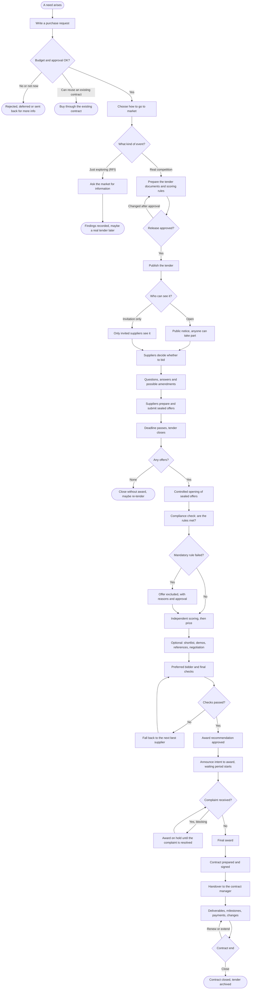

# The tender journey, explained in plain language

This guide walks through a tender from the moment someone needs something until the contract is finished. It explains who does what, which choices come up along the way, and what can go wrong. It also points to the demo data and screens you can open in the prototype, so you can follow each step yourself.

You do not need any procurement background to read it.

---

## 1. The idea in one paragraph

An organization (the **buyer**) needs to buy something, for example new water pumps. Instead of calling one company, it runs a **tender**: a fair, documented competition. It writes down exactly what it wants and how offers will be judged, then publishes that. Companies (the **suppliers**) send sealed offers before a deadline. The buyer opens them under controlled conditions, checks them, scores them against the published rules, and picks a winner. Other suppliers may complain. When the dust settles, the buyer signs a contract and manages it until it ends. At every step the system records who did what and why, so the decision can be defended later.

## 2. Who is involved

| Role | Plain-language description | Demo account (chosen in the sign-in page's persona picker; no password) |
|---|---|---|
| Requester | The employee who needs something | `kagiso.requester@tenderiq.local` |
| Budget owner | Confirms the money exists | `onalenna.budget@tenderiq.local` |
| Procurement officer | Runs the tender day to day (the "tender owner") | `tebogo.officer@tenderiq.local` |
| Procurement manager | Approves strategy and requests within their limit | `mpho.manager@tenderiq.local` |
| Qualification assessor / financial reviewer | Check whether a supplier is fit for a type of work, before or during a tender | `neo.assessor@…`, `lesego.finance@…` |
| Opening officer and witness | Open the sealed offers together, like a notary | `oratile.opener@…`, `goitse.witness@…` |
| Evaluators and chair | Score the offers; the chair runs the committee | `thato.eval@…`, `boitumelo.chair@…` |
| Commercial reviewer | Looks at prices (only after quality is scored) | `refilwe.commercial@…` |
| Award approver | Signs off the final choice (high authority limit) | `keabetswe.approver@…` |
| Contract manager | Runs the contract after signing | `masego.contracts@…` |
| Supplier staff | Bid manager, contributors, internal approver, signatory | e.g. `tsodilo.bidmanager@…` |
| Organization administrator | Manages users and settings, but **cannot** see sealed offers | `admin.kwu@…` |
| Public visitor | Anyone on the internet browsing open tenders | no account needed |

The demo buyer is **Kalahari Water Utilities (Pilot)**. The demo suppliers include Tsodilo Engineering, Chobe Pipe & Valve, Serowe ICT and Gaborone Metering.

## 3. The journey at a glance

A tender does not have to use every box. The optional steps (demos, negotiation, waiting period) happen only when the buyer's policy and the published rules allow them. When a step is skipped, the system records why.

---

## 4. The journey step by step

Each step lists what happens, who does it, the choices, and where to see it in the prototype. Screen IDs such as `BUY-02` match the PRD and the walkthrough in `docs/prototype/walkthrough.md`.

### Step 1 — A need becomes a request

**What happens.** An employee writes a **purchase request**: what is needed, why, when, roughly how much it costs, and which budget pays for it.

**Who.** Requester, then the procurement team and the budget owner.

**Choices.**
- The request is **approved**, **rejected**, **deferred** to later, or **sent back** for more information.
- It can be **combined** with similar requests, or **split** into parts. The total value always stays visible so nobody can dodge an approval limit by splitting.
- If an existing contract already covers the need, it is **routed** there instead of starting a new tender.
- **Approval limits:** each approver can only approve up to their personal limit. A request above that limit is automatically routed to someone more senior.

**Try it.** Sign in as `tebogo.officer`, open *Requests* (`BUY-02`). **PR-2026-0003** is over `mpho.manager`'s limit and is routed to `keabetswe.approver` (scenario AC-05).

### Step 2 — Decide how to go to market

**What happens.** The buyer picks a **strategy**: which type of event and who may take part.

| Event type | In plain words |
|---|---|
| **RFI** (Request for Information) | "Tell us what is out there." No purchase is promised. |
| **RFQ** (Request for Quotation) | "We know exactly what we want; give us a price." |
| **RFP** (Request for Proposal) | "Here is our problem; propose a solution and a price." Quality matters as much as price. |
| **Tender** | A formal, fully rule-bound competition, often for larger or public purchases. |

| Participation | In plain words |
|---|---|
| **Open** | Published publicly; any qualifying supplier may bid. |
| **Invitation only** | Only named suppliers are invited and can see it. |
| **Restricted / multi-stage** | Suppliers are first shortlisted, then the shortlist competes. |
| **Direct award** | One supplier, allowed only with an approved, documented exception. |

**Try it.** *Planning & strategy* (`BUY-05`, `BUY-06`). **T-2026-0004** is an RFI that ends with findings rather than a purchase (AC-39).

### Step 3 — Prepare the tender

**What happens.** The officer writes the tender package:
- **Lots**: separate parts that can be awarded to different suppliers (for example Lot 1 pumps, Lot 2 pipes).
- **Requirements**: questions suppliers must answer. Some are **mandatory** (fail one and you are out); others are **scored**.
- **Price schedule**: what suppliers must price, and how.
- **Evaluation plan**: the scoring rules, published in advance. For example: quality 70 points, price 30 points, with a tie-break rule. Weights must add up to 100.
- **Timetable**: the question deadline, submission deadline and so on, always in one **official time zone**.

**Release approval.** Before publication, reviewers approve the exact package. If anyone changes something important afterwards (scope or value), **the approval is automatically cancelled** and must be given again.

**Try it.** *Tenders* (`BUY-07` to `BUY-13`). **T-2026-0005** shows an approval invalidated by a later edit (AC-06).

### Step 4 — Publish and invite

**What happens.** The tender is published on the scheduled date.
- **Open** tenders appear on the public portal, where anyone can read them without an account.
- **Invitation-only** tenders are invisible to the public. Only invited suppliers see them.

Suppliers may need to accept a confidentiality undertaking or be **qualified** (pre-approved for this type of work) before they can access documents or bid.

**Try it.** Sign out and browse *Opportunities* (`PUB-01` to `PUB-03`). **T-2026-0006** (invitation only) does not appear publicly (AC-01).

### Step 5 — Suppliers decide whether to bid

**What happens.** Each supplier studies the tender and makes a private **bid / no-bid** decision. Its internal notes are never visible to the buyer. A supplier may decline and optionally tell the buyer why.

**Try it.** Sign in as `tsodilo.bidmanager`, open *Opportunities* and *Invitations* (`SUP-06` to `SUP-09`).

### Step 6 — Questions, answers and amendments

**What happens.** Suppliers ask questions. The buyer answers them **to everyone** without revealing who asked, so all bidders have the same information. If an answer changes the rules, the buyer issues a formal **addendum** (an official amendment). Every affected supplier must acknowledge it, and it may extend the deadline. There may also be briefings or site visits.

**Branch.** If an addendum arrives **after** some suppliers have already submitted, they are told whether they must acknowledge it, add something, or resubmit. Their earlier receipts stay valid.

**Try it.** **T-2026-0002** has an addendum issued after two submissions (AC-10). Screens `BUY-16` to `BUY-18` and `SUP-10`, `SUP-11`.

### Step 7 — Suppliers prepare and submit sealed offers

**What happens.** The supplier's team fills in answers, prices and declarations. A **readiness check** separates **blocking problems** (you cannot submit) from **warnings**. The supplier may need its own **internal approval** before submitting. Only someone with **submission authority** can press Submit.

**Important rules the prototype demonstrates:**
- **Saved or internally approved is not submitted.** Only a successful submission produces an official **receipt** (AC-11).
- The official time is the **server's** time of receipt. Late offers are rejected, and the true time is recorded (AC-13).
- A supplier can **replace** its offer before the deadline. If the replacement fails, the earlier offer still counts (AC-12).
- A supplier can **withdraw** its offer, and it then receives a withdrawal confirmation (AC-14).
- A contributor without submission authority cannot submit (AC-03).

**Try it.** As a supplier, open *Responses* (`SUP-12` to `SUP-17`). As the officer, *Submission monitoring* (`BUY-19`) shows **who** submitted but **not what** was offered.

### Step 8 — Closing and sealed opening

**What happens.** At the deadline the tender **closes**. Offers stay **sealed**: nobody can read them, not even the administrator. An authorized **opening officer**, with a **witness**, opens them in a recorded session.

**Staged opening.** Offers often come in separate **envelopes**:
1. qualification;
2. technical (quality);
3. commercial (prices).

**Prices stay closed until quality scoring is finished**, so price cannot influence the quality scores.

**Try it.** **T-2026-0008** is closed and sealed. Sign in as `admin.kwu`: you see a "restricted" page instead of the offers (AC-15). Opening screens are `BUY-20` and `BUY-21`.

### Step 9 — Compliance check

**What happens.** Each offer is checked against the mandatory rules: is it on time, complete and signed, and does it meet every mandatory requirement?

**Branches.**
- A **small omission** may be fixed through a limited **clarification**. It can never be used to improve the offer.
- A **mandatory failure** leads to **exclusion**. That needs reasons, evidence and approval, and the supplier is notified and can challenge it (AC-17).

### Step 10 — Evaluation (scoring)

**What happens.** Evaluators first **declare any conflicts of interest** and sign confidentiality. Then each one **scores independently** against the published criteria, and nobody sees the others' scores first. A missing score stays **"not scored"**; it is never counted as zero (AC-18). The committee then **moderates**: it discusses differences and agrees final scores, and the original individual scores stay on record (AC-20). After that, prices are opened, compared and turned into a price score, and everything is ranked.

**Worked example.** This is the PRD example, reproduced exactly in **T-2026-0003** (AC-19):

| | Quality (70 pts) | Price (30 pts) | Total |
|---|---|---|---|
| Serowe ICT: evaluated cost 100,000 | 56.00 | 30.00 | **86.00** |
| Tsodilo Engineering: evaluated cost 120,000 | 63.00 | 25.00 | **88.00** ← wins |

The cheaper offer loses because the published rules value quality more.

**Try it.** Sign in as `thato.eval` or `boitumelo.chair`, open *Evaluation* (`EVA-01` to `EVA-06`).

### Step 11 — Optional extra steps: shortlist, demos, negotiation

These happen only if the published rules allow them.
- **Shortlist**: the best candidates move to a further stage, and the others are told why (AC-22).
- **Demonstrations, interviews and reference checks**: with equal treatment for all candidates (AC-21).
- **Negotiation / best and final offer (BAFO)**: allowed only when the procedure permits it. Otherwise the system **blocks** it (AC-23).

**Try it.** **T-2026-0009** (`BUY-22` to `BUY-27`).

### Step 12 — Preferred bidder and final checks

**What happens.** The top supplier becomes the **preferred bidder**. This is **not yet a win**, and the system never calls it an award. The buyer then runs **due diligence**: financial health, insurance, licences, references.

**Branch.** If the preferred bidder **fails** these checks, or walks away, the award is blocked and the buyer falls back to the next-ranked supplier with a recorded, approved decision (AC-24; see T-2026-0009).

### Step 13 — Award decision, waiting period and complaints

**What happens.**
1. An **award recommendation** is approved by someone with enough authority.
2. The buyer sends an **intent to award** notice to all bidders. Losers get their result and can ask for a **debriefing**, an explanation of their own score only (AC-27).
3. A **waiting (standstill) period** begins, during which unsuccessful suppliers may **complain**.

**Branch.** A valid complaint places the award **on hold** until it is resolved. If upheld, the decision may be corrected or re-run (AC-25; see **T-2026-0007**). After the waiting period, with no blocking complaint, the buyer issues the **final award** and may publish a public award notice.

**Per lot.** Different lots can end differently. In **T-2026-0001**, Lot 1 is awarded, Lot 2 is cancelled and Lot 3 is still being evaluated, so the tender shows as **partially awarded** (AC-26).

**Try it.** *Awards* (`BUY-26`, `BUY-28` to `BUY-30`). The supplier side is `SUP-21` and `SUP-22`. The public view is `PUB-05`.

### Step 14 — Contract and handover

**What happens.** A contract is prepared from the award. If it **differs from what was awarded**, that difference needs extra approval before signing (AC-28). **Signed**, **effective** and **work may start** are separate steps. The procurement team then **hands over** to the named contract manager, who must accept it. The tender cannot be closed until that handover is accepted (AC-29).

**Try it.** **T-2026-0010** and contracts `C-2026-0001`, `C-2026-0002` (`CON-01` to `CON-04`).

### Step 15 — Managing the contract until the end

**What happens.** The contract manager tracks obligations, milestones, performance reviews, invoices and payments.
- **Milestone evidence can be rejected** with reasons and a fix-by date. A rejection does not mean payment is due (AC-30).
- **Contract changes** add up. Several small changes that together exceed someone's authority need higher approval (AC-31).
- **Renewals are never automatic.** When a renewal window opens, people are alerted and must decide (AC-32).
- At the end: final acceptance, financial reconciliation, release of guarantees, and **closeout**. Warranties that outlive the contract stay tracked.

**Try it.** Sign in as `masego.contracts`, open **C-2026-0001** (`CON-05` to `CON-11`). The supplier's side is `SUP-23`.

---

## 5. Exceptions and alternative endings (summary)

| Situation | What the system does |
|---|---|
| Request exceeds the approver's limit | Routes it to a more senior approver (AC-05) |
| Tender changed after release approval | Cancels the approval; it must be approved again (AC-06) |
| Supplier registered but not qualified | Shows "registered, not qualified" and applies the participation gate (AC-07) |
| Supplier's insurance expires mid-tender | Alerts people and requires an explicit decision; old evidence is kept (AC-09) |
| Amendment after some offers are in | Tells suppliers what action is needed; old receipts stay (AC-10) |
| Late offer | Rejected, with the true time recorded (AC-13) |
| Failed replacement offer | The earlier offer still counts (AC-12) |
| Supplier withdraws | Offer excluded from scoring; history kept (AC-14) |
| No offers at all | Close without award; maybe redesign and re-tender |
| Only one offer | Evaluated normally; it is not automatically the winner |
| No compliant offers | No award; the rules are never bent to create a winner |
| All offers over budget | Extra budget approval, reduced scope, negotiation if allowed, or no award |
| Evaluator has a conflict of interest | Reassigned; prior work kept; access removed |
| Preferred bidder fails checks | Award blocked; fallback to the next supplier with approval (AC-24) |
| Complaint during waiting period | Award on hold until resolved (AC-25) |
| Some lots awarded, some not | Each lot keeps its own outcome; the overall status stays accurate (AC-26) |
| Tender cancelled | Offers and records kept; everyone notified with reasons |
| RFI only | Ends with findings and a possible next-step tender, not a contract (AC-39) |

## 6. How to use this guide while reviewing the prototype

1. Start the prototype (`docs/prototype/README.md`: `npm run dev:prototype`, then open http://localhost:5173; no Docker or Supabase is needed, DD-50).
2. Follow the steps above in order, switching demo accounts by signing out and choosing another persona on the sign-in page.
3. For each step, ask:
   - Is it clear **who I am acting as** and **what happens next**?
   - Are the choices and exceptions described here visible on the screen?
4. Remember that the prototype uses **static demo data**. Actions show a realistic result but are not saved, so a list will not change after you click "Approve".
5. The screenshots and per-screen notes in `docs/prototype/walkthrough.md` let you review each step without running anything.
