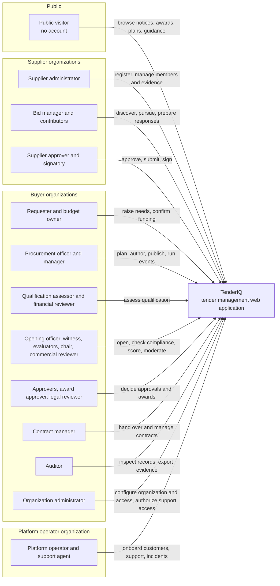
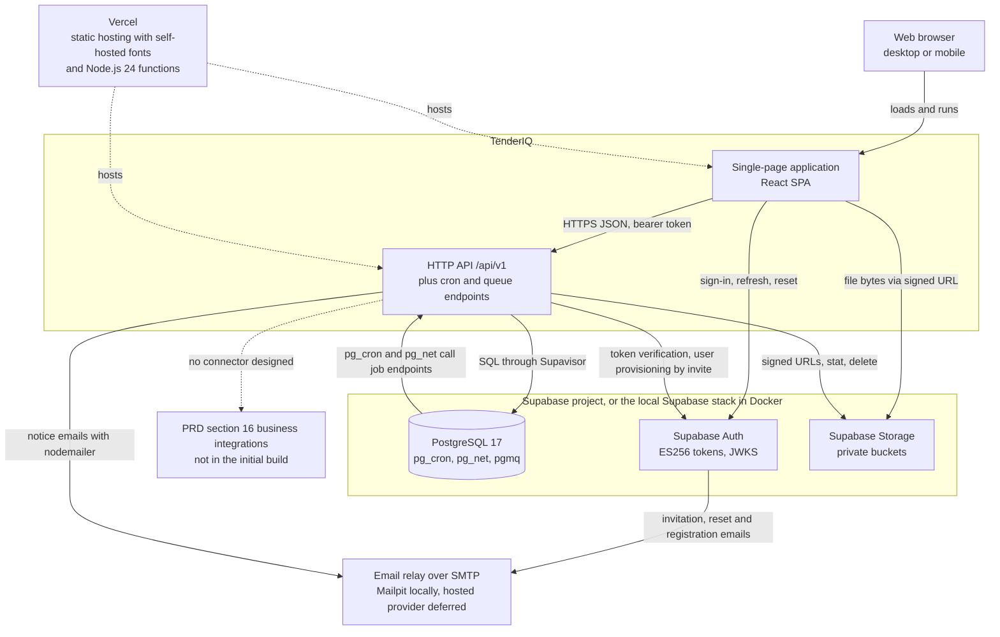

# System Context

Status: As-designed (pre-build). Updated to as-built at the end of Stage A and Stage B.

Sources:
- `docs/PRD.md`: §1.1 product purpose, §2 scope and operating model, §4.1 user roles, §4.3 audience matrix, §11–§13 screen catalog, §16 potential business integrations, §19 service expectations, §21 packaging and operations, §22 delivery priorities, §23 acceptance scenarios.
- `docs/plan/architecture-plan.md` (revision 3): §0 delivery stages, §1 product identity, §2 release scope, §3.1 tenancy, §3.4 official time, §3.8 notifications, §3.9 background jobs, §3.11 prototype mode, §4 URL map, §9 build commands, §11 deviations and assumptions (owner review of 2026-09-29).
- `docs/plan/schema-blueprint.md`: §0 conventions (tags `[S]` and `[R]`), Migration 01 (`tenants`, `users`, storage buckets), Migration 13 (`integration_connections`, operator tables, `rate_limit_buckets`, `request_idempotency`), §P permission catalog and role templates.
- `docs/plan/design-decisions.md`: DD-03 supplier-scope tags, DD-04 `customer_tenant_id`, DD-11 audit partition of support access, DD-14 approval subject types, DD-15 deadline authority, DD-16 owner of `price_gate_releases`, DD-18 grant expiry, DD-21 `/me` personal inbox, DD-22 buyer slug in public URLs, DD-23 permission additions, DD-24 approver permissions, DD-25 conflict gating, DD-27 invitation acceptance, DD-28 public write endpoints, DD-29 sign-in assurance, DD-30 SPA document headers, DD-31 audit content for sealed records, DD-33 zone display, DD-35 fonts, DD-37 language, DD-39 idempotency, DD-40 deferred procedure value, DD-41 pursuit vs bid intent, DD-43 real authentication from Stage A (DD-38 withdrawn), DD-44 email channel, DD-45 Node 24, §E owner decisions (status after the owner review of 2026-09-29).
- `docs/plan/email-delivery-options.md`: local email through Mailpit, hosted provider options (deferred).
- `docs/plan/tenderiq-prototype.workflow.js` and `docs/plan/tenderiq-backend.workflow.js`: Stage A and Stage B build steps (local Supabase stack, demo accounts, SMTP settings).
- `docs/plan/demo-storyline.md`: organizations and personas.
- `docs/architecture-brief.md`: §1 platform summary, §5.7 authentication, §5.9 storage, §7.3 local services, §13 environments, §14 dependency approval.

Contents:
1. [Product purpose](#1-product-purpose)
2. [Actors](#2-actors)
3. [External systems](#3-external-systems)
4. [Context diagrams](#4-context-diagrams)
5. [Constraints that shape the system](#5-constraints-that-shape-the-system)
6. [Scope summary](#6-scope-summary)
7. [Related documents](#7-related-documents)

---

## 1. Product purpose

TenderIQ ("Tender Intelligence", in the same product family as QuoteIQ) is a multi-tenant web application for public and private procurement. It gives a **buying organization** one accountable workspace to take a purchasing need through approval, competition, evaluation, award and contract management. It gives **supplier organizations** one place to discover opportunities, prove qualification, prepare and submit responses on time, and follow outcomes (PRD §1.1).

The product serves both sides of a tender and keeps three information spaces apart: the buyer's internal deliberations, each supplier's confidential work, and material deliberately released to the public (PRD §1.1, §4.3).

The demo locale is Botswana: currency BWP, official time zone `Africa/Gaborone` (architecture-plan §1). The proposed commercial model is a paid service for buyers, with free supplier access to public notices and eligible competitions. PRD §21.1 labels this a recommendation, not a confirmed pricing decision.

## 2. Actors

Every actor except the public visitor is a person (`users`, global) who acts through a **membership** in one organization (`tenants`, kind `buyer`, `supplier` or `operator`) at a time. The person chooses the active organization and capacity in the SPA's organization switcher (COM-02). See [adr/0001-tenancy-equals-organization.md](adr/0001-tenancy-equals-organization.md).

### 2.1 Actor groups, API audiences and screen families

| Actor group | Organization kind | API audience (prefix under `/api/v1`) | SPA area | Screen families (PRD §11–§13) |
|---|---|---|---|---|
| Public visitor | none (anonymous) | `/public/*`, `/health` | `/`, `/opportunities`, `/opportunities/:buyerSlug/:ref`, `/awards`, `/awards/:buyerSlug/:ref`, `/plans`, `/guidance/*`, `/b/:buyerSlug`, `/clarifications/:buyerSlug/:ref` | PUB-01…07, COM-09 (help) |
| Supplier users | `supplier` | `/supplier/*` and `/me/*` | `/supplier/*`, `/me/*` | SUP-01…24, COM-01…09 |
| Buyer users | `buyer` | `/buyer/*` and `/me/*` | `/buyer/*`, `/me/*` | BUY-01…35, EVA-01…06, CON-01…11, ADM-01…17, REP-01…02, COM-01…09 |
| Platform operators | `operator` | `/ops/*` and `/me/*` | `/ops/*`, `/me/*` | OPS-01…07, COM-09 |
| Any signed-in person | any | `/me/*` (tenant-exempt): person-level endpoints such as `/me/context` and `/me/theme`, and the personal inbox (`/me/tasks`, `/me/notifications`, `/me/approvals/:id`, `/me/documents/:id`, `/me/search`) | `/me/*` (profile, tasks, notifications, `approvals/:id`, `documents/:id`, search, help), `/select-organization` | COM-01…09 |

- **Personal inbox (DD-21).** The `/me` inbox endpoints return the caller's **own** rows across all active memberships, each labelled with its organization. Acting on a row requires `X-Tenant-Id` equal to that row's tenant. Global search still filters every result by the caller's authorization in the row's tenant.
- **Invited people (DD-27).** `POST /api/v1/me/invitations/:token/accept` is the one route open to a user whose status is still `invited`. Accepting activates the membership, and the user if needed.
- **References in URLs (DD-22).** References such as `T-2026-0003` are unique per buyer, so public and supplier-facing URLs carry the buyer slug (`/opportunities/:buyerSlug/:ref`, `/awards/:buyerSlug/:ref`, `/clarifications/:buyerSlug/:ref`). Supplier API paths use tender ids.
- **Public writes (DD-28).** Public POSTs (registration, register interest, access requests) are rate-limited per IP hash and per email hash inside the application.

Route prefixes and the tenant-kind check are described in [02-architecture.md §5](02-architecture.md#5-tenancy-and-audience-prefix-routing). Permission enforcement is described in [04-security-model.md](04-security-model.md).

### 2.2 Supplier actors

Supplier actors belong to a `supplier` tenant. A supplier is an organization, not a login (PRD §2.1). One supplier may respond to many buyers.

| Actor (PRD §4.1) | Role template (blueprint §P) | Responsibilities | Principal restrictions | Demo personas |
|---|---|---|---|---|
| Supplier organization administrator | `supplier_admin` | Maintains the organization profile, invites members, assigns responsibilities, manages evidence sharing (SUP-02…05) | Cannot grant buyer privileges or see other suppliers' information | `tsodilo.admin`, `chobe-pipe.admin`, … |
| Supplier bid manager | `bid_manager` | Decides participation, runs the pursuit, assigns work, requests internal approval (SUP-06…11, SUP-15) | Submission authority must be assigned explicitly | `tsodilo.bidmanager`, `serowe-ict.bidmanager`, … |
| Supplier contributor | `contributor`, `commercial_contributor` | Prepares assigned answers, evidence or pricing (SUP-12…14) | Access may be limited by tender, section or commercial sensitivity; a contributor cannot submit (AC-03) | `tsodilo.contributor`, `sam.dual` |
| Supplier approver or authorized signatory | `supplier_approver`, `authorized_signatory` | Approves a response, submits where authorized, accepts commitments, signs agreements (SUP-15…17, SUP-23) | Authority limited by entity, value, tender or dates | `tsodilo.signatory`, … |
| Supplier finance user | `supplier_finance` | Handles the supplier's own financial evidence (PRD §4.3 "own authorized financial users") | Exact permission set finalized in Stage B (`seed.sql`) | none named in the storyline |

- **Pursuit versus bid intent (DD-41).** A pursuit decision (SUP-06…09) is supplier-private. The buyer-visible `participants.bid_intent` and `shared_no_bid_reason` change **only** through the explicit "notify buyer" action on SUP-07 or SUP-09.
- **Supplier permission additions (DD-23).** The supplier catalog adds `supplier.notices.acknowledge` and `supplier.dashboard.view` (SUP-01). Which templates hold them is part of the `seed.sql` matrix written in Stage B.
- **What suppliers can reach (DD-03).** Supplier users reach only buyer-owned tables tagged `[S]` (supplier-accessible). Tables tagged `[R]` carry `supplier_tenant_id` for reference only and stay buyer-internal. Suppliers learn outcomes through notices and the supplier-facing projections defined in the contracts.

### 2.3 Buyer actors

Buyer actors belong to a `buyer` tenant. Access to restricted event material is **assignment-based** (`tender_team_members`, `evaluation_assignments`, BR-26): a role alone does not open sealed or restricted content.

| Actor (PRD §4.1) | Role template | Responsibilities | Principal restrictions | Demo persona (KWU) |
|---|---|---|---|---|
| Internal requester | `requester` | Describes a need and answers procurement questions (BUY-02, BUY-03) | Cannot publish or award | `kagiso.requester` |
| Procurement officer or tender owner | `procurement_officer` | Runs events, manages suppliers and communications, coordinates evaluation and recommendation (BUY-07…30) | Cannot bypass sealing or required independent approvals | `tebogo.officer` |
| Procurement manager | `procurement_manager` | Approves strategy and exceptions, supervises workload (BUY-01, BUY-04, BUY-06, COM-05) | Bound by authority limits, delegations and conflicts | `mpho.manager` (limit BWP 2,000,000) |
| Budget owner or finance reviewer | `budget_owner`, `financial_reviewer` | Confirms funding (BUY-04); assesses financial evidence as assigned (BUY-34) | Financial-review access does not open other procurement material | `onalenna.budget`, `lesego.finance` |
| Qualification assessor | `qualification_assessor` | Reviews supplier evidence against qualification programs (BUY-33…35) | Sees only assigned evidence; cannot alter supplier declarations | `neo.assessor` |
| Bid-opening officer or witness | `opening_officer`. There is no witness template: witnesses are recorded as `tender_team_members.team_role = 'witness'` and `opening_participants.role = 'witness'`, and the catalog has a `bid.witness` permission. | Authorizes and records envelope opening (BUY-20) | Opening rights are separate from authoring, evaluation and award | `oratile.opener`, `goitse.witness` |
| Evaluation committee chair | `evaluation_chair` | Assigns evaluators, manages conflicts, leads moderation and sign-off (EVA-01, EVA-03, EVA-05, EVA-06). Releases the price gate for a staged commercial envelope (`price_gate_releases`, permission `evaluation.chair`, DD-16, DD-23). | Cannot overwrite submitted scores outside the correction process | `boitumelo.chair` |
| Evaluator or subject-matter expert | `evaluator`; commercial comparison by `commercial_reviewer` | Scores assigned criteria with reasons, declares conflicts (EVA-01, EVA-02); commercial comparison (EVA-04) | No unrelated bids, early prices or other assessors' scores before the permitted stage | `thato.eval`, `kabo.eval`, `amantle.eval`, `refilwe.commercial` |
| Legal or compliance reviewer | `legal_reviewer` | Reviews terms, procedure, exceptions and challenges | Access by assignment and business need | `dineo.legal` |
| Approvers, including award approver | Users assigned to an approval step (`approval_steps.approver_user_id` or a committee) who hold `approval.decide`; `award_approver` | Decide approval requests against an exact version, amount and scope (COM-04, COM-05, BUY-26). Final award is its own approval per lot outcome (subject type `final_award`, DD-14). | Deciding a step needs `approval.decide`, the decision-specific permission (for example `award.approve`) and sufficient authority (DD-24). Cannot exceed `authority_limits` or active `delegations` (BR-06). Cross-currency authority uses `exchange_rates` at the request date; with no rate the step routes to the next level up. Self-approval blocked by `sod_policies` (BR-07). | `keabetswe.approver` (limit BWP 10,000,000), `mpho.manager` |
| Contract manager | `contract_manager` | Accepts handover; manages obligations, changes, performance, renewal and closeout (CON-01…11) | Cannot rewrite the competition or award history | `masego.contracts` |
| Auditor or oversight reviewer | `auditor` | Inspects permitted records and requests controlled evidence exports (ADM-14, REP-01) | Read-only; no sealed access before authorized opening | `pule.auditor` |
| Buyer organization administrator | `org_admin` | Manages organization settings, structure, users, roles, authority, policy and configuration: the ADM screens covered by `org.*` permissions (for example ADM-01…08, ADM-10…12, ADM-15…17). Authorizes an operator support access grant (`org.support_access.authorize`, DD-23). | `org.*` permissions only: no tender content, bids or evaluation (PRD §17.2, BR-26, AC-15) | `admin.kwu` |

The buyer catalog also gains `dashboard.view` for the buyer dashboard BUY-01 (DD-23). The second buyer, Okavango District Council (`admin.odc`, `officer.odc`), exists to prove cross-buyer segregation (BR-45).

### 2.4 Platform operator actors

| Actor | Role template | Responsibilities | Principal restrictions | Demo persona |
|---|---|---|---|---|
| Platform operator | `platform_operator` | Customer register, onboarding and offboarding, plans and entitlements, service incidents, oversight, announcements and help content (OPS-01…07) | No routine access to confidential procurement content or sealed bids | `ops.admin` |
| Support agent | `support_agent` | Support cases and temporary customer-authorized access (OPS-04, COM-09) | Same as above. Cannot become an informal bid-submission channel (COM-09) | `support.agent` |

The split of operator permissions between the two templates is written in `seed.sql` in Stage B (blueprint §P).

**Entering a customer tenant (OPS-04).** An operator may act inside a customer tenant only while an active, customer-authorized `support_access_grants` row exists. A customer administrator holding `org.support_access.authorize` authorizes the grant (DD-23). That access is read-only (`support.view`). It never includes sealed content, drafts or scores, and never allows submit, score, approve or sign. It is audited before the handler runs (architecture-plan §3.1), and the audit entries are written to the **customer** tenant so the customer can review them (DD-11). The request-time check compares `starts_at`, `expires_at` and `revoked_at` directly. The `expire-support-access` job (operations) only updates display statuses and sends notices (DD-18). See [adr/0013-operator-support-access-grants.md](adr/0013-operator-support-access-grants.md).

Operator records that name a customer are global `[G]` rows that point at it through `customer_tenant_id` (for example `subscriptions`, `offboarding_plans`, `support_access_grants` and `service_incident_impacts`), so the tenant-scoped query generator never picks them up (DD-04).

### 2.5 People, memberships and capacity

- **One person, many organizations.** `sam.dual` is an evaluator at KWU and a contributor at Tsodilo and at Chobe Pipe. The conflict is routed for review on T-2026-0003 (AC-02). Switching organization clears all tenant-scoped SPA state and never carries permissions across (BR-02).
- **Conflicts gate access (DD-25).** A declaration with `has_conflict = true` blocks restricted access while its disposition is `pending_review`. Access resumes only on `cleared` or `mitigated`. `recused` and `reassigned` block permanently for that subject.
- **Departed people.** `former.officer` is deactivated. Their historic approvals and submissions remain attributed to them (AC-04, BR-38).
- **Consequential actions** (submit, approve, publish, sign) show the acting organization, capacity, scope and result before confirmation (COM-02, architecture-plan §7).
- **Demo personas are real accounts (DD-43).** `npm run auth:personas` creates every demo persona in local Supabase Auth, with the password `test1234`. The script is idempotent and refuses to run against anything that is not local. In local development builds only (`import.meta.env.DEV`), the sign-in page lists the demo accounts for one-click sign-in. Production builds exclude that list, and `scan-bundle` checks this.

## 3. External systems

| System | Role for TenderIQ | Interface | Stage |
|---|---|---|---|
| Web browser (desktop or mobile) | Runs the SPA, the only client. PRD §19 requires practical use on common workplace and mobile devices. | HTTPS to Vercel. supabase-js is used in the browser for authentication only. Files move by signed URL. A CSP `<meta http-equiv>` in `index.html` allows self plus the Supabase URL for auth (DD-30). Fonts are self-hosted, so there is no Google Fonts request (DD-35). | A and B |
| Vercel | Hosts the static SPA (`src/ui/dist`, including the self-hosted Inter and JetBrains Mono font files) and the Node.js serverless functions (`api/v1/index.ts`, `api/cron/<job>.ts`, `api/queue/drain.ts`) on the Node.js 24.x runtime, selected through `engines` `24.x` (DD-45). Deploys through its Git integration. Runtime logs ingest the JSON log lines. | `vercel.json` rewrites and function settings. `vercel.json` has no header rules: the Hono app sets the API headers (DD-30). | Stage A creates `vercel.json` and the build command. The mock API is never deployed. Functions exist from Stage B. No Vercel account exists yet (architecture-plan §11.5). |
| Supabase PostgreSQL 17 | System of record. Hosts `pg_cron` (schedules), `pg_net` (outbound HTTP to job functions) and `pgmq` (queues `notifications`, `exports`). | Kysely over `pg` through the Supavisor transaction pooler (port 6543). Scripts use the session pooler (port 5432). | B. Postgres already runs in the local Supabase Docker stack during Stage A, but no application schema exists until Stage B (DD-43). |
| Supabase Auth (GoTrue) | Email and password sign-in, password reset, session refresh. Issues ES256 access tokens. Self-signup is disabled. The server provisions users through the Auth Admin API. Supplier registration creates the tenant (`pending`), the user (`invited`), a pending membership and the supplier profile in one transaction and commits, then calls the Auth Admin invite after the commit (brief §5.6 keeps network calls out of transactions). If the invite fails, a short follow-up transaction sets the registrant’s `invitations` row to `send_failed`, and the registrant can retry (DD-27). Resolved — owner decision 2026-09-29: this proposed, brief-compliant registration approach is kept (design-decisions §E.7). MFA and step-up sign-in are not in the initial release (DD-29). | Browser: supabase-js. Server: JWKS verification, Auth Admin API with the service-role key. | A and B. Real sign-in runs against Supabase Auth in the local Docker stack from Stage A (DD-43). `npm run auth:personas` creates the demo accounts there through the Admin API (local only, idempotent). The Stage A mock API verifies the real JWT with `src/server/lib/auth/verify.ts`. |
| Supabase Storage | Private buckets `tender-documents`, `bid-submissions`, `supplier-evidence`, `contract-documents`, `exports`, created by migration | Server creates signed upload and download URLs; the browser transfers the bytes directly | B |
| Email relay (SMTP) | Delivers Supabase Auth emails (invitation, password reset, registration verification) and TenderIQ notice emails from the `email` delivery channel (DD-44) | SMTP. Locally, **Mailpit** in the Supabase Docker stack catches every message (SMTP port 54325, web UI `http://127.0.0.1:54324`). TenderIQ sends with `nodemailer`, and a message is recorded `delivered` when Mailpit accepts it. The hosted provider and its delivery-event webhooks are **deferred** (`docs/plan/email-delivery-options.md`); the same SMTP credentials will serve Supabase Auth in hosted environments. | Auth password-reset emails in Mailpit from Stage A. Auth invitation and registration emails, and notice emails, from Stage B (DD-43). The hosted provider is needed before the first hosted environment (design-decisions §E.4). |
| PRD §16 business integrations | Directory and sign-in, finance and budget, purchasing and accounts payable, vendor master, public notice portals, registries, credit, sanctions screening, insurance and bond verification, e-signature, records management, email and messaging, calendars, contract delivery, currency reference data, BI, service management | **No connector is part of the initial build.** ADM-15 records connections, exceptions and manual fallback in `integration_connections` and `integration_exceptions`. External publication is tracked on `publications` (channel `external_notice`). | Not in the initial build |

Build and delivery tooling (GitHub Actions, Doppler, the Supabase CLI) is described in [10-deployment-environments.md](10-deployment-environments.md). Architecture-plan §11.5 limits Doppler, GitHub environments and the Vercel project to files and runbooks. No external accounts are created during the build. The Supabase CLI runs the local stack (Postgres, Auth, Storage, Studio, Mailpit) in Docker from Stage A, so Docker must be running to use the prototype (DD-43). Node 24 is the runtime everywhere: `engines` `24.x`, `.nvmrc` `24`, CI Node 24 and Vercel Node.js 24.x (DD-45). This deviates from the brief's Node 22 pin because Node 22 reaches end-of-life on 2027-04-30.

Formal notices and notifications go through a `DeliveryChannel` port with two implementations, `in_app` and `email` (DD-44):
- Formal notices go to both channels. Non-mandatory events follow user preferences.
- Delivery, opened, acknowledged and accepted-terms events are tracked separately (BR-41). An undeliverable recipient organization creates a delivery-exception task and never alters a deadline (BR-42).
- A notice email carries only the title, the official deadline and a link into the application. It never carries bid, evaluation or other confidential content (BR-43, ADM-12).
- The `email` channel is active only where `EMAIL_ENABLED` and the `SMTP_*` settings are configured. Where email is not enabled, notices are in-app only and no email delivery rows are written.

See [adr/0007-in-app-formal-notices.md](adr/0007-in-app-formal-notices.md), which records this decision.

No other external service is added. Public-write throttling runs inside the application against the `rate_limit_buckets` table (DD-28), and fonts are served from the application's own origin (DD-35). `nodemailer` is a library, not a service; it is the one approved added runtime dependency (DD-44).

## 4. Context diagrams

### 4.1 Business context

### 4.2 Technical context

The API sends notice emails from the `notifications` queue handler, and only where email is enabled (DD-44). Locally, both mail paths end in Mailpit. In Stage A, the mock API stands in for the TenderIQ API: it serves static fixtures and uses no database schema, Storage, jobs or notice email, but it verifies the same Supabase tokens. Supabase Auth and its path to Mailpit are already real in Stage A (DD-43).

Container-level detail, including the three Vercel function types and the job trigger path, is in [02-architecture.md §2](02-architecture.md#2-container-view).

## 5. Constraints that shape the system

| Constraint | Source | Architectural consequence | Detail |
|---|---|---|---|
| Sealed bids stay sealed until an authorized opening | BR-17, FR-13, AC-15 | One `sealing` module is the only reader of bid content tables. Buyers see receipt metadata only before opening. Audit entries for sealed records hold ids and hashes only, never sealed content or evaluator scores (DD-31). | [04-security-model.md](04-security-model.md), [adr/0003-application-layer-sealing.md](adr/0003-application-layer-sealing.md) |
| Users act in one identified organization and capacity | BR-02, COM-02 | Tenancy equals organization. `X-Tenant-Id` is validated against membership on every tenant-scoped request. The `/me` inbox lists the caller's own rows across memberships, and acting on a row requires that row's tenant (DD-21). | [02-architecture.md §5](02-architecture.md#5-tenancy-and-audience-prefix-routing) |
| Buyer-specific supplier assessments are not shared across buyers | BR-45 | Procurement records belong to the buyer tenant. Supplier-private work belongs to the supplier tenant. Suppliers reach only `[S]` tables; `[R]` tables carry `supplier_tenant_id` for reference only and stay buyer-internal (DD-03). | [adr/0002-buyer-owned-procurement-records.md](adr/0002-buyer-owned-procurement-records.md), [03-data-model/README.md](03-data-model/README.md) |
| Official deadlines and receipt times are authoritative | BR-11, BR-12, BR-20, AC-13 | Deadlines are stored as `timestamptz` with an IANA zone per tender. A lot's `submission_deadline`, when set, is authoritative for that lot (DD-15). Receipt time comes from `clock_timestamp()` in the submission transaction. | [adr/0011-official-receipt-time-from-database.md](adr/0011-official-receipt-time-from-database.md) |
| Decisions keep their evidence | BR-09, BR-10, §18.2 | Version-bound approvals, `record_snapshots`, append-only history and `audit_log` | [03-data-model/01-platform-identity-access.md](03-data-model/01-platform-identity-access.md), [03-data-model/03-shared-services.md](03-data-model/03-shared-services.md) |
| Money and scores are exact | PRD §3, §9 | `numeric` columns carried as decimal strings end to end | [adr/0005-decimal-strings-for-money-and-scores.md](adr/0005-decimal-strings-for-money-and-scores.md) |
| Notice emails never carry confidential content | BR-43, PRD ADM-12, DD-44 | The `email` delivery channel sends only the title, the official deadline and a link. The authoritative content stays in the product, and delivery events stay separate from acknowledgment (BR-41). | [adr/0007-in-app-formal-notices.md](adr/0007-in-app-formal-notices.md) |
| No renewal, award or security release happens only because a date arrived | BR-37, BR-32, AC-32 | Scheduled sweeps are state-guarded and create tasks and alerts only. `renewal-windows` never auto-renews. `standstill-monitor` never auto-awards. | [08-background-jobs.md](08-background-jobs.md) |
| Time-limited access ends on time | PRD §4.2 (exceptional grants with an expiry) | Request-time checks compare `starts_at`, `expires_at` and `revoked_at` directly. The expiry jobs `expire-access`, `expire-approvals` and `expire-support-access` only update display statuses and send notices (DD-18). | [04-security-model.md](04-security-model.md), [08-background-jobs.md](08-background-jobs.md) |
| Public write endpoints resist abuse without an external service | DD-28 | An application middleware limits public POSTs per IP hash and per email hash, counting in `rate_limit_buckets` | [02-architecture.md §3.1](02-architecture.md#31-middleware-chain) |
| Retried commands do not create duplicate records | DD-39 | Record-creating commands accept an optional `Idempotency-Key` header, kept 24 hours in `request_idempotency`. The SPA disables submit buttons while a request is in flight. A retried submission still records a new `submission_attempts` row. | [07-api.md](07-api.md) |
| Accessibility and time-zone clarity | PRD §19 | Keyboard operation, focus tokens, `aria-live`, axe checks in E2E. Deadlines always show the IANA zone and the numeric offset, for example `14 Oct 2026, 12:00 (UTC+02:00) Africa/Gaborone` (DD-33). | [09-frontend.md](09-frontend.md) |
| English now, more languages later | PRD §19, §25.2 | English only in this release. Every UI string goes through `t()` with per-feature catalogs, so languages can be added without refactoring (DD-37). | [09-frontend.md](09-frontend.md) |

## 6. Scope summary

### 6.1 In scope (Stage A and Stage B)

Architecture-plan §2 fixes the release as PRD §22 "Core end-to-end release" plus the public portal, supplier journeys, reporting, records and platform operations:

| Item | In scope |
|---|---|
| Functional requirements | FR-01 … FR-19, FR-21, FR-22 |
| Business rules | BR-01 … BR-48 |
| Screens | COM-01…09, PUB-01…07, SUP-01…24, BUY-01…35, EVA-01…06, CON-01…11, ADM-01…17, OPS-01…07, REP-01…02 |
| Acceptance scenarios | AC-01 … AC-36 and AC-39 |

**Stage A** (UI prototype) demonstrates every in-scope screen against typed contracts and a static mock API, with real sign-in through Supabase Auth in the local Docker stack (DD-43). Resolved — owner decision 2026-09-29: the prototype runs locally only, its actions show realistic results but do not persist, and the walkthrough screenshots are committed (design-decisions §E.2, §E.8). **Stage B** (full backend) makes every in-scope acceptance scenario true. Stage B starts only after explicit written approval of Stage A. See [13-delivery-and-resilience.md](13-delivery-and-resilience.md) and [adr/0006-contracts-first-ui-prototype-stage.md](adr/0006-contracts-first-ui-prototype-stage.md). Traceability from requirements to components and tests is in [12-traceability.md](12-traceability.md).

The "no placeholder" rule applies (architecture-plan §2). Every screen, endpoint, job and component that exists is complete for its stage. Every UI action calls a contract endpoint. Static fixtures under `src/mock-api/fixtures/**` are the intended Stage A design, not placeholders.

### 6.2 Deferred optional extensions

These are labelled "Extension" in the PRD and are placed after the core release (architecture-plan §2). They never appear in the UI, not even as dead links.

| Deferred item | PRD reference |
|---|---|
| Frameworks, panels, call-offs and mini-competitions | FR-20, CON-12 |
| Joint procurement workspace | EXT-01 |
| Electronic reverse auctions | EXT-02 |
| Assisted drafting, summarization and evidence comparison | EXT-03 |
| Construction-specific schedules, bonds, progress claims, defects and retention | PRD §2.3 |
| Acceptance scenarios for the above | AC-37, AC-38 (out of scope) |

The procedure value `framework_calloff` stays in the database CHECK lists for the future, but no contract enum used for writes offers it and it never appears in the UI (DD-40).

Two further capabilities are **not in this release** (architecture-plan §11 item 10):

| Not in this release | Reference | What exists instead |
|---|---|---|
| MFA and step-up sign-in | PRD FR-03 ("may be required as business policy") | The brief's Auth configuration disables MFA. It is recorded as a later extension using Supabase MFA (DD-29). |
| Languages other than English | PRD §19, §25.2 | UI strings are catalogued per feature behind `t()`, so languages can be added without refactoring (DD-37) |

The sources contain no design for the other PRD §2.3 and §22 items that architecture-plan §2 does not name, such as specialized dialogue procedures, supplier development plans, advanced portfolio forecasting and anonymized benchmarking. The same applies to the optional supplier services and participation fees in PRD §21.1.

### 6.3 Outside the product boundary

PRD §2.4 lists the following. TenderIQ records business outcomes and statuses. It does not replace accounting, payment execution, inventory, payroll, project delivery, document editing, credit rating or legal case management. For example, `contract_invoices` records invoice references and payment status (`source` = `local_entry` or `finance_system`), but the product runs no ledger and makes no payments.

## 7. Related documents

- [02-architecture.md](02-architecture.md): containers, components, request pipeline, tenancy routing, frontend, prototype vs live mode, repository layout
- [03-data-model/README.md](03-data-model/README.md): data model overview and ERDs
- [04-security-model.md](04-security-model.md): authentication, authorization, sealing, audit
- [06-key-flows.md](06-key-flows.md): end-to-end flows
- [glossary.md](glossary.md): terms used across these documents
- [README.md](README.md): documentation index
- [../plan/design-decisions.md](../plan/design-decisions.md): design decision log DD-01 … DD-45 (DD-38 withdrawn), which amends the plan and the blueprint
- [../plan/email-delivery-options.md](../plan/email-delivery-options.md): local email through Mailpit and the deferred hosted provider options
