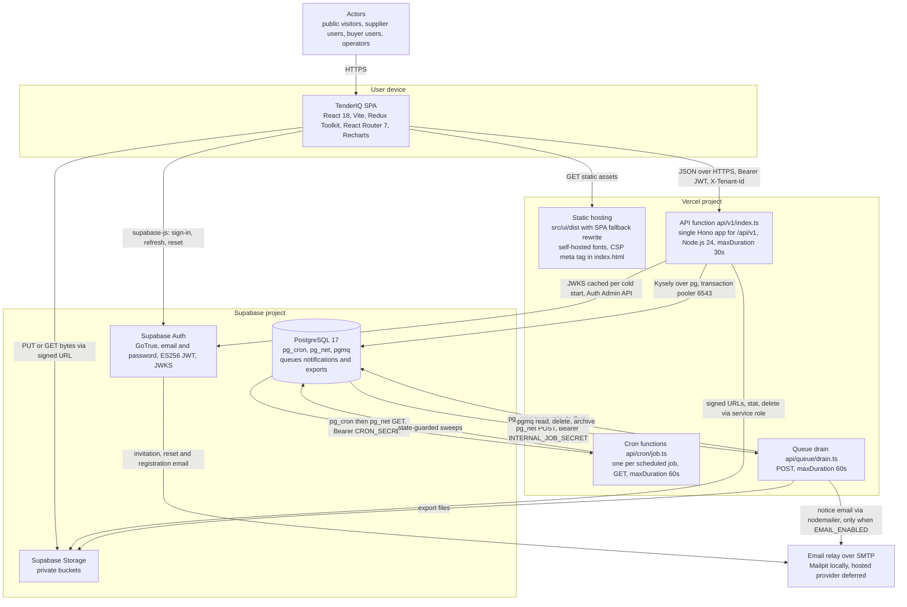
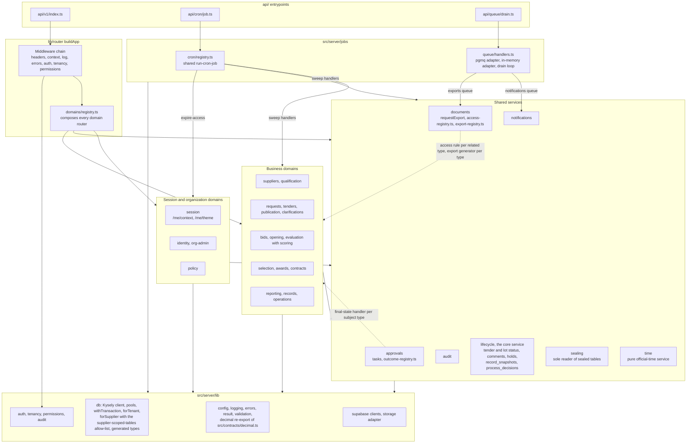
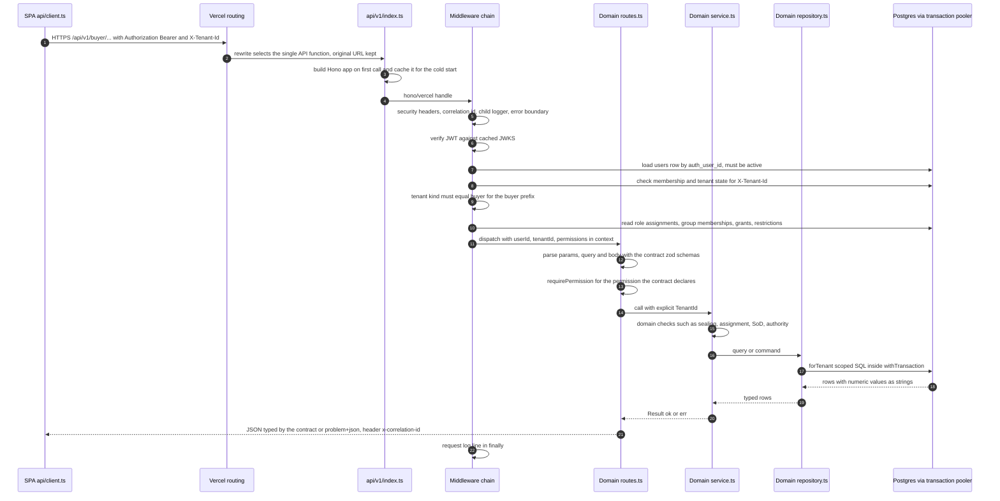
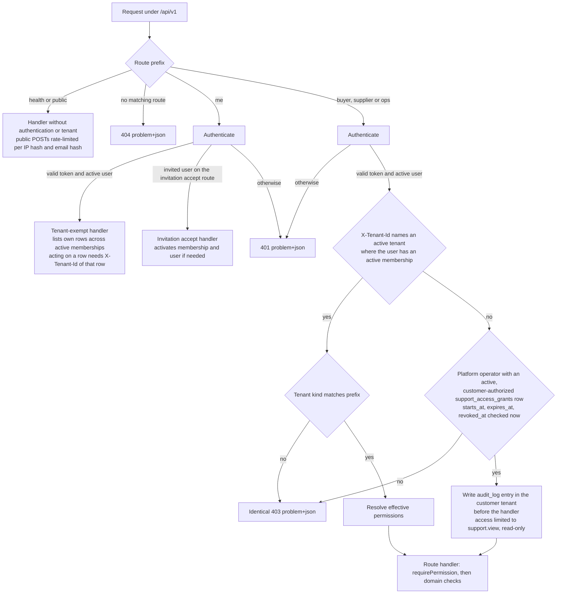
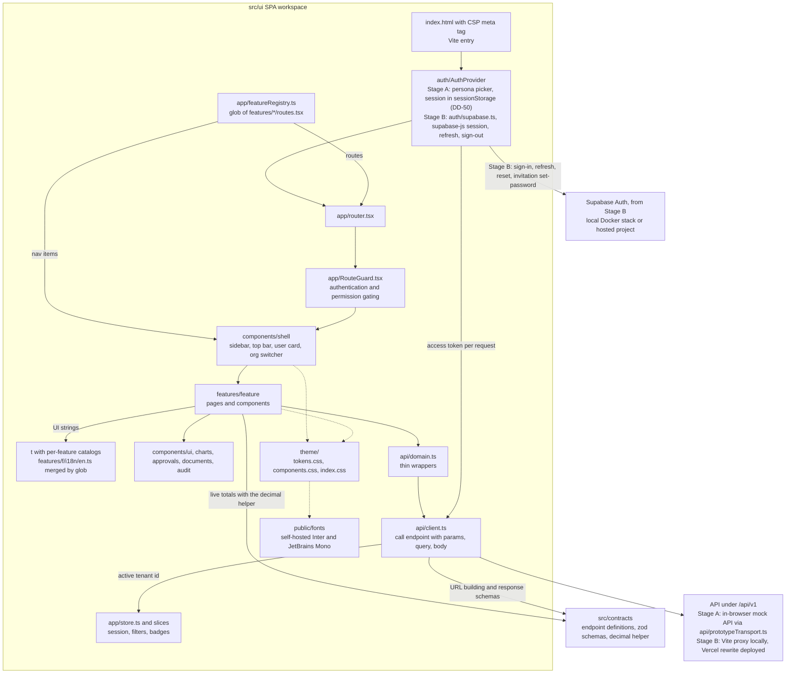
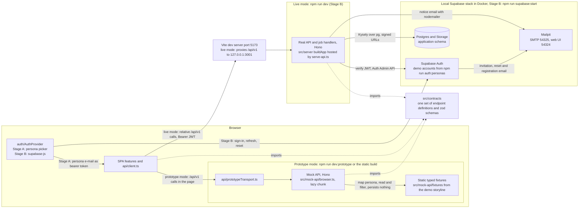
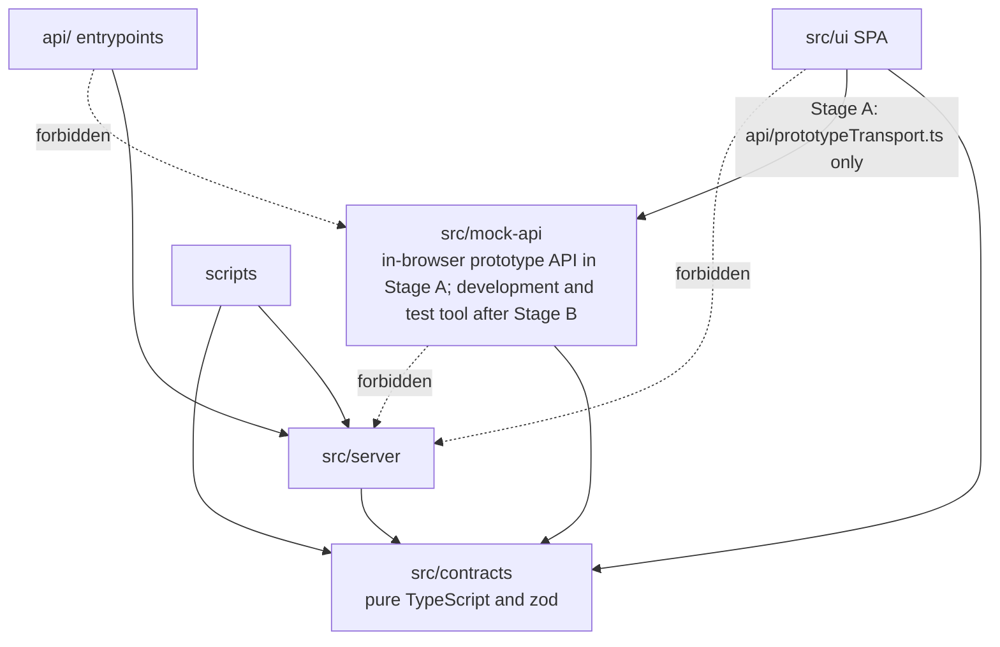
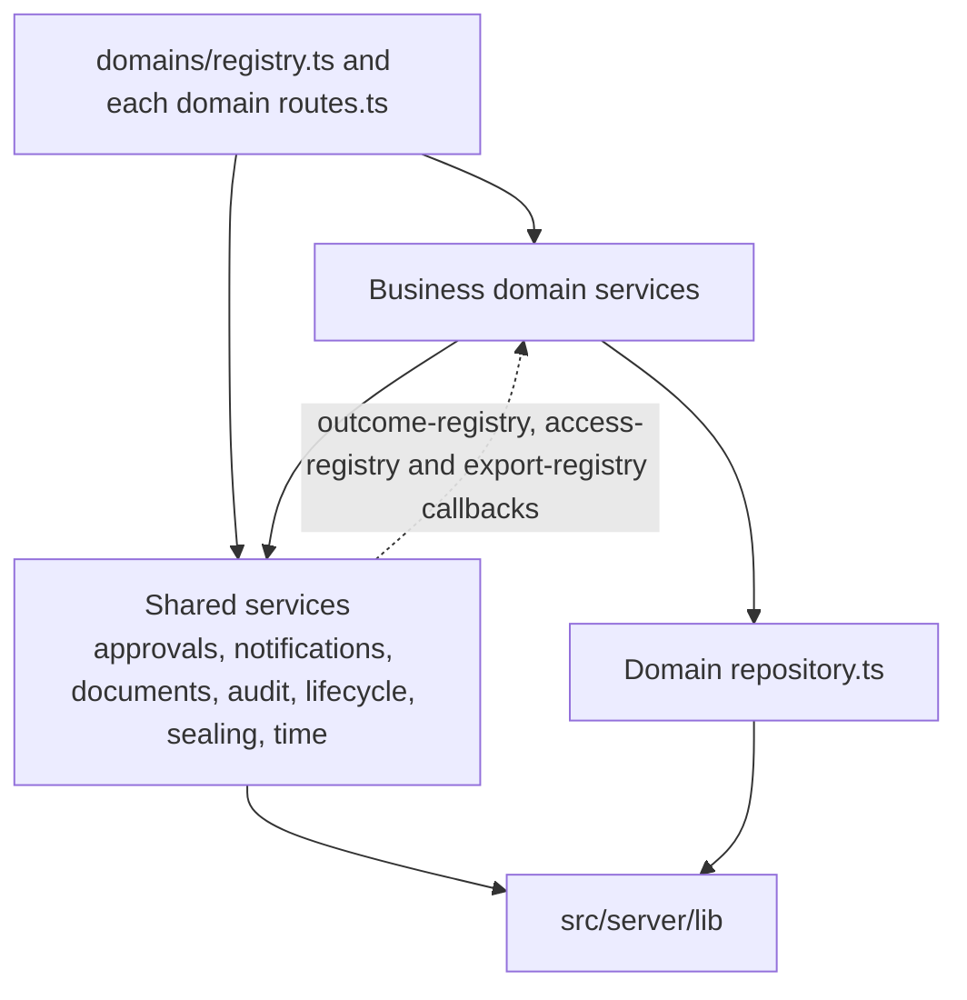

# Architecture

Status: As-built (Stage A prototype); backend sections as-designed

Sources:
- `docs/plan/architecture-plan.md` (revision 3): §0 delivery stages, §3.1 tenancy, §3.2 authorization, §3.3 sealing, §3.6 state machines, §3.7 money and scoring, §3.8 notifications, §3.9 background jobs, §3.10 contracts-first API, §3.11 prototype mode, §4 repository layout, URL map, registries and cross-domain writes, §5 file ownership, §6 domain map, §7 UI design system, §8 testing strategy, §9 build commands, §11 deviations (owner review of 2026-09-29), §12 resilience.
- `docs/plan/design-decisions.md`: DD-03 supplier-scope tags, DD-04 `customer_tenant_id`, DD-05 sealed envelope mapping, DD-11 partition tenant of cross-tenant rows, DD-12 storage keys, DD-13 views, DD-14 approval subject types, DD-15 deadline authority, DD-16 unowned tables, DD-17 cross-domain writes, DD-18 grant expiry, DD-19 added jobs, DD-20 expiry semantics, DD-21 `/me` personal inbox, DD-22 buyer slug in public URLs, DD-23 permission additions, DD-24 approver permissions, DD-25 conflict gating, DD-26 role scope matching, DD-27 invitation acceptance, DD-28 public write endpoints, DD-29 sign-in assurance, DD-30 SPA document headers, DD-31 audit content for sealed records, DD-32 browser decimals, DD-33 zone display, DD-34 CSS port, DD-35 fonts, DD-36 shell behaviour, DD-37 language, DD-38 `VITE_AUTH_MODE` (withdrawn, superseded by DD-43), DD-39 idempotency, DD-40 deferred procedure value, DD-42 acknowledgment authority, DD-43 real authentication (superseded for Stage A by DD-50; its design moves to Stage B), DD-44 email channel, DD-45 Node 24, DD-50 Stage A is a fully static prototype, §E owner decisions (status after the owner review of 2026-09-29).
- `docs/plan/email-delivery-options.md`: local SMTP path to Mailpit, dependency note on `nodemailer`, hosted provider options (deferred).
- `docs/plan/tenderiq-prototype.workflow.js` (Stage A) and `docs/plan/tenderiq-backend.workflow.js` (Stage B): step ownership, the platform modules written in Stage A for Stage B (`lib/config`, `lib/supabase`, `lib/auth/verify.ts`), `scan-bundle` checks, the Stage B `ui-live-api` step and the SMTP settings.
- `docs/architecture-brief.md`: §1 platform summary, §2 repository layout, §3 Vercel configuration, §5 backend architecture (§5.1 request pipeline, §5.2 domain module shape, §5.3 errors, §5.4 configuration, §5.6 database access, §5.7 authentication, §5.9 storage), §7 local development (Supabase CLI and Docker, §7.3 local services including Mailpit), §7.4 local API hosting, §8.4 secret hygiene, §9 background jobs, §10 frontend, §14 dependency approval.
- `docs/plan/schema-blueprint.md`: §0 conventions (tenancy tags [T]/[G]/[P]/[S]/[R], sealed tables), Migration 01 (job platform, storage buckets), Migration 13 (`rate_limit_buckets`, `request_idempotency`), Migration 14 (views, grants, schedules), §P permission catalog.
- `docs/PRD.md`: §4.2 permission principles, §4.3 audience matrix, §15.2 report freshness, §19 service expectations, §25.2 languages.

Contents:
1. [Architecture at a glance](#1-architecture-at-a-glance)
2. [Container view](#2-container-view)
3. [Backend components](#3-backend-components)
4. [Request pipeline](#4-request-pipeline)
5. [Tenancy and audience-prefix routing](#5-tenancy-and-audience-prefix-routing)
6. [Frontend architecture](#6-frontend-architecture)
7. [Prototype mode (Stage A) and live mode (Stage B)](#7-prototype-mode-stage-a-and-live-mode-stage-b)
8. [Repository layout](#8-repository-layout)
9. [Module dependency rules and cross-domain writes](#9-module-dependency-rules-and-cross-domain-writes)
10. [Key design decisions](#10-key-design-decisions)
11. [Open points](#11-open-points)

---

## 1. Architecture at a glance

- **One Vercel project** serves the React SPA as static files and runs three kinds of Node.js serverless function on Node.js 24.x. Node 24 is the runtime everywhere: `engines` `24.x`, `.nvmrc` `24` and CI Node 24 (DD-45, a deviation from the brief's Node 22 pin). `api/v1/index.ts` is a single Hono app that serves the whole `/api/v1` surface. `api/cron/<job>.ts` holds one function per scheduled job. `api/queue/drain.ts` drains the queues.
- **One Supabase project per environment** provides PostgreSQL 17 (the system of record, schedules and queues), Auth (ES256 tokens) and Storage (private buckets). Locally, the Supabase CLI runs the same stack in Docker (Postgres, Auth, Storage, Studio, Mailpit) **from Stage B**. Stage A uses no Supabase and no Docker (DD-50).
- **Notices reach people in-app and by email.** The notifications service delivers through a `DeliveryChannel` port with `in_app` and `email` implementations. `email` sends over SMTP with `nodemailer`, the one approved added runtime dependency. Locally all mail goes to Mailpit. The hosted provider is deferred (DD-44).
- **Postgres drives all background work.** `pg_cron` calls `pg_net`, which calls a secret-protected Vercel function. Queues run on `pgmq`. There is no resident worker, no Vercel Cron and no Redis (brief §1, §9).
- **Tenancy is enforced in the application layer.** Middleware validates `X-Tenant-Id`. Typed scopers (`forTenant`, `forSupplier`) scope data access. `forSupplier` reaches only the `[S]` tables on an allow-list generated from the blueprint tags, never a `[R]` table (DD-03). RLS is not the isolation mechanism. `anon` and `authenticated` hold no privileges on `public` (brief §6.3).
- **The API is contracts-first.** `src/contracts` (TypeScript + zod) defines every endpoint once, and also holds the shared decimal helper `decimal.ts` (DD-32). The SPA, the Stage A mock API and the Stage B real API all import it (architecture-plan §3.10).
- **The SPA is self-contained.** Fonts are self-hosted, a CSP meta tag in `index.html` protects the document, and every UI string goes through `t()` with per-feature catalogs (English only in this release) (DD-30, DD-35, DD-37).
- **Delivery has two stages.** Stage A builds the complete SPA as a fully static prototype: the mock API runs in the browser on static fixtures, and sign-in is a persona picker with no Supabase (DD-50). Stage B brings in real Supabase Auth (DD-43's design) and builds the real backend behind the same contracts. Stage B starts only after written approval of Stage A. See [13-delivery-and-resilience.md](13-delivery-and-resilience.md).

## 2. Container view



| Container | Technology | Responsibility | Stage |
|---|---|---|---|
| SPA | React 18, TypeScript strict, Vite, Redux Toolkit, React Router 7, Recharts | Every in-scope screen. Built to `src/ui/dist`, which is Vercel's `outputDirectory`. Inter and JetBrains Mono are self-hosted woff2 files from `src/ui/public/fonts` (DD-35). `index.html` carries a CSP `<meta http-equiv>` (DD-30): in Stage A `connect-src 'self'` (the dev server adds `ws: wss:`), because no Supabase origin is contacted (DD-50); Stage B adds the Supabase URL for auth. In Stage A the bundle also contains the in-browser mock API as a lazy chunk (DD-50). | A |
| Static hosting | Vercel | Serves the SPA. In Stage A `vercel.json` has the one rewrite `/(.*)` → `/index.html` and no `/api` rewrite or `functions` block, so the static prototype deploys with no environment variables (DD-50). Stage B restores the brief's file, with the rewrite `/((?!api/).*)` → `/index.html`. Either way deep links and hard refreshes work. | A (static prototype, deployable), B |
| API function | Hono via `hono/vercel` `handle()`, Node.js 24.x runtime selected by `engines` `24.x` (DD-45) | The entire `/api/v1` surface. The rewrite `/api/v1/:path*` → `/api/v1` selects the function, and Hono routes on the original URL. The app is built lazily and cached per cold start. A configuration failure returns a sanitized 500 problem+json. | B |
| Cron functions | Same server code | The 17 sweeps in architecture-plan §3.9 as amended by DD-18 and DD-19 (for example `close-tenders`, `standstill-monitor`, `renewal-windows`, `expire-access`, `contract-dates`, `notice-reconciliation`). A bearer check with constant-time comparison runs before any database access. See [08-background-jobs.md](08-background-jobs.md). | B |
| Queue drain | Same server code | Drains `pgmq` queues `notifications` (fan-out and delivery through the `in_app` and `email` channels, DD-44) and `exports` (evidence packs, receipts, evaluation and award reports, handovers, report exports) in bounded batches. The `exports` handler belongs to the documents service (DD-16). It stops taking new messages after about 25 s. | B |
| PostgreSQL 17 | Supabase, extensions installed by the first migration | All business data (see [03-data-model/README.md](03-data-model/README.md)), `job_run`, `job_idempotency_key`, `job_cron_config`, cron schedules, queues, and the request-control tables `rate_limit_buckets` (DD-28) and `request_idempotency` (DD-39) | B. The local Supabase Docker stack, and with it Postgres, is first used in Stage B (DD-50). |
| Supabase Auth | GoTrue | Identity and sessions. `enable_signup = false`. The server provisions users through the Auth Admin API ([adr/0012-supplier-registration-via-provisioned-accounts.md](adr/0012-supplier-registration-via-provisioned-accounts.md)). | B. Stage A has no Auth: sign-in is a persona picker (DD-50). Stage B introduces real sign-in against the local Docker stack's Auth service, and `npm run auth:personas` creates the demo accounts through the Admin API (DD-43's design, moved to Stage B by DD-50). |
| Email relay | SMTP. Locally Mailpit in the Supabase Docker stack (`[inbucket]`, SMTP port 54325, web UI `http://127.0.0.1:54324`). Hosted provider deferred. | Receives Supabase Auth emails (invitation, password reset, registration verification) and the notice emails of the `email` channel, which TenderIQ sends with `nodemailer`. Locally, a message accepted by Mailpit is recorded `delivered`. The hosted provider and its delivery-event webhooks are deferred; see `docs/plan/email-delivery-options.md` (DD-44). | B. Stage A sends no email (DD-50). Auth password-reset, invitation and registration emails, and notice emails, from Stage B. |
| Supabase Storage | Private buckets created by migration | `tender-documents`, `bid-submissions`, `supplier-evidence`, `contract-documents`, `exports`. Object keys are `<owning-record tenant_id>/<related_type>/<related_id>/<document_id>/<version_no>-<sanitized name>`; the buyer tenant owns procurement records even for supplier uploads (DD-12). The domain authorizes before it calls the adapter. | B |
| Mock API (in the browser) | Hono, same `/api/v1` surface | Serves static fixtures for prototype mode **inside the SPA** (DD-50): `src/ui/src/api/prototypeTransport.ts` lazy-loads `src/mock-api/browser.ts` and answers every `/api/v1` request in the page. There is no API server. The bearer token is the chosen persona's e-mail, which `src/mock-api/prototype-auth.ts` accepts and the chain maps to its fixture persona. In Stage A it ships in the static build; after Stage B it remains a development and test tool and leaves the production bundle. See [§7](#7-prototype-mode-stage-a-and-live-mode-stage-b). | A |

`vercel.json` has no `crons` key; that regression test is a Stage B item (architecture-plan §11 item 11). API security headers are set by the Hono app, not by `vercel.json` (brief §3.1). The SPA document's CSP is a `<meta http-equiv>` in `index.html`, and there are still no header rules in `vercel.json` (DD-30). Deployment topology, environments and secrets are covered in [10-deployment-environments.md](10-deployment-environments.md).

## 3. Backend components

### 3.1 Middleware chain

`lib/router` `buildApp(deps)` takes every dependency explicitly, so tests can build the app with fakes. It registers middleware in the order the brief sets (brief §5.1). The Hono `Variables` (correlationId, logger, userId, tenantId, auth context, permissions) are typed in `lib/router/env.ts`.

| # | Middleware | Module | Behavior | Failure |
|---|---|---|---|---|
| 1 | Security headers | `lib/router` | API response headers, applied after `next()` so they survive replaced responses. HSTS only when `APP_ENV !== 'local'`. The SPA document's CSP is not set here: it is a meta tag in `index.html` (DD-30). | — |
| 2 | Request context | `lib/router`, `lib/logging` | Takes the correlation id from `x-correlation-id` or `x-request-id`, or generates one. Fixes the request time, attaches a request-scoped child logger, and sets `x-correlation-id` and `x-server-time` (the request time as an ISO 8601 UTC instant; the storyline clock in the Stage A mock API) on every response ([07-api.md](07-api.md#31-headers)). | — |
| 3 | Request log line | `lib/logging` | In a `finally`: method, route pattern, status, durationMs, userId, tenantId. | — |
| 4 | Error boundary | `lib/errors` | Converts any thrown error to RFC 7807 `application/problem+json`. 5xx responses carry a constant sanitized `detail`. | 500 |
| 5 | Alternate-credential routes | — | The brief reserves this slot. The TenderIQ sources define no such routes. Cron and queue endpoints are separate functions outside `/api/v1`. | — |
| 6 | Authentication | `lib/auth`, `lib/supabase` | Verifies the bearer JWT (see [§4.2](#42-token-verification)), then resolves an active `users` row. The one exception is `POST /api/v1/me/invitations/:token/accept`, which also admits a user in status `invited` (DD-27). `/api/v1/health` and `/api/v1/public/*` are allow-listed. Unknown routes return 404, not 401. | 401 |
| 7 | Tenant context | `lib/tenancy`, `lib/audit` | Validates `X-Tenant-Id` against membership and tenant state, and checks that the tenant kind matches the route prefix. `/me/*` is exempt for listing the caller's own rows; acting on a row requires `X-Tenant-Id` equal to the row's tenant (DD-21). Support-grant access is audited before the handler, in the customer tenant (DD-11). See [§5](#5-tenancy-and-audience-prefix-routing). | identical 403 |
| 8 | Permission resolution | `lib/permissions` | Computes the effective permission set for (user, tenant): role assignments through direct membership, role assignments through groups, and direct exceptional grants. Explicit restrictions are then subtracted. Validity is decided at request time by comparing `starts_at`, `expires_at` and `revoked_at` directly; the expiry jobs only update display statuses (DD-18). A scoped assignment covers a tender whose legal entity, department, category (including descendants) or project matches; lots inherit from their tender, and contracts inherit through their tender and also match on their own legal entity (DD-26). | 403 from `requirePermission` |
| 9 | Domain routers | `domains/registry.ts` | `app.route(...)` for every domain under `/api/v1` | 404, 422, domain errors |

Two request-level controls from the decision log apply alongside the chain. The sources do not fix their slot in it (see [§11](#11-open-points)):
- **Public write throttling (DD-28).** An application middleware limits public POSTs (registration, register interest, access requests) per IP hash and per email hash. Counts live in `rate_limit_buckets` [G] (`key_hash`, `window_start`, `count`, primary key `key_hash` + `window_start`). There is no external service.
- **Idempotency keys (DD-39).** Commands that create records accept an optional `Idempotency-Key` header. It is stored in `request_idempotency` [T] (`key`, `user_id`, `route`, `response_status`, `response_hash`, unique per tenant, user and key), and `upload-reaper` purges rows older than 24 hours. A retried **submission** still records a new `submission_attempts` row, which is intended evidence.

### 3.2 Component diagram



The dotted edges are the three Stage B registries through which shared services call back into the owning domains: approval outcomes, document access rules and export generators. The Integration step wires them ([§3.5](#35-registries)). The `exports` queue handler belongs to the documents service: `requestExport()` queues an export, and each domain registers the generator for its export types in `documents/export-registry.ts` (DD-16). Expiry sweeps belong to the owner of each table: `expire-access` to org-admin, `expire-approvals` to approvals and `expire-support-access` to operations (DD-18).

### 3.3 Domain modules

Each module under `src/server/domains/<domain>/` has the brief §5.2 shape:

| File | Purpose |
|---|---|
| `index.ts` | Public surface and the `defaultXxxDeps()` factory that binds production implementations. Dependency injection uses plain function arguments, with no container. |
| `routes.ts` | Hono router factory. Parses input with the contract's zod schemas, calls the service, and maps `Result` to HTTP. |
| `schemas.ts` | Domain schemas and DTO types. HTTP request and response schemas come from `src/contracts/<domain>.ts` (architecture-plan §3.10). The split between the two files is finalized in Stage B. |
| `service.ts` | Business logic. Expected failures return `Result<T, DomainError>`. Exceptions are reserved for unexpected failures. |
| `repository.ts` | Kysely queries through `forTenant` or `forSupplier` |
| `errors.ts` | Domain error codes |
| `workflow/` | Pure legality matrices, `canTransition(from, to, ctx) → Result`, unit-tested row by row (architecture-plan §3.6). See [05-lifecycles.md](05-lifecycles.md). |
| `jobs/` | Sweep and queue handlers owned by the domain |

Domain map (architecture-plan §6). FR, BR and AC traceability is in [12-traceability.md](12-traceability.md).

| # | Server domain dir(s) | UI feature dirs | Screens |
|---|---|---|---|
| 00 | workspace. Stage A: shared screens and their contracts. Stage B: shared services `approvals`, `notifications`, `documents`, `audit`, `lifecycle`, `sealing`, `time`. | `tasks`, `approvals`, `notifications`, `documents`, `calendars` | COM-04…07, ADM-10, ADM-12 |
| 01 | `identity`, `org-admin` | `account`, `admin-org`, `admin-access` | COM-01…03, ADM-01…05, SUP-04 |
| 02 | `policy` | `admin-policy` | ADM-06…08, ADM-11 |
| 03 | `suppliers` | `supplier-org`, `supplier-directory` | SUP-02, SUP-03, SUP-05, BUY-31, BUY-32 |
| 04 | `qualification` | `qualification` | ADM-09, SUP-20, SUP-24, BUY-33…35 |
| 05 | `requests` | `requests`, `planning` | BUY-02…06, PUB-06 |
| 06 | `tenders` | `tender-authoring` | BUY-07…13 |
| 07 | `publication` | `publication`, `public-portal`, `opportunities` | BUY-14, BUY-15, PUB-01…03, PUB-07, SUP-06…09 |
| 08 | `clarifications` | `clarifications` | BUY-16…18, SUP-10, SUP-11, PUB-04 |
| 09 | `bids` | `responses`, `submission-monitoring` | SUP-12…17, BUY-19 |
| 10 | `opening` | `opening` | BUY-20, BUY-21, SUP-18, EVA-03 |
| 11 | `evaluation` (with `scoring/`) | `evaluation` | EVA-01, EVA-02, EVA-04…06 |
| 12 | `selection` | `selection` | BUY-22…25, BUY-27, SUP-19 |
| 13 | `awards` | `awards`, `outcomes` | BUY-26, BUY-28…30, SUP-21, SUP-22, PUB-05 |
| 14 | `contracts` | `contracts` | CON-01…11, SUP-23 |
| 15 | `reporting`, `records` | `dashboard`, `reports`, `records`, `search` | BUY-01, SUP-01, REP-01, REP-02, ADM-13, ADM-14, COM-08 |
| 16 | `operations` | `ops`, `help`, `admin-integrations` | OPS-01…07, ADM-15…17, COM-09 |

The `session` domain (`/me/context`, `/me/theme`) is not in the domain map because it belongs to the platform layer. Its contract and mock handler are built in Stage A phase A1 (`contracts-core`, `mock-platform`). The real domain is built in Stage B phase B1 (`platform-data-auth`) (architecture-plan §5).

Shared-service responsibilities that other domains rely on:

| Service | Responsibility (architecture-plan §3) |
|---|---|
| `approvals` | Version-bound approval requests and steps (`subject_version`, `content_hash`, `amount`, `currency`). Deciding a step needs `approval.decide`, the decision-specific permission (for example `award.approve`) and sufficient authority (`authority_limits` plus active `delegations`, BR-06); cross-currency authority uses `exchange_rates` at the request date, and with no rate the step routes to the next level up (DD-24). Checks SoD (`sod_policies`, BR-07). Subject types include `obligation_waiver`, `security_release`, `dispute_decision`, `contract_difference` and `final_award`; final award is its own approval per lot outcome (DD-14). Material edits invalidate approvals (AC-06). Final outcomes are dispatched through `outcome-registry.ts`. Also owns `tasks` (DD-16) and the `expire-approvals` job (DD-18). |
| `notifications` | In-app notifications and formal notices through a `DeliveryChannel` port with two implementations, `in_app` and `email` (DD-44). Formal notices go to both channels; non-mandatory events follow user preferences. `email` sends over SMTP with `nodemailer` and is used only when `EMAIL_ENABLED` is set; where email is not enabled, no email delivery rows are written. Locally it sends to Mailpit (`127.0.0.1:54325`), and a message Mailpit accepts is recorded `delivered`. An email carries only the title, the official deadline and a link, never bid, evaluation or other confidential content (BR-43, ADM-12). The hosted provider and its delivery-event webhooks are deferred (`docs/plan/email-delivery-options.md`). Fan-out runs on the `notifications` queue. `notice-reconciliation` re-enqueues recipients still `pending` after 10 minutes, and `notification-digests` sends digests per preference (DD-19). An undeliverable recipient creates a delivery-exception task (BR-42). A notification is written to the recipient's tenant partition (DD-11). For submission readiness `participant_acknowledgments` is authoritative; `notice_recipients.acknowledged_at` records the delivery-level event and is written in the same transaction when the acknowledgment comes from a notice (DD-42). |
| `documents` | Document and version records with the two-step signed-URL upload. Storage keys follow DD-12 ([§2](#2-container-view)); `documents.owner_tenant_id` records who uploaded. Access is decided per related type through `access-registry.ts`. Unregistered types are denied. Owns `exports` and the `exports` queue handler through `requestExport()`, with per-type generators registered by domains in `export-registry.ts` (DD-16). Its `upload-reaper` job also purges `request_idempotency` rows older than 24 hours. |
| `audit` | `audit_log` writes: actor, capacity, delegation, entity, action, reason, before and after state, correlation id. The partition is the tenant that owns the affected record: a supplier acting on a buyer-owned row is audited in the buyer's partition with `actor_capacity` naming the supplier org, `[G]` records go to the operator tenant, and support-access events go to the customer tenant (DD-11). `before_state` and `after_state` never contain sealed content or evaluator scores; those actions record ids and hashes only, with `sensitivity = 'restricted'` (DD-31). |
| `lifecycle` | The core service. It owns the tender and lot lifecycle and is the only path that changes `tenders.status` and `lots.stage`. It also owns `comments`, `holds`, `record_snapshots` and `process_decisions`, and exposes `recordProcessDecision()` (DD-16). It provides the snapshot API that clarifications use when issuing an addendum. An addendum that changes a deadline also updates `tenders.updated_at` in the same transaction, so the submission path's `FOR SHARE` lock on the tender row serializes against deadline changes (DD-15). |
| `sealing` | `assertEnvelopeReadable()` and `readableEnvelopes()`: opening record, assignment, price-gate release (staged commercial envelopes), confidentiality undertaking and conflict declaration. A declaration with `has_conflict = true` blocks restricted access while its disposition is `pending_review` (DD-25). Every sealed row has an envelope (DD-05): `bid_answers` copies it from the requirement, `bid_answer_documents` follows the parent answer, `bid_declarations` is `qualification`, `bid_subcontractors` and `bid_key_personnel` are `technical`, and `bid_prices`, `bid_commercial_terms` and `bid_exceptions` are `commercial`. A single-stage opening writes one `envelope_openings` row per envelope in the same transaction. See [adr/0003-application-layer-sealing.md](adr/0003-application-layer-sealing.md). |
| `time` | Pure official-time and working-day calculations on the tender's calendar (BR-11, BR-12) |

### 3.4 Library layer (`src/server/lib`)

| Module | Responsibility | Source |
|---|---|---|
| `config/` | One zod schema for the entire server environment. `loadConfig`, `getConfig` (parsed once per cold start, deep-frozen), `tryGetConfig`. The only reader of `process.env`. Written in Stage A for the Stage A variables (`APP_ENV`, `LOG_LEVEL`, `SUPABASE_URL`, `SUPABASE_ANON_KEY`, `SUPABASE_SERVICE_ROLE_KEY`) under DD-43, kept but unused by the Stage A prototype since DD-50, and extended in Stage B to every server variable, including the email settings `EMAIL_ENABLED`, `SMTP_HOST`, `SMTP_PORT`, `SMTP_USER`, `SMTP_PASSWORD` and `EMAIL_FROM` (DD-44). | brief §5.4, DD-43, DD-44, DD-50 |
| `logging/` | Hand-rolled one-line JSON logger with `child()` and a mandatory redactor | brief §5.5 |
| `errors/` | `AppError` subclasses and problem+json mapping `{ type, title, status, detail?, code?, errors?, correlationId }` | brief §5.3 |
| `result.ts` | `Result<T, E>` with `ok`, `err`, `mapOk`, `mapErr`, `andThen`, `collect` | brief §5.3 |
| `validation/` | Zod helpers that turn `"CODE\|message"` issues into `{ field, code, message }` field errors (422) | brief §5.3 |
| `decimal.ts` ★ | Re-exports the BigInt-based decimal helper `src/contracts/decimal.ts`: arithmetic for money (`numeric(18,2)`) and scores and rates (`numeric(12,6)`) carried as strings. The helper is pure and shared, so the SPA computes live totals (SUP-13) with it; the server recomputes authoritatively. | architecture-plan §3.7, DD-32 |
| `db/` | `getDb()` (transaction pooler, `max: 2`, no named prepared statements, `numeric` returned as string), `createDirectDb()`, `withTransaction`, branded `TenantId`, `forTenant`, `forSupplier`, `tenantPredicate`, generated types and table lists. `forSupplier` uses the explicit allow-list `supplier-scoped-tables.ts`, generated from the blueprint `[S]` tags rather than from column presence; a guard test asserts that no `[R]` table is on it (DD-03). `[G]` tables that name a customer use `customer_tenant_id`, so the tenant-scoped generator never picks them up (DD-04). | brief §5.6, architecture-plan §3.1, DD-03, DD-04 |
| `auth/` | JWT verification, auth middleware (which admits an `invited` user only on the invitation-accept route), `requirePermission` guard. `verify.ts` was written in Stage A under DD-43; since DD-50 the Stage A prototype does not use it (no JWT in Stage A), and its local-stack test is excluded from the unit project until Stage B. Stage B uses it and adds the middleware and the resolution of the `users` row. | brief §5.7, DD-27, DD-43, DD-50 |
| `tenancy/` | Tenant-context middleware, including the kind-to-prefix check and support-grant admission | brief §5.1, architecture-plan §3.1 |
| `permissions/` ★ | Computes effective permissions from assignments, groups, grants and restrictions. Compares validity timestamps at request time and matches scoped assignments against the tender, lot or contract. | architecture-plan §3.2, DD-18, DD-26 |
| `audit/` ★ | Audit writer used by middleware (support access) and by domains. Chooses the partition tenant and writes restricted, id-and-hash-only entries for sealed records. | architecture-plan §3.1, §3.5, DD-11, DD-31 |
| `supabase/` | Memoized server-side supabase-js clients (verification client with the anon key, admin client with the service-role key) and the JWKS cache. Written in Stage A (DD-43), unused by the Stage A prototype since DD-50, and used and extended in Stage B. | brief §5.7, DD-43, DD-50 |
| `storage/` | `StorageAdapter` port with `SupabaseStorageAdapter` and `FakeStorageAdapter`. Composition throws if the fake adapter is selected outside `local`. | brief §5.9 |
| `router/` | `buildApp(deps)`, middleware composition, `env.ts` | brief §5.1 |

★ marks an addition to the brief's layout (architecture-plan §4).

### 3.5 Registries

Only the Integration step of each stage edits a registry (architecture-plan §4, §5). Parallel domain builders never touch a shared file. See [adr/0009-registries-wired-by-integration.md](adr/0009-registries-wired-by-integration.md).

| Registry | Stage | Maps |
|---|---|---|
| `src/contracts/catalog.ts` | A | Every domain's endpoint map into one catalog (source of `docs/technical/api/openapi.json`) |
| `src/mock-api/registry.ts` | A | Every mock domain handler into the mock Hono app |
| `src/server/domains/registry.ts` | B | Every domain router into `buildApp` |
| `src/server/jobs/cron/registry.ts` | B | Job name → sweep handler. Names must match the `cron.schedule` rows (blueprint Migration 14, with the job list as amended by DD-18 and DD-19). |
| `src/server/jobs/queue/handlers.ts` | B | Queue message type → handler |
| `domains/approvals/outcome-registry.ts` | B | Approval subject type → final-state handler in the owning domain |
| `domains/documents/access-registry.ts` | B | Document related type → access rule. Anything unregistered is denied. |
| `domains/documents/export-registry.ts` | B | Export type → generator registered by the owning domain. `requestExport()` and the `exports` queue handler dispatch through it (DD-16). |

The SPA equivalents need no manual wiring because they are discovered by glob: `app/featureRegistry.ts` collects the features ([§6.3](#63-feature-auto-registration)), and the string catalogs `features/<f>/i18n/en.ts` are merged the same way (DD-37).

## 4. Request pipeline

### 4.1 Sequence

The example is an authenticated buyer request. `...` stands for any contract path under the audience prefix. The endpoint inventory is in [07-api.md](07-api.md).



### 4.2 Token verification

`lib/auth/verify.ts` runs the cheapest and most suspicious checks first (brief §5.7):

1. Decode the unsigned header. A malformed header is rejected.
2. Apply the algorithm allow-list: asymmetric only, which blocks `none` and HS* downgrades.
3. Resolve `kid` against the cached JWKS. An unknown `kid` is rejected without a network round-trip.
4. Call `supabase.auth.getClaims(token, { keys: [key] })`: local WebCrypto plus an expiry check.
5. Pin `iss` to the project's auth URL.

The verified `sub` maps to `users.auth_user_id`. The user must exist with `status = 'active'`. `SUPABASE_JWT_SECRET` is intentionally absent because the project uses ES256 signing keys.

The module was written in Stage A, together with `lib/config` and `lib/supabase` (DD-43). Since DD-50 the Stage A prototype has no JWT: the in-browser mock API's `personaTokenVerifier` (`src/mock-api/prototype-auth.ts`) accepts the chosen persona's e-mail as the bearer token, and the chain maps it to its fixture persona; an unknown or deactivated persona gets the same 401. Stage B uses this module with tokens from real Supabase Auth and adds the `users` row lookup above.

### 4.3 Response outcomes

| Outcome | Status | Where it is decided |
|---|---|---|
| Missing, invalid or expired token, or unknown or inactive user. A user in status `invited` is admitted only on `POST /api/v1/me/invitations/:token/accept` (DD-27). | 401 | Authentication middleware. The SPA signs out or redirects. |
| Any tenant failure: missing or unknown tenant, no active membership, inactive tenant, kind/prefix mismatch | 403, identical body for every cause | Tenant middleware. The reason goes to the server log only. |
| Missing permission | 403 | `requirePermission` |
| Unknown route | 404 | Router, before authentication can turn it into 401 |
| Input validation failure | 422 with `errors[]` | Contract zod schemas through `lib/validation` |
| Expected business failure (illegal transition, conflict, invalid reference) | Mapped from the `DomainError` code | `routes.ts`. Per-domain code-to-status mapping is finalized in Stage B. |
| Unexpected error | 500 with a constant sanitized `detail` and `correlationId` | Error boundary. No stack, SQL or connection string reaches the client. |

## 5. Tenancy and audience-prefix routing

Tenancy equals organization. A `tenants` row has `kind` ∈ {`buyer`, `supplier`, `operator`}. A global `users` row holds `memberships` in any number of tenants ([adr/0001-tenancy-equals-organization.md](adr/0001-tenancy-equals-organization.md)).

### 5.1 Audience prefixes

| Prefix | Authentication | Tenant | Required tenant kind | Used by |
|---|---|---|---|---|
| `/api/v1/health` | none | none | — | Smoke checks. Returns `200 {"status":"ok","version":"v1"}`. |
| `/api/v1/public/*` | none | none | — | Public portal (PUB-01…07, public help). Public POSTs (registration, register interest, access requests) are rate-limited per IP hash and per email hash (DD-28). |
| `/api/v1/me/*` | required (an `invited` user only on the invitation-accept route, DD-27) | exempt for listing; acting on a row requires `X-Tenant-Id` equal to the row's tenant (DD-21) | — | Person-level endpoints: session boot (`/me/context`), theme (`/me/theme`), invitation acceptance (`POST /me/invitations/:token/accept`) and the personal inbox (`/me/tasks`, `/me/notifications`, `/me/approvals/:id`, `/me/documents/:id`, `/me/search`). The inbox returns the caller's own rows across all active memberships, each labelled with its organization, and search filters every result by the caller's authorization in the row's tenant. The full list is in [07-api.md](07-api.md). |
| `/api/v1/buyer/*` | required | `X-Tenant-Id` required | `buyer` | Buyer, evaluator, contract and administration screens |
| `/api/v1/supplier/*` | required | `X-Tenant-Id` required | `supplier` | Supplier screens. Supplier API paths use tender ids (DD-22). |
| `/api/v1/ops/*` | required | `X-Tenant-Id` required | `operator` | Platform operator screens |

The mock API has exactly the same surface. There are no `/api/v1/__mock/auth/*` endpoints: in Stage A sign-in is the SPA's persona picker (DD-50), and in Stage B it goes to Supabase Auth. The mock API enforces the same prefix rules and answers an unknown or deactivated persona with the same 401, so the prototype's 401 and 403 behavior already matches Stage B.

### 5.2 Tenant-context decision flow



The sources fix the rules for support access: authorized by a customer administrator holding `org.support_access.authorize` (DD-23), read-only, `support.view` only, never sealed content, drafts or scores, never submit, score, approve or sign, valid only while `starts_at`, `expires_at` and `revoked_at` allow it at request time (DD-18), and audited before the handler in the customer tenant (DD-11). They do not fix which prefix and endpoints a support session calls. That is finalized in Stage B. See [04-security-model.md](04-security-model.md) and [adr/0013-operator-support-access-grants.md](adr/0013-operator-support-access-grants.md).

### 5.3 Record ownership and data scoping

Procurement records belong to the **buyer** tenant. Where a record concerns a supplier, it also carries `supplier_tenant_id` ([adr/0002-buyer-owned-procurement-records.md](adr/0002-buyer-owned-procurement-records.md)). The tags come from blueprint §0 as amended by DD-03: `[S]` means **supplier-accessible**, and `[R]` means the column is there for **reference only** ([03-data-model/README.md §3](03-data-model/README.md#3-tenancy)).

| Pattern | `tenant_id` | `supplier_tenant_id` | Access path | Examples |
|---|---|---|---|---|
| Buyer internal [T] | buyer | — | `forTenant(db, buyerTenantId)` | `tenders`, `lots`, `evaluation_plans`, `evaluation_assignments`, `approval_requests` |
| Buyer-owned, supplier-accessible [T][S] | buyer | supplier | Buyer side `forTenant`. Supplier side `forSupplier(db, supplierTenantId)`, only on the explicit allow-list `supplier-scoped-tables.ts`, which is generated from the blueprint tags (DD-03). | `participants`, `questions`, `bids`, `bid_revisions`, `submission_receipts`, `notice_recipients`, `qualification_applications`, `qualification_answer_evidence`, `contracts`, `obligations` |
| Buyer internal with a supplier reference [T][R] | buyer | supplier (reference only) | `forTenant` only. Never reachable through `forSupplier`; a guard test asserts that no `[R]` table is on the allow-list (DD-03). | `buyer_supplier_relationships`, `envelope_openings`, `compliance_checks`, `exclusions`, `evaluation_scores`, `evaluation_results`, `shortlist_entries`, `preferred_bidders`, `negotiations`, `renewal_options` |
| Supplier-private [T] | supplier | — | `forTenant(db, supplierTenantId)`. The buyer never reads these rows. | `supplier_profiles`, `evidence_items`, `evidence_shares`, `pursuits`, `pursuit_notes`, `bid_internal_approvals`, `bid_internal_comments`, `saved_searches`, `watchlist_items` |
| Partitioned [P] | `audit_log`: the tenant that owns the affected record. `notifications`: the recipient's tenant (DD-11). | — | `forTenant` on `PARTITION BY LIST (tenant_id)` tables | `audit_log`, `notifications` ([adr/0008-partition-only-high-volume-tables.md](adr/0008-partition-only-high-volume-tables.md)) |
| Global [G] | none. A row that names a customer uses `customer_tenant_id` (DD-04). | — | Dedicated services (identity, operations, public) | `tenants`, `users`, `permissions`, `role_templates`, `category_catalog`, `support_access_grants`, `subscriptions`, `rate_limit_buckets`, `job_run` |

Rules:
- `TenantId` is a branded number with one validating constructor. `forTenant` adds the table-qualified `tenant_id = ?` predicate. Its `insertInto` injects `tenant_id` and does not allow the caller to supply one. Type tests (`@ts-expect-error`) prove that an unscoped query does not compile. There is no ambient "current tenant" (brief §5.6).
- A supplier-side insert into an [S] table names the buyer `tenant_id` explicitly, after the service has verified participation (architecture-plan §3.1).
- Suppliers learn outcomes recorded in `[R]` tables only through notices and the supplier-facing projections defined in the contracts (DD-03).
- Supplier tasks and `supplier_internal` comments use the supplier `tenant_id` (blueprint Migration 04).
- Storage object keys use the owning record's tenant: `<owning-record tenant_id>/<related_type>/<related_id>/<document_id>/<version_no>-<sanitized name>`. The buyer tenant owns procurement records even for supplier uploads, and `documents.owner_tenant_id` records who uploaded (DD-12).
- Sealed bid-content tables (`bid_answers`, `bid_answer_documents`, `bid_prices`, `bid_commercial_terms`, `bid_declarations`, `bid_subcontractors`, `bid_key_personnel`, `bid_exceptions`) are readable by buyer users only through `sealing`, envelope by envelope (DD-05, [§3.3](#33-domain-modules)). Before opening, buyers see `v_bid_receipt_metadata` only: `tenant_id`, `supplier_tenant_id`, the supplier legal name valid at `received_at`, the bid, the effective receipt number, `received_at`, the status (including withdrawn, never drafts) and `document_count` (DD-13).
- Switching organization in the SPA clears all tenant-scoped Redux state (architecture-plan §3.1). The active tenant is remembered per user in `localStorage` as a convenience only, and `/me/context` re-validates it (DD-36).

## 6. Frontend architecture

### 6.1 Structure



### 6.2 Shell and design system

The shell follows `docs/css` and `docs/screenshots/overview.png` (architecture-plan §1, §7):
- Dark sidebar with the tenant label (`<TENANT NAME (PILOT)>`), the wordmark `Tender` + accent `IQ`, and the sub-brand "Tender Intelligence". Grouped navigation under collapsible section headings (DD-48) with line icons, an accent pill for the active item, a separator before the admin group, and a user card with a menu for switching organization, profile, theme and sign-out.
- Top bar with the page title, the section action of the active sidebar destination in accent teal (to the left of search), global search, tasks, a notifications bell with badge and help. Page and record actions render in the page's content head row (DD-46).
- Page composition: `PageHeader`, then the `FilterBar` card, the KPI row, content cards and tables. Tables have uppercase headers, sort carets, monospace accent references (`T-2026-0003`), `StatusChip` tones for every lifecycle state, and right-aligned money with its currency.
- Theme: `docs/css/theme/*.css` is ported to `src/ui/src/theme/`, with `--qiq-*`/`.qiq-*` renamed to `--tiq-*`/`.tiq-*`. Light and dark themes are token-driven. The user's choice is stored in `users.theme` through `/me/theme`. Components never contain raw hex values or literal pixel gaps, and a guard test enforces this.
- CSS port (DD-34): literal pixel gaps become spacing tokens; QuoteIQ-only tokens and chips (`series-*`, `quadrant-*`, `quoted/won/lost`) are dropped; chips are generated per TenderIQ enum tone; in dark mode, brand and nav hover text use a sidebar-legible token. The reference footer bar (amounts currency, "data as of", refresh) is kept for dashboards and reports (PRD §15.2 freshness).
- Fonts (DD-35): Inter and JetBrains Mono (both OFL) are self-hosted woff2 files in `src/ui/public/fonts`. There is no Google Fonts request and no npm font dependency.
- Layout (DD-36, DD-51): below 1280px the sidebar collapses to an icon rail whose account menu opens in full over the page, with a "Full sidebar" toggle from 768 to 1279px; below 768px it becomes a drawer. Tables scroll horizontally inside their card.
- Language (DD-37): English only in this release. All UI strings go through `t()` with per-feature catalogs (`features/<f>/i18n/en.ts`, merged by glob), so languages can be added without refactoring (PRD §19, §25.2).
- Icons are a hand-rolled inline-SVG set. Printable outputs are print-styled HTML plus XLSX and CSV ([adr/0010-no-icon-or-pdf-dependencies.md](adr/0010-no-icon-or-pdf-dependencies.md)).
- Accessibility (PRD §19): keyboard operation, a focus-ring token, labelled inputs, `aria-live` for progress, and axe checks in E2E. Deadlines always render with the IANA zone name and the numeric offset from Intl, for example `14 Oct 2026, 12:00 (UTC+02:00) Africa/Gaborone`, and never as a countdown alone. A short abbreviation such as CAT is shown only when Intl provides one (DD-33).

Screen-level detail is in [09-frontend.md](09-frontend.md).

### 6.3 Feature auto-registration

`app/featureRegistry.ts` collects `import.meta.glob('../features/*/routes.tsx', { eager: true })`. Each `routes.tsx` exports `features: FeatureModule[]`:

| Field | Meaning |
|---|---|
| `id` | Feature identifier |
| `area` | `'buyer' \| 'supplier' \| 'ops' \| 'public' \| 'common'` |
| `routes` | React Router route objects under the area's URL root |
| `nav` | Navigation items, each with `section`, `order`, `icon`, `permission` |

A new feature therefore needs no edit to any shared SPA file. Its string catalog `i18n/en.ts` is merged by glob in the same way (DD-37). The shell builds the sidebar from `nav` and hides any item whose `permission` the user lacks. The backend remains the authority.

URL map (architecture-plan §4):

| Area | Paths |
|---|---|
| Public | `/`, `/opportunities`, `/opportunities/:buyerSlug/:ref`, `/clarifications/:buyerSlug/:ref`, `/awards`, `/awards/:buyerSlug/:ref`, `/plans`, `/guidance/*`, `/b/:buyerSlug`. References are unique per buyer, so public URLs carry the buyer slug (DD-22). |
| Authentication | `/signin` (the persona picker in Stage A, DD-50), `/invite/:token`, `/register`. Stage B adds `/forgot-password` and `/reset-password`. |
| Context selection | `/select-organization` |
| App areas | `/buyer/*`, `/supplier/*`, `/ops/*` |
| Personal | `/me/*`: profile, tasks, notifications, `approvals/:id`, `documents/:id`, search, help. The lists show the caller's own rows across all active memberships, each labelled with its organization; acting on a row requires the row's tenant (DD-21). |

### 6.4 State

Redux Toolkit with a typed `store.ts` and `hooks.ts`. The brief names three slices. `session` holds the active tenant that the client sends as `X-Tenant-Id`; the SPA boots from `/me/context`. The other two are `filters` and `badges`. As built, the store has exactly these three slices; server data is held by the query hooks of `api/hooks.ts`, whose cache key includes the session's `tenantEpoch` ([09-frontend.md §9](09-frontend.md#9-state-management)). Switching the active tenant clears all tenant-scoped state. The active tenant is remembered per user in `localStorage` as a convenience only; `/me/context` re-validates it at boot (DD-36). UI code never hard-codes data: every value comes through the API client (architecture-plan §2).

### 6.5 API client and contracts

`api/client.ts` exports `call(endpoint, { params, query, body })`. It performs the following steps:
1. Build the URL from the contract's `method`, `path` and `params` under the relative base `/api/v1`.
2. Attach `Authorization: Bearer <token>`, reading the token from the auth layer for each request: in Stage A the chosen persona's e-mail (DD-50), in Stage B the supabase-js access token.
3. Inject `X-Tenant-Id` from the session slice. It is omitted for `/public`, `/health` and the tenant-exempt `/me` listings. Acting on a row returned by a `/me` endpoint requires `X-Tenant-Id` equal to that row's tenant (DD-21).
4. In development builds, validate the response against the contract's `response` schema.
5. Normalize problem+json into `{ status, title, fieldErrors[] }`. A 401 signs the user out or redirects.

The request goes through a transport that `main.tsx` installs with `configureApiTransport`. In Stage A it is `api/prototypeTransport.ts`, which lazy-loads the mock API (`src/mock-api/browser.ts`) and answers every `/api/v1` request in the page; there is no API server and no Vite proxy (DD-50). It is the one SPA module allowed to import `src/mock-api`.

`api/<domain>.ts` modules are thin typed wrappers over `call()`. Commands that create records accept an optional `Idempotency-Key` header, and the SPA disables submit buttons while a request is in flight (DD-39). Live totals such as SUP-13 are computed in the browser with `src/contracts/decimal.ts`; the server recomputes them authoritatively (DD-32). Contract structure is covered in [§7.3](#73-contracts-shared-by-both-modes) and [07-api.md](07-api.md).

### 6.6 Authentication

**Stage A (DD-50, architecture-plan §3.11).** Sign-in is a persona picker. There is no password, no Supabase and no supabase-js import; the password-reset pages are removed. There is no `VITE_AUTH_MODE` build variable and no `/api/v1/__mock/auth/*` endpoint (DD-38 is withdrawn).

| Part | File | Behavior |
|---|---|---|
| Persona picker ★ | `auth/SignInPage.tsx`, `auth/PersonaPicker.tsx`, list in `auth/demoAccountList.ts` | Lists every demo persona of the storyline, grouped by organization (each button carries `data-persona="<email>"`). Choosing one signs in as that persona. A persona the API refuses (deactivated `former.officer`, AC-04) gets one generic message. It ships in every build, including a deployed one: the data is fictional. |
| Session | `auth/prototypeSession.ts`, `auth/AuthProvider` | The chosen persona's e-mail is kept in `sessionStorage` (`tiq.prototype.persona`) and cleared on sign-out. The API client sends it as the bearer token; the in-browser mock API's `personaTokenVerifier` accepts it and maps it to the fixture persona. `AuthProvider` loads `/api/v1/me/context` after sign-in. |
| Permissions | `auth/permissions.ts` | `usePermission` hides actions the user lacks. The backend remains the authority. |

**Stage B.** The SPA signs in with supabase-js against Supabase Auth, exactly as in production (DD-43's design, moved to Stage B by DD-50). Stage B brings in:
- `auth/supabase.ts`, the one browser Supabase client, built only from `VITE_SUPABASE_URL` and `VITE_SUPABASE_ANON_KEY` and used for authentication only, never for data, storage or realtime; a boundary test enforces this (brief §10).
- Sign-in, forgot-password, reset-password and invitation set-password pages. Sign-in errors show one generic message. Locally, Supabase Auth emails (password reset, invitation, registration) arrive in Mailpit (`http://127.0.0.1:54324`). The Stage B `ui-live-api` step completes the invitation flow against the real `POST /api/v1/me/invitations/:token/accept` endpoint.
- The demo accounts in local Supabase Auth, created by `npm run auth:personas` (idempotent, local only), and a demo-accounts quick-pick rendered only in local development builds (`import.meta.env.DEV`), with a marker string that `scan-bundle` must not find in `src/ui/dist`.

The "Prototype — static demo data" banner is not tied to the sign-in path: it appears whenever `/api/v1/me/context` reports `environment.mode = 'prototype'`, as the mock API always does (architecture-plan §0). MFA and step-up sign-in are not in this release; they are recorded as a later extension using Supabase MFA (DD-29).

## 7. Prototype mode (Stage A) and live mode (Stage B)

### 7.1 One SPA, two API implementations behind the same client



In prototype mode there is no API server and no Vite proxy: the mock API runs in the page, and Vite serves only the SPA (DD-50). Prototype mode needs no Docker, no Supabase and no environment file, and the same static build deploys to Vercel. Live mode (Stage B) hosts the real API on `127.0.0.1:3001` behind the Vite proxy, so the browser sees one origin and no CORS configuration is needed (brief §7.4); it needs the local Supabase stack running in Docker. In live mode, notice emails leave from the `notifications` queue handler, which runs locally through `npm run queue:worker` (DD-44).

### 7.2 Mode comparison

| Aspect | Prototype mode (Stage A) | Live mode (Stage B) |
|---|---|---|
| Start command | `npm run dev:prototype` (Vite alone, `npm run dev -w @tenderiq/ui`, port 5173). No Docker, no Supabase and no environment file (DD-50). | `npm run dev` (API runner + Vite, through `scripts/dev/dev.mjs`) after `supabase:start` and `supabase:reset` |
| Local Supabase stack (Docker) | Not used (DD-50). | Required. Auth, Postgres with the application schema, Storage and Mailpit. |
| API host | None: the mock API (`src/mock-api/browser.ts`, `createBrowserMockApi` building `src/mock-api/app.ts`) runs in the page through `api/prototypeTransport.ts` | `scripts/dev/serve-api.ts` on `127.0.0.1:3001`, hosting the same Hono app as `api/v1/index.ts` |
| URL surface | Contract endpoints under `/api/v1`. There are no mock auth endpoints. | Contract endpoints under `/api/v1` |
| Middleware | Mirrors the real chain: correlation id, persona token check (`personaTokenVerifier`) and mapping to the fixture persona (an unknown or deactivated persona gets 401), identical-403 tenant validation, contract permission check against the persona's fixture permission set, problem+json errors, response validation against the contract. No JWT (DD-50). | Full chain ([§3.1](#31-middleware-chain)) |
| Authentication | Persona picker on the sign-in page, in every build; no password. The persona's e-mail is kept in `sessionStorage` and sent as the bearer token (DD-50). | supabase-js sign-in against Supabase Auth (DD-43's design, moved to Stage B by DD-50). The ES256 JWT is verified against JWKS, and the verified `sub` must resolve to an active `users` row. In local development builds the sign-in page offers the demo-accounts quick-pick. |
| Email | None. There is no Auth and no notice email; the prototype only displays delivery status from fixtures (DD-50). | Notices go through `in_app` and, when `EMAIL_ENABLED`, `email` (`nodemailer` over SMTP to Mailpit locally). Supabase Auth emails (password reset, invitation, registration) also land in Mailpit; the real API triggers invitations through the Auth Admin invite (DD-43, DD-44). |
| Data | Typed fixtures per domain (`src/mock-api/fixtures/<domain>.ts`), filtered and paginated per tenant, persona and query. Nothing is persisted (resolved — owner decision 2026-09-29: prototype actions do not persist). | PostgreSQL through domain repositories. Demo data from `scripts/db/demo/NN-<domain>.ts`. |
| Commands (submit, approve, publish, …) | Request validated against the contract. A contract-valid static response is returned, for example the fixture receipt for a submission. | Real business logic, transactions and audit |
| Sealing | Fixtures respect sealing boundaries. A buyer persona sees receipt metadata only. Opened content appears only for assigned personas. | Enforced by `sealing` |
| Files | No Storage | Real upload flows are added to the shared document widgets by the Stage B `ui-live-api` step |
| Background jobs | None | `pg_cron` and `pgmq`. Locally run through `npm run cron:run`, `cron:run:all`, `queue:worker`. |
| Visible indicator | "Prototype — static demo data" banner, shown because `/api/v1/me/context` reports `environment.mode = 'prototype'` | None |
| Tests | Contract unit tests; mock-API tests with the persona token (unknown and deactivated personas get 401), all offline; React Testing Library; Playwright `prototype` project (Vite only, port 5280) and `smoke` project. The JWT tests against local Supabase Auth return in Stage B (DD-50). | Adds integration tests, contract conformance against the real API, JWT verification against local Supabase Auth, and the Playwright `full` project; `smoke` then targets the full stack |
| Deployment | The static build (`src/ui/dist`) **is** the prototype and includes the mock API and its fixtures; it may be hosted on Vercel as static files with no environment variables (DD-50; design-decisions §E.2 as amended 2026-10-30). The owner creates the Vercel project and deploys. `scan-bundle` still fails on server code, server variable names and service-role keys, and checks the CSP; the mock-code, persona-e-mail and demo-accounts-marker checks return in Stage B. | Vercel + Supabase. The mock API leaves the production bundle and `api/`. |
| After Stage B | Kept as a development and test tool (`dev:prototype`, Playwright visual tests) | Default mode |

Both modes use the same demo world (`docs/plan/demo-storyline.md`), so the approved prototype and the live system show the same tenants, personas, tenders and contracts.

### 7.3 Contracts shared by both modes

`src/contracts/` is pure TypeScript + zod with no Node or browser APIs (architecture-plan §3.10):

| File | Content |
|---|---|
| `common.ts` | Ids, `Money` (decimal string + currency), `Instant`, `OfficialDeadline`, `Page<T>`, list query, `Problem` (problem+json with `errors[]`) |
| `enums.ts` | Every lifecycle state and classification, mirroring the blueprint CHECK lists ([adr/0004-text-check-constraints-not-enums.md](adr/0004-text-check-constraints-not-enums.md)). The procedure value `framework_calloff` stays in the database CHECK lists, but no enum used for writes offers it (DD-40). |
| `decimal.ts` | BigInt-based decimal arithmetic for money and scores carried as strings. Pure and shared: the SPA uses it for live totals, and `src/server/lib/decimal.ts` re-exports it (architecture-plan §3.7, DD-32). |
| `endpoint.ts` | `defineEndpoint({ id, method, path, audience, permission?, params?, query?, body?, response, errors, screens })` |
| `<domain>.ts` | Request and response schemas, inferred types and an endpoint map per domain |
| `catalog.ts` | Aggregates every domain map. Written by the Integration step. |

Rules:
- Every endpoint declares its `audience` (prefix) and `permission`, and lists the screens that call it.
- `npm run docs:api` generates `docs/technical/api/openapi.json` from the catalog with zod v4 `z.toJSONSchema()`. No extra dependency is needed.
- Contract-conformance tests run the same zod response schemas against the mock API and the real API.
- A contract change in Stage B needs a recorded reason and a UI update in the same unit (architecture-plan §0).

See [adr/0006-contracts-first-ui-prototype-stage.md](adr/0006-contracts-first-ui-prototype-stage.md) and [11-testing-strategy.md](11-testing-strategy.md).

### 7.4 As-built prototype (Stage A)

This subsection records what Stage A actually built. It is generated from the code of 2026-09-30 and amended on 2026-10-30 for DD-50 (mock API host, middleware and authentication rows); the design in §7.1 to §7.3 holds unchanged.

| Aspect | As built |
|---|---|
| API surface | **919 contract endpoints** in 25 modules under `src/contracts` (buyer 583, supplier 195, ops 63, me 49, public 29), plus `GET /api/v1/health`. The mock API mounts every one; `catalog.test.ts` and the registry tests fail if a module is left out ([07-api.md §13](07-api.md#13-endpoint-catalog-by-domain)). |
| Mock API app | `createMockApp()` in `src/mock-api/app.ts`, built in the browser by `createBrowserMockApi` (`src/mock-api/browser.ts`), which `src/ui/src/api/prototypeTransport.ts` lazy-loads (DD-50). It mounts the static list `HANDLER_MODULES` (`src/mock-api/handler-modules.ts`); `handler-modules.test.ts` fails when the list and the modules on disk differ (on-disk discovery is in `registry-discovery.ts`, for tests only). A module that throws while registering is logged and skipped. Runtime code is browser-safe (lint rule `tenderiq/mock-api-browser-safe`; `src/mock-api/sha256.ts` replaces `node:crypto`). |
| Middleware chain | `src/mock-api/middleware/chain.ts`: security headers → request context (correlation id, `x-server-time`) → request log → error boundary → route resolution (unknown route: 404 before authentication) → persona token check (`personaTokenVerifier`, `src/mock-api/prototype-auth.ts`) and persona mapping (401) → tenant context (one identical 403) → permission (403) → dispatch with contract parsing (422) and response validation (500 on fixture drift). |
| Fixtures | `src/mock-api/fixtures/**`, one file or folder per domain, all written "as of" the storyline clock `DEMO_AS_OF` = 2026-10-06T08:00:00Z (10:00 in Africa/Gaborone, `fixtures/demo-clock.ts`). The mock serves every request at `DEMO_AS_OF` (`frozenStorylineNow()`: the clock is frozen, so the storyline looks the same on any real date) and reports it as `/me/context.serverTime` and the `x-server-time` header; the SPA's application clock follows it, so countdowns, overdue marks and "data as of" footers agree. `fixtures/consistency.test.ts` checks references, personas, slugs, in-app links, deadlines, receipts and award values across domains. |
| Commands | Validate the request against the contract and return a contract-valid static response; nothing persists, and a re-read returns the unchanged fixture world (owner decision of 2026-09-29). |
| SPA | 50 feature modules in 34 feature directories, **284 feature routes** and 68 sidebar items, registered through `features/*/routes.tsx`; three Redux slices (`session`, `filters`, `badges`); server data through `useApiQuery` and `useApiMutation` ([09-frontend.md §7, §8](09-frontend.md#7-feature-modules-and-auto-registration)). |
| Authentication | Persona picker (`auth/PersonaPicker.tsx`, the demo personas in `auth/demoAccountList.ts` grouped by organization) in every build; the chosen persona is kept in `sessionStorage` (`tiq.prototype.persona`) and sent as the bearer token. No supabase-js, no Docker (DD-50; [09-frontend.md §11](09-frontend.md#11-authentication-demo-accounts-and-prototype-banner)). |
| Traceability | Every one of the 118 in-scope screens has at least one route and at least one contract endpoint ([12-traceability.md §4.9](12-traceability.md#49-as-built-screen-to-route-to-contract-endpoints)). |
| Tests at the end of Stage A | Root `unit` project: 100 files, 2,900 tests (contracts, mock API, platform auth, scripts). SPA suite: 265 files, 1,456 tests. Playwright `prototype` project: `shell` and `a11y` specs. |
| Checkpoints | Phases A1 (foundation), A3 (integration) and A4 (QA) are checkpointed on `build/tenderiq-core`, with one marker per domain unit in `.build/progress/A/` ([13-delivery-and-resilience.md §2.1](13-delivery-and-resilience.md#21-stage-a-status-as-built)). |

## 8. Repository layout

The brief §2 layout is used verbatim, with the additions below (architecture-plan §4). Legend: ★ addition to the brief, Ⓐ created in Stage A, Ⓑ created in Stage B.

```text
/
├── api/  Ⓑ                              # Vercel function entrypoints only (3–10 lines each, no logic)
│   ├── v1/index.ts                       # the single Hono function for /api/v1
│   ├── cron/<job>.ts                     # one per scheduled job (GET, CRON_SECRET)
│   └── queue/drain.ts                    # queue drain (POST, INTERNAL_JOB_SECRET)
├── src/
│   ├── contracts/ ★Ⓐ                    # common.ts enums.ts endpoint.ts decimal.ts <domain>.ts catalog.ts
│   ├── mock-api/ ★Ⓐ                     # app.ts browser.ts handler-modules.ts prototype-auth.ts sha256.ts persona.ts registry.ts registry-discovery.ts (tests only) middleware/ handlers/<domain>/ fixtures/<domain>[.ts|/] testing/
│   ├── server/  Ⓑ                        # except lib/config, lib/supabase and lib/auth/verify.ts: Ⓐ under DD-43, unused by the Stage A prototype since DD-50, used and extended in Ⓑ
│   │   ├── domains/
│   │   │   ├── registry.ts ★             # composes every domain router (Integration)
│   │   │   ├── session/                  # /me/context, /me/theme (SPA boot)
│   │   │   ├── identity/  org-admin/  policy/
│   │   │   ├── approvals/  notifications/  documents/  audit/  lifecycle/  sealing/  time/   (shared services)
│   │   │   ├── suppliers/  qualification/  requests/  tenders/  publication/  clarifications/
│   │   │   ├── bids/  opening/  evaluation/ (scoring/)  selection/  awards/  contracts/
│   │   │   └── reporting/  records/  operations/
│   │   │       (each: index.ts routes.ts schemas.ts service.ts repository.ts errors.ts workflow/ jobs/)
│   │   ├── jobs/{cron,queue}/            # sweep registry and runner; pgmq and in-memory adapters, drain loop, handlers
│   │   ├── lib/{config,db,auth,tenancy,permissions★,audit★,supabase,storage,router,errors,logging,validation}/
│   │   ├── lib/decimal.ts ★ (re-exports src/contracts/decimal.ts)  lib/result.ts
│   │   └── tests/{unit,integration,types,helpers,fixtures}/
│   └── ui/  Ⓐ                            # SPA workspace (own package.json, tsconfig, eslint, vite)
│       ├── index.html                    # CSP meta tag (DD-30)
│       ├── public/fonts/                 # self-hosted Inter and JetBrains Mono woff2 (DD-35)
│       └── src/
│           ├── app/         store.ts hooks.ts router.tsx RouteGuard.tsx featureRegistry.ts★ slices/
│           ├── api/         client.ts (call(endpoint…), configureApiTransport) prototypeTransport.ts★ (Ⓐ, DD-50) <domain>.ts
│           ├── auth/        Ⓐ AuthProvider SignInPage PersonaPicker★ demoAccountList prototypeSession (DD-50), permissions.ts   Ⓑ supabase.ts, Forgot/Reset pages, dev-only demo-accounts quick-pick
│           ├── components/  shell/ ui/ charts/ approvals/ documents/ audit/
│           ├── features/<feature>/  routes.tsx★ i18n/en.ts pages/ components/ *.test.tsx
│           ├── i18n/        en.ts (shell catalog)
│           ├── pages/
│           ├── theme/       tokens.css components.css index.css (--tiq-*)
│           ├── lib/         format, zonedTime, clock, useNow, download, i18n, storage
│           └── test/
├── supabase/                             # config.toml ([inbucket] smtp_port 54325, DD-44; exists from Ⓐ, unused since DD-50)  Ⓑ migrations/ seed.sql schema.expected.sql (signing_keys.json: local only, git-ignored)
├── scripts/
│   ├── dev/        Ⓑ serve-api.ts, dev.mjs, seed-auth-personas.ts (npm run auth:personas)   (Stage A has no dev server script: dev:prototype runs Vite alone, DD-50)
│   ├── docs/ ★Ⓐ    generate-openapi.ts
│   ├── db/         Ⓑ ensure-signing-keys, seed, seed-demo, generate-types, validate-migrations, configure-job-cron, create-admin, demo/NN-<domain>.ts
│   ├── jobs/ Ⓑ     run-cron, run-all-crons, local-queue-worker, job-status, enqueue-test
│   └── ci/  Ⓐ/Ⓑ    scan-secrets, scan-bundle, assert-test-run
├── e2e_tests/  Ⓐ                         # Playwright workspace (projects: prototype, smoke, full)
├── docs/
│   ├── technical/ ★                      # this documentation set; api/openapi.json generated by npm run docs:api
│   ├── prototype/ ★Ⓐ                    # walkthrough.md and screen captures
│   ├── plan/
│   └── local-development.md  environment-variables.md  deployment.md  background-jobs.md
├── .build/progress/ ★                    # resume markers per stage and unit
├── .github/workflows/ci.yml              # verify and migrate jobs (brief §12), on Node 24 (DD-45)
└── vercel.json package.json (engines 24.x) .nvmrc (24) tsconfig*.json vitest.config.ts eslint.config.js .env.example .env.local.example run.ps1 .gitattributes CLAUDE.md README.md
```

Ownership during the build is by path (architecture-plan §5). Resume markers under `.build/progress/` are described in [13-delivery-and-resilience.md](13-delivery-and-resilience.md).

## 9. Module dependency rules and cross-domain writes

### 9.1 Top-level import directions



Since DD-50 the mock API runs in the browser and imports nothing from `src/server`: the lint rule `tenderiq/mock-api-browser-safe` forbids `node:*` imports, `src/server` imports and Node globals in its runtime code (tests, `testing/**`, `registry-discovery.ts` and `fixtures/approvals/spa-routes.ts` excepted). In Stage A the SPA imports it from `src/ui/src/api/prototypeTransport.ts` only, and the production bundle includes it as a lazy chunk (architecture-plan §11 item 11). Its data still comes only from static fixtures, and it persists nothing (architecture-plan §0). In Stage B the SPA no longer imports it.

### 9.2 Inside `src/server`



### 9.3 Rules

| # | Rule | Enforcement | Source |
|---|---|---|---|
| R1 | `src/ui` never imports `src/server/**` | Import-boundary tests (including `lib/supabase` and `lib/config`); `scan-bundle` fails on server code fragments, server variable names or service-role literals in `src/ui/dist` | brief §8.4, architecture-plan §11 |
| R2 | `src/contracts` is pure TypeScript + zod with no Node or browser APIs, so the SPA, the mock API and the backend can all import it. This includes the shared decimal helper `decimal.ts`. | Contract unit tests, and the ESLint block `tenderiq/contracts-purity` in the root `eslint.config.js`: files under `src/contracts` may import only `zod` and sibling contract files, and no Node or browser API. | architecture-plan §3.10, DD-32 |
| R3 | `src/mock-api` is never part of `api/`. In Stage A the static prototype **is** the production build, so the mock API, its fixtures and the persona picker ship in it on purpose; only `src/ui/src/api/prototypeTransport.ts` may import `src/mock-api` (DD-50). From Stage B the mock API is development and test only and leaves the production bundle, and the demo-accounts quick-pick renders only in local development builds (`import.meta.env.DEV`). | Stage A: SPA lint boundary (only `prototypeTransport.ts`); `scan-bundle` keeps the server-code, server-variable, service-role and CSP checks. Stage B: `scan-bundle` also fails if `src/ui/dist` contains mock-api code, persona e-mails or the demo-accounts marker string | architecture-plan §0, §3.11, §11 items 1 and 11, DD-43, DD-50 |
| R4 | `api/` entrypoints contain no logic. They export named `GET`/`POST` handlers and `config = { runtime: 'nodejs' }`, and delegate to `src/server`. | Integration test for rewrites and entrypoints | brief §3.1, §3.2 |
| R5 | Only `src/server/lib/config/index.ts` reads `process.env` | ESLint `no-restricted-properties` plus a source-scanning integration test | brief §5.4 |
| R6 | The browser Supabase client is used for authentication only. In Stage A no SPA code imports `@supabase/supabase-js` (DD-50); Stage B brings in `auth/supabase.ts` | Boundary test | brief §10, DD-50 |
| R7 | The tenant is always an explicit argument. There is no ambient tenant. Tenant-scoped tables are reached through `forTenant`, `forSupplier` or `tenantPredicate`. `forSupplier` reaches only the `[S]` tables on the generated allow-list, never an `[R]` table. | Type tests; compile-time check of the generated table lists; guard test that no `[R]` table is on the allow-list | brief §5.6, architecture-plan §3.1, DD-03 |
| R8 | Only `sealing` reads sealed bid-content tables | Guard test fails if any other module reads them | architecture-plan §3.3 |
| R9 | Only the `lifecycle` service changes `tenders.status` and `lots.stage` | Review. The guard mechanism is finalized in Stage B. | architecture-plan §4 |
| R10 | A domain writes only its own tables, except for the cross-domain writes in [§9.4](#94-cross-domain-write-exceptions) | Path ownership during the build, audit at runtime | architecture-plan §4, §5 |
| R11 | Registries are edited only by the Integration step | Path ownership | architecture-plan §4, §5 |
| R12 | Dependencies are injected as plain function arguments (`Deps` interface, `defaultXxxDeps()`). There is no DI container, and no abstraction without two real implementations or a clear test seam. | Review | brief §5.2 |
| R13 | UI code never hard-codes data. It always calls the API client. SPA features never edit a shared SPA file. | Review, feature auto-registration | architecture-plan §2, §4 |
| R14 | Components never contain raw hex values or literal pixel gaps | No-raw-hex guard test | architecture-plan §7, §8 |
| R15 | No runtime dependency beyond the approved list (`hono`, `kysely`, `pg`, `zod`, `@supabase/supabase-js`, `exceljs`, plus `nodemailer`; SPA: `react`, `react-dom`, `@reduxjs/toolkit`, `react-redux`, `react-router`, `recharts`, `@supabase/supabase-js`, plus `hono` for the in-browser mock API in Stage A, already an approved project dependency, DD-50). `nodemailer` (with the dev dependency `@types/nodemailer`) is the single approved exception to "no new runtime dependencies", for the SMTP `email` channel (DD-44). The Stage A scaffold declares every dependency for both stages. Fonts are self-hosted files, not an npm dependency. | Owner approval required | brief §14, architecture-plan §11 items 2 and 3, DD-35, DD-44 |
| R16 | Every UI string goes through `t()` and lives in the feature's own catalog `features/<f>/i18n/en.ts`, merged by glob | Review. The sources name no automated check. | DD-37 |

### 9.4 Cross-domain write exceptions

These writes must happen **in the triggering transaction** and must be **audited** (architecture-plan §4, DD-17):

| Writing domain | Target | Context |
|---|---|---|
| `tenders` | `procurement_requests.status = 'converted'` | A tender is created from an approved request |
| `clarifications` | `requirements`, `tender_milestones`, `lots.submission_deadline` | An addendum is issued, through the `lifecycle` snapshot API |
| `opening` | `bids.compliance_status` | Compliance assessment |
| `opening` | `submission_receipts.status = 'selected_for_evaluation'` | A receipt is selected for evaluation (DD-17) |
| `evaluation` | `bids.evaluation_status` | Evaluation progress |
| `publication` | `integration_exceptions` | A failed external publication (AC-33) |
| `contracts` | `integration_exceptions` | An external signature failure (AC-33, DD-17) |
| `suppliers` | `tenants` | A buyer creates a provisional supplier record (DD-17) |
| `bids`, `selection`, `contracts`, `qualification` | `evidence_submissions` | Append-only evidence snapshots through the suppliers-owned helper `snapshotEvidence()` (DD-17) |
| `operations` | `tenants` | Customer onboarding |
| `operations` | `contracts` (historical) and provisional supplier `tenants` | Imports (ADM-16) |

Ownership clarifications (architecture-plan §4, DD-16, DD-18, DD-20):
- Tender and lot status change only through the `lifecycle` service.
- `bids` owns every bid, revision and receipt row, including rows with `round_type = 'bafo'` or `'next_stage'`.
- `selection` owns final-offer rounds (`final_offer_rounds`) and their invitees (`final_offer_invitees`).
- Shared owners: `tasks` → `approvals`; `comments`, `holds`, `record_snapshots` and `process_decisions` → `lifecycle` (the core service, which exposes `recordProcessDecision()`); `exports` and the `exports` queue handler → `documents` (`requestExport()` with generators in `export-registry.ts`); `exchange_rates` and `price_gate_releases` → `evaluation` (the chair releases the gate with `evaluation.chair`); `category_catalog` → the baseline `seed.sql`.
- Expiry jobs belong to the owner of each table: `expire-access` (org-admin: grants, restrictions, delegations, invitations), `expire-approvals` (approvals) and `expire-support-access` (operations). They only update display statuses and send notices.
- `qualification-expiry` writes no decisions: `v_qualification_status` derives `expired`, and the job creates tasks and notices. `evidence-expiry` only flags and notifies; `evidence_items.status = 'expired'` is set by the suppliers domain when the supplier views or renews the item, or by the suppliers-owned helper the job calls. `retention-eligibility` writes `disposal_requests` rows in `proposed` or `blocked` status.

## 10. Key design decisions

### 10.1 TenderIQ decisions (recorded as ADRs)

| Decision | Summary | ADR |
|---|---|---|
| Tenancy equals organization | `tenants.kind` ∈ buyer, supplier, operator. Global users with memberships. `X-Tenant-Id` plus a membership check implements BR-02. | [adr/0001-tenancy-equals-organization.md](adr/0001-tenancy-equals-organization.md) |
| Buyer-owned procurement records | `tenant_id` = buyer. `supplier_tenant_id` on supplier-accessible [S] tables and, for reference only, on buyer-internal [R] tables (DD-03). Supplier-private rows belong to the supplier tenant. | [adr/0002-buyer-owned-procurement-records.md](adr/0002-buyer-owned-procurement-records.md) |
| Application-layer sealing | One `sealing` module with four conditions for reading content. Receipt-metadata view before opening. Guard test. | [adr/0003-application-layer-sealing.md](adr/0003-application-layer-sealing.md) |
| Text + CHECK instead of PG enums | Forward-only migrations can widen a CHECK. `enums.ts` mirrors the lists. | [adr/0004-text-check-constraints-not-enums.md](adr/0004-text-check-constraints-not-enums.md) |
| Decimal strings for money and scores | `numeric(18,2)` and `numeric(12,6)` carried as strings. BigInt arithmetic in `src/contracts/decimal.ts`, re-exported by `lib/decimal.ts` (DD-32). A missing score is `null`, never 0. | [adr/0005-decimal-strings-for-money-and-scores.md](adr/0005-decimal-strings-for-money-and-scores.md) |
| Contracts-first UI prototype stage | Stage A SPA and mock API on shared contracts. Since DD-50 Stage A is fully static (mock API in the browser, persona picker, no Supabase or Docker); real Supabase Auth (DD-43) moves to Stage B. Human approval gate before Stage B. | [adr/0006-contracts-first-ui-prototype-stage.md](adr/0006-contracts-first-ui-prototype-stage.md) |
| Formal notices in-app and by email | `DeliveryChannel` port with `in_app` and `email` implementations. `email` uses SMTP with `nodemailer`, Mailpit locally; the hosted provider is deferred (DD-44). Emails carry title, official deadline and link only. Delivery and acknowledgment events are distinct. The ADR keeps its original filename. | [adr/0007-in-app-formal-notices.md](adr/0007-in-app-formal-notices.md) |
| Partition only high-volume tables | Only `audit_log` and `notifications` are `PARTITION BY LIST (tenant_id)` | [adr/0008-partition-only-high-volume-tables.md](adr/0008-partition-only-high-volume-tables.md) |
| Registries wired by Integration | Parallel builders never edit shared composition files | [adr/0009-registries-wired-by-integration.md](adr/0009-registries-wired-by-integration.md) |
| No icon or PDF dependencies | Hand-rolled SVG icons. Print-styled HTML plus XLSX and CSV. `nodemailer` is the single approved exception to "no new runtime dependencies" (DD-44). | [adr/0010-no-icon-or-pdf-dependencies.md](adr/0010-no-icon-or-pdf-dependencies.md) |
| Official receipt time from the database | `clock_timestamp()` inside the submission transaction, after locking the tender row `FOR SHARE`. Every attempt is recorded. | [adr/0011-official-receipt-time-from-database.md](adr/0011-official-receipt-time-from-database.md) |
| Supplier registration via provisioned accounts | Self-signup stays disabled. Accounts are created with Auth Admin API invitations. The registration transaction commits first, and the invite is called after the commit, so no network call runs inside a transaction (brief §5.6). If the invite fails, a short follow-up transaction sets the registrant’s `invitations` row to `send_failed`, and the registrant can retry (DD-27). The owner kept this proposed approach on 2026-09-29 (design-decisions §E.7). | [adr/0012-supplier-registration-via-provisioned-accounts.md](adr/0012-supplier-registration-via-provisioned-accounts.md) |
| Operator support access grants | Customer-authorized (`org.support_access.authorize`), time-limited, read-only, audited before the handler in the customer tenant (DD-11, DD-23) | [adr/0013-operator-support-access-grants.md](adr/0013-operator-support-access-grants.md) |

The ADR index is [adr/README.md](adr/README.md).

### 10.2 Platform decisions inherited from the brief

| Decision | Reason given in the brief | Further detail |
|---|---|---|
| One function for `/api/v1` plus a rewrite | Vercel's zero-config `api/` routing outside Next.js has no catch-all filename, so nested paths would 404 | brief §3.1 |
| Scheduling in the database (`pg_cron` → `pg_net`), never Vercel Cron | Schedules are created by migration and paused by clearing `job_cron_config` | [08-background-jobs.md](08-background-jobs.md) |
| `pgmq` queues with per-message idempotency keys claimed in the handler transaction | No resident worker. At-least-once delivery made safe. | [08-background-jobs.md](08-background-jobs.md) |
| Application-layer isolation, with the Data API locked down | No DML grants to `anon` or `authenticated`. RLS could be added later as defense in depth. | [04-security-model.md](04-security-model.md) |
| ES256 signing keys verified against JWKS | No shared JWT secret. Local verification with no per-request network call. | [04-security-model.md](04-security-model.md) |
| Two connection strings (transaction pooler 6543, session pooler 5432) and pool `max: 2` | Serverless fan-out would exhaust Supavisor. No session state under transaction pooling. | [10-deployment-environments.md](10-deployment-environments.md) |
| Storage behind a `StorageAdapter` port | Two real implementations (Supabase and fake), one conformance suite | [04-security-model.md](04-security-model.md) |

### 10.3 Deviations from the brief (architecture-plan §11)

| # | Deviation or assumption | Status (owner review of 2026-09-29) | Effect on the architecture |
|---|---|---|---|
| 1 | New top-level folders `src/contracts/` and `src/mock-api/` | Accepted; amended by item 11 (DD-50) | The brief's boundary still holds. The SPA never imports `src/server/**`, and `src/contracts` is pure. The mock API is excluded from `api/`. In Stage A the SPA imports it through `api/prototypeTransport.ts` only and the production bundle includes it; from Stage B it is excluded from the bundle again. |
| 2 | No new runtime dependencies beyond the brief | Accepted, with one exception: `nodemailer` (item 3, DD-44) | Icons are hand-rolled SVG. PDFs are print-styled HTML plus XLSX/CSV. OpenAPI uses `z.toJSONSchema()`. `nodemailer` (plus `@types/nodemailer`) is the single approved added runtime dependency. |
| 3 | Email delivery. Original wording: "No email provider for business notices" (formal notices in-app; Supabase Auth emails through Mailpit locally or hosted SMTP). | Resolved — DD-44: an SMTP `email` channel next to `in_app`, with `nodemailer`; Mailpit locally; the hosted provider is deferred | Formal notices go in-app and by email; non-mandatory events follow preferences. Locally, every email (notices and Supabase Auth invites and resets) goes to Mailpit. Without SMTP configured (`EMAIL_ENABLED`), notices stay in-app only. The hosted provider and its webhooks are chosen before the first hosted environment ([adr/0007-in-app-formal-notices.md](adr/0007-in-app-formal-notices.md)). |
| 4 | Supplier self-registration uses app-provisioned accounts (a clarification, not a deviation) | Resolved — owner decision 2026-09-29: the proposed approach | `/register` posts to the TenderIQ API, which creates the organization, user and membership in one transaction and then calls the Auth Admin API invite. Supabase self-signup stays disabled (`enable_signup = false`, brief §5.7). |
| 5 | Doppler, GitHub environments and the Vercel project are delivered as files and runbooks only | Accepted | No external accounts are created during the build |
| 6 | Node version. Original wording: "Node `engines >=22 <25`" (local Node 24, CI Node 22). | Resolved — DD-45: Node 24 everywhere (option a; a deviation from the brief's Node 22 pin) | `engines` `24.x`, `.nvmrc` `24`, CI Node 24 and Vercel Node.js 24.x (via `engines`). Node 22 reaches end-of-life on 2027-04-30; Node 24 is supported until 2028-04-30. |
| 7 | Git: the existing repository is kept; work happens on branch `build/tenderiq-core` with one checkpoint commit per phase; there is no remote. Original effect: "Off-machine backup is an owner decision (design-decisions §E.3)." | Resolved — owner decision 2026-09-29: checkpoints stay local only (no remote) | Checkpoints are local only. See [13-delivery-and-resilience.md](13-delivery-and-resilience.md). |
| 8 | Authentication in the Stage A prototype. Original wording: "`VITE_AUTH_MODE` (`mock` or `supabase`) is an additional browser-safe build variable" (mock adapter and persona switcher, DD-38). | Resolved — DD-43: real Supabase Auth in local Docker from Stage A (option b). DD-38 is withdrawn. **Superseded for Stage A by item 11 (DD-50, 2026-10-30).** | Under DD-50 Stage A has a persona picker and no Supabase, Docker or JWT; there is still no `VITE_AUTH_MODE` and no `/api/v1/__mock/auth/*`. DD-43's design (supabase-js only, JWT verification through `lib/auth/verify.ts`, the dev-only demo-accounts quick-pick checked by `scan-bundle`) applies from Stage B. |
| 9 | Fonts are self-hosted; the SPA document gets a CSP meta tag | Accepted | No external font request. API headers still come from the Hono app, and `vercel.json` has no header rules (DD-30, DD-35). |
| 10 | Not in this release: MFA and step-up sign-in; languages other than English | Accepted | MFA is recorded as a later extension using Supabase MFA (DD-29). UI strings are catalogued per feature so languages can be added (DD-37). |
| 11 | Stage A is static and runs without Supabase or Docker (DD-50) | Approved by the owner 2026-10-30 | `vercel.json` keeps only the SPA fallback rewrite (no `/api` rewrite, no `functions`); the CSP is `connect-src 'self'`; the production bundle includes the in-browser mock API; brief §5.7, §7 and §8 and PRD COM-01 account recovery are deferred to Stage B. Amends items 1, 2 (`hono` in the SPA workspace) and 5 (the owner may host the static prototype on Vercel). |

After the owner review of 2026-09-29, every architecture-plan §11 item is accepted or decided (item 11 was added and approved on 2026-10-30). The other owner answers of that review: the prototype is local only (amended by item 11: Vercel static hosting is allowed), checkpoints stay local only, prototype actions do not persist, and walkthrough screenshots are committed. The plan, its §11 deviations and the decision log still await the owner's final approval after the consistency re-verification (owner decision §E.1 in `docs/plan/design-decisions.md`). The ADRs then move to Accepted.

### 10.4 Design decision log entries applied here

`docs/plan/design-decisions.md` (DD-01 … DD-51; DD-38 is withdrawn; DD-43 is superseded for Stage A by DD-50) amends the plan and the blueprint and wins on conflict. The entries that shape this document:

| Entry | Decision in one line | Where it applies |
|---|---|---|
| DD-03, DD-04 | `[S]` tables are supplier-accessible through the generated allow-list; `[R]` tables are buyer-internal; `[G]` rows name customers through `customer_tenant_id` | [§3.4](#34-library-layer-srcserverlib), [§5.3](#53-record-ownership-and-data-scoping) |
| DD-05, DD-13, DD-25, DD-31 | Envelope per sealed table; receipt-metadata view shape; conflict gating; ids and hashes only in audit for sealed records | [§3.3](#33-domain-modules), [§5.3](#53-record-ownership-and-data-scoping) |
| DD-11, DD-12 | Partition tenant of cross-tenant rows; storage keys by owning-record tenant | [§2](#2-container-view), [§3.3](#33-domain-modules), [§5.3](#53-record-ownership-and-data-scoping) |
| DD-14, DD-15, DD-24 | Added approval subject types including `final_award`; deadline authority; approver permissions and cross-currency authority | [§3.3](#33-domain-modules) |
| DD-16, DD-17, DD-20 | Owners of previously unowned tables, including `exports` in documents; added cross-domain writes; expiry semantics | [§3.2](#32-component-diagram), [§3.5](#35-registries), [§9.4](#94-cross-domain-write-exceptions) |
| DD-18, DD-19 | Expiry split into `expire-access`, `expire-approvals`, `expire-support-access`; added jobs `contract-dates`, `report-schedules`, `notification-digests`, `notice-reconciliation` | [§2](#2-container-view), [§3.1](#31-middleware-chain), [§3.2](#32-component-diagram) |
| DD-21, DD-22, DD-23, DD-26, DD-27 | `/me` inbox across memberships; buyer slug in public URLs; permission additions; role scope matching; invitation acceptance | [§3.1](#31-middleware-chain), [§5](#5-tenancy-and-audience-prefix-routing), [§6.3](#63-feature-auto-registration) |
| DD-28, DD-39 | App rate limiting of public POSTs in `rate_limit_buckets`; optional `Idempotency-Key` stored in `request_idempotency` | [§3.1](#31-middleware-chain), [§6.5](#65-api-client-and-contracts) |
| DD-29, DD-30 | MFA deferred; CSP meta tag in `index.html` | [§2](#2-container-view), [§6.6](#66-authentication) |
| DD-38 (withdrawn), DD-43 (superseded for Stage A by DD-50), DD-50 | DD-50: Stage A is fully static: mock API in the browser, persona picker with the persona in `sessionStorage`, no Supabase, Docker or JWT, static-only `vercel.json`, CSP `connect-src 'self'`, prototype banner from `/me/context`. DD-43's design applies from Stage B: `npm run auth:personas`, supabase-js only, JWT verification through `lib/auth/verify.ts`, dev-only demo-accounts quick-pick checked by `scan-bundle`, Auth emails in Mailpit. No `VITE_AUTH_MODE` in either stage. | [§1](#1-architecture-at-a-glance), [§2](#2-container-view), [§3.4](#34-library-layer-srcserverlib), [§4.2](#42-token-verification), [§5.1](#51-audience-prefixes), [§6.6](#66-authentication), [§7](#7-prototype-mode-stage-a-and-live-mode-stage-b), [§9.1](#91-top-level-import-directions), [§10.3](#103-deviations-from-the-brief-architecture-plan-11) |
| DD-44 | `email` delivery channel next to `in_app`: `nodemailer` over SMTP (the one approved added runtime dependency), Mailpit locally, `EMAIL_ENABLED` and `SMTP_*` settings, title, deadline and link only; hosted provider and webhooks deferred | [§1](#1-architecture-at-a-glance), [§2](#2-container-view), [§3.3](#33-domain-modules), [§3.4](#34-library-layer-srcserverlib), [§7.2](#72-mode-comparison), [§9.3](#93-rules), [§10.3](#103-deviations-from-the-brief-architecture-plan-11) |
| DD-45 | Node 24 everywhere: `engines` `24.x`, `.nvmrc` `24`, CI Node 24, Vercel Node.js 24.x | [§1](#1-architecture-at-a-glance), [§2](#2-container-view), [§8](#8-repository-layout), [§10.3](#103-deviations-from-the-brief-architecture-plan-11) |
| DD-32, DD-40 | Decimal helper in `src/contracts`; `framework_calloff` never offered for writes | [§3.4](#34-library-layer-srcserverlib), [§7.3](#73-contracts-shared-by-both-modes) |
| DD-33 to DD-37, DD-42 | Zone display; CSS port; self-hosted fonts; shell behaviour; English-only `t()` catalogs; acknowledgment authority | [§3.3](#33-domain-modules), [§6.2](#62-shell-and-design-system), [§6.4](#64-state) |

## 11. Open points

The sources leave the following details open. They are finalized in the stage named. Points that the design decision log (`docs/plan/design-decisions.md`) or the owner review of 2026-09-29 settles stay in the list for traceability and are marked Resolved.

| Point | Finalized in |
|---|---|
| Which route prefix and endpoints a support-grant session uses | Stage B |
| Permission matrix per role template (`seed.sql`, honoring the PRD §4.1 restrictions) | Stage B |
| Mapping from domain error codes to HTTP statuses, per domain | Stage B |
| Split between domain `schemas.ts` and `src/contracts/<domain>.ts` | Stage B |
| Owning domain of the `exports` queue handler | Resolved — DD-16: the documents service owns `exports` and the queue handler through `requestExport()`; domains register per-type generators in `documents/export-registry.ts`, wired by Integration. |
| Guard mechanism for "only `lifecycle` changes tender and lot status" | Stage B |
| Complete Redux slice list beyond `session`, `filters`, `badges` | Resolved — as built in Stage A: exactly `session`, `filters` and `badges` (§6.4). |
| Endpoint inventory (`catalog.ts`, `openapi.json`) | Resolved — as built in Stage A: 919 endpoints in 25 contract modules ([07-api.md §13](07-api.md#13-endpoint-catalog-by-domain), [api/endpoint-catalog.md](api/endpoint-catalog.md)). |
| Hosted SMTP provider for Supabase Auth emails | Owner decision (design-decisions §E.4), needed only before the first hosted Stage B environment. Resolved — DD-44: email is an SMTP channel with `nodemailer`, and local development uses Mailpit. The hosted provider, which will serve both Supabase Auth and TenderIQ notice emails, and its delivery-event webhooks are **deferred** until before the first hosted environment (options in `docs/plan/email-delivery-options.md` §3). |
| Hosting the prototype for remote reviewers (design-decisions §E.2) | Resolved — owner decision 2026-09-29: local only. Amended 2026-10-30 (DD-50): the static prototype may be hosted on Vercel; the owner creates the project and deploys. |
| Off-machine backup of the build branch (design-decisions §E.3) | Resolved — owner decision 2026-09-29: local only (no remote) |
| Node version: the brief's Node 22 pin versus the local Node 24 (design-decisions §E.5) | Resolved — DD-45: Node 24 everywhere |
| Authentication in the Stage A prototype: mock sign-in with `VITE_AUTH_MODE` (DD-38) or real Supabase Auth (design-decisions §E.6) | Resolved — DD-43: real Supabase Auth in local Docker from Stage A; DD-38 is withdrawn. Re-decided 2026-10-30 (DD-50): Stage A is fully static with a persona picker; real Supabase Auth moves to Stage B. |
| Supplier self-registration via the API plus the Auth Admin invite (design-decisions §E.7) | Resolved — owner decision 2026-09-29: the proposed approach |
| Prototype behaviour: whether actions persist; whether walkthrough screenshots are committed (design-decisions §E.8) | Resolved — owner decision 2026-09-29: actions do not persist; screenshots are committed |
| CI minimum test-count floors | After each stage's integration |
| Slot in the middleware chain of the public-POST rate limiter (DD-28) and of `Idempotency-Key` handling (DD-39); the limit values | Stage B |
