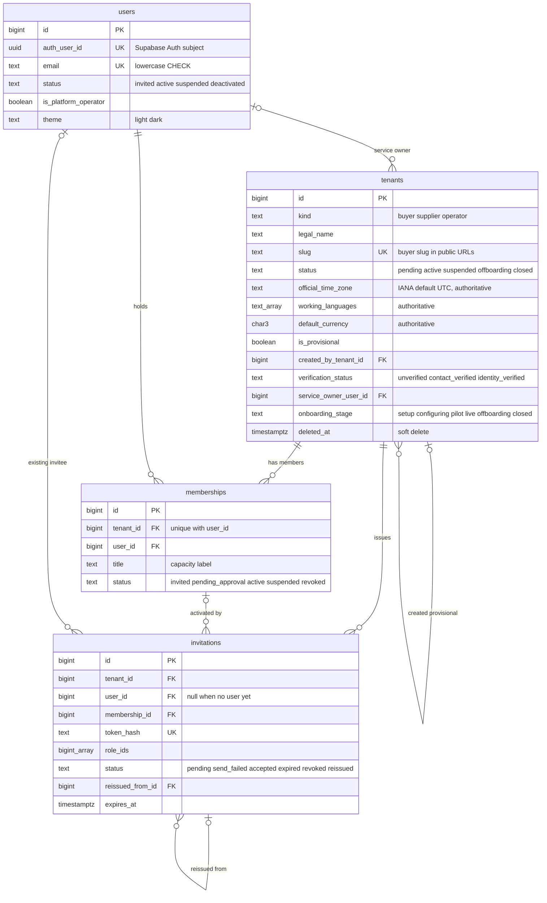
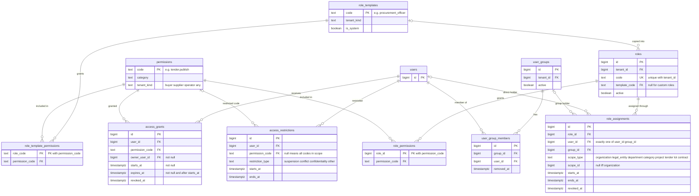
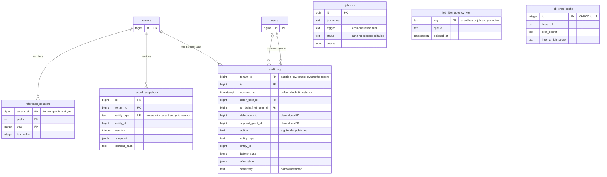
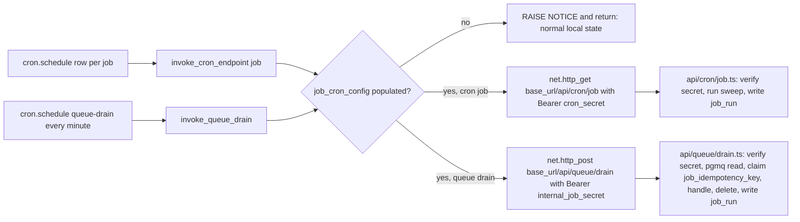
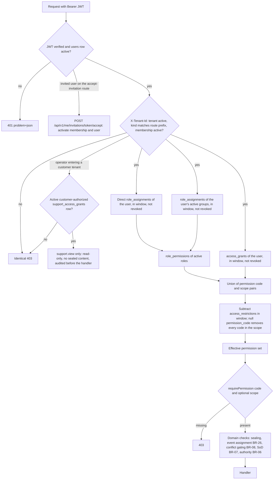

# Platform, Identity and Access Data Model

Status: As-designed (pre-build). Updated to as-built at the end of Stage A and Stage B.

Sources:
- `docs/plan/design-decisions.md`: DD-01 (forward foreign keys from `audit_log`), DD-06 (`invitations.role_ids`, `job_run.status`), DD-09 (reference formats), DD-10 (identity defaults on `tenants`), DD-11 (partition tenant), DD-12 (storage keys), DD-16 (`record_snapshots` owner, exports handler), DD-17 (suppliers → `tenants`), DD-18 (expiry jobs), DD-19 (alert idempotency keys), DD-21 (`/me`), DD-22 (buyer slug), DD-25 (conflict gating), DD-26 (role scope matching), DD-27 (invitation acceptance and supplier registration), DD-29 (MFA deferred), DD-31 (audit content), DD-37 (language), DD-43 (real Supabase Auth in the local Docker stack from Stage A; demo persona accounts; `lib/config`, `lib/supabase` and `lib/auth/verify.ts` written in Stage A), DD-44 (Mailpit locally; the same SMTP credentials will serve Supabase Auth hosted); §E owner decisions of 2026-09-29 (items 6 and 7). DD-38 is withdrawn
- `docs/plan/schema-blueprint.md`: §0 Conventions; Migration 00 (`20261001000000_extensions.sql`); Migration 01 (`20261001000100_platform_core.sql`) including the job platform, queues and storage buckets; Migration 14 (grants and schedules); §P role templates
- `docs/plan/architecture-plan.md` (revision 3): §0 Delivery stages, §3.1 Tenancy (operator support access), §3.2 Authorization model, §3.5 Versioning and audit, §3.9 Background jobs, §3.11 Prototype mode, §4 Repository layout and registries, §5 Build waves (A1 `mock-platform`, B1 ownership), §6 Domain map (domain 01), §11 items 4 (supplier self-registration) and 8 (Stage A authentication)
- `docs/plan/email-delivery-options.md`: §1 (Supabase Auth emails), §2 (local Mailpit)
- `docs/plan/tenderiq-prototype.workflow.js`: `mock-platform` task (`seed-auth-personas.ts`, JWT verification, persona mapping). `docs/plan/tenderiq-backend.workflow.js`: `platform-data-auth` task (extends the Stage A auth modules; demo module `00-platform.ts`), domain 03 notes (public registration)
- `docs/architecture-brief.md`: §5.1 Request pipeline, §5.6 Database access and tenant scoping, §5.7 Authentication, §5.8 Authorization, §5.9 File storage, §6.2 Multi-tenant pattern, §6.3 Data API lockdown, §9 Background jobs, §13 Environments
- `docs/PRD.md`: §4.1 User roles, §4.2 Permission principles, §5.1–§5.3 (FR-01, FR-02, FR-03), §18.2 Decision evidence; BR-02, BR-09, BR-38; screens COM-01..03, ADM-03, ADM-04, OPS-01
- `docs/plan/demo-storyline.md`: organizations and personas used in examples

Contents:
1. [Scope and ownership](#1-scope-and-ownership)
2. [Migration 00: extensions and set_updated_at](#2-migration-00-extensions-and-set_updated_at)
3. [Entity-relationship diagrams](#3-entity-relationship-diagrams)
4. [Organizations and people](#4-organizations-and-people)
5. [Permission catalog and roles](#5-permission-catalog-and-roles)
6. [Groups, assignments, grants and restrictions](#6-groups-assignments-grants-and-restrictions)
7. [References, snapshots and audit](#7-references-snapshots-and-audit)
8. [Job platform tables](#8-job-platform-tables)
9. [SQL functions and triggers](#9-sql-functions-and-triggers)
10. [pgmq queues and storage buckets](#10-pgmq-queues-and-storage-buckets)
11. [Effective-permission resolution](#11-effective-permission-resolution)
12. [Open points](#12-open-points)

Conventions (standard columns, dictionary legend, tags) are defined in [README.md](README.md).

---

## 1. Scope and ownership

This file covers Migration 00 (extensions and the `set_updated_at()` trigger function) and the 20 tables of Migration 01. None of them is sealed. In Stage B, the schema agents (`schema-w1/w2/w3`, then `schema-apply`) write the migrations. `platform-data-auth` builds the platform modules over these tables: `lib/db`, `lib/tenancy`, `lib/permissions`, `lib/audit`, `lib/storage`, `domains/session` and `jobs/**`. It **extends** `lib/supabase` and `lib/auth` from Stage A with the auth middleware that resolves an active `users` row and the invited-user exception (DD-27), and `platform-http` extends `lib/config` to every server variable (architecture-plan §5, phase B1). The identity and org-admin domain backends (phase B3, domain 01) implement the administration endpoints.

**Stage A.** These tables do not exist in Stage A. Authentication is nevertheless real: the local Supabase CLI stack runs in Docker from Stage A, and Stage A uses only its Auth service (DD-43; architecture-plan §3.11).
- `npm run auth:personas` (`scripts/dev/seed-auth-personas.ts`) creates or updates every demo persona in local Supabase Auth through the Admin API. It is idempotent and refuses to run against anything that is not local.
- The SPA signs in with supabase-js exactly as in production. There is no mock auth adapter, no persona switcher and no `VITE_AUTH_MODE` (DD-38 is withdrawn).
- The mock API verifies the Supabase JWT with the real `src/server/lib/auth/verify.ts`, using the real `lib/config` and `lib/supabase` written in Stage A by the A1 agent `mock-platform`. It then maps the verified email to its fixture persona (`src/mock-api/fixtures/platform.ts`), which stands in for the `users`, `memberships` and role rows. An unknown account gets 401.
- The shared `session` and `audit` contracts serve the shell. The mock API enforces each endpoint's declared permission against the persona's fixture permission set (architecture-plan §3.2, §5).

The owners below follow the domain map (architecture-plan §6, domain 01 "identity + org-admin") and the shared owners of architecture-plan §4 and DD-16. The plan does not name the split between `identity` and `org-admin` table by table, so that part of the assignment is the documented intent. It is confirmed as-built at the end of Stage B.

| Table | Tag | mut | Sealed | Owning domain / module | PRD |
|---|---|---|---|---|---|
| `tenants` | `[G]` | yes | no | identity. Cross-domain writers named in architecture-plan §4 and DD-17: operations (onboarding, which creates buyer tenants; provisional supplier tenants created by imports) and suppliers (buyer-created provisional supplier records; the pending tenant created by supplier registration, DD-27) | FR-01, FR-02, BR-02, OPS-01, OPS-02 |
| `users` | `[G]` | yes | no | identity. `session` serves `/me/context` and `/me/theme` | FR-03, BR-38, COM-01, COM-03 |
| `memberships` | `[T]` | yes | no | identity | FR-03, BR-02, COM-02, ADM-03, AC-02 |
| `invitations` | `[T]` | yes | no | identity | FR-03, COM-01, ADM-03 |
| `permissions` | `[G]` | no | no | `supabase/seed.sql` (code-owned catalog); read by `lib/permissions` | §4.2 |
| `role_templates` | `[G]` | no | no | `supabase/seed.sql` | §4.1 |
| `role_template_permissions` | `[G]` | no | no | `supabase/seed.sql` | §4.1 |
| `roles` | `[T]` | yes | no | org-admin | ADM-04 |
| `role_permissions` | `[T]` | no | no | org-admin | ADM-04 |
| `user_groups` | `[T]` | yes | no | org-admin | §4.2, ADM-04 |
| `user_group_members` | `[T]` | no | no | org-admin | ADM-04 |
| `role_assignments` | `[T]` | yes | no | org-admin | §4.2, ADM-03, ADM-04 |
| `access_grants` | `[T]` | yes | no | org-admin | §4.2, ADM-04 |
| `access_restrictions` | `[T]` | yes | no | org-admin | §4.2, ADM-04, BR-08 |
| `reference_counters` | `[T]` | no | no | platform (`lib/db`), written only by `next_reference()` | — |
| `record_snapshots` | `[T]` | no | no | lifecycle (core service), which domains that version records call (DD-16) | BR-09, §18.2 |
| `audit_log` | `[P]` | no | no | audit (`lib/audit` writes, `domains/audit` reads) | §18.2, BR-38, ADM-14 |
| `job_run` | `[G]` | no | no | platform jobs (`src/server/jobs`) | — |
| `job_idempotency_key` | `[G]` | no | no | platform jobs (queue drain; alert deduplication by state-less sweeps, DD-19) | — |
| `job_cron_config` | `[G]` | no | no | platform jobs; written by `npm run db:cron:configure` | — |

---

## 2. Migration 00: extensions and set_updated_at

File `20261001000000_extensions.sql` is the lowest-timestamp migration. It installs extensions by migration, never from the dashboard, so every environment has them (brief §6.1):

| Statement | Effect |
|---|---|
| `create schema if not exists extensions` | Schema that holds `pg_net`'s registration |
| `create extension if not exists pg_cron` | Installs into schema `cron`. Schedules are created by Migration 14 |
| `create extension if not exists pg_net with schema extensions` | Registered in `extensions`, but its **functions live in schema `net`** (`net.http_get`, `net.http_post`). Calling `extensions.http_get` fails silently at the scheduled minute (brief §9.1) |
| `create extension if not exists pgmq` | Installs into schema `pgmq`. Queues are created in Migration 01 |
| `set_updated_at()` | Trigger function that maintains `updated_at` on every mut table |

---

## 3. Entity-relationship diagrams

### 3.1 Organizations, people and invitations

### 3.2 Authorization

### 3.3 References, snapshots, audit and job state

---

## 4. Organizations and people

### tenants `[G]`

**Tag** `[G]` · **mut** yes · **Sealed** no · **Owner** identity (writer exceptions: operations, suppliers) · **PRD** FR-01, FR-02, BR-02, OPS-01, OPS-02

One row per organization of any kind: buyer, supplier or platform operator ([ADR-0001](../adr/0001-tenancy-equals-organization.md)). Every `[T]` table references it. `[G]` tables that name a customer organization reference it through `customer_tenant_id`, never `tenant_id` (DD-04). The demo world has one operator (`tenderiq-ops`), two buyers (`kwu`, `odc`) and six suppliers.

`tenants` is authoritative for an organization's `official_time_zone`, `working_languages` and `default_currency`. `org_settings` keeps only procurement configuration (DD-10; [02-organization-policy.md](02-organization-policy.md#org_settings-t)).

**Writers.** identity owns the table. operations writes buyer tenants during onboarding and provisional supplier tenants during imports. suppliers writes buyer-created provisional supplier records (DD-17). Supplier registration creates the tenant (status `pending`), the user (`invited`), a pending membership and the supplier profile in **one transaction**, which **commits**. **After the commit**, it calls the Supabase Auth Admin invite, because brief §5.6 forbids network calls inside a transaction. If the invite fails, a short follow-up transaction sets the registrant’s `invitations` row to `send_failed`; the state guard allows a retry, and the registrant sees "we could not send the verification email — try again". A "resend verification" action and the unique `users.email` constraint prevent duplicates. Abandoned pending registrations stay visible to operators in the supplier registration and duplicate review, where they can be closed (DD-27; [ADR-0012](../adr/0012-supplier-registration-via-provisioned-accounts.md)). The owner confirmed this approach on 2026-09-29: public registration posts to the TenderIQ API, and Supabase self-signup stays disabled (`enable_signup = false`) (architecture-plan §11 item 4; design-decisions §E item 7). The verification / set-password email lands in Mailpit locally (architecture-plan §11 item 4; DD-43).

| Column | Type | Null | Key / constraint | Meaning |
|---|---|---|---|---|
| `id` | bigint | not null | PK, identity | std |
| `created_at` | timestamptz | not null | default now() | std |
| `created_by` | bigint | null | FK → users | std; null = system action |
| `updated_at` | timestamptz | not null | default now(); `set_updated_at()` | mut |
| `kind` | text | — | CHECK (buyer, supplier, operator) | Organization kind. The tenant middleware requires the active tenant's kind to match the route prefix (architecture-plan §3.1) |
| `legal_name` | text | not null | btree index on `lower(legal_name)` (no trigram index) | Registered legal name |
| `trading_name` | text | — | | Trading name |
| `slug` | text | — | UK | URL-safe natural key (e.g. `kwu`). References are unique per buyer, so public and supplier URLs carry the buyer slug: `/b/:buyerSlug`, `/opportunities/:buyerSlug/:ref`, `/awards/:buyerSlug/:ref`, `/clarifications/:buyerSlug/:ref` (DD-22). Also the natural key of demo seeds |
| `status` | text | — | CHECK (pending, active, suspended, offboarding, closed); default active | Account state. The tenant middleware requires an active tenant (brief §5.1) |
| `country` | char(2) | — | | Two-letter country code |
| `registration_jurisdiction` | text | — | | Jurisdiction of registration (FR-02) |
| `registration_number` | text | — | | Business registration identifier |
| `tax_identifier` | text | — | | Tax identifier |
| `default_currency` | char(3) | — | CHECK `^[A-Z]{3}$` | Default currency (demo: BWP). Authoritative for the organization (DD-10) |
| `official_time_zone` | text | — | default 'UTC' | IANA zone (demo: `Africa/Gaborone`). Authoritative for the organization (DD-10). The year segment of `next_reference` is the year in this zone (DD-09) |
| `working_languages` | text[] | — | default '{en}' | Working languages. Authoritative for the organization (DD-10). The UI is English only in this release (DD-37) |
| `is_provisional` | boolean | — | default false | Supplier record created by a buyer before the supplier registers (FR-02) |
| `created_by_tenant_id` | bigint | — | FK → tenants | Tenant that created a provisional record |
| `verification_status` | text | — | CHECK (unverified, contact_verified, identity_verified); default unverified | Verification of the organization. FR-02 keeps contact verification, membership approval, identity verification and qualification separate (BR-03) |
| `plan_code` | text | — | | Commercial plan (buyers) |
| `service_owner_user_id` | bigint | — | FK → users | Operator-side service owner (OPS-01) |
| `onboarding_stage` | text | — | CHECK (setup, configuring, pilot, live, offboarding, closed) | Customer onboarding/offboarding stage (OPS-01, OPS-02) |
| `deleted_at` | timestamptz | null | | Soft delete. This is the only soft-deleted table (brief §6.2) |

Indexes and triggers: `(kind, status)`; btree `lower(legal_name)`; `after insert` trigger calling `ensure_tenant_partitions(new.id)` (§9); `set_updated_at`.

### users `[G]`

**Tag** `[G]` · **mut** yes · **Sealed** no · **Owner** identity · **PRD** FR-03, BR-38, COM-01, COM-03

One person. A user is global and may hold memberships in many tenants (AC-02). The demo person `sam.dual` is an evaluator at `kwu` and a contributor at `tsodilo` and `chobe-pipe`.

| Column | Type | Null | Key / constraint | Meaning |
|---|---|---|---|---|
| `id` | bigint | not null | PK, identity | std |
| `created_at` | timestamptz | not null | default now() | std |
| `created_by` | bigint | null | FK → users | std |
| `updated_at` | timestamptz | not null | default now(); `set_updated_at()` | mut |
| `auth_user_id` | uuid | not null | UK | Supabase Auth user id (the verified JWT `sub`). Authentication maps the token to this row (brief §5.7). In Stage A, before this table exists, the mock API maps the verified email to a fixture persona instead (DD-43) |
| `email` | text | — | UK; CHECK lower-case | Sign-in email, stored lower-case ("citext-like") |
| `full_name` | text | — | | Display name |
| `phone` | text | — | | Contact phone |
| `locale` | text | — | default 'en' | UI language. English only in this release; UI strings go through per-feature catalogs so languages can be added later (DD-37) |
| `display_time_zone` | text | — | | Personal zone for local-time assistance. Official deadlines always show the tender zone (BR-11) |
| `status` | text | — | CHECK (invited, active, suspended, deactivated) | Account state. An unknown or inactive user gets 401 (brief §5.7). An `invited` user may call only `POST /api/v1/me/invitations/:token/accept` (DD-27) |
| `is_platform_operator` | boolean | — | default false | Operator staff flag |
| `last_seen_at` | timestamptz | — | | Last activity |
| `deactivated_at` | timestamptz | — | | Deactivation time. Historical actions stay attributed to the user (FR-03, BR-38; demo `former.officer`) |
| `theme` | text | — | CHECK (light, dark); default light | UI theme, set through `/me/theme` |

Accounts are provisioned through the Supabase Auth Admin API, because self-signup is disabled. Supplier self-registration uses the same route ([ADR-0012](../adr/0012-supplier-registration-via-provisioned-accounts.md)), as the owner decided on 2026-09-29 (design-decisions §E item 7).
- **Auth emails.** Locally, emails from Supabase Auth go to Mailpit in the local Supabase Docker stack (`http://127.0.0.1:54324`). In Stage A only password-reset emails arrive there: the demo accounts are created already confirmed by `npm run auth:personas`, and the mock API persists nothing and never calls the Auth Admin invite. Invitation and registration emails arrive from Stage B, when the real API calls the Auth Admin invite (DD-43). Hosted Supabase needs a custom SMTP provider; that provider is deferred, and the same SMTP credentials will serve Supabase Auth and the app's `email` delivery channel (DD-44; `docs/plan/email-delivery-options.md` §1).
- **Demo accounts.** The demo personas exist as local Supabase Auth accounts from Stage A (`npm run auth:personas`). In local development builds only (`import.meta.env.DEV`), the sign-in page lists them for one-click sign-in; production builds exclude that list, and `scan-bundle` checks it (DD-43). In Stage B, `scripts/db/demo/00-platform.ts` links those existing accounts, or creates them, and then writes the `users` rows, memberships and role assignments with the same emails as `src/mock-api/fixtures/platform.ts` (Stage B `platform-data-auth` task).

MFA and step-up sign-in are not in the initial release (the brief disables MFA), so the table holds no second-factor state. They are recorded as a later extension using Supabase MFA (DD-29).

### memberships `[T]`

**Tag** `[T]` · **mut** yes · **Sealed** no · **Owner** identity · **PRD** FR-03, BR-02, COM-02, ADM-03, AC-02

Links a user to an organization in a named capacity. The tenant middleware validates `X-Tenant-Id` against the user's membership (brief §5.1 step 7). The organization/capacity switcher (COM-02) lists these rows. The personal `/me` lists (tasks, notifications, approvals, documents, search) return the caller's own rows across **all active memberships**, each labelled with its organization. Acting on a row requires `X-Tenant-Id` equal to the row's tenant (DD-21).

| Column | Type | Null | Key / constraint | Meaning |
|---|---|---|---|---|
| `id` | bigint | not null | PK, identity | std |
| `tenant_id` | bigint | not null | FK → tenants; UK (tenant_id, user_id) | Organization |
| `created_at` | timestamptz | not null | default now() | std |
| `created_by` | bigint | null | FK → users | std |
| `updated_at` | timestamptz | not null | default now() | mut |
| `user_id` | bigint | — | FK → users; index (user_id, status) | Member |
| `title` | text | — | | Capacity label shown when acting, e.g. "Procurement Officer" (BR-02) |
| `status` | text | — | CHECK (invited, pending_approval, active, suspended, revoked) | Membership state (FR-03) |
| `invited_by` | bigint | — | FK → users | Inviter |
| `approved_by` | bigint | — | FK → users | Approver of a membership request |
| `joined_at` | timestamptz | — | | Activation time |
| `ended_at` | timestamptz | — | | End time |
| `end_reason` | text | — | | Why the membership ended |

### invitations `[T]`

**Tag** `[T]` · **mut** yes · **Sealed** no · **Owner** identity · **PRD** FR-03, COM-01 (`/invite/:token`), ADM-03

An invitation to join a tenant. An expired invitation is reissued without creating a duplicate identity (FR-03). Acceptance goes through `POST /api/v1/me/invitations/:token/accept`, the one route the auth middleware allows for users in status `invited`. Accepting activates the membership, and the user if needed (DD-27). The hourly `expire-access` job (org-admin) updates the display status of expired invitations and sends notices. Request-time checks compare `expires_at` directly and do not wait for the job (DD-18; architecture-plan §3.9). The invitation email is sent through the Supabase Auth Admin API (`inviteUserByEmail`, Stage B domain 01 notes). Locally it lands in Mailpit, and the `/invite/:token` set-password flow is completed against the real accept endpoint in Stage B (DD-43; Stage B `ui-live-api` task).

| Column | Type | Null | Key / constraint | Meaning |
|---|---|---|---|---|
| `id` | bigint | not null | PK, identity | std |
| `tenant_id` | bigint | not null | FK → tenants | Inviting organization |
| `created_at` | timestamptz | not null | default now() | std |
| `created_by` | bigint | null | FK → users | std |
| `updated_at` | timestamptz | not null | default now() | mut |
| `email` | text | — | | Invitee email |
| `user_id` | bigint | null | FK → users | Existing user, when the invitee already has an account |
| `membership_id` | bigint | — | FK → memberships | Membership the invitation activates |
| `token_hash` | text | — | UK | Hash of the invitation token. The raw token is not stored |
| `role_ids` | bigint[] | — | not FK-enforced | **Tenant role ids** (`roles.id`) to assign on acceptance (DD-06; §12, point 1). The service validates each element |
| `expires_at` | timestamptz | — | | Expiry |
| `status` | text | — | CHECK (pending, send_failed, accepted, expired, revoked, reissued) | Invitation state. `send_failed`: the Auth Admin invite failed after the registration commit; retryable, and a successful resend returns to `pending` (DD-27) |
| `reissued_from_id` | bigint | — | FK → invitations | Previous invitation this one replaces |
| `accepted_at` | timestamptz | — | | Acceptance time |
| `sent_count` | integer | — | | Number of sends |

---

## 5. Permission catalog and roles

The catalog is fixed and code-owned. `supabase/seed.sql` seeds it with conflict-tolerant, transactional inserts (brief §5.8, §6.4). The seeded codes and role templates are listed in [02-organization-policy.md](02-organization-policy.md#9-seeded-permission-catalog-and-role-templates).

### permissions `[G]`

**Tag** `[G]` · **mut** no · **Sealed** no · **Owner** `seed.sql` · **PRD** §4.2

| Column | Type | Null | Key / constraint | Meaning |
|---|---|---|---|---|
| `code` | text | not null | PK | Permission code, e.g. `tender.publish`, `supplier.response.submit`, `support.view` |
| `description` | text | — | | Human description |
| `category` | text | — | | Grouping for administration screens. Seeded values are written in `seed.sql` |
| `tenant_kind` | text | — | CHECK (buyer, supplier, operator, any) | Kind of organization the permission applies to |

### role_templates `[G]`

**Tag** `[G]` · **mut** no · **Sealed** no · **Owner** `seed.sql` · **PRD** §4.1

Global role definitions, copied into each tenant as `roles`.

| Column | Type | Null | Key / constraint | Meaning |
|---|---|---|---|---|
| `code` | text | not null | PK | Template code, e.g. `org_admin`, `bid_manager`, `support_agent` |
| `tenant_kind` | text | — | CHECK list not stated in the blueprint (`permissions.tenant_kind` uses buyer, supplier, operator, any) | Organization kind the template is for |
| `name` | text | — | | Display name |
| `description` | text | — | | Description |
| `is_system` | boolean | — | | System-defined template |

### role_template_permissions `[G]`

**Tag** `[G]` · **mut** no · **Sealed** no · **Owner** `seed.sql` · **PRD** §4.1

The permission matrix of each template. The `schema-apply` agent writes the exact matrix in `seed.sql`, and it must honor the restrictions column of PRD §4.1 (blueprint §P).

| Column | Type | Null | Key / constraint | Meaning |
|---|---|---|---|---|
| `role_code` | text | not null | PK (role_code, permission_code); FK → role_templates.code | Template |
| `permission_code` | text | not null | FK → permissions.code | Granted permission |

### roles `[T]`

**Tag** `[T]` · **mut** yes · **Sealed** no · **Owner** org-admin · **PRD** ADM-04

Per-tenant roles: copies of templates plus custom roles (architecture-plan §3.2).

| Column | Type | Null | Key / constraint | Meaning |
|---|---|---|---|---|
| `id` | bigint | not null | PK, identity | std |
| `tenant_id` | bigint | not null | FK → tenants; UK (tenant_id, code) | Owning organization |
| `created_at` | timestamptz | not null | default now() | std |
| `created_by` | bigint | null | FK → users | std |
| `updated_at` | timestamptz | not null | default now() | mut |
| `code` | text | — | UK (tenant_id, code) | Role code |
| `name` | text | — | | Display name |
| `description` | text | — | | Description |
| `template_code` | text | null | FK → role_templates.code | Source template. Null for custom roles |
| `is_system` | boolean | — | | Copied system role |
| `active` | boolean | — | | Deactivated roles stay visible on history |
| `deactivated_at` | timestamptz | — | | Deactivation time |

### role_permissions `[T]`

**Tag** `[T]` · **mut** no · **Sealed** no · **Owner** org-admin · **PRD** ADM-04

| Column | Type | Null | Key / constraint | Meaning |
|---|---|---|---|---|
| `tenant_id` | bigint | not null | FK → tenants | Owning organization |
| `role_id` | bigint | not null | PK (role_id, permission_code); FK → roles | Role |
| `permission_code` | text | not null | FK → permissions.code | Granted permission |

---

## 6. Groups, assignments, grants and restrictions

### user_groups `[T]`

**Tag** `[T]` · **mut** yes · **Sealed** no · **Owner** org-admin · **PRD** §4.2, ADM-04

Groups simplify assignment. They cannot bypass restrictions on conflicts, authority limits, confidentiality or process stage (PRD §4.2).

| Column | Type | Null | Key / constraint | Meaning |
|---|---|---|---|---|
| `id` | bigint | not null | PK, identity | std |
| `tenant_id` | bigint | not null | FK → tenants | Owning organization |
| `created_at` | timestamptz | not null | default now() | std |
| `created_by` | bigint | null | FK → users | std |
| `updated_at` | timestamptz | not null | default now() | mut |
| `name` | text | — | | Group name |
| `description` | text | — | | Description |
| `active` | boolean | — | | Inactive groups confer nothing |

### user_group_members `[T]`

**Tag** `[T]` · **mut** no · **Sealed** no · **Owner** org-admin · **PRD** ADM-04

| Column | Type | Null | Key / constraint | Meaning |
|---|---|---|---|---|
| `id` | bigint | not null | PK, identity | std |
| `tenant_id` | bigint | not null | FK → tenants | Owning organization |
| `created_at` | timestamptz | not null | default now() | std |
| `created_by` | bigint | null | FK → users | std |
| `group_id` | bigint | — | FK → user_groups | Group |
| `user_id` | bigint | — | FK → users | Member |
| `added_by` | bigint | — | FK → users | Who added the member |
| `added_at` | timestamptz | — | | When the member was added |
| `removed_at` | timestamptz | — | | Removal time. Membership history is kept |

### role_assignments `[T]`

**Tag** `[T]` · **mut** yes · **Sealed** no · **Owner** org-admin · **PRD** §4.2, ADM-03, ADM-04

A scoped, dated grant of a role to a user or a group (PRD §4.2: organization, legal entity, department, category, project, event, lot or contract).

| Column | Type | Null | Key / constraint | Meaning |
|---|---|---|---|---|
| `id` | bigint | not null | PK, identity | std |
| `tenant_id` | bigint | not null | FK → tenants | Owning organization |
| `created_at` | timestamptz | not null | default now() | std |
| `created_by` | bigint | null | FK → users | std |
| `updated_at` | timestamptz | not null | default now() | mut |
| `role_id` | bigint | — | FK → roles | Assigned role |
| `user_id` | bigint | null | FK → users; CHECK exactly one of user_id / group_id | Direct holder |
| `group_id` | bigint | null | FK → user_groups | Group holder |
| `scope_type` | text | — | CHECK (organization, legal_entity, department, category, project, tender, lot, contract); default organization | Scope kind |
| `scope_id` | bigint | null | Null iff scope_type = organization; polymorphic (not FK) | Scoped record: `legal_entities`, `departments`, `categories`, `procurement_projects`, `tenders`, `lots` or `contracts`. How a scope covers a tender, lot or contract is fixed by DD-26 (§11) |
| `starts_at` | timestamptz | — | default now() | Validity start |
| `ends_at` | timestamptz | — | | Validity end (open-ended when null) |
| `granted_by` | bigint | — | FK → users | Grantor. Nobody can grant what they do not hold (architecture-plan §3.2) |
| `revoked_at` | timestamptz | — | | Revocation time |
| `revoked_by` | bigint | — | FK → users | Revoker |
| `reason` | text | — | | Reason for the assignment or revocation |

### access_grants `[T]`

**Tag** `[T]` · **mut** yes · **Sealed** no · **Owner** org-admin · **PRD** §4.2, ADM-04

A direct exceptional grant of one permission. PRD §4.2 requires an owner, a reason, a start and an expiry. Request-time checks always compare `starts_at`, `expires_at` and `revoked_at` directly. The hourly `expire-access` job (org-admin) only updates display statuses and sends notices for expired grants (DD-18; architecture-plan §3.9).

| Column | Type | Null | Key / constraint | Meaning |
|---|---|---|---|---|
| `id` | bigint | not null | PK, identity | std |
| `tenant_id` | bigint | not null | FK → tenants | Owning organization |
| `created_at` | timestamptz | not null | default now() | std |
| `created_by` | bigint | null | FK → users | std |
| `updated_at` | timestamptz | not null | default now() | mut |
| `user_id` | bigint | — | FK → users | Recipient |
| `permission_code` | text | — | FK → permissions.code | Granted permission |
| `scope_type` | text | — | CHECK list not restated in the blueprint (role_assignments uses the eight scope kinds) | Scope kind |
| `scope_id` | bigint | — | Polymorphic (not FK) | Scoped record |
| `reason` | text | not null | | Business reason |
| `owner_user_id` | bigint | not null | FK → users | Accountable owner of the exception |
| `starts_at` | timestamptz | not null | | Start |
| `expires_at` | timestamptz | not null | CHECK (expires_at > starts_at) | Mandatory expiry |
| `revoked_at` | timestamptz | — | | Early revocation |
| `revoked_by` | bigint | — | FK → users | Revoker |

### access_restrictions `[T]`

**Tag** `[T]` · **mut** yes · **Sealed** no · **Owner** org-admin · **PRD** §4.2, ADM-04, BR-08

An explicit restriction. It wins over every role, group and grant (PRD §4.2: "explicit restrictions, active suspensions, conflict restrictions … take precedence"). Request-time checks compare `starts_at` and `ends_at` directly. The `expire-access` job only updates display statuses and sends notices for ended restrictions (DD-18).

| Column | Type | Null | Key / constraint | Meaning |
|---|---|---|---|---|
| `id` | bigint | not null | PK, identity | std |
| `tenant_id` | bigint | not null | FK → tenants | Owning organization |
| `created_at` | timestamptz | not null | default now() | std |
| `created_by` | bigint | null | FK → users | std |
| `updated_at` | timestamptz | not null | default now() | mut |
| `user_id` | bigint | — | FK → users | Restricted user |
| `permission_code` | text | null | FK → permissions.code | Restricted permission. Null = every permission in the scope |
| `scope_type` | text | — | CHECK list not restated in the blueprint | Scope kind |
| `scope_id` | bigint | — | Polymorphic (not FK) | Scoped record |
| `reason` | text | — | | Reason |
| `restriction_type` | text | — | CHECK (suspension, conflict, confidentiality, other) | Kind of restriction |
| `starts_at` | timestamptz | — | | Start |
| `ends_at` | timestamptz | — | | End (open-ended when null) |
| `imposed_by` | bigint | — | FK → users | Who imposed it |

---

## 7. References, snapshots and audit

### reference_counters `[T]`

**Tag** `[T]` · **mut** no · **Sealed** no · **Owner** platform (`lib/db`) · **PRD** —

Per-tenant, per-prefix, per-year counters behind `next_reference()` (README §2.6). Contract change requests do not use it: `change_requests.number` is a per-contract integer computed as `max + 1` under a `SELECT … FOR UPDATE` lock on the contract row, and displayed as `CR-0001` (DD-09).

| Column | Type | Null | Key / constraint | Meaning |
|---|---|---|---|---|
| `tenant_id` | bigint | not null | PK (tenant_id, prefix, year); FK → tenants | Tenant |
| `prefix` | text | not null | PK | Reference prefix: `PR`, `PP`, `QA`, `T`, `C`, `RCPT`, `CMP` (DD-09) |
| `year` | integer | not null | PK | Year segment of the reference: the year in the tenant's official time zone (`tenants.official_time_zone`), not the UTC year (DD-09) |
| `last_value` | integer | — | | Last number issued |

### record_snapshots `[T]`

**Tag** `[T]` · **mut** no · **Sealed** no · **Owner** lifecycle (core service, DD-16) · **PRD** BR-09, §18.2

Immutable versions of records (BR-09). The lifecycle (core) service owns the table, and domains that version records write snapshots through it (DD-16; architecture-plan §4). `tender_versions.snapshot_id`, `evaluation_reports.snapshot_id` and `award_recommendations.snapshot_id` reference it. A correction writes a new version and never updates an old one (architecture-plan §3.5).

| Column | Type | Null | Key / constraint | Meaning |
|---|---|---|---|---|
| `id` | bigint | not null | PK, identity | std |
| `tenant_id` | bigint | not null | FK → tenants; UK (tenant_id, entity_type, entity_id, version) | Owning tenant |
| `created_at` | timestamptz | not null | default now() | std; the snapshot time |
| `created_by` | bigint | null | FK → users | std |
| `entity_type` | text | — | | Versioned record type |
| `entity_id` | bigint | — | Polymorphic (not FK) | Versioned record id |
| `version` | integer | — | | Version number |
| `snapshot` | jsonb | — | | Immutable content (JSONB policy: snapshot) |
| `content_hash` | text | — | | Hash of the content. Approvals bind to it (`approval_requests.content_hash`). The hash algorithm is finalized in Stage B |
| `reason` | text | — | | Why the snapshot was taken |

### audit_log `[P]`

**Tag** `[P]` · **mut** no · **Sealed** no · **Owner** audit (`lib/audit` writes; `domains/audit` reads for ADM-14) · **PRD** §18.2, BR-38, ADM-14

The append-only business audit trail: who acted, in which capacity, on behalf of whom, under which delegation, on which record, when, why, and with what previous and new state (PRD §18.2; architecture-plan §3.5). It is partitioned by tenant (partition `audit_log_t<tenant id>`). Nothing may reference it, and no foreign key is created *from* it: `delegation_id` and `support_grant_id` are plain ids (DD-01). Cross-tenant access by privileged internal users, including operator support access, is audited **before** the handler runs (brief §5.1; architecture-plan §3.1).

**Partition tenant (DD-11).** A row goes to the tenant that **owns the affected record**:
- A supplier submitting a bid on a buyer-owned row is audited in the buyer's partition, and `actor_capacity` names the supplier organization.
- Actions on `[G]` records (for example support cases or subscriptions) go to the operator tenant.
- Support-access events are written to the **customer** tenant, so the customer can review them.

**Sealed records (DD-31).** `before_state` and `after_state` never contain sealed content or evaluator scores. Those actions record ids and hashes only, with `sensitivity = 'restricted'`. The audit viewer (ADM-14) shows restricted rows only to `audit.view` holders, redacted to metadata.

| Column | Type | Null | Key / constraint | Meaning |
|---|---|---|---|---|
| `tenant_id` | bigint | not null | PK (tenant_id, id); FK → tenants; partition key | Tenant whose partition holds the row: the tenant that owns the affected record (DD-11) |
| `id` | bigint | not null | PK, identity | Row id |
| `created_at` | timestamptz | not null | default now() | std (see README §2.1) |
| `created_by` | bigint | null | FK → users | std |
| `occurred_at` | timestamptz | — | default clock_timestamp() | True event time, not transaction start (README §2.5) |
| `actor_user_id` | bigint | — | FK → users | Acting person |
| `actor_capacity` | text | — | | Capacity the actor acted in (BR-02). Names the supplier organization when a supplier acts on a buyer-owned record (DD-11) |
| `on_behalf_of_user_id` | bigint | — | FK → users | Person on whose behalf the action was taken |
| `delegation_id` | bigint | — | Plain id, no FK (partitioned table, DD-01) | Delegation used (`delegations`, Migration 02) |
| `support_grant_id` | bigint | — | Plain id, no FK (partitioned table, DD-01) | Operator support grant used (`support_access_grants`, Migration 13) |
| `action` | text | — | | Dotted action code, e.g. `tender.published` |
| `entity_type` | text | — | index (tenant_id, entity_type, entity_id) | Affected record type |
| `entity_id` | bigint | — | Polymorphic (not FK) | Affected record id |
| `reason` | text | — | | Stated reason |
| `before_state` | jsonb | — | | Previous state (JSONB policy: audit). Never sealed content or evaluator scores (DD-31) |
| `after_state` | jsonb | — | | New state. Never sealed content or evaluator scores (DD-31) |
| `correlation_id` | text | — | | Request or job correlation id (`x-correlation-id`) |
| `sensitivity` | text | — | CHECK (normal, restricted) | `restricted` for actions on sealed records or scores, which record ids and hashes only. Restricted rows are shown only to `audit.view` holders, redacted to metadata (DD-31) |

Indexes: `(tenant_id, entity_type, entity_id)`, `(tenant_id, occurred_at desc)`, `(tenant_id, actor_user_id)`.

---

## 8. Job platform tables

The tables below support the scheduling and queue model in brief §9. [08-background-jobs.md](../08-background-jobs.md) lists the jobs.

A rejected secret returns an identical 401, writes no `job_run` row and performs no queue read (brief §9.2).

### job_run `[G]`

**Tag** `[G]` · **mut** no · **Sealed** no · **Owner** platform jobs · **PRD** —

One row per execution attempt (brief §9.3). `npm run jobs:status` reads it.

| Column | Type | Null | Key / constraint | Meaning |
|---|---|---|---|---|
| `id` | bigint | not null | PK, identity | std |
| `created_at` | timestamptz | not null | default now() | std |
| `created_by` | bigint | null | FK → users | std; null for scheduled runs |
| `job_name` | text | — | | Job name, matching `jobs/cron/registry.ts` |
| `trigger` | text | — | CHECK (cron, queue, manual) | What started the run |
| `environment` | text | — | CHECK (local, dev, preview, staging, production) | `APP_ENV` of the run |
| `correlation_id` | text | — | | Correlation id |
| `started_at` | timestamptz | — | | Start |
| `finished_at` | timestamptz | — | | End |
| `duration_ms` | integer | — | | Duration (type open: integer or bigint) |
| `status` | text | — | CHECK (running, succeeded, failed) | Outcome. An endpoint for a job that is not yet implemented writes `failed` and returns 501; there is no `not_implemented` value (DD-06; brief §9.3) |
| `error_message` | text | — | | Failure message: ids and counts only, no secrets or PII |
| `counts` | jsonb | — | | Per-run counts, including partial counts and failing ids (JSONB policy: job counts) |

### job_idempotency_key `[G]`

**Tag** `[G]` · **mut** no · **Sealed** no · **Owner** platform jobs · **PRD** —

Dedupe keys for queue messages. Per message, the drain claims the key (`INSERT … ON CONFLICT DO NOTHING`), runs the handler and acks, all in one transaction. A duplicate delivery finds the key claimed and is skipped. A failed attempt rolls back the claim (brief §9.5). State-less sweeps also deduplicate their alerts here, with keys of the form `<job>:<entity>:<window>` (DD-19).

| Column | Type | Null | Key / constraint | Meaning |
|---|---|---|---|---|
| `key` | text | not null | PK | Queue messages: unique per **event**, not per entity, e.g. `{entityId}:{historyRowId}`. Sweep alerts: `<job>:<entity>:<window>` (DD-19) |
| `queue` | text | — | | Queue name (`notifications`, `exports`) |
| `claimed_at` | timestamptz | — | | Claim time |

### job_cron_config `[G]`

**Tag** `[G]` · **mut** no · **Sealed** no · **Owner** platform jobs · **PRD** —

A single row holding the callback origin and secrets that pg_cron uses. Migration 01 creates it **empty**. No migration or seed ever populates it. `npm run db:cron:configure -- --env=<env>` (run by CI's migrate job) or an operator's SQL writes it. It is revoked from `public`, `anon`, `authenticated` and `service_role`. Only `postgres` and the `SECURITY DEFINER` helpers read it. Clearing it pauses all jobs (brief §9.1, §13).

| Column | Type | Null | Key / constraint | Meaning |
|---|---|---|---|---|
| `id` | integer | not null | PK; CHECK (id = 1) | Enforces a single row |
| `base_url` | text | — | | Stable deployed origin (`JOB_CRON_BASE_URL`), never a per-deployment preview URL |
| `cron_secret` | text | — | | Bearer secret for `/api/cron/*` (`CRON_SECRET`) |
| `internal_job_secret` | text | — | | Bearer secret for `/api/queue/drain` (`INTERNAL_JOB_SECRET`), distinct from `cron_secret` |

---

## 9. SQL functions and triggers

| Function | Migration | Security | Called by | Behavior |
|---|---|---|---|---|
| `set_updated_at()` | 00 | Not stated | Trigger on every mut table | Maintains `updated_at` when a row is updated |
| `next_reference(p_tenant bigint, p_prefix text) returns text` | 01 | Not stated | Domain services creating referenced records (not `change_requests`, DD-09) | Locks the `reference_counters` row for (tenant, prefix, year) with `SELECT … FOR UPDATE` inside the caller's transaction, increments `last_value` and returns the formatted reference. The year is the year in the tenant's official time zone (DD-09; README §2.6) |
| `ensure_tenant_partitions(p_tenant_id bigint)` | 01 | `SECURITY DEFINER`, pinned `search_path` | `after insert on tenants` trigger; re-callable for backfill | Finds every table in `pg_partitioned_table` partitioned by `tenant_id` and runs `CREATE TABLE IF NOT EXISTS <table>_t<id>` for the tenant (README §3.4) |
| `invoke_cron_endpoint(job text)` | 01 | `SECURITY DEFINER`, `search_path` = `public, extensions` | `cron.schedule` rows (Migration 14) | Reads `job_cron_config`. If it is empty, `RAISE NOTICE` and return. Otherwise calls `net.http_get` on `<base_url>/api/cron/<job>` with `Authorization: Bearer <cron_secret>` |
| `invoke_queue_drain()` | 01 | `SECURITY DEFINER`, `search_path` = `public, extensions` | `queue-drain` schedule, `* * * * *` | Same guard. Calls `net.http_post` on `<base_url>/api/queue/drain` with `Authorization: Bearer <internal_job_secret>` |

Rules (brief §6.3, §9.1):
- Every `SECURITY DEFINER` function explicitly revokes `anon` and `authenticated` and pins `search_path`.
- **Standing rule:** a `SECURITY DEFINER` function that calls an extension function has an integration test that **executes** it. Inspecting `prosrc` or catalog rows is not enough.
- Locally, `pg_net` inside Docker cannot reach the host dev server, so `job_cron_config` stays empty and the schedules are deliberate no-ops. Jobs run locally through `npm run cron:run -- <job>` and `npm run queue:worker` (brief §7.5).

The delegation-limit trigger belongs to Migration 02 and is documented in [02-organization-policy.md](02-organization-policy.md#delegations-t).

---

## 10. pgmq queues and storage buckets

### 10.1 Queues

Migration 01 runs `select pgmq.create('notifications'); select pgmq.create('exports');`. Each call also creates the archive table `pgmq.a_<queue>`, which serves as the dead-letter queue (brief §9.5).

| Queue | Archive | Purpose (architecture-plan §3.8, §3.9) |
|---|---|---|
| `notifications` | `pgmq.a_notifications` | Notification fan-out and delivery ([03-shared-services.md](03-shared-services.md)). The `notice-reconciliation` job re-enqueues notice recipients still `pending` after 10 minutes (DD-19) |
| `exports` | `pgmq.a_exports` | Evidence packs, receipts, evaluation and award reports, handovers and report exports. The handler belongs to the documents service (`requestExport()`), with per-type generators registered by domains in `documents/export-registry.ts` (DD-16; [12-records-reporting-operations.md](12-records-reporting-operations.md)) |

Message lifecycle: `pgmq.send`, then `pgmq.read(queue, vt_seconds, qty)`, then the handler, then `pgmq.delete` (ack). A failure leaves the message to reappear after its visibility timeout. After `max_attempts` (for example 5) the message is archived. An unparseable message is archived immediately. An unknown message type is retried. Payloads carry ids only and the tenant id travels on the envelope. Producers publish after their business transaction commits (brief §9.5).

### 10.2 Storage buckets

Migration 01 inserts the buckets into `storage.buckets` with `public = false`. They are never created by hand (brief §5.9).

| Bucket id | Intended content (from the bucket name) |
|---|---|
| `tender-documents` | Buyer tender packages and published tender documents |
| `bid-submissions` | Supplier bid files |
| `supplier-evidence` | Supplier evidence items |
| `contract-documents` | Contract and performance documents |
| `exports` | Generated exports and evidence packs |

- Size limits are set per bucket. The values are finalized in Stage B.
- Which bucket each `documents.related_type` uses is finalized in Stage B. `document_versions.bucket` records the bucket that holds each version ([03-shared-services.md](03-shared-services.md#document_versions-t)).
- Object keys follow `<owning-record tenant_id>/<related_type>/<related_id>/<document_id>/<version_no>-<sanitized name>` (DD-12). The buyer tenant owns procurement records even for supplier uploads, so a supplier's bid file sits under the buyer's prefix. `documents.owner_tenant_id` records who uploaded ([03-shared-services.md](03-shared-services.md#documents-t)). The domain authorizes **before** calling the `StorageAdapter`, because the adapter performs no checks. Uploads use the two-step pending → confirm envelope, and the `upload-reaper` job removes versions that were never confirmed.
- `STORAGE_ADAPTER` / `STORAGE_<BUCKET>` override the adapter and bucket names. `STORAGE_ADAPTER=fake` is refused outside `APP_ENV=local` (brief §5.9, §8.1).

---

## 11. Effective-permission resolution

The backend computes effective permissions **per request** for (user, active tenant). Nothing is cached for correctness (brief §3.3, §5.8; architecture-plan §3.2). The UI hides navigation by permission, but the backend is always the authority.

Resolution rules as designed. The query itself is written in `lib/permissions` in Stage B.

| Source | Rows that count |
|---|---|
| Direct role assignments | `role_assignments.user_id` = user, `starts_at ≤ now`, `ends_at` null or later than now, `revoked_at` null; the role is `active` |
| Group role assignments | Same window rules on `role_assignments.group_id`, for groups where the user has a `user_group_members` row with `removed_at` null and the group is `active` |
| Role permissions | `role_permissions` of the qualifying roles, carrying the assignment's `(scope_type, scope_id)` |
| Direct grants | `access_grants` with `starts_at ≤ now < expires_at` and `revoked_at` null |
| Restrictions (subtract) | `access_restrictions` with `starts_at ≤ now` and `ends_at` null or later. `permission_code` null removes every code in the scope. Restrictions win over everything else (PRD §4.2) |

- **Invited users (DD-27).** The auth middleware allows a user in status `invited` on exactly one route, `POST /api/v1/me/invitations/:token/accept`. Accepting activates the membership, and the user if needed. Every other route answers 401 for an invited user.
- **Personal routes (DD-21).** `/api/v1/me/*` is tenant-exempt. Its lists return the caller's own rows across all active memberships, each labelled with its organization, and global search filters every result by the caller's authorization **in the row's tenant**. Acting on a row requires `X-Tenant-Id` equal to the row's tenant, which runs the full chain above.
- **Scope (DD-26).** An organization-scoped entry satisfies a check anywhere in the tenant. An entry scoped to a legal entity, department, category (including its descendants) or project covers a tender when the tender's corresponding column (`legal_entity_id`, `department_id`, `category_id`, `project_id`) matches. Lots inherit from their tender. Contracts inherit through their tender and also match on their own `legal_entity_id`. Tender-, lot- and contract-scoped entries cover that record.
- **Expiry (DD-18).** Every source is evaluated against its own timestamps at request time (`starts_at`, `ends_at` / `expires_at`, `revoked_at`). The `expire-access` job only updates display statuses and sends notices, so access never outlives its window while waiting for a sweep.
- **Beyond the permission set.** Holding a permission is necessary but not sufficient. Restricted material is gated by event assignment (`tender_team_members`, `evaluation_assignments`; BR-26). A tenant administrator without an assignment sees nothing restricted (AC-15, demo `admin.kwu`). Sealing, conflict declarations (BR-08), separation of duties (BR-07) and authority limits (BR-06) are checked by the domain services ([04-security-model.md](../04-security-model.md)). A conflict declaration with `has_conflict = true` blocks restricted access while its disposition is `pending_review`. Access resumes only on `cleared` or `mitigated`, and `recused` or `reassigned` block permanently for that subject (DD-25).
- **Granting.** The ability to assign privileges is itself constrained: users cannot grant authority they are not permitted to delegate (PRD §4.2; architecture-plan §3.2).
- **Inspectability.** Effective permissions must be inspectable (PRD §4.2). ADM-04 shows roles, groups, grants, restrictions and effective access.
- **Operator support.** `support.view` is granted only through `support_access_grants` (blueprint §P; [ADR-0013](../adr/0013-operator-support-access-grants.md); [12-records-reporting-operations.md](12-records-reporting-operations.md)).

---

## 12. Open points

1. Resolved — DD-06: `invitations.role_ids bigint[]` holds **tenant role ids** (`roles.id`). *Original point:* `invitations.role_ids` is declared `bigint[]` (role ids), but its blueprint comment said "role codes to assign on accept". Stage B was to choose ids (`roles.id`) or codes (`text[]` of `roles.code`).
2. Resolved — DD-09: the year segment is the year in the tenant's official time zone, and `change_requests.number` is a per-contract integer (`max + 1` under a contract row lock, shown `CR-0001`) that does not use `next_reference`. *Original point:* the year segment of `next_reference` (UTC or the tenant's official time zone) was not stated. `CR-0001` is numbered **per contract** and has no year, which the `(tenant_id, prefix, year)` key does not express directly. The counter key for change requests was open.
3. Resolved — DD-01: `audit_log` is partitioned, so no FKs are created from it; `delegation_id` and `support_grant_id` stay plain ids. *Original point:* `audit_log.delegation_id` and `audit_log.support_grant_id` reference tables created in Migrations 02 and 13. Whether they become declared foreign keys (added in those migrations) or stay plain ids was open.
4. Resolved — DD-11: actions on `[G]` records are audited in the operator tenant, support-access events in the customer tenant, and other rows in the tenant that owns the affected record. *Original point:* for actions on `[G]` records (for example support cases or subscriptions), the tenant whose `audit_log` partition receives the row (the operator tenant or the affected customer) was not stated.
5. Resolved — DD-06: the brief wins; an unimplemented job's endpoint writes `failed` and returns 501, and `not_implemented` is removed from `job_run.status`. *Original point:* brief §9.3 says an endpoint for a not-yet-implemented job "writes a failed row", while the blueprint's `job_run.status` list contained `not_implemented`.
6. The `role_templates.tenant_kind` CHECK list and the `scope_type` CHECK lists of `access_grants` and `access_restrictions` are not restated in the blueprint.
7. `next_reference` security mode (invoker or definer) and storage bucket size limits are not stated.
8. **Writers of `tenants` beyond identity.** Resolved — DD-17: suppliers is an approved cross-domain writer of `tenants` (buyer-created provisional suppliers); DD-27 fixes supplier registration as one committed transaction (pending tenant, invited user, pending membership, supplier profile) followed, after the commit, by the Auth Admin invite; if the invite fails, a short follow-up transaction sets the registrant’s `invitations` row to `send_failed`, and a retry is allowed. *Original point:* architecture-plan §4 named only operations as the cross-domain writer of `tenants` (onboarding; provisional supplier tenants created by imports). The Stage B workflow notes for domain 03 placed two more supplier-tenant writes in the suppliers domain: the public registration endpoint creates a pending supplier tenant, and buyers create provisional supplier records (`tenants.is_provisional`, `created_by_tenant_id`; FR-02). The write path (a direct cross-domain write or a call into identity) was open. Resolved — owner decision 2026-09-29: supplier self-registration uses the proposed approach, the public API plus the Auth Admin invite, with Supabase self-signup kept disabled (architecture-plan §11 item 4; design-decisions §E item 7).
