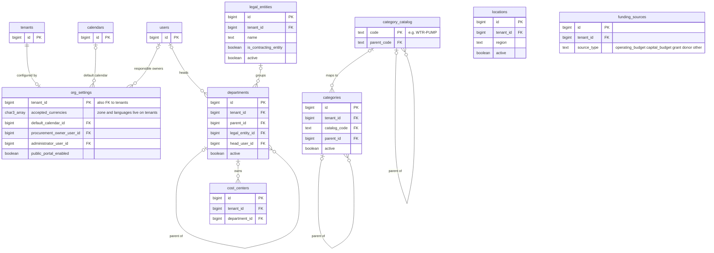
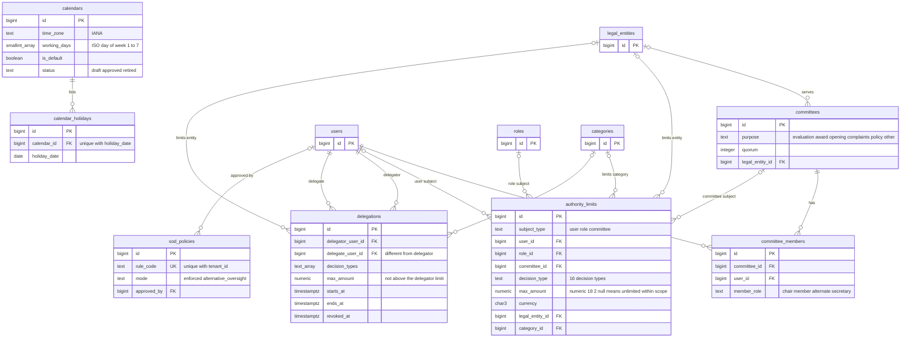
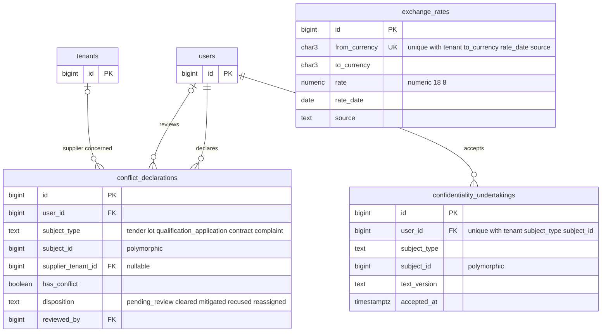
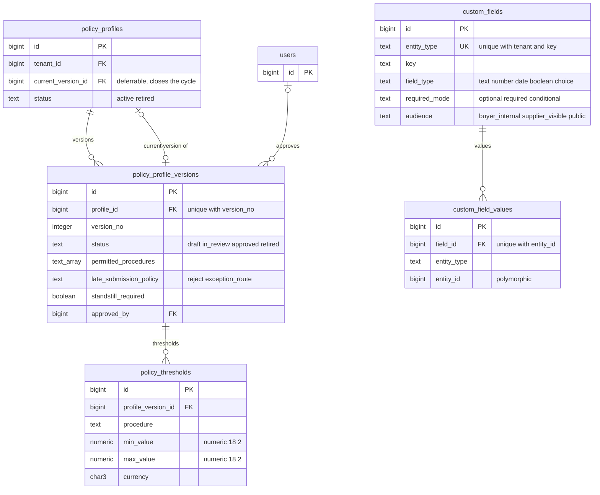
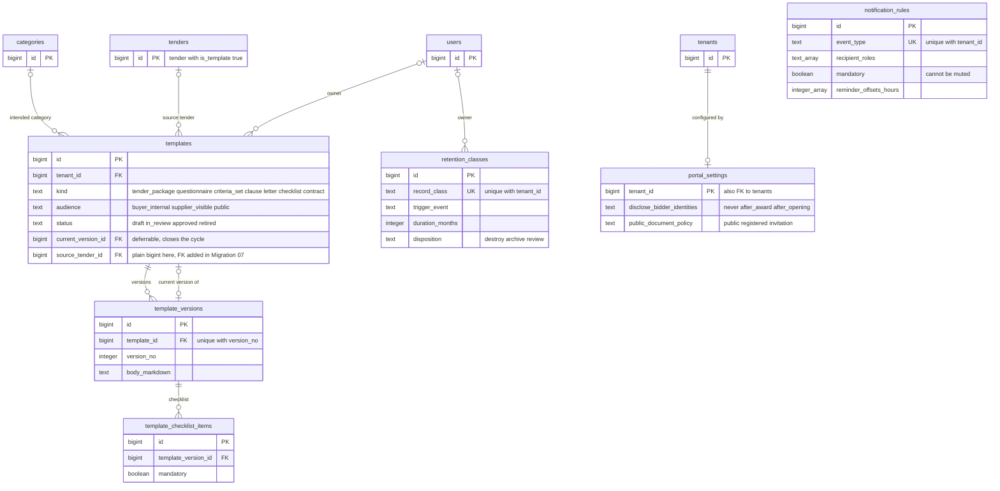

# Organization and Policy Data Model

Status: As-designed (pre-build). Updated to as-built at the end of Stage A and Stage B.

Sources:
- `docs/plan/design-decisions.md`: DD-01 (forward FK and deferred cycles), DD-10 (identity defaults, `accepted_currencies`), DD-13 (public portal flag in `v_public_tenders`), DD-16 (owners of `exchange_rates` and `category_catalog`), DD-18 (`expire-access`), DD-20 (`retention-eligibility`), DD-22 (buyer slug), DD-23 (permission additions), DD-24 (approver permissions, cross-currency authority), DD-25 (conflict gating), DD-26 (category scope), DD-37 (language), DD-40 (`framework_calloff`), DD-43 (demo personas as local Supabase Auth accounts from Stage A), DD-44 (`in_app` and `email` delivery channels; email content limits)
- `docs/plan/schema-blueprint.md`: §0 Conventions; Migration 02 (`20261001000200_org_structure.sql`); Migration 03 (`20261001000300_policy_templates.sql`); Migration 07 (FK `templates.source_tender_id`); §P Permission catalog and role templates
- `docs/plan/architecture-plan.md` (revision 3): §3.2 Authorization model, §3.3 Sealing (confidentiality and conflict prerequisites), §3.5 Versioning, approvals and authority, §3.8 Notifications, §3.9 Background jobs (`expire-access`, `retention-eligibility`), §3.11 Prototype mode, §4 Shared owners, §6 Domain map (domains 00, 01, 02, 15)
- `docs/architecture-brief.md`: §6.2 Multi-tenant pattern (reference data), §6.4 Seeds
- `docs/PRD.md`: §4.1 User roles, §4.3 Audience matrix, §5.1 (FR-01), §5.3 (FR-03 delegation), §5.4 Segregation of duties and conflicts, §9.3 (exchange rates), §14.3 Notification events, §17 Business configuration and templates, §18.3 Retention; BR-04, BR-06, BR-07, BR-08, BR-09, BR-12, BR-15; screens ADM-01..02, ADM-05..08, ADM-10..12, ADM-14
- `docs/plan/demo-storyline.md`: personas, authority limits and calendar used in examples

Contents:
1. [Scope and ownership](#1-scope-and-ownership)
2. [Entity-relationship diagrams](#2-entity-relationship-diagrams)
3. [Organization settings and structure](#3-organization-settings-and-structure)
4. [Calendars and committees](#4-calendars-and-committees)
5. [Authority, delegation and separation of duties](#5-authority-delegation-and-separation-of-duties)
6. [Conflicts, confidentiality and exchange rates](#6-conflicts-confidentiality-and-exchange-rates)
7. [Policy profiles and custom fields](#7-policy-profiles-and-custom-fields)
8. [Templates, notification rules, portal and retention](#8-templates-notification-rules-portal-and-retention)
9. [Seeded permission catalog and role templates](#9-seeded-permission-catalog-and-role-templates)
10. [Open points](#10-open-points)

Conventions (standard columns, dictionary legend, tags) are defined in [README.md](README.md).

---

## 1. Scope and ownership

This file covers the 18 tables of Migration 02 and the 11 tables of Migration 03. None of them is sealed. All are `[T]` except `category_catalog` (`[G]`). Section 9 lists the permission codes and role templates that `supabase/seed.sql` loads into the Migration 01 catalog tables ([01-platform-identity-access.md](01-platform-identity-access.md#5-permission-catalog-and-roles)).

In Stage A these tables do not exist: the local Supabase stack runs for Auth only, with no application schema (DD-43). The admin screens (ADM-01..17) and the `calendars` shared contract are backed by static fixtures, and prototype actions persist nothing (architecture-plan §0, §5). The owners below follow the domain map (architecture-plan §6): domain 01 identity + org-admin (FR-01, §5.4, BR-06/07, ADM-01..05), domain 02 policy (FR-22, §17, ADM-06, ADM-07, ADM-08, ADM-11), domain 00 workspace, whose Stage B form is the shared services (ADM-10 calendars → `time`, ADM-12 notification rules → `notifications`), and domain 15 records (ADM-14). DD-16 names the owners of `exchange_rates` (evaluation) and `category_catalog` (baseline `seed.sql`). For the other tables the plan does not name owners table by table, so the assignment below is the documented intent. It is confirmed as-built at the end of Stage B.

| Table | Tag | mut | Sealed | Owning domain | PRD |
|---|---|---|---|---|---|
| `org_settings` | `[T]` | yes | no | org-admin | FR-01, ADM-01 |
| `legal_entities` | `[T]` | yes | no | org-admin | FR-01, BR-04, ADM-01 |
| `departments` | `[T]` | yes | no | org-admin | FR-01, ADM-02 |
| `locations` | `[T]` | yes | no | org-admin | FR-01, ADM-02 |
| `category_catalog` | `[G]` | no | no | Baseline `supabase/seed.sql` (code-owned shared taxonomy, DD-16) | FR-02 (supplier discovery) |
| `categories` | `[T]` | yes | no | org-admin | FR-01, ADM-02 |
| `cost_centers` | `[T]` | yes | no | org-admin | FR-01, ADM-02 |
| `funding_sources` | `[T]` | yes | no | org-admin | FR-01, ADM-02 |
| `calendars` | `[T]` | yes | no | time (shared service); UI `features/calendars` | BR-12, ADM-10 |
| `calendar_holidays` | `[T]` | no | no | time | BR-12, ADM-10 |
| `committees` | `[T]` | yes | no | org-admin | ADM-05 |
| `committee_members` | `[T]` | no | no | org-admin | ADM-05 |
| `authority_limits` | `[T]` | yes | no | org-admin; read by approvals | BR-06, ADM-05, AC-05 |
| `delegations` | `[T]` | yes | no | org-admin; read by approvals | FR-03, BR-06, ADM-05 |
| `sod_policies` | `[T]` | yes | no | org-admin | §5.4, BR-07 |
| `conflict_declarations` | `[T]` | yes | no | org-admin (PRD §5.4); consumed by sealing, evaluation, qualification | §5.4, BR-08 |
| `confidentiality_undertakings` | `[T]` | no | no | org-admin; consumed by sealing and evaluation | BR-08 |
| `exchange_rates` | `[T]` | no | no | evaluation (DD-16); read by approvals for cross-currency authority (DD-24) | §9.3, §15.2 |
| `policy_profiles` | `[T]` | yes | no | policy | FR-22, §17.1, ADM-06 |
| `policy_profile_versions` | `[T]` | no | no | policy | BR-09, FR-22, ADM-06 |
| `policy_thresholds` | `[T]` | no | no | policy | §17.1, ADM-06 |
| `custom_fields` | `[T]` | yes | no | policy | §17.3, ADM-07 |
| `custom_field_values` | `[T]` | yes | no | policy (definitions). Values are captured on the owning record's screens; the write path is finalized in Stage B | §17.3, ADM-07 |
| `templates` | `[T]` | yes | no | policy | §17.3, ADM-08 |
| `template_versions` | `[T]` | no | no | policy | §17.3, ADM-08 |
| `template_checklist_items` | `[T]` | no | no | policy | ADM-08 |
| `notification_rules` | `[T]` | yes | no | notifications | §14.3, ADM-12 |
| `portal_settings` | `[T]` | yes | no | policy | BR-15, BR-46, ADM-11 |
| `retention_classes` | `[T]` | yes | no | records | §18.3, BR-39, ADM-14 |

---

## 2. Entity-relationship diagrams

### 2.1 Organization settings and structure

### 2.2 Calendars, committees and authority

### 2.3 Conflicts, confidentiality and exchange rates

### 2.4 Policy profiles and custom fields

### 2.5 Templates, notification rules, portal and retention

---

## 3. Organization settings and structure

### org_settings `[T]`

**Tag** `[T]` · **mut** yes · **Sealed** no · **Owner** org-admin · **PRD** FR-01, ADM-01

At most one row per tenant (the primary key is `tenant_id`; the blueprint does not state that every tenant kind has one), holding the procurement configuration that FR-01 requires: accepted currencies, working calendar, and the responsible people for procurement, administration, budget approval, publication, complaints, records retention and contract ownership. The organization's official time zone, working languages and default currency are **not** stored here: `tenants` is authoritative for them (DD-10; [01-platform-identity-access.md](01-platform-identity-access.md#tenants-g)). DD-10 renamed `currencies` to `accepted_currencies` and dropped the former `official_time_zone` and `working_languages` columns.

| Column | Type | Null | Key / constraint | Meaning |
|---|---|---|---|---|
| `tenant_id` | bigint | not null | PK; FK → tenants | Organization |
| `created_at` | timestamptz | not null | default now() | std |
| `created_by` | bigint | null | FK → users | std |
| `updated_at` | timestamptz | not null | default now() | mut |
| `accepted_currencies` | char(3)[] | — | | Currencies the organization accepts (demo: BWP). The default currency is `tenants.default_currency` (DD-10) |
| `default_calendar_id` | bigint | — | FK → calendars | Default working calendar |
| `procurement_owner_user_id` | bigint | — | FK → users | Procurement owner |
| `administrator_user_id` | bigint | — | FK → users | Organization administrator |
| `budget_approval_owner_user_id` | bigint | — | FK → users | Budget approval owner |
| `publication_owner_user_id` | bigint | — | FK → users | Publication owner |
| `complaints_owner_user_id` | bigint | — | FK → users | Complaints owner |
| `records_owner_user_id` | bigint | — | FK → users | Records retention owner |
| `contract_owner_user_id` | bigint | — | FK → users | Contract ownership |
| `support_contact_user_id` | bigint | — | FK → users | Customer's support contact |
| `branding_display_name` | text | — | | Display name for branding (sidebar tenant label, public portal) |
| `public_portal_enabled` | boolean | — | | Whether the public buyer portal is on. `v_public_tenders` lists a buyer's open-participation tenders only while the portal is enabled (DD-13) |
| `portal_intro` | text | — | | Portal introduction text |
| `guidance_markdown` | text | — | | Buyer guidance shown to suppliers |
| `sod_alternative_oversight_note` | text | — | | Organization-level description of alternative oversight (PRD §5.4) |

### legal_entities `[T]`

**Tag** `[T]` · **mut** yes · **Sealed** no · **Owner** org-admin · **PRD** FR-01, BR-04, ADM-01

The organization's legal entities. The contracting legal entity must be identified before a binding commitment is authorized (BR-04), and `contracts.legal_entity_id` is not null. Demo: "Kalahari Water Utilities Corporation".

| Column | Type | Null | Key / constraint | Meaning |
|---|---|---|---|---|
| `id` | bigint | not null | PK, identity | std |
| `tenant_id` | bigint | not null | FK → tenants | Organization |
| `created_at` | timestamptz | not null | default now() | std |
| `created_by` | bigint | null | FK → users | std |
| `updated_at` | timestamptz | not null | default now() | mut |
| `name` | text | — | | Legal name |
| `registration_number` | text | — | | Registration identifier |
| `country` | char(2) | — | | Country (type open: `char(2)` matches `tenants.country`) |
| `address` | text | — | | Registered address |
| `is_contracting_entity` | boolean | — | | May be a contract party |
| `active` | boolean | — | | Deactivated entities stay readable on history |
| `deactivated_at` | timestamptz | — | | Deactivation time |

### departments `[T]`

**Tag** `[T]` · **mut** yes · **Sealed** no · **Owner** org-admin · **PRD** FR-01, ADM-02

Departments and reporting hierarchy. A customer may use a flat structure (FR-01).

| Column | Type | Null | Key / constraint | Meaning |
|---|---|---|---|---|
| `id` | bigint | not null | PK, identity | std |
| `tenant_id` | bigint | not null | FK → tenants | Organization |
| `created_at` | timestamptz | not null | default now() | std |
| `created_by` | bigint | null | FK → users | std |
| `updated_at` | timestamptz | not null | default now() | mut |
| `name` | text | — | | Department name |
| `code` | text | — | | Department code |
| `parent_id` | bigint | — | FK → departments | Parent department |
| `legal_entity_id` | bigint | — | FK → legal_entities | Legal entity the department belongs to |
| `head_user_id` | bigint | — | FK → users | Head of department |
| `active` | boolean | — | | Active flag |
| `deactivated_at` | timestamptz | — | | Deactivation time |

### locations `[T]`

**Tag** `[T]` · **mut** yes · **Sealed** no · **Owner** org-admin · **PRD** FR-01, ADM-02

| Column | Type | Null | Key / constraint | Meaning |
|---|---|---|---|---|
| `id` | bigint | not null | PK, identity | std |
| `tenant_id` | bigint | not null | FK → tenants | Organization |
| `created_at` | timestamptz | not null | default now() | std |
| `created_by` | bigint | null | FK → users | std |
| `updated_at` | timestamptz | not null | default now() | mut |
| `name` | text | — | | Location name |
| `address` | text | — | | Address |
| `region` | text | — | | Region |
| `country` | char(2) | — | | Country (type open, as `legal_entities.country`) |
| `active` | boolean | — | | Active flag |

### category_catalog `[G]`

**Tag** `[G]` · **mut** no · **Sealed** no · **Owner** baseline `supabase/seed.sql` (DD-16) · **PRD** FR-02

The platform-wide category taxonomy. Buyers' `categories` and suppliers' `supplier_categories` both map to it, which makes supplier discovery match across buyers ([04-suppliers-qualification.md](04-suppliers-qualification.md)). It is loaded by the baseline `supabase/seed.sql`, not by the demo seed (DD-16).

| Column | Type | Null | Key / constraint | Meaning |
|---|---|---|---|---|
| `code` | text | not null | PK | Category code, e.g. `WTR-PUMP`, `WTR-PIPE` |
| `name` | text | — | | Display name |
| `parent_code` | text | — | FK → category_catalog.code | Parent category |
| `description` | text | — | | Description |

### categories `[T]`

**Tag** `[T]` · **mut** yes · **Sealed** no · **Owner** org-admin · **PRD** FR-01, ADM-02

The buyer's own procurement categories. Role assignments, authority limits, delegations and templates can be scoped by category. A role assignment scoped to a category covers the category **and its descendants** (`parent_id`), and matches a tender through `tenders.category_id` (DD-26).

| Column | Type | Null | Key / constraint | Meaning |
|---|---|---|---|---|
| `id` | bigint | not null | PK, identity | std |
| `tenant_id` | bigint | not null | FK → tenants | Organization |
| `created_at` | timestamptz | not null | default now() | std |
| `created_by` | bigint | null | FK → users | std |
| `updated_at` | timestamptz | not null | default now() | mut |
| `name` | text | — | | Category name |
| `code` | text | — | | Buyer's category code |
| `catalog_code` | text | — | FK → category_catalog.code | Shared taxonomy mapping |
| `parent_id` | bigint | — | FK → categories | Parent category |
| `active` | boolean | — | | Active flag |
| `deactivated_at` | timestamptz | — | | Deactivation time |

### cost_centers `[T]`

**Tag** `[T]` · **mut** yes · **Sealed** no · **Owner** org-admin · **PRD** FR-01, ADM-02

| Column | Type | Null | Key / constraint | Meaning |
|---|---|---|---|---|
| `id` | bigint | not null | PK, identity | std |
| `tenant_id` | bigint | not null | FK → tenants | Organization |
| `created_at` | timestamptz | not null | default now() | std |
| `created_by` | bigint | null | FK → users | std |
| `updated_at` | timestamptz | not null | default now() | mut |
| `code` | text | — | | Cost-center code |
| `name` | text | — | | Name |
| `department_id` | bigint | — | FK → departments | Owning department |
| `active` | boolean | — | | Active flag |

### funding_sources `[T]`

**Tag** `[T]` · **mut** yes · **Sealed** no · **Owner** org-admin · **PRD** FR-01, ADM-02

| Column | Type | Null | Key / constraint | Meaning |
|---|---|---|---|---|
| `id` | bigint | not null | PK, identity | std |
| `tenant_id` | bigint | not null | FK → tenants | Organization |
| `created_at` | timestamptz | not null | default now() | std |
| `created_by` | bigint | null | FK → users | std |
| `updated_at` | timestamptz | not null | default now() | mut |
| `code` | text | — | | Funding code |
| `name` | text | — | | Name |
| `source_type` | text | — | CHECK (operating_budget, capital_budget, grant, donor, other) | Kind of funding |
| `external_reference` | text | — | | Reference in the finance system |
| `active` | boolean | — | | Active flag |

---

## 4. Calendars and committees

### calendars `[T]`

**Tag** `[T]` · **mut** yes · **Sealed** no · **Owner** time · **PRD** BR-12, ADM-10

Approved working calendars. Working-day calculations use the event's approved calendar, and changes to holidays or calendars require review of affected deadlines (BR-12). `tenders.calendar_id` references it. Demo: "Botswana Public Holidays 2026".

| Column | Type | Null | Key / constraint | Meaning |
|---|---|---|---|---|
| `id` | bigint | not null | PK, identity | std |
| `tenant_id` | bigint | not null | FK → tenants | Organization |
| `created_at` | timestamptz | not null | default now() | std |
| `created_by` | bigint | null | FK → users | std |
| `updated_at` | timestamptz | not null | default now() | mut |
| `name` | text | — | | Calendar name |
| `time_zone` | text | — | | IANA zone |
| `working_days` | smallint[] | — | | ISO days of week 1–7 |
| `is_default` | boolean | — | | Default calendar flag |
| `active` | boolean | — | | Active flag |
| `status` | text | — | CHECK (draft, approved, retired) | Approval state |
| `approved_by` | bigint | — | FK → users | Approver |
| `approved_at` | timestamptz | — | | Approval time |

### calendar_holidays `[T]`

**Tag** `[T]` · **mut** no · **Sealed** no · **Owner** time · **PRD** BR-12, ADM-10

| Column | Type | Null | Key / constraint | Meaning |
|---|---|---|---|---|
| `id` | bigint | not null | PK, identity | std |
| `tenant_id` | bigint | not null | FK → tenants | Organization |
| `created_at` | timestamptz | not null | default now() | std |
| `created_by` | bigint | null | FK → users | std |
| `calendar_id` | bigint | — | FK → calendars; UK (calendar_id, holiday_date) | Calendar |
| `holiday_date` | date | — | | Non-working date |
| `name` | text | — | | Holiday name |

### committees `[T]`

**Tag** `[T]` · **mut** yes · **Sealed** no · **Owner** org-admin · **PRD** ADM-05

Standing committees with a quorum. `approval_requests.committee_id` and `approval_steps.committee_id` reference it for committee-quorum routes ([03-shared-services.md](03-shared-services.md)).

| Column | Type | Null | Key / constraint | Meaning |
|---|---|---|---|---|
| `id` | bigint | not null | PK, identity | std |
| `tenant_id` | bigint | not null | FK → tenants | Organization |
| `created_at` | timestamptz | not null | default now() | std |
| `created_by` | bigint | null | FK → users | std |
| `updated_at` | timestamptz | not null | default now() | mut |
| `name` | text | — | | Committee name |
| `purpose` | text | — | CHECK (evaluation, award, opening, complaints, policy, other) | Purpose |
| `quorum` | integer | — | | Members required for a decision |
| `legal_entity_id` | bigint | — | FK → legal_entities | Entity served |
| `active` | boolean | — | | Active flag |

### committee_members `[T]`

**Tag** `[T]` · **mut** no · **Sealed** no · **Owner** org-admin · **PRD** ADM-05

| Column | Type | Null | Key / constraint | Meaning |
|---|---|---|---|---|
| `id` | bigint | not null | PK, identity | std |
| `tenant_id` | bigint | not null | FK → tenants | Organization |
| `created_at` | timestamptz | not null | default now() | std |
| `created_by` | bigint | null | FK → users | std |
| `committee_id` | bigint | — | FK → committees | Committee |
| `user_id` | bigint | — | FK → users | Member |
| `member_role` | text | — | CHECK (chair, member, alternate, secretary) | Role on the committee |
| `starts_at` | timestamptz | — | | Membership start |
| `ends_at` | timestamptz | — | | Membership end |

---

## 5. Authority, delegation and separation of duties

Authority (BR-06) is checked against `authority_limits` plus active `delegations`, comparing value, currency, legal entity, category and dates. `sod_policies` blocks self-approval and incompatible duties (BR-07) unless documented alternative oversight is recorded (architecture-plan §3.5). [03-shared-services.md](03-shared-services.md#4-approval-flow-data) shows how approval steps record the check.

Deciding an approval step requires `approval.decide` **and** the decision-specific permission (for example `award.approve`) **and** sufficient authority. When the amount and the limit are in different currencies, authority is compared using `exchange_rates` at the request date. With no rate for that date, the step routes to the next level up; it never passes on an assumed rate (DD-24).

### authority_limits `[T]`

**Tag** `[T]` · **mut** yes · **Sealed** no · **Owner** org-admin; read by approvals · **PRD** BR-06, ADM-05, AC-05

Approved decision authority for a user, a role or a committee. Demo: `mpho.manager` holds BWP 2,000,000 and `keabetswe.approver` holds BWP 10,000,000. Request PR-2026-0003 exceeds the first limit and is routed to the second (AC-05). `approval_steps.authority_limit_id` and `contract_signatories.authority_limit_id` reference this table.

| Column | Type | Null | Key / constraint | Meaning |
|---|---|---|---|---|
| `id` | bigint | not null | PK, identity | std |
| `tenant_id` | bigint | not null | FK → tenants | Organization |
| `created_at` | timestamptz | not null | default now() | std |
| `created_by` | bigint | null | FK → users | std |
| `updated_at` | timestamptz | not null | default now() | mut |
| `subject_type` | text | — | CHECK (user, role, committee) | Whose limit this is |
| `user_id` | bigint | — | FK → users | Set when subject_type = user |
| `role_id` | bigint | — | FK → roles | Set when subject_type = role |
| `committee_id` | bigint | — | FK → committees | Set when subject_type = committee. The form of the consistency constraint is finalized in Stage B |
| `decision_type` | text | — | CHECK (request_approval, funding_confirmation, strategy_approval, release_approval, exclusion_approval, shortlist_approval, preferred_bidder_approval, award_approval, contract_approval, contract_signature, change_approval, renewal_approval, qualification_decision, late_submission_exception, negotiation_mandate, disposal_approval) | Decision the limit covers |
| `max_amount` | numeric(18,2) | null | | Maximum value. Null = unlimited within scope |
| `currency` | char(3) | — | CHECK `^[A-Z]{3}$` | Currency of `max_amount`. A decision in another currency is converted with `exchange_rates` at the request date; with no rate, the step routes to the next level up (DD-24) |
| `legal_entity_id` | bigint | — | FK → legal_entities | Entity scope |
| `category_id` | bigint | — | FK → categories | Category scope |
| `effective_from` | timestamptz | — | | Start of validity (type open: date or timestamptz) |
| `effective_to` | timestamptz | — | | End of validity (type open) |
| `approved_by` | bigint | — | FK → users | Who approved the limit |

### delegations `[T]`

**Tag** `[T]` · **mut** yes · **Sealed** no · **Owner** org-admin; read by approvals · **PRD** FR-03, BR-06, ADM-05

Temporary delegation of decision authority. FR-03 requires the decisions covered, the principal, the dates and the authority. The acting person and the delegated capacity are both recorded (`approval_steps.acting_for_user_id`, `approval_steps.delegation_id`, `audit_log.delegation_id`). A delegate cannot expand the original authority. Request-time checks compare `starts_at`, `ends_at` and `revoked_at` directly. The hourly `expire-access` job (org-admin) only updates display statuses and sends notices for ended delegations (DD-18; architecture-plan §3.9).

| Column | Type | Null | Key / constraint | Meaning |
|---|---|---|---|---|
| `id` | bigint | not null | PK, identity | std |
| `tenant_id` | bigint | not null | FK → tenants | Organization |
| `created_at` | timestamptz | not null | default now() | std |
| `created_by` | bigint | null | FK → users | std |
| `updated_at` | timestamptz | not null | default now() | mut |
| `delegator_user_id` | bigint | — | FK → users | Principal |
| `delegate_user_id` | bigint | — | FK → users; CHECK different from delegator_user_id | Delegate |
| `decision_types` | text[] | — | Values from `authority_limits.decision_type` | Decisions delegated |
| `max_amount` | numeric(18,2) | — | Trigger: at creation, not above the delegator's own limit | Delegated ceiling |
| `currency` | char(3) | — | CHECK `^[A-Z]{3}$` | Currency |
| `legal_entity_id` | bigint | — | FK → legal_entities | Entity scope |
| `category_id` | bigint | — | FK → categories | Category scope |
| `starts_at` | timestamptz | — | | Start |
| `ends_at` | timestamptz | — | | End |
| `reason` | text | — | | Reason |
| `revoked_at` | timestamptz | — | | Revocation time |
| `revoked_by` | bigint | — | FK → users | Revoker |

Trigger: a Migration 02 trigger rejects a delegation whose `max_amount` exceeds the delegator's own limit at creation time.

### sod_policies `[T]`

**Tag** `[T]` · **mut** yes · **Sealed** no · **Owner** org-admin · **PRD** §5.4, BR-07

One row per separation-of-duties rule. Small organizations may adopt documented alternative oversight, but may not silently disable the control (PRD §5.4).

| Column | Type | Null | Key / constraint | Meaning |
|---|---|---|---|---|
| `id` | bigint | not null | PK, identity | std |
| `tenant_id` | bigint | not null | FK → tenants; UK (tenant_id, rule_code) | Organization |
| `created_at` | timestamptz | not null | default now() | std |
| `created_by` | bigint | null | FK → users | std |
| `updated_at` | timestamptz | not null | default now() | mut |
| `rule_code` | text | — | CHECK (draft_vs_final_approval, submission_custody_vs_opening, evaluation_vs_award_approval, supplier_assessment_vs_exception_approval, requester_vs_request_approval) | Rule (see table below) |
| `mode` | text | — | CHECK (enforced, alternative_oversight) | Enforcement mode |
| `alternative_oversight_note` | text | — | CHECK: required when mode = alternative_oversight | Documented alternative oversight |
| `approved_by` | bigint | — | FK → users | Approver |
| `effective_from` | timestamptz | — | | Start (type open) |

| `rule_code` | Incompatible duties (PRD §5.4, BR-07) |
|---|---|
| `draft_vs_final_approval` | Drafting and final approval |
| `submission_custody_vs_opening` | Submission custody and opening authorization |
| `evaluation_vs_award_approval` | Individual evaluation and final award approval |
| `supplier_assessment_vs_exception_approval` | Supplier assessment and approval of an exception |
| `requester_vs_request_approval` | Requesting and approving the same request (self-approval) |

---

## 6. Conflicts, confidentiality and exchange rates

Conflict declarations and confidentiality undertakings must precede access to restricted assessment material (BR-08). The sealing module requires both before any buyer user reads opened bid content (architecture-plan §3.3; [04-security-model.md](../04-security-model.md)).

**Conflict gating (DD-25).** A declaration with `has_conflict = true` blocks restricted access while its `disposition` is `pending_review`. Access resumes only on `cleared` or `mitigated`. `recused` and `reassigned` block permanently for that subject.

### conflict_declarations `[T]`

**Tag** `[T]` · **mut** yes · **Sealed** no · **Owner** org-admin · **PRD** §5.4, BR-08

A declared conflict triggers review, possible recusal or reassignment, and a recorded disposition (PRD §5.4). `evaluation_assignments.conflict_declaration_id` references this table. Demo: `sam.dual`, an evaluator at `kwu` and a contributor at two bidding suppliers, has a conflict routed for review on T-2026-0003. The table carries a nullable `supplier_tenant_id` but is **not** `[S]`, so it is not on the `forSupplier` allow-list and suppliers never read it (DD-03).

| Column | Type | Null | Key / constraint | Meaning |
|---|---|---|---|---|
| `id` | bigint | not null | PK, identity | std |
| `tenant_id` | bigint | not null | FK → tenants | Buyer organization |
| `created_at` | timestamptz | not null | default now() | std |
| `created_by` | bigint | null | FK → users | std |
| `updated_at` | timestamptz | not null | default now() | mut |
| `user_id` | bigint | — | FK → users | Declaring person |
| `subject_type` | text | — | CHECK (tender, lot, qualification_application, contract, complaint) | Declared subject |
| `subject_id` | bigint | — | Polymorphic (not FK) | Subject record |
| `supplier_tenant_id` | bigint | null | FK → tenants | Supplier the conflict concerns, if any |
| `has_conflict` | boolean | — | | Whether a conflict is declared |
| `nature` | text | null | CHECK (financial_interest, personal_relationship, prior_employment, bid_preparation, other) | Nature of the conflict |
| `details` | text | — | | Details |
| `declared_at` | timestamptz | — | | Declaration time |
| `disposition` | text | — | CHECK (pending_review, cleared, mitigated, recused, reassigned) | Review outcome. With `has_conflict = true`: `pending_review` blocks restricted access, `cleared` / `mitigated` resume it, `recused` / `reassigned` block it permanently for the subject (DD-25) |
| `reviewed_by` | bigint | — | FK → users | Reviewer |
| `reviewed_at` | timestamptz | — | | Review time |
| `review_note` | text | — | | Review note |

### confidentiality_undertakings `[T]`

**Tag** `[T]` · **mut** no · **Sealed** no · **Owner** org-admin · **PRD** BR-08

`evaluation_assignments.confidentiality_undertaking_id` references this table.

| Column | Type | Null | Key / constraint | Meaning |
|---|---|---|---|---|
| `id` | bigint | not null | PK, identity | std |
| `tenant_id` | bigint | not null | FK → tenants; UK (tenant_id, user_id, subject_type, subject_id) | Organization |
| `created_at` | timestamptz | not null | default now() | std |
| `created_by` | bigint | null | FK → users | std |
| `user_id` | bigint | — | FK → users | Person who accepted |
| `subject_type` | text | — | CHECK list not stated in the blueprint | Subject kind |
| `subject_id` | bigint | — | Polymorphic (not FK) | Subject record |
| `text_version` | text | — | | Version of the undertaking text accepted |
| `accepted_at` | timestamptz | — | | Acceptance time |

### exchange_rates `[T]`

**Tag** `[T]` · **mut** no · **Sealed** no · **Owner** evaluation (DD-16) · **PRD** §9.3, §15.2

Dated exchange rates, owned by the evaluation domain (DD-16; architecture-plan §4). Evaluation records the source, date and comparison currency it used (`evaluation_plans.fx_source`, `fx_date`; `commercial_evaluations.fx_rate`), and the supplier's original currency and amount stay visible (PRD §9.3). Reports state their currency basis and conversion date (PRD §15.2). The approvals service reads the rate at the request date for cross-currency authority checks; with no rate, the step routes to the next level up (DD-24).

| Column | Type | Null | Key / constraint | Meaning |
|---|---|---|---|---|
| `id` | bigint | not null | PK, identity | std |
| `tenant_id` | bigint | not null | FK → tenants; UK (tenant_id, from_currency, to_currency, rate_date, source) | Organization |
| `created_at` | timestamptz | not null | default now() | std |
| `created_by` | bigint | null | FK → users | std |
| `from_currency` | char(3) | — | CHECK `^[A-Z]{3}$` | Source currency |
| `to_currency` | char(3) | — | CHECK `^[A-Z]{3}$` | Target currency |
| `rate` | numeric(18,8) | — | | Rate |
| `rate_date` | date | — | | Rate date |
| `source` | text | — | | Rate source |

---

## 7. Policy profiles and custom fields

### policy_profiles `[T]`

**Tag** `[T]` · **mut** yes · **Sealed** no · **Owner** policy · **PRD** FR-22, §17.1, ADM-06

A named procurement policy that is versioned through `policy_profile_versions`.

| Column | Type | Null | Key / constraint | Meaning |
|---|---|---|---|---|
| `id` | bigint | not null | PK, identity | std |
| `tenant_id` | bigint | not null | FK → tenants | Organization |
| `created_at` | timestamptz | not null | default now() | std |
| `created_by` | bigint | null | FK → users | std |
| `updated_at` | timestamptz | not null | default now() | mut |
| `name` | text | — | | Profile name |
| `description` | text | — | | Description |
| `current_version_id` | bigint | — | FK → policy_profile_versions, added at the end of Migration 03 as `DEFERRABLE INITIALLY DEFERRED` (DD-01) | Current approved version |
| `status` | text | — | CHECK (active, retired) | Profile state |

### policy_profile_versions `[T]`

**Tag** `[T]` · **mut** no · **Sealed** no · **Owner** policy · **PRD** BR-09, FR-22, ADM-06

A version of the policy rules. A tender freezes its version at release in `tenders.policy_profile_version_id`, and `procurement_strategies.policy_profile_version_id` records the version a strategy was prepared under. Policy changes therefore never silently change the rules of an already issued tender (FR-22, BR-09). ADM-06 shows which events use each version. Approval of a version runs through `approval_requests.subject_type = 'policy_profile'`.

| Column | Type | Null | Key / constraint | Meaning |
|---|---|---|---|---|
| `id` | bigint | not null | PK, identity | std |
| `tenant_id` | bigint | not null | FK → tenants | Organization |
| `created_at` | timestamptz | not null | default now() | std |
| `created_by` | bigint | null | FK → users | std |
| `profile_id` | bigint | — | FK → policy_profiles; UK (profile_id, version_no) | Profile |
| `version_no` | integer | — | | Version number |
| `status` | text | — | CHECK (draft, in_review, approved, retired) | Version state |
| `permitted_procedures` | text[] | — | Subset of (rfi, open, restricted, invitation_only, multi_stage, direct, framework_calloff) | Procedures allowed. `framework_calloff` stays in the database list for the future, but no contract enum used for writes offers it and it never appears in the UI (DD-40) |
| `requires_release_approval` | boolean | — | | Release needs approval |
| `staged_opening_default` | boolean | — | | Staged opening by default |
| `opening_quorum` | integer | — | | Opening quorum |
| `opening_requires_second_person` | boolean | — | | Opening needs a second person |
| `independent_evaluation` | boolean | — | | Evaluators score independently |
| `negotiation_permitted` | boolean | — | | Negotiation allowed |
| `bafo_permitted` | boolean | — | | Best-and-final-offer rounds allowed |
| `late_submission_policy` | text | — | CHECK (reject, exception_route) | Late-submission handling |
| `question_deadline_days_before_close` | integer | — | | Question deadline offset |
| `min_response_days` | integer | — | | Minimum response period |
| `standstill_required` | boolean | — | | Standstill required before final award |
| `standstill_length` | integer | — | | Standstill length |
| `standstill_day_type` | text | — | CHECK (calendar, working) | Day type for the standstill |
| `complaint_window_days` | integer | — | | Complaint window |
| `complaint_requires_independent_review` | boolean | — | | Independent complaint review |
| `public_award_notice_required` | boolean | — | | Public award notice required |
| `approval_route_note` | text | — | | Approval route description |
| `approved_by` | bigint | — | FK → users | Approver |
| `approved_at` | timestamptz | — | | Approval time |
| `effective_from` | timestamptz | — | | Start (type open) |
| `retired_at` | timestamptz | — | | Retirement time |

### policy_thresholds `[T]`

**Tag** `[T]` · **mut** no · **Sealed** no · **Owner** policy · **PRD** §17.1, ADM-06

Value bands per procedure within a policy version.

| Column | Type | Null | Key / constraint | Meaning |
|---|---|---|---|---|
| `id` | bigint | not null | PK, identity | std |
| `tenant_id` | bigint | not null | FK → tenants | Organization |
| `created_at` | timestamptz | not null | default now() | std |
| `created_by` | bigint | null | FK → users | std |
| `profile_version_id` | bigint | — | FK → policy_profile_versions | Policy version |
| `procedure` | text | — | CHECK list not stated (procedure values as in `permitted_procedures`) | Procedure the band applies to |
| `min_value` | numeric(18,2) | — | | Lower bound |
| `max_value` | numeric(18,2) | — | | Upper bound |
| `currency` | char(3) | — | CHECK `^[A-Z]{3}$` | Currency |
| `required_approval_level` | text | — | | Approval level required |
| `requires_public_notice` | boolean | — | | Public notice required |

### custom_fields `[T]`

**Tag** `[T]` · **mut** yes · **Sealed** no · **Owner** policy · **PRD** §17.3, ADM-07

Additional business fields on requests, tenders, qualification applications and contracts. Each field is labelled, explained, assigned an audience and may be conditionally required. Customization must not hide a mandatory control or introduce undisclosed scoring (PRD §17.3).

| Column | Type | Null | Key / constraint | Meaning |
|---|---|---|---|---|
| `id` | bigint | not null | PK, identity | std |
| `tenant_id` | bigint | not null | FK → tenants; UK (tenant_id, entity_type, key) | Organization |
| `created_at` | timestamptz | not null | default now() | std |
| `created_by` | bigint | null | FK → users | std |
| `updated_at` | timestamptz | not null | default now() | mut |
| `entity_type` | text | — | CHECK (procurement_request, tender, qualification_application, contract) | Record type extended |
| `key` | text | — | | Field key |
| `label` | text | — | | Label |
| `purpose` | text | — | | Why the field exists |
| `field_type` | text | — | CHECK (text, number, date, boolean, choice) | Value type |
| `allowed_values` | text[] | — | | Choices for `choice` fields |
| `required_mode` | text | — | CHECK (optional, required, conditional) | Requirement mode |
| `required_condition_field` | text | — | | Field that drives a conditional requirement |
| `required_condition_value` | text | — | | Value that makes the field required |
| `audience` | text | — | CHECK (buyer_internal, supplier_visible, public) | Who may see the value |
| `include_in_reports` | boolean | — | | Available to reports |
| `active` | boolean | — | | Active flag |
| `sort_order` | integer | — | | Display order |

### custom_field_values `[T]`

**Tag** `[T]` · **mut** yes · **Sealed** no · **Owner** policy (write path finalized in Stage B) · **PRD** §17.3, ADM-07

| Column | Type | Null | Key / constraint | Meaning |
|---|---|---|---|---|
| `id` | bigint | not null | PK, identity | std |
| `tenant_id` | bigint | not null | FK → tenants | Organization |
| `created_at` | timestamptz | not null | default now() | std |
| `created_by` | bigint | null | FK → users | std |
| `updated_at` | timestamptz | not null | default now() | mut |
| `field_id` | bigint | — | FK → custom_fields; UK (field_id, entity_id) | Field |
| `entity_type` | text | — | | Record type (mirrors `custom_fields.entity_type`) |
| `entity_id` | bigint | — | Polymorphic (not FK) | Record id |
| `value_text` | text | — | | Text or choice value |
| `value_number` | numeric | — | No precision stated | Number value |
| `value_date` | date | — | | Date value |
| `value_bool` | boolean | — | | Boolean value |

---

## 8. Templates, notification rules, portal and retention

### templates `[T]`

**Tag** `[T]` · **mut** yes · **Sealed** no · **Owner** policy · **PRD** §17.3, ADM-08

Reusable content with an owner, intended procedure and category, audience, approval status, effective date, review date and revision history. Retired templates cannot be selected for new work, and existing events keep their adopted version (PRD §17.3). A `tender_package` template points at a tender flagged `is_template = true`. `source_tender_id` is a plain `bigint` in Migration 03, and Migration 07, which creates `tenders`, adds the foreign key with `ALTER TABLE … ADD CONSTRAINT` (DD-01; [06-tenders.md](06-tenders.md)). `current_version_id → template_versions` closes a same-migration cycle and is added at the end of Migration 03 as `DEFERRABLE INITIALLY DEFERRED` (DD-01).

| Column | Type | Null | Key / constraint | Meaning |
|---|---|---|---|---|
| `id` | bigint | not null | PK, identity | std |
| `tenant_id` | bigint | not null | FK → tenants | Organization |
| `created_at` | timestamptz | not null | default now() | std |
| `created_by` | bigint | null | FK → users | std |
| `updated_at` | timestamptz | not null | default now() | mut |
| `kind` | text | — | CHECK (tender_package, questionnaire, criteria_set, clause, letter, checklist, contract) | Template kind |
| `name` | text | — | | Name |
| `procedure` | text | — | | Intended procedure |
| `category_id` | bigint | — | FK → categories | Intended category |
| `audience` | text | — | CHECK (buyer_internal, supplier_visible, public) | Audience |
| `owner_user_id` | bigint | — | FK → users | Owner |
| `status` | text | — | CHECK (draft, in_review, approved, retired) | Template state |
| `effective_from` | timestamptz | — | | Effective date (type open) |
| `review_date` | date | — | | Next review date |
| `current_version_id` | bigint | — | FK → template_versions, `DEFERRABLE INITIALLY DEFERRED` (DD-01) | Current version |
| `source_tender_id` | bigint | — | FK → tenders, added in Migration 07 (DD-01) | Template tender for `tender_package` |

### template_versions `[T]`

**Tag** `[T]` · **mut** no · **Sealed** no · **Owner** policy · **PRD** §17.3, ADM-08

| Column | Type | Null | Key / constraint | Meaning |
|---|---|---|---|---|
| `id` | bigint | not null | PK, identity | std |
| `tenant_id` | bigint | not null | FK → tenants | Organization |
| `created_at` | timestamptz | not null | default now() | std |
| `created_by` | bigint | null | FK → users | std |
| `template_id` | bigint | — | FK → templates; UK (template_id, version_no) | Template |
| `version_no` | integer | — | | Version number |
| `body_markdown` | text | — | | Content |
| `change_note` | text | — | | What changed |
| `approved_by` | bigint | — | FK → users | Approver |
| `approved_at` | timestamptz | — | | Approval time |

### template_checklist_items `[T]`

**Tag** `[T]` · **mut** no · **Sealed** no · **Owner** policy · **PRD** ADM-08

| Column | Type | Null | Key / constraint | Meaning |
|---|---|---|---|---|
| `id` | bigint | not null | PK, identity | std |
| `tenant_id` | bigint | not null | FK → tenants | Organization |
| `created_at` | timestamptz | not null | default now() | std |
| `created_by` | bigint | null | FK → users | std |
| `template_version_id` | bigint | — | FK → template_versions | Version |
| `item_text` | text | — | | Checklist item |
| `sort_order` | integer | — | | Display order |
| `mandatory` | boolean | — | | Mandatory item |

### notification_rules `[T]`

**Tag** `[T]` · **mut** yes · **Sealed** no · **Owner** notifications · **PRD** §14.3, ADM-12

One rule per notification event type. Mandatory formal notices cannot be muted by a user preference (PRD §14.3). General alerts must not embed confidential bid content (ADM-12). Delivery uses the `in_app` and `email` channels of the `DeliveryChannel` port: formal notices go to both channels, and non-mandatory events follow user preferences. The `email` channel is used only where email is enabled, and an email carries only the title, the official deadline and a link, never bid, evaluation or other confidential content (DD-44; BR-43). [03-shared-services.md](03-shared-services.md#5-notifications-and-formal-notices) describes delivery, and its [§5.1](03-shared-services.md#51-notification-event-catalog) catalogs the event types.

| Column | Type | Null | Key / constraint | Meaning |
|---|---|---|---|---|
| `id` | bigint | not null | PK, identity | std |
| `tenant_id` | bigint | not null | FK → tenants; UK (tenant_id, event_type) | Organization |
| `created_at` | timestamptz | not null | default now() | std |
| `created_by` | bigint | null | FK → users | std |
| `updated_at` | timestamptz | not null | default now() | mut |
| `event_type` | text | — | Vocabulary follows PRD §14.3; no CHECK stated | Event. One row per PRD §14.3 trigger in the [notification event catalog](03-shared-services.md#51-notification-event-catalog) |
| `recipient_roles` | text[] | — | | Recipient roles |
| `mandatory` | boolean | — | | Cannot be muted |
| `subject_template` | text | — | | Subject template |
| `body_template` | text | — | | Body template |
| `reminder_offsets_hours` | int[] | — | | Reminder offsets |
| `escalate_after_hours` | integer | — | | Escalation delay |
| `escalation_role` | text | — | | Escalation recipient role |
| `active` | boolean | — | | Active flag |

### portal_settings `[T]`

**Tag** `[T]` · **mut** yes · **Sealed** no · **Owner** policy · **PRD** BR-15, BR-46, §4.3, ADM-11

Approved disclosure settings of the buyer's public portal. At most one row per tenant (the primary key is `tenant_id`). It is configured on ADM-11, a buyer organization administration screen (PRD §13.2), so supplier and operator tenants are not expected to have a row. Bidder identities and participation counts are released only where this policy allows (PRD §4.3). `v_public_tenders` shows a buyer's open-participation tenders only while the buyer's public portal is enabled (`portal_settings` / `org_settings.public_portal_enabled`, DD-13). Public pages identify the buyer by `tenants.slug` (`/b/:buyerSlug`, `/opportunities/:buyerSlug/:ref`, DD-22).

| Column | Type | Null | Key / constraint | Meaning |
|---|---|---|---|---|
| `tenant_id` | bigint | not null | PK; FK → tenants | Organization |
| `created_at` | timestamptz | not null | default now() | std |
| `created_by` | bigint | null | FK → users | std |
| `updated_at` | timestamptz | not null | default now() | mut |
| `show_advance_notices` | boolean | — | | Show advance notices (PUB-06) |
| `show_awards` | boolean | — | | Show awards (PUB-05) |
| `show_bidder_counts` | boolean | — | | Show bidder counts |
| `disclose_bidder_identities` | text | — | CHECK (never, after_award, after_opening) | When bidder names become public |
| `public_document_policy` | text | — | CHECK (public, registered, invitation) | Who may download tender documents |
| `languages` | text[] | — | | Portal languages. The UI is English only in this release (DD-37) |
| `approved_by` | bigint | — | FK → users | Approver |
| `approved_at` | timestamptz | — | | Approval time |

### retention_classes `[T]`

**Tag** `[T]` · **mut** yes · **Sealed** no · **Owner** records · **PRD** §18.3, BR-39, BR-40, ADM-14

Each record class has a retention trigger, a duration, an owner and a disposition (PRD §18.3). Durations need explicit customer setup, with no assumed jurisdictional default (PRD §17.2). The weekly `retention-eligibility` job (records) writes `disposal_requests` rows for eligible records, in status `proposed`, or `blocked` when a hold applies (DD-20; architecture-plan §3.9; [12-records-reporting-operations.md](12-records-reporting-operations.md)).

| Column | Type | Null | Key / constraint | Meaning |
|---|---|---|---|---|
| `id` | bigint | not null | PK, identity | std |
| `tenant_id` | bigint | not null | FK → tenants; UK (tenant_id, record_class) | Organization |
| `created_at` | timestamptz | not null | default now() | std |
| `created_by` | bigint | null | FK → users | std |
| `updated_at` | timestamptz | not null | default now() | mut |
| `record_class` | text | — | CHECK (tender, bid, financial_evidence, communication, evaluation, contract, complaint, personal_account, audit) | Record class |
| `trigger_event` | text | — | CHECK (event_closed, contract_closed, complaint_closed, account_deactivated, record_created) | Event that starts the retention period |
| `duration_months` | integer | — | | Retention period |
| `owner_user_id` | bigint | — | FK → users | Owner |
| `disposition` | text | — | CHECK (destroy, archive, review) | What happens at the end of the period |
| `approved_by` | bigint | — | FK → users | Approver |

---

## 9. Seeded permission catalog and role templates

`supabase/seed.sql` loads these rows into `permissions`, `role_templates` and `role_template_permissions` (Migration 01 tables). It is conflict-tolerant and transactional, and it runs after every `supabase db reset` and in each deployed environment through `npm run db:seed -- --env=<env>` (brief §6.4). The blueprint lists codes only. The Reading column gives the plain meaning of each code and the records or screens it evidently governs. The seeded `description` and `category` values, and the full template → permission matrix, are written in `seed.sql` by the `schema-apply` agent. That matrix must honor the restrictions column of PRD §4.1 (blueprint §P).

The first segment of a code names its subject, not the tenant kind: `supplier.directory.view` is a **buyer** permission. DD-23 added four codes to the blueprint catalog: `org.support_access.authorize` and `dashboard.view` (buyer), and `supplier.notices.acknowledge` and `supplier.dashboard.view` (supplier).

### 9.1 Buyer permissions (`tenant_kind` = buyer), 83 codes

**Organization administration**

| Code | Reading |
|---|---|
| `org.settings.manage` | Maintain organization settings (`org_settings`; ADM-01) |
| `org.structure.manage` | Maintain legal entities, departments, locations, categories, cost centers, funding sources (ADM-01, ADM-02) |
| `org.users.view` | View the user directory (ADM-03) |
| `org.users.manage` | Invite, suspend and deactivate users; manage memberships and invitations (ADM-03) |
| `org.roles.manage` | Maintain roles, groups and role assignments (ADM-04) |
| `org.access.review` | Review effective access, grants and restrictions (ADM-04) |
| `org.authority.manage` | Maintain authority limits, committees and delegations (ADM-05) |
| `org.policy.manage` | Author policy profile versions (ADM-06) |
| `org.policy.approve` | Approve policy profile versions (ADM-06) |
| `org.templates.manage` | Author templates (ADM-08) |
| `org.templates.approve` | Approve templates (ADM-08) |
| `org.fields.manage` | Maintain custom fields (ADM-07) |
| `org.calendars.manage` | Maintain calendars and holidays (ADM-10) |
| `org.portal.manage` | Maintain public portal settings (ADM-11) |
| `org.notifications.manage` | Maintain notification rules (ADM-12) |
| `org.integrations.manage` | Maintain the integration register (ADM-15) |
| `org.imports.manage` | Run imports and historical onboarding (ADM-16) |
| `org.subscription.view` | View subscription and offboarding (ADM-17) |
| `org.support_access.authorize` | Authorize an operator support access grant into the organization (`support_access_grants.authorized_by_user_id`; OPS-04; DD-23) |
| `dashboard.view` | View the buyer dashboard (BUY-01; DD-23) |

**Requests, planning and strategy**

| Code | Reading |
|---|---|
| `request.create` | Create and submit procurement requests |
| `request.view_all` | View requests beyond one's own |
| `request.review` | Review requests and request information |
| `request.approve` | Approve requests |
| `request.funding_confirm` | Confirm funding |
| `plan.manage` | Maintain plan items and advance notices |
| `strategy.manage` | Prepare procurement strategies |
| `strategy.approve` | Approve procurement strategies |

**Suppliers and qualification**

| Code | Reading |
|---|---|
| `supplier.directory.view` | View the supplier directory |
| `supplier.relationship.manage` | Maintain buyer–supplier relationships |
| `supplier.duplicates.review` | Review duplicate supplier candidates |
| `qualification.program.manage` | Maintain qualification programs (ADM-09) |
| `qualification.review` | Assess qualification applications |
| `qualification.financial_review` | Perform financial reviews |
| `qualification.decide` | Decide qualification |

**Tenders**

| Code | Reading |
|---|---|
| `tender.view` | View tenders (restricted material still needs an assignment, BR-26) |
| `tender.create` | Create tenders |
| `tender.edit` | Edit draft tenders |
| `tender.release_approve` | Approve tender release |
| `tender.publish` | Publish or schedule publication |
| `tender.participants.manage` | Manage invitations, access requests and participants |
| `tender.clarifications.manage` | Manage questions and clarifications |
| `tender.addenda.approve` | Approve addenda |
| `tender.sessions.manage` | Manage briefings and site visits |
| `tender.close` | Close a tender |
| `tender.cancel` | Cancel a tender |

**Bids, opening and evaluation**

| Code | Reading |
|---|---|
| `bid.monitor` | Monitor submissions (receipt metadata only before opening) |
| `bid.open` | Open envelopes as an opening officer |
| `bid.witness` | Witness an opening |
| `compliance.assess` | Record compliance checks |
| `exclusion.approve` | Approve exclusions |
| `evaluation.chair` | Chair an evaluation. Also the permission for releasing the price gate (`price_gate_releases`; DD-16, DD-23) |
| `evaluation.score` | Score assigned criteria |
| `evaluation.commercial` | Perform commercial evaluation |
| `evaluation.moderate` | Moderate scores |
| `evaluation.signoff` | Sign off evaluation reports |

**Selection, award and complaints**

| Code | Reading |
|---|---|
| `selection.manage` | Manage demonstrations, reference checks and shortlist preparation |
| `shortlist.approve` | Approve shortlists |
| `diligence.manage` | Manage due diligence |
| `negotiation.conduct` | Conduct negotiations |
| `negotiation.approve` | Approve negotiation mandates |
| `award.recommend` | Prepare award recommendations |
| `award.approve` | Approve awards |
| `notice.issue` | Issue formal notices |
| `complaint.manage` | Manage complaints |
| `debrief.manage` | Manage debriefs |
| `event.closeout` | Close out events |

**Contracts**

| Code | Reading |
|---|---|
| `contract.view` | View contracts |
| `contract.prepare` | Prepare contracts |
| `contract.approve` | Approve contracts |
| `contract.sign` | Sign contracts for the buyer |
| `contract.manage` | Manage handover, obligations and performance |
| `contract.change.approve` | Approve change requests |
| `contract.renewal.decide` | Decide renewals and extensions |
| `contract.financials.view` | View contract financials (invoices, payment status) |

**Reporting, audit and records**

| Code | Reading |
|---|---|
| `report.view` | View reports (REP-01) |
| `report.manage` | Define reports (REP-02) |
| `export.create` | Create controlled exports |
| `audit.view` | View the audit log |
| `records.retention.manage` | Maintain retention classes |
| `records.hold.manage` | Impose and release holds |
| `records.disposal.approve` | Approve disposal |

**Approvals**

| Code | Reading |
|---|---|
| `approval.decide` | Decide approval steps assigned to the user (COM-05). Deciding also needs the decision-specific permission (for example `award.approve`) and sufficient authority (DD-24) |

### 9.2 Supplier permissions (`tenant_kind` = supplier), 17 codes

| Code | Reading |
|---|---|
| `supplier.org.manage` | Maintain the supplier profile, locations and categories |
| `supplier.users.manage` | Manage supplier users and membership requests |
| `supplier.evidence.manage` | Maintain evidence items |
| `supplier.evidence.share` | Share evidence with buyers |
| `supplier.financial.view` | View financial evidence |
| `supplier.opportunities.view` | View opportunities |
| `supplier.pursuit.manage` | Manage pursuits and bid/no-bid decisions |
| `supplier.response.edit` | Edit responses |
| `supplier.pricing.edit` | Edit pricing |
| `supplier.response.approve` | Approve a response internally |
| `supplier.response.submit` | Submit a response (official receipt) |
| `supplier.qualification.apply` | Apply for qualification |
| `supplier.outcomes.view` | View outcomes and formal notices |
| `supplier.complaint.submit` | Submit complaints |
| `supplier.contract.participate` | Take part in contract management as the supplier party |
| `supplier.notices.acknowledge` | Acknowledge formal notices for the supplier organization (DD-23). For submission readiness, `participant_acknowledgments` is authoritative, and `notice_recipients.acknowledged_at` records the delivery-level event in the same transaction (DD-42) |
| `supplier.dashboard.view` | View the supplier dashboard (SUP-01; DD-23) |

### 9.3 Operator permissions (`tenant_kind` = operator), 7 codes

| Code | Reading |
|---|---|
| `ops.customers.manage` | Customer register, onboarding and offboarding (OPS-01, OPS-02) |
| `ops.subscriptions.manage` | Plans, entitlements and commercial accounts (OPS-03) |
| `ops.support.manage` | Support cases (OPS-04) |
| `ops.incidents.manage` | Service incidents (OPS-05) |
| `ops.content.manage` | Announcements and help content (OPS-07) |
| `ops.oversight.view` | Platform oversight (OPS-06) |
| `support.view` | Read-only view inside a customer tenant. Granted **only** through an active `support_access_grants` row, which a customer administrator holding `org.support_access.authorize` authorizes (OPS-04; DD-23; [ADR-0013](../adr/0013-operator-support-access-grants.md)) |

### 9.4 Role templates

Each template is copied into a tenant as a `roles` row with `template_code` set. The PRD §4.1 role and restriction columns are the constraints the seeded matrix must honor. The demo personas come from `docs/plan/demo-storyline.md`. From Stage A each persona is a real account in the local Supabase Auth, created by `npm run auth:personas`, and local development builds list them on the sign-in page for one-click sign-in (DD-43; [01-platform-identity-access.md](01-platform-identity-access.md#users-g)).

**Buyer templates**

| Code | PRD §4.1 role | Restriction to honor | Demo persona |
|---|---|---|---|
| `org_admin` | Buyer organization administrator | `org.*` only: **no** tender content, bids or evaluation (blueprint §P; PRD §17.2; BR-26) | `admin.kwu`, `admin.odc` |
| `procurement_manager` | Procurement manager | Authority constrained by delegation limits and conflicts | `mpho.manager` (BWP 2,000,000) |
| `procurement_officer` | Procurement officer or tender owner | Cannot bypass sealed-bid rules or required independent approvals | `tebogo.officer`, `officer.odc` |
| `requester` | Internal requester | Cannot assume authority to publish or award | `kagiso.requester` |
| `budget_owner` | Budget owner or finance reviewer | Financial-review access does not imply access to all procurement material | `onalenna.budget` |
| `qualification_assessor` | Supplier qualification assessor | Sees only assigned evidence; cannot silently alter supplier declarations | `neo.assessor` |
| `financial_reviewer` | Budget owner or finance reviewer | As `budget_owner` | `lesego.finance` |
| `evaluation_chair` | Evaluation committee chair | Cannot overwrite submitted scores without a recorded correction | `boitumelo.chair` |
| `evaluator` | Evaluator or subject-matter expert | No unrelated bids, premature prices or other assessors' scores before the permitted stage | `thato.eval`, `kabo.eval`, `amantle.eval`, `sam.dual` |
| `commercial_reviewer` | No dedicated §4.1 row; matches the tender team role `commercial_reviewer` ([06-tenders.md](06-tenders.md)) | Access by assignment and stage (BR-26) | `refilwe.commercial` |
| `opening_officer` | Bid-opening officer or witness | Opening rights separate from authoring, evaluation and award rights | `oratile.opener` |
| `legal_reviewer` | Legal or compliance reviewer | Access based on assignment and business need | `dineo.legal` |
| `award_approver` | Award approver or committee | Not beyond delegated authority or through an unresolved conflict | `keabetswe.approver` (BWP 10,000,000) |
| `contract_manager` | Contract manager | Cannot rewrite the historical competition or award decision | `masego.contracts` |
| `auditor` | Auditor or oversight reviewer | Read-only + `audit.view` + `export.create`; no sealed access (blueprint §P) | `pule.auditor` |

The storyline also has `goitse.witness`, an opening witness, without a named template. The tender team role `witness` and the permission `bid.witness` cover that duty.

**Supplier templates**

| Code | PRD §4.1 role | Restriction to honor | Demo persona |
|---|---|---|---|
| `supplier_admin` | Supplier organization administrator | Cannot grant buyer privileges or inspect other suppliers' information | `<supplier>.admin` |
| `bid_manager` | Supplier bid manager | Submission authority must be explicitly assigned | `<supplier>.bidmanager` |
| `contributor` | Supplier contributor | Access may be limited by tender, section or commercial sensitivity | `<supplier>.contributor`, `sam.dual` |
| `commercial_contributor` | Supplier contributor (commercial content) | As `contributor` | — |
| `supplier_approver` | Supplier approver or authorized signatory | Authority may be limited by entity, value, tender or dates | — |
| `authorized_signatory` | Supplier approver or authorized signatory | As `supplier_approver` | `<supplier>.signatory` |
| `supplier_finance` | No dedicated §4.1 row; PRD §4.3 "own authorized financial users" for supplier financial evidence | Financial evidence stays within authorized financial users | — |

**Operator templates**

| Code | PRD §4.1 role | Restriction to honor | Demo persona |
|---|---|---|---|
| `platform_operator` | Platform operator | No routine entitlement to confidential procurement content or sealed bids | `ops.admin` |
| `support_agent` | Support agent | As above; `support.view` only through `support_access_grants`; cannot submit, score, approve or sign (PRD §4.2) | `support.agent` |

---

## 10. Open points

1. Resolved — DD-10: `tenants` is authoritative for `official_time_zone`, `working_languages` and `default_currency`; `org_settings.currencies` is renamed `accepted_currencies`, and `org_settings.official_time_zone` and `working_languages` are dropped. *Original point:* `tenants.official_time_zone`, `tenants.working_languages` and `tenants.default_currency` overlapped with `org_settings.official_time_zone`, `working_languages` and `currencies`. Which one was authoritative for a buyer, and whether one was derived from the other, was not stated.
2. `authority_limits`: the form of the constraint tying `subject_type` to exactly one of `user_id` / `role_id` / `committee_id`, and the types of `effective_from` / `effective_to` (and of `effective_from` on `sod_policies`, `policy_profile_versions` and `templates`), are not stated.
3. The delegation-limit trigger compares against "the delegator's own limit". Which `authority_limits` row applies when the delegator holds several (by decision type, entity or category, or through a role or committee) is finalized in Stage B.
4. The `subject_type` CHECK list of `confidentiality_undertakings`, the `procedure` CHECK of `policy_thresholds`, and the `event_type` vocabulary of `notification_rules` (PRD §14.3) are not enumerated in the blueprint. The [notification event catalog](03-shared-services.md#51-notification-event-catalog) maps each §14.3 trigger to its producing domain and notice type; the codes themselves are fixed in the Stage A `notifications` / `notification-rules` contracts.
5. `policy_profile_versions` and `template_versions` are not marked mut, yet `policy_profile_versions.status` moves through `draft → in_review → approved → retired`. Whether draft versions are edited in place (needing `updated_at`) is open.
6. Resolved — DD-16: `exchange_rates` is owned by the evaluation domain, and `category_catalog` is loaded by the baseline `seed.sql`. *Original point:* the owning module of `exchange_rates`, and the seed layer that loads `category_catalog` (baseline `seed.sql` or demo seed), were not named.
7. The permission `description` and `category` values and the template → permission matrix are written in `seed.sql` during Stage B. This file records them as-built afterwards.
