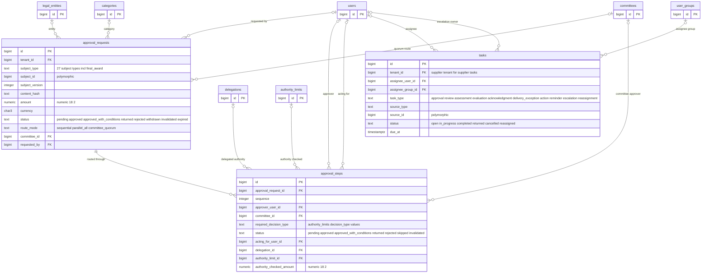
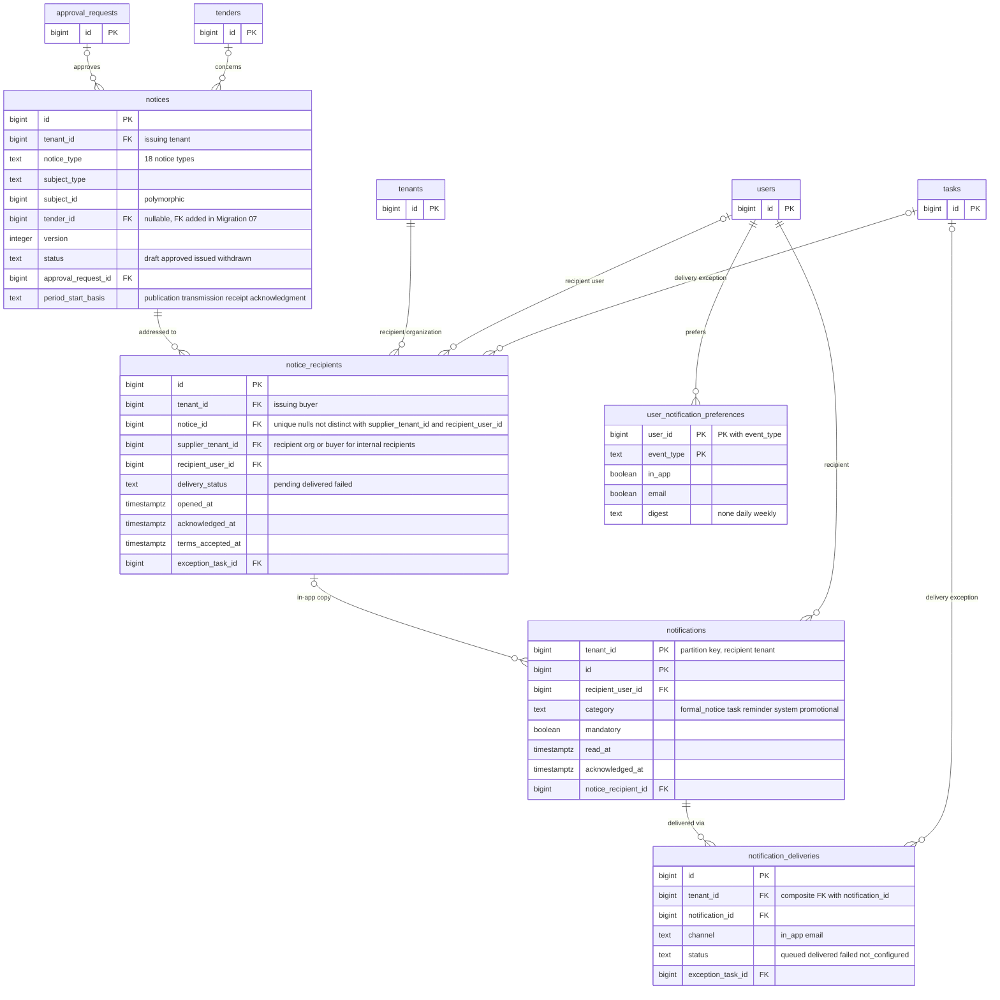
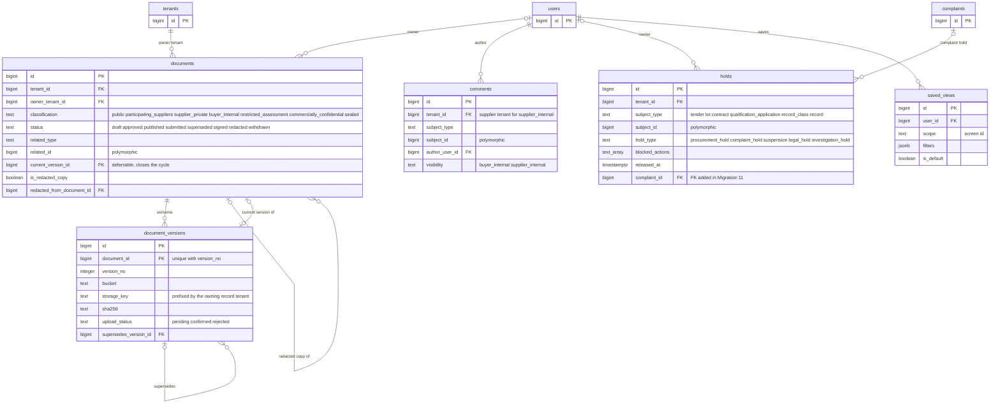
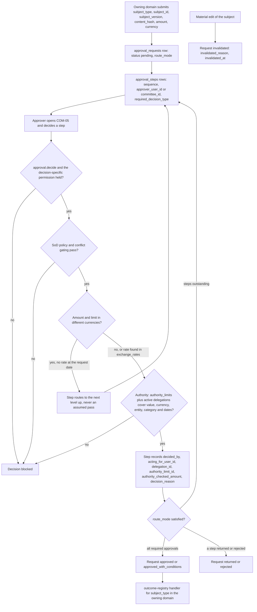
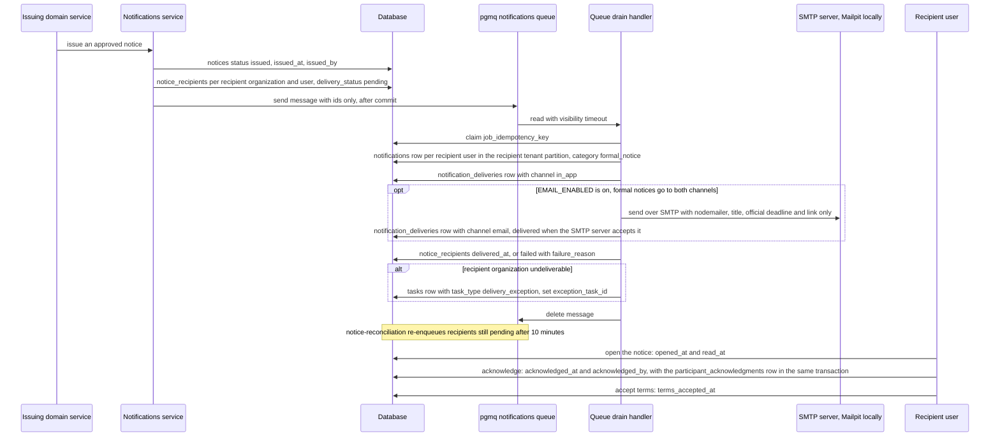
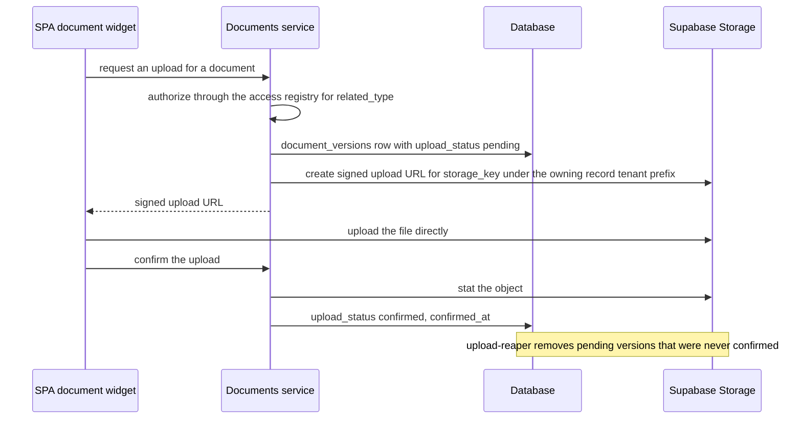

# Shared Services Data Model

Status: As-designed (pre-build). Updated to as-built at the end of Stage A and Stage B.

Sources:
- `docs/plan/design-decisions.md`: DD-01 (forward FKs and deferred cycles), DD-02 (`NULLS NOT DISTINCT`), DD-11 (notification partition tenant), DD-12 (storage keys), DD-14 (approval subject types), DD-16 (owners of `tasks`, `comments`, `holds`, `exports`), DD-18 (`expire-approvals`), DD-19 (`contract-dates`, `notification-digests`, `notice-reconciliation`), DD-20 (expiry semantics), DD-21 (`/me` aggregation), DD-23 (`supplier.notices.acknowledge`), DD-24 (approver permissions), DD-25 (conflict gating), DD-39 (idempotency), DD-42 (acknowledgment authority), DD-43 (Supabase Auth emails in Mailpit; superseded for Stage A by DD-50, so they all arrive from Stage B), DD-44 (`email` delivery channel: nodemailer over SMTP, Mailpit locally, `EMAIL_ENABLED` and `SMTP_*` configuration, content limits, hosted provider deferred); §E owner decisions of 2026-09-29 (item 4 email delivery, item 8 prototype behaviour)
- `docs/plan/schema-blueprint.md`: §0 Conventions; Migration 04 (`20261001000400_shared_services.sql`); Migrations 05–13 for the back-references listed in §8
- `docs/plan/architecture-plan.md` (revision 3): §0 Delivery stages; §3.5 Versioning, approvals and evidence; §3.6 State machines (holds); §3.8 Notifications; §3.9 Background jobs; §3.11 Prototype mode; §4 Registries (`approvals/outcome-registry.ts`, `documents/access-registry.ts`) and shared owners; §5 Build waves (A1 `contracts-core`, B1 `ui-live-api`, B2 shared services); §6 Domain map (domain 00 workspace, domain 15); §11 item 3 Email delivery (decided, DD-44)
- `docs/plan/email-delivery-options.md`: §1 delivery tracking and content rule, §2 local Mailpit set-up, §3 hosted provider options (deferred)
- `docs/technical/adr/0007-in-app-formal-notices.md` (filename kept): formal notices delivered through the `in_app` and `email` channels, with SMTP through nodemailer, Mailpit locally and the hosted provider deferred (DD-44)
- `docs/architecture-brief.md`: §5.9 File storage; §9.5 Queues
- `docs/PRD.md`: §4.3 Audience matrix; §7.18 (FR-21); §8.2 (holds); §8.3 Approval request states; §14 Documents, communication and notifications (§14.3 notification events); §18.1 Information classes; BR-06, BR-07, BR-10, BR-13, BR-32, BR-40, BR-41, BR-42, BR-43; screens COM-03..08, ADM-12
- `docs/plan/demo-storyline.md`: examples (AC-05, AC-06, AC-25, AC-35)
- `docs/plan/tenderiq-prototype.workflow.js`: domain 00 workspace notes (`notifications` and `notification-rules` contracts, COM-06, ADM-12). `docs/plan/tenderiq-backend.workflow.js`: B1 `scaffold-b` (email variables in `.env.local`) and `ui-live-api` notes, B2 `svc-approvals` and `svc-notifications` notes (email channel, Mailpit-based integration tests), domain 01 notes (invitations)

Contents:
1. [Scope and ownership](#1-scope-and-ownership)
2. [Entity-relationship diagrams](#2-entity-relationship-diagrams)
3. [Approvals and tasks](#3-approvals-and-tasks)
4. [Approval flow data](#4-approval-flow-data)
5. [Notifications and formal notices](#5-notifications-and-formal-notices)
   - [5.1 Notification event catalog](#51-notification-event-catalog)
6. [Documents](#6-documents)
7. [Comments, holds and saved views](#7-comments-holds-and-saved-views)
8. [Back-references from domain tables](#8-back-references-from-domain-tables)
9. [Open points](#9-open-points)

Conventions (standard columns, dictionary legend, tags, polymorphic pairs) are defined in [README.md](README.md).

---

## 1. Scope and ownership

This file covers the 13 tables of Migration 04. None of them is sealed. `notifications` is partitioned (`[P]`), `notice_recipients` is supplier-accessible (`[S]`, on the `forSupplier` allow-list, DD-03) and `user_notification_preferences` is global (`[G]`).

**Stage A.** The A1 agent `contracts-core` writes the shared contracts (`approvals`, `tasks`, `notifications`, `documents`, `audit`, `calendars`). Domain 00 (workspace) builds the screens COM-04 (tasks and approvals inbox), COM-05 (approval decision), COM-06 (notification center) and COM-07 (document viewer) against static fixtures. No table exists, and prototype actions persist nothing (architecture-plan §0, §5, §6). The Stage A prototype only displays delivery status (`email-delivery-options.md`). **Stage B.** The B2 agents `svc-approvals`, `svc-notifications`, `svc-documents` and `svc-core` implement the same contracts over these tables. `svc-notifications` builds both delivery channels, `in_app` and `email` (DD-44; §5).

DD-16 and architecture-plan §4 name the owners of the tables that the domain map left open: `tasks` belongs to the approvals service, and `comments` and `holds` belong to the lifecycle (core) service, which also owns `record_snapshots` ([01](01-platform-identity-access.md)) and `process_decisions` ([10](10-selection-award.md)) and exposes `recordProcessDecision()`. The documents service also owns `exports` and the `exports` queue handler (`requestExport()`, [12](12-records-reporting-operations.md)). The assignments are confirmed as-built at the end of Stage B.

| Table | Tag | mut | Sealed | Owning domain / module | PRD |
|---|---|---|---|---|---|
| `approval_requests` | `[T]` | yes | no | approvals | FR-21, BR-06, BR-07, BR-10, COM-04, COM-05, AC-05, AC-06 |
| `approval_steps` | `[T]` | yes | no | approvals | FR-03, BR-06, BR-07, COM-05 |
| `tasks` | `[T]` | yes | no | approvals (DD-16); UI `features/tasks` | FR-21, BR-42, COM-04 |
| `notifications` | `[P]` | no | no | notifications | BR-41, BR-43, §14.3, COM-06 |
| `notification_deliveries` | `[T]` | no | no | notifications | BR-41, BR-42 |
| `user_notification_preferences` | `[G]` | no | no | notifications | §14.3, COM-03 |
| `notices` | `[T]` | yes | no | notifications | §14.2, §14.3, BR-41 |
| `notice_recipients` | `[T]` `[S]` | yes | no | notifications | BR-41, BR-42, §14.3 |
| `documents` | `[T]` | yes | no | documents | §14.1, §18.1, COM-07 |
| `document_versions` | `[T]` | no | no | documents | §14.1, COM-07 |
| `comments` | `[T]` | yes | no | lifecycle (core service) (DD-16) | FR-21, §14.2 |
| `holds` | `[T]` | yes | no | lifecycle (core service) (DD-16). The lifecycle module also enforces blocked actions (architecture-plan §3.6). Holds are imposed and released on ADM-14 with `records.hold.manage`; complaints raise complaint holds | §8.2, BR-13, BR-32, BR-40, ADM-14 |
| `saved_views` | `[T]` | yes | no | reporting (search, COM-08) | COM-08 |

---

## 2. Entity-relationship diagrams

### 2.1 Approvals and tasks

### 2.2 Notifications and formal notices

### 2.3 Documents, comments, holds and saved views

---

## 3. Approvals and tasks

### approval_requests `[T]`

**Tag** `[T]` · **mut** yes · **Sealed** no · **Owner** approvals · **PRD** FR-21, BR-06, BR-07, BR-10, COM-04, COM-05, AC-05, AC-06

A decision request against an **exact version** of a subject: `subject_version`, `content_hash`, `amount` and `currency` (architecture-plan §3.5). A material edit of the subject invalidates the request, and a prior approval cannot be reused for a different commercial decision (BR-10). Demo: T-2026-0005 was awaiting release approval when a scope/value edit invalidated the approval (AC-06). When a request reaches a final state, the owning domain's handler for its `subject_type` runs through `domains/approvals/outcome-registry.ts` (architecture-plan §4). The hourly `expire-approvals` job (approvals, at :05) expires requests past `expires_at` and notifies their owners, and `deadline-reminders` sends approval-due reminders (DD-18; architecture-plan §3.9). An approver finds requests in the personal inbox, which lists the caller's own rows across all active memberships (`/me/approvals/:id`); deciding requires `X-Tenant-Id` equal to the request's tenant (DD-21).

**Subject types added by DD-14.** `obligation_waiver` (`obligations.waiver_approval_id`), `security_release` (`contract_securities.release_approval_id`), `dispute_decision` (`contract_disputes.authorized_decision_id` references `approval_requests`), `contract_difference` (`contracts.difference_approval_id`) and `final_award`. Final award is distinct from intent: it is its own approval per lot outcome (`lot_outcomes.final_award_approval_id`). A tender can have several `award_recommendations` over time, each covering the lots listed in its `lot_outcomes`, so lots on different timelines are supported ([10-selection-award.md](10-selection-award.md)).

| Column | Type | Null | Key / constraint | Meaning |
|---|---|---|---|---|
| `id` | bigint | not null | PK, identity | std |
| `tenant_id` | bigint | not null | FK → tenants; index (tenant_id, status); index (tenant_id, subject_type, subject_id) | Organization |
| `created_at` | timestamptz | not null | default now() | std |
| `created_by` | bigint | null | FK → users | std |
| `updated_at` | timestamptz | not null | default now() | mut |
| `subject_type` | text | — | CHECK (procurement_request, funding, strategy, tender_release, addendum, exclusion, shortlist, preferred_bidder, negotiation_mandate, final_offer_round, award, contract, contract_signature, contract_change, renewal, qualification_decision, late_submission_exception, policy_profile, template, disposal, process_decision, hold_release, obligation_waiver, security_release, dispute_decision, contract_difference, final_award) | What is being decided. The last five were added by DD-14 |
| `subject_id` | bigint | — | Polymorphic (not FK) | Subject record |
| `subject_version` | integer | — | | Version of the subject under decision |
| `content_hash` | text | — | | Hash of the approved content (compare `record_snapshots.content_hash`) |
| `title` | text | — | | Title shown in the inbox |
| `summary` | text | — | | Decision summary |
| `amount` | numeric(18,2) | — | | Value under decision |
| `currency` | char(3) | — | CHECK `^[A-Z]{3}$` | Currency |
| `legal_entity_id` | bigint | — | FK → legal_entities | Entity (authority scope) |
| `category_id` | bigint | — | FK → categories | Category (authority scope) |
| `justification` | text | — | | Justification |
| `status` | text | — | CHECK (pending, approved, approved_with_conditions, returned, rejected, withdrawn, invalidated, expired) | Request state (PRD §8.3) |
| `requested_by` | bigint | — | FK → users | Requester |
| `due_at` | timestamptz | — | | Decision due |
| `expires_at` | timestamptz | — | | Expiry. `expire-approvals` sets `status = 'expired'` after it and notifies the owner (DD-18) |
| `decided_at` | timestamptz | — | | Final decision time |
| `conditions` | text | — | | Conditions attached to an `approved_with_conditions` decision |
| `invalidated_reason` | text | — | | Why the request was invalidated (for example a material edit) |
| `invalidated_at` | timestamptz | — | | Invalidation time |
| `route_mode` | text | — | CHECK (sequential, parallel_all, committee_quorum) | How steps combine |
| `committee_id` | bigint | — | FK → committees | Committee for `committee_quorum` |

### approval_steps `[T]`

**Tag** `[T]` · **mut** yes · **Sealed** no · **Owner** approvals · **PRD** FR-03, BR-06, BR-07, COM-05

One approver's (or committee's) step in a request. The step records both the acting person and any delegated capacity (FR-03), plus the authority limit and amount that were checked (BR-06). Deciding a step requires `approval.decide` **and** the decision-specific permission (for example `award.approve`) **and** sufficient authority. Cross-currency authority uses `exchange_rates` at the request date; with no rate, the step routes to the next level up and never passes on an assumed rate (DD-24).

| Column | Type | Null | Key / constraint | Meaning |
|---|---|---|---|---|
| `id` | bigint | not null | PK, identity | std |
| `tenant_id` | bigint | not null | FK → tenants | Organization |
| `created_at` | timestamptz | not null | default now() | std |
| `created_by` | bigint | null | FK → users | std |
| `updated_at` | timestamptz | not null | default now() | mut |
| `approval_request_id` | bigint | — | FK → approval_requests | Request |
| `sequence` | integer | — | | Order within the route |
| `approver_user_id` | bigint | — | FK → users | Assigned approver (or use `committee_id`) |
| `committee_id` | bigint | — | FK → committees | Committee approver |
| `required_decision_type` | text | — | Values of `authority_limits.decision_type` | Authority required for this step |
| `status` | text | — | CHECK (pending, approved, approved_with_conditions, returned, rejected, skipped, invalidated) | Step state |
| `decided_by` | bigint | — | FK → users | Person who decided |
| `acting_for_user_id` | bigint | — | FK → users | Principal when a delegate decided |
| `delegation_id` | bigint | — | FK → delegations | Delegation used |
| `decision_reason` | text | — | | Reason |
| `conditions` | text | — | | Conditions |
| `decided_at` | timestamptz | — | | Decision time |
| `authority_checked_amount` | numeric(18,2) | — | | Amount compared against the limit, converted with `exchange_rates` at the request date when the currencies differ (DD-24) |
| `authority_limit_id` | bigint | — | FK → authority_limits | Limit that authorized the decision |

### tasks `[T]`

**Tag** `[T]` · **mut** yes · **Sealed** no · **Owner** approvals (DD-16) · **PRD** FR-21, BR-42, COM-04

Work items for buyer and supplier users, owned by the approvals service (DD-16; architecture-plan §4). Every task identifies an owner, a due date, a status, a source record and an escalation route (FR-21). Supplier tasks use the **supplier** `tenant_id`. Delivery exceptions (BR-42) are tasks with `task_type = 'delivery_exception'`. Jobs raise tasks instead of taking business decisions: `standstill-monitor` creates a task only and never auto-awards, `obligation-status` creates escalation tasks, and `qualification-expiry` creates tasks and notices but writes **no** decision, because `v_qualification_status` derives `expired` (DD-20; architecture-plan §3.9). Sweeps without their own state deduplicate the alerts they raise with `<job>:<entity>:<window>` keys in `job_idempotency_key` (DD-19).

The personal inbox (`/api/v1/me/tasks`, COM-04) returns the caller's own tasks across **all active memberships**, each labelled with its organization. Acting on a task requires `X-Tenant-Id` equal to the task's tenant (DD-21).

| Column | Type | Null | Key / constraint | Meaning |
|---|---|---|---|---|
| `id` | bigint | not null | PK, identity | std |
| `tenant_id` | bigint | not null | FK → tenants; index (tenant_id, assignee_user_id, status, due_at) | Organization (supplier tenant for supplier tasks) |
| `created_at` | timestamptz | not null | default now() | std |
| `created_by` | bigint | null | FK → users | std; null for job-created tasks |
| `updated_at` | timestamptz | not null | default now() | mut |
| `assignee_user_id` | bigint | — | FK → users | Assignee |
| `assignee_group_id` | bigint | — | FK → user_groups | Assignee group |
| `title` | text | — | | Title |
| `description` | text | — | | Description, without restricted details (COM-04) |
| `task_type` | text | — | CHECK (approval, review, assessment, evaluation, acknowledgment, delivery_exception, action, reminder, escalation, reassignment) | Kind of task |
| `source_type` | text | — | | Source record type |
| `source_id` | bigint | — | Polymorphic (not FK) | Source record id |
| `source_reference` | text | — | | Human reference of the source (e.g. `T-2026-0003`) |
| `due_at` | timestamptz | — | | Due time |
| `priority` | text | — | CHECK (low, normal, high, urgent) | Priority |
| `status` | text | — | CHECK (open, in_progress, completed, returned, cancelled, reassigned) | Task state |
| `escalation_user_id` | bigint | — | FK → users | Escalation owner |
| `delegated_from_user_id` | bigint | — | FK → users | Original assignee when delegated |
| `completed_at` | timestamptz | — | | Completion time |
| `completed_by` | bigint | — | FK → users | Completer |
| `outcome_note` | text | — | | Outcome |

---

## 4. Approval flow data

This flowchart shows how the approval tables record a decision. The legality matrix for request states is written in `domains/approvals/workflow` in Stage B (architecture-plan §3.6). [06-key-flows.md](../06-key-flows.md) shows the end-to-end sequences.

- **Authority (BR-06).** `authority_limits` rows for the approver (as a user, through a role, or through a committee) plus active `delegations` must cover the decision type, amount, currency, legal entity, category and dates. Demo: PR-2026-0003 exceeds `mpho.manager`'s BWP 2,000,000 limit and is routed to `keabetswe.approver` (AC-05). [02-organization-policy.md](02-organization-policy.md#5-authority-delegation-and-separation-of-duties) defines the limit tables.
- **Permissions (DD-24).** Deciding a step requires `approval.decide` **and** the decision-specific permission (for example `award.approve`) **and** sufficient authority.
- **Cross-currency authority (DD-24).** When the amount and the limit are in different currencies, the check uses `exchange_rates` at the request date. With no rate, the step routes to the next level up; it never passes on an assumed rate.
- **Separation of duties (BR-07).** `sod_policies` blocks self-approval and incompatible duties unless `mode = 'alternative_oversight'` with a recorded note.
- **Conflict gating (DD-25).** The conflict check follows the rule for `conflict_declarations`: a declaration with `has_conflict = true` blocks restricted access while its disposition is `pending_review`; access resumes only on `cleared` or `mitigated`, and `recused` or `reassigned` block permanently for that subject ([02-organization-policy.md](02-organization-policy.md#conflict_declarations-t)).
- **Mapping.** Which `required_decision_type` each `subject_type` needs is not tabulated in the blueprint (see §9).

---

## 5. Notifications and formal notices

PRD §14.2 separates internal collaboration (`comments`), general clarifications, supplier-specific correspondence and **formal notices** (`notices`), which are approved, versioned and addressed to a defined audience. BR-41 requires four distinct recorded events: delivery (`notice_recipients.delivered_at`), opening (`opened_at`), acknowledgment (`acknowledged_at`) and acceptance of terms (`terms_accepted_at`).

**Delivery channels (DD-44).** The `DeliveryChannel` port has two implementations, `in_app` and `email`, and every delivery attempt is tracked in `notification_deliveries` ([ADR-0007](../adr/0007-in-app-formal-notices.md); architecture-plan §3.8, §11 item 3).
- **Transport.** `email` sends over SMTP with `nodemailer`, the one approved added runtime dependency.
- **Local delivery.** Locally, every message goes to Mailpit in the Supabase Docker stack (`supabase/config.toml` `[inbucket] smtp_port = 54325`; web UI `http://127.0.0.1:54324`). A message is recorded as `delivered` when Mailpit accepts it. Stage B integration tests read Mailpit's API to assert delivery (`svc-notifications` notes).
- **Configuration.** `EMAIL_ENABLED`, `SMTP_HOST`, `SMTP_PORT`, `SMTP_USER`, `SMTP_PASSWORD` and `EMAIL_FROM`. Where email is not enabled (no SMTP configured), notices stay in-app only and no `email` rows are written to `notification_deliveries`.
- **Channel choice.** Formal notices go to both channels. Non-mandatory events follow `user_notification_preferences`.
- **Content.** An email carries only the title, the official deadline and a link into the app, never bid, evaluation or other confidential content (BR-43, ADM-12). The authoritative content stays in the product.
- **Hosted provider.** The hosted provider and its delivery-event webhooks are **deferred** ([email-delivery-options.md](../../plan/email-delivery-options.md) §3). A provider is needed before the first hosted environment (design-decisions §E item 4).

A delivery failure never alters a deadline. It creates a delivery-exception task (BR-42). Fan-out and delivery run on the `notifications` pgmq queue (architecture-plan §3.8, §3.9).

Three jobs support delivery (DD-19; architecture-plan §3.9, all owned by notifications):
- `notice-reconciliation` (every 10 minutes) re-enqueues `notice_recipients` still `pending` after 10 minutes. It is the safety net of brief §9.5.
- `notification-digests` (daily 05:00) sends daily and weekly digests per `user_notification_preferences.digest`. Mandatory notices are never digested.
- `deadline-reminders` (hourly at :15) sends closing, evaluation-due and approval-due reminders.

**Partition tenant (DD-11).** A `notifications` row is written to the **recipient's** tenant for that notice, which is the supplier tenant for a supplier recipient. The `notices` and `notice_recipients` rows stay with the issuing buyer.

**Acknowledgment authority (DD-42).** For submission readiness, `participant_acknowledgments` is authoritative. `notice_recipients.acknowledged_at` records the delivery-level event, and it is written in the same transaction when the acknowledgment comes from a notice. Suppliers acknowledge with `supplier.notices.acknowledge` (DD-23).

Which rows are written in the issuing transaction and which in the queue handler is finalized in Stage B, and so is how the `in_app` and `email` outcomes combine into `notice_recipients.delivery_status` (§9). The message carries ids only, and the handler re-reads the current state (brief §9.5). Where email is not enabled, the `opt` block does not run and no `email` row is written (DD-44). A `participant_acknowledgments` row is written only where the recipient organization is a tender participant; it stays authoritative for submission readiness (DD-42).

### 5.1 Notification event catalog

`notifications.event_type`, `notification_rules.event_type` (unique per tenant) and `user_notification_preferences (user_id, event_type)` all key on one event vocabulary. The blueprint defines that vocabulary only by reference to the PRD §14.3 list. This catalog gives one row per PRD §14.3 trigger. Each row names the domain that produces the event, the transition or job that raises it, and the formal notice type it carries, if any. Every domain emits through the notifications service: `notify(...)` for ordinary notifications, which respects preferences except for mandatory items, and `issueNotice(...)` for formal notices, which writes `notices` and `notice_recipients` and enqueues fan-out (Stage B `svc-notifications` notes).

**Event codes.** No source enumerates the `event_type` codes. In Stage A the workspace domain (00) owns the `notifications` and `notification-rules` contracts: COM-06 preferences with mandatory types locked, and ADM-12 notification rules (`tenderiq-prototype` workflow notes). The codes are defined once in those contracts, and Stage B implements the same contracts over these tables. The trigger names below are the reference until the codes are recorded here as-built at the end of Stage A. How a tenant's `notification_rules` rows are first populated (defaults at onboarding or ADM-12 configuration only) is not stated and is finalized in Stage B. In Stage A no event is emitted and no app email is sent. COM-06 shows fixture rows, and mock handlers never persist anything (architecture-plan §3.11; owner decision 2026-09-29: prototype actions do not persist). Stage A has no Supabase Auth and sends no email at all (DD-50); Auth password-reset, invitation and registration emails arrive from Stage B, when real Supabase Auth and the real API are in place.

**Column rules.**
- **Producing domain** uses the architecture-plan §6 numbering. A job's owner comes from architecture-plan §3.9.
- **Category.** The blueprint gives only the CHECK list (`formal_notice`, `task`, `reminder`, `system`, `promotional`). This catalog applies one rule: `formal_notice` when the notification carries a `notice_recipient_id` (fan-out of an issued notice, §5); `task` when it accompanies a task or approval step for the recipient; `reminder` when a scheduled sweep raises it ahead of or after a due date; `system` for any other process outcome. No §14.3 trigger is `promotional`; promotional messages and optional digests stay separately controllable (PRD §14.3). The assignment is design intent and is confirmed as-built at the end of Stage B.
- **Mandatory.** The flag is set per event type by `notification_rules.mandatory` and copied to `notifications.mandatory`. A mandatory item ignores `user_notification_preferences` (PRD §14.3). Essential process notices are mandatory "where policy requires them" (COM-03). "Expected yes" marks a formal notice to its defined audience.

| # | PRD §14.3 trigger | Producing domain (plan §6) | Source transition or job | Category | Related `notices.notice_type` | Mandatory | Recipients (PRD §14.3) |
|---|---|---|---|---|---|---|---|
| 1 | User invitation or authority change | 01 identity + org-admin | `invitations` created (ADM-03, COM-01). A change to `role_assignments`, `access_grants`, `access_restrictions` or `delegations` (ADM-03 to ADM-05). `expire-access` (org-admin, hourly at :00) updates the display status of expired grants, restrictions, delegations and invitations and sends notices; request-time checks compare the timestamps directly (DD-18). An invitee without an account is reached by the Supabase Auth invite email (`inviteUserByEmail`; domain 01 workflow notes), not in-app. Locally that email lands in Mailpit (DD-43; architecture-plan §11 item 3) | `system` | none | Per rule | Affected user and responsible administrator |
| 2 | Request submitted or returned | 05 requests | `procurement_requests.status` → `submitted`. → `information_requested` with a `request_info_requests` row. The approvals service creates tasks and notifications for the review and approval route | `task` | none | Per rule | Requester, owner and assigned reviewers |
| 3 | Tender issued or invitation received | 07 publication | Release path: lifecycle `ready → open`, either "publish now" or `publish-scheduled` (publication, every 5 minutes). Supplier invited: `participants.invitation_status = 'invited'`, `invited_at` | `formal_notice` | `tender_issued`, `invitation` | Expected yes | Approved supplier audience and relevant buyer owners |
| 4 | Addendum or deadline change | 08 clarifications | `addenda.status` → `issued` (`addenda.notice_id`), through the lifecycle snapshot API. `deadline_change` when dates move | `formal_notice` | `addendum`, `deadline_change` | Expected yes | All affected eligible participants and buyer stakeholders |
| 5 | Question answered or clarification requested | 08 clarifications (tender questions). 10 opening (bid clarifications) | `questions.status` → `published` (audience `all_participants` or `public`) or `answered_privately`. `bid_clarifications.status` → `issued` to one bidder, with `due_at`. Qualification information requests (`qualification_info_requests`, 04 qualification) match the same wording; whether they share this event type is decided with the codes | `formal_notice` for a general clarification to all participants; otherwise `task` | `clarification_published` for a general clarification (PRD §14.2); none for supplier-specific correspondence | Expected yes for `clarification_published`; otherwise per rule | Appropriate participant or assigned reviewer |
| 6 | Qualification evidence expiring | 04 qualification | `evidence-expiry` (qualification, daily 02:10). It only flags and notifies, and also raises `reassessment_triggers` (BR-25). `evidence_items.status = 'expired'` is set by the suppliers domain, not by the job (DD-20) | `reminder` | none | Per rule | Supplier evidence owner and buyer reviewer as configured |
| 7 | Submission succeeded, failed, replaced or withdrawn | 09 bids | Submission transaction: `submission_attempts.outcome` (`succeeded`, `failed_*`) and `submission_receipts`. Replacement: the earlier receipt becomes `superseded`. Withdrawal: a `withdrawals` row, and the receipt becomes `withdrawn` | `system` | none | Per rule | Supplier bid manager and submitter |
| 8 | Closing approaching | 00 workspace (`deadline-reminders` job owner: notifications) | `deadline-reminders` (hourly at :15), offsets from `notification_rules.reminder_offsets_hours`. Which supplier users count as "interested" is finalized in Stage B | `reminder` | none | Per rule; user settings apply | Interested supplier users according to settings |
| 9 | Evaluation assigned or overdue | 11 evaluation (assigned). 00 workspace (overdue) | Assigned: an `evaluation_assignments` row is created. Overdue: `deadline-reminders` against `evaluation_assignments.due_at`, escalating after `escalate_after_hours` to `escalation_role` (`tasks.task_type = 'escalation'`) | `task` (assigned), `reminder` (overdue) | none | Per rule | Assessor, chair and escalation owner |
| 10 | Approval needed, returned or expired | 00 workspace (approvals service) | Needed: `requestApproval` creates steps, tasks and notifications. Returned: `approval_requests.status` / `approval_steps.status` → `returned`. Expired: `expire-approvals` (approvals, hourly at :05) → `expired`, and the owner is notified (DD-18). Due soon: `deadline-reminders` | `task`; `reminder` for approval-due | none | Per rule | Assigned approver and record owner |
| 11 | Preferred selection, intent, exclusion or award | 12 selection (shortlist, preferred bidder). 10 opening (exclusion). 13 awards (intent, award, unsuccessful outcome) | `shortlist_entries.notice_id`. `preferred_bidders` approved. `exclusions.notice_id`, `notified_at` after approval. Intent notice `standstill_periods.intent_notice_id` with `lot_outcomes.status = 'intent_notified'`. `lot_outcomes.status = 'final_awarded'` | `formal_notice` | `shortlist_outcome`, `preferred_bidder`, `exclusion`, `intent_to_award`, `final_award`, `unsuccessful_outcome` | Expected yes | Approved bidder audience |
| 12 | Complaint or waiting-period change | 13 awards | `complaints.status` transitions (recorded in `complaint_events`). `standstill_periods.status` → `extended` or `suspended` (`extended_to`, `extension_reason`). When the standstill ends with no blocking hold, `standstill-monitor` (awards, every 15 minutes) creates a task only (plan §3.9) | `formal_notice` | `complaint_update`, `standstill_change` | Expected yes | Case parties and responsible buyer roles |
| 13 | Contract milestone, expiry or renewal window | 14 contracts | `obligation-status` (contracts, daily 02:30): due and overdue `obligations`, escalation tasks. `renewal-windows` (contracts, daily 02:40): `renewal_options` notice windows, alerts only, never auto-renew (BR-37, AC-32). `contract-dates` (contracts, daily 02:50): `signed_not_effective` → `active` on the effective date, `active` → `expired` after `term_end` (open obligations remain), and securities → `expiring` / `expired` (DD-19) | `reminder` | none for these alerts. `contract_notice` is for formal contractual notices (PRD §14.2), not reminders | Per rule | Contract owners and assigned supplier contacts |
| 14 | Service incident affecting participation | 16 operations | `service_incidents` with `service_incident_impacts` rows naming the affected customer (`customer_tenant_id`, DD-04) and tender (`customer_notice`). Buyers issue their own deadline decisions separately, as row 4 | `formal_notice` | `service_incident` | Expected yes | Affected users and buyer decision owners |

Notes:
- **Notice types without a §14.3 row.** `cancellation` (tender cancellation through the lifecycle service), `qualification_decision` (04 qualification), `contract_notice` (14 contracts) and `other` are formal notices that no §14.3 trigger names. They use the same `issueNotice` fan-out. Their event codes are fixed together with the others.
- **Issuing tenant for row 14.** `service_incidents` is `[G]`, and `notices` is `[T]` with `tenant_id` = the issuing organization. Whether the operator tenant or each affected buyer issues the `service_incident` notice is not stated.
- **Content.** Bodies must not reveal restricted information (BR-43), and general alerts must not embed confidential bid content (ADM-12). An email carries only the title, the official deadline and a link (DD-44).
- **Channels.** Notifications use the `in_app` channel and, where email is enabled, the `email` channel. Formal notices go to both channels, and non-mandatory events follow `user_notification_preferences` (DD-44; §5). The invite email of row 1 is sent by Supabase Auth itself, not by the `email` channel.
- **Consolidation.** Repeated reminders are consolidated where that does not obscure distinct obligations (PRD §14.3). Optional items go into daily or weekly digests through `notification-digests`; mandatory notices are never digested (DD-19). Sweeps deduplicate their alerts with `<job>:<entity>:<window>` keys (DD-19).
- **Qualification expiry.** `qualification-expiry` (qualification, daily 02:20) writes no decisions. `v_qualification_status` derives `expired`, and the job creates tasks and notices (DD-20).
- **Scheduled reports.** `report-schedules` (reporting, hourly at :05) runs due report definitions and re-checks each recipient's authorization at issue time (DD-19; [12-records-reporting-operations.md](12-records-reporting-operations.md)).
- **Jobs.** [08-background-jobs.md](../08-background-jobs.md) describes each job named above.

### notifications `[P]`

**Tag** `[P]` · **mut** no · **Sealed** no · **Owner** notifications · **PRD** BR-41, BR-43, §14.3, COM-06

In-app notifications, partitioned by tenant (`notifications_t<tenant id>`). A row goes to the **recipient's** tenant for that notice, which is the supplier tenant for a supplier recipient (DD-11). `notification_deliveries` is the only table allowed to reference a `[P]` table. Reading a notification (`read_at`) is distinct from acknowledging it (`acknowledged_at`) (COM-06). Content must not reveal restricted information to unauthorized users (BR-43). The notification center (`/api/v1/me/notifications`, COM-06) returns the caller's own notifications across **all active memberships**, each labelled with its organization; acting on one requires `X-Tenant-Id` equal to its tenant (DD-21).

| Column | Type | Null | Key / constraint | Meaning |
|---|---|---|---|---|
| `tenant_id` | bigint | not null | PK (tenant_id, id); FK → tenants; partition key; index (tenant_id, recipient_user_id, read_at) | Partition tenant: the recipient's tenant for the notice (DD-11) |
| `id` | bigint | not null | PK, identity | Row id |
| `created_by` | bigint | null | FK → users | std |
| `recipient_user_id` | bigint | — | FK → users | Recipient |
| `event_type` | text | — | | Event (matches `notification_rules.event_type`; catalog in §5.1) |
| `category` | text | — | CHECK (formal_notice, task, reminder, system, promotional) | Category. Promotional messages are separately controllable (PRD §14.3) |
| `title` | text | — | | Title |
| `body` | text | — | | Body, without confidential bid content (ADM-12) |
| `source_type` | text | — | | Source record type |
| `source_id` | bigint | — | Polymorphic (not FK) | Source record id |
| `link_path` | text | — | | SPA route to the authoritative record |
| `mandatory` | boolean | — | | Mandatory: ignores user preferences |
| `requires_acknowledgment` | boolean | — | | Acknowledgment required |
| `created_at` | timestamptz | not null | default now() (std; also listed explicitly in the blueprint) | Creation time |
| `read_at` | timestamptz | — | | Read time |
| `acknowledged_at` | timestamptz | — | | Acknowledgment time |
| `notice_recipient_id` | bigint | — | FK → notice_recipients | Formal notice delivery this notification carries |

### notification_deliveries `[T]`

**Tag** `[T]` · **mut** no · **Sealed** no · **Owner** notifications · **PRD** BR-41, BR-42

One row per delivery attempt per channel (the `DeliveryChannel` port). The port has two implementations, `in_app` and `email` (DD-44; [ADR-0007](../adr/0007-in-app-formal-notices.md); architecture-plan §3.8, §11 item 3). Formal notices go to both channels, and non-mandatory events follow the recipient's `user_notification_preferences`. An `email` row is written only where email is enabled (`EMAIL_ENABLED` with SMTP configured); where it is not, no `email` rows are written. Locally an `email` row reaches `delivered` when Mailpit accepts the message. Delivery-event webhooks from a hosted provider (for example bounce or open events) are deferred with the provider choice (DD-44; `docs/plan/email-delivery-options.md` §2).

| Column | Type | Null | Key / constraint | Meaning |
|---|---|---|---|---|
| `id` | bigint | not null | PK, identity | std |
| `tenant_id` | bigint | not null | FK (tenant_id, notification_id) → notifications (tenant_id, id); FK → tenants | Organization (the notification's partition tenant) |
| `created_at` | timestamptz | not null | default now() | std |
| `created_by` | bigint | null | FK → users | std |
| `notification_id` | bigint | — | Part of the composite FK | Notification |
| `channel` | text | — | CHECK (in_app, email) | Channel. Formal notices use both; other events follow preferences. `email` rows exist only where email is enabled, and are sent over SMTP with nodemailer (DD-44) |
| `status` | text | — | CHECK (queued, delivered, failed, not_configured) | Outcome of the attempt. For `email`, `delivered` means the SMTP server accepted the message (Mailpit locally, DD-44). Because no `email` row is written where email is not enabled, no source names a case that writes `not_configured` (§9) |
| `attempted_at` | timestamptz | — | | Attempt time |
| `failure_reason` | text | — | | Failure reason |
| `exception_task_id` | bigint | — | FK → tasks | Delivery-exception task (BR-42) |

### user_notification_preferences `[G]`

**Tag** `[G]` · **mut** no · **Sealed** no · **Owner** notifications · **PRD** §14.3, COM-03

A person's channel and digest choices per event type. It is global because a person's preferences span all of their memberships. **Mandatory notices ignore preferences** (PRD §14.3).

| Column | Type | Null | Key / constraint | Meaning |
|---|---|---|---|---|
| `user_id` | bigint | not null | PK (user_id, event_type); FK → users | Person |
| `event_type` | text | not null | PK | Event (catalog in §5.1) |
| `in_app` | boolean | — | | Receive in-app |
| `email` | boolean | — | | Receive by email, where email is enabled. Non-mandatory events follow this preference; formal notices go to both channels regardless (DD-44) |
| `digest` | text | — | CHECK (none, daily, weekly) | Digest frequency, applied by the daily `notification-digests` job (05:00). Mandatory notices are never digested (DD-19) |

### notices `[T]`

**Tag** `[T]` · **mut** yes · **Sealed** no · **Owner** notifications · **PRD** §14.2, §14.3, BR-41

Formal, versioned communications with a defined audience, issue time and, where applicable, required acknowledgment (PRD §14.2). The adopted policy defines whether publication, transmission, receipt or acknowledgment starts a notice period (`period_start_basis`, PRD §14.3). Issuing requires `notice.issue`.

| Column | Type | Null | Key / constraint | Meaning |
|---|---|---|---|---|
| `id` | bigint | not null | PK, identity | std |
| `tenant_id` | bigint | not null | FK → tenants | Issuing organization |
| `created_at` | timestamptz | not null | default now() | std |
| `created_by` | bigint | null | FK → users | std |
| `updated_at` | timestamptz | not null | default now() | mut |
| `notice_type` | text | — | CHECK (tender_issued, invitation, addendum, deadline_change, clarification_published, cancellation, exclusion, shortlist_outcome, preferred_bidder, intent_to_award, final_award, unsuccessful_outcome, standstill_change, complaint_update, contract_notice, service_incident, qualification_decision, other) | Kind of notice |
| `subject_type` | text | — | | Subject record type |
| `subject_id` | bigint | — | Polymorphic (not FK) | Subject record |
| `tender_id` | bigint | null | Plain `bigint` in Migration 04; FK → tenders added by Migration 07 with `ALTER TABLE … ADD CONSTRAINT` (DD-01) | Tender, when tender-related |
| `version` | integer | — | | Notice version |
| `title` | text | — | | Title |
| `body` | text | — | | Body |
| `audience_description` | text | — | | Defined audience |
| `requires_acknowledgment` | boolean | — | | Acknowledgment required |
| `status` | text | — | CHECK (draft, approved, issued, withdrawn) | Notice state |
| `issued_at` | timestamptz | — | | Issue time |
| `issued_by` | bigint | — | FK → users | Issuer |
| `approval_request_id` | bigint | — | FK → approval_requests | Approval of the notice |
| `period_start_basis` | text | — | CHECK (publication, transmission, receipt, acknowledgment) | Event that starts the notice period |

### notice_recipients `[T]` `[S]`

**Tag** `[T]` `[S]` · **mut** yes · **Sealed** no · **Owner** notifications · **PRD** BR-41, BR-42, §14.3

One row per recipient organization and user. `tenant_id` is the issuing buyer. `supplier_tenant_id` is the recipient organization. For buyer-internal recipients it holds the buyer tenant id. The table is `[S]` (on the `forSupplier` allow-list), so suppliers read their rows through `forSupplier` (DD-03). A recipient still `pending` after 10 minutes is re-enqueued by `notice-reconciliation` (DD-19). For submission readiness `participant_acknowledgments` is authoritative; `acknowledged_at` here records the delivery-level event and is written in the same transaction when the acknowledgment comes from a notice (DD-42).

| Column | Type | Null | Key / constraint | Meaning |
|---|---|---|---|---|
| `id` | bigint | not null | PK, identity | std |
| `tenant_id` | bigint | not null | FK → tenants | Issuing organization |
| `supplier_tenant_id` | bigint | not null | FK → tenants | Recipient organization (buyer tenant for internal recipients) |
| `created_at` | timestamptz | not null | default now() | std |
| `created_by` | bigint | null | FK → users | std |
| `updated_at` | timestamptz | not null | default now() | mut |
| `notice_id` | bigint | — | FK → notices; `UNIQUE NULLS NOT DISTINCT` (notice_id, supplier_tenant_id, recipient_user_id) (DD-02) | Notice |
| `recipient_user_id` | bigint | null | FK → users | Recipient user. DD-02 cites this unique key as one that includes a nullable column: a null user counts as one value, so an organization-level row cannot be duplicated |
| `delivery_status` | text | — | CHECK (pending, delivered, failed) | Delivery outcome. `pending` rows older than 10 minutes are re-enqueued by `notice-reconciliation` (DD-19) |
| `delivered_at` | timestamptz | — | | Delivery event (BR-41) |
| `opened_at` | timestamptz | — | | Opening event (BR-41) |
| `acknowledged_at` | timestamptz | — | | Acknowledgment event (BR-41). Delivery-level record; `participant_acknowledgments` is authoritative for submission readiness (DD-42) |
| `acknowledged_by` | bigint | — | FK → users | Who acknowledged |
| `terms_accepted_at` | timestamptz | — | | Acceptance-of-terms event (BR-41) |
| `failure_reason` | text | — | | Failure reason |
| `exception_task_id` | bigint | — | FK → tasks | Delivery-exception task (BR-42) |

---

## 6. Documents

Every formal document has a name, a business owner, a purpose, a version, a date, a classification, a language, a status and a related record (PRD §14.1). A correction creates a new edition and never silently replaces history. Redaction creates an audience-specific copy while the controlled original is kept (`is_redacted_copy`, `redacted_from_document_id`; COM-07). Access is decided per `related_type` by `domains/documents/access-registry.ts`, and any unregistered type is denied (architecture-plan §4). Files live in the private buckets created by Migration 01 ([01-platform-identity-access.md](01-platform-identity-access.md#102-storage-buckets)).

- **Storage keys (DD-12).** `<owning-record tenant_id>/<related_type>/<related_id>/<document_id>/<version_no>-<sanitized name>`. The buyer tenant owns procurement records even for supplier uploads, so a supplier's bid file is stored under the buyer's prefix and `documents.tenant_id` is the buyer. `documents.owner_tenant_id` records who uploaded.
- **Current version (DD-01).** `documents.current_version_id → document_versions` closes a cycle inside Migration 04 and is added at the end of that migration as `DEFERRABLE INITIALLY DEFERRED`.
- **Exports (DD-16).** The documents service also owns `exports` and the `exports` queue handler through `requestExport()`. Domains register per-type generators in `documents/export-registry.ts`, which the Integration step wires. A finished export is stored as a document (`exports.document_id`, [12-records-reporting-operations.md](12-records-reporting-operations.md)).
- **Personal access (DD-21).** `/api/v1/me/documents/:id` returns a document the caller can see in any of their active memberships, labelled with its organization. Acting on it requires `X-Tenant-Id` equal to the document's tenant.

The two-step upload envelope comes from brief §5.9. The domain authorizes before calling the `StorageAdapter`, because the adapter performs no checks. The `upload-reaper` job (documents, daily 03:50) removes pending versions that were never confirmed and also purges `request_idempotency` rows older than 24 hours (architecture-plan §3.9; DD-39). In Stage A the document widgets run against fixtures. The Stage B agent `ui-live-api` adds the real upload flows to the shared widgets (architecture-plan §5).

### documents `[T]`

**Tag** `[T]` · **mut** yes · **Sealed** no · **Owner** documents · **PRD** §14.1, §18.1, COM-07

| Column | Type | Null | Key / constraint | Meaning |
|---|---|---|---|---|
| `id` | bigint | not null | PK, identity | std |
| `tenant_id` | bigint | not null | FK → tenants; index (tenant_id, related_type, related_id) | Tenant that owns the related record. The buyer for procurement records, even for supplier uploads (DD-12). Also the first segment of every version's `storage_key` |
| `created_at` | timestamptz | not null | default now() | std |
| `created_by` | bigint | null | FK → users | std |
| `updated_at` | timestamptz | not null | default now() | mut |
| `owner_tenant_id` | bigint | — | FK → tenants | Tenant that uploaded the file (DD-12): equal to `tenant_id` for buyer documents; the supplier tenant for supplier uploads and supplier-owned evidence mirrored into a procurement |
| `owner_user_id` | bigint | — | FK → users | Business owner |
| `title` | text | — | | Title |
| `purpose` | text | — | | Purpose |
| `classification` | text | — | CHECK (public, participating_suppliers, supplier_private, buyer_internal, restricted_assessment, commercially_confidential, sealed) | Audience class (PRD §18.1) |
| `language` | text | — | | Language |
| `status` | text | — | CHECK (draft, approved, published, submitted, superseded, signed, redacted, withdrawn) | Document state (PRD §14.1) |
| `related_type` | text | — | Must be registered in `access-registry.ts` | Owning record type |
| `related_id` | bigint | — | Polymorphic (not FK) | Owning record id |
| `current_version_id` | bigint | — | FK → document_versions, `DEFERRABLE INITIALLY DEFERRED` (DD-01) | Current version |
| `precedence` | integer | — | | Precedence where documents can conflict (PRD §14.1) |
| `is_redacted_copy` | boolean | — | | Redacted disclosure copy |
| `redacted_from_document_id` | bigint | — | FK → documents | Controlled original |

### document_versions `[T]`

**Tag** `[T]` · **mut** no · **Sealed** no · **Owner** documents · **PRD** §14.1, COM-07

Immutable file versions. A supplier's submitted document set stays available exactly as submitted, including the evidence versions used at that time (PRD §14.1), because bids, receipts and evidence submissions reference specific `document_versions` rows (§8).

| Column | Type | Null | Key / constraint | Meaning |
|---|---|---|---|---|
| `id` | bigint | not null | PK, identity | std |
| `tenant_id` | bigint | not null | FK → tenants | Tenant |
| `created_at` | timestamptz | not null | default now() | std |
| `created_by` | bigint | null | FK → users | std; the uploader |
| `document_id` | bigint | — | FK → documents; UK (document_id, version_no) | Document |
| `version_no` | integer | — | | Version number |
| `bucket` | text | — | | Storage bucket id (Migration 01 buckets) |
| `storage_key` | text | — | | Object key `<owning-record tenant_id>/<related_type>/<related_id>/<document_id>/<version_no>-<sanitized name>` (DD-12) |
| `file_name` | text | — | | Sanitized file name |
| `content_type` | text | — | | MIME type |
| `size_bytes` | bigint | — | | Size |
| `sha256` | text | — | | Content hash |
| `upload_status` | text | — | CHECK (pending, confirmed, rejected) | Upload envelope state |
| `change_note` | text | — | | What changed |
| `supersedes_version_id` | bigint | — | FK → document_versions | Previous version |
| `confirmed_at` | timestamptz | — | | Confirmation time |

---

## 7. Comments, holds and saved views

### comments `[T]`

**Tag** `[T]` · **mut** yes · **Sealed** no · **Owner** lifecycle (core service, DD-16) · **PRD** FR-21, §14.2

Internal collaboration only, owned by the lifecycle (core) service (DD-16; architecture-plan §4). A comment never changes issued conditions and is never a formal supplier notice (PRD §14.2, FR-21). Supplier-internal comments use the supplier `tenant_id`, so buyers never read them.

| Column | Type | Null | Key / constraint | Meaning |
|---|---|---|---|---|
| `id` | bigint | not null | PK, identity | std |
| `tenant_id` | bigint | not null | FK → tenants | Buyer tenant, or supplier tenant for supplier-internal comments |
| `created_at` | timestamptz | not null | default now() | std |
| `created_by` | bigint | null | FK → users | std |
| `updated_at` | timestamptz | not null | default now() | mut |
| `subject_type` | text | — | | Record type discussed |
| `subject_id` | bigint | — | Polymorphic (not FK) | Record id |
| `author_user_id` | bigint | — | FK → users | Author |
| `body` | text | — | | Text |
| `visibility` | text | — | CHECK (buyer_internal, supplier_internal) | Audience |
| `edited_at` | timestamptz | — | | Last edit time |

### holds `[T]`

**Tag** `[T]` · **mut** yes · **Sealed** no · **Owner** lifecycle (core service, DD-16) · **PRD** §8.2, BR-13, BR-32, BR-40, ADM-14

Owned by the lifecycle (core) service, which also enforces the blocked actions (DD-16; architecture-plan §3.6, §4). A hold is a separate condition with an owner, a reason, a scope, a start, a review date and a release. It lists the actions it blocks. A hold never changes dates, never stops clocks and never cancels supplier obligations (PRD §8.2, BR-13; architecture-plan §3.6). A blocking complaint places a complaint hold that prevents the actions the policy specifies (BR-32, `complaints.hold_id`). Legal and investigation holds prevent disposal even after retention ends (BR-40). The `retention-eligibility` and `standstill-monitor` jobs both respect holds: `retention-eligibility` writes a `disposal_requests` row in status `blocked` (with `blocked_by_hold_ids`) when a hold applies, and `proposed` otherwise (DD-20; architecture-plan §3.9). Release can require approval (`approval_requests.subject_type = 'hold_release'`). Demo: the Limpopo complaint holds T-2026-0007 (AC-25), and a legal hold blocks disposal of expired legacy records (AC-35).

| Column | Type | Null | Key / constraint | Meaning |
|---|---|---|---|---|
| `id` | bigint | not null | PK, identity | std |
| `tenant_id` | bigint | not null | FK → tenants | Organization |
| `created_at` | timestamptz | not null | default now() | std |
| `created_by` | bigint | null | FK → users | std |
| `updated_at` | timestamptz | not null | default now() | mut |
| `subject_type` | text | — | CHECK (tender, lot, contract, qualification_application, record_class, record) | Held subject kind |
| `subject_id` | bigint | — | Polymorphic (not FK) | Held subject |
| `hold_type` | text | — | CHECK (procurement_hold, complaint_hold, suspension, legal_hold, investigation_hold) | Kind of hold |
| `reason` | text | — | | Reason |
| `owner_user_id` | bigint | — | FK → users | Owner |
| `authority_note` | text | — | | Authority for the hold (PRD §18.3) |
| `blocked_actions` | text[] | — | e.g. award_final, contract_sign, disposal, publish, open | Actions the hold blocks |
| `scope_description` | text | — | | Scope |
| `started_at` | timestamptz | — | | Start |
| `review_date` | date | — | | Next review (type open: date or timestamptz) |
| `released_at` | timestamptz | — | | Release time |
| `released_by` | bigint | — | FK → users | Releaser |
| `release_reason` | text | — | | Release reason |
| `complaint_id` | bigint | — | Plain `bigint` in Migration 04; FK → complaints added by Migration 11 with `ALTER TABLE … ADD CONSTRAINT` (DD-01) | Complaint behind a complaint hold |

### saved_views `[T]`

**Tag** `[T]` · **mut** yes · **Sealed** no · **Owner** reporting (search) · **PRD** COM-08

Saved list filters per user and screen. Results and counts must still respect access rules (COM-08, BR-43).

| Column | Type | Null | Key / constraint | Meaning |
|---|---|---|---|---|
| `id` | bigint | not null | PK, identity | std |
| `tenant_id` | bigint | not null | FK → tenants | Organization |
| `created_at` | timestamptz | not null | default now() | std |
| `created_by` | bigint | null | FK → users | std |
| `updated_at` | timestamptz | not null | default now() | mut |
| `user_id` | bigint | — | FK → users | Owner |
| `scope` | text | — | | Screen id, e.g. `BUY-07` |
| `name` | text | — | | View name |
| `filters` | jsonb | — | | Filter configuration (JSONB policy: filter config) |
| `is_default` | boolean | — | | Default view for the screen |

---

## 8. Back-references from domain tables

These columns in other migrations point into the shared services. They are listed here so that the effect of a shared-service change can be traced.

| Shared target | Referencing columns (table: column) |
|---|---|
| `approval_requests` | `procurement_strategies`, `evaluation_plans`, `addenda`, `late_submission_exceptions`, `exclusions`, `qualification_decisions`, `shortlists`, `preferred_bidders`, `negotiations`, `final_offer_rounds`, `process_decisions`, `award_recommendations`, `change_requests`, `renewal_options`, `disposal_requests`, `notices`: `approval_request_id`. Also `lot_outcomes.final_award_approval_id` (`final_award`), `contracts.difference_approval_id` (`contract_difference`), `contract_disputes.authorized_decision_id` (`dispute_decision`), `obligations.waiver_approval_id` (`obligation_waiver`) and `contract_securities.release_approval_id` (`security_release`) (DD-14) |
| `notices` | `addenda.notice_id`, `exclusions.notice_id`, `shortlist_entries.notice_id`, `standstill_periods.intent_notice_id` |
| `tasks` | `notice_recipients.exception_task_id`, `notification_deliveries.exception_task_id`, `publications.exception_task_id`, `reassessment_triggers.task_id` |
| `documents` | `evidence_items.document_id`, `tender_terms.document_id`, `questions.document_id`, `evaluation_reports.document_id`, `exports.document_id`, `import_batches.document_id`, `sessions.minutes_document_id`, `contracts.signed_document_id`, `consortium_members.authority_evidence_document_id`, `bid_subcontractors.qualification_evidence_document_id`, `bid_key_personnel.cv_document_id`, `supplier_identity_changes.evidence_document_id`, `assessment_findings.evidence_document_id`, `due_diligence_findings.evidence_document_id` |
| `document_versions` | `evidence_submissions.document_version_id`, `bid_answer_documents.document_version_id`, `receipt_inventory_items.document_version_id`, `document_access_log.document_version_id`, `obligation_evidence.document_version_id` |
| `holds` | `complaints.hold_id`, `disposal_requests.blocked_by_hold_ids` (array, not FK-enforced) |

---

## 9. Open points

1. **Forward references.** Resolved — DD-01: both columns stay plain `bigint` in Migration 04, and Migrations 07 and 11 add the foreign keys with `ALTER TABLE … ADD CONSTRAINT`. *Original point:* `notices.tender_id → tenders` (Migration 07) and `holds.complaint_id → complaints` (Migration 11) point at tables created later. Whether the constraints were added in those migrations (the pattern used for `templates.source_tender_id`) was not stated.
2. **Subject type → decision type.** The blueprint does not tabulate which `authority_limits.decision_type` each `approval_requests.subject_type` requires (for example `tender_release → release_approval`). Stage B defines the mapping in the approvals module.
3. **Partition tenant for notifications.** Resolved — DD-11: the in-app row goes to the recipient's tenant for that notice (the supplier tenant for supplier recipients). *Original point:* when a buyer issues a notice to a supplier user, the blueprint did not state which tenant's `notifications` partition receives the in-app row (the issuing buyer or the recipient's organization).
4. **`notice_recipients.recipient_user_id` nullability.** Resolved — DD-02: every unique constraint that includes a nullable column uses `UNIQUE NULLS NOT DISTINCT`, and DD-02 names `notice_recipients (notice_id, supplier_tenant_id, recipient_user_id)`. *Original point:* if organization-level recipient rows may omit the user, the unique constraint `(notice_id, supplier_tenant_id, recipient_user_id)` needs `NULLS NOT DISTINCT` to prevent duplicates.
5. **Vocabularies.** The `event_type` codes shared by `notifications`, `notification_rules` and `user_notification_preferences` are not enumerated by any source. §5.1 maps each PRD §14.3 trigger to its producer, and the codes are fixed in the Stage A `notifications` / `notification-rules` contracts. The full `holds.blocked_actions` vocabulary (the blueprint gives examples only) and the mapping from `documents.related_type` to storage bucket are finalized in Stage B.
6. **Owning modules.** Resolved — DD-16: `tasks` belongs to the approvals service, and `comments` and `holds` belong to the lifecycle (core) service. *Original point:* the Stage B modules that own `tasks`, `comments` and `holds` were not named in the plan.
7. **Email channel.** Resolved — DD-44: the `DeliveryChannel` port has `in_app` and `email` implementations. `email` uses nodemailer over SMTP and delivers to Mailpit locally, where a message is `delivered` when Mailpit accepts it. It is configured by `EMAIL_ENABLED` and the `SMTP_*` variables, writes no `email` rows where email is not enabled, and carries only the title, the official deadline and a link. The hosted provider and its delivery-event webhooks are deferred (§5). *Original point:* no email provider was approved, so notices were delivered in-app only. No `email` rows were written to `notification_deliveries`, the schema kept the `email` channel value and the `not_configured` status for a later channel, and `user_notification_preferences.email` had no effect (ADR-0007; architecture-plan §11.3).
8. **Email delivery details.** Finalized in Stage B: how the `in_app` and `email` outcomes for one recipient combine into `notice_recipients.delivery_status`, `delivered_at` and the BR-42 delivery-exception task, and whether `notification_deliveries.status = 'not_configured'` is ever written, since no `email` row is written where email is not enabled (DD-44). Once the hosted provider is chosen, its delivery, bounce and open webhooks update `notification_deliveries` ([email-delivery-options.md](../../plan/email-delivery-options.md) §2).
