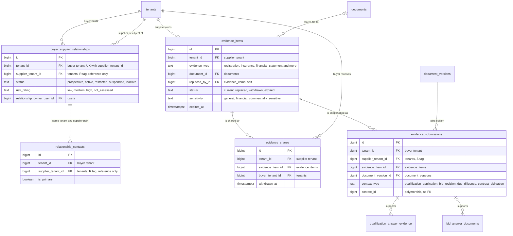
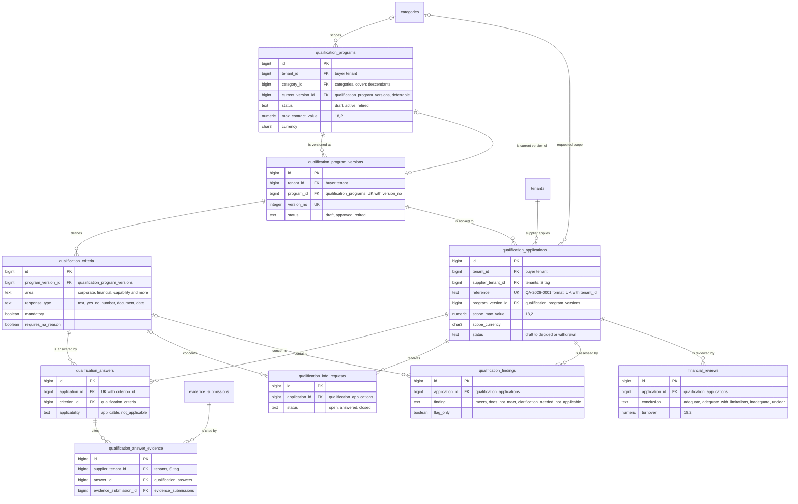
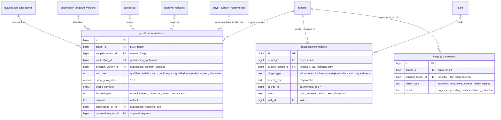
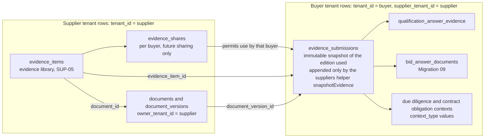

# Data model: Suppliers and qualification (Migration 05)

Status: As-designed (pre-build). Updated to as-built at the end of Stage A and Stage B.

Sources:
- `docs/plan/schema-blueprint.md`: §0 Conventions; Migration 05 `20261001000500_suppliers_qualification.sql`; Migration 14 (view `v_qualification_status`); §P permission catalog.
- `docs/plan/architecture-plan.md`: §0 delivery stages; §3.1 tenancy and cross-tenant records; §3.8 notifications; §3.9 background jobs; §3.11 prototype mode; §4 cross-domain writes; §6 domain map (domains 03 suppliers and 04 qualification); §8 testing; §11 item 4 (supplier self-registration, decided 2026-09-29) and the other owner answers of 2026-09-29.
- `docs/architecture-brief.md`: §5.6 tenant scoping (`forTenant`); §6.1 to §6.3 migration rules, multi-tenant pattern, Data API lockdown.
- `docs/PRD.md`: §3 business concepts; §4.3 audience matrix; FR-02 (§5.2); FR-06 (§7.3); §8.3 related record lifecycles; §14.1 document control; BR-03, BR-24, BR-25, BR-44, BR-45, BR-48; screens SUP-02 to SUP-05, SUP-20, SUP-24, BUY-31 to BUY-35, ADM-09; AC-07, AC-08, AC-09.
- `docs/plan/demo-storyline.md`: Organizations; Qualification.
- `docs/plan/design-decisions.md`: DD-01 (forward and same-migration FKs), DD-02 (nullable unique keys), DD-03 (`[S]` and `[R]` tags), DD-07 (additional unique keys), DD-08 (currency on amounts), DD-09 (reference formats), DD-10 (identity defaults), DD-12 (storage keys), DD-13 (`v_qualification_status`), DD-16 (unowned tables), DD-17 (cross-domain writes), DD-19 (job alert keys), DD-20 (expiry semantics), DD-24 (approver permissions), DD-25 (conflict gating), DD-26 (category scope), DD-27 (supplier registration), DD-28 (public write throttling), DD-39 (idempotency), DD-43 (real Supabase Auth from Stage A), DD-44 (email channel); §E owner decisions of 2026-09-29 (item 7 supplier self-registration, item 8 prototype behaviour).

Contents:
- [1. Scope, tenancy and ownership](#1-scope-tenancy-and-ownership)
- [2. Reading the data dictionary](#2-reading-the-data-dictionary)
- [3. Diagrams](#3-diagrams)
- [4. Data dictionary: supplier organization](#4-data-dictionary-supplier-organization)
- [5. Data dictionary: relationships and evidence](#5-data-dictionary-relationships-and-evidence)
- [6. Data dictionary: qualification](#6-data-dictionary-qualification)
- [7. View v_qualification_status](#7-view-v_qualification_status)
- [8. States and enumerations](#8-states-and-enumerations)
- [9. Constraints and indexes](#9-constraints-and-indexes)
- [10. Read access by audience](#10-read-access-by-audience)
- [11. Jobs and cross-domain touchpoints](#11-jobs-and-cross-domain-touchpoints)
- [12. Demo storyline coverage](#12-demo-storyline-coverage)
- [13. Open points finalized in Stage B](#13-open-points-finalized-in-stage-b)

Related: [data model overview](README.md), [platform and identity](01-platform-identity-access.md) (`tenants`, `users`), [shared services](03-shared-services.md) (`documents`, `approval_requests`, `tasks`), [records, reporting and operations](12-records-reporting-operations.md) (`rate_limit_buckets`, `request_idempotency`), [security model](../04-security-model.md), [lifecycles](../05-lifecycles.md), [background jobs](../08-background-jobs.md), ADRs [0001](../adr/0001-tenancy-equals-organization.md), [0002](../adr/0002-buyer-owned-procurement-records.md), [0004](../adr/0004-text-check-constraints-not-enums.md), [0005](../adr/0005-decimal-strings-for-money-and-scores.md), [0012](../adr/0012-supplier-registration-via-provisioned-accounts.md).

---

## 1. Scope, tenancy and ownership

Migration 05 holds two groups of tables:

- **Supplier organization, relationships and evidence** (domain 03 `suppliers`, FR-02). These tables serve SUP-02, SUP-03, SUP-05, BUY-31 and BUY-32.
- **Qualification** (domain 04 `qualification`, FR-06). These tables serve ADM-09, SUP-20, SUP-24 and BUY-33 to BUY-35.

The owning domain below comes from the architecture-plan §6 domain map, which assigns screens and requirements to domains. A domain writes only its own tables (architecture-plan §4). No table in this migration is partitioned ([P]), and **no table in this migration is sealed**. Sealed bid tables are in Migration 09 ([08-bids-submission.md](08-bids-submission.md)).

"Row tenant" is the tenant stored in `tenant_id`. For [S] and [R] tables it is the **buyer** tenant, and `supplier_tenant_id` names the supplier (architecture-plan §3.1, [ADR 0002](../adr/0002-buyer-owned-procurement-records.md)). The two tags differ in reachability (DD-03):

- **[S]** means **supplier-accessible**. The table is on the explicit allow-list `supplier-scoped-tables.ts` that `forSupplier` uses.
- **[R]** means the table carries `supplier_tenant_id` for **reference only**. It is buyer-internal and `forSupplier` never reaches it. Suppliers learn outcomes only through notices and the supplier-facing projections defined in the contracts.

The allow-list is generated from the blueprint tags, not from column presence. A guard test asserts that no [R] table is on it (DD-03).

| Table | Tag | Row tenant (`tenant_id`) | Owning domain | Mutable (`updated_at`) | Sealed |
|---|---|---|---|---|---|
| `supplier_profiles` | [T] | supplier (PK) | suppliers | yes | no |
| `supplier_locations` | [T] | supplier | suppliers | no | no |
| `supplier_categories` | [T] | supplier | suppliers | no | no |
| `supplier_membership_requests` | [T] | supplier | suppliers | yes | no |
| `supplier_identity_changes` | [T] | supplier (by context, see §13) | suppliers | yes | no |
| `supplier_legal_names` | [T] | supplier (by context) | suppliers | no | no |
| `duplicate_candidates` | [G] | none (global) | suppliers | yes | no |
| `supplier_merges` | [G] | none (global) | suppliers | no | no |
| `buyer_supplier_relationships` | [T][R] | buyer | suppliers | yes | no |
| `relationship_contacts` | [T][R] | buyer | suppliers | yes | no |
| `evidence_items` | [T] | supplier | suppliers | yes | no |
| `evidence_shares` | [T] | supplier | suppliers | yes | no |
| `evidence_submissions` | [T][S] | buyer | suppliers (bids, selection, contracts and qualification append rows through the suppliers-owned helper `snapshotEvidence()`, DD-17; see §11) | no (immutable snapshot) | no |
| `qualification_programs` | [T] | buyer | qualification | yes | no |
| `qualification_program_versions` | [T] | buyer | qualification | no | no |
| `qualification_criteria` | [T] | buyer | qualification | yes | no |
| `qualification_applications` | [T][S] | buyer | qualification | yes | no |
| `qualification_answers` | [T][S] | buyer | qualification | yes | no |
| `qualification_answer_evidence` | [T][S] | buyer | qualification | no | no |
| `qualification_info_requests` | [T][S] | buyer | qualification | yes | no |
| `qualification_findings` | [T] | buyer | qualification | yes | no |
| `financial_reviews` | [T] | buyer | qualification | yes | no |
| `qualification_decisions` | [T][S] | buyer | qualification | yes | no |
| `reassessment_triggers` | [T][R] | buyer | qualification | yes | no |
| `integrity_screenings` | [T][R] | buyer | qualification | yes | no |
| `v_qualification_status` (view) | n/a | buyer | qualification | n/a | no |

Tables whose row tenant is the **supplier** hold the supplier's own organization data and evidence library. The buyer's copy of what a supplier actually used lives in buyer-tenant `evidence_submissions` rows (FR-02: withdrawal of future sharing does not erase evidence already submitted into a procurement record).

## 2. Reading the data dictionary

| Column | Meaning |
|---|---|
| Type | Plain type: stated in the blueprint, or fixed by a §0 convention (identity and FK columns `bigint`; instants `*_at` are `timestamptz` per architecture-plan §3.4; money `numeric(18,2)`; quantities `numeric(18,4)`; scores, rates and weights `numeric(12,6)`; currency `char(3)` with CHECK `~ '^[A-Z]{3}$'`; enumerations `text` + named CHECK). *Italic* type: inferred from the column's name and meaning because the blueprint states no type. `n/s`: not specified, with the candidates given. Stage B migrations fix every final type, recorded in `supabase/schema.expected.sql`. |
| Null | `no`: NOT NULL stated by the blueprint or a §0 convention. `yes`: nullable as stated, or the column is filled only by a later lifecycle event (for example `decided_at`), which forces nullability. `n/s`: not specified by the blueprint. |
| Key / constraint | `PK`, `FK → table`, `UK` (member of a unique constraint listed under the table), CHECK lists, defaults. Every FK column is indexed (§0). |

Standard columns (§0): `id bigint generated always as identity primary key`, `created_at timestamptz not null default now()`, `created_by bigint references users(id)` (null = system). Tables marked mutable add `updated_at timestamptz not null default now()`, maintained by the `set_updated_at()` trigger (Migration 00). [T] tables carry `tenant_id bigint not null references tenants(id)`. [S] tables also carry `supplier_tenant_id bigint not null references tenants(id)` and appear in the generated `supplier-scoped-tables.ts`. [R] tables carry `supplier_tenant_id` (FK → tenants) for reference only and never appear in that list (DD-03). §0 states NOT NULL only for the [S] column, so the [R] column's nullability is shown as `n/s` (see §13).

## 3. Diagrams

Diagram legend: solid lines are FK columns; dashed lines are logical links with no FK constraint (polymorphic `*_type`/`*_id` pairs, or links through the `(tenant_id, supplier_tenant_id)` pair). Entities without an attribute block are defined in other data-model files. User FK columns (`*_user_id`, `*_by`) are listed in the attribute blocks but their lines to `users` are omitted for readability. Self-referencing FKs are noted in attribute comments.

### 3.1 Supplier organization (supplier tenant rows and global identity tables)

```mermaid
erDiagram
    tenants ||--o| supplier_profiles : "has profile"
    tenants ||--o{ supplier_locations : "operates at"
    tenants ||--o{ supplier_categories : "serves"
    category_catalog ||--o{ supplier_categories : "classifies"
    tenants ||--o{ supplier_membership_requests : "receives"
    users ||--o{ supplier_membership_requests : "asks to join"
    tenants ||--o{ supplier_identity_changes : "requests"
    documents |o--o{ supplier_identity_changes : "evidences"
    tenants ||--o{ supplier_legal_names : "was named"
    tenants ||--o{ duplicate_candidates : "is tenant a"
    tenants ||--o{ duplicate_candidates : "is tenant b"
    tenants ||--o{ supplier_merges : "survives"
    tenants ||--o{ supplier_merges : "is merged"

    supplier_profiles {
        bigint tenant_id PK "supplier tenant, FK tenants"
        text_array trading_names
        text_array service_areas
        bigint primary_contact_user_id FK "users"
        boolean banking_collected "default false"
    }
    supplier_locations {
        bigint id PK
        bigint tenant_id FK "supplier tenant"
        boolean is_registered_office
    }
    supplier_categories {
        bigint id PK
        bigint tenant_id FK "supplier tenant"
        text catalog_code FK "category_catalog, UK with tenant_id"
    }
    supplier_membership_requests {
        bigint id PK
        bigint tenant_id FK "supplier tenant"
        bigint user_id FK "users"
        text status "pending, approved, rejected, withdrawn"
    }
    supplier_identity_changes {
        bigint id PK
        bigint tenant_id FK "supplier tenant"
        text change_type "legal_name, registration, ownership and more"
        bigint evidence_document_id FK "documents"
        text status "submitted, under_review, approved, rejected"
    }
    supplier_legal_names {
        bigint id PK
        bigint tenant_id FK "supplier tenant"
        text legal_name
    }
    duplicate_candidates {
        bigint id PK
        bigint tenant_a_id FK "tenants"
        bigint tenant_b_id FK "tenants"
        bigint raised_by_tenant_id FK "tenants"
        text status "open, not_duplicate, merged, escalated"
    }
    supplier_merges {
        bigint id PK
        bigint surviving_tenant_id FK "tenants"
        bigint merged_tenant_id FK "tenants"
    }
```

### 3.2 Buyer relationships and the evidence chain

`bid_answer_documents` is defined in [08-bids-submission.md](08-bids-submission.md).

### 3.3 Qualification programs, applications and assessment

### 3.4 Decisions and ongoing monitoring

### 3.5 Where evidence lives across the tenant boundary

Withdrawing a share (`evidence_shares.withdrawn_at`) stops future sharing only. Existing `evidence_submissions` rows keep the pinned `document_version_id` (FR-02, BR-25, PRD §14.1). Replacing an evidence item is prospective: the old row moves to `replaced` and points at its successor through `replaced_by_id` (SUP-05).

## 4. Data dictionary: supplier organization

### 4.1 supplier_profiles

[T], mutable. Row tenant: the supplier. **PK `tenant_id`**, which replaces the standard `id`. One row per supplier organization. The legal name, registration identifiers and verification status live on `tenants` ([01-platform-identity-access.md](01-platform-identity-access.md)). Supplier registration creates the tenant (status `pending`), the user (`invited`), a pending membership and this profile in one transaction and commits, and **after the commit** calls the Auth Admin invite; if the invite fails, a short follow-up transaction sets the registrant’s `invitations` row to `send_failed`, and the registrant can retry (DD-27). The owner approved this approach on 2026-09-29 (architecture-plan §11 item 4). Supabase self-signup stays disabled (`enable_signup = false`), and Supabase Auth sends the verification and set-password email, which lands in Mailpit locally (DD-43).

| Column | Type | Null | Key / constraint | Meaning |
|---|---|---|---|---|
| tenant_id | bigint | no | PK; FK → tenants | The supplier organization this profile describes. |
| trading_names | text[] | n/s | | Trading names (FR-02, SUP-03). |
| website | *text* | n/s | | Public website. |
| description | *text* | n/s | | Business description. |
| year_established | integer | n/s | | Year the business was established. |
| employee_count_band | *text* | n/s | no CHECK list in the blueprint | Size band label. |
| annual_turnover_band | *text* | n/s | no CHECK list in the blueprint | Turnover band label. Audited figures belong to evidence and `financial_reviews`. |
| capacity_overview | *text* | n/s | | Capacity overview shown on SUP-03. |
| ownership_disclosure | *text* | n/s | | Ownership declaration (SUP-03). Changes to ownership go through `supplier_identity_changes`. |
| ultimate_parent_name | *text* | n/s | | Ultimate parent company name. |
| service_areas | text[] | n/s | | Geographic service areas (FR-02). |
| preferred_languages | text[] | n/s | | Preferred working languages (FR-02). |
| primary_contact_user_id | bigint | n/s | FK → users | Primary supplier contact. |
| banking_collected | boolean | n/s | default false | Flag only. FR-02 keeps payment-account onboarding separate from participation; the blueprint defines no banking-detail columns. |
| created_at | timestamptz | no | default now() | Standard. |
| created_by | bigint | yes | FK → users | Standard; null = system. |
| updated_at | timestamptz | no | default now(); `set_updated_at()` | Mutable marker. |

### 4.2 supplier_locations

[T]. Row tenant: the supplier. Locations shown on SUP-03.

| Column | Type | Null | Key / constraint | Meaning |
|---|---|---|---|---|
| id | bigint | no | PK (identity) | Standard. |
| tenant_id | bigint | no | FK → tenants | Supplier tenant. |
| name | *text* | n/s | | Location name. |
| address | *text* | n/s | | Postal or street address. |
| region | *text* | n/s | | Region, used in discovery filters (FR-09 geography). |
| country | n/s (`tenants.country` is `char(2)`) | n/s | | Country. |
| is_registered_office | boolean | n/s | | Marks the registered office. |
| created_at | timestamptz | no | default now() | Standard. |
| created_by | bigint | yes | FK → users | Standard. |

### 4.3 supplier_categories

[T]. Row tenant: the supplier. Categories served, expressed in the **global** shared taxonomy `category_catalog` so that buyers' tenant categories (`categories.catalog_code`) can be matched for discovery (Migration 02). `category_catalog` is filled by the baseline `seed.sql` (DD-16).

| Column | Type | Null | Key / constraint | Meaning |
|---|---|---|---|---|
| id | bigint | no | PK | Standard. |
| tenant_id | bigint | no | FK → tenants; UK (tenant_id, catalog_code) | Supplier tenant. |
| catalog_code | text | n/s | FK → category_catalog(code); UK | Shared category code, for example `WTR-PUMP`. |
| created_at | timestamptz | no | default now() | Standard. |
| created_by | bigint | yes | FK → users | Standard. |

### 4.4 supplier_membership_requests

[T], mutable. Row tenant: the supplier organization being joined (FR-02 "request membership in an existing organization through a controlled approval process", SUP-02, SUP-04).

| Column | Type | Null | Key / constraint | Meaning |
|---|---|---|---|---|
| id | bigint | no | PK | Standard. |
| tenant_id | bigint | no | FK → tenants | Supplier organization the user asks to join. |
| user_id | bigint | n/s | FK → users | Requesting person. |
| message | *text* | n/s | | Requester's message. |
| status | text | n/s | CHECK (pending, approved, rejected, withdrawn) | Request state. |
| decided_by | bigint | yes | FK → users | Supplier administrator who decided. |
| decided_at | timestamptz | yes | | Decision time. |
| decision_note | *text* | yes | | Reason recorded with the decision. |
| created_at | timestamptz | no | default now() | Standard. |
| created_by | bigint | yes | FK → users | Standard. |
| updated_at | timestamptz | no | `set_updated_at()` | Mutable marker. |

The blueprint does not state how an approved request creates the `memberships` row (Migration 01). That wiring is finalized in Stage B.

### 4.5 supplier_identity_changes

[T], mutable. Reviewed changes to legal identity (FR-02: "Require evidence and review for ownership disputes, administrator recovery, legal-name changes, merger, succession, and transfer of representation").

| Column | Type | Null | Key / constraint | Meaning |
|---|---|---|---|---|
| id | bigint | no | PK | Standard. |
| tenant_id | bigint | no | FK → tenants | Supplier tenant whose identity changes (by context; see §13). |
| change_type | text | n/s | CHECK (legal_name, registration, ownership, merger, succession, representation_transfer, admin_recovery) | Kind of change. |
| previous_value | *text* | n/s | | Value before the change. |
| proposed_value | *text* | n/s | | Requested new value. |
| evidence_document_id | bigint | n/s | FK → documents | Supporting evidence. |
| status | text | n/s | CHECK (submitted, under_review, approved, rejected) | Review state. |
| reviewed_by | bigint | yes | FK → users | Reviewer. |
| reviewed_at | timestamptz | yes | | Review time. |
| effective_at | timestamptz | yes | | When an approved change takes effect. |
| decision_note | *text* | yes | | Reviewer's reasons. |
| created_at | timestamptz | no | default now() | Standard. |
| created_by | bigint | yes | FK → users | Standard. |
| updated_at | timestamptz | no | `set_updated_at()` | Mutable marker. |

### 4.6 supplier_legal_names

[T]. Historic legal names, so that historic bids and representations keep their original legal party (FR-02, BR-44). The current name is `tenants.legal_name`.

| Column | Type | Null | Key / constraint | Meaning |
|---|---|---|---|---|
| id | bigint | no | PK | Standard. |
| tenant_id | bigint | no | FK → tenants | Supplier tenant. |
| legal_name | *text* | n/s | | A former or current legal name. |
| valid_from | n/s (`date` or `timestamptz`) | n/s | | Start of validity. |
| valid_to | n/s (`date` or `timestamptz`) | yes | | End of validity; open-ended while current. |
| created_at | timestamptz | no | default now() | Standard. |
| created_by | bigint | yes | FK → users | Standard. |

### 4.7 duplicate_candidates

[G], mutable. Possible duplicate supplier organizations flagged for review. A shared email domain or similar name is not sufficient to merge (FR-02), and a detection is a suggestion only (BR-48).

| Column | Type | Null | Key / constraint | Meaning |
|---|---|---|---|---|
| id | bigint | no | PK | Standard. |
| tenant_a_id | bigint | n/s | FK → tenants | First organization. |
| tenant_b_id | bigint | n/s | FK → tenants | Second organization. |
| detected_reason | text | n/s | CHECK (similar_name, same_registration_number, same_email_domain, import_match) | Why the pair was flagged. |
| status | text | n/s | CHECK (open, not_duplicate, merged, escalated) | Review state. |
| reviewed_by | bigint | yes | FK → users | Reviewer. |
| reviewed_at | timestamptz | yes | | Review time. |
| note | *text* | n/s | | Review note. |
| raised_by_tenant_id | bigint | n/s | FK → tenants | Tenant that raised the candidate (for example a buyer flagging from BUY-31). |
| created_at | timestamptz | no | default now() | Standard. |
| created_by | bigint | yes | FK → users | Standard. |
| updated_at | timestamptz | no | `set_updated_at()` | Mutable marker. |

### 4.8 supplier_merges

[G]. Approved merges. **Records are never re-pointed**: historic bids keep their legal party (BR-44).

| Column | Type | Null | Key / constraint | Meaning |
|---|---|---|---|---|
| id | bigint | no | PK | Standard. |
| surviving_tenant_id | bigint | n/s | FK → tenants | Organization that continues. |
| merged_tenant_id | bigint | n/s | FK → tenants | Organization merged into the survivor. |
| approved_by | bigint | n/s | FK → users | Approver. |
| reason | *text* | n/s | | Merge rationale. |
| merged_at | timestamptz | n/s | | Effective time of the merge. |
| created_at | timestamptz | no | default now() | Standard. |
| created_by | bigint | yes | FK → users | Standard. |

## 5. Data dictionary: relationships and evidence

### 5.1 buyer_supplier_relationships

[T][R], mutable. Row tenant: the buyer. The buyer's private record of one supplier (PRD §3 "Buyer-supplier relationship", BUY-32). BR-45: buyer-specific assessments are not shared with unrelated buyers. The table is buyer-internal: `forSupplier` never reaches it (DD-03).

| Column | Type | Null | Key / constraint | Meaning |
|---|---|---|---|---|
| id | bigint | no | PK | Standard. |
| tenant_id | bigint | no | FK → tenants; UK (tenant_id, supplier_tenant_id) | Buyer tenant. |
| supplier_tenant_id | bigint | n/s | FK → tenants; UK; [R] reference | Supplier the relationship is about. |
| status | text | n/s | CHECK (prospective, active, restricted, suspended, inactive) | Relationship state. |
| relationship_owner_user_id | bigint | n/s | FK → users | Accountable buyer user. |
| risk_rating | text | n/s | CHECK (low, medium, high, not_assessed) | Buyer's risk rating. |
| restriction_note | *text* | n/s | | Explanation of any restriction. |
| internal_notes | *text* | n/s | | Buyer-internal notes. |
| first_engaged_at | timestamptz | n/s | | First engagement time. |
| created_at | timestamptz | no | default now() | Standard. |
| created_by | bigint | yes | FK → users | Standard. |
| updated_at | timestamptz | no | `set_updated_at()` | Mutable marker. |

### 5.2 relationship_contacts

[T][R], mutable. Row tenant: the buyer. Buyer-maintained contacts for a supplier. There is no FK to `buyer_supplier_relationships`; rows belong to the relationship through the `(tenant_id, supplier_tenant_id)` pair. Buyer-internal (DD-03).

| Column | Type | Null | Key / constraint | Meaning |
|---|---|---|---|---|
| id | bigint | no | PK | Standard. |
| tenant_id | bigint | no | FK → tenants | Buyer tenant. |
| supplier_tenant_id | bigint | n/s | FK → tenants; [R] reference | Supplier. |
| name | *text* | n/s | | Contact name. |
| email | *text* | n/s | | Contact email. |
| phone | *text* | n/s | | Contact phone. |
| role_label | *text* | n/s | | Contact's role, free text. |
| is_primary | *boolean* | n/s | | Primary contact flag. |
| active | *boolean* | n/s | | Active flag; inactive contacts are kept for history. |
| created_at | timestamptz | no | default now() | Standard. |
| created_by | bigint | yes | FK → users | Standard. |
| updated_at | timestamptz | no | `set_updated_at()` | Mutable marker. |

### 5.3 evidence_items

[T], mutable. Row tenant: the supplier. The reusable evidence library (SUP-05; PRD §14.1: evidence carries issuer, period, expiry and verification status).

| Column | Type | Null | Key / constraint | Meaning |
|---|---|---|---|---|
| id | bigint | no | PK | Standard. |
| tenant_id | bigint | no | FK → tenants | Supplier tenant that owns the evidence. |
| evidence_type | text | n/s | CHECK (registration, financial_statement, credit_report, certificate, insurance, license, reference, declaration, policy, bond, other) | Kind of evidence. |
| title | *text* | n/s | | Display title. |
| issuer | *text* | n/s | | Issuing body. |
| reference_number | *text* | n/s | | Issuer's reference (policy or certificate number). |
| period_start | n/s (`date` or `timestamptz`) | n/s | | Reporting or coverage period start. |
| period_end | n/s (`date` or `timestamptz`) | n/s | | Reporting or coverage period end. |
| reporting_currency | char(3) | n/s | CHECK `~ '^[A-Z]{3}$'` | Currency of financial figures. |
| is_consolidated | boolean | n/s | | Consolidated or entity-specific figures (FR-06). |
| coverage_amount | numeric(18,2) | n/s | | Insurance or bond coverage. |
| coverage_currency | char(3) | n/s | CHECK `~ '^[A-Z]{3}$'` | Currency of `coverage_amount`. |
| valid_from | n/s (`date` or `timestamptz`) | n/s | | Start of validity. |
| expires_at | timestamptz | n/s | | Expiry; scanned by the `evidence-expiry` job, which only flags and notifies (DD-20). |
| document_id | bigint | n/s | FK → documents | File record in the supplier tenant. |
| status | text | n/s | CHECK (current, replaced, withdrawn, expired) | Library state. `expired` is set by the suppliers domain when the supplier views or renews the item, or by the suppliers-owned helper that the `evidence-expiry` job calls (DD-20). |
| replaced_by_id | bigint | yes | FK → evidence_items (self) | Successor edition when replaced. |
| verification_status | text | n/s | CHECK (supplier_provided, independently_verified, verification_failed) | Supplier statement vs buyer verification (SUP-14 distinction). |
| sensitivity | text | n/s | CHECK (general, financial, commercially_sensitive) | Drives narrower access for financial evidence (PRD §4.3). |
| created_at | timestamptz | no | default now() | Standard. |
| created_by | bigint | yes | FK → users | Standard. |
| updated_at | timestamptz | no | `set_updated_at()` | Mutable marker. |

### 5.4 evidence_shares

[T], mutable. Row tenant: the supplier. Which buyer may use which evidence item. **Withdrawal only stops future sharing.**

| Column | Type | Null | Key / constraint | Meaning |
|---|---|---|---|---|
| id | bigint | no | PK | Standard. |
| tenant_id | bigint | no | FK → tenants | Supplier tenant. |
| evidence_item_id | bigint | n/s | FK → evidence_items | Shared item. |
| buyer_tenant_id | bigint | n/s | FK → tenants | Buyer allowed to use it. |
| shared_at | timestamptz | n/s | | Share time. |
| shared_by | bigint | n/s | FK → users | Supplier user who shared (needs `supplier.evidence.share`). |
| withdrawn_at | timestamptz | yes | | Future sharing withdrawn. |
| withdrawn_by | bigint | yes | FK → users | Who withdrew. |
| created_at | timestamptz | no | default now() | Standard. |
| created_by | bigint | yes | FK → users | Standard. |
| updated_at | timestamptz | no | `set_updated_at()` | Mutable marker. |

### 5.5 evidence_submissions

[T][S], immutable. Row tenant: the buyer. An immutable snapshot of **which evidence edition was used** in a buyer context (PRD §14.1: "The supplier's submitted document set must remain available as submitted, including the evidence versions used at that time"). Rows are append-only. The bids, selection, contracts and qualification domains write them only through the suppliers-owned helper `snapshotEvidence()` (DD-17, architecture-plan §4).

| Column | Type | Null | Key / constraint | Meaning |
|---|---|---|---|---|
| id | bigint | no | PK | Standard. |
| tenant_id | bigint | no | FK → tenants | Buyer tenant that received the evidence. |
| supplier_tenant_id | bigint | no | FK → tenants | Supplier that submitted it. |
| evidence_item_id | bigint | n/s | FK → evidence_items (row in the supplier tenant) | Library item the snapshot came from. |
| document_version_id | bigint | n/s | FK → document_versions | Exact file edition used. |
| context_type | text | n/s | CHECK (qualification_application, bid_revision, due_diligence, contract_obligation) | Where it was used. |
| context_id | bigint | n/s | polymorphic; no FK | Id of the application, bid revision, due-diligence case or obligation. |
| submitted_at | timestamptz | n/s | | Submission time. |
| created_at | timestamptz | no | default now() | Standard. |
| created_by | bigint | yes | FK → users | Standard. |

## 6. Data dictionary: qualification

### 6.1 qualification_programs

[T], mutable. Row tenant: the buyer. Reusable eligibility program (PRD §3, ADM-09).

| Column | Type | Null | Key / constraint | Meaning |
|---|---|---|---|---|
| id | bigint | no | PK | Standard. |
| tenant_id | bigint | no | FK → tenants | Buyer tenant. |
| name | *text* | n/s | | Program name. |
| description | *text* | n/s | | Description. |
| category_id | bigint | n/s | FK → categories | Category scope: a single buyer category, which includes its descendants (`categories.parent_id`), so a parent category covers several catalog codes (demo storyline, DD-26). |
| geography | *text* | n/s | | Geographic scope. |
| max_contract_value | numeric(18,2) | n/s | | Contract-size ceiling covered. |
| currency | char(3) | n/s | CHECK `~ '^[A-Z]{3}$'` | Currency of `max_contract_value`. |
| validity_months | *integer* | n/s | | Validity period of a decision. |
| renewal_notice_days | *integer* | n/s | | Lead time for renewal reminders. |
| decision_role_code | *text* | n/s | role code; FK n/s | Role that decides (a `roles.code`; roles are unique per tenant). |
| requires_independent_approval | boolean | n/s | | Independent approval required for decisions (FR-06). |
| status | text | n/s | CHECK (draft, active, retired) | Program state. |
| current_version_id | bigint | yes | FK → qualification_program_versions; `DEFERRABLE INITIALLY DEFERRED` | Current version. Circular with `program_id`, so the FK is added at the end of Migration 05 as `DEFERRABLE INITIALLY DEFERRED` (DD-01). |
| owner_user_id | bigint | n/s | FK → users | Accountable owner (BR-01). |
| created_at | timestamptz | no | default now() | Standard. |
| created_by | bigint | yes | FK → users | Standard. |
| updated_at | timestamptz | no | `set_updated_at()` | Mutable marker. |

### 6.2 qualification_program_versions

[T]. Row tenant: the buyer. Versioned criteria set; decisions record the version applied (FR-06).

| Column | Type | Null | Key / constraint | Meaning |
|---|---|---|---|---|
| id | bigint | no | PK | Standard. |
| tenant_id | bigint | no | FK → tenants | Buyer tenant. |
| program_id | bigint | n/s | FK → qualification_programs; UK (program_id, version_no) | Parent program. |
| version_no | *integer* | n/s | UK (DD-07) | Version number. |
| status | text | n/s | CHECK (draft, approved, retired) | Version state. |
| change_note | *text* | n/s | | What changed. |
| approved_by | bigint | yes | FK → users | Approver. |
| approved_at | timestamptz | yes | | Approval time. |
| created_at | timestamptz | no | default now() | Standard. |
| created_by | bigint | yes | FK → users | Standard. |

### 6.3 qualification_criteria

[T], mutable. Row tenant: the buyer. Questions per program version, grouped by the FR-06 assessment areas.

| Column | Type | Null | Key / constraint | Meaning |
|---|---|---|---|---|
| id | bigint | no | PK | Standard. |
| tenant_id | bigint | no | FK → tenants | Buyer tenant. |
| program_version_id | bigint | n/s | FK → qualification_program_versions | Owning version. |
| area | text | n/s | CHECK (corporate, financial, capability, quality, insurance, regulatory, integrity, social_environmental, references) | FR-06 assessment area. |
| question | *text* | n/s | | Question shown to the supplier. |
| guidance | *text* | n/s | | Guidance for the supplier. |
| response_type | text | n/s | CHECK (text, yes_no, number, document, date) | Expected answer form. |
| mandatory | boolean | n/s | | Mandatory question. Missing evidence is never a silent pass (FR-06). |
| evidence_types | text[] | n/s | | Acceptable evidence kinds (values of `evidence_items.evidence_type`). |
| requires_na_reason | boolean | n/s | | "Not applicable" requires a reason. |
| threshold_description | *text* | n/s | | Threshold wording for assessors. |
| sort_order | *integer* | n/s | | Display order. |
| created_at | timestamptz | no | default now() | Standard. |
| created_by | bigint | yes | FK → users | Standard. |
| updated_at | timestamptz | no | `set_updated_at()` | Mutable marker. |

### 6.4 qualification_applications

[T][S], mutable. Row tenant: the buyer that runs the program; `supplier_tenant_id` is the applicant (SUP-20, BUY-33). **Buyer queries always exclude `draft`.**

| Column | Type | Null | Key / constraint | Meaning |
|---|---|---|---|---|
| id | bigint | no | PK | Standard. |
| tenant_id | bigint | no | FK → tenants; UK (tenant_id, reference) | Buyer tenant. |
| supplier_tenant_id | bigint | no | FK → tenants | Applicant supplier. |
| program_version_id | bigint | n/s | FK → qualification_program_versions | Version applied for. |
| reference | text | no | UK (tenant_id, reference); `next_reference(tenant, 'QA')` | Format `QA-2026-0001`. The year is the year in the tenant's official time zone (`tenants.official_time_zone`) (DD-09, DD-10). |
| status | text | n/s | CHECK (draft, submitted, under_review, more_info_required, decision_pending, decided, withdrawn) | Application state (PRD §8.3). |
| scope_category_id | bigint | n/s | FK → categories | Requested category scope. |
| scope_max_value | numeric(18,2) | n/s | | Requested contract-size scope, in `scope_currency`. |
| scope_currency | char(3) | n/s | CHECK `~ '^[A-Z]{3}$'` | Currency of `scope_max_value` (DD-08). |
| submitted_at | timestamptz | yes | | Submission time. |
| submitted_by | bigint | yes | FK → users | Supplier user who submitted. |
| assessor_user_id | bigint | yes | FK → users | Assigned qualification assessor. |
| financial_reviewer_user_id | bigint | yes | FK → users | Assigned financial reviewer (restricted access, AC-08). |
| due_at | timestamptz | n/s | | Review due time. |
| priority | n/s (`text`; no CHECK list given) | n/s | | Queue priority (BUY-33). |
| risk_level | text | n/s | CHECK (low, medium, high) | Risk level for the queue. |
| created_at | timestamptz | no | default now() | Standard. |
| created_by | bigint | yes | FK → users | Standard. |
| updated_at | timestamptz | no | `set_updated_at()` | Mutable marker. |

### 6.5 qualification_answers

[T][S], mutable. Row tenant: the buyer. One answer per criterion per application.

| Column | Type | Null | Key / constraint | Meaning |
|---|---|---|---|---|
| id | bigint | no | PK | Standard. |
| tenant_id | bigint | no | FK → tenants | Buyer tenant. |
| supplier_tenant_id | bigint | no | FK → tenants | Applicant supplier. |
| application_id | bigint | n/s | FK → qualification_applications; UK (application_id, criterion_id) | Parent application. |
| criterion_id | bigint | n/s | FK → qualification_criteria; UK | Criterion answered. |
| answer_text | *text* | n/s | | Text answer. |
| answer_number | n/s (`numeric`, precision not stated) | n/s | | Numeric answer. |
| answer_date | *date* | n/s | | Date answer. |
| answer_bool | *boolean* | n/s | | Yes/no answer. |
| applicability | text | n/s | CHECK (applicable, not_applicable) | Applicability choice (FR-06). |
| na_reason | *text* | n/s | | Reason for not applicable; required when the criterion has `requires_na_reason` (enforced in the service, since the rule spans two tables). |
| updated_by | bigint | n/s | FK → users | Last editor. |
| created_at | timestamptz | no | default now() | Standard. |
| created_by | bigint | yes | FK → users | Standard. |
| updated_at | timestamptz | no | `set_updated_at()` | Mutable marker. |

### 6.6 qualification_answer_evidence

[T][S]. Row tenant: the buyer. Links an answer to the evidence snapshots it cites. It is [S], so the applicant reaches it through `forSupplier` like its parent `qualification_answers` (DD-03).

| Column | Type | Null | Key / constraint | Meaning |
|---|---|---|---|---|
| id | bigint | no | PK | Standard. |
| tenant_id | bigint | no | FK → tenants | Buyer tenant. |
| supplier_tenant_id | bigint | no | FK → tenants | Applicant supplier ([S] rule, §0). |
| answer_id | bigint | n/s | FK → qualification_answers | Answer. |
| evidence_submission_id | bigint | n/s | FK → evidence_submissions | Snapshot cited. |
| created_at | timestamptz | no | default now() | Standard. |
| created_by | bigint | yes | FK → users | Standard. |

### 6.7 qualification_info_requests

[T][S], mutable. Row tenant: the buyer. Buyer requests for more information, answered by the supplier (FR-06 review process; AC-08).

| Column | Type | Null | Key / constraint | Meaning |
|---|---|---|---|---|
| id | bigint | no | PK | Standard. |
| tenant_id | bigint | no | FK → tenants | Buyer tenant. |
| supplier_tenant_id | bigint | no | FK → tenants | Applicant supplier. |
| application_id | bigint | n/s | FK → qualification_applications | Application. |
| criterion_id | bigint | n/s | FK → qualification_criteria | Criterion concerned, if any. |
| question | *text* | n/s | | Buyer's question. |
| requested_by | bigint | n/s | FK → users | Buyer user who asked. |
| due_at | timestamptz | n/s | | Response due time. |
| response_text | *text* | yes | | Supplier's answer. |
| responded_by | bigint | yes | FK → users | Supplier user who answered. |
| responded_at | timestamptz | yes | | Answer time. |
| status | text | n/s | CHECK (open, answered, closed) | Request state. |
| created_at | timestamptz | no | default now() | Standard. |
| created_by | bigint | yes | FK → users | Standard. |
| updated_at | timestamptz | no | `set_updated_at()` | Mutable marker. |

### 6.8 qualification_findings

[T], mutable. Row tenant: the buyer. Buyer-internal assessor findings per criterion (BUY-34).

| Column | Type | Null | Key / constraint | Meaning |
|---|---|---|---|---|
| id | bigint | no | PK | Standard. |
| tenant_id | bigint | no | FK → tenants | Buyer tenant. |
| application_id | bigint | n/s | FK → qualification_applications | Application. |
| criterion_id | bigint | n/s | FK → qualification_criteria | Criterion assessed. |
| assessor_user_id | bigint | n/s | FK → users | Assessor. |
| finding | text | n/s | CHECK (meets, does_not_meet, clarification_needed, not_applicable) | Finding. |
| rationale | *text* | no | NOT NULL | Required reasons. |
| evidence_refs | n/s | n/s | | References to evidence considered. |
| flag_only | boolean | n/s | | A screening match that only flags review and cannot reject by itself (BR-48, FR-06). |
| created_at | timestamptz | no | default now() | Standard. |
| created_by | bigint | yes | FK → users | Standard. |
| updated_at | timestamptz | no | `set_updated_at()` | Mutable marker. |

### 6.9 financial_reviews

[T], mutable. Row tenant: the buyer. Restricted financial assessment (FR-06: period, reporting currency, consolidation, source, review date, material qualifications; AC-08).

| Column | Type | Null | Key / constraint | Meaning |
|---|---|---|---|---|
| id | bigint | no | PK | Standard. |
| tenant_id | bigint | no | FK → tenants | Buyer tenant. |
| application_id | bigint | n/s | FK → qualification_applications | Application reviewed. |
| reviewer_user_id | bigint | n/s | FK → users | Financial reviewer. |
| financial_period_end | date | n/s | | End of the financial period reviewed. |
| reporting_currency | char(3) | n/s | CHECK `~ '^[A-Z]{3}$'` | Currency of the statements. |
| is_consolidated | *boolean* | n/s | | Consolidated or entity-specific figures. |
| source | *text* | n/s | | Source of the figures. |
| turnover | numeric(18,2) | n/s | | Turnover in `reporting_currency`. |
| current_ratio | numeric(12,6) | n/s | | Liquidity ratio. |
| debt_to_equity | numeric(12,6) | n/s | | Leverage ratio. |
| parent_support_evidence | *text* | n/s | | Parent support relied on. A parent's strength does not qualify a subsidiary without the support the program requires (FR-06). |
| material_qualifications | *text* | n/s | | Auditor qualifications or caveats. |
| conclusion | text | n/s | CHECK (adequate, adequate_with_limitations, inadequate, unclear) | Reviewer's conclusion. |
| rationale | *text* | n/s | | Reasons. |
| reviewed_at | timestamptz | yes | | Review date. |
| created_at | timestamptz | no | default now() | Standard. |
| created_by | bigint | yes | FK → users | Standard. |
| updated_at | timestamptz | no | `set_updated_at()` | Mutable marker. |

### 6.10 qualification_decisions

[T][S], mutable. Row tenant: the buyer. The approved, scoped and dated conclusion (FR-06, BR-24, SUP-24, BUY-35). A decision is replaced by a new row, never rewritten: `superseded_by_id` links to the successor.

| Column | Type | Null | Key / constraint | Meaning |
|---|---|---|---|---|
| id | bigint | no | PK | Standard. |
| tenant_id | bigint | no | FK → tenants | Buyer tenant. |
| supplier_tenant_id | bigint | no | FK → tenants | Supplier decided on. |
| application_id | bigint | n/s | FK → qualification_applications | Source application. |
| program_version_id | bigint | n/s | FK → qualification_program_versions | Criteria version applied (FR-06). |
| outcome | text | n/s | CHECK (qualified, qualified_with_conditions, not_qualified, suspended, expired, withdrawn) | Decision outcome. Expiry by date is not written here: `v_qualification_status` derives `expired` from `effective_to`, and the `qualification-expiry` job never writes decisions (DD-20). |
| scope_category_id | bigint | n/s | FK → categories | Category scope. |
| scope_max_value | numeric(18,2) | n/s | | Contract-size scope, in `scope_currency`. |
| scope_currency | char(3) | n/s | CHECK `~ '^[A-Z]{3}$'` | Currency of `scope_max_value` (DD-08). |
| scope_geography | *text* | n/s | | Geographic scope. |
| effective_from | n/s (`date` or `timestamptz`) | n/s | | Start of validity. |
| effective_to | n/s (`date` or `timestamptz`) | n/s | | End of validity; the view reports `expired` after it passes. |
| reassessment_date | *date* | n/s | | Planned reassessment. |
| conditions | *text* | n/s | | Conditions attached (qualified with conditions). |
| allowed_activities | *text* | n/s | | Activities still allowed under conditions (FR-06). |
| blocked_gate | text | n/s | CHECK (none, invitation, submission, award, contract_start) | Next gate blocked until conditions are met (FR-06). |
| reasons | *text* | no | NOT NULL | Decision reasons. |
| supplier_explanation | *text* | n/s | | Explanation released to the supplier, without protected internal material. |
| appeal_route | *text* | n/s | | Review or appeal route. |
| reviewer_user_id | bigint | n/s | FK → users | Reviewer. |
| approver_user_id | bigint | n/s | FK → users | Approver (authority checked via `authority_limits`, decision type `qualification_decision`). Deciding an approval step needs `approval.decide`, the decision-specific permission and sufficient authority (DD-24). |
| approval_request_id | bigint | n/s | FK → approval_requests | Approval (subject type `qualification_decision`). |
| superseded_by_id | bigint | yes | FK → qualification_decisions (self) | Successor decision. |
| supersede_reason | *text* | yes | | Why it was superseded. |
| created_at | timestamptz | no | default now() | Standard. |
| created_by | bigint | yes | FK → users | Standard. |
| updated_at | timestamptz | no | `set_updated_at()` | Mutable marker. |

### 6.11 reassessment_triggers

[T][R], mutable. Row tenant: the buyer. Events that require a qualification review (FR-06, BR-25). A trigger never rewrites earlier evidence or eligibility at a past deadline. Buyer-internal: `forSupplier` never reaches it (DD-03).

| Column | Type | Null | Key / constraint | Meaning |
|---|---|---|---|---|
| id | bigint | no | PK | Standard. |
| tenant_id | bigint | no | FK → tenants | Buyer tenant. |
| supplier_tenant_id | bigint | n/s | FK → tenants; [R] reference | Supplier concerned. |
| trigger_type | text | n/s | CHECK (evidence_expiry, ownership_change, financial_change, insurance_expired, adverse_finding, poor_performance, manual) | Trigger kind. |
| source_type | *text* | n/s | polymorphic | Type of the source record. |
| source_id | bigint | n/s | polymorphic; no FK | Id of the source record. |
| detected_at | timestamptz | n/s | | Detection time. |
| status | text | n/s | CHECK (open, assessed, action_taken, dismissed) | Handling state. |
| assessed_by | bigint | yes | FK → users | Assessor. |
| disposition | *text* | yes | | Recorded disposition. |
| active_bids_reviewed | boolean | n/s | | Effect on active bids assessed (FR-06, AC-09). |
| active_contracts_reviewed | boolean | n/s | | Effect on active contracts assessed. |
| task_id | bigint | n/s | FK → tasks | Follow-up task, created through the approvals service, which owns `tasks` (DD-16). |
| created_at | timestamptz | no | default now() | Standard. |
| created_by | bigint | yes | FK → users | Standard; null when created by a job. |
| updated_at | timestamptz | no | `set_updated_at()` | Mutable marker. |

### 6.12 integrity_screenings

[T][R], mutable. Row tenant: the buyer. Sanctions, debarment, adverse-media and registry checks (FR-06 "Integrity and restrictions"). A possible match flags review only (BR-48). Buyer-internal: `forSupplier` never reaches it (DD-03).

| Column | Type | Null | Key / constraint | Meaning |
|---|---|---|---|---|
| id | bigint | no | PK | Standard. |
| tenant_id | bigint | no | FK → tenants | Buyer tenant. |
| supplier_tenant_id | bigint | n/s | FK → tenants; [R] reference | Supplier screened. |
| check_type | text | n/s | CHECK (sanctions, debarment, adverse_media, registry) | Check kind. |
| source | *text* | n/s | | Source consulted. |
| checked_at | timestamptz | n/s | | Check time. |
| result | text | n/s | CHECK (no_match, possible_match, confirmed_restriction) | Result. |
| reviewed_by | bigint | yes | FK → users | Reviewer. |
| disposition | *text* | yes | | Review disposition. |
| effect | *text* | yes | | Effect on eligibility. |
| created_at | timestamptz | no | default now() | Standard. |
| created_by | bigint | yes | FK → users | Standard. |
| updated_at | timestamptz | no | `set_updated_at()` | Mutable marker. |

## 7. View v_qualification_status

Defined in Migration 14 (`20261001001400_views_grants_schedules.sql`). It is the single read model for "is this supplier qualified for this program?" (PRD §8.3 qualification status; AC-07).

| Aspect | Design |
|---|---|
| Grain | One row per (buyer `tenant_id`, `supplier_tenant_id`, program). The program is reached through `qualification_decisions.program_version_id → qualification_program_versions.program_id`. |
| Source rows | The latest non-superseded `qualification_decisions` row (`superseded_by_id is null`) per grain, ordered by `effective_from desc, id desc` (DD-13). |
| `effective_status` | `expired` when `effective_to < now()`, otherwise the decision `outcome`. The view is where date-based expiry is derived; the `qualification-expiry` job does not write decisions (DD-20). |
| Not assessed | Rows with `not_assessed` come from **active** `buyer_supplier_relationships` × **active** `qualification_programs` that have no decision (DD-13). |
| Value domain | qualified, qualified_with_conditions, not_qualified, suspended, expired, withdrawn, not_assessed. PRD §8.3 lists the statuses without `withdrawn`; the CHECK on `outcome` includes it. |
| Other columns | Scope (`scope_category_id`, `scope_max_value`, `scope_currency`, `scope_geography`), dates (`effective_from`, `effective_to`), `conditions` and `effective_status` (DD-13). PRD §8.3 requires scope and effective dates with every status. |
| Consumers | Participation gating (`participants.qualification_gate`, `participation_conditions` of type `qualification_required`, see [07-participation-clarifications.md](07-participation-clarifications.md) and [06-tenders.md](06-tenders.md)), BUY-31, BUY-35, SUP-24. |

## 8. States and enumerations

All enumerations are `text` columns with a named CHECK ([ADR 0004](../adr/0004-text-check-constraints-not-enums.md)). The same lists are defined once in `src/contracts/enums.ts`, and a Stage A contract test checks that they match the blueprint (architecture-plan §3.6, §8). Transition rules live in [05-lifecycles.md](../05-lifecycles.md).

| Table.column | Values | Notes |
|---|---|---|
| supplier_membership_requests.status | pending, approved, rejected, withdrawn | |
| supplier_identity_changes.change_type | legal_name, registration, ownership, merger, succession, representation_transfer, admin_recovery | FR-02 reviewed identity events. |
| supplier_identity_changes.status | submitted, under_review, approved, rejected | |
| duplicate_candidates.detected_reason | similar_name, same_registration_number, same_email_domain, import_match | Suggestions only (BR-48). |
| duplicate_candidates.status | open, not_duplicate, merged, escalated | |
| buyer_supplier_relationships.status | prospective, active, restricted, suspended, inactive | |
| buyer_supplier_relationships.risk_rating | low, medium, high, not_assessed | |
| evidence_items.evidence_type | registration, financial_statement, credit_report, certificate, insurance, license, reference, declaration, policy, bond, other | |
| evidence_items.status | current, replaced, withdrawn, expired | |
| evidence_items.verification_status | supplier_provided, independently_verified, verification_failed | |
| evidence_items.sensitivity | general, financial, commercially_sensitive | |
| evidence_submissions.context_type | qualification_application, bid_revision, due_diligence, contract_obligation | |
| qualification_programs.status | draft, active, retired | |
| qualification_program_versions.status | draft, approved, retired | |
| qualification_criteria.area | corporate, financial, capability, quality, insurance, regulatory, integrity, social_environmental, references | The nine FR-06 areas. |
| qualification_criteria.response_type | text, yes_no, number, document, date | |
| qualification_applications.status | draft, submitted, under_review, more_info_required, decision_pending, decided, withdrawn | PRD §8.3. |
| qualification_applications.risk_level | low, medium, high | |
| qualification_answers.applicability | applicable, not_applicable | |
| qualification_info_requests.status | open, answered, closed | |
| qualification_findings.finding | meets, does_not_meet, clarification_needed, not_applicable | |
| financial_reviews.conclusion | adequate, adequate_with_limitations, inadequate, unclear | |
| qualification_decisions.outcome | qualified, qualified_with_conditions, not_qualified, suspended, expired, withdrawn | FR-06 outcomes. Date-based expiry is derived by the view, not written by a job (DD-20). |
| qualification_decisions.blocked_gate | none, invitation, submission, award, contract_start | |
| reassessment_triggers.trigger_type | evidence_expiry, ownership_change, financial_change, insurance_expired, adverse_finding, poor_performance, manual | |
| reassessment_triggers.status | open, assessed, action_taken, dismissed | |
| integrity_screenings.check_type | sanctions, debarment, adverse_media, registry | |
| integrity_screenings.result | no_match, possible_match, confirmed_restriction | |
| v_qualification_status.effective_status | qualified, qualified_with_conditions, not_qualified, suspended, expired, withdrawn, not_assessed | Derived. |

## 9. Constraints and indexes

**Unique constraints (stated in the blueprint and DD-07)**

| Table | Unique |
|---|---|
| supplier_profiles | PK (tenant_id) |
| supplier_categories | (tenant_id, catalog_code) |
| buyer_supplier_relationships | (tenant_id, supplier_tenant_id) |
| qualification_program_versions | (program_id, version_no) (DD-07) |
| qualification_applications | (tenant_id, reference) |
| qualification_answers | (application_id, criterion_id) |

Any of these keys that includes a nullable column is declared `UNIQUE NULLS NOT DISTINCT` (DD-02).

**Other constraints**

- Currency columns (`evidence_items.reporting_currency`, `evidence_items.coverage_currency`, `qualification_programs.currency`, `qualification_applications.scope_currency`, `financial_reviews.reporting_currency`, `qualification_decisions.scope_currency`) carry CHECK `~ '^[A-Z]{3}$'` (§0). DD-08 requires a currency for every money column; in this migration each one sits on the same row.
- NOT NULL beyond the standard columns: `qualification_findings.rationale`, `qualification_decisions.reasons`, `qualification_applications.reference`.
- Rules that span tables are enforced in the domain service, not by CHECK: an N/A answer needs `na_reason` when `qualification_criteria.requires_na_reason` is true; buyer reads exclude draft applications; a screening match with `flag_only` cannot produce a rejection on its own.
- Circular FK: `qualification_programs.current_version_id ↔ qualification_program_versions.program_id`. The `current_version_id` FK is added at the end of Migration 05 as `DEFERRABLE INITIALLY DEFERRED` (DD-01).
- Cross-tenant FKs: `evidence_submissions.evidence_item_id` (buyer row → supplier row) and `evidence_shares.buyer_tenant_id`. FKs across tenants are allowed; isolation is enforced in the application layer (brief §6.3).
- Supplier reachability: [S] tables are on the generated allow-list; a guard test asserts that no [R] table (`buyer_supplier_relationships`, `relationship_contacts`, `reassessment_triggers`, `integrity_screenings`) is on it (DD-03).

**Indexes**

- The blueprint states no explicit indexes for Migration 05. Two §0 rules apply: every FK column is indexed (including `supplier_tenant_id` on every [S] and [R] table; on [S] tables it serves the supplier-side scoper); and every [T] table has an index leading with `tenant_id` for each list access pattern.
- Candidate list-pattern indexes from that rule, using the columns these tables have: `qualification_applications (tenant_id, status)`, `(tenant_id, assessor_user_id)` and `(tenant_id, due_at)` for BUY-33; `buyer_supplier_relationships (tenant_id, status)` for BUY-31; `evidence_items (tenant_id, expires_at)` for SUP-05 and the `evidence-expiry` sweep; `qualification_decisions (tenant_id, supplier_tenant_id)` for the view; `reassessment_triggers (tenant_id, status)`. The exact set is fixed with the Stage B list queries.
- `duplicate_candidates` and `supplier_merges` are global and have no tenant index.

## 10. Read access by audience

Access is enforced in the application layer ([ADR 0001](../adr/0001-tenancy-equals-organization.md), brief §6.3). Buyer-side services use `forTenant(db, buyerTenantId)`. Supplier-side services use `forSupplier(db, supplierTenantId)`, which works only on the [S] tables of the generated allow-list and never on [R] tables (DD-03). Rows whose tenant is the supplier are read with the supplier's own `forTenant`. The permission codes are from blueprint §P; each contract endpoint declares its own permission ([07-api.md](../07-api.md)). A buyer user whose conflict declaration on an application (`conflict_declarations.subject_type = qualification_application`) has `has_conflict = true` loses restricted access while the disposition is `pending_review`; access resumes only on `cleared` or `mitigated`, and `recused` or `reassigned` block it permanently for that subject (DD-25). Full rules: [04-security-model.md](../04-security-model.md).

| Table | Buyer | Supplier | Public | Relevant permissions (§P) |
|---|---|---|---|---|
| supplier_profiles, supplier_locations, supplier_categories | Supplier identity and categories appear in the directory (BUY-31) and the relationship record (BUY-32); the read path across tenants is fixed in Stage B | Own organization | No | supplier.org.manage; buyer supplier.directory.view |
| supplier_membership_requests | No | Own organization's administrators | No | supplier.users.manage |
| supplier_identity_changes, supplier_legal_names | Identity changes are reviewable from BUY-32; see §13 for the reviewer | Own organization | No | supplier.org.manage; buyer supplier.relationship.manage |
| duplicate_candidates, supplier_merges | Buyers can flag duplicates (BUY-31) | SUP-02 shows candidate matches without disclosing confidential information | No | supplier.duplicates.review |
| buyer_supplier_relationships, relationship_contacts | Owning buyer only (BR-45) | No: [R], not reachable through `forSupplier` (DD-03) | No | supplier.relationship.manage, supplier.directory.view |
| evidence_items, evidence_shares | Only items shared with that buyer, and only the snapshots it received | Own library; `financial` sensitivity limited to authorized financial users | No | supplier.evidence.manage, supplier.evidence.share, supplier.financial.view |
| evidence_submissions | Receiving buyer; financial evidence only to assigned qualification or financial reviewers (PRD §4.3) | Own submissions | No | qualification.review, qualification.financial_review |
| qualification_programs, qualification_program_versions, qualification_criteria | Program owner | Programs, thresholds and questions they can apply against (SUP-20); status `active` | No | qualification.program.manage; supplier.qualification.apply |
| qualification_applications, qualification_answers, qualification_info_requests | Assigned assessors and reviewers; **never `draft`** | Own applications, including drafts | No | qualification.review; supplier.qualification.apply |
| qualification_answer_evidence | Assigned assessors | Own rows ([S], DD-03) | No | qualification.review; supplier.qualification.apply |
| qualification_findings | Assigned assessors only | No | No | qualification.review |
| financial_reviews | Assigned financial reviewer and authorized decision makers only (AC-08) | No | No | qualification.financial_review, qualification.decide |
| qualification_decisions, v_qualification_status | Buyer team | Own decisions: outcome, scope, dates, conditions, `supplier_explanation`, `appeal_route`; not protected internal material (FR-06, SUP-24) | No | qualification.decide |
| reassessment_triggers, integrity_screenings | Buyer team | No: [R], not reachable through `forSupplier`. Outcomes reach the supplier only through notices and the supplier-facing projections (DD-03) | No | qualification.review, qualification.decide |

Operators have no routine access to supplier evidence or buyer assessments (PRD §4.1). Support access follows `support_access_grants` ([ADR 0013](../adr/0013-operator-support-access-grants.md)).

Notices and notifications sent on the `email` channel carry only the title, official deadline and a link. Evidence, financial reviews and assessment content never leave the product by email (DD-44, BR-43).

## 11. Jobs and cross-domain touchpoints

| Mechanism | Tables | Behavior (architecture-plan §3.9) |
|---|---|---|
| `evidence-expiry` job, `10 2 * * *`, owner qualification | reads `evidence_items.expires_at`; writes `reassessment_triggers`, notifications | Expiring evidence → notifications and reassessment triggers (BR-25). The job only flags and notifies. `evidence_items.status = 'expired'` is set by the suppliers domain when the supplier views or renews the item, or by the suppliers-owned helper the job calls (DD-20). The evidence row keeps its history. |
| `qualification-expiry` job, `20 2 * * *`, owner qualification | reads `v_qualification_status`; writes tasks and notices | The job does **not** write decisions. `v_qualification_status` derives `expired` from `effective_to`, and the job creates tasks and notices (DD-20). |
| Alert de-duplication | `job_idempotency_key` (Migration 01) | Alerts from state-less sweeps use the idempotency key `<job>:<entity>:<window>` (DD-19, architecture-plan §3.9). |
| Tasks | `reassessment_triggers.task_id` | `tasks` is owned by the approvals service; qualification creates follow-up tasks through it (DD-16). |
| Approvals outcome registry | `qualification_decisions.approval_request_id` | Final approval outcomes are handled per subject type (`qualification_decision`) through `domains/approvals/outcome-registry.ts` (architecture-plan §4). |
| Evidence snapshots from other domains | `evidence_submissions` | Qualification (applications), bids (`bid_answer_documents.evidence_submission_id`), selection (due diligence) and contracts (obligations) each pin evidence. They append rows through the suppliers-owned helper `snapshotEvidence()`, an allowed cross-domain write (DD-17, architecture-plan §4). |
| Provisional supplier records | `tenants` (Migration 01) | Suppliers may write `tenants` to create a buyer-created provisional supplier (`is_provisional`, FR-02) (DD-17). Operations also creates provisional supplier tenants from imports (architecture-plan §4). |
| Supplier registration | `tenants`, `users`, `memberships`, `supplier_profiles` | One transaction creates tenant (`pending`), user (`invited`), pending membership and supplier profile and commits; the Auth Admin invite is called after the commit. An invite failure is recorded by a short follow-up transaction that sets the registrant’s `invitations` row to `send_failed`, and a retry or "resend verification" is allowed; the unique `users.email` constraint prevents duplicates (DD-27). This is the approach the owner approved on 2026-09-29 (architecture-plan §11 item 4); the Supabase Auth email lands in Mailpit locally (DD-43). Registration is a public POST throttled per IP hash and per email hash through `rate_limit_buckets` ([12-records-reporting-operations.md](12-records-reporting-operations.md), DD-28). |
| Idempotent creates | `request_idempotency` ([12-records-reporting-operations.md](12-records-reporting-operations.md)) | Commands that create records (for example creating an application or adding an evidence item) accept an optional `Idempotency-Key` header, kept for 24 hours (DD-39). |
| Documents | `evidence_items.document_id`, `supplier_identity_changes.evidence_document_id` | Files use the shared documents service and private buckets created in Migration 01 (including `supplier-evidence`). Storage keys are `<owning-record tenant_id>/<related_type>/<related_id>/<document_id>/<version_no>-<sanitized name>` (DD-12); for the evidence library the owning record is the supplier-tenant `evidence_items` row. |
| Participation gate | `v_qualification_status` | Read by publication when evaluating participation conditions ([07-participation-clarifications.md](07-participation-clarifications.md)). |

**Stage A.** None of these tables exist in Stage A. The mock API serves fixtures typed against `src/contracts` (`src/mock-api/fixtures/suppliers.ts`, `qualification.ts`) that honor the same boundaries: a supplier persona never receives another supplier's fixtures or any [R] row, and buyer personas never see draft applications ([ADR 0006](../adr/0006-contracts-first-ui-prototype-stage.md)). Personas are real accounts in the local Supabase Auth, created by `npm run auth:personas`. The mock API verifies each Supabase JWT and maps the verified email to its fixture persona (DD-43). Commands such as submitting a qualification application return a static, contract-valid response and persist nothing (architecture-plan §0; owner decision 2026-09-29).

## 12. Demo storyline coverage

| Storyline element | Rows |
|---|---|
| Suppliers `tsodilo`, `chobe-pipe`, `makgadikgadi`, `serowe-ict`, `limpopo-env`, `gaborone-meter` | `tenants` (kind supplier) + `supplier_profiles`, `supplier_categories` |
| Program "Water Infrastructure Suppliers — Category A", buyer `kwu`, scoped to the parent category WTR-INFRA, which covers WTR-PUMP and WTR-PIPE (category scope includes descendants, DD-26) | `qualification_programs.category_id` → the WTR-INFRA `categories` row (child categories via `categories.parent_id`), `qualification_program_versions`, `qualification_criteria` |
| Tsodilo qualified | `qualification_decisions.outcome = qualified` |
| Chobe qualified with conditions; insurance evidence expires within 10 days (AC-09) | `qualification_decisions.outcome = qualified_with_conditions`; `evidence_items` (insurance, `expires_at`); `reassessment_triggers` |
| Makgadikgadi registered, not qualified for WTR-PUMP (AC-07); application in `more_info_required` with unclear financial statement and an info request from `lesego.finance` (AC-08) | `qualification_applications.status = more_info_required`; `financial_reviews.conclusion = unclear`; `qualification_info_requests` |
| One expired and one suspended decision | `qualification_decisions` |

## 13. Open points finalized in Stage B

1. **Row tenant of `supplier_identity_changes` and `supplier_legal_names`.** The blueprint does not say. They are documented as supplier-tenant rows by context. Who reviews identity changes (operator, or each buyer through BUY-32) is not specified.
2. **`qualification_answer_evidence` is not [S].** Its parent `qualification_answers` is [S], but this child has no `supplier_tenant_id`, so it is not on the supplier-scoped list. The supplier-side write and read path for this table must be designed. **Resolved — DD-03: `qualification_answer_evidence` becomes [S] (carries `supplier_tenant_id` and is on the allow-list).**
3. **`qualification_program_versions` uniqueness.** No unique `(program_id, version_no)` is stated, unlike `policy_profile_versions` and `template_versions`. **Resolved — DD-07: unique `(program_id, version_no)`.**
4. **Currency of qualification scope.** `qualification_applications.scope_max_value` and `qualification_decisions.scope_max_value` have no currency column; only the program has `currency`. **Resolved — DD-08: `scope_currency` added to `qualification_applications` and `qualification_decisions`.**
5. **Reference prefix for qualification applications.** §0 lists formats for requests, tenders, contracts, receipts, complaints and change requests, but not applications. **Resolved — DD-09: prefix `QA-` (`QA-2026-0001`), year in the tenant's official time zone.**
6. **`v_qualification_status` details.** The ordering that defines "latest", the program set used for `not_assessed` rows, and the final column list are not specified. **Resolved — DD-13: latest non-superseded decision ordered by `effective_from desc, id desc`; columns are scope, dates, conditions and `effective_status`; `not_assessed` rows come from active relationships × active programs.**
7. **Demo program scope.** The demo program covers two catalog codes (WTR-PUMP, WTR-PIPE), but `qualification_programs.category_id` is a single category. Stage B can use a parent category (`categories.parent_id`) or change the design. **Resolved — DD-26: category scope includes descendants, so the program is scoped to the parent category WTR-INFRA (amended demo storyline).**
8. **Types left open.** Date or timestamp for `valid_from`, `valid_to`, `period_start`, `period_end`, `effective_from` and `effective_to`; the type of `evidence_refs`; the type and allowed values of `qualification_applications.priority`.
9. **Supplier projection of [S] tables that hold buyer-internal fields** (`buyer_supplier_relationships.internal_notes` and `risk_rating`, and `integrity_screenings`). Being [S] makes them reachable from the supplier side; which columns the supplier sees is fixed by the supplier-facing contracts. **Resolved — DD-03: `buyer_supplier_relationships`, `relationship_contacts`, `reassessment_triggers` and `integrity_screenings` are [R], never reachable by `forSupplier`; suppliers learn outcomes only through notices and supplier-facing projections.**
10. **Nullability of `supplier_tenant_id` on [R] tables.** §0 states `not null` only for the [S] column; the [R] definition (DD-03) names the column but not its nullability. Finalized in Stage B.
