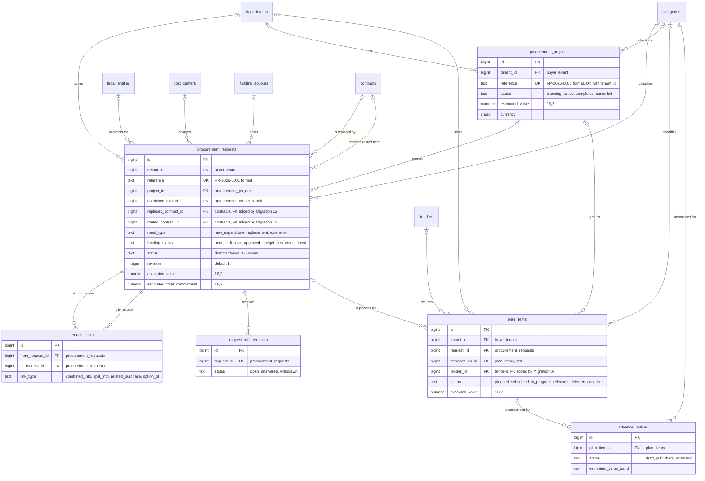
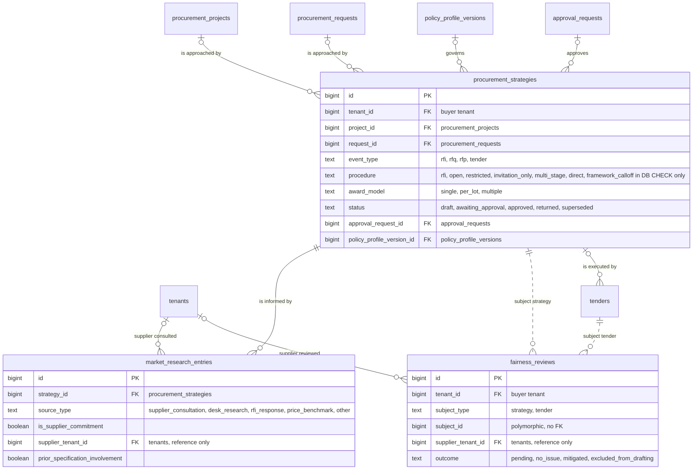
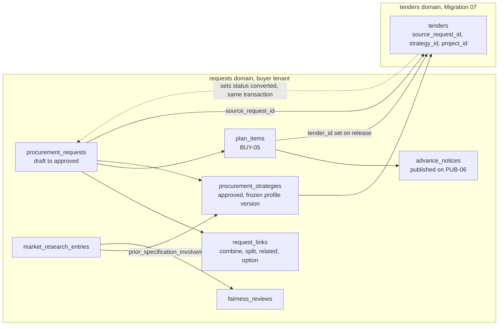

# Data model: Requests, planning and strategy (Migration 06)

Status: As-designed (pre-build). Updated to as-built at the end of Stage A and Stage B.

Sources:
- `docs/plan/schema-blueprint.md`: §0 Conventions; Migration 06 `20261001000600_requests_planning.sql`; Migrations 02 to 04 (referenced tables); §P permission catalog.
- `docs/plan/architecture-plan.md`: §0 delivery stages; §3.1 tenancy; §3.5 versioning and approvals; §3.8 notifications; §3.11 prototype mode; §4 cross-domain writes; §6 domain map (domain 05 requests); §10 demo data; the owner answers of 2026-09-29 (§11).
- `docs/architecture-brief.md`: §5.6 tenant scoping; §6.1 to §6.3.
- `docs/PRD.md`: §3 business concepts (amount distinctions); FR-04 (§7.1); FR-05 (§7.2); §8.1 procurement request lifecycle; BR-01, BR-06, BR-10; screens BUY-02 to BUY-06, PUB-06; AC-05, AC-39.
- `docs/plan/demo-storyline.md`: Requests and planning; Tenders (T-2026-0004, T-2026-0009).
- `docs/plan/design-decisions.md`: DD-01 (forward FKs), DD-03 (`[S]` and `[R]` tags), DD-09 (reference formats), DD-10 (identity defaults), DD-16 (unowned tables), DD-18 (grant and approval expiry jobs), DD-24 (approver permissions), DD-39 (idempotency), DD-40 (deferred procedure value), DD-43 (real Supabase Auth from Stage A), DD-44 (email channel); §E owner decisions of 2026-09-29 (item 8 prototype behaviour).

Contents:
- [1. Scope, tenancy and ownership](#1-scope-tenancy-and-ownership)
- [2. Reading the data dictionary](#2-reading-the-data-dictionary)
- [3. Diagrams](#3-diagrams)
- [4. Data dictionary: projects, requests and planning](#4-data-dictionary-projects-requests-and-planning)
- [5. Data dictionary: strategy and market research](#5-data-dictionary-strategy-and-market-research)
- [6. States and enumerations](#6-states-and-enumerations)
- [7. Constraints and indexes](#7-constraints-and-indexes)
- [8. Read access by audience](#8-read-access-by-audience)
- [9. Approvals, jobs and cross-domain touchpoints](#9-approvals-jobs-and-cross-domain-touchpoints)
- [10. Demo storyline coverage](#10-demo-storyline-coverage)
- [11. Open points finalized in Stage B](#11-open-points-finalized-in-stage-b)

Related: [data model overview](README.md), [organization and policy](02-organization-policy.md) (`legal_entities`, `departments`, `categories`, `cost_centers`, `funding_sources`, `policy_profile_versions`, `authority_limits`), [shared services](03-shared-services.md) (`approval_requests`), [tenders](06-tenders.md), [contracts](11-contracts.md), [records, reporting and operations](12-records-reporting-operations.md) (`request_idempotency`), [lifecycles](../05-lifecycles.md), [key flows](../06-key-flows.md), [security model](../04-security-model.md).

---

## 1. Scope, tenancy and ownership

Migration 06 holds the buyer's intake, planning and strategy records (FR-04, FR-05). Every table is [T] with **row tenant = the buyer**. None is [S], [P] or [G], and **none is sealed**. The owning domain is `requests` (architecture-plan §6, domain 05: BUY-02 to BUY-06 and PUB-06). A domain writes only its own tables; the one stated exception here is that the tenders domain sets `procurement_requests.status = 'converted'` in the transaction that creates the tender (architecture-plan §4).

| Table | Tag | Row tenant | Owning domain | Mutable (`updated_at`) | Sealed | Screens |
|---|---|---|---|---|---|---|
| `procurement_projects` | [T] | buyer | requests | yes | no | BUY-05, BUY-06 |
| `procurement_requests` | [T] | buyer | requests (status `converted` is set by tenders) | yes | no | BUY-02, BUY-03, BUY-04 |
| `request_links` | [T] | buyer | requests | no | no | BUY-02 |
| `request_info_requests` | [T] | buyer | requests | yes | no | BUY-03, BUY-04 |
| `plan_items` | [T] | buyer | requests | yes | no | BUY-05 |
| `advance_notices` | [T] | buyer | requests | yes | no | BUY-05, PUB-06 |
| `procurement_strategies` | [T] | buyer | requests | yes | no | BUY-06 |
| `market_research_entries` | [T] | buyer | requests | yes | no | BUY-06 |
| `fairness_reviews` | [T] | buyer | requests (see §11 for `subject_type = tender`) | yes | no | BUY-06 |

`market_research_entries` and `fairness_reviews` have a `supplier_tenant_id` column, but the blueprint tags them neither [S] nor [R]. The column is an optional reference to a supplier, not a visibility tag. The supplier-scoped allow-list is generated from the blueprint tags, not from column presence (DD-03), so these tables are not on it, `forSupplier` never reaches them, and suppliers never read them.

## 2. Reading the data dictionary

| Column | Meaning |
|---|---|
| Type | Plain type: stated in the blueprint, or fixed by a §0 convention (identity and FK columns `bigint`; instants `*_at` are `timestamptz` per architecture-plan §3.4; money `numeric(18,2)`; quantities `numeric(18,4)`; scores, rates and weights `numeric(12,6)`; currency `char(3)` with CHECK `~ '^[A-Z]{3}$'`; enumerations `text` + named CHECK). *Italic* type: inferred from the column's name and meaning because the blueprint states no type. `n/s`: not specified, with the candidates given. Stage B migrations fix the final types. |
| Null | `no`: NOT NULL stated by the blueprint or a §0 convention. `yes`: nullable as stated, or filled only by a later lifecycle event. `n/s`: not specified. |
| Key / constraint | `PK`, `FK → table`, `UK` (member of a unique constraint), CHECK lists, defaults. Every FK column is indexed (§0). |

Standard columns (§0): `id` (identity PK), `created_at` (not null, default `now()`), `created_by` (FK → users, null = system); mutable tables add `updated_at` (trigger `set_updated_at()`). Every table carries `tenant_id bigint not null references tenants(id)`.

Money fields follow the PRD §3 rule that estimate, approved budget, evaluated cost and other amounts are different measures. Each amount kind has its own column and label (architecture-plan §3.7, [ADR 0005](../adr/0005-decimal-strings-for-money-and-scores.md)).

## 3. Diagrams

Legend: solid lines are FK columns; dashed lines are logical links with no FK constraint (polymorphic pairs, or approval rows found by `subject_type` and `subject_id`). Entities without an attribute block are defined in other files. Lines to `users` are omitted.

### 3.1 Projects, requests and the plan

### 3.2 Strategy, market research and fairness

### 3.3 From need to event (record lineage)

The dotted edge is the cross-domain write permitted by architecture-plan §4. When `plan_items.tender_id` is set, and which plan status goes with it, is decided by the requests service in Stage B. The column itself is a plain `bigint` in Migration 06; Migration 07 adds its FK to `tenders` (DD-01).

## 4. Data dictionary: projects, requests and planning

### 4.1 procurement_projects

[T], mutable. Row tenant: the buyer. The overarching purchasing initiative, which can contain several linked events (PRD §3).

| Column | Type | Null | Key / constraint | Meaning |
|---|---|---|---|---|
| id | bigint | no | PK | Standard. |
| tenant_id | bigint | no | FK → tenants; UK (tenant_id, reference) | Buyer tenant. |
| reference | text | no | UK; `next_reference(tenant, 'PP')` | Format `PP-2026-0001` (DD-09). The year is the year in the tenant's official time zone (`tenants.official_time_zone`, DD-10). |
| title | *text* | n/s | | Title. |
| description | *text* | n/s | | Description. |
| owner_user_id | bigint | n/s | FK → users | Accountable owner (BR-01). |
| category_id | bigint | n/s | FK → categories | Category. |
| department_id | bigint | n/s | FK → departments | Department. |
| estimated_value | numeric(18,2) | n/s | | Estimate (not a budget). |
| currency | char(3) | n/s | CHECK `~ '^[A-Z]{3}$'` | Currency of `estimated_value`. |
| status | text | n/s | CHECK (planning, active, completed, cancelled) | Project state. |
| created_at | timestamptz | no | default now() | Standard. |
| created_by | bigint | yes | FK → users | Standard. |
| updated_at | timestamptz | no | `set_updated_at()` | Mutable marker. |

### 4.2 procurement_requests

[T], mutable. Row tenant: the buyer. The internal need and business case (FR-04; BUY-02 to BUY-04).

| Column | Type | Null | Key / constraint | Meaning |
|---|---|---|---|---|
| id | bigint | no | PK | Standard. |
| tenant_id | bigint | no | FK → tenants; UK (tenant_id, reference) | Buyer tenant. |
| reference | text | no | UK; `next_reference(tenant, 'PR')` | Format `PR-2026-0001` (§0). The year is the year in the tenant's official time zone (DD-09). |
| title | *text* | n/s | | Title. |
| requester_user_id | bigint | n/s | FK → users | Requester. |
| sponsor_user_id | bigint | n/s | FK → users | Business sponsor. |
| owner_user_id | bigint | n/s | FK → users | Accountable procurement owner (BR-01). |
| budget_owner_user_id | bigint | n/s | FK → users | Budget owner (FR-04). |
| legal_entity_id | bigint | n/s | FK → legal_entities | Contracting entity. A change triggers reconsideration (FR-04). |
| department_id | bigint | n/s | FK → departments | Requesting department. |
| category_id | bigint | n/s | FK → categories | Category. |
| cost_center_id | bigint | n/s | FK → cost_centers | Cost center. |
| funding_source_id | bigint | n/s | FK → funding_sources | Funding source. |
| project_id | bigint | n/s | FK → procurement_projects | Parent project. |
| problem_statement | *text* | n/s | | Problem or opportunity. |
| expected_outcomes | *text* | n/s | | Expected outcomes. |
| scope_description | *text* | n/s | | Scope. |
| quantities | *text* | n/s | | Quantities or service volumes, as described by the requester. |
| delivery_locations | *text* | n/s | | Delivery locations. |
| target_date | date | n/s | | Required date. |
| constraints | *text* | n/s | | Known constraints. |
| stakeholders | *text* | n/s | | Stakeholders. |
| consequence_of_delay | *text* | n/s | | Consequence of delay. |
| need_type | text | n/s | CHECK (new_expenditure, replacement, extension) | Replaces a contract, extends a service, or is new expenditure (FR-04). |
| replaces_contract_id | bigint | yes | FK → contracts; plain `bigint` here, FK added by Migration 12 with `ALTER TABLE` (DD-01) | Contract being replaced or extended. |
| estimated_value | numeric(18,2) | n/s | | Estimated value. |
| currency | char(3) | n/s | CHECK `~ '^[A-Z]{3}$'` | Currency of the amounts on this row. |
| estimation_basis | *text* | n/s | | How the estimate was built. |
| accounting_reference | *text* | n/s | | Accounting or project reference. |
| contract_term_months | *integer* | n/s | | Proposed term. |
| renewal_options | *text* | n/s | | Renewal options. |
| estimated_total_commitment | numeric(18,2) | n/s | | Whole-life commitment including options. Splitting must not hide the overall value (FR-04). |
| funding_status | text | n/s | CHECK (none, indicative, approved_budget, firm_commitment) | Distinguishes indicative funding, approved budget and firm commitment (FR-04). |
| priority | text | n/s | CHECK (low, normal, high, critical) | Priority. |
| status | text | n/s | CHECK (draft, submitted, under_review, information_requested, approved, rejected, withdrawn, deferred, converted, routed_to_existing, rescinded, closed) | Request state (§6). |
| revision | integer | n/s | default 1 | Revision of the request. Approvals target an exact version (`approval_requests.subject_version`), and a material change triggers reconsideration (FR-04, BR-10). |
| combined_into_id | bigint | yes | FK → procurement_requests (self) | Request this one was combined into. Combining keeps the original requesters, funding and requirements (FR-04). |
| routed_contract_id | bigint | yes | FK → contracts; plain `bigint` here, FK added by Migration 12 with `ALTER TABLE` (DD-01) | Existing contract the need was routed to. |
| submitted_at | timestamptz | yes | | Submission time. |
| decided_at | timestamptz | yes | | Decision time. |
| decision_reason | *text* | yes | | Reason kept for rejection, deferral and other decisions (PRD §8.1). |
| deferred_until | n/s (`date` or `timestamptz`) | yes | | Deferral date. |
| created_at | timestamptz | no | default now() | Standard. |
| created_by | bigint | yes | FK → users | Standard. |
| updated_at | timestamptz | no | `set_updated_at()` | Mutable marker. |

### 4.3 request_links

[T]. Row tenant: the buyer. Typed links between requests: combine, split, related purchases and options (FR-04: "Options, related lots, and associated purchases must be visible when deciding the applicable approval route").

| Column | Type | Null | Key / constraint | Meaning |
|---|---|---|---|---|
| id | bigint | no | PK | Standard. |
| tenant_id | bigint | no | FK → tenants | Buyer tenant. |
| from_request_id | bigint | n/s | FK → procurement_requests | Source request. |
| to_request_id | bigint | n/s | FK → procurement_requests | Target request. |
| link_type | text | n/s | CHECK (combined_into, split_into, related_purchase, option_of) | Link meaning. |
| note | *text* | n/s | | Explanation. |
| created_at | timestamptz | no | default now() | Standard. |
| created_by | bigint | yes | FK → users | Standard. |

### 4.4 request_info_requests

[T], mutable. Row tenant: the buyer. Procurement's questions to the requester (PRD §8.1 "Information requested").

| Column | Type | Null | Key / constraint | Meaning |
|---|---|---|---|---|
| id | bigint | no | PK | Standard. |
| tenant_id | bigint | no | FK → tenants | Buyer tenant. |
| request_id | bigint | n/s | FK → procurement_requests | Request concerned. |
| question | *text* | n/s | | Question. |
| requested_by | bigint | n/s | FK → users | Reviewer who asked. |
| due_at | timestamptz | n/s | | Response due time. |
| response_text | *text* | yes | | Requester's answer. |
| responded_by | bigint | yes | FK → users | Who answered. |
| responded_at | timestamptz | yes | | Answer time. |
| status | text | n/s | CHECK (open, answered, withdrawn) | State. |
| created_at | timestamptz | no | default now() | Standard. |
| created_by | bigint | yes | FK → users | Standard. |
| updated_at | timestamptz | no | `set_updated_at()` | Mutable marker. |

### 4.5 plan_items

[T], mutable. Row tenant: the buyer. Procurement plan and calendar entries (BUY-05).

| Column | Type | Null | Key / constraint | Meaning |
|---|---|---|---|---|
| id | bigint | no | PK | Standard. |
| tenant_id | bigint | no | FK → tenants | Buyer tenant. |
| title | *text* | n/s | | Title. |
| project_id | bigint | n/s | FK → procurement_projects | Project. |
| request_id | bigint | n/s | FK → procurement_requests | Source request. |
| category_id | bigint | n/s | FK → categories | Category. |
| department_id | bigint | n/s | FK → departments | Department. |
| owner_user_id | bigint | n/s | FK → users | Owner. |
| budget_period | *text* | n/s | | Budget period label. |
| expected_value | numeric(18,2) | n/s | | Expected value. Buyer-internal. |
| currency | char(3) | n/s | CHECK `~ '^[A-Z]{3}$'` | Currency of `expected_value`. |
| planned_release_date | *date* | n/s | | Planned release. |
| planned_award_date | *date* | n/s | | Planned award. |
| resource_demand_days | n/s (`integer` or `numeric`) | n/s | | Resource demand (BUY-05). |
| priority | n/s (`text`; no CHECK list given) | n/s | | Planning priority. |
| depends_on_id | bigint | yes | FK → plan_items (self) | Dependency (BUY-05). |
| status | text | n/s | CHECK (planned, scheduled, in_progress, released, deferred, cancelled) | Plan state. |
| tender_id | bigint | yes | FK → tenders; plain `bigint` here, FK added by Migration 07 with `ALTER TABLE` (DD-01) | Event that realizes the item. |
| created_at | timestamptz | no | default now() | Standard. |
| created_by | bigint | yes | FK → users | Standard. |
| updated_at | timestamptz | no | `set_updated_at()` | Mutable marker. |

### 4.6 advance_notices

[T], mutable. Row tenant: the buyer. Future-opportunity notices published to PUB-06. They are forecasts, not invitations to bid (PUB-06).

| Column | Type | Null | Key / constraint | Meaning |
|---|---|---|---|---|
| id | bigint | no | PK | Standard. |
| tenant_id | bigint | no | FK → tenants | Buyer tenant. |
| plan_item_id | bigint | n/s | FK → plan_items | Plan item announced. |
| title | *text* | n/s | | Public title. |
| summary | *text* | n/s | | Public summary. |
| category_id | bigint | n/s | FK → categories | Category shown. |
| indicative_timing | *text* | n/s | | Indicative timing. |
| estimated_value_band | *text* | n/s | | Public value band. The plan item's exact `expected_value` is not published. |
| eoi_instructions | *text* | n/s | | Expression-of-interest instructions. |
| status | text | n/s | CHECK (draft, published, withdrawn) | Notice state. |
| published_at | timestamptz | yes | | Publication time. |
| published_by | bigint | yes | FK → users | Publisher. |
| created_at | timestamptz | no | default now() | Standard. |
| created_by | bigint | yes | FK → users | Standard. |
| updated_at | timestamptz | no | `set_updated_at()` | Mutable marker. |

## 5. Data dictionary: strategy and market research

### 5.1 procurement_strategies

[T], mutable. Row tenant: the buyer. The approved market approach (FR-05, BUY-06). A new revision supersedes the old one (`status = superseded`) rather than overwriting it.

| Column | Type | Null | Key / constraint | Meaning |
|---|---|---|---|---|
| id | bigint | no | PK | Standard. |
| tenant_id | bigint | no | FK → tenants | Buyer tenant. |
| project_id | bigint | n/s | FK → procurement_projects | Project. |
| request_id | bigint | n/s | FK → procurement_requests | Request. |
| revision | *integer* | n/s | | Strategy revision. |
| intended_outcome | *text* | n/s | | Intended procurement outcome. |
| event_type | text | n/s | CHECK (rfi, rfq, rfp, tender) | Planned event type. |
| procedure | text | n/s | CHECK (rfi, open, restricted, invitation_only, multi_stage, direct, framework_calloff) | Procedure (FR-05 table). `framework_calloff` belongs to the deferred FR-20 extension (architecture-plan §2). It stays in the DB CHECK for the future, but no contract enum used for writes offers it and it never appears in the UI (DD-40). |
| competition_rationale | *text* | n/s | | Why this procedure. |
| direct_award_grounds | *text* | n/s | | Exception grounds for direct procurement. |
| risks | *text* | n/s | | Risks. |
| qualification_approach | *text* | n/s | | Qualification approach. |
| lot_strategy | *text* | n/s | | Lot structure. |
| award_model | text | n/s | CHECK (single, per_lot, multiple) | Award model. |
| evaluation_approach | *text* | n/s | | Evaluation method summary. |
| negotiation_permitted | *boolean* | n/s | | Negotiation permission. |
| timetable_summary | *text* | n/s | | Timetable. |
| external_oversight | *text* | n/s | | External oversight or funding-body approvals (FR-05). |
| supplier_information_use | *text* | n/s | required when event_type = rfi (service rule) | RFI only (FR-05): states that taking part creates no award entitlement and how the information suppliers share may be used later. Null for competitive events. Added by owner decision 2026-09-30. |
| status | text | n/s | CHECK (draft, awaiting_approval, approved, returned, superseded) | Strategy state. |
| approval_request_id | bigint | yes | FK → approval_requests | Approval (subject type `strategy`). |
| policy_profile_version_id | bigint | n/s | FK → policy_profile_versions | Policy profile version applied (BR-09). |
| created_at | timestamptz | no | default now() | Standard. |
| created_by | bigint | yes | FK → users | Standard. |
| updated_at | timestamptz | no | `set_updated_at()` | Mutable marker. |

### 5.2 market_research_entries

[T], mutable. Row tenant: the buyer. Research sources and findings. Unverified estimates are kept separate from supplier commitments (FR-05).

| Column | Type | Null | Key / constraint | Meaning |
|---|---|---|---|---|
| id | bigint | no | PK | Standard. |
| tenant_id | bigint | no | FK → tenants | Buyer tenant. |
| strategy_id | bigint | n/s | FK → procurement_strategies | Strategy informed. |
| source_type | text | n/s | CHECK (supplier_consultation, desk_research, rfi_response, price_benchmark, other) | Kind of source. |
| source | *text* | n/s | | Source description. |
| finding | *text* | n/s | | Finding. |
| is_supplier_commitment | boolean | n/s | | True for a supplier commitment, false for an unverified estimate (FR-05). |
| supplier_tenant_id | bigint | n/s | FK → tenants | Supplier consulted, if any. A reference only; the table is tagged neither [S] nor [R], so it is not on the supplier allow-list (DD-03). |
| prior_specification_involvement | boolean | n/s | | The supplier helped shape specifications, which calls for a fairness review (FR-05). |
| recorded_at | timestamptz | n/s | | Recording time. |
| created_at | timestamptz | no | default now() | Standard. |
| created_by | bigint | yes | FK → users | Standard. |
| updated_at | timestamptz | no | `set_updated_at()` | Mutable marker. |

### 5.3 fairness_reviews

[T], mutable. Row tenant: the buyer. Review of prior supplier involvement in a strategy or tender (FR-05).

| Column | Type | Null | Key / constraint | Meaning |
|---|---|---|---|---|
| id | bigint | no | PK | Standard. |
| tenant_id | bigint | no | FK → tenants | Buyer tenant. |
| subject_type | text | n/s | CHECK (strategy, tender) | Subject kind. |
| subject_id | bigint | n/s | polymorphic; no FK | Strategy or tender id. |
| supplier_tenant_id | bigint | n/s | FK → tenants | Supplier whose involvement is reviewed. A reference only; the table is tagged neither [S] nor [R], so it is not on the supplier allow-list (DD-03). |
| reason | *text* | n/s | | Why a review is needed. |
| reviewer_user_id | bigint | n/s | FK → users | Reviewer. |
| outcome | text | n/s | CHECK (pending, no_issue, mitigated, excluded_from_drafting) | Outcome. `excluded_from_drafting` removes the supplier from drafting; it does not by itself exclude them from competing (FR-05: unsuccessful RFI participants are not automatically excluded). |
| note | *text* | n/s | | Reviewer's note. |
| created_at | timestamptz | no | default now() | Standard. |
| created_by | bigint | yes | FK → users | Standard. |
| updated_at | timestamptz | no | `set_updated_at()` | Mutable marker. |

## 6. States and enumerations

Enumerations are `text` + named CHECK ([ADR 0004](../adr/0004-text-check-constraints-not-enums.md)), mirrored once in `src/contracts/enums.ts` (architecture-plan §3.6). Transition matrices: [05-lifecycles.md](../05-lifecycles.md).

**Procurement request status and the PRD §8.1 gates**

| Status value | PRD §8.1 state | Permitted next outcome (PRD §8.1) | Gate or evidence (PRD §8.1) |
|---|---|---|---|
| draft | Draft | submitted, or abandoned | Requester and minimum business information. |
| submitted, under_review | Submitted / under review | information_requested, approved, rejected, deferred | Assigned procurement and budget reviewers. |
| information_requested | Information requested | resubmitted, or withdrawn | Responses linked to the requested changes (`request_info_requests`). |
| approved | Approved | converted, routed_to_existing, rescinded | Strategy and funding approval for the chosen route. |
| rejected, withdrawn, deferred | Rejected / withdrawn / deferred | closed, or reconsidered | Reason retained; reconsideration requires review of the changed basis. |
| converted | (outcome of Approved) | none stated | Set by the tenders domain when the event is created. |
| routed_to_existing | (outcome of Approved) | none stated | `routed_contract_id` records the existing arrangement. |
| rescinded | (outcome of Approved) | none stated | |
| closed | (outcome) | none stated | |

PRD §8.1 names "abandoned" for a draft, but the CHECK list has no `abandoned` value. The amended demo storyline represents an abandoned draft as `withdrawn`.

**Other enumerations**

| Table.column | Values |
|---|---|
| procurement_projects.status | planning, active, completed, cancelled |
| procurement_requests.need_type | new_expenditure, replacement, extension |
| procurement_requests.funding_status | none, indicative, approved_budget, firm_commitment |
| procurement_requests.priority | low, normal, high, critical |
| request_links.link_type | combined_into, split_into, related_purchase, option_of |
| request_info_requests.status | open, answered, withdrawn |
| plan_items.status | planned, scheduled, in_progress, released, deferred, cancelled |
| advance_notices.status | draft, published, withdrawn |
| procurement_strategies.event_type | rfi, rfq, rfp, tender |
| procurement_strategies.procedure | rfi, open, restricted, invitation_only, multi_stage, direct, framework_calloff (`framework_calloff` is DB-only: not offered by write contract enums or the UI, DD-40) |
| procurement_strategies.award_model | single, per_lot, multiple |
| procurement_strategies.status | draft, awaiting_approval, approved, returned, superseded |
| market_research_entries.source_type | supplier_consultation, desk_research, rfi_response, price_benchmark, other |
| fairness_reviews.subject_type | strategy, tender |
| fairness_reviews.outcome | pending, no_issue, mitigated, excluded_from_drafting |

## 7. Constraints and indexes

**Unique constraints**

| Table | Unique |
|---|---|
| procurement_projects | (tenant_id, reference) (§0 human references) |
| procurement_requests | (tenant_id, reference) |

**Other constraints**

- Currency columns carry CHECK `~ '^[A-Z]{3}$'`.
- `reference` columns are `text not null`, generated by `next_reference(tenant_id, prefix)` backed by `reference_counters`, inside the caller's transaction (Migration 01). Prefixes: `PR` (requests) and `PP` (projects); the year segment is the year in the tenant's official time zone (DD-09).
- **Forward references (DD-01).** `procurement_requests.replaces_contract_id` and `routed_contract_id` point at `contracts` (Migration 12), and `plan_items.tender_id` points at `tenders` (Migration 07). Those tables do not exist when Migration 06 runs, so the columns stay plain `bigint` here. The migration that creates each target table adds the FK with `ALTER TABLE … ADD CONSTRAINT`: Migration 07 for `plan_items.tender_id`, Migration 12 for the two contract columns.
- Self-references: `procurement_requests.combined_into_id`, `plan_items.depends_on_id`.
- Cross-row rules enforced in the service: a combined request keeps its requesters and funding; splitting keeps the overall value visible for the policy threshold (FR-04).

**Indexes**

- No explicit indexes are stated for Migration 06. Under §0, every FK column is indexed, and each list access pattern gets an index leading with `tenant_id`.
- Candidate list-pattern indexes from that rule: `procurement_requests (tenant_id, status)`, `(tenant_id, owner_user_id)`, `(tenant_id, requester_user_id)` and `(tenant_id, submitted_at)` for BUY-02 (status, ownership, age); `plan_items (tenant_id, planned_release_date)` and `(tenant_id, status)` for BUY-05; `advance_notices (tenant_id, status)` for PUB-06; `procurement_strategies (tenant_id, status)`. Fixed with the Stage B list queries.

## 8. Read access by audience

All rows are buyer-internal except published advance notices. Suppliers have no access to any table in this migration. Permission codes are from blueprint §P; each endpoint declares its own permission ([07-api.md](../07-api.md)).

| Table | Buyer | Supplier | Public | Relevant permissions (§P) |
|---|---|---|---|---|
| procurement_projects | Buyer users with planning or request rights | No | No | plan.manage, request.view_all |
| procurement_requests, request_links, request_info_requests | Requesters (own requests), reviewers, approvers, budget owners | No | No | request.create, request.view_all, request.review, request.approve, request.funding_confirm |
| plan_items | Planning users | No | No | plan.manage |
| advance_notices | Planning users (all statuses) | As public | `published` rows only, on PUB-06 (`/plans`), when the buyer's `portal_settings.show_advance_notices` is on (Migration 03) | plan.manage |
| procurement_strategies, market_research_entries, fairness_reviews | Strategy users and approvers | No | No | strategy.manage, strategy.approve |

Operators have no routine access (PRD §4.1). Requesters cannot publish or award (PRD §4.1).

## 9. Approvals, jobs and cross-domain touchpoints

| Mechanism | Tables | Behavior |
|---|---|---|
| Request approval | `approval_requests` with `subject_type = procurement_request` or `funding`, `subject_id` = request id, `subject_version` | The request row has no approval FK. Authority is checked against `authority_limits` (`request_approval`, `funding_confirmation`) and active `delegations` (BR-06). A request above the approver's limit is routed to an approver who holds the authority (AC-05). Deciding a step needs `approval.decide`, the decision-specific permission and sufficient authority. Cross-currency authority uses `exchange_rates` at the request date; with no rate, the step routes to the next level up, never an assumed pass (DD-24). |
| Strategy approval | `procurement_strategies.approval_request_id` (`subject_type = strategy`) | Authority decision type `strategy_approval`. |
| Material change | `procurement_requests.revision`, `approval_requests.status = invalidated` | A material change to scope, amount, funding, risk or contracting entity triggers reconsideration (FR-04, BR-10, architecture-plan §3.5). |
| Conversion | `procurement_requests.status = converted` | Written by the tenders domain in the tender-creation transaction and audited (architecture-plan §4). |
| Snapshots and audit | `record_snapshots`, `audit_log` | Approved versions are kept as immutable snapshots; every state change is audited (Migration 01). `record_snapshots` is owned by the core (lifecycle) service, so requests writes snapshots through it (DD-16). |
| Notifications | `notifications`, `notification_deliveries` | "Request submitted or returned" (PRD §14.3) is sent through the notifications domain. It is delivered in-app and, when `EMAIL_ENABLED` is set, by email. Formal notices go to both channels, and other events follow the recipient's preferences. An email carries only the title, official deadline and a link, never confidential content (DD-44). |
| Jobs | none specific | No job in architecture-plan §3.9 sweeps these tables. `deadline-reminders` covers approval-due reminders through `approval_requests`, and `expire-approvals` (owner approvals, `5 * * * *`) expires approval requests past `expires_at` and notifies owners (DD-18). |
| Idempotent creates | `request_idempotency` ([12-records-reporting-operations.md](12-records-reporting-operations.md)) | Commands that create records (for example creating a request) accept an optional `Idempotency-Key` header, kept for 24 hours (DD-39). |

**Stage A.** The mock API serves `src/mock-api/fixtures/requests.ts` (and planning fixtures), typed against `src/contracts/requests.ts`. Commands such as submit and approve validate the request and return a static contract-valid response; nothing persists (architecture-plan §0; owner decision 2026-09-29). Buyer personas such as `mpho.manager` and `keabetswe.approver` are real accounts in the local Supabase Auth, created by `npm run auth:personas`. The mock API verifies each Supabase JWT and maps the verified email to its fixture persona (DD-43).

## 10. Demo storyline coverage

| Storyline element | Rows |
|---|---|
| PR-2026-0001 to PR-2026-0012, buyer `kwu`, covering every request status (draft, submitted, under_review, information_requested, approved, rejected, withdrawn, deferred, converted, routed_to_existing, rescinded, closed); PRD §8.1 "abandoned" is represented by `withdrawn` | `procurement_requests` |
| PR-2026-0003 exceeds `mpho.manager`'s limit (BWP 2,000,000) and is routed to `keabetswe.approver` (AC-05) | `procurement_requests`, `approval_requests`, `approval_steps` |
| PR-2026-0006 combined into PR-2026-0005 | `procurement_requests.combined_into_id` and `request_links` (`combined_into`) |
| Plan items for 2026 Q4 and 2027 Q1; two published advance notices | `plan_items`, `advance_notices` (`published`) |
| Strategy and AC-39: RFI T-2026-0004 leads to the linked event T-2026-0009 | `procurement_strategies`, `market_research_entries` (`rfi_response`). The RFI's own findings and next-step decision are on `event_closeouts` (Migration 11); the link is `tenders.linked_from_tender_id` with `link_type = from_rfi` ([06-tenders.md](06-tenders.md)). |

## 11. Open points finalized in Stage B

1. **Deferred FKs.** Whether FK constraints are added later for `procurement_requests.replaces_contract_id` and `routed_contract_id` (to `contracts`, Migration 12) and `plan_items.tender_id` (to `tenders`, Migration 07). The blueprint states this only for `templates.source_tender_id`. **Resolved — DD-01: the columns stay plain `bigint` in Migration 06; Migration 07 (`plan_items.tender_id`) and Migration 12 (the two contract columns) add the FKs with `ALTER TABLE`.**
2. **Demo request coverage.** The storyline says eight requests "cover every request state", but the status CHECK has twelve values. Fixture and seed authors need to reconcile this. **Resolved — amended demo storyline (not a DD entry): PR-2026-0001 to PR-2026-0012 cover all twelve statuses.**
3. **Abandoned drafts.** PRD §8.1 "abandoned" has no CHECK value. **Resolved — amended demo storyline (not a DD entry): "abandoned" is represented by `withdrawn`.**
4. **Reference prefix for projects** is not listed in §0. **Resolved — DD-09: prefix `PP-` (`PP-2026-0001`), year in the tenant's official time zone.**
5. **Ownership of tender-subject fairness reviews.** `fairness_reviews.subject_type = tender` rows may be raised during tender authoring. The domain map assigns the table to requests (BUY-06); how the tenders domain creates them is fixed in Stage B.
6. **Types left open.** `deferred_until`, `resource_demand_days`, and the type and allowed values of `plan_items.priority`.
7. **`framework_calloff` in the procedure CHECK.** FR-20 is deferred, and deferred items never appear in the UI as dead links (architecture-plan §2). Whether the value can be selected in the core release is decided in the Stage A contracts. **Resolved — DD-40: `framework_calloff` stays in the DB CHECK lists, is not offered by any contract enum used for writes, and never appears in the UI.**
