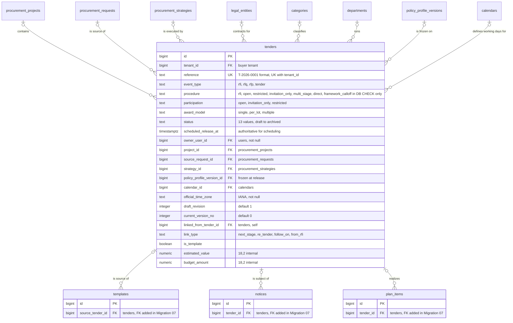
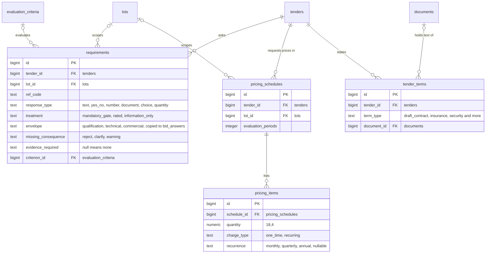
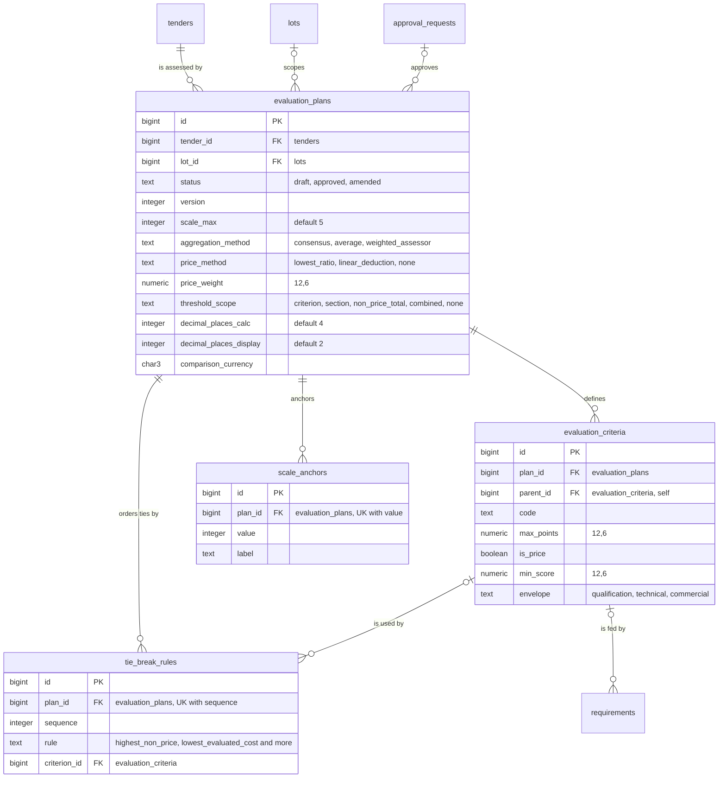
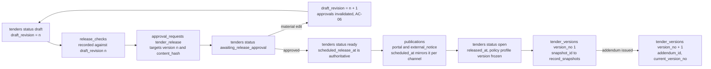

# Data model: Tenders, lots, requirements and evaluation plans (Migration 07)

Status: As-designed (pre-build). Updated to as-built at the end of Stage A and Stage B.

Sources:
- `docs/plan/schema-blueprint.md`: §0 Conventions; Migration 07 `20261001000700_tenders.sql`; Migration 03 (`templates.source_tender_id`, `portal_settings`); Migration 14 (`v_public_tenders`); §P permission catalog.
- `docs/plan/architecture-plan.md`: §0 delivery stages; §3.1 tenancy; §3.2 assignment-based access; §3.4 official time; §3.5 versioning and approvals; §3.6 state machines; §3.7 money and scoring; §3.8 notifications; §3.9 jobs; §3.11 prototype mode; §4 cross-domain writes; §6 domain map (domains 06 tenders and 07 publication); the owner answers of 2026-09-29 (§11).
- `docs/architecture-brief.md`: §5.6 tenant scoping; §6.1 to §6.3.
- `docs/PRD.md`: §3 concepts (lot, requirement, evaluation criterion, tender version); FR-07 (§7.4); FR-08 (§7.5); §8.2 tender lifecycle; §9.1 to §9.3 evaluation rules; BR-01, BR-09, BR-10, BR-11, BR-12, BR-14, BR-15, BR-16, BR-26; screens BUY-07 to BUY-15, PUB-01 to PUB-03; AC-01, AC-06, AC-19, AC-26, AC-33.
- `docs/plan/demo-storyline.md`: Tenders.
- `docs/plan/design-decisions.md`: DD-01 (forward FKs), DD-02 (nullable unique keys), DD-03 (`[S]` and `[R]` tags), DD-05 (sealed envelope mapping), DD-06 (missing CHECK lists and types), DD-07 (additional unique keys), DD-09 (reference formats), DD-10 (identity defaults), DD-13 (`v_public_tenders`), DD-15 (deadline authority), DD-16 (unowned tables), DD-22 (buyer slug in public URLs), DD-24 (approver permissions), DD-25 (conflict gating), DD-26 (role scope matching), DD-33 (zone display), DD-39 (idempotency), DD-40 (deferred procedure value), DD-43 (real Supabase Auth from Stage A), DD-44 (email channel); §E owner decisions of 2026-09-29 (item 8 prototype behaviour).

Contents:
- [1. Scope, tenancy and ownership](#1-scope-tenancy-and-ownership)
- [2. Reading the data dictionary](#2-reading-the-data-dictionary)
- [3. Diagrams](#3-diagrams)
- [4. Data dictionary: tender core and structure](#4-data-dictionary-tender-core-and-structure)
- [5. Data dictionary: requirements, pricing and terms](#5-data-dictionary-requirements-pricing-and-terms)
- [6. Data dictionary: evaluation plan](#6-data-dictionary-evaluation-plan)
- [7. Data dictionary: release and publication](#7-data-dictionary-release-and-publication)
- [8. States and enumerations](#8-states-and-enumerations)
- [9. Constraints and indexes](#9-constraints-and-indexes)
- [10. Read access by audience](#10-read-access-by-audience)
- [11. Jobs and cross-domain touchpoints](#11-jobs-and-cross-domain-touchpoints)
- [12. Demo storyline coverage](#12-demo-storyline-coverage)
- [13. Open points finalized in Stage B](#13-open-points-finalized-in-stage-b)

Related: [data model overview](README.md), [platform and identity](01-platform-identity-access.md) (`record_snapshots`), [organization and policy](02-organization-policy.md) (`calendars`, `policy_profile_versions`, `templates`, `portal_settings`), [shared services](03-shared-services.md) (`approval_requests`, `documents`, `tasks`, `notices`, `holds`), [requests and planning](05-requests-planning.md), [participation and clarifications](07-participation-clarifications.md), [bids and submission](08-bids-submission.md), [opening and evaluation](09-opening-evaluation.md), [records, reporting and operations](12-records-reporting-operations.md) (`request_idempotency`), [lifecycles](../05-lifecycles.md), [key flows](../06-key-flows.md), [security model](../04-security-model.md), ADRs [0002](../adr/0002-buyer-owned-procurement-records.md), [0004](../adr/0004-text-check-constraints-not-enums.md), [0005](../adr/0005-decimal-strings-for-money-and-scores.md).

---

## 1. Scope, tenancy and ownership

Migration 07 holds the sourcing event and everything the buyer authors before release: lots, milestones, team, requirements, pricing schedules, terms, envelopes, participation conditions, the evaluation plan, release checks and publications (FR-07, FR-08). Every table is [T] with **row tenant = the buyer**. None is [S], [R], [P] or [G], and **none is sealed**. Sealing applies to supplier bid content in Migration 09. Because no table here is on the supplier allow-list, `forSupplier` never reads them (DD-03); supplier endpoints serve issued content after the service verifies participation (see §10).

Owning domains follow architecture-plan §6: `tenders` (domain 06: BUY-07 to BUY-13) owns authoring; `publication` (domain 07: BUY-14, BUY-15, PUB-01 to PUB-03) owns `publications`. Two stated rules cut across ownership (architecture-plan §3.6, §4):

- **Tender and lot status change only through the shared `lifecycle` service.** No domain updates `tenders.status` or `lots.stage` directly.
- **Clarifications writes `requirements`, `tender_milestones` and `lots.submission_deadline`** through the lifecycle snapshot API when an addendum is issued, in the same audited transaction.

| Table | Tag | Row tenant | Owning domain | Mutable (`updated_at`) | Sealed | Screens |
|---|---|---|---|---|---|---|
| `tenders` | [T] | buyer | tenders (status via lifecycle) | yes | no | BUY-07, BUY-08 |
| `tender_versions` | [T] | buyer | tenders (written via lifecycle snapshots) | no | no | BUY-08, BUY-13, PUB-03 |
| `tender_milestones` | [T] | buyer | tenders (clarifications via addendum) | yes | no | BUY-12 |
| `lots` | [T] | buyer | tenders (stage via lifecycle; deadline via addendum) | yes | no | BUY-09 |
| `tender_team_members` | [T] | buyer | tenders | yes | no | BUY-08 |
| `requirements` | [T] | buyer | tenders (clarifications via addendum) | yes | no | BUY-09 |
| `pricing_schedules` | [T] | buyer | tenders | yes | no | BUY-10 |
| `pricing_items` | [T] | buyer | tenders | yes | no | BUY-10 |
| `tender_terms` | [T] | buyer | tenders | yes | no | BUY-10 |
| `tender_envelopes` | [T] | buyer | tenders | no | no | BUY-12 |
| `participation_conditions` | [T] | buyer | tenders | yes | no | BUY-12 |
| `evaluation_plans` | [T] | buyer | tenders | yes | no | BUY-11 |
| `evaluation_criteria` | [T] | buyer | tenders | yes | no | BUY-11 |
| `scale_anchors` | [T] | buyer | tenders | no | no | BUY-11 |
| `tie_break_rules` | [T] | buyer | tenders | no | no | BUY-11 |
| `release_checks` | [T] | buyer | tenders | yes | no | BUY-13 |
| `publications` | [T] | buyer | publication | yes | no | BUY-14 |

Migration 07 also adds, with `ALTER TABLE … ADD CONSTRAINT`, the forward FKs from earlier migrations that target `tenders` (DD-01):

- `templates.source_tender_id → tenders` (templates of kind `tender_package` point at a tender with `is_template = true`; Migration 03);
- `notices.tender_id → tenders` (Migration 04);
- `plan_items.tender_id → tenders` (Migration 06).

Two columns in this migration point forward at Migration 08 tables and stay plain `bigint` here: `tender_versions.addendum_id` and `participation_conditions.session_id`. Migration 08 adds their FKs (DD-01).

## 2. Reading the data dictionary

| Column | Meaning |
|---|---|
| Type | Plain type: stated in the blueprint, or fixed by a §0 convention (identity and FK columns `bigint`; instants `*_at` are `timestamptz` per architecture-plan §3.4; money `numeric(18,2)`; quantities `numeric(18,4)`; scores, rates and weights `numeric(12,6)`; currency `char(3)` with CHECK `~ '^[A-Z]{3}$'`; enumerations `text` + named CHECK). *Italic* type: inferred from the column's name and meaning because the blueprint states no type. `n/s`: not specified, with the candidates given. Stage B migrations fix the final types. |
| Null | `no`: NOT NULL stated by the blueprint or a §0 convention. `yes`: nullable as stated, or filled only by a later lifecycle event. `n/s`: not specified. |
| Key / constraint | `PK`, `FK → table`, `UK` (member of a unique constraint), CHECK lists, defaults. Every FK column is indexed (§0). |

Standard columns (§0): `id` (identity PK), `created_at` (not null, default `now()`), `created_by` (FK → users, null = system); mutable tables add `updated_at` (trigger `set_updated_at()`). Every table carries `tenant_id bigint not null references tenants(id)`. Columns the blueprint marks **(internal)** hold buyer-only amounts and are never projected to suppliers or the public.

## 3. Diagrams

Legend: solid lines are FK columns; dashed lines are logical links without an FK. Entities without an attribute block are defined in other files. Lines to `users` are omitted. Self-references are noted in attribute comments.

### 3.1 Tender and its sources

### 3.2 Structure, versions, release and publication

```mermaid
erDiagram
    tenders ||--o{ lots : "is divided into"
    tenders ||--o{ tender_versions : "is issued as"
    record_snapshots ||--o{ tender_versions : "freezes"
    addenda |o--o{ tender_versions : "produces"
    tenders ||--o{ tender_milestones : "is scheduled by"
    lots |o--o{ tender_milestones : "overrides for"
    tenders ||--o{ tender_team_members : "is staffed by"
    lots |o--o{ tender_team_members : "scopes"
    tenders ||--o{ tender_envelopes : "separates into"
    tenders ||--o{ participation_conditions : "is gated by"
    qualification_programs |o--o{ participation_conditions : "is required by"
    sessions |o--o{ participation_conditions : "is required by"
    tenders ||--o{ release_checks : "is checked by"
    tenders ||--o{ publications : "is published by"
    tasks |o--o{ publications : "handles exception of"

    lots {
        bigint id PK
        bigint tender_id FK "UK with lot_no"
        integer lot_no
        text stage "draft to cancelled, 8 values"
        timestamptz submission_deadline "authoritative for the lot when set, else tender milestone"
        numeric estimated_value "18,2 internal"
    }
    tender_versions {
        bigint id PK
        bigint tender_id FK "UK with version_no"
        integer version_no
        bigint snapshot_id FK "record_snapshots"
        bigint addendum_id FK "addenda, FK added by Migration 08"
    }
    tender_milestones {
        bigint id PK
        bigint tender_id FK "UK NULLS NOT DISTINCT with lot_id and milestone"
        bigint lot_id FK "lots, null for tender level"
        text milestone "questions_deadline, submission_deadline and more"
        timestamptz at
        boolean is_disclosed
    }
    tender_team_members {
        bigint id PK
        bigint tender_id FK "tenders"
        bigint lot_id FK "lots"
        bigint user_id FK "users"
        text team_role "owner, officer, evaluator and more"
        timestamptz removed_at
    }
    tender_envelopes {
        bigint id PK
        bigint tender_id FK "UK with envelope"
        text envelope "qualification, technical, commercial"
        integer open_order
    }
    participation_conditions {
        bigint id PK
        bigint tender_id FK "tenders"
        text condition_type "confidentiality_undertaking, qualification_required and more"
        bigint qualification_program_id FK "qualification_programs"
        bigint session_id FK "sessions, FK added by Migration 08"
        boolean blocking
    }
    release_checks {
        bigint id PK
        bigint tender_id FK "UK with check_area and draft_revision"
        text check_area "scope, funding, terms and more"
        text status "pending, passed, failed, not_applicable"
        integer draft_revision
    }
    publications {
        bigint id PK
        bigint tender_id FK "UK with version_no and channel"
        integer version_no
        text channel "portal, external_notice"
        timestamptz scheduled_at "mirrors tenders.scheduled_release_at"
        text status "scheduled to withdrawn, 6 values"
        boolean reconciled
        bigint exception_task_id FK "tasks"
    }
```

### 3.3 Requirements, pricing and terms

### 3.4 Evaluation plan

### 3.5 Revision, approval and issued version

The flow shows the data effects stated in the blueprint and PRD §8.2. Legal transitions, guards and the exact point where `tender_versions` row 1 is written are defined by the lifecycle module ([05-lifecycles.md](../05-lifecycles.md)) and fixed in Stage B.

## 4. Data dictionary: tender core and structure

### 4.1 tenders

[T], mutable. Row tenant: the buyer. The sourcing event (PRD §3; FR-07). Owning domain: tenders; status through the lifecycle service.

| Column | Type | Null | Key / constraint | Meaning |
|---|---|---|---|---|
| id | bigint | no | PK | Standard. |
| tenant_id | bigint | no | FK → tenants; UK (tenant_id, reference) | Buyer tenant. |
| reference | text | no | UK; `next_reference(tenant, 'T')` | Format `T-2026-0001` (§0); the year is the year in the tenant's official time zone (DD-09, DD-10). References are unique **per buyer**, so public URLs carry the buyer slug (`/opportunities/:buyerSlug/:ref`, `/awards/:buyerSlug/:ref`, `/clarifications/:buyerSlug/:ref`), and supplier API paths use tender ids (DD-22). |
| title | *text* | n/s | | Title. |
| summary | *text* | n/s | | Summary. |
| event_type | text | n/s | CHECK (rfi, rfq, rfp, tender) | Event type (PRD §3). |
| procedure | text | n/s | CHECK (rfi, open, restricted, invitation_only, multi_stage, direct, framework_calloff) | Procedure, same list as `procurement_strategies.procedure`. `framework_calloff` stays in the DB CHECK for the deferred FR-20 extension, but no contract enum used for writes offers it and it never appears in the UI (DD-40). |
| participation | text | n/s | CHECK (open, invitation_only, restricted) | Who may take part; `open` tenders are publicly discoverable (FR-08, AC-01). |
| project_id | bigint | n/s | FK → procurement_projects | Project. Matched by project-scoped role assignments (DD-26). |
| source_request_id | bigint | n/s | FK → procurement_requests | Source request. |
| strategy_id | bigint | n/s | FK → procurement_strategies | Approved strategy. |
| legal_entity_id | bigint | n/s | FK → legal_entities | Contracting entity (FR-07). Matched by legal-entity-scoped role assignments (DD-26). |
| category_id | bigint | n/s | FK → categories | Category. Matched by category-scoped role assignments, including assignments on an ancestor category (DD-26). |
| department_id | bigint | n/s | FK → departments | Department. Matched by department-scoped role assignments (DD-26). |
| owner_user_id | bigint | no | FK → users; NOT NULL | Accountable tender owner (BR-01). |
| policy_profile_version_id | bigint | n/s | FK → policy_profile_versions | Policy version; frozen at release (BR-09). |
| calendar_id | bigint | n/s | FK → calendars | Working-day calendar (BR-12). |
| official_time_zone | text | no | NOT NULL; IANA name | Official time zone for all deadlines (BR-11). |
| currency | char(3) | n/s | CHECK `~ '^[A-Z]{3}$'` | Tender currency. |
| accepted_currencies | char(3)[] | n/s | | Currencies accepted in bids. |
| accepted_languages | text[] | n/s | | Accepted languages. |
| bid_validity_days | *integer* | n/s | | Bid validity period. |
| estimated_value | numeric(18,2) | n/s | internal | Estimate. Buyer-only. |
| budget_amount | numeric(18,2) | n/s | internal | Approved budget. Buyer-only; excluded from `v_public_tenders`. |
| award_model | text | n/s | CHECK (single, per_lot, multiple) | Award model; same list as `procurement_strategies.award_model` (DD-06). |
| max_lots_per_supplier | integer | n/s | | Limit on lots per supplier (PRD §9.3). |
| eligibility_summary | *text* | n/s | | Eligibility summary. |
| delivery_requirements | *text* | n/s | | Geographic or delivery requirements. |
| partial_bids_allowed | *boolean* | n/s | | Partial bids allowed. |
| alternatives_allowed | *boolean* | n/s | | Alternative proposals allowed. |
| negotiation_permitted | *boolean* | n/s | | Negotiation permitted (gates BR-30 actions). |
| demonstrations_permitted | *boolean* | n/s | | Demonstrations permitted. |
| references_permitted | *boolean* | n/s | | Reference checks permitted. |
| bafo_permitted | *boolean* | n/s | | Final-offer rounds permitted. |
| opening_mode | text | n/s | CHECK (single_stage, staged) | Single or staged opening (FR-13). |
| independent_evaluation | boolean | n/s | | Evaluators assess independently. |
| anonymized_evaluation | boolean | n/s | | Evaluation is anonymized. |
| anonymization_limitations | *text* | n/s | | Stated limits of anonymization. |
| submission_rules | *text* | n/s | | Rules for submission, revision and withdrawal (FR-07). |
| late_material_rule | *text* | n/s | | Late material rule. |
| communication_channel_note | *text* | n/s | | Official communication channel (FR-07, PRD §14.2). |
| status | text | n/s | CHECK (draft, awaiting_release_approval, ready, open, closed, under_assessment, award_pending, awarded, partially_awarded, completed_without_award, information_collected, cancelled, archived) | Tender state (§8). Changed only by the lifecycle service. |
| draft_revision | integer | n/s | default 1 | Bumped by material edits; the bump invalidates approvals (BR-10, AC-06). |
| current_version_no | integer | n/s | default 0 | Latest issued version (0 = never issued). |
| scheduled_release_at | timestamptz | yes | | Scheduled release time (status `ready`). Authoritative for scheduling; `publications.scheduled_at` mirrors it per channel (DD-15). |
| released_at | timestamptz | yes | | Actual release time. |
| closed_at | timestamptz | yes | | Closing time. |
| cancelled_at | timestamptz | yes | | Cancellation time. |
| cancellation_reason | *text* | yes | | Cancellation reason (PRD §8.2). |
| is_template | boolean | n/s | | Template tender used by `templates.source_tender_id`; never released. |
| linked_from_tender_id | bigint | yes | FK → tenders (self) | Previous linked event. |
| link_type | text | yes | CHECK (next_stage, re_tender, follow_on, from_rfi) | Nature of the link (FR-05: a later event after an RFI is a separate linked event). |
| stage_no | integer | n/s | default 1 | Stage number in a multi-stage competition. |
| created_at | timestamptz | no | default now() | Standard. |
| created_by | bigint | yes | FK → users | Standard. |
| updated_at | timestamptz | no | `set_updated_at()` | Mutable marker. Issuing an addendum that changes a deadline also updates this row in the same transaction, so the submission path's `FOR SHARE` lock on the tender row serializes against deadline changes (DD-15). |

### 4.2 tender_versions

[T]. Row tenant: the buyer. One row per **issued** version (FR-10: "The event must retain every issued version"). Immutable.

| Column | Type | Null | Key / constraint | Meaning |
|---|---|---|---|---|
| id | bigint | no | PK | Standard. |
| tenant_id | bigint | no | FK → tenants | Buyer tenant. |
| tender_id | bigint | n/s | FK → tenders; UK (tender_id, version_no) | Tender. |
| version_no | *integer* | n/s | UK | Issued version number. |
| issued_at | timestamptz | n/s | | Issue time. |
| issued_by | bigint | n/s | FK → users | Issuer. |
| change_summary | *text* | n/s | | Summary of changes from the previous version. |
| snapshot_id | bigint | n/s | FK → record_snapshots | Immutable content snapshot (BR-09). |
| addendum_id | bigint | yes | FK → addenda; plain `bigint` here, FK added by Migration 08 with `ALTER TABLE` (DD-01) | Addendum that produced this version; null for the initial issue. |
| created_at | timestamptz | no | default now() | Standard. |
| created_by | bigint | yes | FK → users | Standard. |

### 4.3 tender_milestones

[T], mutable. Row tenant: the buyer. Official dates (FR-07; BUY-12). The submission deadline also lives on `lots.submission_deadline` when lots differ. **Deadline authority (DD-15):** `lots.submission_deadline`, when set, is authoritative for that lot; otherwise the tender-level row (`milestone = submission_deadline`, `lot_id` null) applies.

| Column | Type | Null | Key / constraint | Meaning |
|---|---|---|---|---|
| id | bigint | no | PK | Standard. |
| tenant_id | bigint | no | FK → tenants | Buyer tenant. |
| tender_id | bigint | n/s | FK → tenders; UK NULLS NOT DISTINCT (tender_id, lot_id, milestone) | Tender. |
| lot_id | bigint | yes (null for tender-level milestones) | FK → lots; UK | Lot the milestone applies to. Because the key is `NULLS NOT DISTINCT`, a tender has at most one tender-level row per milestone (DD-02). |
| milestone | text | n/s | CHECK (questions_deadline, briefing, site_visit, submission_deadline, opening, clarification_deadline, expected_award, standstill_end, contract_start); UK | Milestone kind. |
| at | timestamptz | n/s | | The instant. Rendered from `tenders.official_time_zone` with the IANA name plus the numeric offset, for example `14 Oct 2026, 12:00 (UTC+02:00) Africa/Gaborone`; a short abbreviation is shown only when Intl provides one (BR-11, DD-33). |
| is_disclosed | boolean | n/s | | Disclosed to suppliers and the public (for example "opening where disclosed", FR-07). |
| note | *text* | n/s | | Note. |
| created_at | timestamptz | no | default now() | Standard. |
| created_by | bigint | yes | FK → users | Standard. |
| updated_at | timestamptz | no | `set_updated_at()` | Mutable marker. |

### 4.4 lots

[T], mutable. Row tenant: the buyer. Separately identifiable parts of the procurement, each with its own outcome (PRD §3, BR-33).

| Column | Type | Null | Key / constraint | Meaning |
|---|---|---|---|---|
| id | bigint | no | PK | Standard. |
| tenant_id | bigint | no | FK → tenants | Buyer tenant. |
| tender_id | bigint | n/s | FK → tenders; UK (tender_id, lot_no) | Tender. |
| lot_no | integer | n/s | UK | Lot number. |
| title | *text* | n/s | | Title. |
| description | *text* | n/s | | Description. |
| quantity_description | *text* | n/s | | Quantities or service volumes. |
| estimated_value | numeric(18,2) | n/s | internal | Lot estimate. Buyer-only. |
| delivery_location | *text* | n/s | | Delivery location. |
| delivery_date | *date* | n/s | | Delivery date. |
| submission_deadline | timestamptz | yes | null = the tender's deadline | Lot-specific deadline. When set, it is authoritative for that lot; when null, the tender-level `tender_milestones` row applies (DD-15). Changed only via addendum. |
| owner_user_id | bigint | n/s | FK → users | Lot owner (BR-01). |
| stage | text | n/s | CHECK (draft, open, closed, under_assessment, award_pending, awarded, no_award, cancelled) | Per-lot stage (PRD §8.2). Changed only by the lifecycle service. |
| outcome_reason | *text* | n/s | | Reason for the lot outcome (for example cancellation). |
| created_at | timestamptz | no | default now() | Standard. |
| created_by | bigint | yes | FK → users | Standard. |
| updated_at | timestamptz | no | `set_updated_at()` | Mutable marker. |

### 4.5 tender_team_members

[T], mutable. Row tenant: the buyer. Event-level assignments. **Assignment gates access to restricted material (BR-26)**: a tenant administrator without an assignment sees nothing restricted (AC-15).

| Column | Type | Null | Key / constraint | Meaning |
|---|---|---|---|---|
| id | bigint | no | PK | Standard. |
| tenant_id | bigint | no | FK → tenants | Buyer tenant. |
| tender_id | bigint | n/s | FK → tenders | Tender. |
| lot_id | bigint | n/s | FK → lots | Lot scope, if limited to one lot. |
| user_id | bigint | n/s | FK → users | Team member. |
| team_role | text | n/s | CHECK (owner, officer, evaluator, evaluation_chair, commercial_reviewer, opening_officer, witness, legal_reviewer, finance_reviewer, observer, auditor) | Role on this event. |
| assigned_by | bigint | n/s | FK → users | Who assigned. |
| assigned_at | timestamptz | n/s | | Assignment time. |
| removed_at | timestamptz | yes | | Removal time; ends access. |
| removal_reason | *text* | yes | | Reason (for example conflict or departure). |
| created_at | timestamptz | no | default now() | Standard. |
| created_by | bigint | yes | FK → users | Standard. |
| updated_at | timestamptz | no | `set_updated_at()` | Mutable marker. |

### 4.6 tender_envelopes

[T]. Row tenant: the buyer. Envelope structure and opening order (PRD §3 "Envelope"; BUY-12).

| Column | Type | Null | Key / constraint | Meaning |
|---|---|---|---|---|
| id | bigint | no | PK | Standard. |
| tenant_id | bigint | no | FK → tenants | Buyer tenant. |
| tender_id | bigint | n/s | FK → tenders; UK (tender_id, envelope) | Tender. |
| envelope | text | n/s | CHECK (qualification, technical, commercial); UK | Envelope. |
| open_order | integer | n/s | | Opening order for staged opening. |
| created_at | timestamptz | no | default now() | Standard. |
| created_by | bigint | yes | FK → users | Standard. |

### 4.7 participation_conditions

[T], mutable. Row tenant: the buyer. Conditions for document access or participation, disclosed in advance (FR-08, BR-15).

| Column | Type | Null | Key / constraint | Meaning |
|---|---|---|---|---|
| id | bigint | no | PK | Standard. |
| tenant_id | bigint | no | FK → tenants | Buyer tenant. |
| tender_id | bigint | n/s | FK → tenders | Tender. |
| condition_type | text | n/s | CHECK (confidentiality_undertaking, qualification_required, mandatory_briefing, registration, eligibility_review) | Condition kind. |
| description | *text* | n/s | | Published description. |
| qualification_program_id | bigint | yes | FK → qualification_programs | Required program when `qualification_required` (AC-07). |
| session_id | bigint | yes | FK → sessions; plain `bigint` here, FK added by Migration 08 with `ALTER TABLE` (DD-01) | Mandatory briefing or visit when `mandatory_briefing`. |
| blocking | boolean | n/s | | Blocks participation until met. |
| created_at | timestamptz | no | default now() | Standard. |
| created_by | bigint | yes | FK → users | Standard. |
| updated_at | timestamptz | no | `set_updated_at()` | Mutable marker. |

## 5. Data dictionary: requirements, pricing and terms

### 5.1 requirements

[T], mutable. Row tenant: the buyer. Buyer needs and questions (PRD §3; FR-07; BUY-09). After release, they change only through an addendum (BR-16), written by clarifications through the lifecycle snapshot API.

| Column | Type | Null | Key / constraint | Meaning |
|---|---|---|---|---|
| id | bigint | no | PK | Standard. |
| tenant_id | bigint | no | FK → tenants | Buyer tenant. |
| tender_id | bigint | n/s | FK → tenders | Tender. |
| lot_id | bigint | n/s | FK → lots | Lot, if lot-specific. |
| section | *text* | n/s | | Section heading. |
| ref_code | *text* | n/s | | Requirement reference code. |
| text | *text* | n/s | | Requirement wording (column named `text`). |
| owner_user_id | bigint | n/s | FK → users | Requirement owner (FR-07). |
| applicability | *text* | n/s | | Applicability statement. |
| response_type | text | n/s | CHECK (text, yes_no, number, document, choice, quantity) | Response form. |
| choices | text[] | n/s | | Allowed choices for `choice`. |
| response_instructions | *text* | n/s | | Instructions. |
| evidence_required | text | yes | null = none | Evidence required (DD-06). |
| treatment | text | n/s | CHECK (mandatory_gate, rated, information_only) | Mandatory gate, rated, or information only (FR-07; PRD §9.1). |
| envelope | text | n/s | CHECK (qualification, technical, commercial) | Envelope the answer belongs to. `bid_answers.envelope` is copied from this column (DD-05, [08-bids-submission.md](08-bids-submission.md)). |
| missing_consequence | text | n/s | CHECK (reject, clarify, warning) | Consequence of a missing item. Eligibility is distinct from a completeness warning (FR-07). |
| criterion_id | bigint | yes | FK → evaluation_criteria | Evaluation association. |
| sort_order | *integer* | n/s | | Display order. |
| created_at | timestamptz | no | default now() | Standard. |
| created_by | bigint | yes | FK → users | Standard. |
| updated_at | timestamptz | no | `set_updated_at()` | Mutable marker. |

### 5.2 pricing_schedules

[T], mutable. Row tenant: the buyer. Price schedule definition (FR-07; BUY-10).

| Column | Type | Null | Key / constraint | Meaning |
|---|---|---|---|---|
| id | bigint | no | PK | Standard. |
| tenant_id | bigint | no | FK → tenants | Buyer tenant. |
| tender_id | bigint | n/s | FK → tenders | Tender. |
| lot_id | bigint | n/s | FK → lots | Lot, if lot-specific. |
| name | *text* | n/s | | Schedule name. |
| instructions | *text* | n/s | | Pricing instructions. |
| tax_treatment | *text* | n/s | | Tax treatment. |
| evaluation_periods | integer | n/s | | Number of periods used to evaluate recurring charges. |
| created_at | timestamptz | no | default now() | Standard. |
| created_by | bigint | yes | FK → users | Standard. |
| updated_at | timestamptz | no | `set_updated_at()` | Mutable marker. |

### 5.3 pricing_items

[T], mutable. Row tenant: the buyer. Priced lines. One-time and recurring charges, options and provisional items are distinct (FR-07). Supplier answers are in `bid_prices` (Migration 09, sealed), whose `price_status` separates priced, included and not offered.

| Column | Type | Null | Key / constraint | Meaning |
|---|---|---|---|---|
| id | bigint | no | PK | Standard. |
| tenant_id | bigint | no | FK → tenants | Buyer tenant. |
| schedule_id | bigint | n/s | FK → pricing_schedules | Parent schedule. |
| item_code | *text* | n/s | | Item code. |
| description | *text* | n/s | | Description. |
| unit | *text* | n/s | | Unit of measure. |
| quantity | numeric(18,4) | n/s | | Quantity. |
| charge_type | text | n/s | CHECK (one_time, recurring) | Charge type. |
| recurrence | text | yes | CHECK (monthly, quarterly, annual); nullable | Recurrence for recurring charges. |
| is_optional | *boolean* | n/s | | Optional item. |
| is_provisional | *boolean* | n/s | | Provisional item. |
| include_in_evaluation | *boolean* | n/s | | Enters price comparison (PRD §9.3). |
| sort_order | *integer* | n/s | | Display order. |
| created_at | timestamptz | no | default now() | Standard. |
| created_by | bigint | yes | FK → users | Standard. |
| updated_at | timestamptz | no | `set_updated_at()` | Mutable marker. |

### 5.4 tender_terms

[T], mutable. Row tenant: the buyer. Draft contract terms, insurances, securities, confidentiality, complaint process, payment and document precedence (FR-07).

| Column | Type | Null | Key / constraint | Meaning |
|---|---|---|---|---|
| id | bigint | no | PK | Standard. |
| tenant_id | bigint | no | FK → tenants | Buyer tenant. |
| tender_id | bigint | n/s | FK → tenders | Tender. |
| term_type | text | n/s | CHECK (draft_contract, insurance, security, confidentiality, complaint_process, payment, document_precedence, other) | Term kind. |
| content | *text* | n/s | | Term content. |
| document_id | bigint | n/s | FK → documents | Supporting document. |
| created_at | timestamptz | no | default now() | Standard. |
| created_by | bigint | yes | FK → users | Standard. |
| updated_at | timestamptz | no | `set_updated_at()` | Mutable marker. |

## 6. Data dictionary: evaluation plan

The plan is approved before release (BUY-11) and is the method the evaluation domain applies ([09-opening-evaluation.md](09-opening-evaluation.md)). The scoring engine is pure and uses decimal strings (architecture-plan §3.7). The PRD §9.2 worked example (86.00 vs 88.00) must be reproducible from these rows (AC-19).

### 6.1 evaluation_plans

[T], mutable. Row tenant: the buyer. One plan per tender, or per lot when `lot_id` is set.

| Column | Type | Null | Key / constraint | Meaning |
|---|---|---|---|---|
| id | bigint | no | PK | Standard. |
| tenant_id | bigint | no | FK → tenants | Buyer tenant. |
| tender_id | bigint | n/s | FK → tenders | Tender. |
| lot_id | bigint | n/s | FK → lots | Lot, if the plan is lot-specific. |
| status | text | n/s | CHECK (draft, approved, amended) | Plan state. Amendments after release are shown explicitly (BUY-11). |
| version | integer | n/s | | Plan version. |
| scale_max | integer | n/s | default 5 | Top of the rating scale (0 to 5 in PRD §9.2). |
| aggregation_method | text | n/s | CHECK (consensus, average, weighted_assessor) | Final-result method (PRD §9.3). |
| price_method | text | n/s | CHECK (lowest_ratio, linear_deduction, none) | Price scoring rule. `lowest_ratio` = lowest eligible evaluated cost / this offer's cost × weight (PRD §9.2). |
| price_weight | numeric(12,6) | n/s | | Price weight. |
| price_formula_note | *text* | n/s | | Published formula wording. |
| zero_price_treatment | *text* | n/s | | Declared treatment of zero prices (PRD §9.3). |
| missing_price_treatment | *text* | n/s | | Declared treatment of missing prices. |
| threshold_scope | text | n/s | CHECK (criterion, section, non_price_total, combined, none) | Where a threshold applies (PRD §9.1). |
| non_price_threshold | numeric(12,6) | n/s | | Threshold value. |
| decimal_places_calc | integer | n/s | default 4 | Decimal places for calculation and tie decisions (PRD §9.3). |
| decimal_places_display | integer | n/s | default 2 | Decimal places for display. |
| comparison_currency | char(3) | n/s | CHECK `~ '^[A-Z]{3}$'` | Comparison currency. |
| fx_source | *text* | n/s | | Exchange-rate source. |
| fx_date | *date* | n/s | | Exchange-rate date. |
| approved_at | timestamptz | yes | | Approval time. |
| approval_request_id | bigint | yes | FK → approval_requests | Approval record. |
| created_at | timestamptz | no | default now() | Standard. |
| created_by | bigint | yes | FK → users | Standard. |
| updated_at | timestamptz | no | `set_updated_at()` | Mutable marker. |

Weights must total 100% or an equivalent points total (PRD §9.1). The blueprint states that this is **validated in the service**, not by a CHECK.

### 6.2 evaluation_criteria

[T], mutable. Row tenant: the buyer. Criteria tree (`parent_id` for sections).

| Column | Type | Null | Key / constraint | Meaning |
|---|---|---|---|---|
| id | bigint | no | PK | Standard. |
| tenant_id | bigint | no | FK → tenants | Buyer tenant. |
| plan_id | bigint | n/s | FK → evaluation_plans | Plan. |
| parent_id | bigint | yes | FK → evaluation_criteria (self) | Parent section. |
| code | *text* | n/s | | Criterion code. |
| name | *text* | n/s | | Name. |
| description | *text* | n/s | | Description. |
| max_points | numeric(12,6) | n/s | | Maximum points (for example 35 for solution quality). |
| is_price | boolean | n/s | | Price criterion. |
| min_score | numeric(12,6) | n/s | | Minimum score (threshold at criterion level). |
| scoring_guidance | *text* | n/s | | Guidance for evaluators. |
| envelope | text | n/s | CHECK (technical, commercial, qualification) | Envelope the criterion draws on (DD-06). |
| na_permitted | *boolean* | n/s | | N/A allowed, decided before assessment (PRD §9.3). |
| sort_order | *integer* | n/s | | Display order. |
| created_at | timestamptz | no | default now() | Standard. |
| created_by | bigint | yes | FK → users | Standard. |
| updated_at | timestamptz | no | `set_updated_at()` | Mutable marker. |

### 6.3 scale_anchors

[T]. Row tenant: the buyer. Defines what each scale value means (PRD §9.3).

| Column | Type | Null | Key / constraint | Meaning |
|---|---|---|---|---|
| id | bigint | no | PK | Standard. |
| tenant_id | bigint | no | FK → tenants | Buyer tenant. |
| plan_id | bigint | n/s | FK → evaluation_plans; UK (plan_id, value) | Plan. |
| value | integer | n/s | UK (DD-07) | Scale value (0 to `scale_max`). |
| label | *text* | n/s | | Short label, for example "meets requirements". |
| description | *text* | n/s | | Anchor description. |
| created_at | timestamptz | no | default now() | Standard. |
| created_by | bigint | yes | FK → users | Standard. |

### 6.4 tie_break_rules

[T]. Row tenant: the buyer. The published tie sequence; no criterion may be added after scores are known (PRD §9.3).

| Column | Type | Null | Key / constraint | Meaning |
|---|---|---|---|---|
| id | bigint | no | PK | Standard. |
| tenant_id | bigint | no | FK → tenants | Buyer tenant. |
| plan_id | bigint | n/s | FK → evaluation_plans; UK (plan_id, sequence) | Plan. |
| sequence | *integer* | n/s | UK (DD-07) | Order of application. |
| rule | text | n/s | CHECK (highest_non_price, lowest_evaluated_cost, highest_criterion, earliest_receipt, committee_decision) | Rule. |
| criterion_id | bigint | yes | FK → evaluation_criteria | Criterion for `highest_criterion`. |
| created_at | timestamptz | no | default now() | Standard. |
| created_by | bigint | yes | FK → users | Standard. |

## 7. Data dictionary: release and publication

### 7.1 release_checks

[T], mutable. Row tenant: the buyer. Pre-release review areas (FR-07: "verify scope, funding, terms, evaluation readiness, dates, accessibility, languages, supplier burden, permissions, and approval authority"). Each check records the `draft_revision` it was made against, so a later material edit makes it stale.

| Column | Type | Null | Key / constraint | Meaning |
|---|---|---|---|---|
| id | bigint | no | PK | Standard. |
| tenant_id | bigint | no | FK → tenants | Buyer tenant. |
| tender_id | bigint | n/s | FK → tenders; UK (tender_id, check_area, draft_revision) | Tender. |
| check_area | text | n/s | CHECK (scope, funding, terms, evaluation_readiness, dates, accessibility, languages, supplier_burden, permissions, approval_authority); UK | Area reviewed. |
| status | text | n/s | CHECK (pending, passed, failed, not_applicable) | Result. |
| reviewer_user_id | bigint | n/s | FK → users | Reviewer. |
| note | *text* | n/s | | Note. |
| draft_revision | *integer* | n/s | UK (DD-07) | `tenders.draft_revision` at the time of the check. One check per area per revision. |
| created_at | timestamptz | no | default now() | Standard. |
| created_by | bigint | yes | FK → users | Standard. |
| updated_at | timestamptz | no | `set_updated_at()` | Mutable marker. |

### 7.2 publications

[T], mutable. Row tenant: the buyer. Owning domain: **publication**. Publication of a tender version on a channel. An external notice needs confirmation and reconciliation before the event counts as advertised (FR-08, AC-33). `publications.channel` is the publication channel (portal or external notice). It is separate from the notification delivery channels `in_app` and `email` (DD-44), which are recorded in `notification_deliveries` ([03-shared-services.md](03-shared-services.md)).

| Column | Type | Null | Key / constraint | Meaning |
|---|---|---|---|---|
| id | bigint | no | PK | Standard. |
| tenant_id | bigint | no | FK → tenants | Buyer tenant. |
| tender_id | bigint | n/s | FK → tenders; UK (tender_id, version_no, channel) | Tender. |
| version_no | *integer* | n/s | UK (DD-07) | Tender version published (`tender_versions.version_no`). |
| channel | text | n/s | CHECK (portal, external_notice); UK | Channel. |
| scheduled_at | timestamptz | n/s | | Scheduled time. Mirrors `tenders.scheduled_release_at`, which is authoritative (DD-15). |
| published_at | timestamptz | yes | | Actual publication time. |
| status | text | n/s | CHECK (scheduled, published, failed, awaiting_confirmation, confirmed, withdrawn) | Publication state. |
| external_reference | *text* | yes | | External notice reference. |
| confirmation_received_at | timestamptz | yes | | Confirmation receipt time. |
| failure_reason | *text* | yes | | Failure reason. |
| reconciled | boolean | n/s | | Official version reconciled with the external notice. |
| exception_task_id | bigint | yes | FK → tasks | Exception task assigned on failure, created through the approvals service, which owns `tasks` (DD-16). |
| created_at | timestamptz | no | default now() | Standard. |
| created_by | bigint | yes | FK → users | Standard. |
| updated_at | timestamptz | no | `set_updated_at()` | Mutable marker. |

## 8. States and enumerations

Enumerations are `text` + named CHECK ([ADR 0004](../adr/0004-text-check-constraints-not-enums.md)), mirrored in `src/contracts/enums.ts`. The tender and lot lifecycle is a pure legality matrix in the shared `lifecycle` module (architecture-plan §3.6); see [05-lifecycles.md](../05-lifecycles.md).

**Tender status and PRD §8.2**

| `tenders.status` | PRD §8.2 state | Transition requirement (PRD §8.2) |
|---|---|---|
| draft | Draft | Required information, evaluation plan and review assignments before an approval request. |
| awaiting_release_approval | Awaiting release approval | All required approvals; material edits return affected approvals for reconsideration (AC-06). |
| ready | Ready / scheduled | Approved audience, dates, notice and release authority. |
| open | Open | Published conditions govern access, questions, amendments and submissions. |
| closed | Closed / awaiting opening | Deadline passed or approved closure; sealed content stays protected. |
| under_assessment | Under assessment | Each envelope and substage observes its own gates. |
| award_pending | Award decision pending | Evaluation complete, funding current, waiting periods resolved. |
| awarded, partially_awarded | Awarded / partially awarded | Each lot has an explicit outcome (BR-33, AC-26). |
| completed_without_award, information_collected | Completed without award / information collected | Approved outcome; market findings for an RFI (AC-39). |
| cancelled | Cancelled | Authority, reason, treatment of bids, notices. |
| archived | Archived | Handover, outcome, outstanding-case and retention conditions satisfied. |

The overall tender status must not imply that every lot has the same outcome (PRD §8.2). Holds (BR-13) are separate `holds` records that list blocked actions. They are not tender states, and they never change dates (architecture-plan §3.6).

**Lot stage:** draft, open, closed, under_assessment, award_pending, awarded, no_award, cancelled.

**Other enumerations**

| Table.column | Values |
|---|---|
| tenders.event_type | rfi, rfq, rfp, tender |
| tenders.procedure | rfi, open, restricted, invitation_only, multi_stage, direct, framework_calloff (`framework_calloff` is DB-only: not offered by write contract enums or the UI, DD-40) |
| tenders.participation | open, invitation_only, restricted |
| tenders.award_model | single, per_lot, multiple (DD-06) |
| tenders.opening_mode | single_stage, staged |
| tenders.link_type | next_stage, re_tender, follow_on, from_rfi |
| tender_milestones.milestone | questions_deadline, briefing, site_visit, submission_deadline, opening, clarification_deadline, expected_award, standstill_end, contract_start |
| tender_team_members.team_role | owner, officer, evaluator, evaluation_chair, commercial_reviewer, opening_officer, witness, legal_reviewer, finance_reviewer, observer, auditor |
| requirements.response_type | text, yes_no, number, document, choice, quantity |
| requirements.treatment | mandatory_gate, rated, information_only |
| requirements.envelope, tender_envelopes.envelope, evaluation_criteria.envelope | qualification, technical, commercial (every envelope column has this CHECK, DD-05, DD-06) |
| requirements.missing_consequence | reject, clarify, warning |
| pricing_items.charge_type | one_time, recurring |
| pricing_items.recurrence | monthly, quarterly, annual (nullable) |
| tender_terms.term_type | draft_contract, insurance, security, confidentiality, complaint_process, payment, document_precedence, other |
| participation_conditions.condition_type | confidentiality_undertaking, qualification_required, mandatory_briefing, registration, eligibility_review |
| evaluation_plans.status | draft, approved, amended |
| evaluation_plans.aggregation_method | consensus, average, weighted_assessor |
| evaluation_plans.price_method | lowest_ratio, linear_deduction, none |
| evaluation_plans.threshold_scope | criterion, section, non_price_total, combined, none |
| tie_break_rules.rule | highest_non_price, lowest_evaluated_cost, highest_criterion, earliest_receipt, committee_decision |
| release_checks.check_area | scope, funding, terms, evaluation_readiness, dates, accessibility, languages, supplier_burden, permissions, approval_authority |
| release_checks.status | pending, passed, failed, not_applicable |
| publications.channel | portal, external_notice |
| publications.status | scheduled, published, failed, awaiting_confirmation, confirmed, withdrawn |

## 9. Constraints and indexes

**Unique constraints**

| Table | Unique |
|---|---|
| tenders | (tenant_id, reference) |
| tender_versions | (tender_id, version_no) |
| tender_milestones | `UNIQUE NULLS NOT DISTINCT` (tender_id, lot_id, milestone) (DD-02) |
| lots | (tender_id, lot_no) |
| tender_envelopes | (tender_id, envelope) |
| scale_anchors | (plan_id, value) (DD-07) |
| tie_break_rules | (plan_id, sequence) (DD-07) |
| release_checks | (tender_id, check_area, draft_revision) (DD-07) |
| publications | (tender_id, version_no, channel) (DD-07) |

Every unique key that includes a nullable column uses `UNIQUE NULLS NOT DISTINCT` (DD-02). For `tender_milestones` this means a tender has at most one tender-level row (`lot_id` null) per milestone kind.

**Other constraints**

- NOT NULL beyond standard columns: `tenders.owner_user_id` (BR-01), `tenders.official_time_zone`, `tenders.reference`.
- Currency CHECK `~ '^[A-Z]{3}$'` on `tenders.currency` and `evaluation_plans.comparison_currency`. Whether each element of `accepted_currencies` is checked is not stated.
- CHECK lists added by DD-06: `tenders.award_model` (single, per_lot, multiple) and `evaluation_criteria.envelope` (technical, commercial, qualification). `requirements.evidence_required` is `text` (null = none).
- Service-enforced rules (no CHECK): weights total (PRD §9.1); published requirements and evaluation rules change only through an addendum (BR-16); a material edit bumps `draft_revision` and invalidates approvals (BR-10); `policy_profile_version_id` is frozen at release (BR-09).
- **Deadline authority (DD-15).** `lots.submission_deadline`, when set, is authoritative for that lot; otherwise the tender-level `tender_milestones` row (`submission_deadline`, `lot_id` null) applies. An addendum that changes a deadline also updates `tenders.updated_at` in the same transaction, so the submission path's `FOR SHARE` lock on the tender row serializes against deadline changes. `tenders.scheduled_release_at` is authoritative for scheduling, and `publications.scheduled_at` mirrors it per channel.
- **Forward references (DD-01).** `tender_versions.addendum_id → addenda` and `participation_conditions.session_id → sessions` point at Migration 08 tables. They stay plain `bigint` here, and Migration 08 adds their FKs with `ALTER TABLE`. Migration 07 in turn adds the FKs `templates.source_tender_id`, `notices.tender_id` and `plan_items.tender_id → tenders` (§1).
- Within Migration 07, `requirements.criterion_id → evaluation_criteria` requires `evaluation_criteria` to be created first, or the FK added afterwards.

**Indexes**

| Index | Source | Purpose |
|---|---|---|
| tenders (tenant_id, status) | stated | Buyer tender register (BUY-07). |
| tenders (participation, status) | stated | Public portal and `v_public_tenders`: cross-tenant, so not tenant-led. |
| FK indexes on every FK column | §0 rule | Joins and child lists. |
| Tenant-led list indexes | §0 rule; candidates | `tenders (tenant_id, owner_user_id)`, `lots (tenant_id, stage)`, `publications (tenant_id, status)` (BUY-14 failures), and a job-scan index on `tenders` for `ready` plus `scheduled_release_at` (`publish-scheduled`; `scheduled_release_at` is authoritative, DD-15). Fixed in Stage B. |

## 10. Read access by audience

Buyer access is permission plus **assignment**: `tender_team_members` gates restricted material, and organization administration alone grants nothing (BR-26, AC-15). A role assignment scoped to a legal entity, department, category (including its descendants) or project covers a tender when the tender's `legal_entity_id`, `department_id`, `category_id` or `project_id` matches; lots inherit from their tender (DD-26). A conflict declaration on the tender or lot with `has_conflict = true` blocks restricted access while its disposition is `pending_review`; access resumes only on `cleared` or `mitigated`, and `recused` or `reassigned` block it permanently for that subject (DD-25). Supplier and public exposure is always a projection of issued content, never the draft; none of these tables is on the supplier allow-list (DD-03). Permission codes are from §P; each endpoint declares its own ([07-api.md](../07-api.md)). Full rules: [04-security-model.md](../04-security-model.md).

| Table | Buyer | Supplier | Public | Relevant permissions (§P) |
|---|---|---|---|---|
| tenders | Tender team and permitted viewers; internal amounts (`estimated_value`, `budget_amount`) are buyer-only | Issued content of open tenders, and of invitation-only or restricted tenders only for organizations with a `participants` row granting access (FR-08, BR-15, AC-01). Supplier API paths use tender ids (DD-22) | `v_public_tenders` (Migration 14): `participation = 'open'`, the buyer's public portal enabled (`portal_settings` / `org_settings.public_portal_enabled`), and status in open, closed, under_assessment, award_pending, awarded, partially_awarded, completed_without_award, information_collected or cancelled; no internal budget (DD-13). Public URLs carry the buyer slug: `/opportunities/:buyerSlug/:ref` (DD-22) | tender.view, tender.create, tender.edit, tender.cancel, tender.close |
| tender_versions | Tender team | Current package and amendment history, including for later registrants (FR-10) | Amendment history on PUB-03 for public tenders | tender.view |
| tender_milestones | Tender team | Rows with `is_disclosed = true` | Disclosed rows for public tenders | tender.edit |
| lots | Tender team | Issued lots, without `estimated_value` | Lots on PUB-03, without `estimated_value` | tender.edit |
| tender_team_members | Tender team and administrators managing assignments | No | No | tender.edit |
| requirements, pricing_schedules, pricing_items, tender_terms, tender_envelopes | Tender team | Issued content, subject to document-access conditions | Per document classification and `portal_settings.public_document_policy` (public, registered, invitation) | tender.edit |
| participation_conditions | Tender team | Yes; conditions must be clearly disclosed (FR-08) | Yes, for public tenders (PUB-03) | tender.edit, tender.participants.manage |
| evaluation_plans, evaluation_criteria, scale_anchors, tie_break_rules | Tender team; release approvers | "Weights, thresholds, scoring approach, cost comparison, and tie rules at the level required for disclosure" (FR-07); the exact projection is fixed in the contracts | Same disclosure level for public tenders | tender.edit, tender.release_approve |
| release_checks | Tender team and release approvers | No | No | tender.release_approve |
| publications | Tender team and publishers | No | No | tender.publish |

Operators have no automatic content access; support access follows [ADR 0013](../adr/0013-operator-support-access-grants.md). Suppliers never see buyer-internal fields.

## 11. Jobs and cross-domain touchpoints

| Mechanism | Tables | Behavior |
|---|---|---|
| `publish-scheduled` job, `*/5 * * * *`, owner publication | `tenders` (ready, `scheduled_release_at`), `publications` | Ready or scheduled tenders whose release time has passed move to Open through the lifecycle service. `tenders.scheduled_release_at` is the authoritative release time; `publications.scheduled_at` mirrors it per channel (DD-15). State-guarded and per item transactional (architecture-plan §3.9). |
| `close-tenders` job, `* * * * *`, owner bids | `tenders`, `lots.submission_deadline`, `tender_milestones` | Open tenders past their deadline move to closed or awaiting opening. The deadline is `lots.submission_deadline` when set, otherwise the tender-level `submission_deadline` milestone (DD-15). |
| `deadline-reminders` job | `tender_milestones` | Closing-approaching reminders (PRD §14.3). They are delivered in-app and, when `EMAIL_ENABLED` is set, by email; an email carries only the title, official deadline and a link (DD-44). |
| Release approval | `approval_requests` (`subject_type = tender_release`), `release_checks` | Authority decision type `release_approval`. Approval targets the exact revision and content hash (architecture-plan §3.5). Deciding a step needs `approval.decide`, the decision-specific permission and sufficient authority (DD-24). |
| Addendum | `addenda` (Migration 08) → `requirements`, `tender_milestones`, `lots.submission_deadline`, `tender_versions`, `tenders.current_version_no` | Written by clarifications through the lifecycle snapshot API in the issuing transaction (architecture-plan §4). A deadline change also updates `tenders.updated_at` in that transaction (DD-15). |
| Conversion | `procurement_requests.status = converted` | Written by tenders when the tender is created from a request. |
| Publication failure | `integration_exceptions` (Migration 13), `publications.exception_task_id` | The event stays visibly unconfirmed, and the exception is assigned and reconciled (AC-33). The exception task is created through the approvals service, which owns `tasks` (DD-16). |
| Evaluation | `evaluation_plans`, `evaluation_criteria` | Read by evaluation and opening (Migration 10); `tender_envelopes.open_order` drives staged opening. Bids copy `requirements.envelope` into `bid_answers.envelope` (DD-05). |
| Snapshots | `record_snapshots` | Issued versions are immutable snapshots (BR-09). `record_snapshots` is owned by the core (lifecycle) service (DD-16). |
| Idempotent creates | `request_idempotency` ([12-records-reporting-operations.md](12-records-reporting-operations.md)) | Commands that create records (for example creating a tender or a lot) accept an optional `Idempotency-Key` header, kept for 24 hours (DD-39). |

**Stage A.** The mock API serves tender fixtures (`src/mock-api/fixtures/tenders.ts`, `publication.ts`) built from the demo storyline, typed by `src/contracts/tenders.ts`. The public mock routes return only what `v_public_tenders` would return (open participation, portal enabled, public-safe statuses; DD-13), at buyer-slug URLs (DD-22), so AC-01 behavior is already visible in the prototype. Buyer personas are real accounts in the local Supabase Auth, created by `npm run auth:personas`; the mock API verifies each Supabase JWT and maps the verified email to its fixture persona (DD-43). Authoring, release-approval and publish commands return a static, contract-valid response and persist nothing (architecture-plan §0; owner decision 2026-09-29).

## 12. Demo storyline coverage

| Tender | Rows demonstrated |
|---|---|
| T-2026-0001 Borehole pumps, 3 lots | `lots.stage`: Lot 1 `awarded`, Lot 2 `cancelled`, Lot 3 `under_assessment`; `tenders.status = partially_awarded` (AC-26). |
| T-2026-0002 Smart water meters, rfq/open | `tenders.status = open`; addendum after two submissions creates `tender_versions` row 2 and a new mandatory requirement (AC-10). |
| T-2026-0003 SCADA telemetry, rfp/open, staged | `opening_mode = staged`; `tender_envelopes`; `evaluation_plans` with 0 to 5 scale, criteria of 35, 20 and 15 points plus price 30, `price_method = lowest_ratio` (PRD §9.2, AC-19). |
| T-2026-0004 Leak-detection consultation, rfi | `status = information_collected` (AC-39). |
| T-2026-0005 Treatment chemicals framework | `status = awaiting_release_approval`, then a scope and value edit bumps `draft_revision` and invalidates the approval (AC-06). |
| T-2026-0006 Chlorine dosing, rfq/invitation_only | `participation = invitation_only`; absent from `v_public_tenders` (AC-01). |
| T-2026-0007 Reservoir rehabilitation | `status = award_pending`. |
| T-2026-0008 Pipeline valves | `status = closed`, awaiting opening (AC-14, AC-15). |
| T-2026-0009 Acoustic leak detection, rfp/restricted, multi-stage | `participation = restricted`, `procedure = multi_stage`; `linked_from_tender_id` = T-2026-0004 with `link_type = from_rfi`; the storyline blocks BAFO on a variant where negotiation is not permitted, which exercises `negotiation_permitted` and `bafo_permitted` (AC-23). |
| T-2026-0010 Fleet maintenance | `status = awarded`. |
| T-2026-0011 Office cleaning, buyer `odc` | `status = open` in a second buyer tenant (cross-buyer segregation). |

## 13. Open points finalized in Stage B

1. **Deferred FKs for Migration 08 targets:** `tender_versions.addendum_id` and `participation_conditions.session_id`. **Resolved — DD-01: both stay plain `bigint` in Migration 07; Migration 08 adds their FKs with `ALTER TABLE`.**
2. **Tender-level milestone uniqueness:** plain UNIQUE or `UNIQUE NULLS NOT DISTINCT` on `(tender_id, lot_id, milestone)`. **Resolved — DD-02: `UNIQUE NULLS NOT DISTINCT (tender_id, lot_id, milestone)`.**
3. **Two homes for the submission deadline.** `tender_milestones` (`submission_deadline`, optionally per lot) and `lots.submission_deadline` both hold it. Which is authoritative for `close-tenders`, and how the two stay in step, is not specified beyond "when lots differ". **Resolved — DD-15: `lots.submission_deadline`, when set, is authoritative for that lot, otherwise the tender-level milestone (`lot_id` null) applies; a deadline-changing addendum also updates `tenders.updated_at` in the same transaction.**
4. **Types and CHECK lists left open:** `tenders.award_model` (no CHECK here), `evaluation_criteria.envelope` (no CHECK here), `requirements.evidence_required` (text or boolean), and the element CHECK on `accepted_currencies`. **Resolved — DD-06: `tenders.award_model` CHECK (single, per_lot, multiple), `evaluation_criteria.envelope` CHECK (technical, commercial, qualification), `requirements.evidence_required` is `text` (null = none).** Still open: the element CHECK on `accepted_currencies`.
5. **Supplier and public projection of the evaluation plan.** FR-07 requires disclosure "at the level required"; which columns are disclosed is fixed in the contracts.
6. **Uniqueness not stated** for `scale_anchors (plan_id, value)`, `tie_break_rules (plan_id, sequence)`, `evaluation_criteria (plan_id, code)`, `release_checks (tender_id, check_area, draft_revision)` and `publications (tender_id, version_no, channel)`. **Resolved — DD-07: unique `scale_anchors (plan_id, value)`, `tie_break_rules (plan_id, sequence)`, `release_checks (tender_id, check_area, draft_revision)` and `publications (tender_id, version_no, channel)`.** Still open: `evaluation_criteria (plan_id, code)`, which DD-07 does not list.
7. **Supplier-side read path.** These tables are not [S], so the supplier-side scoper cannot read them directly. Supplier endpoints read issued content after verifying participation; the query path (for example through the snapshot in `record_snapshots`) is fixed in Stage B.
8. **`framework_calloff`** is in the procedure CHECK, but FR-20 is deferred (architecture-plan §2). **Resolved — DD-40: it stays in the DB CHECK lists, is not offered by any contract enum used for writes, and never appears in the UI.**
