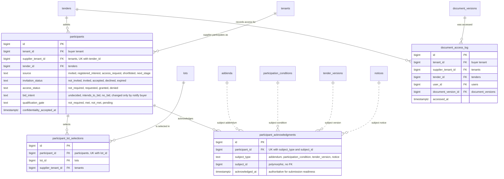
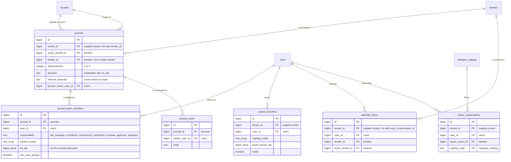
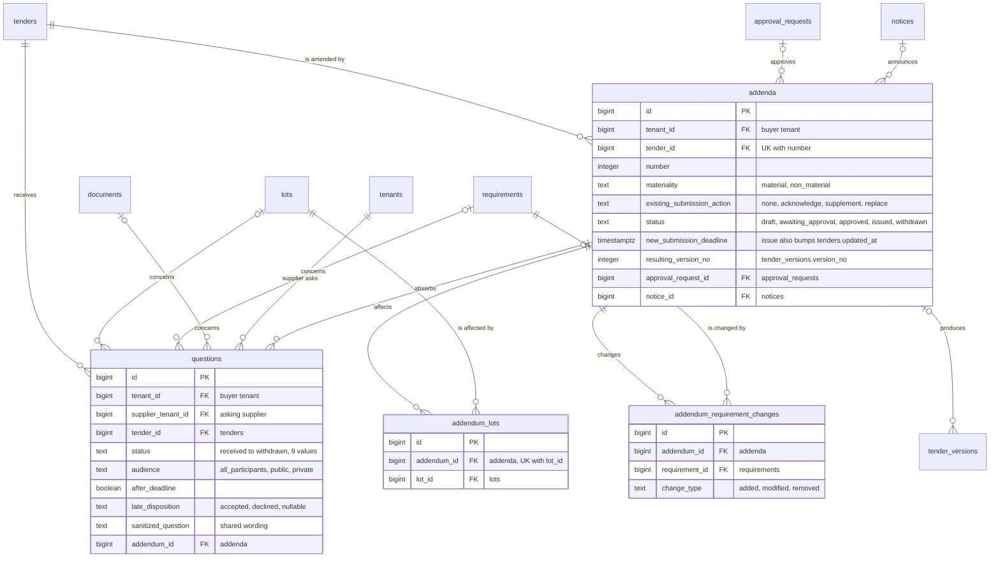
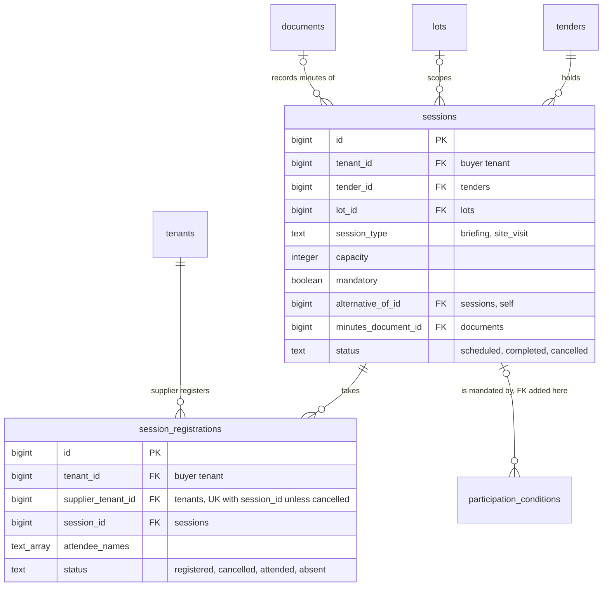
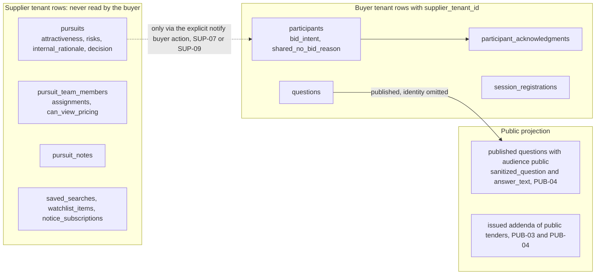
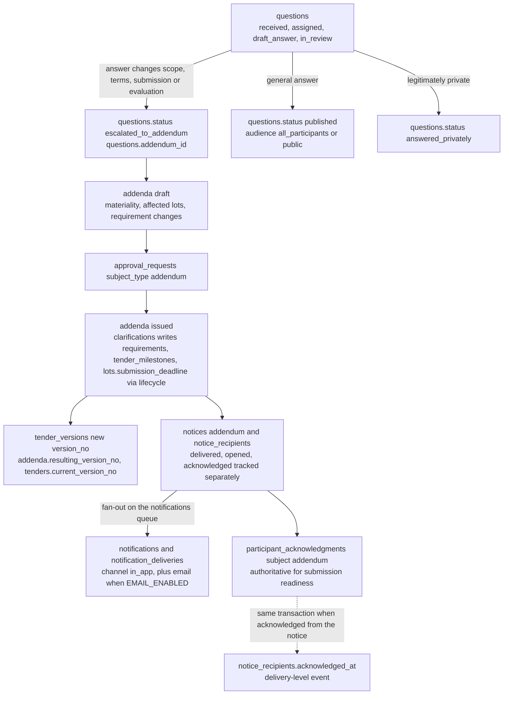

# Data model: Participation, pursuits and clarifications (Migration 08)

Status: As-designed (pre-build). Updated to as-built at the end of Stage A and Stage B.

Sources:
- `docs/plan/schema-blueprint.md`: §0 Conventions; Migration 08 `20261001000800_participation_clarifications.sql`; Migration 04 (`notices`, `notice_recipients`, `comments`); Migration 03 (`portal_settings`, `policy_profile_versions`); §P permission catalog.
- `docs/plan/architecture-plan.md`: §0 delivery stages; §3.1 tenancy, cross-tenant records and supplier-private collaboration; §3.4 official time; §3.8 notifications (`in_app` and `email` delivery channels); §3.11 prototype mode; §4 cross-domain writes; §6 domain map (domains 07 publication and 08 clarifications); §11 item 3 (email delivery, decided 2026-09-29) and the other owner answers of 2026-09-29.
- `docs/architecture-brief.md`: §5.6 tenant scoping; §6.1 to §6.3.
- `docs/PRD.md`: §3 concepts (participation record, clarification); §4.3 audience matrix; FR-08 (§7.5); FR-09 (§7.6); FR-10 (§7.7); §14.2 communication categories; §14.3 notification events; BR-14, BR-15, BR-16, BR-41, BR-42; screens BUY-15 to BUY-18, SUP-06 to SUP-11, PUB-03, PUB-04; AC-01, AC-10.
- `docs/plan/demo-storyline.md`: Tenders (T-2026-0002, T-2026-0006, T-2026-0009); Personas.
- `docs/plan/design-decisions.md`: DD-01 (forward FKs), DD-02 (nullable unique keys), DD-03 (`[S]` and `[R]` tags), DD-07 (additional unique keys), DD-11 (partition tenant of notifications), DD-13 (`v_public_tenders`), DD-15 (deadline authority), DD-16 (unowned tables), DD-19 (`notice-reconciliation` job), DD-22 (buyer slug in public URLs), DD-23 (permission additions), DD-24 (approver permissions), DD-28 (public write throttling), DD-39 (idempotency), DD-41 (pursuit vs bid intent), DD-42 (acknowledgment authority), DD-43 (real Supabase Auth from Stage A), DD-44 (email channel); §E owner decisions of 2026-09-29 (item 4 email delivery, item 8 prototype behaviour).
- `docs/plan/email-delivery-options.md`: §1 content rule; §2 local delivery to Mailpit. The hosted provider is deferred.

Contents:
- [1. Scope, tenancy and ownership](#1-scope-tenancy-and-ownership)
- [2. Reading the data dictionary](#2-reading-the-data-dictionary)
- [3. Diagrams](#3-diagrams)
- [4. Data dictionary: participation (buyer tenant, supplier-visible)](#4-data-dictionary-participation-buyer-tenant-supplier-visible)
- [5. Data dictionary: supplier-private pursuit and discovery (supplier tenant)](#5-data-dictionary-supplier-private-pursuit-and-discovery-supplier-tenant)
- [6. Data dictionary: questions and addenda](#6-data-dictionary-questions-and-addenda)
- [7. Data dictionary: briefings and site visits](#7-data-dictionary-briefings-and-site-visits)
- [8. States and enumerations](#8-states-and-enumerations)
- [9. Constraints and indexes](#9-constraints-and-indexes)
- [10. Read access by audience](#10-read-access-by-audience)
- [11. Jobs and cross-domain touchpoints](#11-jobs-and-cross-domain-touchpoints)
- [12. Demo storyline coverage](#12-demo-storyline-coverage)
- [13. Open points finalized in Stage B](#13-open-points-finalized-in-stage-b)

Related: [data model overview](README.md), [shared services](03-shared-services.md) (`notices`, `notice_recipients`, `approval_requests`, `documents`, `document_versions`, `comments`), [tenders](06-tenders.md), [suppliers and qualification](04-suppliers-qualification.md) (`v_qualification_status`), [bids and submission](08-bids-submission.md), [records, reporting and operations](12-records-reporting-operations.md) (`rate_limit_buckets`, `request_idempotency`), [security model](../04-security-model.md), [lifecycles](../05-lifecycles.md), [key flows](../06-key-flows.md), ADRs [0002](../adr/0002-buyer-owned-procurement-records.md), [0004](../adr/0004-text-check-constraints-not-enums.md), [0007](../adr/0007-in-app-formal-notices.md).

---

## 1. Scope, tenancy and ownership

Migration 08 holds three kinds of record, with two different row tenants:

1. **Participation and clarification records** (row tenant = **buyer**). The [S] tables carry `supplier_tenant_id` and are on the generated allow-list `supplier-scoped-tables.ts`, so the supplier side reaches them through `forSupplier(db, supplierTenantId)`. [S] means supplier-accessible; no table in this migration is [R] (reference-only, buyer-internal) (DD-03). When the supplier side inserts, it names the buyer `tenant_id` explicitly after the service verifies participation (architecture-plan §3.1, [ADR 0002](../adr/0002-buyer-owned-procurement-records.md)).
2. **Supplier-private pursuit and discovery records** (row tenant = **supplier**). `pursuits`, `pursuit_team_members`, `pursuit_notes`, `saved_searches`, `watchlist_items` and `notice_subscriptions` are owned by the supplier tenant. **The buyer never reads them** (architecture-plan §3.1; FR-09: "Private pursuit notes and draft progress remain invisible to the buyer").
3. **Buyer-only clarification workflow** rows (`addenda`, `addendum_lots`, `addendum_requirement_changes`, `sessions`). These are [T] buyer rows without `supplier_tenant_id`. Suppliers see only their issued or published projection.

No table here is [P] or [G], and **none is sealed**. Owning domains follow architecture-plan §6: `publication` (domain 07: BUY-15, SUP-06 to SUP-09) and `clarifications` (domain 08: BUY-16 to BUY-18, SUP-10, SUP-11, PUB-04).

| Table | Tag | Row tenant | Owning domain | Mutable (`updated_at`) | Sealed | Screens |
|---|---|---|---|---|---|---|
| `participants` | [T][S] | buyer | publication | yes | no | BUY-15, SUP-07, SUP-08 |
| `participant_lot_selections` | [T][S] | buyer | publication | no | no | SUP-08 |
| `participant_acknowledgments` | [T][S] | buyer | publication | no | no | SUP-08, BUY-15, BUY-17 |
| `document_access_log` | [T][S] | buyer | publication | no | no | BUY-15 |
| `pursuits` | [T] | **supplier** | publication | yes | no | SUP-09 |
| `pursuit_team_members` | [T] | **supplier** | publication | yes | no | SUP-09 |
| `pursuit_notes` | [T] | **supplier** | publication | no | no | SUP-09 |
| `saved_searches` | [T] | **supplier** | publication | yes | no | SUP-06 |
| `watchlist_items` | [T] | **supplier** | publication | no | no | SUP-06 |
| `notice_subscriptions` | [T] | **supplier** | publication | no | no | SUP-06 |
| `questions` | [T][S] | buyer | clarifications | yes | no | BUY-16, SUP-10, PUB-04 |
| `addenda` | [T] | buyer | clarifications | yes | no | BUY-17, SUP-08, PUB-04 |
| `addendum_lots` | [T] | buyer | clarifications | no | no | BUY-17 |
| `addendum_requirement_changes` | [T] | buyer | clarifications | no | no | BUY-17 |
| `sessions` | [T] | buyer | clarifications | yes | no | BUY-18, SUP-11 |
| `session_registrations` | [T][S] | buyer | clarifications | yes | no | BUY-18, SUP-11 |

Owning domain for the participation rows is derived from the screens each domain owns. Supplier-internal comments on a pursuit or bid use the shared `comments` table with `visibility = supplier_internal` and the supplier `tenant_id` (Migration 04); `comments` is owned by the core (lifecycle) service (DD-16).

Migration 08 also adds, with `ALTER TABLE … ADD CONSTRAINT`, the forward FKs from Migration 07 that target its tables: `tender_versions.addendum_id → addenda` and `participation_conditions.session_id → sessions` (DD-01).

## 2. Reading the data dictionary

| Column | Meaning |
|---|---|
| Type | Plain type: stated in the blueprint, or fixed by a §0 convention (identity and FK columns `bigint`; instants `*_at` are `timestamptz` per architecture-plan §3.4; money `numeric(18,2)`; quantities `numeric(18,4)`; scores, rates and weights `numeric(12,6)`; enumerations `text` + named CHECK). *Italic* type: inferred from the column's name and meaning because the blueprint states no type. `n/s`: not specified, with the candidates given. Stage B migrations fix the final types. |
| Null | `no`: NOT NULL stated by the blueprint or a §0 convention. `yes`: nullable as stated, or filled only by a later lifecycle event. `n/s`: not specified. |
| Key / constraint | `PK`, `FK → table`, `UK` (member of a unique constraint), CHECK lists, defaults. Every FK column is indexed (§0). |

Standard columns (§0): `id` (identity PK), `created_at` (not null, default `now()`), `created_by` (FK → users, null = system); mutable tables add `updated_at` (trigger `set_updated_at()`). Every table carries `tenant_id bigint not null references tenants(id)`; [S] tables also carry `supplier_tenant_id bigint not null references tenants(id)` and are listed in the allow-list generated from the blueprint tags, not from column presence (DD-03).

## 3. Diagrams

Legend: solid lines are FK columns; dashed lines are logical links without an FK (polymorphic `subject_type`/`subject_id`, version numbers, or the `(tenant_id, supplier_tenant_id)` pair). Entities without an attribute block are defined in other files. Lines to `users` are omitted.

### 3.1 Participation (buyer tenant rows, supplier-visible)

### 3.2 Supplier-private pursuit and discovery (supplier tenant rows)

### 3.3 Questions and addenda

### 3.4 Briefings and site visits

### 3.5 What crosses the buyer and supplier boundary

The dotted edge shows the only way pursuit information reaches the buyer. Pursuit decisions are supplier-private. The buyer-visible `participants.bid_intent` and `shared_no_bid_reason` change **only** through the explicit "notify buyer" action on SUP-07 or SUP-09; recording a pursuit decision never updates them by itself (DD-41).

### 3.6 From question to addendum to acknowledgment

This is the data path implied by FR-10, BR-16 and architecture-plan §4. The sequence and guards are specified in [06-key-flows.md](../06-key-flows.md) and [05-lifecycles.md](../05-lifecycles.md). The addendum notice is a formal notice, so it is delivered on both channels when email is enabled; the email carries only the title, official deadline and link (DD-44). The delivery tables are described in [03-shared-services.md](03-shared-services.md).

## 4. Data dictionary: participation (buyer tenant, supplier-visible)

### 4.1 participants

[T][S], mutable. Row tenant: the buyer. One row per supplier organization per tender (PRD §3 "Participation record"; FR-08). **Replacing the invited contact does not change the invited legal supplier** (FR-08): the legal party is `supplier_tenant_id`, and the contact columns are only contact data.

| Column | Type | Null | Key / constraint | Meaning |
|---|---|---|---|---|
| id | bigint | no | PK | Standard. |
| tenant_id | bigint | no | FK → tenants | Buyer tenant. |
| supplier_tenant_id | bigint | no | FK → tenants; UK (tender_id, supplier_tenant_id) | Participating supplier organization. |
| tender_id | bigint | n/s | FK → tenders; UK | Tender. |
| source | text | n/s | CHECK (invited, registered_interest, access_request, shortlisted, next_stage) | How the supplier came to participate. |
| invitation_status | text | n/s | CHECK (not_invited, invited, accepted, declined, expired) | Invitation response (FR-08, SUP-07). |
| invited_contact_name | *text* | n/s | | Intended contact. |
| invited_contact_email | *text* | n/s | | Intended contact email. |
| invited_at | timestamptz | yes | | Invitation time. |
| invitation_expires_at | timestamptz | yes | | Invitation expiry. |
| access_status | text | n/s | CHECK (not_required, requested, granted, denied) | Restricted-document access state (BR-15). |
| access_decided_by | bigint | yes | FK → users | Buyer user who decided access. |
| access_decided_at | timestamptz | yes | | Decision time. |
| access_decision_reason | *text* | yes | | Reason. |
| confidentiality_accepted_at | timestamptz | yes | | Confidentiality undertaking accepted (participation condition). |
| confidentiality_accepted_by | bigint | yes | FK → users | Supplier representative who accepted. |
| bid_intent | text | n/s | CHECK (undecided, intends_to_bid, no_bid) | Buyer-visible participation intent. Changed **only** by the explicit "notify buyer" action on SUP-07 or SUP-09, never by recording a private pursuit decision (DD-41). |
| shared_no_bid_reason | *text* | yes | | Decline reason the supplier chose to share (SUP-09), set by the same "notify buyer" action (DD-41). |
| intent_changed_at | timestamptz | yes | | Last intent change; reconsideration before closing keeps audit history (FR-09). |
| qualification_gate | text | n/s | CHECK (not_required, met, not_met, pending) | Result of a `qualification_required` participation condition (AC-07). |
| created_at | timestamptz | no | default now() | Standard. |
| created_by | bigint | yes | FK → users | Standard. |
| updated_at | timestamptz | no | `set_updated_at()` | Mutable marker. |

### 4.2 participant_lot_selections

[T][S]. Row tenant: the buyer. Lots the supplier selected in the opportunity workspace (SUP-08).

| Column | Type | Null | Key / constraint | Meaning |
|---|---|---|---|---|
| id | bigint | no | PK | Standard. |
| tenant_id | bigint | no | FK → tenants | Buyer tenant. |
| supplier_tenant_id | bigint | no | FK → tenants | Supplier. |
| participant_id | bigint | n/s | FK → participants; UK (participant_id, lot_id) | Participant. |
| lot_id | bigint | n/s | FK → lots; UK (DD-07) | Selected lot. |
| created_at | timestamptz | no | default now() | Standard. |
| created_by | bigint | yes | FK → users | Standard. |

### 4.3 participant_acknowledgments

[T][S]. Row tenant: the buyer. Participation-level acknowledgments of addenda, conditions, tender versions and notices (FR-10: "Mandatory acknowledgment of an addendum must be visible in submission readiness"). Append-only. **This table is authoritative for submission readiness.** `notice_recipients.acknowledged_at` (Migration 04) records the delivery-level event and is written in the same transaction when the acknowledgment comes from a notice (DD-42).

| Column | Type | Null | Key / constraint | Meaning |
|---|---|---|---|---|
| id | bigint | no | PK | Standard. |
| tenant_id | bigint | no | FK → tenants | Buyer tenant. |
| supplier_tenant_id | bigint | no | FK → tenants | Supplier. |
| participant_id | bigint | n/s | FK → participants; UK (participant_id, subject_type, subject_id) | Participant. |
| subject_type | text | n/s | CHECK (addendum, participation_condition, tender_version, notice); UK | What was acknowledged. |
| subject_id | bigint | n/s | polymorphic; no FK; UK | Id of the addendum, condition, tender version or notice. |
| acknowledged_by | bigint | n/s | FK → users | Supplier representative. |
| acknowledged_at | timestamptz | n/s | | Acknowledgment time. |
| created_at | timestamptz | no | default now() | Standard. |
| created_by | bigint | yes | FK → users | Standard. |

### 4.4 document_access_log

[T][S]. Row tenant: the buyer. Supplier-side access to tender document versions (BUY-15 "document access"). Append-only. `supplier_tenant_id` is NOT NULL, so this table records supplier-side access.

| Column | Type | Null | Key / constraint | Meaning |
|---|---|---|---|---|
| id | bigint | no | PK | Standard. |
| tenant_id | bigint | no | FK → tenants | Buyer tenant. |
| supplier_tenant_id | bigint | no | FK → tenants | Supplier organization of the accessing user. |
| tender_id | bigint | n/s | FK → tenders | Tender. |
| user_id | bigint | n/s | FK → users | Accessing user. |
| document_version_id | bigint | n/s | FK → document_versions | Version accessed. |
| accessed_at | timestamptz | n/s | | Access time. |
| created_at | timestamptz | no | default now() | Standard. |
| created_by | bigint | yes | FK → users | Standard. |

## 5. Data dictionary: supplier-private pursuit and discovery (supplier tenant)

These rows have **row tenant = the supplier**. They are read and written only by the supplier's own users through the supplier's `forTenant` scope. They are not [S], and buyer-side code never queries them.

### 5.1 pursuits

[T], mutable. Row tenant: the supplier. The supplier's private bid/no-bid record for one tender (FR-09, SUP-09). Pursuit decisions are supplier-private; they reach the buyer only when the supplier uses the explicit "notify buyer" action, which updates `participants.bid_intent` and `shared_no_bid_reason` (DD-41).

| Column | Type | Null | Key / constraint | Meaning |
|---|---|---|---|---|
| id | bigint | no | PK | Standard. |
| tenant_id | bigint | no | FK → tenants; UK (tenant_id, tender_id) | Supplier tenant. |
| buyer_tenant_id | bigint | n/s | FK → tenants | Buyer running the tender. |
| tender_id | bigint | n/s | FK → tenders (row in the buyer tenant); UK | Tender pursued. |
| attractiveness | integer | n/s | range 1 to 5 (stated); CHECK or service enforcement n/s | Internal attractiveness rating. |
| capacity_note | *text* | n/s | | Capacity assessment. |
| estimated_effort_hours | n/s (`integer` or `numeric`) | n/s | | Estimated effort. |
| risks | *text* | n/s | | Internal risks. |
| pursuit_owner_user_id | bigint | n/s | FK → users | Pursuit owner. |
| decision | text | n/s | CHECK (undecided, bid, no_bid) | Private bid/no-bid decision. |
| internal_rationale | *text* | n/s | | Private rationale. Never shared. |
| decided_at | timestamptz | yes | | Decision time. |
| decided_by | bigint | yes | FK → users | Decider. |
| created_at | timestamptz | no | default now() | Standard. |
| created_by | bigint | yes | FK → users | Standard. |
| updated_at | timestamptz | no | `set_updated_at()` | Mutable marker. |

### 5.2 pursuit_team_members

[T], mutable. Row tenant: the supplier. Internal allocation of response work (SUP-09; FR-11 "assign response owners and reviewers ... Commercial sections ... may have narrower access"). This is an internal assignment only: authority to submit or sign comes from supplier roles and permissions (`supplier.response.submit`, the `authorized_signatory` role; AC-03).

| Column | Type | Null | Key / constraint | Meaning |
|---|---|---|---|---|
| id | bigint | no | PK | Standard. |
| tenant_id | bigint | no | FK → tenants | Supplier tenant. |
| pursuit_id | bigint | n/s | FK → pursuits | Pursuit. |
| user_id | bigint | n/s | FK → users | Team member. |
| responsibility | text | n/s | CHECK (bid_manager, contributor, commercial_contributor, reviewer, approver, signatory) | Responsibility on this pursuit. |
| section_scope | text[] | n/s | | Sections assigned. |
| lot_ids | bigint[] | n/s | array; elements not FK-enforced | Lots assigned. |
| due_at | timestamptz | n/s | | Internal due time. |
| can_view_pricing | boolean | n/s | | Access to commercial sections. |
| created_at | timestamptz | no | default now() | Standard. |
| created_by | bigint | yes | FK → users | Standard. |
| updated_at | timestamptz | no | `set_updated_at()` | Mutable marker. |

### 5.3 pursuit_notes

[T]. Row tenant: the supplier. Private internal notes (SUP-09). Append-only.

| Column | Type | Null | Key / constraint | Meaning |
|---|---|---|---|---|
| id | bigint | no | PK | Standard. |
| tenant_id | bigint | no | FK → tenants | Supplier tenant. |
| pursuit_id | bigint | n/s | FK → pursuits | Pursuit. |
| author_user_id | bigint | n/s | FK → users | Author. |
| body | *text* | n/s | | Note text. |
| created_at | timestamptz | no | default now() | Standard. |
| created_by | bigint | yes | FK → users | Standard. |

### 5.4 saved_searches

[T], mutable. Row tenant: the supplier; per user. Saved discovery filters (FR-09, SUP-06). Matches are suggestions, not qualification decisions or invitations (FR-09).

| Column | Type | Null | Key / constraint | Meaning |
|---|---|---|---|---|
| id | bigint | no | PK | Standard. |
| tenant_id | bigint | no | FK → tenants | Supplier tenant. |
| user_id | bigint | n/s | FK → users | Owner. |
| name | *text* | n/s | | Search name. |
| keywords | *text* | n/s | | Keywords. |
| catalog_codes | text[] | n/s | elements not FK-enforced | Shared category codes (`category_catalog`). |
| buyer_tenant_ids | bigint[] | n/s | elements not FK-enforced | Buyers filtered on. |
| regions | text[] | n/s | | Regions. |
| procedures | text[] | n/s | values of the procedure list | Procedures. |
| notify | boolean | n/s | | Notify on new matches. |
| created_at | timestamptz | no | default now() | Standard. |
| created_by | bigint | yes | FK → users | Standard. |
| updated_at | timestamptz | no | `set_updated_at()` | Mutable marker. |

### 5.5 watchlist_items

[T]. Row tenant: the supplier; per user. Watched tenders (SUP-06).

| Column | Type | Null | Key / constraint | Meaning |
|---|---|---|---|---|
| id | bigint | no | PK | Standard. |
| tenant_id | bigint | no | FK → tenants; UK (tenant_id, user_id, tender_id) | Supplier tenant. |
| user_id | bigint | n/s | FK → users; UK | Watching user. |
| tender_id | bigint | n/s | FK → tenders; UK | Watched tender. |
| buyer_tenant_id | bigint | n/s | FK → tenants | Tender's buyer. |
| created_at | timestamptz | no | default now() | Standard. |
| created_by | bigint | yes | FK → users | Standard. |

### 5.6 notice_subscriptions

[T]. Row tenant: the supplier; per user. Subscriptions to a buyer's notices, optionally by category (FR-09, SUP-06).

| Column | Type | Null | Key / constraint | Meaning |
|---|---|---|---|---|
| id | bigint | no | PK | Standard. |
| tenant_id | bigint | no | FK → tenants | Supplier tenant. |
| user_id | bigint | n/s | FK → users | Subscriber. |
| buyer_tenant_id | bigint | n/s | FK → tenants | Buyer followed. |
| catalog_code | text | n/s | FK → category_catalog(code) | Category filter. |
| active | *boolean* | n/s | | Active flag. The table is not marked mutable, so it has no `updated_at`. |
| created_at | timestamptz | no | default now() | Standard. |
| created_by | bigint | yes | FK → users | Standard. |

## 6. Data dictionary: questions and addenda

### 6.1 questions

[T][S], mutable. Row tenant: the buyer; `supplier_tenant_id` is the asking supplier. Supplier questions against a tender, lot, requirement or document (FR-10; BUY-16, SUP-10). Shared answers normally omit the questioner's identity and commercially sensitive wording (FR-10). `sanitized_question` holds the shared wording.

| Column | Type | Null | Key / constraint | Meaning |
|---|---|---|---|---|
| id | bigint | no | PK | Standard. |
| tenant_id | bigint | no | FK → tenants | Buyer tenant. |
| supplier_tenant_id | bigint | no | FK → tenants | Asking supplier. |
| tender_id | bigint | n/s | FK → tenders | Tender. |
| lot_id | bigint | n/s | FK → lots | Lot concerned. |
| requirement_id | bigint | n/s | FK → requirements | Requirement concerned. |
| document_id | bigint | n/s | FK → documents | Document concerned. |
| asked_by_user_id | bigint | n/s | FK → users | Supplier user who asked. |
| question_text | *text* | n/s | | Original wording (private to the asker and the buyer team). |
| submitted_at | timestamptz | n/s | | Submission time. |
| after_deadline | boolean | n/s | | Submitted after the question deadline. |
| late_disposition | text | yes | CHECK (accepted, declined); nullable | Required disposition for late questions (FR-10). |
| late_disposition_reason | *text* | yes | | Reason for the late disposition. |
| owner_user_id | bigint | n/s | FK → users | Buyer owner (FR-10). |
| status | text | n/s | CHECK (received, assigned, draft_answer, in_review, published, answered_privately, escalated_to_addendum, declined, withdrawn) | Handling state (§8). |
| audience | text | n/s | CHECK (all_participants, public, private) | Who receives the answer. |
| sanitized_question | *text* | n/s | | Question wording as shared, without identity or sensitive detail. |
| answer_text | *text* | n/s | | Answer. |
| confidentiality_reviewed_by | bigint | yes | FK → users | Reviewer of confidentiality before publication. |
| published_at | timestamptz | yes | | Publication time. |
| addendum_id | bigint | yes | FK → addenda | Addendum that absorbed a material answer. |
| created_at | timestamptz | no | default now() | Standard. |
| created_by | bigint | yes | FK → users | Standard. |
| updated_at | timestamptz | no | `set_updated_at()` | Mutable marker. |

### 6.2 addenda

[T], mutable. Row tenant: the buyer. Formal amendments (PRD §3 "Tender version and addendum"; FR-10; BR-16; BUY-17). An issued addendum produces a new `tender_versions` row and a formal `notices` row. Formal notices go to the `in_app` channel and, where email is enabled, to the `email` channel as well (DD-44, [ADR 0007](../adr/0007-in-app-formal-notices.md)).

| Column | Type | Null | Key / constraint | Meaning |
|---|---|---|---|---|
| id | bigint | no | PK | Standard. |
| tenant_id | bigint | no | FK → tenants | Buyer tenant. |
| tender_id | bigint | n/s | FK → tenders; UK (tender_id, number) | Tender. |
| number | integer | n/s | UK | Addendum number within the tender. |
| title | *text* | n/s | | Title. |
| change_description | *text* | n/s | | What changed. |
| reason | *text* | n/s | | Why. |
| materiality | text | n/s | CHECK (material, non_material) | Materiality. |
| changes_scope | *boolean* | n/s | | Changes scope. |
| changes_terms | *boolean* | n/s | | Changes terms. |
| changes_submission | *boolean* | n/s | | Changes submission requirements. |
| changes_evaluation | *boolean* | n/s | | Changes evaluation. |
| new_submission_deadline | timestamptz | yes | | New deadline, if changed. Issuing an addendum that changes a deadline also updates `tenders.updated_at` in the same transaction, so the submission path's `FOR SHARE` lock on the tender row serializes against the change (DD-15). |
| response_time_assessment | *text* | n/s | | Assessment of whether more response time is needed (BR-16). |
| existing_submission_action | text | n/s | CHECK (none, acknowledge, supplement, replace) | What suppliers who already submitted must do (AC-10). |
| status | text | n/s | CHECK (draft, awaiting_approval, approved, issued, withdrawn) | Addendum state. |
| approval_request_id | bigint | yes | FK → approval_requests | Approval (`subject_type = addendum`). |
| issued_at | timestamptz | yes | | Issue time. |
| resulting_version_no | *integer* | yes | matches `tender_versions.version_no`; no FK | Tender version produced. |
| notice_id | bigint | yes | FK → notices | Formal notice (`notice_type = addendum` or `deadline_change`). |
| created_at | timestamptz | no | default now() | Standard. |
| created_by | bigint | yes | FK → users | Standard. |
| updated_at | timestamptz | no | `set_updated_at()` | Mutable marker. |

### 6.3 addendum_lots

[T]. Row tenant: the buyer. Lots affected by an addendum (FR-10: "identify affected lots and participants").

| Column | Type | Null | Key / constraint | Meaning |
|---|---|---|---|---|
| id | bigint | no | PK | Standard. |
| tenant_id | bigint | no | FK → tenants | Buyer tenant. |
| addendum_id | bigint | n/s | FK → addenda; UK (addendum_id, lot_id) | Addendum. |
| lot_id | bigint | n/s | FK → lots; UK (DD-07) | Affected lot. |
| created_at | timestamptz | no | default now() | Standard. |
| created_by | bigint | yes | FK → users | Standard. |

### 6.4 addendum_requirement_changes

[T]. Row tenant: the buyer. Before and after record of each requirement change. Published requirements are never silently edited (BR-16).

| Column | Type | Null | Key / constraint | Meaning |
|---|---|---|---|---|
| id | bigint | no | PK | Standard. |
| tenant_id | bigint | no | FK → tenants | Buyer tenant. |
| addendum_id | bigint | n/s | FK → addenda | Addendum. |
| requirement_id | bigint | n/s | FK → requirements | Requirement added, modified or removed. |
| change_type | text | n/s | CHECK (added, modified, removed) | Change kind. |
| previous_text | *text* | yes | | Wording before (null for `added`). |
| new_text | *text* | yes | | Wording after (null for `removed`). |
| previous_treatment | *text* | yes | values of `requirements.treatment` | Treatment before. |
| new_treatment | *text* | yes | values of `requirements.treatment` | Treatment after (for example a new `mandatory_gate`). |
| created_at | timestamptz | no | default now() | Standard. |
| created_by | bigint | yes | FK → users | Standard. |

## 7. Data dictionary: briefings and site visits

### 7.1 sessions

[T], mutable. Row tenant: the buyer. Briefings and site visits (FR-10; BUY-18, SUP-11). Mandatory attendance is declared in advance and linked from `participation_conditions.session_id` (Migration 07), whose FK this migration adds (DD-01).

| Column | Type | Null | Key / constraint | Meaning |
|---|---|---|---|---|
| id | bigint | no | PK | Standard. |
| tenant_id | bigint | no | FK → tenants | Buyer tenant. |
| tender_id | bigint | n/s | FK → tenders | Tender. |
| lot_id | bigint | n/s | FK → lots | Lot, if lot-specific. |
| session_type | text | n/s | CHECK (briefing, site_visit) | Session kind. |
| title | *text* | n/s | | Title. |
| starts_at | timestamptz | n/s | | Start. |
| ends_at | timestamptz | n/s | | End. |
| venue | *text* | n/s | | Venue or joining instructions. |
| instructions | *text* | n/s | | Attendance instructions. |
| capacity | integer | n/s | | Places available. |
| mandatory | boolean | n/s | | Attendance is mandatory. |
| alternative_of_id | bigint | yes | FK → sessions (self) | Permitted alternative session (FR-10). |
| accessibility_info | *text* | n/s | | Accessibility information. |
| registration_deadline | *timestamptz* | n/s | | Registration cut-off. |
| minutes_document_id | bigint | yes | FK → documents | Official minutes. |
| minutes_published_at | timestamptz | yes | | Minutes publication time. |
| status | text | n/s | CHECK (scheduled, completed, cancelled) | Session state. |
| created_at | timestamptz | no | default now() | Standard. |
| created_by | bigint | yes | FK → users | Standard. |
| updated_at | timestamptz | no | `set_updated_at()` | Mutable marker. |

### 7.2 session_registrations

[T][S], mutable. Row tenant: the buyer; `supplier_tenant_id` is the registering supplier. Bookings and attendance evidence (SUP-11, BUY-18).

| Column | Type | Null | Key / constraint | Meaning |
|---|---|---|---|---|
| id | bigint | no | PK | Standard. |
| tenant_id | bigint | no | FK → tenants | Buyer tenant. |
| supplier_tenant_id | bigint | no | FK → tenants; partial UK (session_id, supplier_tenant_id) `WHERE status <> 'cancelled'` | Registering supplier. One live registration per supplier per session (DD-07). |
| session_id | bigint | n/s | FK → sessions; partial UK | Session. |
| registered_by | bigint | n/s | FK → users | Supplier user who registered. |
| attendee_names | text[] | n/s | | Attendee names. |
| accessibility_needs | *text* | n/s | | Accommodation requested. |
| status | text | n/s | CHECK (registered, cancelled, attended, absent) | Registration and attendance state. |
| attendance_recorded_by | bigint | yes | FK → users | Buyer user who recorded attendance. |
| attendance_recorded_at | timestamptz | yes | | Recording time. |
| created_at | timestamptz | no | default now() | Standard. |
| created_by | bigint | yes | FK → users | Standard. |
| updated_at | timestamptz | no | `set_updated_at()` | Mutable marker. |

## 8. States and enumerations

Enumerations are `text` + named CHECK ([ADR 0004](../adr/0004-text-check-constraints-not-enums.md)), mirrored once in `src/contracts/enums.ts` (architecture-plan §3.6). Transition matrices: [05-lifecycles.md](../05-lifecycles.md).

**Question status and the FR-10 steps**

| `questions.status` | FR-10 step |
|---|---|
| received | Question submitted against a tender, lot, requirement or document. |
| assigned | Buyer assigns an owner. |
| draft_answer | Answer being prepared. |
| in_review | Confidentiality review before publication. |
| published | Released to `all_participants` or `public`. |
| answered_privately | Legitimate supplier-specific answer (audience `private`). |
| escalated_to_addendum | Answer changes scope, terms, submission or evaluation, so it becomes an addendum. |
| declined | Declined, including a declined late question. |
| withdrawn | Withdrawn by the supplier. |

**Other enumerations**

| Table.column | Values |
|---|---|
| participants.source | invited, registered_interest, access_request, shortlisted, next_stage |
| participants.invitation_status | not_invited, invited, accepted, declined, expired |
| participants.access_status | not_required, requested, granted, denied |
| participants.bid_intent | undecided, intends_to_bid, no_bid |
| participants.qualification_gate | not_required, met, not_met, pending |
| participant_acknowledgments.subject_type | addendum, participation_condition, tender_version, notice |
| pursuits.decision | undecided, bid, no_bid |
| pursuit_team_members.responsibility | bid_manager, contributor, commercial_contributor, reviewer, approver, signatory |
| questions.late_disposition | accepted, declined (nullable) |
| questions.audience | all_participants, public, private |
| addenda.materiality | material, non_material |
| addenda.existing_submission_action | none, acknowledge, supplement, replace |
| addenda.status | draft, awaiting_approval, approved, issued, withdrawn |
| addendum_requirement_changes.change_type | added, modified, removed |
| sessions.session_type | briefing, site_visit |
| sessions.status | scheduled, completed, cancelled |
| session_registrations.status | registered, cancelled, attended, absent |

## 9. Constraints and indexes

**Unique constraints**

| Table | Unique |
|---|---|
| participants | (tender_id, supplier_tenant_id) |
| participant_lot_selections | (participant_id, lot_id) (DD-07) |
| participant_acknowledgments | (participant_id, subject_type, subject_id) |
| pursuits | (tenant_id, tender_id) |
| watchlist_items | (tenant_id, user_id, tender_id) |
| addenda | (tender_id, number) |
| addendum_lots | (addendum_id, lot_id) (DD-07) |
| session_registrations | (session_id, supplier_tenant_id) `WHERE status <> 'cancelled'`, a partial unique index (DD-07) |

Every unique key that includes a nullable column uses `UNIQUE NULLS NOT DISTINCT` (DD-02).

**Other constraints**

- `pursuits.attractiveness` is limited to 1 to 5 by the blueprint; whether as a CHECK or in the service is not stated.
- Array columns (`pursuit_team_members.lot_ids`, `saved_searches.buyer_tenant_ids`, `saved_searches.catalog_codes`) are not FK-enforced. The service validates the elements.
- Cross-tenant FKs: `pursuits.tender_id` and `watchlist_items.tender_id` (supplier rows → buyer tender). These are allowed; isolation is an application-layer rule (brief §6.3).
- Service-enforced rules: a late question needs a `late_disposition` (FR-10); a material answer must become an addendum, not a private reply (FR-10, BR-14); an issued addendum's changes reach `requirements`, `tender_milestones` and `lots.submission_deadline` only through the lifecycle snapshot API (architecture-plan §4), and a deadline change also updates `tenders.updated_at` in the same transaction (DD-15); a hold never changes dates (BR-13); `participants.bid_intent` and `shared_no_bid_reason` change only through the "notify buyer" action (DD-41).
- **Forward FKs added here (DD-01).** `tender_versions.addendum_id → addenda` and `participation_conditions.session_id → sessions` are plain `bigint` columns in Migration 07; this migration adds both FKs with `ALTER TABLE … ADD CONSTRAINT` once `addenda` and `sessions` exist.

**Indexes**

- No explicit indexes are stated for Migration 08. Under §0, every FK column is indexed, which includes `supplier_tenant_id` on each [S] table for the supplier-side scoper. Each list access pattern gets an index leading with `tenant_id`.
- Candidate list-pattern indexes from that rule: `participants (tenant_id, tender_id)` is covered by the FK index plus the unique constraint; `questions (tenant_id, tender_id, status)` and `(tenant_id, owner_user_id)` for BUY-16; `addenda (tenant_id, status)`; `sessions (tenant_id, starts_at)` for BUY-18; `pursuits (tenant_id, decision)` and `watchlist_items (tenant_id, user_id)` for SUP-06 and SUP-09. Fixed with the Stage B list queries.

## 10. Read access by audience

Permission codes are from §P; each endpoint declares its own permission ([07-api.md](../07-api.md)). Buyer access to tender-level material also requires a `tender_team_members` assignment (BR-26). Supplier access to [S] rows goes through `forSupplier` and the generated allow-list (DD-03); supplier API paths address tenders by id, while public URLs carry the buyer slug because references are unique per buyer (DD-22). Full rules: [04-security-model.md](../04-security-model.md).

| Table | Buyer | Supplier | Public | Relevant permissions (§P) |
|---|---|---|---|---|
| participants | Tender team: invitations, access decisions, acknowledgments, readiness, and `bid_intent` / `shared_no_bid_reason` as last notified by the supplier (DD-41); never supplier drafts (FR-08) | Own row only | No | tender.participants.manage, tender.view; supplier.opportunities.view, supplier.pursuit.manage |
| participant_lot_selections, participant_acknowledgments | Tender team (readiness, BUY-15; acknowledgment status, BUY-17) | Own rows | No | tender.participants.manage; supplier.opportunities.view, supplier.notices.acknowledge (DD-23) |
| document_access_log | Tender team (BUY-15) | Own rows | No | tender.participants.manage |
| pursuits, pursuit_team_members, pursuit_notes | **Never** | Own organization's authorized users | No | supplier.pursuit.manage |
| saved_searches, watchlist_items, notice_subscriptions | **Never** | Owning user | No | supplier.opportunities.view |
| questions | Tender team with clarification rights | Own questions in full; other suppliers' questions only as published `sanitized_question` and `answer_text` with audience `all_participants`; never other suppliers' private cases (SUP-10) | Published rows with audience `public`, as `sanitized_question` and `answer_text`, without identity (PUB-04, `/clarifications/:buyerSlug/:ref`, DD-22) | tender.clarifications.manage |
| addenda, addendum_lots, addendum_requirement_changes | Tender team; approvers | Issued addenda for tenders the supplier can access; the same official version for all eligible participants (BR-14) | Issued addenda of public tenders, meaning tenders in `v_public_tenders` (PUB-03, PUB-04; DD-13) | tender.clarifications.manage, tender.addenda.approve |
| sessions | Tender team | Scheduled sessions of accessible tenders; minutes once published (SUP-11) | Not specified (PUB-03 does not list sessions) | tender.sessions.manage |
| session_registrations | Tender team (attendance, BUY-18) | Own registrations | No | tender.sessions.manage |

`portal_settings` (Migration 03) governs public disclosure of bidder identities and counts (`disclose_bidder_identities`, `show_bidder_counts`); the rows in this migration are never listed publicly. Operators have no automatic content access ([ADR 0013](../adr/0013-operator-support-access-grants.md)).

Notices and notifications sent on the `email` channel carry only the title, official deadline and a link. Question wording, pursuit data and other confidential content stay in the product (DD-44, BR-43).

## 11. Jobs and cross-domain touchpoints

| Mechanism | Tables | Behavior |
|---|---|---|
| Addendum issue | `addenda` → `requirements`, `tender_milestones`, `lots.submission_deadline`, `tender_versions`, `tenders.current_version_no` | Clarifications writes through the lifecycle snapshot API in the issuing transaction, audited (architecture-plan §4). A deadline change also updates `tenders.updated_at` in that transaction, so it serializes with the submission path's `FOR SHARE` lock (DD-15). |
| Addendum approval | `approval_requests` (`subject_type = addendum`) | Approved against the exact addendum. Deciding a step needs `approval.decide`, the decision-specific permission and sufficient authority (DD-24). |
| Formal notices | `notices`, `notice_recipients`, `notifications`, `notification_deliveries` (Migration 04) | Addenda, deadline changes, invitations and published clarifications are formal notices. Delivery, opening, acknowledgment and acceptance of terms are separate events (BR-41). Fan-out runs on the `notifications` pgmq queue (architecture-plan §3.8). Each `notifications` row is written to the **recipient's** tenant partition, so a supplier recipient's row lives in the supplier tenant (DD-11). The `DeliveryChannel` port has `in_app` and `email` implementations, and formal notices go to both channels (DD-44). The `email` channel sends over SMTP with nodemailer and is used only when `EMAIL_ENABLED` is set; with email disabled, no `email` rows are written to `notification_deliveries`. Locally all mail goes to Mailpit in the Supabase Docker stack (SMTP 54325, web UI 54324), and a message Mailpit accepts is recorded as `delivered`. An email carries only the title, official deadline and a link, never confidential content (BR-43). The hosted email provider and its delivery-event webhooks are deferred (`email-delivery-options.md`). |
| `notice-reconciliation` job, `*/10 * * * *`, owner notifications | `notice_recipients` | Re-enqueues recipients still `pending` after 10 minutes (brief §9.5 safety net; DD-19). |
| Delivery failure | `notice_recipients.exception_task_id`, `tasks` | An undeliverable recipient organization creates a delivery-exception task and never alters a deadline (BR-42). `tasks` is owned by the approvals service (DD-16). |
| Qualification gate | `participants.qualification_gate`, `participation_conditions`, `v_qualification_status` | The gate reads the supplier's qualification status for the required program ([04-suppliers-qualification.md](04-suppliers-qualification.md)). When the gate is recomputed is fixed in Stage B. |
| Shortlist and next stage | `participants.source` (shortlisted, next_stage) | Selection (Migration 11) approves shortlists; only the authorized audience receives next-stage invitations (AC-22). |
| Bid intent | `participants.bid_intent`, `shared_no_bid_reason` | Written only by the explicit "notify buyer" action on SUP-07 or SUP-09; saving a pursuit decision in `pursuits` never changes them (DD-41). |
| Public write endpoints | `rate_limit_buckets` ([12-records-reporting-operations.md](12-records-reporting-operations.md)) | Register interest and access requests (the routes behind the `participants.source` values `registered_interest` and `access_request`) are public POSTs. An app middleware backed by `rate_limit_buckets` limits them per IP hash and per email hash; there is no external service (DD-28). |
| Idempotent creates | `request_idempotency` ([12-records-reporting-operations.md](12-records-reporting-operations.md)) | Commands that create records (for example submitting a question or registering for a session) accept an optional `Idempotency-Key` header, kept for 24 hours (DD-39). |
| `deadline-reminders` job, `15 * * * *` | `tender_milestones`, participation rows | Closing-approaching reminders to interested supplier users according to their settings (PRD §14.3). The reminders are delivered in-app and, when `EMAIL_ENABLED` is set, by email; the recipient's preferences choose the channels for events that are not formal notices (DD-44). Recipient selection is fixed in Stage B. |
| Submission readiness | `participant_acknowledgments` | Read by the bids domain: mandatory acknowledgments appear in readiness (FR-10, AC-10). `participant_acknowledgments` is authoritative; `notice_recipients.acknowledged_at` records the delivery-level event and is written in the same transaction when the acknowledgment comes from a notice (DD-42). |

**Stage A.** The mock API serves `src/mock-api/fixtures/publication.ts` and `clarifications.ts`, typed by the contracts. Its tenant filtering guarantees that a buyer persona never receives pursuit fixtures and a supplier persona never receives another supplier's questions or participation rows (architecture-plan §8 mock-API tests). Personas are real accounts in the local Supabase Auth, created by `npm run auth:personas`. The mock API verifies each Supabase JWT and maps the verified email to its fixture persona (DD-43). Commands such as registering interest, submitting a question or acknowledging an addendum return a static, contract-valid response and persist nothing (architecture-plan §0; owner decision 2026-09-29). The prototype only displays notice delivery status from fixtures. The application `email` channel is built in Stage B (architecture-plan §11 item 3), so in Stage A only Supabase Auth password-reset emails reach Mailpit; invitation and registration emails arrive from Stage B, when the real API calls the Auth Admin invite (DD-43).

## 12. Demo storyline coverage

| Storyline element | Rows |
|---|---|
| T-2026-0006 Chlorine dosing, invitation-only: Tsodilo and Chobe invited only, invisible to the public (AC-01) | `participants` (`source = invited`, `invitation_status`) for two suppliers; no public projection. |
| T-2026-0002 Smart water meters: addendum after two submissions adds a new mandatory requirement and requires acknowledgment plus a supplement (AC-10) | `addenda` (material, `existing_submission_action`), `addendum_requirement_changes` (`added`, `new_treatment = mandatory_gate`), `addendum_lots`, `participant_acknowledgments`, `questions`. |
| T-2026-0009 Acoustic leak detection: shortlist of 2 of 3 advances (AC-22) | `participants.source = shortlisted` or `next_stage`. |
| T-2026-0004 RFI with Limpopo as a participant | `participants` on an RFI. |
| Supplier personas `<name>.bidmanager`, `<name>.contributor` | `pursuits`, `pursuit_team_members` (bid_manager, contributor). |

The storyline does not name specific pursuits, saved searches, watchlist items or sessions. The domain's fixtures and seed add them so that SUP-06, SUP-09, SUP-11 and BUY-18 are populated; the storyline requires every screen to be populated.

## 13. Open points finalized in Stage B

1. **Private decision vs buyer-visible intent.** `pursuits.decision` (supplier-private) and `participants.bid_intent` / `shared_no_bid_reason` (buyer-visible) are separate rows. Whether recording one updates the other is a Stage A contract decision. **Resolved — DD-41: pursuit decisions stay supplier-private; `bid_intent` and `shared_no_bid_reason` change only through the explicit "notify buyer" action on SUP-07 or SUP-09.**
2. **Two acknowledgment records.** `participant_acknowledgments` (subject `notice`) and `notice_recipients.acknowledged_at` (Migration 04) can both record acknowledgment of a notice. Which is authoritative for submission readiness, and whether one action writes both, is not specified. **Resolved — DD-42: `participant_acknowledgments` is authoritative for readiness; `notice_recipients.acknowledged_at` records the delivery-level event and is written in the same transaction when the acknowledgment comes from a notice.**
3. **Buyer-side document access.** `document_access_log.supplier_tenant_id` is NOT NULL, so buyer-user access to tender documents is not recorded here. Whether it is recorded elsewhere (for example `audit_log`) is not stated.
4. **Uniqueness not stated** for `participant_lot_selections (participant_id, lot_id)`, `addendum_lots (addendum_id, lot_id)`, `session_registrations (session_id, supplier_tenant_id)` and `notice_subscriptions`. **Resolved — DD-07: unique `participant_lot_selections (participant_id, lot_id)`, `addendum_lots (addendum_id, lot_id)` and `session_registrations (session_id, supplier_tenant_id) WHERE status <> 'cancelled'`.** Still open: `notice_subscriptions`, which DD-07 does not list.
5. **Types left open:** `estimated_effort_hours`; the enforcement form of `attractiveness`.
6. **Public visibility of sessions and minutes** is not specified (PUB-03 does not list sessions).
7. **Deferred FKs from Migration 07** that target this migration: `tender_versions.addendum_id → addenda` and `participation_conditions.session_id → sessions` ([06-tenders.md](06-tenders.md) §13). **Resolved — DD-01: both columns stay plain `bigint` in Migration 07, and Migration 08 adds the FKs with `ALTER TABLE`.**
