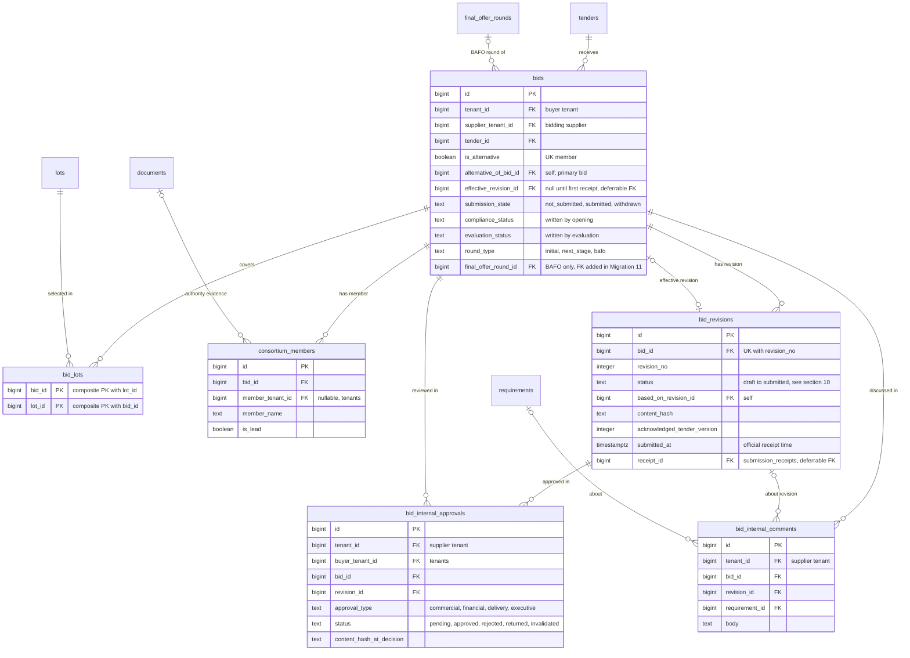
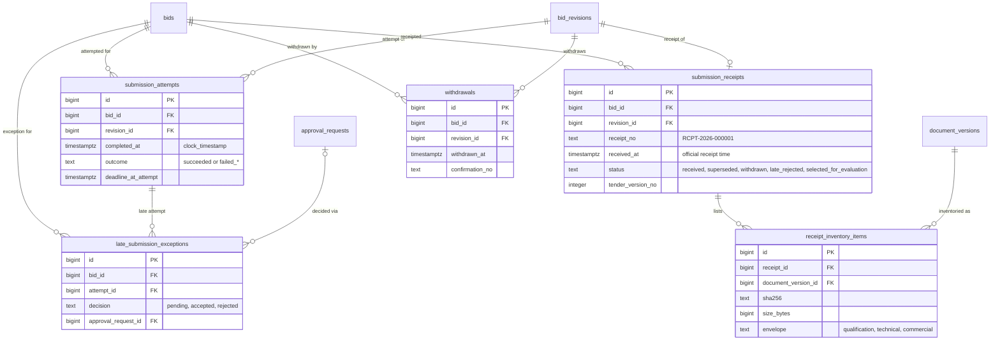
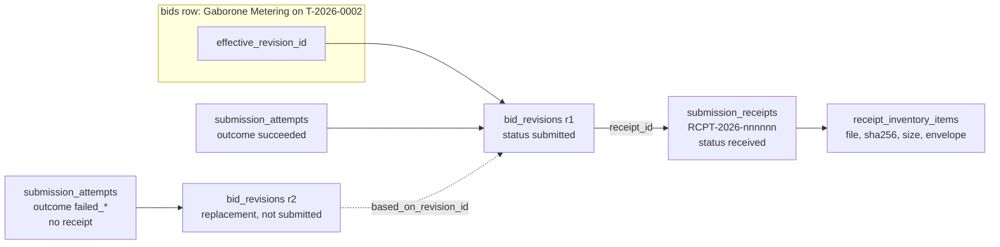
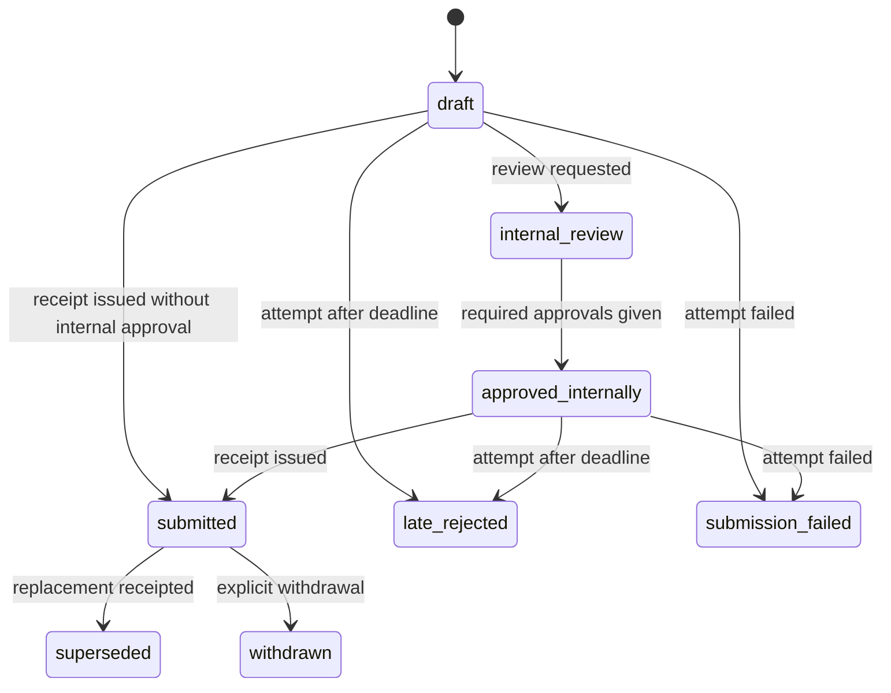

# Data model: Bids and submission (Migration 09)

Status: As-designed (pre-build). Updated to as-built at the end of Stage A and Stage B.

Sources:
- `docs/plan/schema-blueprint.md`: §0 Conventions; Migration 09 `20261001000900_bids.sql`; Migration 14 (view `v_bid_receipt_metadata`); Migration 01 (`reference_counters`, `next_reference()`, storage buckets); Migration 04 (`documents`, `document_versions`, `approval_requests`); §P permission catalog and role templates.
- `docs/plan/architecture-plan.md`: §0 delivery stages; §3.1 cross-tenant records and operator support access; §3.3 sealing and staged opening; §3.4 official time; §3.6 state machines; §3.7 money; §3.8 notifications (`DeliveryChannel` with `in_app` and `email`); §3.9 background jobs; §3.11 prototype mode (fully static since DD-50: persona picker, mock API in the browser); §4 cross-domain writes and registries; §6 domain map (domain 09 `bids`); §8 testing.
- `docs/architecture-brief.md`: §5.6 tenant scoping and generated table lists; §5.9 file storage; §6.1 to §6.3 migration rules and Data API lockdown.
- `docs/PRD.md`: §3 (bid, bid revision, envelope); §4.3 audience matrix; FR-11 (§7.8); FR-12 (§7.9); §8.3 supplier response lifecycle; §14.1, §14.3; §17.2 defaults; §20 exceptional journeys; BR-17 to BR-21, BR-44; screens SUP-12 to SUP-17, BUY-19; AC-03, AC-10 to AC-15.
- `docs/plan/demo-storyline.md`: Tenders T-2026-0002, T-2026-0003, T-2026-0008, T-2026-0009; additional scenario anchors AC-11 and AC-17; personas.
- `docs/plan/tenderiq-backend.workflow.js` (Stage B, draft): domain notes for `bids` and `sealing` (submission transaction, readiness checks, pricing access, guard test).
- `docs/plan/design-decisions.md`: DD-01 (forward and cyclic FKs), DD-02 (`NULLS NOT DISTINCT`), DD-03 ([S] and [R] tags), DD-05 (sealed envelope mapping), DD-09 (reference formats), DD-11 (audit partition), DD-12 (storage keys), DD-13 (`v_bid_receipt_metadata` shape), DD-15 (deadline authority), DD-16 (exports), DD-17 (cross-domain writes), DD-24 (approver permissions), DD-25 (conflict gating), DD-31 (audit content for sealed records), DD-32 (decimal helper), DD-39 (idempotency), DD-42 (acknowledgment authority), DD-43 (real Supabase Auth; superseded for Stage A by DD-50 and moved to Stage B), DD-50 (Stage A is a static prototype: persona picker, mock API in the browser, no Supabase or Docker), DD-44 (email channel next to in-app: nodemailer over SMTP, Mailpit locally, content limited to title, official deadline and link, hosted provider deferred).

Contents:
- [1. Scope, tenancy and ownership](#1-scope-tenancy-and-ownership)
- [2. Reading the data dictionary](#2-reading-the-data-dictionary)
- [3. Diagrams](#3-diagrams)
- [4. Receipts, revisions and the effective revision](#4-receipts-revisions-and-the-effective-revision)
- [5. Data dictionary: bid container and revisions](#5-data-dictionary-bid-container-and-revisions)
- [6. Data dictionary: sealed response content](#6-data-dictionary-sealed-response-content)
- [7. Data dictionary: supplier-private review](#7-data-dictionary-supplier-private-review)
- [8. Data dictionary: submission, receipts and withdrawal](#8-data-dictionary-submission-receipts-and-withdrawal)
- [9. View v_bid_receipt_metadata](#9-view-v_bid_receipt_metadata)
- [10. States and enumerations](#10-states-and-enumerations)
- [11. Constraints and indexes](#11-constraints-and-indexes)
- [12. Read access by audience](#12-read-access-by-audience)
- [13. Jobs and cross-domain touchpoints](#13-jobs-and-cross-domain-touchpoints)
- [14. Demo storyline coverage](#14-demo-storyline-coverage)
- [15. Open points finalized in Stage B](#15-open-points-finalized-in-stage-b)

Related: [data model overview](README.md), [tenders](06-tenders.md) (`tenders`, `lots`, `requirements`, `pricing_items`, `tender_envelopes`), [participation and clarifications](07-participation-clarifications.md) (`participants`, `pursuit_team_members`, addenda), [opening and evaluation](09-opening-evaluation.md) (`envelope_openings`, `price_gate_releases`), [selection and award](10-selection-award.md) (`final_offer_rounds`), [shared services](03-shared-services.md) (`documents`, `approval_requests`), [suppliers and qualification](04-suppliers-qualification.md) (`evidence_submissions`), [security model](../04-security-model.md), [lifecycles](../05-lifecycles.md), [key flows](../06-key-flows.md), [background jobs](../08-background-jobs.md), ADRs [0002](../adr/0002-buyer-owned-procurement-records.md), [0003](../adr/0003-application-layer-sealing.md), [0004](../adr/0004-text-check-constraints-not-enums.md), [0005](../adr/0005-decimal-strings-for-money-and-scores.md), [0007](../adr/0007-in-app-formal-notices.md), [0011](../adr/0011-official-receipt-time-from-database.md).

---

## 1. Scope, tenancy and ownership

Migration 09 (`supabase/migrations/20261001000900_bids.sql`, written in Stage B) holds the supplier response model: the bid container, its revisions, the **sealed** response content, supplier-private review records, submission attempts, official receipts, withdrawals, and late-submission exceptions. The buyer-side receipt projection `v_bid_receipt_metadata` is created in Migration 14 (`20261001001400_views_grants_schedules.sql`).

**Owner.** Domain 09 `bids` (`src/server/domains/bids/`; UI features `responses` and `submission-monitoring`; FR-11, FR-12, BR-17 to BR-21; SUP-12 to SUP-17, BUY-19) owns every table in this file. It also owns bid, revision and receipt rows for later rounds (`round_type = 'next_stage' | 'bafo'`); the selection domain owns only the final-offer rounds and their invitees (architecture-plan §4). Three writes by other domains are approved, performed in the triggering transaction and audited: `bids.compliance_status` (written by `opening`), `bids.evaluation_status` (written by `evaluation`) and `submission_receipts.status = 'selected_for_evaluation'` (written by `opening`, DD-17). In the other direction, `bids` writes `evidence_submissions` snapshots only through the suppliers-owned helper `snapshotEvidence()` (append-only, DD-17). Buyer-side reads of sealed content go only through the shared `sealing` service (architecture-plan §3.3).

"Row tenant" is the tenant stored in `tenant_id`. For every [S] and [R] table it is the **buyer** that runs the tender, and `supplier_tenant_id` names the bidding supplier (architecture-plan §3.1, [ADR 0002](../adr/0002-buyer-owned-procurement-records.md)). Supplier-side inserts name the buyer `tenant_id` explicitly after the service verifies participation. The two supplier-private tables use the **supplier** as row tenant and are never visible to the buyer.

**[S] and [R] (DD-03).** [S] means **supplier-accessible**: the table is on the explicit allow-list `supplier-scoped-tables.ts` that `forSupplier()` uses, generated from the blueprint tags rather than from column presence. [R] means the table carries `supplier_tenant_id` for **reference only**: it is buyer-internal and never reachable through `forSupplier()`, and a guard test asserts that no [R] table is on the allow-list. In this file only `late_submission_exceptions` is [R]; the supplier learns its outcome through a notice or a supplier-facing projection defined in the API contracts (`src/contracts`).

| Table | Tag | Row tenant (`tenant_id`) | Mutable (`updated_at`) | Sealed |
|---|---|---|---|---|
| `bids` | [T][S] | buyer | yes | no (container metadata) |
| `bid_lots` | [T][S] | buyer | no | no |
| `consortium_members` | [T][S] | buyer | yes | no |
| `bid_revisions` | [T][S] | buyer | yes | no |
| `bid_answers` | [T][S] | buyer | yes | **SEALED** (envelope per row) |
| `bid_answer_documents` | [T][S] | buyer | no | **SEALED** (envelope of the parent answer) |
| `bid_prices` | [T][S] | buyer | yes | **SEALED** (commercial) |
| `bid_commercial_terms` | [T][S] | buyer | no | **SEALED** (commercial) |
| `bid_declarations` | [T][S] | buyer | no | **SEALED** (qualification) |
| `bid_subcontractors` | [T][S] | buyer | no | **SEALED** (technical) |
| `bid_key_personnel` | [T][S] | buyer | no | **SEALED** (technical) |
| `bid_exceptions` | [T][S] | buyer | no | **SEALED** (commercial) |
| `bid_internal_approvals` | [T] | supplier | yes | no (supplier-private) |
| `bid_internal_comments` | [T] | supplier | no | no (supplier-private) |
| `submission_attempts` | [T][S] | buyer | no | no |
| `submission_receipts` | [T][S] | buyer | no (immutable except `status`) | no |
| `receipt_inventory_items` | [T][S] | buyer | no | no |
| `withdrawals` | [T][S] | buyer | no | no |
| `late_submission_exceptions` | [T][R] | buyer | yes | no |
| `v_bid_receipt_metadata` (view) | n/a | buyer | n/a | exposes no content |

No table here is partitioned ([P]). All owners are `bids`.

## 2. Reading the data dictionary

| Column | Meaning |
|---|---|
| Type | Plain type: stated in the blueprint, or fixed by a §0 convention (identity and FK columns `bigint`; instants `*_at` are `timestamptz` per architecture-plan §3.4; money `numeric(18,2)`; quantities `numeric(18,4)`; scores, rates and weights `numeric(12,6)`; currency `char(3)` with CHECK `~ '^[A-Z]{3}$'`; enumerations `text` + named CHECK). *Italic* type: inferred from the column's name and meaning because the blueprint states no type. `n/s`: not specified, with the candidates given. Stage B migrations fix every final type, recorded in `supabase/schema.expected.sql`. |
| Null | `no`: NOT NULL stated by the blueprint or a §0 convention. `yes`: nullable as stated, or the column is filled only by a later lifecycle event (for example `decided_at`), which forces nullability. `n/s`: not specified by the blueprint. |
| Key / constraint | `PK`, `FK → table`, `UK` (member of a unique constraint listed in §11), CHECK lists, defaults. Every FK column is indexed (§0). |

Standard columns (§0) appear in every table: `id bigint generated always as identity primary key`, `created_at timestamptz not null default now()`, `created_by bigint references users(id)` (null = system). Mutable tables add `updated_at timestamptz not null default now()`, maintained by the `set_updated_at()` trigger.

## 3. Diagrams

Diagram legend: solid lines are FK columns; dashed lines are logical links with no FK constraint. Entities without an attribute block are defined in other data-model files. `tenant_id` and `supplier_tenant_id` (FK → `tenants`) and user FK columns (`*_user_id`, `*_by`) are listed in the attribute blocks, but their lines to `tenants` and `users` are omitted for readability. Self-referencing FKs are noted in attribute comments, not drawn.

### 3.1 Bid container, revisions and supplier-private review

### 3.2 Sealed response content (all keyed by revision)

```mermaid
erDiagram
    bid_revisions ||--o{ bid_answers : "answers"
    requirements ||--o{ bid_answers : "answered by"
    bid_answers ||--o{ bid_answer_documents : "attaches"
    document_versions ||--o{ bid_answer_documents : "attached as"
    evidence_submissions |o--o{ bid_answer_documents : "evidence snapshot"
    bid_revisions ||--o{ bid_prices : "prices"
    pricing_items ||--o{ bid_prices : "priced by"
    bid_revisions ||--o{ bid_commercial_terms : "commercial terms"
    bid_revisions ||--o{ bid_declarations : "declares"
    bid_revisions ||--o{ bid_subcontractors : "proposes"
    bid_revisions ||--o{ bid_key_personnel : "names"
    bid_revisions ||--o{ bid_exceptions : "raises"
    documents |o--o{ bid_subcontractors : "qualification evidence"
    documents |o--o{ bid_key_personnel : "CV"

    bid_answers {
        bigint id PK
        bigint revision_id FK "UK with requirement_id"
        bigint requirement_id FK
        text envelope "qualification, technical, commercial; copied from the requirement"
        text progress "not_started, in_progress, ready_for_review, complete"
        bigint reused_from_answer_id FK "self"
    }
    bid_answer_documents {
        bigint id PK
        bigint answer_id FK
        bigint document_version_id FK
        bigint evidence_submission_id FK
    }
    bid_prices {
        bigint id PK
        bigint revision_id FK "UK with pricing_item_id"
        bigint pricing_item_id FK
        text price_status "priced, included, not_offered"
        numeric unit_price "money 18,2"
        numeric quantity "quantity 18,4"
        char3 currency
        numeric line_total "money 18,2, computed in service"
    }
    bid_commercial_terms {
        bigint id PK
        bigint revision_id FK
        numeric total_one_time "money 18,2"
        numeric total_recurring_per_period "money 18,2"
        char3 currency
    }
    bid_declarations {
        bigint id PK
        bigint revision_id FK
        text declaration_type "authority_to_bid, eligibility and more"
        boolean accepted
    }
    bid_subcontractors {
        bigint id PK
        bigint revision_id FK
        bigint qualification_evidence_document_id FK
    }
    bid_key_personnel {
        bigint id PK
        bigint revision_id FK
        bigint cv_document_id FK
    }
    bid_exceptions {
        bigint id PK
        bigint revision_id FK
        text clause_ref
    }
```

### 3.3 Submission attempts, receipts, withdrawal and late exceptions

## 4. Receipts, revisions and the effective revision

The model separates four things that the PRD requires to stay distinct (BR-18, BR-19, PRD §8.3): preparing content, trying to submit, being officially received, and being the offer that counts.

| Concept | Where it lives | Rule |
|---|---|---|
| Bid (container) | `bids` | One per supplier × tender × bidding combination: primary or alternative (`is_alternative`), and round (`round_type`, `final_offer_round_id`). Lots are in `bid_lots`. |
| Revision | `bid_revisions` | A distinguishable edition of the response (PRD §3). Every content row (answers, prices, terms, declarations, subcontractors, personnel, exceptions) is keyed by `revision_id`, so each revision carries its own content set. A replacement is a new revision whose `based_on_revision_id` names its source; the earlier revision's rows are not rewritten. |
| Attempt | `submission_attempts` | Written for **every** attempt: successful, invalid, unauthorized, late or errored. `completed_at` is `clock_timestamp()`, and `deadline_at_attempt` is the deadline in force (AC-13). A retried submission, even with the same `Idempotency-Key` header, still records a new attempt row: that row is intended evidence (DD-39). |
| Receipt | `submission_receipts` + `receipt_inventory_items` | Exists only for a successful official submission (BR-18). `received_at` is the official receipt time: `clock_timestamp()` inside the submission transaction after the tender row is locked `FOR SHARE` (architecture-plan §3.4, [ADR 0011](../adr/0011-official-receipt-time-from-database.md)). Issuing an addendum that changes a deadline also updates `tenders.updated_at` in the same transaction, so this lock serializes submissions against deadline changes (DD-15). The inventory lists each submitted file with name, `sha256`, size and envelope. Receipts are immutable except `status` and `status_changed_at`. |
| Effective revision | `bids.effective_revision_id` | Null until the first successful receipt. Then it names the last successfully submitted, non-withdrawn revision (PRD §17.2 default). A partial unique index permits at most one revision with `status = 'submitted'` per bid. |

**Example (demo storyline, T-2026-0002, Gaborone Metering).** The supplier has an earlier effective receipt and a failed replacement attempt. The failed attempt leaves the effective revision and its receipt untouched (AC-12).

**Revision states.** The principal transitions below come from PRD §7.8, §7.9 and §8.3 and the bids domain notes. The complete legality matrix is written in `domains/bids/workflow/` in Stage B and documented in [05-lifecycles.md](../05-lifecycles.md).

Internal supplier approval is optional or required by the supplier's own policy (FR-11), which is why `draft → submitted` exists. Saving or internally approving never creates a receipt (AC-11).

**What each outcome writes.** Every outcome is one database transaction in the bids service (domain notes; architecture-plan §3.4). Status names are the blueprint CHECK values; the choreography is confirmed as-built in Stage B.

| Outcome | `submission_attempts` | `bid_revisions` | `submission_receipts` / inventory | `bids` |
|---|---|---|---|---|
| First successful submission | `succeeded` | attempted revision → `submitted`; `submitted_at` = official receipt time; `receipt_id` set | new receipt `received` + inventory rows | `effective_revision_id` = revision; `submission_state` = `submitted` |
| Successful replacement before closing | `succeeded` | new revision → `submitted`; previous effective → `superseded` | new receipt `received`; previous receipt → `superseded` | `effective_revision_id` → new revision |
| Failed attempt (validation, authority, error) | `failed_validation`, `failed_authority` or `failed_error`, with `failure_reason` | attempted revision is not submitted (`submission_failed` exists in the CHECK list; see §15) | none; no false receipt (AC-12) | unchanged; the earlier submission stays effective (BR-19) |
| Late attempt | `failed_late`, true `completed_at`, `deadline_at_attempt` | attempted revision → `late_rejected` | none | unchanged (AC-13, BR-20) |
| Late exception route | the late attempt row is kept | see §15 | see §15 | `late_submission_exceptions` row, decided through `approval_requests` (subject type `late_submission_exception`) only where the frozen policy version has `late_submission_policy = exception_route` |
| Explicit withdrawal | none | effective revision → `withdrawn` | its receipt → `withdrawn` | `submission_state` = `withdrawn`; `withdrawals` row with `confirmation_no` (AC-14, BR-21) |

A "late" decision is never made by editing a time: the attempt keeps its true `completed_at`, and a general administrator cannot declare a late response timely (FR-12, BR-20).

## 5. Data dictionary: bid container and revisions

### 5.1 bids

[T][S], mutable, not sealed. Row tenant: the buyer. One response container per supplier × tender × bidding combination (blueprint). Owner `bids`; `compliance_status` is written by `opening` and `evaluation_status` by `evaluation` (architecture-plan §4). Compliance and evaluation outcomes are separate attributes from the submission state (PRD §8.3).

| Column | Type | Null | Key / constraint | Meaning |
|---|---|---|---|---|
| id | bigint | no | PK | Standard. |
| tenant_id | bigint | no | FK → tenants | Buyer tenant that runs the tender. |
| supplier_tenant_id | bigint | no | FK → tenants; UK | Bidding supplier organization (legal party); key for `forSupplier()`. |
| tender_id | bigint | n/s | FK → tenders; UK | Tender responded to. |
| is_alternative | boolean | n/s | UK | True for a permitted alternative offer (`tenders.alternatives_allowed`). |
| alternative_of_bid_id | bigint | n/s | FK → bids (self) | Primary bid an alternative relates to; alternatives remain explicitly related offers (FR-12). |
| is_consortium | boolean | n/s | | Bid made by a consortium or joint venture; members in `consortium_members`. |
| lead_member_name | *text* | n/s | | Name of the consortium lead party. |
| effective_revision_id | bigint | yes | FK → bid_revisions (`DEFERRABLE INITIALLY DEFERRED`, added at the end of Migration 09, DD-01) | Effective revision; null until a successful receipt. |
| submission_state | text | n/s | CHECK (not_submitted, submitted, withdrawn) | Whether the container has an effective submission. |
| compliance_status | text | n/s | CHECK (pending, compliant, non_compliant, clarification_pending, excluded) | Compliance outcome from opening/compliance review (BUY-21). |
| evaluation_status | text | n/s | CHECK (not_started, in_evaluation, evaluated, excluded) | Evaluation progress for this bid (EVA-01 to EVA-06). |
| round_type | text | n/s | CHECK (initial, next_stage, bafo); UK | Competition round the container belongs to. |
| final_offer_round_id | bigint | yes | FK → final_offer_rounds (added by Migration 11, DD-01); UK (`NULLS NOT DISTINCT`, DD-02) | Final-offer round for BAFO bids; null for other rounds. Migration 09 creates it as a plain `bigint`, and Migration 11, which creates `final_offer_rounds`, adds the FK with `ALTER TABLE … ADD CONSTRAINT` (§11). |
| created_at | timestamptz | no | default now() | Standard. |
| created_by | bigint | yes | FK → users | Standard. |
| updated_at | timestamptz | no | `set_updated_at()` | Mutable marker. |

### 5.2 bid_lots

[T][S], not mutable, not sealed. Row tenant: the buyer. Lots a bid covers (FR-11 lot selection; "one or more lots" per PRD §3).

| Column | Type | Null | Key / constraint | Meaning |
|---|---|---|---|---|
| bid_id | bigint | no | PK (bid_id, lot_id); FK → bids | Bid. |
| lot_id | bigint | no | PK (bid_id, lot_id); FK → lots | Lot offered. |
| tenant_id | bigint | no | FK → tenants | Buyer tenant. |
| supplier_tenant_id | bigint | no | FK → tenants | Bidding supplier. |
| id | bigint | n/s | identity (not the PK) | The standard `id` column. The blueprint sets PK (bid_id, lot_id); whether the identity column is also kept is fixed in Stage B. |
| created_at | timestamptz | no | default now() | Standard. |
| created_by | bigint | yes | FK → users | Standard. |

### 5.3 consortium_members

[T][S], mutable, not sealed by the blueprint (see §15). Row tenant: the buyer. Named members of a consortium or joint-venture bid, with the lead party, responsibilities and authority evidence (PRD §3 "Consortium or joint venture").

| Column | Type | Null | Key / constraint | Meaning |
|---|---|---|---|---|
| id | bigint | no | PK | Standard. |
| tenant_id | bigint | no | FK → tenants | Buyer tenant. |
| supplier_tenant_id | bigint | no | FK → tenants | Bidding supplier (the organization that submits). |
| bid_id | bigint | n/s | FK → bids | Consortium bid. |
| member_tenant_id | bigint | yes | FK → tenants | Member's organization when it is a platform tenant; nullable (blueprint). |
| member_name | *text* | n/s | | Member name as declared. |
| is_lead | *boolean* | n/s | | Lead party flag. |
| responsibilities | *text* | n/s | | Agreed responsibilities of the member. |
| authority_evidence_document_id | bigint | n/s | FK → documents | Evidence of authority to act for the member. |
| created_at | timestamptz | no | default now() | Standard. |
| created_by | bigint | yes | FK → users | Standard. |
| updated_at | timestamptz | no | `set_updated_at()` | Mutable marker. |

### 5.4 bid_revisions

[T][S], mutable, not sealed (the revision row carries status and hashes, not content). Row tenant: the buyer. A distinguishable edition of a response. PRD §8.3 states: draft, internal review, approved internally, submitted, superseded, withdrawn, late/rejected.

| Column | Type | Null | Key / constraint | Meaning |
|---|---|---|---|---|
| id | bigint | no | PK | Standard. |
| tenant_id | bigint | no | FK → tenants | Buyer tenant. |
| supplier_tenant_id | bigint | no | FK → tenants | Bidding supplier. |
| bid_id | bigint | n/s | FK → bids; UK (bid_id, revision_no) | Parent bid. |
| revision_no | *integer* | n/s | UK | Revision number within the bid. |
| status | text | n/s | CHECK (draft, internal_review, approved_internally, submitted, superseded, withdrawn, late_rejected, submission_failed); partial unique index: one `submitted` per bid | Revision state (§4). |
| based_on_revision_id | bigint | yes | FK → bid_revisions (self) | Revision this one was prepared from; null for the first. |
| content_hash | *text* | n/s | | Hash of the revision content. Internal approvals record the hash they approved, so a material change is detectable and approvals are invalidated (FR-11, SUP-15). Algorithm and scope are fixed in Stage B. |
| acknowledged_tender_version | integer | n/s | | Tender version (`tender_versions.version_no`) the revision acknowledges; used when an addendum requires acknowledgment, supplement or replacement (AC-10). |
| internally_approved_at | timestamptz | yes | | When the revision reached `approved_internally`. |
| submitted_at | timestamptz | yes | | Official receipt time of the successful submission (blueprint). The receipt records the same time as `received_at`. |
| receipt_id | bigint | yes | FK → submission_receipts (`DEFERRABLE INITIALLY DEFERRED`, added at the end of Migration 09, DD-01) | Receipt issued for this revision. |
| created_at | timestamptz | no | default now() | Standard. |
| created_by | bigint | yes | FK → users | Standard; the blueprint lists it explicitly for this table. |
| updated_at | timestamptz | no | `set_updated_at()` | Mutable marker. |

## 6. Data dictionary: sealed response content

Every table in this section is **SEALED** (blueprint). A buyer user can read a row only through `sealing.assertEnvelopeReadable()` / `readableEnvelopes()` after the relevant envelope is opened (see §12 and [09-opening-evaluation.md](09-opening-evaluation.md)). The supplier's own authorized team reads and edits its rows through the bids domain under `forSupplier()`. Drafts are never visible to buyers (BR-17).

The envelope mapping is fixed by DD-05. Every envelope column carries CHECK (`qualification`, `technical`, `commercial`).

| Table | Envelope used by the sealing service |
|---|---|
| bid_answers | The row's own `envelope` column, copied from `requirements.envelope` of the answered requirement. |
| bid_answer_documents | Follows its parent answer: no envelope column, resolved through the parent `bid_answers` row. |
| bid_declarations | qualification. |
| bid_subcontractors, bid_key_personnel | technical. |
| bid_prices, bid_commercial_terms, bid_exceptions | commercial. |
| receipt_inventory_items (not sealed, §8.3) | Its own `envelope` column records the envelope of each submitted file. |

### 6.1 bid_answers

[T][S], mutable, **SEALED**. Row tenant: the buyer. Structured answers to tender requirements, one per requirement per revision (SUP-12).

| Column | Type | Null | Key / constraint | Meaning |
|---|---|---|---|---|
| id | bigint | no | PK | Standard. |
| tenant_id | bigint | no | FK → tenants | Buyer tenant. |
| supplier_tenant_id | bigint | no | FK → tenants | Bidding supplier. |
| revision_id | bigint | n/s | FK → bid_revisions; UK (revision_id, requirement_id) | Revision the answer belongs to. |
| requirement_id | bigint | n/s | FK → requirements; UK | Requirement answered. |
| envelope | text | n/s | CHECK (qualification, technical, commercial) (DD-05) | Sealing envelope of this answer, copied from the requirement's `envelope`. |
| answer_text | *text* | n/s | | Text answer. |
| answer_number | n/s (`numeric`, precision not stated) | n/s | | Numeric or quantity answer (`requirements.response_type` includes number and quantity). |
| answer_choice | *text* | n/s | | Selected choice (from `requirements.choices`). |
| answer_bool | *boolean* | n/s | | Yes/no answer. |
| is_deviation | *boolean* | n/s | | The answer deviates from the requirement (FR-11 deviations). |
| deviation_note | *text* | n/s | | Explanation of the deviation. |
| assigned_user_id | bigint | n/s | FK → users | Supplier contributor assigned to the answer (FR-11). |
| progress | text | n/s | CHECK (not_started, in_progress, ready_for_review, complete) | Preparation progress (FR-11: unfinished vs ready for review). |
| reused_from_answer_id | bigint | yes | FK → bid_answers (self) | Source of reused content; reuse must be reviewed and is not a fresh certification (FR-11). |
| updated_by | bigint | n/s | FK → users | Last supplier user who edited the answer. |
| created_at | timestamptz | no | default now() | Standard. |
| created_by | bigint | yes | FK → users | Standard. |
| updated_at | timestamptz | no | `set_updated_at()` | Mutable marker. |

### 6.2 bid_answer_documents

[T][S], not mutable, **SEALED** (envelope of the parent answer, DD-05). Row tenant: the buyer. Files and evidence attached to an answer. Evidence from the supplier's library is pinned through an `evidence_submissions` snapshot, so a later library update never changes the historical bid (PRD §14.1, BR-25).

| Column | Type | Null | Key / constraint | Meaning |
|---|---|---|---|---|
| id | bigint | no | PK | Standard. |
| tenant_id | bigint | no | FK → tenants | Buyer tenant. |
| supplier_tenant_id | bigint | no | FK → tenants | Bidding supplier. |
| answer_id | bigint | n/s | FK → bid_answers | Answer the file supports. |
| document_version_id | bigint | n/s | FK → document_versions | Exact file edition attached. |
| evidence_submission_id | bigint | n/s | FK → evidence_submissions | Evidence snapshot (context type `bid_revision`) when the file comes from the evidence library; created through the suppliers-owned `snapshotEvidence()` helper (DD-17). |
| created_at | timestamptz | no | default now() | Standard. |
| created_by | bigint | yes | FK → users | Standard. |

### 6.3 bid_prices

[T][S], mutable, **SEALED (commercial)**. Row tenant: the buyer. One offered line per pricing item per revision (SUP-13). On the supplier side, pricing is restricted to users with `supplier.pricing.edit` or a `pursuit_team_members.can_view_pricing` flag (FR-11; domain notes).

| Column | Type | Null | Key / constraint | Meaning |
|---|---|---|---|---|
| id | bigint | no | PK | Standard. |
| tenant_id | bigint | no | FK → tenants | Buyer tenant. |
| supplier_tenant_id | bigint | no | FK → tenants | Bidding supplier. |
| revision_id | bigint | n/s | FK → bid_revisions; UK (revision_id, pricing_item_id) | Revision. |
| pricing_item_id | bigint | n/s | FK → pricing_items; UK | Pricing schedule line priced. |
| price_status | text | n/s | CHECK (priced, included, not_offered) | Priced, included at no separate charge, or not offered. Distinct from a zero price (domain notes). |
| unit_price | numeric(18,2) | n/s | | Offered unit price. |
| quantity | numeric(18,4) | n/s | | Offered quantity. |
| currency | char(3) | n/s | CHECK `~ '^[A-Z]{3}$'` | Offer currency (must be in `tenders.accepted_currencies`, checked in service). |
| tax_rate | numeric(12,6) | n/s | | Tax rate applied to the line. |
| discount_amount | numeric(18,2) | n/s | | Line discount. |
| line_total | numeric(18,2) | n/s | | Line total, computed in the service with the shared decimal helper `src/contracts/decimal.ts` (re-exported by `src/server/lib/decimal.ts`) and stored. The SPA uses the same helper for live totals on SUP-13; the server recomputes authoritatively (blueprint; architecture-plan §3.7; DD-32). |
| notes | *text* | n/s | | Supplier notes on the line. |
| created_at | timestamptz | no | default now() | Standard. |
| created_by | bigint | yes | FK → users | Standard. |
| updated_at | timestamptz | no | `set_updated_at()` | Mutable marker. |

### 6.4 bid_commercial_terms

[T][S], not mutable, **SEALED (commercial)**. Row tenant: the buyer. Commercial offer terms and submitted totals for the revision (SUP-13).

| Column | Type | Null | Key / constraint | Meaning |
|---|---|---|---|---|
| id | bigint | no | PK | Standard. |
| tenant_id | bigint | no | FK → tenants | Buyer tenant. |
| supplier_tenant_id | bigint | no | FK → tenants | Bidding supplier. |
| revision_id | bigint | n/s | FK → bid_revisions | Revision. |
| validity_days | *integer* | n/s | | Offered bid validity in days (tender asks for `tenders.bid_validity_days`). |
| payment_terms | *text* | n/s | | Offered payment terms. |
| conditional_discounts | *text* | n/s | | Discounts that apply only under stated award combinations (PRD §9.3). |
| assumptions | *text* | n/s | | Commercial assumptions. |
| total_one_time | numeric(18,2) | n/s | | Submitted one-time total. |
| total_recurring_per_period | numeric(18,2) | n/s | | Submitted recurring total per period. |
| currency | char(3) | n/s | CHECK `~ '^[A-Z]{3}$'` | Currency of the totals. |
| created_at | timestamptz | no | default now() | Standard. |
| created_by | bigint | yes | FK → users | Standard. |

### 6.5 bid_declarations

[T][S], not mutable, **SEALED (qualification)**. Row tenant: the buyer. Declarations made for the revision (SUP-14; FR-11 final declaration).

| Column | Type | Null | Key / constraint | Meaning |
|---|---|---|---|---|
| id | bigint | no | PK | Standard. |
| tenant_id | bigint | no | FK → tenants | Buyer tenant. |
| supplier_tenant_id | bigint | no | FK → tenants | Bidding supplier. |
| revision_id | bigint | n/s | FK → bid_revisions | Revision. |
| declaration_type | text | n/s | CHECK (authority_to_bid, eligibility, no_conflict, no_collusion, bid_validity, terms_acceptance, other) | Declaration kind. |
| accepted | boolean | n/s | | Whether the supplier confirms the declaration. |
| explanation | *text* | n/s | | Explanation where not accepted or qualified. |
| declared_by | bigint | n/s | FK → users | Supplier user making the declaration. |
| declared_at | timestamptz | n/s | | Declaration time. |
| created_at | timestamptz | no | default now() | Standard. |
| created_by | bigint | yes | FK → users | Standard. |

### 6.6 bid_subcontractors

[T][S], not mutable, **SEALED (technical)**. Row tenant: the buyer. Proposed subcontractors (PRD §3: a subcontractor is not automatically a bidder or portal participant).

| Column | Type | Null | Key / constraint | Meaning |
|---|---|---|---|---|
| id | bigint | no | PK | Standard. |
| tenant_id | bigint | no | FK → tenants | Buyer tenant. |
| supplier_tenant_id | bigint | no | FK → tenants | Bidding supplier. |
| revision_id | bigint | n/s | FK → bid_revisions | Revision. |
| name | *text* | n/s | | Subcontractor name. |
| scope | *text* | n/s | | Subcontracted scope. |
| share_percent | *numeric(12,6)* | n/s | | Share of the work (rate convention, inferred). |
| qualification_evidence_document_id | bigint | n/s | FK → documents | Subcontractor qualification evidence. |
| created_at | timestamptz | no | default now() | Standard. |
| created_by | bigint | yes | FK → users | Standard. |

### 6.7 bid_key_personnel

[T][S], not mutable, **SEALED (technical)**. Row tenant: the buyer. Named key personnel (FR-11).

| Column | Type | Null | Key / constraint | Meaning |
|---|---|---|---|---|
| id | bigint | no | PK | Standard. |
| tenant_id | bigint | no | FK → tenants | Buyer tenant. |
| supplier_tenant_id | bigint | no | FK → tenants | Bidding supplier. |
| revision_id | bigint | n/s | FK → bid_revisions | Revision. |
| name | *text* | n/s | | Person's name. |
| role | *text* | n/s | | Proposed role. |
| qualifications | *text* | n/s | | Relevant qualifications. |
| cv_document_id | bigint | n/s | FK → documents | CV file. |
| created_at | timestamptz | no | default now() | Standard. |
| created_by | bigint | yes | FK → users | Standard. |

### 6.8 bid_exceptions

[T][S], not mutable, **SEALED (commercial)**. Row tenant: the buyer. Proposed exceptions to contract terms (SUP-14; FR-11 "outstanding exceptions" on the final declaration).

| Column | Type | Null | Key / constraint | Meaning |
|---|---|---|---|---|
| id | bigint | no | PK | Standard. |
| tenant_id | bigint | no | FK → tenants | Buyer tenant. |
| supplier_tenant_id | bigint | no | FK → tenants | Bidding supplier. |
| revision_id | bigint | n/s | FK → bid_revisions | Revision. |
| clause_ref | *text* | n/s | | Clause the exception concerns. |
| proposed_change | *text* | n/s | | Proposed wording or change. |
| rationale | *text* | n/s | | Supplier's reason. |
| created_at | timestamptz | no | default now() | Standard. |
| created_by | bigint | yes | FK → users | Standard. |

## 7. Data dictionary: supplier-private review

These rows belong to the **supplier** tenant. The buyer never reads them (architecture-plan §3.1: supplier-private collaboration lives in rows owned by the supplier tenant).

### 7.1 bid_internal_approvals

[T], mutable. Row tenant: the supplier. Internal supplier approval of a specific revision (SUP-15). Approval applies to a particular revision; a material change afterwards requires reapproval (FR-11).

| Column | Type | Null | Key / constraint | Meaning |
|---|---|---|---|---|
| id | bigint | no | PK | Standard. |
| tenant_id | bigint | no | FK → tenants | Supplier tenant. |
| buyer_tenant_id | bigint | n/s | FK → tenants | Buyer running the tender (the bid's row tenant). |
| bid_id | bigint | n/s | FK → bids | Bid (buyer-tenant row). |
| revision_id | bigint | n/s | FK → bid_revisions | Revision under approval. |
| approver_user_id | bigint | n/s | FK → users | Supplier approver. |
| approval_type | text | n/s | CHECK (commercial, financial, delivery, executive) | Approval perspective (FR-11). |
| status | text | n/s | CHECK (pending, approved, rejected, returned, invalidated) | Decision state; `invalidated` when the revision's content hash changes. |
| content_hash_at_decision | *text* | n/s | | `bid_revisions.content_hash` at decision time. |
| decided_at | timestamptz | yes | | Decision time. |
| note | *text* | n/s | | Approver's note. |
| created_at | timestamptz | no | default now() | Standard. |
| created_by | bigint | yes | FK → users | Standard. |
| updated_at | timestamptz | no | `set_updated_at()` | Mutable marker. |

### 7.2 bid_internal_comments

[T], not mutable. Row tenant: the supplier. Private review comments on a bid, revision or requirement (FR-11 "maintain private comments"; PRD §14.2 internal collaboration).

| Column | Type | Null | Key / constraint | Meaning |
|---|---|---|---|---|
| id | bigint | no | PK | Standard. |
| tenant_id | bigint | no | FK → tenants | Supplier tenant. |
| bid_id | bigint | n/s | FK → bids | Bid discussed. |
| revision_id | bigint | n/s | FK → bid_revisions | Revision discussed. |
| requirement_id | bigint | n/s | FK → requirements | Requirement discussed. |
| author_user_id | bigint | n/s | FK → users | Supplier author. |
| body | *text* | n/s | | Comment text. |
| created_at | timestamptz | no | default now() | Standard. |
| created_by | bigint | yes | FK → users | Standard. |

## 8. Data dictionary: submission, receipts and withdrawal

### 8.1 submission_attempts

[T][S], not mutable. Row tenant: the buyer. One row per submission attempt, successful or not, with its true time (AC-13).

| Column | Type | Null | Key / constraint | Meaning |
|---|---|---|---|---|
| id | bigint | no | PK | Standard. |
| tenant_id | bigint | no | FK → tenants | Buyer tenant. |
| supplier_tenant_id | bigint | no | FK → tenants | Bidding supplier. |
| bid_id | bigint | n/s | FK → bids | Bid. |
| revision_id | bigint | n/s | FK → bid_revisions | Revision the attempt tried to submit. |
| attempted_by | bigint | n/s | FK → users | Supplier user who attempted; must hold `supplier.response.submit` to succeed (AC-03). |
| started_at | timestamptz | n/s | | Attempt start. |
| completed_at | timestamptz | yes | | `clock_timestamp()` at completion (blueprint). |
| outcome | text | n/s | CHECK (succeeded, failed_validation, failed_late, failed_authority, failed_error) | Result of the attempt. |
| failure_reason | *text* | yes | | Why the attempt failed; shown to the supplier (PRD §7.9: clear failure information). |
| deadline_at_attempt | timestamptz | n/s | | Deadline in force at the attempt: `lots.submission_deadline` when set (authoritative for that lot), otherwise the tender's `tender_milestones` row (`submission_deadline`, `lot_id` null) (DD-15). |
| created_at | timestamptz | no | default now() | Standard. |
| created_by | bigint | yes | FK → users | Standard. |

### 8.2 submission_receipts

[T][S], immutable except `status` and `status_changed_at`. Row tenant: the buyer. The official receipt (FR-12). It confirms receipt, not compliance, qualification, evaluation success or award.

| Column | Type | Null | Key / constraint | Meaning |
|---|---|---|---|---|
| id | bigint | no | PK | Standard. |
| tenant_id | bigint | no | FK → tenants | Buyer tenant. |
| supplier_tenant_id | bigint | no | FK → tenants | Submitting supplier (legal party). |
| bid_id | bigint | n/s | FK → bids | Bid. |
| revision_id | bigint | n/s | FK → bid_revisions | Revision received. |
| receipt_no | *text* | n/s | human reference; see §11 | Receipt number in the §0 format `RCPT-2026-000001`, generated by `next_reference()`. The year segment is the year in the buyer tenant's official time zone (DD-09). |
| received_at | timestamptz | n/s | | Official receipt time (DB clock in the submission transaction). |
| submitted_by | bigint | n/s | FK → users | Authorized submitter. |
| submitter_authority_note | *text* | n/s | | Authority under which the submitter acted (FR-11 final declaration: authorized representative). |
| lots_summary | *text* | n/s | | Lots covered, as shown on the receipt. |
| document_count | *integer* | n/s | | Number of inventoried files. |
| status | text | n/s | CHECK (received, superseded, withdrawn, late_rejected, selected_for_evaluation) | Receipt status (PRD §7.9: history distinguishes received, superseded, withdrawn, late/rejected and selected-for-evaluation revisions). `selected_for_evaluation` is written by `opening` (approved cross-domain write, DD-17). |
| status_changed_at | timestamptz | yes | | Time of the last status change. |
| tender_version_no | *integer* | n/s | | Tender version in force at receipt (AC-10). |
| created_at | timestamptz | no | default now() | Standard. |
| created_by | bigint | yes | FK → users | Standard. |

### 8.3 receipt_inventory_items

[T][S], not mutable. Row tenant: the buyer. The submitted document inventory printed on the receipt (FR-12).

| Column | Type | Null | Key / constraint | Meaning |
|---|---|---|---|---|
| id | bigint | no | PK | Standard. |
| tenant_id | bigint | no | FK → tenants | Buyer tenant. |
| supplier_tenant_id | bigint | no | FK → tenants | Bidding supplier. |
| receipt_id | bigint | n/s | FK → submission_receipts | Receipt. |
| document_version_id | bigint | n/s | FK → document_versions | File edition received. |
| file_name | *text* | n/s | | File name at receipt. |
| sha256 | *text* | n/s | | Content hash at receipt. |
| size_bytes | *bigint* | n/s | | File size (`document_versions.size_bytes` is `bigint`). |
| envelope | text | n/s | CHECK (qualification, technical, commercial) (DD-05) | Envelope the file belongs to. |
| created_at | timestamptz | no | default now() | Standard. |
| created_by | bigint | yes | FK → users | Standard. |

### 8.4 withdrawals

[T][S], not mutable. Row tenant: the buyer. Explicit withdrawal of the effective response, with a confirmation (AC-14). The withdrawn response stays in the history and is excluded from ordinary evaluation (BR-21).

| Column | Type | Null | Key / constraint | Meaning |
|---|---|---|---|---|
| id | bigint | no | PK | Standard. |
| tenant_id | bigint | no | FK → tenants | Buyer tenant. |
| supplier_tenant_id | bigint | no | FK → tenants | Bidding supplier. |
| bid_id | bigint | n/s | FK → bids | Bid withdrawn. |
| revision_id | bigint | n/s | FK → bid_revisions | Revision that was effective when withdrawn. |
| withdrawn_by | bigint | n/s | FK → users | Authorized supplier user. |
| withdrawn_at | timestamptz | n/s | | Withdrawal time. |
| confirmation_no | *text* | n/s | | Withdrawal confirmation number; format not specified. |
| reason | *text* | n/s | | Stated reason. |
| created_at | timestamptz | no | default now() | Standard. |
| created_by | bigint | yes | FK → users | Standard. |

### 8.5 late_submission_exceptions

[T][R], mutable. Row tenant: the buyer. Buyer-internal: `supplier_tenant_id` is for reference only, and the table is not reachable through `forSupplier()` (DD-03). Exceptional treatment of a late attempt. FR-12 requires an applicable policy basis, an authorized decision, evidence and an equal-treatment review; the default is rejection. It is available only when the frozen policy version has `late_submission_policy = exception_route`.

| Column | Type | Null | Key / constraint | Meaning |
|---|---|---|---|---|
| id | bigint | no | PK | Standard. |
| tenant_id | bigint | no | FK → tenants | Buyer tenant. |
| supplier_tenant_id | bigint | no | FK → tenants | Supplier concerned (reference only, [R]). |
| bid_id | bigint | n/s | FK → bids | Bid. |
| attempt_id | bigint | n/s | FK → submission_attempts | The late attempt (true time preserved). |
| policy_basis | *text* | n/s | | Policy provision relied on. |
| evidence | *text* | n/s | | Evidence supporting the exception (for example incident timing). |
| equal_treatment_review | *text* | n/s | | Equal-treatment assessment across affected suppliers. |
| decision | text | n/s | CHECK (pending, accepted, rejected) | Outcome. |
| approval_request_id | bigint | n/s | FK → approval_requests | Approval (subject type `late_submission_exception`; authority decision type `late_submission_exception`). Deciding a step requires `approval.decide`, the decision-specific permission and sufficient authority (DD-24). |
| decided_by | bigint | yes | FK → users | Decision maker. |
| created_at | timestamptz | no | default now() | Standard. |
| created_by | bigint | yes | FK → users | Standard. |
| updated_at | timestamptz | no | `set_updated_at()` | Mutable marker. |

## 9. View v_bid_receipt_metadata

Defined in Migration 14. It is **the only buyer-side projection of bids before opening** and never exposes content (blueprint). BUY-19 (submission monitoring) and the sealing service's receipt-metadata helper read it (domain notes).

| Aspect | Design |
|---|---|
| Exposed fields (DD-13) | `tenant_id` (the buyer, so `forTenant()` can scope the view), `supplier_tenant_id`, the supplier legal name **valid at `received_at`**, the bid, the effective receipt number, `received_at`, status and `document_count`. |
| Sources | `bids` (id, `tender_id`, `tenant_id`, `supplier_tenant_id`, `effective_revision_id`); `submission_receipts` of the effective revision (`receipt_no`, `received_at`, `status`, `document_count`); the legal name from `supplier_legal_names` for the period that contains `received_at` (BR-44). |
| Rows | Status includes `withdrawn`; drafts never appear (DD-13). |
| Never exposed | Any column of a sealed table; draft revisions; supplier-private rows; prices or totals. |
| Counting | BUY-19 counts unique suppliers, not revisions (domain notes; PRD §15.2, AC-34). |
| Exact column names | Fixed with the Migration 14 SQL in Stage B. |

## 10. States and enumerations

All enumerations are `text` columns with a named CHECK ([ADR 0004](../adr/0004-text-check-constraints-not-enums.md)). The same lists are defined once in `src/contracts/enums.ts`, and a Stage A contract test checks that they match the blueprint (architecture-plan §3.6, §8). Transition rules live in [05-lifecycles.md](../05-lifecycles.md).

| Table.column | Values | Notes |
|---|---|---|
| bids.submission_state | not_submitted, submitted, withdrawn | Container-level state. |
| bids.compliance_status | pending, compliant, non_compliant, clarification_pending, excluded | Written by `opening`. |
| bids.evaluation_status | not_started, in_evaluation, evaluated, excluded | Written by `evaluation`. |
| bids.round_type | initial, next_stage, bafo | |
| bid_revisions.status | draft, internal_review, approved_internally, submitted, superseded, withdrawn, late_rejected, submission_failed | PRD §8.3 plus `submission_failed`. At most one `submitted` per bid. |
| bid_answers.progress | not_started, in_progress, ready_for_review, complete | |
| bid_answers.envelope | qualification, technical, commercial | Copied from the requirement (DD-05). |
| bid_prices.price_status | priced, included, not_offered | |
| bid_declarations.declaration_type | authority_to_bid, eligibility, no_conflict, no_collusion, bid_validity, terms_acceptance, other | |
| bid_internal_approvals.approval_type | commercial, financial, delivery, executive | |
| bid_internal_approvals.status | pending, approved, rejected, returned, invalidated | |
| submission_attempts.outcome | succeeded, failed_validation, failed_late, failed_authority, failed_error | |
| submission_receipts.status | received, superseded, withdrawn, late_rejected, selected_for_evaluation | Only `status` changes after insert; `opening` sets `selected_for_evaluation` (DD-17). |
| receipt_inventory_items.envelope | qualification, technical, commercial | Envelope of each submitted file (DD-05). |
| late_submission_exceptions.decision | pending, accepted, rejected | |

## 11. Constraints and indexes

**Unique constraints and keys (stated in the blueprint)**

| Table | Constraint |
|---|---|
| bids | `UNIQUE NULLS NOT DISTINCT` (tender_id, supplier_tenant_id, is_alternative, round_type, final_offer_round_id) (DD-02). DD-02 replaces the `coalesce(final_offer_round_id, 0)` expression that the Migration 09 blueprint text still shows (the decision log wins), so it is a table constraint and two rows with a null round still collide. Consequence: at most one primary and one alternative bid per supplier, tender and round. |
| bid_lots | PK (bid_id, lot_id) |
| bid_revisions | unique (bid_id, revision_no); partial unique index allowing at most one `status = 'submitted'` revision per bid |
| bid_answers | unique (revision_id, requirement_id) |
| bid_prices | unique (revision_id, pricing_item_id) |

**By convention (§0)**

- `submission_receipts.receipt_no` is a human reference (`RCPT-2026-000001`) generated by `next_reference(p_tenant, p_prefix)`, which locks `reference_counters` with `SELECT … FOR UPDATE` inside the submission transaction. The year segment is the year in the tenant's official time zone (DD-09). §0 makes human references `not null` and unique per tenant; the blueprint names this column `receipt_no` rather than `reference`, so the Stage B migration states `unique (tenant_id, receipt_no)` explicitly.
- Currency columns (`bid_prices.currency`, `bid_commercial_terms.currency`) carry CHECK `~ '^[A-Z]{3}$'`.
- Every envelope column (`bid_answers.envelope`, `receipt_inventory_items.envelope`) carries CHECK (`qualification`, `technical`, `commercial`) (DD-05).

**FK ordering (DD-01; migrations are append-only and apply in filename order)**

- Same-migration cycles: `bids.effective_revision_id → bid_revisions` and `bid_revisions.receipt_id → submission_receipts` are added at the end of Migration 09 as `DEFERRABLE INITIALLY DEFERRED`, so the submission transaction can insert the revision, the receipt and the bid update in any order and the constraints are checked at commit.
- Forward FK: `bids.final_offer_round_id` stays a plain `bigint` in Migration 09. Migration 11, which creates `final_offer_rounds`, adds the FK with `ALTER TABLE … ADD CONSTRAINT`.

**Service-enforced rules (not expressible as CHECKs)**

- One official receipt time per successful submission, from `clock_timestamp()` after `SELECT … FOR SHARE` on the tender row (architecture-plan §3.4). The attempt compares that time with the deadline in force, lot-specific when set.
- Readiness check before submission: blocking errors (missing mandatory answers, unacknowledged mandatory addenda, missing authority, unmet participation conditions or qualification gate, expired mandatory evidence, inconsistent pricing) are distinct from warnings (FR-11; domain notes). For acknowledgments, `participant_acknowledgments` is authoritative; `notice_recipients.acknowledged_at` is only the delivery-level event (DD-42).
- The deadline in force is `lots.submission_deadline` when set, otherwise the tender-level `tender_milestones` row (`submission_deadline`, `lot_id` null) (DD-15).
- A `bafo` bid's `final_offer_round_id` must reference a round to which the supplier was invited through `final_offer_invitees` (domain notes).
- Internal approvals are valid only while `content_hash_at_decision = bid_revisions.content_hash`.
- `bid_prices.line_total` and the totals in `bid_commercial_terms` are computed with decimal strings using `src/contracts/decimal.ts` (re-exported by `src/server/lib/decimal.ts`), never floating point; the server recomputes what the SPA shows as live totals (DD-32, [ADR 0005](../adr/0005-decimal-strings-for-money-and-scores.md)).
- Receipts are never updated except `status` and `status_changed_at`; there is no `updated_at` on the table.

**Indexes**

- Every FK column is indexed, including `supplier_tenant_id` on every [S] table (the supplier-side scoper filters on it) and on the [R] table.
- Every [T] table has an index leading with `tenant_id` for each list pattern (§0). Candidates from BUY-19 and SUP-17: `bids (tenant_id, tender_id)`, `bids (supplier_tenant_id, submission_state)`, `submission_receipts (tenant_id, bid_id, status)`, `submission_attempts (tenant_id, bid_id, completed_at)`. The exact set is fixed with the Stage B list queries.

## 12. Read access by audience

Access is enforced in the application layer ([ADR 0001](../adr/0001-tenancy-equals-organization.md), [ADR 0003](../adr/0003-application-layer-sealing.md), brief §6.3). The PostgREST roles `anon` and `authenticated` hold no privileges on any table here (Migration 14 revoke). Full rules: [04-security-model.md](../04-security-model.md).

**Sealing gate.** A buyer user reads a sealed row only through `sealing.assertEnvelopeReadable()` / `readableEnvelopes()`, which require all of: an `envelope_openings` row for the revision and envelope (the envelope of each table is fixed in §6, DD-05); an assignment to the tender, lot or criterion (`tender_team_members`, `evaluation_assignments`); a `price_gate_releases` row for a staged commercial envelope; and a signed confidentiality undertaking plus a conflict declaration (architecture-plan §3.3, BR-08, BR-17). A declaration with `has_conflict = true` blocks access while its disposition is `pending_review`; access resumes only on `cleared` or `mitigated`, and `recused` or `reassigned` block it permanently for that subject (DD-25). An architecture guard test fails if any module other than `sealing` (and `bids`, for the supplier's own rows under `forSupplier()`) selects from a sealed table.

**Supplier scoping.** `forSupplier()` reaches only the [S] tables on the generated allow-list; `late_submission_exceptions` is [R] and never reachable from a supplier route (DD-03).

**Audit of sealed records.** `audit_log.before_state` and `after_state` never contain sealed content: actions on sealed records record ids and hashes only, with `sensitivity = 'restricted'`, and the audit viewer shows restricted rows only to `audit.view` holders, redacted to metadata (DD-31). A supplier's submission on a buyer-owned row is audited in the **buyer's** partition, with `actor_capacity` naming the supplier organization (DD-11).

| Table group | Buyer | Supplier | Operator, public | Relevant permissions (§P) |
|---|---|---|---|---|
| Sealed content (§6) | Before opening: nothing. After opening: only through the sealing gate. `org_admin` and `auditor` templates have no sealed access (AC-15). | Own authorized team, including drafts. Pricing only for `supplier.pricing.edit` or `can_view_pricing`. | Never. A support grant (`support.view`) never includes sealed content, drafts or scores (architecture-plan §3.1). | supplier.response.edit, supplier.pricing.edit; buyer evaluation.* via assignment |
| `bids`, `bid_lots`, `consortium_members`, `bid_revisions` | Before opening: only `v_bid_receipt_metadata`. Drafts never. After opening: see §15 for non-sealed columns. | Own bids and revisions | Never | supplier.response.edit, supplier.response.submit; buyer bid.monitor |
| `bid_internal_approvals`, `bid_internal_comments` | Never (supplier-tenant rows) | Own organization's pursuit team | Never | supplier.response.approve, supplier.pursuit.manage |
| `submission_attempts`, `submission_receipts`, `receipt_inventory_items`, `withdrawals` | Receipt metadata through the view (BUY-19). Receipts and withdrawals are formal history for later opening and audit. | Own attempts, receipts (downloadable) and withdrawals (SUP-17) | Never | supplier.response.submit; buyer bid.monitor, audit.view |
| `late_submission_exceptions` ([R]) | Tender team and approvers | Not reachable (DD-03); the outcome reaches the supplier through a notice or a supplier-facing projection in the API contracts | Never | approval.decide plus the decision-specific permission and authority for `late_submission_exception` (DD-24) |
| `v_bid_receipt_metadata` | Tender team (BUY-19), scoped by the view's `tenant_id` through `forTenant()` (DD-13) | Not used (suppliers read their own receipts) | Never | bid.monitor |

Consequential supplier actions (submit, withdraw) confirm the acting organization, capacity, scope and result before they run (COM-02; architecture-plan §7). Suppliers act only in a supplier tenant (`/api/v1/supplier/*`).

## 13. Jobs and cross-domain touchpoints

| Mechanism | Tables | Behavior |
|---|---|---|
| `close-tenders` job, `* * * * *`, owner bids | tenders (through the lifecycle service) | Open tenders past deadline → closed / awaiting opening (architecture-plan §3.9). Each submission attempt compares its own official receipt time with the deadline, so the job's run time never decides lateness. Manual closing uses `tender.close`. |
| `deadline-reminders` job, `15 * * * *`, owner notifications | reads deadlines | Closing-approaching reminders; no implied guarantee of receipt (PRD §14.3). |
| `upload-reaper` job, `50 3 * * *`, owner documents | `document_versions` | Removes never-confirmed pending uploads; bid files use the two-step signed upload (brief §5.9) into the private `bid-submissions` bucket created by Migration 01. Storage keys are `<owning-record tenant_id>/<related_type>/<related_id>/<document_id>/<version_no>-<sanitized name>`: the buyer tenant owns the bid record even for supplier uploads, and `documents.owner_tenant_id` records who uploaded (DD-12). The same job purges `request_idempotency` rows older than 24 hours (DD-39). |
| `notifications` queue | notices, notifications | Submission succeeded, failed, replaced or withdrawn → supplier bid manager and submitter (PRD §14.3). Publishing happens after the business transaction commits (brief §9.5). Delivery uses the `in_app` channel and, where `EMAIL_ENABLED`, the `email` channel (nodemailer over SMTP; Mailpit locally; hosted provider deferred). Formal notices go to both channels; other events follow user preferences. An email carries only the title, official deadline and a link, never bid content (DD-44, [ADR 0007](../adr/0007-in-app-formal-notices.md)). |
| `exports` queue | `exports` (export type `receipt`) | Downloadable receipts: print-styled HTML plus XLSX (architecture-plan §11; domain notes). The documents service owns `exports` and the queue handler (`requestExport()`); bids registers the receipt generator in `documents/export-registry.ts`, wired by Integration (DD-16). See [12-records-reporting-operations.md](12-records-reporting-operations.md). |
| Idempotency | `request_idempotency` | Submission and other create commands accept an optional `Idempotency-Key` header; the SPA disables submit buttons while a request is in flight, and a retried submission still records a new `submission_attempts` row (DD-39). |
| Cross-domain writes into this file | `bids.compliance_status` ← opening; `bids.evaluation_status` ← evaluation; `submission_receipts.status = 'selected_for_evaluation'` ← opening | The only writes to this file's tables by other domains (architecture-plan §4; DD-17). |
| Evidence snapshots | `bid_answer_documents.evidence_submission_id` | Created with context type `bid_revision` through the suppliers-owned `snapshotEvidence()` helper, an approved append-only write from bids (DD-17; [04-suppliers-qualification.md](04-suppliers-qualification.md)). |
| Approvals outcome registry | `late_submission_exceptions.approval_request_id` | Final approval outcome handled for subject type `late_submission_exception` in `domains/approvals/outcome-registry.ts` (architecture-plan §4). |
| Lifecycle | tenders | The tender moves closed → under_assessment on first opening, through the lifecycle service (domain notes). |

**Stage A.** None of these tables exist in Stage A. The mock API serves fixtures typed against `src/contracts` (`src/mock-api/fixtures/bids.ts`) that respect the same boundaries: a buyer persona's sealed bid view shows receipt metadata only, opened content appears only for assigned personas, and a supplier persona never receives another supplier's fixtures (architecture-plan §3.3, §3.11, [ADR 0006](../adr/0006-contracts-first-ui-prototype-stage.md)). A submit command returns the fixture receipt and persists nothing. Personas are chosen in the sign-in page's persona picker; the in-browser mock API maps the chosen persona to its fixture persona, and Stage A uses no Supabase and no Docker (DD-50).

## 14. Demo storyline coverage

| Storyline element | Rows |
|---|---|
| T-2026-0002 Smart water meter supply (`open`): three submissions; an addendum after two of them adds a mandatory requirement (acknowledge + supplement) (AC-10) | `bids`, `bid_revisions` (`acknowledged_tender_version` older than the current version), `submission_receipts` (`tender_version_no`) |
| Gaborone Metering: failed replacement attempt and an earlier effective receipt (AC-12) | `submission_attempts` (`failed_*`), a non-submitted replacement revision, the earlier `submitted` revision still named by `bids.effective_revision_id` |
| Chobe Pipe: late attempt recorded and rejected (AC-13) | `submission_attempts.outcome = failed_late` with true `completed_at`; revision `late_rejected` |
| T-2026-0008 Pipeline valves (`closed`): two sealed submissions, one withdrawn; admin and support cannot read (AC-14, AC-15) | `withdrawals`, receipt `withdrawn`; `v_bid_receipt_metadata` as the only buyer view; no `envelope_openings` rows yet |
| T-2026-0003 SCADA (`under_assessment`, staged opening): Serowe and Tsodilo bids | revisions with sealed content, opened per envelope ([09-opening-evaluation.md](09-opening-evaluation.md)) |
| T-2026-0009 BAFO blocked (AC-23) | no `round_type = 'bafo'` bid exists until a final-offer round is issued |
| Supplier personas `<name>.contributor` without submission authority (AC-03) | `bid_answers.assigned_user_id`; failed attempts with `failed_authority` if a contributor tries to submit |
| Serowe ICT on T-2026-0002: response `approved_internally` with no receipt, shown as "Not submitted" (AC-11) | `bid_revisions.status = approved_internally`; `bid_internal_approvals` (supplier tenant); no `submission_receipts` row; `bids.submission_state = not_submitted` |
| T-2026-0003: Makgadikgadi's bid fails REQ-Q-03; its commercial envelope stays sealed (AC-17) | sealed commercial rows (`bid_prices`, `bid_commercial_terms`, `bid_exceptions`) with no commercial `envelope_openings` row ([09-opening-evaluation.md](09-opening-evaluation.md)) |

## 15. Open points finalized in Stage B

1. **Envelope of four sealed tables.** Resolved — DD-05: `bid_declarations` is qualification; `bid_subcontractors` and `bid_key_personnel` are technical; `bid_prices`, `bid_commercial_terms` and `bid_exceptions` are commercial; `bid_answers.envelope` is copied from the requirement and `bid_answer_documents` follows its answer; every envelope column has CHECK (qualification, technical, commercial) (§6).
2. **Non-sealed bid tables after opening.** `bids`, `bid_lots`, `consortium_members` and `bid_revisions` are not SEALED. Before opening, `v_bid_receipt_metadata` is the only buyer projection; the buyer read rule for these tables after opening (for example consortium membership during compliance) is not specified.
3. **FK to `final_offer_rounds`.** Resolved — DD-01: `bids.final_offer_round_id` stays a plain `bigint` in Migration 09, and Migration 11 adds the FK with `ALTER TABLE … ADD CONSTRAINT`; the Migration 09 cycles are added as `DEFERRABLE INITIALLY DEFERRED`.
4. **Effective revision after withdrawal.** BR-19 says withdrawal removes the effective submission. The blueprint does not say whether `effective_revision_id` is cleared or kept pointing at the withdrawn revision while `submission_state = 'withdrawn'`.
5. **`submission_failed` usage.** Whether a failed attempt moves the revision to `submission_failed` or leaves it in preparation so the supplier can fix and retry is fixed in the bids workflow matrix.
6. **Receipt statuses `late_rejected` and `selected_for_evaluation`.** Resolved — DD-17 for `selected_for_evaluation`: `opening` sets `submission_receipts.status = 'selected_for_evaluation'` as an approved cross-domain write. Still open: the domain notes create no receipt for a late attempt, so the use of `late_rejected` on a receipt is undefined.
7. **Effect of an accepted late exception.** What an accepted `late_submission_exceptions.decision` does to the late revision and whether a receipt is issued is not specified.
8. **`v_bid_receipt_metadata` shape.** Resolved — DD-13: the view exposes `tenant_id` (for `forTenant()`), `supplier_tenant_id`, the supplier legal name valid at `received_at` (from `supplier_legal_names`), the bid, the effective receipt number, `received_at`, status (including withdrawn, never drafts) and `document_count` (§9).
9. **Draft-edited tables without `updated_at`.** `bid_commercial_terms`, `bid_declarations`, `bid_subcontractors`, `bid_key_personnel`, `bid_exceptions` and `bid_answer_documents` are not marked mut, although suppliers edit them while drafting.
10. **Uniqueness gaps.** No unique key on `submission_receipts.revision_id` (one receipt per revision is implied by `bid_revisions.receipt_id`); no unique key on `bid_commercial_terms.revision_id`. The boolean `is_alternative` in the bid key allows only one alternative per supplier, tender and round.
11. **Types left open.** Precision of `bid_answers.answer_number`; `bid_subcontractors.share_percent` (documented with the rate convention).
