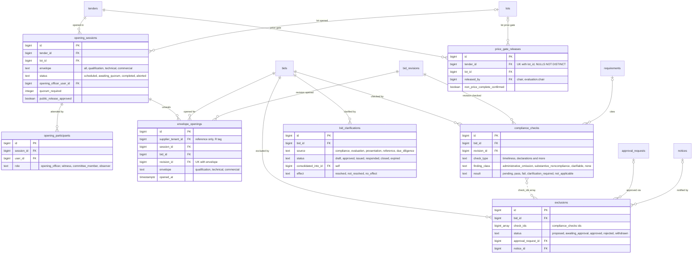
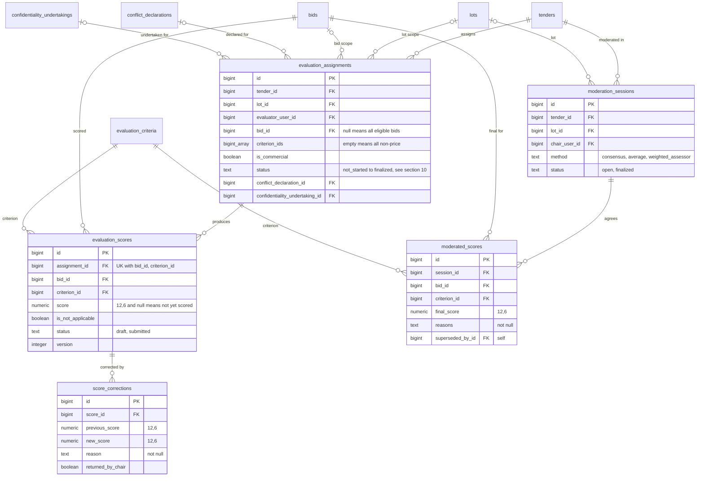
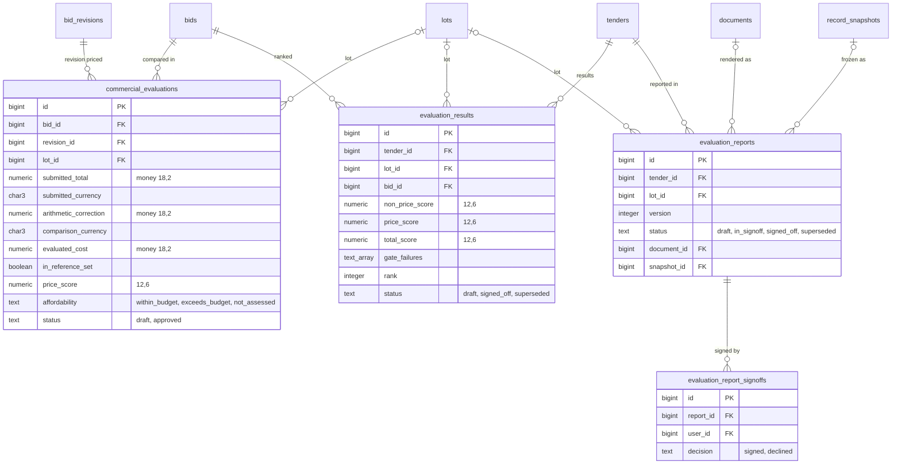
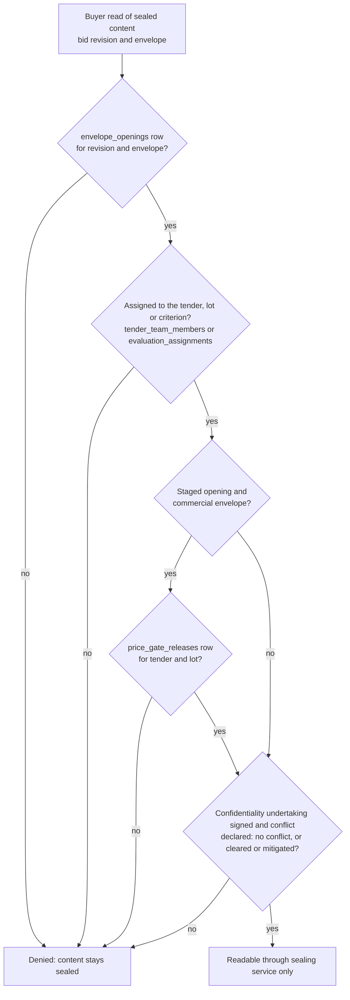
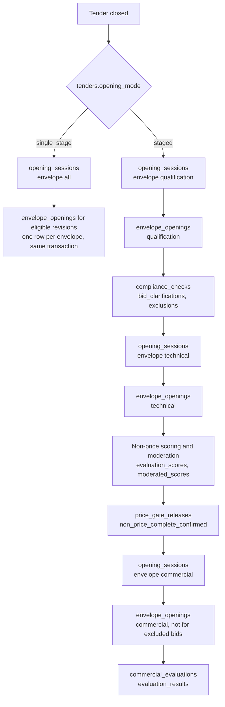

# Data model: Opening and evaluation (Migration 10)

Status: As-designed (pre-build). Updated to as-built at the end of Stage A and Stage B.

Sources:
- `docs/plan/schema-blueprint.md`: §0 Conventions; Migration 10 `20261001001000_opening_evaluation.sql`; Migration 02 (`conflict_declarations`, `confidentiality_undertakings`, `exchange_rates`, `authority_limits`); Migration 03 (`policy_profile_versions`); Migration 04 (`approval_requests`, `notices`, `documents`, `holds`); Migration 07 (`tender_envelopes`, `evaluation_plans`, `evaluation_criteria`, `scale_anchors`, `tie_break_rules`, `tender_team_members`); §P permission catalog and role templates.
- `docs/plan/architecture-plan.md`: §3.1 operator support access; §3.2 assignment-based access (BR-26); §3.3 sealing and staged opening; §3.6 state machines; §3.7 money and scoring; §3.8 notifications (`DeliveryChannel` with `in_app` and `email`); §3.9 background jobs; §3.11 prototype mode (fully static since DD-50: persona picker, mock API in the browser); §4 cross-domain writes and registries; §6 domain map (domains 10 `opening` and 11 `evaluation`); §8 testing.
- `docs/architecture-brief.md`: §5.6 tenant scoping; §6.1 to §6.3.
- `docs/PRD.md`: §3 (envelope, evaluation, moderated result); §4.1, §4.3 audience matrix; FR-13 (§7.10); FR-14 (§7.11); §8.3 evaluation assignment lifecycle; §9 evaluation and commercial comparison rules; BR-08, BR-17, BR-22, BR-23, BR-26 to BR-29; screens BUY-20, BUY-21, SUP-18, EVA-01 to EVA-06; AC-15 to AC-20.
- `docs/plan/demo-storyline.md`: T-2026-0001, T-2026-0003, T-2026-0008; additional scenario anchor AC-17; personas.
- `docs/plan/tenderiq-backend.workflow.js` (Stage B, draft): domain notes for `opening`, `evaluation` and `sealing` (who writes `price_gate_releases`, eligible revisions, scoring engine).
- `docs/plan/design-decisions.md`: DD-02 (`NULLS NOT DISTINCT`), DD-03 ([S] and [R] tags), DD-05 (sealed envelope mapping, single-stage opening), DD-06 (`evaluation_criteria.envelope` CHECK), DD-16 (owners of `price_gate_releases`, `exchange_rates`, `record_snapshots`, exports), DD-17 (opening → `submission_receipts.status`), DD-23 (`evaluation.chair` for the price gate), DD-24 (approver permissions), DD-25 (conflict gating), DD-31 (audit content for sealed records and scores), DD-32 (decimal helper), DD-43 (real Supabase Auth; superseded for Stage A by DD-50 and moved to Stage B), DD-50 (Stage A is a static prototype: persona picker, mock API in the browser, no Supabase or Docker), DD-44 (email channel next to in-app: nodemailer over SMTP, Mailpit locally, content limited to title, official deadline and link, hosted provider deferred).

Contents:
- [1. Scope, tenancy and ownership](#1-scope-tenancy-and-ownership)
- [2. Reading the data dictionary](#2-reading-the-data-dictionary)
- [3. Diagrams](#3-diagrams)
- [4. Unsealing: envelope openings and the price gate](#4-unsealing-envelope-openings-and-the-price-gate)
- [5. Data dictionary: opening](#5-data-dictionary-opening)
- [6. Data dictionary: compliance, clarifications and exclusions](#6-data-dictionary-compliance-clarifications-and-exclusions)
- [7. Data dictionary: assignments, scoring and moderation](#7-data-dictionary-assignments-scoring-and-moderation)
- [8. Data dictionary: commercial comparison, results and report](#8-data-dictionary-commercial-comparison-results-and-report)
- [9. The PRD §9.2 worked example in rows](#9-the-prd-92-worked-example-in-rows)
- [10. States and enumerations](#10-states-and-enumerations)
- [11. Constraints and indexes](#11-constraints-and-indexes)
- [12. Read access by audience](#12-read-access-by-audience)
- [13. Jobs and cross-domain touchpoints](#13-jobs-and-cross-domain-touchpoints)
- [14. Demo storyline coverage](#14-demo-storyline-coverage)
- [15. Open points finalized in Stage B](#15-open-points-finalized-in-stage-b)

Related: [data model overview](README.md), [bids and submission](08-bids-submission.md) (sealed tables, `bids`, `bid_revisions`), [tenders](06-tenders.md) (`tender_envelopes`, `evaluation_plans`, `evaluation_criteria`, `tie_break_rules`, `tender_team_members`), [organization and policy](02-organization-policy.md) (`conflict_declarations`, `confidentiality_undertakings`, `exchange_rates`), [shared services](03-shared-services.md) (`approval_requests`, `notices`, `holds`), [selection and award](10-selection-award.md), [security model](../04-security-model.md), [lifecycles](../05-lifecycles.md), [key flows](../06-key-flows.md), ADRs [0003](../adr/0003-application-layer-sealing.md), [0004](../adr/0004-text-check-constraints-not-enums.md), [0005](../adr/0005-decimal-strings-for-money-and-scores.md), [0007](../adr/0007-in-app-formal-notices.md).

---

## 1. Scope, tenancy and ownership

Migration 10 (`supabase/migrations/20261001001000_opening_evaluation.sql`, written in Stage B) holds the opening record, the **unseal record** (`envelope_openings`), the price gate, compliance review, bid clarifications, exclusions, and the complete evaluation record: assignments, individual scores, corrections, moderation, commercial comparison, results and the signed-off report.

Owners come from the architecture-plan §6 domain map. A domain writes only its own tables (architecture-plan §4).

- **`opening`** (domain 10; FR-13, BR-22, BR-23; BUY-20, BUY-21, SUP-18, EVA-03): opening sessions and participants, envelope openings, compliance checks, bid clarifications and exclusions. It also writes `bids.compliance_status` and `submission_receipts.status = 'selected_for_evaluation'` (approved cross-domain writes, architecture-plan §4, DD-17).
- **`evaluation`** (domain 11; FR-14, PRD §9, BR-26 to BR-29; EVA-01, EVA-02, EVA-04 to EVA-06): assignments, scores, corrections, moderation, commercial evaluations, results and reports. It also writes `bids.evaluation_status`. It owns `price_gate_releases`: the chair releases the gate with permission `evaluation.chair` after non-price moderation is finalized (DD-16, DD-23). It also owns the reference table `exchange_rates` ([02-organization-policy.md](02-organization-policy.md), DD-16). Evaluation uses the issued method and the approved response version, with transparent calculations and assumptions (**BR-28**): the scoring engine applies the tender's approved `evaluation_plans` row and scores only the effective revision opened in `envelope_openings`.

**No table in this migration is SEALED.** Sealed bid content lives in Migration 09 ([08-bids-submission.md](08-bids-submission.md)); the tables here control when it may be read. Evaluation tables hold restricted assessment material (PRD §4.3 "individual evaluator scores"), protected by assignment, not by sealing.

"Row tenant" is `tenant_id`. For every table here it is the **buyer** tenant. [S] and [R] tables also carry `supplier_tenant_id` = the supplier whose bid the row concerns ([ADR 0002](../adr/0002-buyer-owned-procurement-records.md)). **[S]** means supplier-accessible: the table is on the allow-list `supplier-scoped-tables.ts` that `forSupplier()` uses, generated from the blueprint tags. **[R]** means `supplier_tenant_id` is for reference only: the table is buyer-internal, never reachable through `forSupplier()`, and a guard test asserts that no [R] table is on the allow-list (DD-03). Suppliers learn outcomes only through notices and the supplier-facing projections in the API contracts. In this migration only `bid_clarifications` is [S].

| Table | Tag | Row tenant (`tenant_id`) | Owning domain | Mutable (`updated_at`) | Sealed |
|---|---|---|---|---|---|
| `opening_sessions` | [T] | buyer | opening | yes | no |
| `opening_participants` | [T] | buyer | opening | no | no |
| `envelope_openings` | [T][R] | buyer | opening | no | no (**the unseal record**) |
| `price_gate_releases` | [T] | buyer | evaluation (DD-16) | no | no |
| `compliance_checks` | [T][R] | buyer | opening | yes | no |
| `bid_clarifications` | [T][S] | buyer | opening | yes | no |
| `exclusions` | [T][R] | buyer | opening | yes | no |
| `evaluation_assignments` | [T] | buyer | evaluation | yes | no |
| `evaluation_scores` | [T][R] | buyer | evaluation | yes | no |
| `score_corrections` | [T] | buyer | evaluation | no | no |
| `moderation_sessions` | [T] | buyer | evaluation | yes | no |
| `moderated_scores` | [T][R] | buyer | evaluation | yes | no |
| `commercial_evaluations` | [T][R] | buyer | evaluation | yes | no |
| `evaluation_results` | [T][R] | buyer | evaluation | yes | no |
| `evaluation_reports` | [T] | buyer | evaluation | yes | no |
| `evaluation_report_signoffs` | [T] | buyer | evaluation | no | no |

## 2. Reading the data dictionary

| Column | Meaning |
|---|---|
| Type | Plain type: stated in the blueprint, or fixed by a §0 convention (identity and FK columns `bigint`; instants `*_at` are `timestamptz` per architecture-plan §3.4; money `numeric(18,2)`; quantities `numeric(18,4)`; scores, rates and weights `numeric(12,6)`; currency `char(3)` with CHECK `~ '^[A-Z]{3}$'`; enumerations `text` + named CHECK). *Italic* type: inferred from the column's name and meaning because the blueprint states no type. `n/s`: not specified, with the candidates given. Stage B migrations fix every final type, recorded in `supabase/schema.expected.sql`. |
| Null | `no`: NOT NULL stated by the blueprint or a §0 convention. `yes`: nullable as stated, or the column is filled only by a later lifecycle event (for example `decided_at`), which forces nullability. `n/s`: not specified by the blueprint. |
| Key / constraint | `PK`, `FK → table`, `UK` (member of a unique constraint listed in §11), CHECK lists, defaults. Every FK column is indexed (§0). |

Standard columns (§0) appear in every table: `id bigint generated always as identity primary key`, `created_at timestamptz not null default now()`, `created_by bigint references users(id)` (null = system). Mutable tables add `updated_at`, maintained by `set_updated_at()`. Scores are carried end to end as decimal strings and computed with the shared helper `src/contracts/decimal.ts`, re-exported by `src/server/lib/decimal.ts` (DD-32, [ADR 0005](../adr/0005-decimal-strings-for-money-and-scores.md)).

## 3. Diagrams

Diagram legend: solid lines are FK columns; dashed lines are logical links with no FK constraint (arrays of ids). Entities without an attribute block are defined in other data-model files. `tenant_id`, `supplier_tenant_id` and user FK columns (`*_user_id`, `*_by`) are listed in the attribute blocks, but their lines to `tenants` and `users` are omitted. Self-referencing FKs are noted in attribute comments, not drawn.

### 3.1 Opening, unsealing and compliance

### 3.2 Assignments, individual scoring and moderation

### 3.3 Commercial comparison, results and report

## 4. Unsealing: envelope openings and the price gate

**`envelope_openings` is the unseal record** (blueprint). A row states that one envelope of one bid revision was opened in one opening session at a recorded time. Without it, no buyer user can read that envelope, whatever their role. The unique key `(revision_id, envelope)` makes each envelope of each revision open exactly once.

The shared `sealing` service decides every buyer read of sealed bid content (architecture-plan §3.3). All four conditions must hold:

| Condition | Rows checked | Written by |
|---|---|---|
| Opening record | `envelope_openings (revision_id, envelope)` | opening, during a completed opening session |
| Assignment (BR-26) | `tender_team_members` ([06-tenders.md](06-tenders.md)); `evaluation_assignments` (this file) | tenders; evaluation |
| Price gate for a staged commercial envelope (AC-16) | `price_gate_releases (tender_id, lot_id)`; staged means `tenders.opening_mode = 'staged'` | evaluation (chair, permission `evaluation.chair`; DD-16, DD-23) |
| Undertaking and declaration (BR-08) | `confidentiality_undertakings`, `conflict_declarations` ([02-organization-policy.md](02-organization-policy.md)); linked from the assignment. A declaration with `has_conflict = true` blocks access while its disposition is `pending_review`; access resumes only on `cleared` or `mitigated`, and `recused` or `reassigned` block it permanently for that subject (DD-25) | the assigned user, through org-admin services |

Administration never substitutes for these rows: an `org_admin`, an `auditor` or an operator on a support grant without an assignment is denied before and after opening (AC-15; role templates; architecture-plan §3.1).

**Staged opening.** The domain notes describe the sequence: stages follow `tender_envelopes.open_order` (qualification → technical → commercial); each stage is an opening session run by the assigned opening officer (`tender_team_members.team_role = 'opening_officer'`, permission `bid.open`) with the second person or quorum the frozen policy version requires (`policy_profile_versions.opening_quorum`, `opening_requires_second_person`). Opening writes `envelope_openings` only for eligible revisions: the effective revision of each bid, excluding withdrawn and late ones. A single-stage opening (`opening_sessions.envelope = 'all'`) writes one `envelope_openings` row **per envelope** (qualification, technical, commercial) in the same transaction, so the sealing check always looks up one concrete envelope (DD-05). The first opening moves the tender from `closed` to `under_assessment` through the lifecycle service. A hold with `blocked_actions` containing `open` blocks opening ([03-shared-services.md](03-shared-services.md)).

Unopened price envelopes of failed bidders remain closed unless the approved procedure permits later release (FR-13; AC-17). An excluded bid therefore gets no commercial `envelope_openings` row.

## 5. Data dictionary: opening

### 5.1 opening_sessions

[T], mutable. Row tenant: the buyer. Owner `opening`. The opening record: participants, authority, time, envelopes opened, irregularities and permitted minutes (FR-13, BUY-20).

| Column | Type | Null | Key / constraint | Meaning |
|---|---|---|---|---|
| id | bigint | no | PK | Standard. |
| tenant_id | bigint | no | FK → tenants | Buyer tenant. |
| tender_id | bigint | n/s | FK → tenders | Tender. |
| lot_id | bigint | n/s | FK → lots | Lot opened, where lots open separately. The meaning of null (whole tender) is not stated. |
| envelope | text | n/s | CHECK (all, qualification, technical, commercial) | Stage opened; `all` is a single-stage opening. |
| scheduled_at | timestamptz | n/s | | Planned opening time (`tender_milestones.opening`). |
| opened_at | timestamptz | yes | | Recorded opening time. |
| status | text | n/s | CHECK (scheduled, awaiting_quorum, completed, aborted) | Session state. |
| opening_officer_user_id | bigint | n/s | FK → users | Assigned opening officer. |
| quorum_required | *integer* | n/s | | Participants required before opening completes (policy version fields `opening_quorum`, `opening_requires_second_person`). |
| minutes | *text* | n/s | | Permitted minutes. |
| irregularities | *text* | n/s | | Irregularities observed. |
| public_release_summary | *text* | n/s | | Information released at a public opening where the procedure requires one (FR-13). |
| public_release_approved | boolean | n/s | | Whether the public release summary is approved. |
| created_at | timestamptz | no | default now() | Standard. |
| created_by | bigint | yes | FK → users | Standard. |
| updated_at | timestamptz | no | `set_updated_at()` | Mutable marker. |

### 5.2 opening_participants

[T], not mutable. Row tenant: the buyer. Owner `opening`. Who took part in an opening and in what role (FR-13: opening requires the assigned officer and any second person or quorum).

| Column | Type | Null | Key / constraint | Meaning |
|---|---|---|---|---|
| id | bigint | no | PK | Standard. |
| tenant_id | bigint | no | FK → tenants | Buyer tenant. |
| session_id | bigint | n/s | FK → opening_sessions | Session. |
| user_id | bigint | n/s | FK → users | Participant. |
| role | text | n/s | CHECK (opening_officer, witness, committee_member, observer) | Role in the session; witnesses need `bid.witness`. |
| confirmed_at | timestamptz | yes | | When the participant confirmed presence; counts toward quorum. |
| created_at | timestamptz | no | default now() | Standard. |
| created_by | bigint | yes | FK → users | Standard. |

### 5.3 envelope_openings

[T][R], not mutable. Row tenant: the buyer. Buyer-internal: not reachable through `forSupplier()` (DD-03). Owner `opening`. **The unseal record** (blueprint). The sealing service reads it for every buyer access to sealed content (§4).

| Column | Type | Null | Key / constraint | Meaning |
|---|---|---|---|---|
| id | bigint | no | PK | Standard. |
| tenant_id | bigint | no | FK → tenants | Buyer tenant. |
| supplier_tenant_id | bigint | no | FK → tenants | Supplier whose envelope was opened (reference only, [R]). |
| session_id | bigint | n/s | FK → opening_sessions | Session that opened it. |
| bid_id | bigint | n/s | FK → bids | Bid. |
| revision_id | bigint | n/s | FK → bid_revisions; UK (revision_id, envelope) | Effective revision opened. |
| envelope | text | n/s | UK; CHECK (qualification, technical, commercial) (DD-05) | Envelope opened. A single-stage session writes one row per envelope (§4). |
| opened_at | timestamptz | n/s | | Opening time. |
| created_at | timestamptz | no | default now() | Standard. |
| created_by | bigint | yes | FK → users | Standard. |

### 5.4 price_gate_releases

[T], not mutable. Row tenant: the buyer. Owner `evaluation`, written by the chair with permission `evaluation.chair` (DD-16, DD-23). Records that the non-price review gate is met, so the commercial envelope of a staged tender may be opened and read (FR-14: "Commercial prices must remain unavailable until the required non-price review gate is met"; AC-16).

| Column | Type | Null | Key / constraint | Meaning |
|---|---|---|---|---|
| id | bigint | no | PK | Standard. |
| tenant_id | bigint | no | FK → tenants | Buyer tenant. |
| tender_id | bigint | n/s | FK → tenders; UK (tender_id, lot_id) `NULLS NOT DISTINCT` (DD-02) | Tender. |
| lot_id | bigint | n/s | FK → lots; UK | Lot released. Because the unique key is `NULLS NOT DISTINCT`, a tender can have at most one release row with a null `lot_id` (DD-02). |
| released_at | timestamptz | n/s | | Release time. |
| released_by | bigint | n/s | FK → users | Chair who released the gate (`evaluation.chair`, DD-23). |
| non_price_complete_confirmed | boolean | n/s | | Explicit confirmation that non-price assessment is complete. |
| note | *text* | n/s | | Note on the release. |
| created_at | timestamptz | no | default now() | Standard. |
| created_by | bigint | yes | FK → users | Standard. |

## 6. Data dictionary: compliance, clarifications and exclusions

### 6.1 compliance_checks

[T][R], mutable. Row tenant: the buyer. Buyer-internal (DD-03). Owner `opening`. The compliance checklist per bid (FR-13, BUY-21). Each finding cites evidence and has a disposition; the buyer distinguishes administrative omission, substantive noncompliance and a clarifiable matter.

| Column | Type | Null | Key / constraint | Meaning |
|---|---|---|---|---|
| id | bigint | no | PK | Standard. |
| tenant_id | bigint | no | FK → tenants | Buyer tenant. |
| supplier_tenant_id | bigint | no | FK → tenants | Supplier assessed. |
| bid_id | bigint | n/s | FK → bids | Bid. |
| revision_id | bigint | n/s | FK → bid_revisions | Revision assessed. |
| check_type | text | n/s | CHECK (timeliness, declarations, required_documents, eligibility, mandatory_requirement, attendance, acknowledgments, securities, lot_restrictions, qualification_status) | The FR-13 checklist areas. |
| requirement_id | bigint | n/s | FK → requirements | Requirement the check concerns (for `mandatory_requirement`). |
| finding_class | text | n/s | CHECK (administrative_omission, substantive_noncompliance, clarifiable, none) | Nature of the finding. |
| result | text | n/s | CHECK (pending, pass, fail, clarification_required, not_applicable) | Disposition. |
| reason | *text* | n/s | required when `result = 'not_applicable'` (table CHECK) | Reason for the result. |
| evidence_ref | *text* | n/s | | Evidence cited. |
| assessed_by | bigint | yes | FK → users | Assessor (`compliance.assess`). |
| assessed_at | timestamptz | yes | | Assessment time. |
| created_at | timestamptz | no | default now() | Standard. |
| created_by | bigint | yes | FK → users | Standard. |
| updated_at | timestamptz | no | `set_updated_at()` | Mutable marker. |

### 6.2 bid_clarifications

[T][S], mutable. Row tenant: the buyer. Owner `opening` (EVA-03 clarification coordination; SUP-18). A formal question to one supplier about its submitted response, with permitted scope, deadline, response and effect (FR-13). A clarification cannot become an improved offer (BR-22): the supplier's answer is text or attached documents on the clarification, never a new bid revision (domain notes).

| Column | Type | Null | Key / constraint | Meaning |
|---|---|---|---|---|
| id | bigint | no | PK | Standard. |
| tenant_id | bigint | no | FK → tenants | Buyer tenant. |
| supplier_tenant_id | bigint | no | FK → tenants | Supplier asked. |
| bid_id | bigint | n/s | FK → bids | Bid. |
| raised_by | bigint | n/s | FK → users | Buyer user who raised it (assessor or chair). |
| source | text | n/s | CHECK (compliance, evaluation, presentation, reference, due_diligence) | Stage that raised the question. |
| question | *text* | n/s | | Question text. |
| permitted_scope | *text* | n/s | | What the supplier may clarify; states the BR-22 limit. |
| due_at | timestamptz | n/s | | Response deadline. |
| status | text | n/s | CHECK (draft, approved, issued, responded, closed, expired) | Clarification state. |
| approved_by | bigint | yes | FK → users | Approver of the question before issue. |
| consolidated_into_id | bigint | yes | FK → bid_clarifications (self) | Target when the chair merges duplicate evaluator questions (EVA-03). |
| response_text | *text* | yes | | Supplier response. |
| responded_by | bigint | yes | FK → users | Supplier user who responded. |
| responded_at | timestamptz | yes | | Response time. |
| effect | text | yes | CHECK (resolved, not_resolved, no_effect); nullable (blueprint) | Effect on compliance or assessment. |
| effect_note | *text* | n/s | | Explanation of the effect. |
| created_at | timestamptz | no | default now() | Standard. |
| created_by | bigint | yes | FK → users | Standard. |
| updated_at | timestamptz | no | `set_updated_at()` | Mutable marker. |

### 6.3 exclusions

[T][R], mutable. Row tenant: the buyer. Buyer-internal (DD-03); the supplier learns of an exclusion through the formal notice. Owner `opening`. A decision to exclude a bid, with reasons, approval, notification and challenge route (FR-13). Excluded responses remain in the record but are not ranked (AC-17).

| Column | Type | Null | Key / constraint | Meaning |
|---|---|---|---|---|
| id | bigint | no | PK | Standard. |
| tenant_id | bigint | no | FK → tenants | Buyer tenant. |
| supplier_tenant_id | bigint | no | FK → tenants | Supplier excluded. |
| bid_id | bigint | n/s | FK → bids | Bid. |
| grounds | *text* | n/s | | Grounds for exclusion. |
| check_ids | bigint[] | n/s | array of `compliance_checks.id`; no FK | Checks cited as evidence. |
| status | text | n/s | CHECK (proposed, awaiting_approval, approved, rejected, withdrawn) | Decision state. |
| approval_request_id | bigint | n/s | FK → approval_requests | Approval (subject type `exclusion`; authority decision type `exclusion_approval`). |
| notice_id | bigint | yes | FK → notices | Formal notice to the supplier (notice type `exclusion`). |
| notified_at | timestamptz | yes | | Notification time. |
| challenge_route | *text* | n/s | | Challenge route stated to the supplier. |
| created_at | timestamptz | no | default now() | Standard. |
| created_by | bigint | yes | FK → users | Standard. |
| updated_at | timestamptz | no | `set_updated_at()` | Mutable marker. |

## 7. Data dictionary: assignments, scoring and moderation

### 7.1 evaluation_assignments

[T], mutable. Row tenant: the buyer. Owner `evaluation`. An evaluator's assignment (EVA-01). Assignments and stage restrictions decide access (BR-26). The evaluator accepts, signs the confidentiality undertaking and declares conflicts before seeing any content (BR-08; domain notes). PRD §8.3 states: not started, in progress, submitted, returned for correction, finalized, recused/reassigned.

| Column | Type | Null | Key / constraint | Meaning |
|---|---|---|---|---|
| id | bigint | no | PK | Standard. |
| tenant_id | bigint | no | FK → tenants | Buyer tenant. |
| tender_id | bigint | n/s | FK → tenders | Tender. |
| lot_id | bigint | n/s | FK → lots | Lot scope. |
| evaluator_user_id | bigint | n/s | FK → users | Evaluator (`evaluation.score`, or `evaluation.commercial` for commercial work). |
| bid_id | bigint | yes | FK → bids; null = all eligible bids (blueprint) | Bid scope. |
| criterion_ids | bigint[] | n/s | array of `evaluation_criteria.id`; empty = all non-price (blueprint); no FK | Criterion scope. |
| is_commercial | boolean | n/s | | Commercial assignment (EVA-04). |
| due_at | timestamptz | n/s | | Due date; drives evaluation-due reminders. |
| status | text | n/s | CHECK (not_started, in_progress, submitted, returned, finalized, recused, reassigned) | Assignment state. |
| accepted_at | timestamptz | yes | | Acceptance time. |
| conflict_declaration_id | bigint | yes | FK → conflict_declarations | Declaration made for this assignment (BR-08). |
| confidentiality_undertaking_id | bigint | yes | FK → confidentiality_undertakings | Undertaking signed for this assignment (BR-08). |
| reassigned_to_id | bigint | yes | FK target n/s | The replacement assignment or evaluator; the target is not stated (§15). |
| reassignment_reason | *text* | yes | | Why the work was reassigned; prior work is preserved (PRD §20). |
| created_at | timestamptz | no | default now() | Standard. |
| created_by | bigint | yes | FK → users | Standard. |
| updated_at | timestamptz | no | `set_updated_at()` | Mutable marker. |

### 7.2 evaluation_scores

[T][R], mutable. Row tenant: the buyer. Buyer-internal (DD-03). Owner `evaluation`. One evaluator's score for one bid on one criterion (EVA-02). A missing score is `null`, never 0 (AC-18). Submitted scores are formal records; changes after submission go through `score_corrections` (FR-14).

| Column | Type | Null | Key / constraint | Meaning |
|---|---|---|---|---|
| id | bigint | no | PK | Standard. |
| tenant_id | bigint | no | FK → tenants | Buyer tenant. |
| supplier_tenant_id | bigint | no | FK → tenants | Supplier whose bid is scored (reference only, [R]; DD-03). |
| assignment_id | bigint | n/s | FK → evaluation_assignments; UK (assignment_id, bid_id, criterion_id) | Assignment. |
| bid_id | bigint | n/s | FK → bids; UK | Bid. |
| criterion_id | bigint | n/s | FK → evaluation_criteria; UK | Criterion. |
| evaluator_user_id | bigint | n/s | FK → users | Evaluator. |
| score | numeric(12,6) | yes | NULL = not yet scored (blueprint) | Evaluator's score on the plan's scale (`evaluation_plans.scale_max`, `scale_anchors`). See §9 and §15. |
| is_not_applicable | boolean | n/s | | Criterion marked not applicable; allowed only where `evaluation_criteria.na_permitted` (PRD §9.3). |
| rationale | *text* | n/s | | Reasons for the score (FR-14). |
| evidence_refs | n/s (`text` or `text[]`) | n/s | | Evidence references. |
| clarification_needed | boolean | n/s | | Evaluator needs a clarification (feeds `bid_clarifications`, EVA-03). |
| status | text | n/s | CHECK (draft, submitted) | Draft until the evaluator submits. |
| submitted_at | timestamptz | yes | | Submission time. |
| version | integer | n/s | | Score version, incremented by corrections. |
| created_at | timestamptz | no | default now() | Standard. |
| created_by | bigint | yes | FK → users | Standard. |
| updated_at | timestamptz | no | `set_updated_at()` | Mutable marker. |

### 7.3 score_corrections

[T], not mutable. Row tenant: the buyer. Owner `evaluation`. Append-only history of changes to a submitted score: corrections require a reason and retain history (FR-14, BR-27).

| Column | Type | Null | Key / constraint | Meaning |
|---|---|---|---|---|
| id | bigint | no | PK | Standard. |
| tenant_id | bigint | no | FK → tenants | Buyer tenant. |
| score_id | bigint | n/s | FK → evaluation_scores | Score corrected. |
| previous_score | numeric(12,6) | n/s | | Score before the correction. |
| new_score | numeric(12,6) | n/s | | Score after the correction. |
| previous_rationale | *text* | n/s | | Rationale before the correction. |
| reason | *text* | no | NOT NULL (blueprint) | Why the score changed. |
| corrected_by | bigint | n/s | FK → users | Evaluator who corrected. |
| corrected_at | timestamptz | n/s | | Correction time. |
| returned_by_chair | boolean | n/s | | The chair returned the assessment for correction (EVA-05). |
| created_at | timestamptz | no | default now() | Standard. |
| created_by | bigint | yes | FK → users | Standard. |

### 7.4 moderation_sessions

[T], mutable. Row tenant: the buyer. Owner `evaluation`. A moderation of submitted assessments by the chair (EVA-05).

| Column | Type | Null | Key / constraint | Meaning |
|---|---|---|---|---|
| id | bigint | no | PK | Standard. |
| tenant_id | bigint | no | FK → tenants | Buyer tenant. |
| tender_id | bigint | n/s | FK → tenders | Tender. |
| lot_id | bigint | n/s | FK → lots | Lot. |
| chair_user_id | bigint | n/s | FK → users | Chair (`evaluation.chair`, `evaluation.moderate`). |
| method | text | n/s | CHECK (consensus, average, weighted_assessor) | Declared method; matches `evaluation_plans.aggregation_method`. |
| status | text | n/s | CHECK (open, finalized) | Session state. |
| notes | *text* | n/s | | Discussion notes. |
| finalized_at | timestamptz | yes | | Finalization time. |
| created_at | timestamptz | no | default now() | Standard. |
| created_by | bigint | yes | FK → users | Standard. |
| updated_at | timestamptz | no | `set_updated_at()` | Mutable marker. |

### 7.5 moderated_scores

[T][R], mutable. Row tenant: the buyer. Buyer-internal (DD-03). Owner `evaluation`. The agreed committee result per bid and criterion, with method and reasons. Individual scores stay available (BR-27, AC-20); a chair cannot silently replace committee opinions (FR-14), so a change supersedes the row instead of editing it.

| Column | Type | Null | Key / constraint | Meaning |
|---|---|---|---|---|
| id | bigint | no | PK | Standard. |
| tenant_id | bigint | no | FK → tenants | Buyer tenant. |
| supplier_tenant_id | bigint | no | FK → tenants | Supplier whose bid is moderated. |
| session_id | bigint | n/s | FK → moderation_sessions | Session. |
| bid_id | bigint | n/s | FK → bids | Bid. |
| criterion_id | bigint | n/s | FK → evaluation_criteria | Criterion. |
| final_score | numeric(12,6) | n/s | | Agreed score on the plan's scale. |
| method | *text* | n/s | CHECK list n/s | Method applied; `moderation_sessions.method` uses (consensus, average, weighted_assessor). |
| reasons | *text* | no | NOT NULL (blueprint) | Reasons for the agreed result. |
| moderated_by | bigint | n/s | FK → users | Chair recording the result. |
| superseded_by_id | bigint | yes | FK → moderated_scores (self) | Later result that replaces this one. |
| created_at | timestamptz | no | default now() | Standard. |
| created_by | bigint | yes | FK → users | Standard. |
| updated_at | timestamptz | no | `set_updated_at()` | Mutable marker. |

## 8. Data dictionary: commercial comparison, results and report

### 8.1 commercial_evaluations

[T][R], mutable. Row tenant: the buyer. Buyer-internal (DD-03). Owner `evaluation`. Commercial comparison per bid and lot on the issued basis (EVA-04; PRD §9.3). It keeps the submitted total, authorized corrections, conversion and evaluated cost apart (BR-29). Private sensitivity scenarios never alter official scores (EVA-04).

| Column | Type | Null | Key / constraint | Meaning |
|---|---|---|---|---|
| id | bigint | no | PK | Standard. |
| tenant_id | bigint | no | FK → tenants | Buyer tenant. |
| supplier_tenant_id | bigint | no | FK → tenants | Supplier. |
| bid_id | bigint | n/s | FK → bids | Bid. |
| revision_id | bigint | n/s | FK → bid_revisions | Revision whose prices are compared. |
| lot_id | bigint | n/s | FK → lots | Lot. |
| submitted_total | numeric(18,2) | n/s | | Total as submitted (from `bid_prices`, read through the sealing service). |
| submitted_currency | char(3) | n/s | CHECK `~ '^[A-Z]{3}$'` | Supplier's original currency; stays visible (PRD §9.3). |
| arithmetic_correction | numeric(18,2) | yes | | Authorized arithmetic correction, recorded separately from the submitted figure. Whether it stores the delta or the corrected total is fixed in Stage B. |
| correction_rule | *text* | yes | | Rule applied for the correction. |
| correction_approved_by | bigint | yes | FK → users | Approver of the correction. |
| supplier_ack_at | timestamptz | yes | | Supplier acknowledgment of the correction, where required. |
| fx_rate | n/s (`numeric(12,6)` rate convention, or `numeric(18,8)` as `exchange_rates.rate`) | yes | | Exchange rate applied. |
| fx_source | *text* | yes | | Rate source (`evaluation_plans.fx_source`). |
| fx_date | *date* | yes | | Rate date (`evaluation_plans.fx_date`). |
| comparison_currency | char(3) | n/s | CHECK `~ '^[A-Z]{3}$'` | Comparison currency (`evaluation_plans.comparison_currency`). |
| evaluated_cost | numeric(18,2) | n/s | | Evaluated cost on the issued basis (taxes, options, recurring charges, whole-life cost). |
| excluded_items_note | *text* | n/s | | Items excluded from comparison and why. |
| assumptions | *text* | n/s | | Comparison assumptions. |
| abnormally_low_flag | *boolean* | n/s | | Flag for documented review; never an automatic rejection (PRD §9.3; domain notes). |
| abnormally_low_review | *text* | n/s | | Outcome of the abnormally-low review. |
| in_reference_set | boolean | n/s | | Offer is in the reference set of a relative price formula (PRD §9.3). |
| reference_exclusion_reason | *text* | n/s | | Why an offer is outside the reference set. |
| price_score | numeric(12,6) | n/s | | Price score from `evaluation_plans.price_method`. |
| affordability | text | n/s | CHECK (within_budget, exceeds_budget, not_assessed) | Affordability, displayed separately from rank (PRD §9.3). |
| status | text | n/s | CHECK (draft, approved) | Comparison state. |
| created_at | timestamptz | no | default now() | Standard. |
| created_by | bigint | yes | FK → users | Standard. |
| updated_at | timestamptz | no | `set_updated_at()` | Mutable marker. |

### 8.2 evaluation_results

[T][R], mutable. Row tenant: the buyer. Buyer-internal (DD-03). Owner `evaluation`; read by the selection and awards domains (domain notes). The computed result per bid and lot, produced by the pure scoring engine in `domains/evaluation/scoring` (architecture-plan §3.7). Rank is decision support, not an award (PRD §9.3).

| Column | Type | Null | Key / constraint | Meaning |
|---|---|---|---|---|
| id | bigint | no | PK | Standard. |
| tenant_id | bigint | no | FK → tenants | Buyer tenant. |
| supplier_tenant_id | bigint | no | FK → tenants | Supplier. |
| tender_id | bigint | n/s | FK → tenders | Tender. |
| lot_id | bigint | n/s | FK → lots | Lot. |
| bid_id | bigint | n/s | FK → bids | Bid. |
| non_price_score | numeric(12,6) | n/s | | Weighted non-price points. |
| price_score | numeric(12,6) | n/s | | Price points. |
| total_score | numeric(12,6) | n/s | | Total at `evaluation_plans.decimal_places_calc` precision (default 4). |
| total_score_display | n/s (`text` or `numeric`) | n/s | | Total rounded to `decimal_places_display` (default 2). A display-rounded tie must not hide different decision values (PRD §9.3). |
| passes_gates | *boolean* | n/s | | All mandatory gates and thresholds passed. |
| gate_failures | text[] | n/s | | Gates failed; a strong price cannot offset a failed mandatory requirement (PRD §9.1). |
| rank | integer | yes | | Rank among eligible bids. |
| tie_break_applied | n/s (`boolean` or `text` naming the rule) | n/s | | Whether and which `tie_break_rules` entry decided the order. |
| status | text | n/s | CHECK (draft, signed_off, superseded) | Result state. |
| computed_at | timestamptz | n/s | | Computation time. |
| created_at | timestamptz | no | default now() | Standard. |
| created_by | bigint | yes | FK → users | Standard. |
| updated_at | timestamptz | no | `set_updated_at()` | Mutable marker. |

### 8.3 evaluation_reports

[T], mutable. Row tenant: the buyer. Owner `evaluation`. The versioned evaluation record with committee sign-off (EVA-06). It is frozen as a `record_snapshots` row and rendered as a document for export.

| Column | Type | Null | Key / constraint | Meaning |
|---|---|---|---|---|
| id | bigint | no | PK | Standard. |
| tenant_id | bigint | no | FK → tenants | Buyer tenant. |
| tender_id | bigint | n/s | FK → tenders | Tender. |
| lot_id | bigint | n/s | FK → lots | Lot. |
| version | *integer* | n/s | | Report version. |
| status | text | n/s | CHECK (draft, in_signoff, signed_off, superseded) | Report state. |
| summary | *text* | n/s | | Report summary. |
| document_id | bigint | yes | FK → documents | Rendered report (print-styled HTML or XLSX). |
| snapshot_id | bigint | yes | FK → record_snapshots | Immutable snapshot of the signed content (BR-09). |
| created_at | timestamptz | no | default now() | Standard. |
| created_by | bigint | yes | FK → users | Standard. |
| updated_at | timestamptz | no | `set_updated_at()` | Mutable marker. |

### 8.4 evaluation_report_signoffs

[T], not mutable. Row tenant: the buyer. Owner `evaluation`. Each committee member's sign-off decision on a report version (EVA-06).

| Column | Type | Null | Key / constraint | Meaning |
|---|---|---|---|---|
| id | bigint | no | PK | Standard. |
| tenant_id | bigint | no | FK → tenants | Buyer tenant. |
| report_id | bigint | n/s | FK → evaluation_reports | Report. |
| user_id | bigint | n/s | FK → users | Signer (`evaluation.signoff`). |
| decision | text | n/s | CHECK (signed, declined) | Decision. |
| note | *text* | n/s | | Note, for example why sign-off was declined. |
| decided_at | timestamptz | n/s | | Decision time. |
| created_at | timestamptz | no | default now() | Standard. |
| created_by | bigint | yes | FK → users | Standard. |

## 9. The PRD §9.2 worked example in rows

The demo tender T-2026-0003 carries exactly the PRD §9.2 numbers (architecture-plan §3.7; demo storyline). AC-19 requires Supplier A (Serowe ICT) = 86.00 and Supplier B (Tsodilo) = 88.00, with B ranked first. The ratings below are the PRD rule solved backwards: weighted points = rating ÷ 5 × maximum points.

| Criterion (`evaluation_criteria`) | `max_points` | A rating | A points | B rating | B points |
|---|---|---|---|---|---|
| Solution quality | 35 | 4 | 28.00 | 4.5 | 31.50 |
| Delivery approach | 20 | 4 | 16.00 | 4.5 | 18.00 |
| Relevant experience | 15 | 4 | 12.00 | 4.5 | 13.50 |
| Price (`is_price`) | 30 | n/a | 30.00 | n/a | 25.00 |
| **Total** | 100 | | **86.00** | | **88.00** |

| Value | Where it is stored |
|---|---|
| Individual ratings | `evaluation_scores.score` per evaluator; a missing criterion stays `null` (AC-18) |
| Agreed rating per criterion | `moderated_scores.final_score` with `reasons` (AC-20: the demo moderation changes one score) |
| Non-price points: A 56.00, B 63.00 | `evaluation_results.non_price_score` |
| Evaluated cost: A 100,000, B 120,000 (same comparison currency) | `commercial_evaluations.evaluated_cost`, `comparison_currency` |
| Price score: lowest ÷ this × 30 → A 30, B 25 | `commercial_evaluations.price_score`, copied into `evaluation_results.price_score`; `evaluation_plans.price_method = 'lowest_ratio'`, `price_weight = 30` |
| Totals 86.00 and 88.00 | `evaluation_results.total_score` (4 decimals), `total_score_display` (2 decimals) |
| B ranked first | `evaluation_results.rank` |

## 10. States and enumerations

All enumerations are `text` columns with a named CHECK ([ADR 0004](../adr/0004-text-check-constraints-not-enums.md)). The same lists are defined once in `src/contracts/enums.ts`, and a Stage A contract test checks that they match the blueprint (architecture-plan §3.6, §8). Transition rules live in [05-lifecycles.md](../05-lifecycles.md).

| Table.column | Values | Notes |
|---|---|---|
| opening_sessions.envelope | all, qualification, technical, commercial | `all` = single-stage opening. |
| opening_sessions.status | scheduled, awaiting_quorum, completed, aborted | |
| opening_participants.role | opening_officer, witness, committee_member, observer | |
| envelope_openings.envelope | qualification, technical, commercial | DD-05; a single-stage (`all`) session writes one row per envelope. |
| compliance_checks.check_type | timeliness, declarations, required_documents, eligibility, mandatory_requirement, attendance, acknowledgments, securities, lot_restrictions, qualification_status | FR-13 checklist. |
| compliance_checks.finding_class | administrative_omission, substantive_noncompliance, clarifiable, none | |
| compliance_checks.result | pending, pass, fail, clarification_required, not_applicable | `not_applicable` requires `reason`. |
| bid_clarifications.source | compliance, evaluation, presentation, reference, due_diligence | |
| bid_clarifications.status | draft, approved, issued, responded, closed, expired | |
| bid_clarifications.effect | resolved, not_resolved, no_effect | Nullable. |
| exclusions.status | proposed, awaiting_approval, approved, rejected, withdrawn | |
| evaluation_assignments.status | not_started, in_progress, submitted, returned, finalized, recused, reassigned | PRD §8.3. |
| evaluation_scores.status | draft, submitted | |
| moderation_sessions.method | consensus, average, weighted_assessor | |
| moderation_sessions.status | open, finalized | |
| moderated_scores.method | n/s | Candidates as `moderation_sessions.method`. |
| commercial_evaluations.affordability | within_budget, exceeds_budget, not_assessed | |
| commercial_evaluations.status | draft, approved | |
| evaluation_results.status | draft, signed_off, superseded | |
| evaluation_reports.status | draft, in_signoff, signed_off, superseded | |
| evaluation_report_signoffs.decision | signed, declined | |

## 11. Constraints and indexes

**Unique constraints (stated in the blueprint)**

| Table | Unique |
|---|---|
| envelope_openings | (revision_id, envelope) |
| price_gate_releases | `UNIQUE NULLS NOT DISTINCT` (tender_id, lot_id) (DD-02) |
| evaluation_scores | (assignment_id, bid_id, criterion_id) |

**Other constraints**

- `envelope_openings.envelope` carries CHECK (`qualification`, `technical`, `commercial`) (DD-05). `opening_sessions.envelope` keeps its own list, which adds `all`.
- `compliance_checks`: a `not_applicable` result requires a reason (blueprint), equivalent to `CHECK (result <> 'not_applicable' OR reason IS NOT NULL)`.
- NOT NULL beyond the standard columns: `score_corrections.reason`, `moderated_scores.reasons`.
- Currency columns (`submitted_currency`, `comparison_currency`) carry CHECK `~ '^[A-Z]{3}$'`.
- Arrays `exclusions.check_ids` and `evaluation_assignments.criterion_ids` hold ids without FK enforcement; the services validate membership.

**Service-enforced rules**

- An `envelope_openings` row is written only inside a completed opening session with the officer and the required second person or quorum, for eligible effective revisions (non-withdrawn, non-late), and for a staged commercial envelope only after a `price_gate_releases` row exists (domain notes; AC-16).
- Independent evaluation (`tenders.independent_evaluation`): an evaluator cannot read other evaluators' scores before submitting their own and before the moderation stage (FR-14).
- A missing score is `null`; the scoring engine never substitutes 0 and never changes the denominator without the approved method (PRD §9.3, AC-18).
- Submitted scores change only by appending a `score_corrections` row with a reason and bumping `evaluation_scores.version`; moderation supersedes `moderated_scores` rows instead of editing them (BR-27).
- Calculations use decimal strings with the plan's declared precision, through the shared helper `src/contracts/decimal.ts` (re-exported by `src/server/lib/decimal.ts`, DD-32); ties are decided on calculation precision with the published `tie_break_rules` sequence (PRD §9.3).
- An `exclusions` row reaches `approved` only through the approvals service with authority for `exclusion_approval`; deciding a step requires `approval.decide`, the decision-specific permission (`exclusion.approve`) and sufficient authority (DD-24). The bid's `compliance_status` becomes `excluded` in the same transaction (architecture-plan §4).
- Opening marks each receipt it selects for evaluation with `submission_receipts.status = 'selected_for_evaluation'` in the triggering transaction, audited (approved cross-domain write, architecture-plan §4, DD-17).

**Indexes**

- Every FK column is indexed, including `supplier_tenant_id` on [S] and [R] tables.
- Tenant-leading list indexes follow the screens: `evaluation_assignments (tenant_id, evaluator_user_id, status)` for EVA-01; `compliance_checks (tenant_id, bid_id)`; `evaluation_results (tenant_id, tender_id, lot_id, status)` for EVA-06; `opening_sessions (tenant_id, tender_id, status)` for BUY-20. The exact set is fixed with the Stage B list queries.

## 12. Read access by audience

Access is assignment-based (BR-26, architecture-plan §3.2). A tenant administrator without an assignment sees nothing restricted (AC-15). Each contract endpoint declares its permission ([07-api.md](../07-api.md)). Full rules: [04-security-model.md](../04-security-model.md).

Supplier access uses `forSupplier()`, which reaches only [S] tables. Every [R] table below is buyer-internal and never reachable from a supplier route; the supplier learns outcomes only through notices and the supplier-facing projections in the API contracts (DD-03).

| Table | Buyer | Supplier | Operator, public | Relevant permissions (§P) |
|---|---|---|---|---|
| opening_sessions, opening_participants | Tender team, opening officer and witnesses | Only the approved public opening information (`public_release_summary` with `public_release_approved`); the release channel is fixed in Stage B | Public: approved public opening information only | bid.open, bid.witness |
| envelope_openings ([R]) | Read by the sealing service; visible to the tender team as the opening record | Not reachable (DD-03) | None | bid.open |
| price_gate_releases | Chair and evaluation team | None | None | evaluation.chair (DD-23) |
| compliance_checks ([R]) | Compliance assessors and tender team | Not reachable (DD-03); findings reach the supplier through clarifications and exclusion notices | None | compliance.assess |
| bid_clarifications ([S]) | Chair, raising assessor, tender team | Own bid's clarifications once issued; responds within the permitted scope (SUP-18) | None | compliance.assess, evaluation.chair; supplier.response.edit |
| exclusions ([R]) | Tender team, approvers | Not reachable (DD-03); own exclusion only through the formal notice with the challenge route | None | exclusion.approve with approval.decide and authority (DD-24), notice.issue |
| evaluation_assignments | Chair; the assigned evaluator (own rows) | None | None | evaluation.chair, evaluation.score |
| evaluation_scores ([R]), score_corrections | Author; the chair and authorized oversight; other committee members only at the permitted stage (PRD §4.3) | Never (PRD §4.3; [R], DD-03) | None; a support grant never includes scores (architecture-plan §3.1) | evaluation.score, evaluation.chair, evaluation.moderate |
| moderation_sessions, moderated_scores ([R]) | Chair and permitted committee | Not reachable (DD-03); own result only at the level debriefing permits (AC-27) | None | evaluation.moderate |
| commercial_evaluations ([R]) | Commercial reviewers after the price gate | Not reachable (DD-03); an arithmetic correction reaches the supplier through a notice or a supplier-facing projection, and `supplier_ack_at` records its acknowledgment | None | evaluation.commercial |
| evaluation_results ([R]), evaluation_reports, evaluation_report_signoffs | Selection team, committee, award approvers | Own outcome only, through award notices and debriefing | None | evaluation.signoff, award.recommend |

The `auditor` template is read-only with `audit.view` and `export.create` and has no sealed access (§P). Search, totals, exports and notifications must not reveal restricted assessment material (BR-43). Audit rows never carry sealed content or evaluator scores in `before_state` / `after_state`: those actions record ids and hashes only with `sensitivity = 'restricted'`, and the audit viewer shows restricted rows only to `audit.view` holders, redacted to metadata (DD-31).

## 13. Jobs and cross-domain touchpoints

| Mechanism | Tables | Behavior |
|---|---|---|
| `deadline-reminders` job, `15 * * * *`, owner notifications | `evaluation_assignments.due_at` | Evaluation-due reminders to assessor, chair and escalation owner (architecture-plan §3.9; PRD §14.3). |
| Cross-domain column writes | `bids.compliance_status` ← opening; `submission_receipts.status = 'selected_for_evaluation'` ← opening; `bids.evaluation_status` ← evaluation | Only through the owning service transaction, audited (architecture-plan §4, DD-17). |
| Lifecycle service | tenders, lots | First opening moves the tender `closed → under_assessment`; lot stages change only through lifecycle (architecture-plan §4). |
| Sealing service | `envelope_openings`, `price_gate_releases`, `evaluation_assignments` | `assertEnvelopeReadable()` and `readableEnvelopes()` read these rows (§4). Integration tests cover AC-15 (admin, auditor and support denied before and after opening without assignment) and AC-16 (commercial denied before the gate). |
| Approvals outcome registry | `exclusions.approval_request_id` | Final outcome for subject type `exclusion` in `domains/approvals/outcome-registry.ts`. |
| Notices | `exclusions.notice_id` | Formal exclusion notice with challenge route through the notifications service. As a formal notice it goes to both channels: `in_app`, and `email` where `EMAIL_ENABLED` (nodemailer over SMTP; Mailpit locally; hosted provider deferred). The email carries only the title, official deadline and a link, never bid, evaluation or other confidential content (DD-44, [ADR 0007](../adr/0007-in-app-formal-notices.md)). |
| Selection and awards | `evaluation_results` | Shortlists are built from results; the award recommendation reads them ([10-selection-award.md](10-selection-award.md)). |
| Exports and snapshots | `evaluation_reports` | Export type `evaluation_report` through the documents service `requestExport()` and the `exports` queue; evaluation registers the generator in `documents/export-registry.ts`, wired by Integration (DD-16). `record_snapshots` (owned by the core lifecycle service, DD-16) freezes the signed content. |
| Reference data | `exchange_rates` (owned by evaluation, DD-16), `evaluation_plans`, `tie_break_rules`, `scale_anchors` | Read by the scoring engine; the selected comparison basis is preserved even if reference values change later (PRD §16). |

**Stage A.** None of these tables exist. The mock API serves fixtures typed against `src/contracts` (`src/mock-api/fixtures/opening.ts`, `evaluation.ts`). The T-2026-0003 fixtures carry exactly the §9.2 numbers, and only assigned personas receive opened content (architecture-plan §3.3, §3.7, [ADR 0006](../adr/0006-contracts-first-ui-prototype-stage.md)). Commands persist nothing. Personas are chosen in the sign-in page's persona picker; the in-browser mock API maps the chosen persona to its fixture persona, and Stage A uses no Supabase and no Docker (DD-50).

## 14. Demo storyline coverage

| Storyline element | Rows |
|---|---|
| T-2026-0003 SCADA telemetry upgrade (`under_assessment`, staged opening): technical opened, price gate released (AC-16) | `opening_sessions` and `envelope_openings` per stage; `price_gate_releases` |
| Two bids scored reproducing PRD §9.2 (AC-19) | §9 rows in `evaluation_scores`, `moderated_scores`, `commercial_evaluations`, `evaluation_results` |
| One evaluator missing a criterion (AC-18) | an `evaluation_scores` row with `score` null (or no row), assignment still `in_progress` |
| Moderation changed one score (AC-20) | `moderated_scores` row with `reasons`; the individual `evaluation_scores` stay unchanged |
| `sam.dual` (KWU evaluator, also Tsodilo and Chobe contributor): conflict routed for review on T-2026-0003 (AC-02) | `conflict_declarations` linked from `evaluation_assignments.conflict_declaration_id` |
| T-2026-0008 (`closed`, awaiting opening): `admin.kwu` and `support.agent` cannot read (AC-15) | no `envelope_openings` rows |
| T-2026-0001 Lot 3 under evaluation | assignments and draft scores for that lot |
| T-2026-0003: Makgadikgadi's bid fails mandatory requirement REQ-Q-03 (ISO 9001 certificate); an exclusion awaits approval and its commercial envelope stays sealed (AC-17) | `compliance_checks` (`check_type = mandatory_requirement`, `result = fail`, `evidence_ref` citing the evidence); `exclusions.status = awaiting_approval` with `approval_request_id`; no commercial `envelope_openings` row for that bid |
| Personas | `oratile.opener` (opening officer), `goitse.witness` (witness), `boitumelo.chair`, `thato.eval`, `kabo.eval`, `amantle.eval`, `refilwe.commercial` |

## 15. Open points finalized in Stage B

1. **Envelope values.** Resolved — DD-05: `envelope_openings.envelope` has CHECK (qualification, technical, commercial), and a single-stage session (`opening_sessions.envelope = 'all'`) writes one row per envelope in the same transaction.
2. **Nulls in `price_gate_releases (tender_id, lot_id)`.** Resolved — DD-02: the key is `UNIQUE NULLS NOT DISTINCT (tender_id, lot_id)`, so a whole-tender release with `lot_id = null` cannot be duplicated. Still open: the meaning of a null `lot_id` in `opening_sessions`.
3. **[S] on individual scores.** Resolved — DD-03: `evaluation_scores`, `moderated_scores` (and `envelope_openings`, `compliance_checks`, `exclusions`, `commercial_evaluations`, `evaluation_results`) are [R], never on the `forSupplier()` allow-list; a guard test enforces it.
4. **`evaluation_assignments.reassigned_to_id` target.** It is not stated whether it references the replacement assignment (self-FK) or the replacement user.
5. **Score semantics.** Whether `evaluation_scores.score` and `moderated_scores.final_score` hold the rating on the plan scale (as documented here, per PRD §9.2) or weighted points.
6. **Types left open.** `fx_rate` precision; `total_score_display`; `tie_break_applied`; `evidence_refs`; whether `arithmetic_correction` is a delta or the corrected total.
7. **Owner of `price_gate_releases`.** Resolved — DD-16: owned by evaluation and written by the chair with permission `evaluation.chair` (DD-23).
8. **Missing uniqueness.** No unique key on `evaluation_reports (tender_id, lot_id, version)`, on `commercial_evaluations (bid_id, revision_id, lot_id)`, or on `evaluation_results` per (tender, lot, bid) among non-superseded rows.
9. **Clarification attachments.** `bid_clarifications` has no document column; attachments must use the polymorphic `documents.related_type` / `related_id` and a registered entry in `domains/documents/access-registry.ts`.
10. **Public opening release channel.** How an approved `public_release_summary` reaches suppliers or the public (notice or portal) is not specified. DD-44 settles only how a notice is delivered (`in_app`, plus `email` where enabled), not whether this summary is released as a notice or on the portal.
