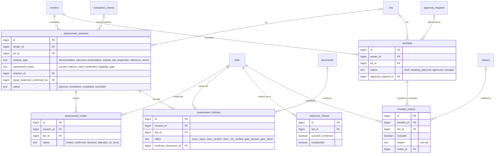
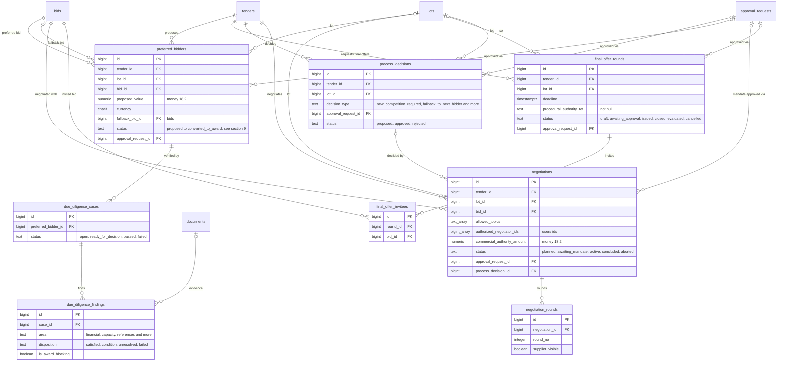
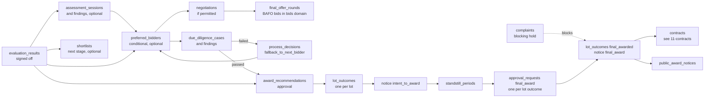

# Data model: Selection and award (Migration 11)

Status: As-designed (pre-build). Updated to as-built at the end of Stage A and Stage B.

Sources:
- `docs/plan/schema-blueprint.md`: §0 Conventions; Migration 11 `20261001001100_selection_award.sql`; Migration 02 (`authority_limits.decision_type`); Migration 03 (`policy_profile_versions` negotiation, BAFO, standstill and complaint fields); Migration 04 (`approval_requests`, `notices`, `holds`, `record_snapshots` from Migration 01); Migration 07 (`tenders`, `lots`); Migration 09 (`bids.round_type`, `bids.final_offer_round_id`); Migration 14 (`v_public_awards`); §P permission catalog.
- `docs/plan/architecture-plan.md`: §3.5 approvals and authority; §3.6 state machines and holds; §3.8 notifications (`DeliveryChannel` with `in_app` and `email`); §3.9 background jobs (`standstill-monitor`, `expire-approvals`); §3.11 prototype mode (fully static since DD-50: persona picker, mock API in the browser); §4 cross-domain writes, shared owners and registries; §6 domain map (domains 12 `selection` and 13 `awards`).
- `docs/architecture-brief.md`: §5.6 tenant scoping; §6.1 to §6.3.
- `docs/PRD.md`: §3 (award, complaint); §4.3; FR-15 (§7.12); FR-16 (§7.13); FR-17 (§7.14); §8.2 tender lifecycle; §8.3 complaint lifecycle; §9.3; §14.3; §18.1; §20; BR-13, BR-30 to BR-34; screens BUY-22 to BUY-30, SUP-18, SUP-19, SUP-21, SUP-22, PUB-05; AC-21 to AC-27, AC-29, AC-39.
- `docs/plan/demo-storyline.md`: T-2026-0001, T-2026-0004, T-2026-0007, T-2026-0009, T-2026-0010; personas.
- `docs/plan/tenderiq-backend.workflow.js` (Stage B, draft): domain notes for `selection` and `awards` (fallback decisions, final-award gate, closeout gate).
- `docs/plan/design-decisions.md`: DD-01 (forward FKs), DD-03 ([S] and [R] tags), DD-09 (reference formats), DD-13 (`v_public_awards`), DD-14 (approval subject types, final award, several recommendations per tender), DD-16 (owners of `process_decisions`, `holds`, `tasks`, `record_snapshots`, exports), DD-17 (selection → `evidence_submissions`), DD-18 (`expire-approvals`), DD-22 (buyer slug in public URLs), DD-23 (`supplier.notices.acknowledge`), DD-24 (approver permissions), DD-43 (real Supabase Auth; superseded for Stage A by DD-50 and moved to Stage B), DD-50 (Stage A is a static prototype: persona picker, mock API in the browser, no Supabase or Docker), DD-44 (email channel next to in-app: nodemailer over SMTP, Mailpit locally, content limited to title, official deadline and link, hosted provider deferred).

Contents:
- [1. Scope, tenancy and ownership](#1-scope-tenancy-and-ownership)
- [2. Reading the data dictionary](#2-reading-the-data-dictionary)
- [3. Diagrams](#3-diagrams)
- [4. From evaluation result to final award](#4-from-evaluation-result-to-final-award)
- [5. Data dictionary: supplementary assessment and shortlist](#5-data-dictionary-supplementary-assessment-and-shortlist)
- [6. Data dictionary: preferred bidder, diligence, negotiation and final offers](#6-data-dictionary-preferred-bidder-diligence-negotiation-and-final-offers)
- [7. Data dictionary: award, standstill and outcomes](#7-data-dictionary-award-standstill-and-outcomes)
- [8. Data dictionary: debriefs, complaints, public notice and closeout](#8-data-dictionary-debriefs-complaints-public-notice-and-closeout)
- [9. States and enumerations](#9-states-and-enumerations)
- [10. Constraints and indexes](#10-constraints-and-indexes)
- [11. Read access by audience](#11-read-access-by-audience)
- [12. Jobs and cross-domain touchpoints](#12-jobs-and-cross-domain-touchpoints)
- [13. Demo storyline coverage](#13-demo-storyline-coverage)
- [14. Open points finalized in Stage B](#14-open-points-finalized-in-stage-b)

Related: [data model overview](README.md), [opening and evaluation](09-opening-evaluation.md) (`evaluation_results`, `bid_clarifications`), [bids and submission](08-bids-submission.md) (`bids`, BAFO bids), [tenders](06-tenders.md) (`tenders`, `lots`, `evaluation_criteria`), [shared services](03-shared-services.md) (`approval_requests`, `notices`, `holds`), [contracts](11-contracts.md) (`contracts`, `contract_lot_allocations`, `handovers`), [records, reporting and operations](12-records-reporting-operations.md) (`v_public_awards`), [security model](../04-security-model.md), [lifecycles](../05-lifecycles.md), [key flows](../06-key-flows.md), [background jobs](../08-background-jobs.md), ADRs [0002](../adr/0002-buyer-owned-procurement-records.md), [0004](../adr/0004-text-check-constraints-not-enums.md), [0005](../adr/0005-decimal-strings-for-money-and-scores.md), [0007](../adr/0007-in-app-formal-notices.md).

---

## 1. Scope, tenancy and ownership

Migration 11 (`supabase/migrations/20261001001100_selection_award.sql`, written in Stage B) holds everything between a signed-off evaluation and a closed event: supplementary assessment (demonstrations, interviews, references), shortlists, preferred bidders, due diligence, negotiation, final-offer (BAFO) rounds, process decisions, the award recommendation and per-lot outcomes, standstill, debriefs, complaints, the public award notice and event closeout.

Owners come from the architecture-plan §6 domain map. A domain writes only its own tables (architecture-plan §4).

- **`selection`** (domain 12; FR-15, FR-16, BR-30, BR-31; BUY-22 to BUY-25, BUY-27, SUP-19; AC-21 to AC-24): assessment sessions, invites, findings, reference checks, shortlists, preferred bidders, due diligence, negotiations and final-offer rounds with invitees. Supplier BAFO **bids** are owned by `bids` ([08-bids-submission.md](08-bids-submission.md)).
- **`awards`** (domain 13; FR-17, BR-32 to BR-34; BUY-26, BUY-28 to BUY-30, SUP-21, SUP-22, PUB-05; AC-25 to AC-27, AC-29, AC-39): award recommendations, lot outcomes, standstill periods, debriefs, complaints and their events, public award notices and event closeouts.
- **`process_decisions`** is owned by the shared **core (lifecycle) service**, which exposes `recordProcessDecision()` (DD-16). Selection calls it for a blocked negotiation or BAFO (AC-23) and a fallback to the next bidder (AC-24), and awards for a departure from rank (domain notes). The same core service owns `holds` and `record_snapshots`, and the approvals service owns `tasks` (DD-16).

Tender and lot status change only through the shared lifecycle service (architecture-plan §4). No table here is SEALED or partitioned.

"Row tenant" is `tenant_id`, always the **buyer**. [S] and [R] tables carry `supplier_tenant_id` = the supplier concerned ([ADR 0002](../adr/0002-buyer-owned-procurement-records.md)). **[S]** means supplier-accessible: the table is on the allow-list `supplier-scoped-tables.ts` that `forSupplier()` uses, generated from the blueprint tags. **[R]** means `supplier_tenant_id` is for reference only: the table is buyer-internal, never reachable through `forSupplier()`, and a guard test asserts that no [R] table is on the allow-list. Suppliers learn outcomes only through notices and the supplier-facing projections in the API contracts (DD-03). Two documented variations: `lot_outcomes.supplier_tenant_id` is nullable for `no_award` and `cancelled` outcomes, and `complaints.supplier_tenant_id` is the complainant organization.

| Table | Tag | Row tenant (`tenant_id`) | Owning domain | Mutable (`updated_at`) |
|---|---|---|---|---|
| `assessment_sessions` | [T] | buyer | selection | yes |
| `assessment_invites` | [T][S] | buyer | selection | yes |
| `assessment_findings` | [T][R] | buyer | selection | yes |
| `reference_checks` | [T][R] | buyer | selection | yes |
| `shortlists` | [T] | buyer | selection | yes |
| `shortlist_entries` | [T][R] | buyer | selection | yes |
| `preferred_bidders` | [T][R] | buyer | selection | yes |
| `due_diligence_cases` | [T][R] | buyer | selection | yes |
| `due_diligence_findings` | [T][R] | buyer | selection | yes |
| `negotiations` | [T][R] | buyer | selection | yes |
| `negotiation_rounds` | [T][S] | buyer | selection | yes |
| `final_offer_rounds` | [T] | buyer | selection | yes |
| `final_offer_invitees` | [T][S] | buyer | selection | no |
| `process_decisions` | [T] | buyer | core lifecycle service (`recordProcessDecision()`, DD-16); called by selection and awards | yes |
| `award_recommendations` | [T] | buyer | awards | yes |
| `lot_outcomes` | [T][S] (supplier nullable for no_award, cancelled) | buyer | awards | yes |
| `standstill_periods` | [T] | buyer | awards | yes |
| `debrief_requests` | [T][S] | buyer | awards | yes |
| `complaints` | [T][S] (supplier = complainant) | buyer | awards | yes |
| `complaint_events` | [T] | buyer | awards | no |
| `public_award_notices` | [T] | buyer | awards | yes |
| `event_closeouts` | [T] | buyer | awards | yes |

## 2. Reading the data dictionary

| Column | Meaning |
|---|---|
| Type | Plain type: stated in the blueprint, or fixed by a §0 convention (identity and FK columns `bigint`; instants `*_at` are `timestamptz` per architecture-plan §3.4; money `numeric(18,2)`; quantities `numeric(18,4)`; scores, rates and weights `numeric(12,6)`; currency `char(3)` with CHECK `~ '^[A-Z]{3}$'`; enumerations `text` + named CHECK). *Italic* type: inferred from the column's name and meaning because the blueprint states no type. `n/s`: not specified, with the candidates given. Stage B migrations fix every final type, recorded in `supabase/schema.expected.sql`. |
| Null | `no`: NOT NULL stated by the blueprint or a §0 convention. `yes`: nullable as stated, or the column is filled only by a later lifecycle event (for example `decided_at`), which forces nullability. `n/s`: not specified by the blueprint. |
| Key / constraint | `PK`, `FK → table`, `UK` (member of a unique constraint listed in §10), CHECK lists, defaults. Every FK column is indexed (§0). |

Standard columns (§0) appear in every table: `id bigint generated always as identity primary key`, `created_at timestamptz not null default now()`, `created_by bigint references users(id)` (null = system). Mutable tables add `updated_at`, maintained by `set_updated_at()`.

## 3. Diagrams

Diagram legend: solid lines are FK columns; dashed lines are logical links with no FK constraint. Entities without an attribute block are defined in other data-model files. `tenant_id`, `supplier_tenant_id` and user FK columns (`*_user_id`, `*_by`) are listed in the attribute blocks, but their lines to `tenants` and `users` are omitted. Self-referencing FKs are noted in attribute comments.

### 3.1 Supplementary assessment and shortlist

### 3.2 Preferred bidder, due diligence, negotiation, final offers and process decisions

### 3.3 Award, standstill, debriefs, complaints and closeout

```mermaid
erDiagram
    tenders ||--o{ award_recommendations : "recommended in"
    record_snapshots |o--o{ award_recommendations : "frozen as"
    award_recommendations ||--o{ lot_outcomes : "decides"
    lots ||--o{ lot_outcomes : "outcome of"
    bids |o--o{ lot_outcomes : "awarded bid"
    tenders ||--o{ standstill_periods : "waits"
    notices |o--o{ standstill_periods : "intent notice"
    tenders ||--o{ debrief_requests : "debriefs"
    bids ||--o{ debrief_requests : "for bid"
    tenders ||--o{ complaints : "challenged by"
    approval_requests |o--o{ award_recommendations : "approved via"
    approval_requests |o--o{ lot_outcomes : "final award approval"
    tenders ||--o{ lot_outcomes : "decided in"
    lots |o--o{ standstill_periods : "lot"
    lots |o--o{ complaints : "lot"
    holds |o--o{ complaints : "blocking hold"
    complaints ||--o{ complaint_events : "history"
    tenders ||--o{ public_award_notices : "published as"
    tenders ||--o{ event_closeouts : "closed by"
    tenders |o--o{ event_closeouts : "linked next event"

    award_recommendations {
        bigint id PK
        bigint tender_id FK "several per tender over time"
        integer version
        text status "draft, awaiting_approval, approved, returned, rejected, superseded"
        bigint approval_request_id FK "subject award"
        bigint snapshot_id FK
    }
    lot_outcomes {
        bigint id PK
        bigint supplier_tenant_id FK "null only for no_award, cancelled"
        bigint recommendation_id FK
        bigint tender_id FK
        bigint lot_id FK
        text outcome "award, partial_award, conditional_award, no_award, cancelled"
        bigint bid_id FK
        numeric awarded_value "money 18,2"
        text status "recommended, approved, intent_notified, final_awarded, withdrawn"
        bigint final_award_approval_id FK "subject final_award"
    }
    standstill_periods {
        bigint id PK
        bigint tender_id FK
        bigint lot_id FK
        bigint intent_notice_id FK
        timestamptz ends_at
        text status "running, extended, suspended, completed, not_applicable"
    }
    debrief_requests {
        bigint id PK
        bigint tender_id FK
        bigint bid_id FK
        text status "requested, scheduled, provided, declined"
    }
    complaints {
        bigint id PK
        bigint supplier_tenant_id FK "complainant organization"
        text reference "CMP-2026-0001"
        bigint tender_id FK
        bigint lot_id FK
        text status "received to closed, see section 9"
        boolean is_blocking
        bigint hold_id FK
    }
    complaint_events {
        bigint id PK
        bigint complaint_id FK
        text from_status
        text to_status
    }
    public_award_notices {
        bigint id PK
        bigint tender_id FK
        boolean disclosed_values
        text status "draft, approved, published, withdrawn"
    }
    event_closeouts {
        bigint id PK
        bigint tender_id FK
        text status "in_progress, blocked, closed, archived"
        bigint linked_next_tender_id FK "tenders"
        text_array blocking_reasons
    }
```

## 4. From evaluation result to final award

Substages are optional and depend on the procedure and the frozen policy version (PRD §8.2 "Under assessment": optional shortlist and due diligence). Rank is decision support; nothing here awards automatically (PRD §9.3, §17.2).

**Final-award gate.** Final award requires all applicable approvals, satisfied award conditions, resolution of blocking complaints, and completion of any applicable waiting period (FR-17, BR-32). The awards service checks, per lot:

| Condition | Rows | Blocks when |
|---|---|---|
| Recommendation (intent) approval | `award_recommendations.approval_request_id` → `approval_requests` (subject type `award`; authority `award_approval`) | not `approved` (or `approved_with_conditions` with unmet conditions) |
| Final award approval (DD-14) | `lot_outcomes.final_award_approval_id` → `approval_requests` (subject type `final_award`), one per lot outcome and distinct from the intent approval | not `approved` |
| Preferred bidder diligence (AC-24) | `due_diligence_findings.is_award_blocking`, `due_diligence_cases.status` | any award-blocking finding unresolved, or the case `failed` |
| Blocking complaint (AC-25) | `complaints.is_blocking`, `complaints.hold_id` → `holds` with `blocked_actions` containing `award_final` or `contract_sign` | the hold is not released |
| Waiting period | `standstill_periods.status` for the tender or lot | `running`, `extended` or `suspended` |
| Award conditions | `lot_outcomes.conditions` | not satisfied |

The `standstill-monitor` job only creates a task when a standstill ends with no blocking hold; it never awards (architecture-plan §3.9). The intention-to-award notice is distinct from the final award notice (FR-17), and final award is its own approval per lot outcome (DD-14). Deciding any approval step requires `approval.decide`, the decision-specific permission (for example `award.approve`) and sufficient authority; cross-currency authority uses `exchange_rates` at the request date, and with no rate the step routes to the next level up (DD-24). A hold never changes dates; a changed date needs its own decision and notice (BR-13).

**Several recommendations per tender (DD-14).** A tender can have several `award_recommendations` over time, each covering the lots listed in its `lot_outcomes`, so lots on different timelines are supported (PRD §20).

**Per-lot outcomes.** Each lot has an explicit outcome (BR-33). The tender's aggregate status (`awarded`, `partially_awarded`, `completed_without_award`) is set by the lifecycle service from its lots, so a tender with one lot awarded, one cancelled and one still in evaluation is `partially_awarded`, not complete (AC-26).

## 5. Data dictionary: supplementary assessment and shortlist

### 5.1 assessment_sessions

[T], mutable. Row tenant: the buyer. Owner `selection`. A demonstration, interview, presentation, sample, site inspection or reference-check session (FR-15, BUY-22). It states whether the outcome feeds a scored criterion, verifies a claim, or is an eligibility gate, so there is no unannounced double counting (PRD §9.3).

| Column | Type | Null | Key / constraint | Meaning |
|---|---|---|---|---|
| id | bigint | no | PK | Standard. |
| tenant_id | bigint | no | FK → tenants | Buyer tenant. |
| tender_id | bigint | n/s | FK → tenders | Tender. |
| lot_id | bigint | n/s | FK → lots | Lot. |
| session_type | text | n/s | CHECK (demonstration, interview, presentation, sample, site_inspection, reference_check) | Kind of session. |
| purpose | *text* | n/s | | Purpose. |
| agenda | *text* | n/s | | Agenda. |
| assessment_basis | text | n/s | CHECK (scored_criterion, claim_verification, eligibility_gate) | Declared effect of the outcome. |
| criterion_id | bigint | n/s | FK → evaluation_criteria | Criterion scored, when the basis is `scored_criterion`. |
| instructions | *text* | n/s | | Instructions given to every equivalent candidate (FR-15). |
| preparation_days | *integer* | n/s | | Preparation time given to candidates. |
| equal_treatment_confirmed_by | bigint | yes | FK → users | Who confirmed comparable instructions, time and treatment. |
| status | text | n/s | CHECK (planned, scheduled, completed, cancelled) | Session state. |
| created_at | timestamptz | no | default now() | Standard. |
| created_by | bigint | yes | FK → users | Standard. |
| updated_at | timestamptz | no | `set_updated_at()` | Mutable marker. |

### 5.2 assessment_invites

[T][S], mutable. Row tenant: the buyer. Owner `selection`. A bid's invitation to a session; the supplier confirms participation (SUP-18).

| Column | Type | Null | Key / constraint | Meaning |
|---|---|---|---|---|
| id | bigint | no | PK | Standard. |
| tenant_id | bigint | no | FK → tenants | Buyer tenant. |
| supplier_tenant_id | bigint | no | FK → tenants | Supplier invited. |
| session_id | bigint | n/s | FK → assessment_sessions | Session. |
| bid_id | bigint | n/s | FK → bids | Bid. |
| scheduled_at | timestamptz | n/s | | Appointment time. |
| status | text | n/s | CHECK (invited, confirmed, declined, attended, no_show) | Invitation state. |
| supplier_confirmed_at | timestamptz | yes | | Supplier confirmation time. |
| supplier_confirmed_by | bigint | yes | FK → users | Supplier user who confirmed. |
| created_at | timestamptz | no | default now() | Standard. |
| created_by | bigint | yes | FK → users | Standard. |
| updated_at | timestamptz | no | `set_updated_at()` | Mutable marker. |

### 5.3 assessment_findings

[T][R], mutable. Row tenant: the buyer. Buyer-internal (DD-03). Owner `selection`. An assessor's finding for one bid in a session, with its declared effect and evidence (AC-21).

| Column | Type | Null | Key / constraint | Meaning |
|---|---|---|---|---|
| id | bigint | no | PK | Standard. |
| tenant_id | bigint | no | FK → tenants | Buyer tenant. |
| supplier_tenant_id | bigint | no | FK → tenants | Supplier assessed. |
| session_id | bigint | n/s | FK → assessment_sessions | Session. |
| bid_id | bigint | n/s | FK → bids | Bid. |
| assessor_user_id | bigint | n/s | FK → users | Assessor. |
| finding | *text* | n/s | | Finding. |
| effect | text | n/s | CHECK (score_input, claim_verified, claim_not_verified, gate_passed, gate_failed) | Effect; must match the session's `assessment_basis`. |
| evidence_document_id | bigint | n/s | FK → documents | Supporting evidence. |
| created_at | timestamptz | no | default now() | Standard. |
| created_by | bigint | yes | FK → users | Standard. |
| updated_at | timestamptz | no | `set_updated_at()` | Mutable marker. |

### 5.4 reference_checks

[T][R], mutable. Row tenant: the buyer. Buyer-internal (DD-03). Owner `selection`. A reference taken on a bid. Reference contacts must be authorized and their feedback treated under the stated confidentiality rules (FR-15).

| Column | Type | Null | Key / constraint | Meaning |
|---|---|---|---|---|
| id | bigint | no | PK | Standard. |
| tenant_id | bigint | no | FK → tenants | Buyer tenant. |
| supplier_tenant_id | bigint | no | FK → tenants | Supplier referenced. |
| bid_id | bigint | n/s | FK → bids | Bid. |
| referee_name | *text* | n/s | | Referee. |
| referee_organization | *text* | n/s | | Referee's organization. |
| consent_confirmed | boolean | n/s | | Contact authorized (FR-15). |
| contacted_at | timestamptz | yes | | Contact time. |
| feedback | *text* | n/s | | Referee feedback. |
| confidential | boolean | n/s | | Feedback is confidential and is not disclosed to the supplier. |
| assessor_user_id | bigint | n/s | FK → users | Assessor. |
| outcome | *text* | n/s | no value list stated | Assessor's conclusion. |
| created_at | timestamptz | no | default now() | Standard. |
| created_by | bigint | yes | FK → users | Standard. |
| updated_at | timestamptz | no | `set_updated_at()` | Mutable marker. |

### 5.5 shortlists

[T], mutable. Row tenant: the buyer. Owner `selection`. The stage selection with its rule, threshold, reasons and approval (FR-15, BUY-23, AC-22). A change after approval needs a recorded decision and review of affected invitations and deadlines.

| Column | Type | Null | Key / constraint | Meaning |
|---|---|---|---|---|
| id | bigint | no | PK | Standard. |
| tenant_id | bigint | no | FK → tenants | Buyer tenant. |
| tender_id | bigint | n/s | FK → tenders | Tender. |
| lot_id | bigint | n/s | FK → lots | Lot. |
| stage_no | *integer* | n/s | | Stage the shortlist admits to (`tenders.stage_no` of the next stage). |
| selection_rule | *text* | n/s | | Ranking or threshold rule applied. |
| threshold | n/s (`numeric(12,6)` score, or `text`) | n/s | | Threshold used by the rule. |
| rationale | *text* | n/s | | Selection rationale. |
| status | text | n/s | CHECK (draft, awaiting_approval, approved, changed) | Shortlist state. |
| approval_request_id | bigint | n/s | FK → approval_requests | Approval (subject type `shortlist`; authority `shortlist_approval`). |
| approved_at | timestamptz | yes | | Approval time. |
| change_reason | *text* | yes | | Recorded decision for a change after approval. |
| created_at | timestamptz | no | default now() | Standard. |
| created_by | bigint | yes | FK → users | Standard. |
| updated_at | timestamptz | no | `set_updated_at()` | Mutable marker. |

### 5.6 shortlist_entries

[T][R], mutable. Row tenant: the buyer. Buyer-internal (DD-03); the candidate learns the outcome through the `shortlist_outcome` notice. Owner `selection`. One candidate's inclusion or exclusion with reasons (AC-22).

| Column | Type | Null | Key / constraint | Meaning |
|---|---|---|---|---|
| id | bigint | no | PK | Standard. |
| tenant_id | bigint | no | FK → tenants | Buyer tenant. |
| supplier_tenant_id | bigint | no | FK → tenants | Candidate supplier. |
| shortlist_id | bigint | n/s | FK → shortlists | Shortlist. |
| bid_id | bigint | n/s | FK → bids | Candidate bid. |
| included | boolean | n/s | | Included in the next stage. |
| rank | *integer* | n/s | | Rank used by the rule. |
| reason | *text* | no | NOT NULL (blueprint) | Reason for inclusion or exclusion. |
| conditions | *text* | n/s | | Conditions attached to inclusion. |
| notified_at | timestamptz | yes | | Notification time. |
| notice_id | bigint | yes | FK → notices | Outcome notice (notice type `shortlist_outcome`). |
| created_at | timestamptz | no | default now() | Standard. |
| created_by | bigint | yes | FK → users | Standard. |
| updated_at | timestamptz | no | `set_updated_at()` | Mutable marker. |

## 6. Data dictionary: preferred bidder, diligence, negotiation and final offers

### 6.1 preferred_bidders

[T][R], mutable. Row tenant: the buyer. Buyer-internal (DD-03); the supplier learns its status through the `preferred_bidder` notice. Owner `selection`. A conditional selection outcome, never an unconditional award (BR-31). It records scope, value, rationale, remaining checks, negotiation topics, decision owner and contingency (FR-16, BUY-24).

| Column | Type | Null | Key / constraint | Meaning |
|---|---|---|---|---|
| id | bigint | no | PK | Standard. |
| tenant_id | bigint | no | FK → tenants | Buyer tenant. |
| supplier_tenant_id | bigint | no | FK → tenants | Preferred supplier. |
| tender_id | bigint | n/s | FK → tenders | Tender. |
| lot_id | bigint | n/s | FK → lots | Lot. |
| bid_id | bigint | n/s | FK → bids | Preferred bid. |
| scope | *text* | n/s | | Proposed scope. |
| proposed_value | numeric(18,2) | n/s | | Proposed value. |
| currency | char(3) | n/s | CHECK `~ '^[A-Z]{3}$'` | Currency of `proposed_value`. |
| rationale | *text* | n/s | | Rationale. |
| remaining_checks | *text* | n/s | | Checks still to complete. |
| negotiation_topics | *text* | n/s | | Authorized negotiation topics (`negotiations.allowed_topics` is `text[]`). |
| decision_owner_user_id | bigint | n/s | FK → users | Decision owner. |
| contingency_plan | *text* | n/s | | What happens if the preferred bidder cannot proceed. |
| fallback_bid_id | bigint | yes | FK → bids | Declared fallback bid. |
| status | text | n/s | CHECK (proposed, awaiting_approval, approved, withdrawn, failed_diligence, superseded, converted_to_award) | State. |
| approval_request_id | bigint | n/s | FK → approval_requests | Approval (subject type `preferred_bidder`; authority `preferred_bidder_approval`). |
| status_reason | *text* | yes | | Reason for the current status (for example failed diligence). |
| created_at | timestamptz | no | default now() | Standard. |
| created_by | bigint | yes | FK → users | Standard. |
| updated_at | timestamptz | no | `set_updated_at()` | Mutable marker. |

### 6.2 due_diligence_cases

[T][R], mutable. Row tenant: the buyer. Buyer-internal (DD-03). Owner `selection`. Verification of a preferred bidder's claims before award (FR-16, BUY-25). Failure blocks award (AC-24).

| Column | Type | Null | Key / constraint | Meaning |
|---|---|---|---|---|
| id | bigint | no | PK | Standard. |
| tenant_id | bigint | no | FK → tenants | Buyer tenant. |
| supplier_tenant_id | bigint | no | FK → tenants | Supplier verified. |
| preferred_bidder_id | bigint | n/s | FK → preferred_bidders | Preferred bidder. |
| owner_user_id | bigint | n/s | FK → users | Case owner (`diligence.manage`). |
| status | text | n/s | CHECK (open, ready_for_decision, passed, failed) | Case state. |
| decided_by | bigint | yes | FK → users | Decision maker. |
| decided_at | timestamptz | yes | | Decision time. |
| decision_note | *text* | yes | | Decision reasoning. |
| created_at | timestamptz | no | default now() | Standard. |
| created_by | bigint | yes | FK → users | Standard. |
| updated_at | timestamptz | no | `set_updated_at()` | Mutable marker. |

### 6.3 due_diligence_findings

[T][R], mutable. Row tenant: the buyer. Buyer-internal (DD-03). Owner `selection`. A finding by area. Every finding needs a disposition, owner and due date if unresolved (FR-16).

| Column | Type | Null | Key / constraint | Meaning |
|---|---|---|---|---|
| id | bigint | no | PK | Standard. |
| tenant_id | bigint | no | FK → tenants | Buyer tenant. |
| supplier_tenant_id | bigint | no | FK → tenants | Supplier. |
| case_id | bigint | n/s | FK → due_diligence_cases | Case. |
| area | text | n/s | CHECK (financial, capacity, references, insurance, licenses, restrictions, ownership, key_personnel, subcontractors, contract_exceptions, security) | FR-16 areas. |
| finding | *text* | n/s | | Finding. |
| disposition | text | n/s | CHECK (satisfied, condition, unresolved, failed) | Disposition. |
| owner_user_id | bigint | n/s | FK → users | Owner while unresolved. |
| due_at | timestamptz | n/s | | Due date while unresolved. |
| evidence_document_id | bigint | n/s | FK → documents | Evidence; supplier evidence is pinned through `evidence_submissions` (context type `due_diligence`). |
| is_award_blocking | boolean | n/s | | Blocks the award while unresolved. |
| created_at | timestamptz | no | default now() | Standard. |
| created_by | bigint | yes | FK → users | Standard. |
| updated_at | timestamptz | no | `set_updated_at()` | Mutable marker. |

### 6.4 negotiations

[T][R], mutable. Row tenant: the buyer. Buyer-internal (DD-03); the supplier sees its negotiation only through `negotiation_rounds` marked `supplier_visible`. Owner `selection`. A negotiation with one bidder under a mandate (FR-16, BUY-27, BR-30). It is possible only when `tenders.negotiation_permitted` and the frozen policy version permit it; otherwise the action is blocked and a process decision is required (AC-23; domain notes).

| Column | Type | Null | Key / constraint | Meaning |
|---|---|---|---|---|
| id | bigint | no | PK | Standard. |
| tenant_id | bigint | no | FK → tenants | Buyer tenant. |
| supplier_tenant_id | bigint | no | FK → tenants | Supplier negotiated with. |
| tender_id | bigint | n/s | FK → tenders | Tender. |
| lot_id | bigint | n/s | FK → lots | Lot. |
| bid_id | bigint | n/s | FK → bids | Bid. |
| allowed_topics | text[] | n/s | | Topics the mandate allows. |
| authorized_negotiator_ids | bigint[] | n/s | array of `users.id`; no FK | Who may negotiate. |
| commercial_authority_amount | numeric(18,2) | n/s | | Commercial authority of the mandate. |
| currency | char(3) | n/s | CHECK `~ '^[A-Z]{3}$'` | Currency of the authority amount. |
| status | text | n/s | CHECK (planned, awaiting_mandate, active, concluded, aborted) | Negotiation state. |
| approval_request_id | bigint | n/s | FK → approval_requests | Mandate approval (subject type `negotiation_mandate`; authority `negotiation_mandate`). |
| outcome_summary | *text* | n/s | | Outcome. |
| affects_competition_basis | boolean | n/s | | Material scope change or harm to the basis of competition; requires a process decision (FR-16). |
| process_decision_id | bigint | yes | FK → process_decisions | Decision taken because of this negotiation. |
| created_at | timestamptz | no | default now() | Standard. |
| created_by | bigint | yes | FK → users | Standard. |
| updated_at | timestamptz | no | `set_updated_at()` | Mutable marker. |

### 6.5 negotiation_rounds

[T][S], mutable. Row tenant: the buyer. Owner `selection`. A meeting or exchange in a negotiation. Competitors' confidential prices or solutions are never disclosed (FR-16).

| Column | Type | Null | Key / constraint | Meaning |
|---|---|---|---|---|
| id | bigint | no | PK | Standard. |
| tenant_id | bigint | no | FK → tenants | Buyer tenant. |
| supplier_tenant_id | bigint | no | FK → tenants | Supplier. |
| negotiation_id | bigint | n/s | FK → negotiations | Negotiation. |
| round_no | *integer* | n/s | | Round number. |
| meeting_at | timestamptz | n/s | | Meeting time. |
| participants | *text* | n/s | | Participants. |
| minutes | *text* | n/s | | Minutes. |
| buyer_proposal | *text* | n/s | | Buyer's proposal. |
| supplier_proposal | *text* | n/s | | Supplier's proposal. |
| concessions | *text* | n/s | | Concessions made. |
| unresolved_issues | *text* | n/s | | Open issues. |
| supplier_response_at | timestamptz | yes | | Supplier response time. |
| supplier_visible | boolean | n/s | | Whether the round record is shown to the supplier (SUP-19). |
| created_at | timestamptz | no | default now() | Standard. |
| created_by | bigint | yes | FK → users | Standard. |
| updated_at | timestamptz | no | `set_updated_at()` | Mutable marker. |

### 6.6 final_offer_rounds

[T], mutable. Row tenant: the buyer. Owner `selection`. A formally requested final response round (BAFO) with eligible audience, instructions, permitted changes, deadline, opening rules and evaluation treatment (FR-16). It requires explicit procedural authority (BR-30). Earlier offers stay visible for comparison; the round does not rewrite them.

| Column | Type | Null | Key / constraint | Meaning |
|---|---|---|---|---|
| id | bigint | no | PK | Standard. |
| tenant_id | bigint | no | FK → tenants | Buyer tenant. |
| tender_id | bigint | n/s | FK → tenders | Tender. |
| lot_id | bigint | n/s | FK → lots | Lot. |
| instructions | *text* | n/s | | Instructions, identical for every invitee. |
| permitted_changes | *text* | n/s | | What invitees may change. |
| deadline | *timestamptz* | n/s | | Official deadline for final offers (an instant, architecture-plan §3.4). |
| opening_rules | *text* | n/s | | How final offers are opened. |
| evaluation_treatment | *text* | n/s | | Declared evaluation treatment. |
| procedural_authority_ref | *text* | no | NOT NULL (blueprint) | Procedural authority for the round. |
| status | text | n/s | CHECK (draft, awaiting_approval, issued, closed, evaluated, cancelled) | Round state. |
| approval_request_id | bigint | n/s | FK → approval_requests | Approval (subject type `final_offer_round`). |
| created_at | timestamptz | no | default now() | Standard. |
| created_by | bigint | yes | FK → users | Standard. |
| updated_at | timestamptz | no | `set_updated_at()` | Mutable marker. |

### 6.7 final_offer_invitees

[T][S], not mutable. Row tenant: the buyer. Owner `selection`. The eligible audience of a final-offer round. A BAFO bid (`bids.round_type = 'bafo'`) may reference the round only if its supplier is invited (domain notes).

| Column | Type | Null | Key / constraint | Meaning |
|---|---|---|---|---|
| id | bigint | no | PK | Standard. |
| tenant_id | bigint | no | FK → tenants | Buyer tenant. |
| supplier_tenant_id | bigint | no | FK → tenants | Invited supplier. |
| round_id | bigint | n/s | FK → final_offer_rounds | Round. |
| bid_id | bigint | n/s | FK → bids | The supplier's earlier bid that qualifies it. |
| notified_at | timestamptz | yes | | Notification time. |
| created_at | timestamptz | no | default now() | Standard. |
| created_by | bigint | yes | FK → users | Standard. |

### 6.8 process_decisions

[T], mutable. Row tenant: the buyer. Owner: the core (lifecycle) service, which exposes `recordProcessDecision()`; selection and awards call it (DD-16). A recorded, approved procedural decision: new competition, fallback to the next bidder, reopening a round, a deadline extension, cancellation, no award, a late exception, or a restart after an incident (FR-16; PRD §20).

| Column | Type | Null | Key / constraint | Meaning |
|---|---|---|---|---|
| id | bigint | no | PK | Standard. |
| tenant_id | bigint | no | FK → tenants | Buyer tenant. |
| tender_id | bigint | n/s | FK → tenders | Tender. |
| lot_id | bigint | n/s | FK → lots | Lot. |
| decision_type | text | n/s | CHECK (new_competition_required, fallback_to_next_bidder, reopen_round, deadline_extension, cancellation, no_award, late_exception, restart_after_incident, other) | Decision kind. |
| reason | *text* | n/s | | Reason. |
| decided_by | bigint | yes | FK → users | Decision maker. |
| approval_request_id | bigint | n/s | FK → approval_requests | Approval (subject type `process_decision`). |
| status | text | n/s | CHECK (proposed, approved, rejected) | Decision state. |
| created_at | timestamptz | no | default now() | Standard. |
| created_by | bigint | yes | FK → users | Standard. |
| updated_at | timestamptz | no | `set_updated_at()` | Mutable marker. |

## 7. Data dictionary: award, standstill and outcomes

### 7.1 award_recommendations

[T], mutable. Row tenant: the buyer. Owner `awards`. The versioned recommendation that brings together compliant offers, evaluation, commercial comparison, affordability, qualification, diligence, allocation, conflicts, exceptions, negotiation results and unresolved conditions (FR-17, BUY-26). Approvers approve, reject or return it. A tender can have several recommendations over time, each covering the lots listed in its `lot_outcomes`, so lots on different timelines are supported (DD-14).

| Column | Type | Null | Key / constraint | Meaning |
|---|---|---|---|---|
| id | bigint | no | PK | Standard. |
| tenant_id | bigint | no | FK → tenants | Buyer tenant. |
| tender_id | bigint | n/s | FK → tenders | Tender (several recommendations per tender are allowed, DD-14). |
| version | *integer* | n/s | | Recommendation version; approvals target an exact version (BR-10). |
| status | text | n/s | CHECK (draft, awaiting_approval, approved, returned, rejected, superseded) | State. |
| summary | *text* | n/s | | Recommendation summary. |
| compliant_offers_summary | *text* | n/s | | Compliant offers. |
| affordability_summary | *text* | n/s | | Affordability. |
| conflicts_summary | *text* | n/s | | Conflicts. |
| exceptions_summary | *text* | n/s | | Exceptions. |
| negotiation_summary | *text* | n/s | | Negotiation results. |
| unresolved_conditions | *text* | n/s | | Conditions still open. |
| approval_request_id | bigint | n/s | FK → approval_requests | Approval of the recommendation, which is the intent to award (subject type `award`; authority `award_approval`). Final award is approved separately per lot outcome (§7.2, DD-14). |
| snapshot_id | bigint | yes | FK → record_snapshots | Immutable snapshot of the approved version (BR-09). |
| created_at | timestamptz | no | default now() | Standard. |
| created_by | bigint | yes | FK → users | Standard. |
| updated_at | timestamptz | no | `set_updated_at()` | Mutable marker. |

### 7.2 lot_outcomes

[T][S], mutable. Row tenant: the buyer. Owner `awards`. The explicit outcome of one lot (BR-33, AC-26). `supplier_tenant_id` is nullable **only** for `no_award` and `cancelled` outcomes, a documented exception to the [S] rule (blueprint). Final-awarded outcomes feed contracts ([11-contracts.md](11-contracts.md)); the public sees them only through a published `public_award_notices` row in `v_public_awards` (DD-13).

| Column | Type | Null | Key / constraint | Meaning |
|---|---|---|---|---|
| id | bigint | no | PK | Standard. |
| tenant_id | bigint | no | FK → tenants | Buyer tenant. |
| supplier_tenant_id | bigint | yes | FK → tenants; null only when `outcome` is `no_award` or `cancelled` | Awarded supplier. |
| recommendation_id | bigint | n/s | FK → award_recommendations | Recommendation that decides the lot. |
| tender_id | bigint | n/s | FK → tenders | Tender. |
| lot_id | bigint | n/s | FK → lots | Lot. |
| outcome | text | n/s | CHECK (award, partial_award, conditional_award, no_award, cancelled) | Outcome type (FR-17: full, partial, conditional, no award). |
| bid_id | bigint | n/s | FK → bids | Awarded bid; logically absent for `no_award` and `cancelled`. |
| awarded_value | numeric(18,2) | n/s | | Awarded value; reconciles with the selected offer plus approved negotiation changes (FR-17). |
| currency | char(3) | n/s | CHECK `~ '^[A-Z]{3}$'` | Currency. |
| conditions | *text* | n/s | | Award conditions. |
| reason | *text* | n/s | | Reason, required in substance for no award or cancellation. |
| status | text | n/s | CHECK (recommended, approved, intent_notified, final_awarded, withdrawn) | Outcome state. |
| final_awarded_at | timestamptz | yes | | Final award time. |
| final_award_approval_id | bigint | yes | FK → approval_requests | Final award approval for this lot outcome (subject type `final_award`), distinct from the recommendation's intent approval (DD-14). |
| final_award_approved_by | bigint | yes | FK → users | Approver of the final award. |
| created_at | timestamptz | no | default now() | Standard. |
| created_by | bigint | yes | FK → users | Standard. |
| updated_at | timestamptz | no | `set_updated_at()` | Mutable marker. |

### 7.3 standstill_periods

[T], mutable. Row tenant: the buyer. Owner `awards`. The waiting or challenge period started by an intention-to-award notice (FR-17, BUY-28). Length and day type come from the frozen policy version (`standstill_required`, `standstill_length`, `standstill_day_type`); working days use the tender calendar (BR-12). There is no universal duration.

| Column | Type | Null | Key / constraint | Meaning |
|---|---|---|---|---|
| id | bigint | no | PK | Standard. |
| tenant_id | bigint | no | FK → tenants | Buyer tenant. |
| tender_id | bigint | n/s | FK → tenders | Tender. |
| lot_id | bigint | n/s | FK → lots | Lot, when lots run separate periods. |
| intent_notice_id | bigint | n/s | FK → notices | Intention-to-award notice (notice type `intent_to_award`). The notice's `period_start_basis` defines what starts the period. |
| starts_at | timestamptz | n/s | | Start. |
| ends_at | timestamptz | n/s | | Original end. |
| day_type | *text* | n/s | CHECK list n/s | Calendar or working days; the policy field uses (calendar, working). |
| extended_to | *timestamptz* | yes | | Extended end. |
| extension_reason | *text* | yes | | Reason for extension (for example a complaint). |
| status | text | n/s | CHECK (running, extended, suspended, completed, not_applicable) | Period state. |
| not_applicable_reason | *text* | yes | | Why no standstill applies. |
| created_at | timestamptz | no | default now() | Standard. |
| created_by | bigint | yes | FK → users | Standard. |
| updated_at | timestamptz | no | `set_updated_at()` | Mutable marker. |

## 8. Data dictionary: debriefs, complaints, public notice and closeout

### 8.1 debrief_requests

[T][S], mutable. Row tenant: the buyer. Owner `awards`. A supplier's debrief request and response. Debriefing explains the recipient's own result at the permitted level without other bidders' confidential content (FR-17, SUP-21, AC-27).

| Column | Type | Null | Key / constraint | Meaning |
|---|---|---|---|---|
| id | bigint | no | PK | Standard. |
| tenant_id | bigint | no | FK → tenants | Buyer tenant. |
| supplier_tenant_id | bigint | no | FK → tenants | Requesting supplier. |
| tender_id | bigint | n/s | FK → tenders | Tender. |
| bid_id | bigint | n/s | FK → bids | Supplier's bid. |
| requested_by | bigint | n/s | FK → users | Supplier user. |
| requested_at | timestamptz | n/s | | Request time. |
| due_at | timestamptz | n/s | | Response due. |
| meeting_at | timestamptz | yes | | Meeting time. |
| written_response | *text* | yes | | Written debrief. |
| status | text | n/s | CHECK (requested, scheduled, provided, declined) | State. |
| effect_on_deadlines | *text* | n/s | | Recorded effect on standstill or challenge deadlines (FR-17). |
| provided_by | bigint | yes | FK → users | Buyer user who provided it (`debrief.manage`). |
| created_at | timestamptz | no | default now() | Standard. |
| created_by | bigint | yes | FK → users | Standard. |
| updated_at | timestamptz | no | `set_updated_at()` | Mutable marker. |

### 8.2 complaints

[T][S], mutable. Row tenant: the buyer. `supplier_tenant_id` = the complainant organization. Owner `awards`. A formal complaint or challenge (PRD §3; FR-17; BUY-29, SUP-22). A procurement hold is a separate record (`holds`), linked here (PRD §8.3). A complaint is not handled solely by the person whose conduct is challenged when policy requires independent review (`policy_profile_versions.complaint_requires_independent_review`).

| Column | Type | Null | Key / constraint | Meaning |
|---|---|---|---|---|
| id | bigint | no | PK | Standard. |
| tenant_id | bigint | no | FK → tenants | Buyer tenant. |
| supplier_tenant_id | bigint | no | FK → tenants | Complainant organization. |
| reference | text | no | UK (tenant_id, reference) (§0) | Human reference `CMP-2026-0001` from `next_reference()`; the year is the year in the buyer tenant's official time zone (DD-09). |
| tender_id | bigint | n/s | FK → tenders | Tender. |
| lot_id | bigint | n/s | FK → lots | Lot. |
| complainant_user_id | bigint | n/s | FK → users | Supplier user who filed (`supplier.complaint.submit`). |
| subject | text | n/s | CHECK (tender_terms, eligibility, exclusion, evaluation, award, process, other) | What is challenged. |
| grounds | *text* | n/s | | Grounds. |
| received_at | timestamptz | n/s | | Receipt time. |
| within_window | boolean | n/s | | Filed within the policy complaint window (`complaint_window_days`). |
| standing_confirmed | boolean | n/s | | Standing to complain confirmed. |
| acknowledged_at | timestamptz | yes | | Acknowledgment time. |
| case_owner_user_id | bigint | n/s | FK → users | Independent case owner (`complaint.manage`). |
| independence_confirmed | boolean | n/s | | Independence check done. |
| status | text | n/s | CHECK (received, acknowledged, admissibility_review, under_investigation, response_issued, appealed, resolved, withdrawn, closed) | PRD §8.3 states. |
| is_blocking | boolean | n/s | | The complaint blocks award or signing actions (AC-25). |
| hold_id | bigint | yes | FK → holds | Procurement hold (`hold_type = complaint_hold`). |
| response_text | *text* | yes | | Response issued. |
| outcome | text | yes | CHECK (upheld, partially_upheld, dismissed, withdrawn, inadmissible) | Outcome. |
| remedy | *text* | yes | | Remedy; superseded decisions and reasons are retained (PRD §20). |
| appeal_grounds | *text* | yes | | Appeal grounds. |
| appeal_outcome | *text* | yes | | Appeal outcome. |
| closed_at | timestamptz | yes | | Closure time. |
| public_summary | *text* | yes | | Redacted summary for release, if approved (PRD §4.3). |
| created_at | timestamptz | no | default now() | Standard. |
| created_by | bigint | yes | FK → users | Standard. |
| updated_at | timestamptz | no | `set_updated_at()` | Mutable marker. |

### 8.3 complaint_events

[T], not mutable. Row tenant: the buyer. Owner `awards`. Append-only case history; backward transitions keep the original decision and reason (PRD §8.3).

| Column | Type | Null | Key / constraint | Meaning |
|---|---|---|---|---|
| id | bigint | no | PK | Standard. |
| tenant_id | bigint | no | FK → tenants | Buyer tenant. |
| complaint_id | bigint | n/s | FK → complaints | Complaint. |
| event_type | *text* | n/s | no value list stated | Event kind. |
| from_status | *text* | n/s | | Status before. |
| to_status | *text* | n/s | | Status after. |
| note | *text* | n/s | | Note. |
| actor_user_id | bigint | n/s | FK → users | Actor. |
| occurred_at | timestamptz | n/s | | Event time. |
| created_at | timestamptz | no | default now() | Standard. |
| created_by | bigint | yes | FK → users | Standard. |

### 8.4 public_award_notices

[T], mutable. Row tenant: the buyer. Owner `awards`. The approved, redacted public award notice (FR-17, BR-34, PUB-05). Publication requires review of confidentiality and personal information. Published notices feed `v_public_awards` ([12-records-reporting-operations.md](12-records-reporting-operations.md)). Publication of an award does not prove a contract is signed or effective.

| Column | Type | Null | Key / constraint | Meaning |
|---|---|---|---|---|
| id | bigint | no | PK | Standard. |
| tenant_id | bigint | no | FK → tenants | Buyer tenant. |
| tender_id | bigint | n/s | FK → tenders | Tender. |
| content | *text* | n/s | | Notice content. |
| disclosed_values | boolean | n/s | | Whether values are disclosed. |
| review_confidentiality_by | bigint | yes | FK → users | Confidentiality reviewer (BR-34). |
| review_personal_info_by | bigint | yes | FK → users | Personal-information reviewer (BR-34). |
| status | text | n/s | CHECK (draft, approved, published, withdrawn) | State. |
| published_at | timestamptz | yes | | Publication time. |
| created_at | timestamptz | no | default now() | Standard. |
| created_by | bigint | yes | FK → users | Standard. |
| updated_at | timestamptz | no | `set_updated_at()` | Mutable marker. |

### 8.5 event_closeouts

[T], mutable. Row tenant: the buyer. Owner `awards`. Event closure and archive (BUY-30). The closeout gate checks lot outcomes, signed-contract links, **accepted** handovers, outstanding complaints, securities and the retention class; it is blocked while a handover is unaccepted (AC-29; domain notes). An RFI closes with market findings and a linked next-step decision, without an award (AC-39).

| Column | Type | Null | Key / constraint | Meaning |
|---|---|---|---|---|
| id | bigint | no | PK | Standard. |
| tenant_id | bigint | no | FK → tenants | Buyer tenant. |
| tender_id | bigint | n/s | FK → tenders | Tender. |
| status | text | n/s | CHECK (in_progress, blocked, closed, archived) | Closeout state. |
| lessons_learned | *text* | n/s | | Lessons learned. |
| retention_class | *text* | n/s | | Retention classification of the event records (see §14). |
| market_findings | *text* | n/s | | RFI market findings (blueprint: RFI). |
| next_step_decision | *text* | n/s | | RFI next-step decision (blueprint: RFI). |
| linked_next_tender_id | bigint | yes | FK → tenders | Linked next event (re-tender or follow-on; AC-39). |
| closed_by | bigint | yes | FK → users | User who closed (`event.closeout`). |
| closed_at | timestamptz | yes | | Closure time. |
| archived_at | timestamptz | yes | | Archive time. |
| blocking_reasons | text[] | n/s | | Why closure is blocked (for example an unaccepted handover). |
| created_at | timestamptz | no | default now() | Standard. |
| created_by | bigint | yes | FK → users | Standard. |
| updated_at | timestamptz | no | `set_updated_at()` | Mutable marker. |

## 9. States and enumerations

All enumerations are `text` columns with a named CHECK ([ADR 0004](../adr/0004-text-check-constraints-not-enums.md)). The same lists are defined once in `src/contracts/enums.ts`, and a Stage A contract test checks that they match the blueprint (architecture-plan §3.6, §8). Transition rules live in [05-lifecycles.md](../05-lifecycles.md).

| Table.column | Values | Notes |
|---|---|---|
| assessment_sessions.session_type | demonstration, interview, presentation, sample, site_inspection, reference_check | FR-15. |
| assessment_sessions.assessment_basis | scored_criterion, claim_verification, eligibility_gate | PRD §9.3: no double counting. |
| assessment_sessions.status | planned, scheduled, completed, cancelled | |
| assessment_invites.status | invited, confirmed, declined, attended, no_show | |
| assessment_findings.effect | score_input, claim_verified, claim_not_verified, gate_passed, gate_failed | |
| reference_checks.outcome | n/s | No list stated. |
| shortlists.status | draft, awaiting_approval, approved, changed | |
| preferred_bidders.status | proposed, awaiting_approval, approved, withdrawn, failed_diligence, superseded, converted_to_award | Never presented as an award (BR-31). |
| due_diligence_cases.status | open, ready_for_decision, passed, failed | |
| due_diligence_findings.area | financial, capacity, references, insurance, licenses, restrictions, ownership, key_personnel, subcontractors, contract_exceptions, security | |
| due_diligence_findings.disposition | satisfied, condition, unresolved, failed | |
| negotiations.status | planned, awaiting_mandate, active, concluded, aborted | |
| final_offer_rounds.status | draft, awaiting_approval, issued, closed, evaluated, cancelled | |
| process_decisions.decision_type | new_competition_required, fallback_to_next_bidder, reopen_round, deadline_extension, cancellation, no_award, late_exception, restart_after_incident, other | |
| process_decisions.status | proposed, approved, rejected | |
| award_recommendations.status | draft, awaiting_approval, approved, returned, rejected, superseded | |
| lot_outcomes.outcome | award, partial_award, conditional_award, no_award, cancelled | |
| lot_outcomes.status | recommended, approved, intent_notified, final_awarded, withdrawn | |
| standstill_periods.day_type | n/s | Candidates from the policy: calendar, working. |
| standstill_periods.status | running, extended, suspended, completed, not_applicable | |
| debrief_requests.status | requested, scheduled, provided, declined | |
| complaints.subject | tender_terms, eligibility, exclusion, evaluation, award, process, other | |
| complaints.status | received, acknowledged, admissibility_review, under_investigation, response_issued, appealed, resolved, withdrawn, closed | PRD §8.3. |
| complaints.outcome | upheld, partially_upheld, dismissed, withdrawn, inadmissible | |
| complaint_events.event_type | n/s | No list stated. |
| public_award_notices.status | draft, approved, published, withdrawn | |
| event_closeouts.status | in_progress, blocked, closed, archived | |

## 10. Constraints and indexes

**Stated in the blueprint**

| Table | Constraint |
|---|---|
| complaints | `reference text not null`, unique (tenant_id, reference) (§0 human reference, format `CMP-2026-0001`) |
| lot_outcomes | `supplier_tenant_id` nullable only for `no_award` and `cancelled`; expressible as `CHECK (supplier_tenant_id IS NOT NULL OR outcome IN ('no_award', 'cancelled'))` |
| shortlist_entries | `reason` NOT NULL |
| final_offer_rounds | `procedural_authority_ref` NOT NULL |

Currency columns (`preferred_bidders.currency`, `negotiations.currency`, `lot_outcomes.currency`) carry CHECK `~ '^[A-Z]{3}$'`. Arrays `negotiations.authorized_negotiator_ids` and `event_closeouts.blocking_reasons` are not FK-enforced.

**FK ordering (filename order; DD-01)**

- `negotiations.process_decision_id → process_decisions`: `process_decisions` is listed after `negotiations` in the blueprint; the migration creates it first or adds the FK afterwards.
- Inbound forward references resolved here: `bids.final_offer_round_id` (Migration 09) and `holds.complaint_id` (Migration 04) stay plain `bigint` columns in their own migrations. Migration 11, which creates `final_offer_rounds` and `complaints`, adds both FKs with `ALTER TABLE … ADD CONSTRAINT` (DD-01).

**Service-enforced rules**

- Negotiation and final-offer rounds require `tenders.negotiation_permitted` / `bafo_permitted` and the frozen policy version to allow them; otherwise a `process_decisions` row is needed first (AC-23, BR-30). A bid clarification cannot act as a hidden negotiation round (BR-22).
- A fallback to another bidder requires an approved `process_decisions` row (`fallback_to_next_bidder`) before the next bidder is approached (AC-24, PRD §20).
- Every lot has exactly one current outcome; lot outcome totals reconcile to the approved award without double counting (BR-33). Allocation to contracts is checked in [11-contracts.md](11-contracts.md).
- Final award only when the gate in §4 passes, including an approved `final_award` approval request per lot outcome (DD-14); the job never awards (BR-32).
- Deciding an approval step requires `approval.decide`, the decision-specific permission (for example `shortlist.approve`, `negotiation.approve`, `award.approve`) and sufficient authority (DD-24).
- Approvals target an exact version (`award_recommendations.version`); a material change invalidates them (BR-10).

**Indexes**

- Every FK column is indexed, including `supplier_tenant_id` on [S] and [R] tables, `lot_outcomes.supplier_tenant_id` (nullable) and `lot_outcomes.final_award_approval_id`.
- Candidate tenant-leading list indexes: `complaints (tenant_id, status)` and `(tenant_id, case_owner_user_id)` for BUY-29; `standstill_periods (tenant_id, status, ends_at)` for the `standstill-monitor` sweep; `lot_outcomes (tenant_id, tender_id, status)` for BUY-26 and BUY-28; `event_closeouts (tenant_id, status)` for BUY-30; `debrief_requests (tenant_id, status, due_at)`. The exact set is fixed with the Stage B list queries.

## 11. Read access by audience

Buyer access is assignment-based (BR-26). Supplier access uses `forSupplier()`, which reaches only [S] tables and returns only the supplier's own rows; [R] tables are never reachable from a supplier route, and the supplier learns those outcomes only through notices and the supplier-facing projections in the API contracts (DD-03). Full rules: [04-security-model.md](../04-security-model.md).

| Table | Buyer | Supplier | Public | Relevant permissions (§P) |
|---|---|---|---|---|
| assessment_sessions, assessment_invites ([S]) | Tender and selection team | Own invitations; confirms or declines (SUP-18) | No | selection.manage |
| assessment_findings, reference_checks ([R]) | Selection team | Not reachable (DD-03); confidential reference feedback is never shown | No | selection.manage |
| shortlists, shortlist_entries ([R]) | Selection team, approvers | Not reachable (DD-03); own outcome and next-stage instructions only through the `shortlist_outcome` notice (AC-22) | No | selection.manage, shortlist.approve |
| preferred_bidders, due_diligence_cases, due_diligence_findings ([R]) | Selection team, approvers | Not reachable (DD-03); own preferred status only through the `preferred_bidder` notice, never worded as an award (BR-31); evidence requests reach the supplier as `bid_clarifications` with source `due_diligence` | No | selection.manage, diligence.manage |
| negotiations ([R]), negotiation_rounds ([S]) | Authorized negotiators, approvers | Own negotiation rounds only where `supplier_visible`; the `negotiations` row itself is not reachable; other suppliers' records hidden (SUP-19) | No | negotiation.conduct, negotiation.approve |
| final_offer_rounds, final_offer_invitees ([S]) | Selection team | Own invitation and round instructions (SUP-19) | No | selection.manage; supplier.response.submit |
| process_decisions | Tender team, approvers | No | No | approval.decide |
| award_recommendations | Tender team, award approvers | No | No | award.recommend, award.approve |
| lot_outcomes ([S]) | Tender team | Own outcome after notice (SUP-21) | Final outcomes through the published notice in `v_public_awards` | award.approve, notice.issue; supplier.outcomes.view |
| standstill_periods | Tender team | Dates through notices and SUP-21 | No | notice.issue |
| debrief_requests ([S]) | Debrief owner | Own requests and responses (AC-27) | No | debrief.manage; supplier.outcomes.view |
| complaints ([S]), complaint_events | Case owner and authorized reviewers | Own cases and permitted responses; never other suppliers' cases or private deliberations (SUP-22) | Approved redacted summary only | complaint.manage; supplier.complaint.submit |
| public_award_notices | Tender team | Published notice | Published notices through `v_public_awards` (PUB-05), at `/awards/:buyerSlug/:ref` because references are unique per buyer (DD-22) | notice.issue |
| event_closeouts | Tender team, records staff | No | No | event.closeout |

Formal notices issued from this file's records (shortlist outcome, preferred bidder, intent to award, final award) that carry `notices.requires_acknowledgment` are acknowledged by supplier users holding `supplier.notices.acknowledge` (DD-23).

Operators have no automatic access; complaint material is service metadata only for them (PRD §4.3).

## 12. Jobs and cross-domain touchpoints

| Mechanism | Tables | Behavior |
|---|---|---|
| `standstill-monitor` job, `*/15 * * * *`, owner awards | `standstill_periods`, `holds` | Standstill ended with no blocking hold → task only, through the approvals service that owns `tasks` (DD-16); never auto-award (architecture-plan §3.9). |
| `deadline-reminders` job, `15 * * * *` | approvals, final-offer deadlines | Approval-due reminders (architecture-plan §3.9). |
| `expire-approvals` job, `5 * * * *`, owner approvals | `approval_requests` | Expires approval requests past `expires_at`, including those referenced here, and notifies their owners (DD-18). |
| Approvals outcome registry | `shortlists`, `preferred_bidders`, `negotiations`, `final_offer_rounds`, `process_decisions`, `award_recommendations`, `lot_outcomes` | Subject types `shortlist`, `preferred_bidder`, `negotiation_mandate`, `final_offer_round`, `process_decision`, `award`, `final_award` (DD-14); `hold_release` for releasing a complaint hold (architecture-plan §4). |
| Core (lifecycle) service | `process_decisions`, `holds`, `record_snapshots` | Owned by the core service (DD-16): selection and awards record procedural decisions through `recordProcessDecision()`; complaint holds and recommendation snapshots go through the same service. |
| Notices | `shortlist_entries.notice_id`, `standstill_periods.intent_notice_id` | Notice types `shortlist_outcome`, `preferred_bidder`, `intent_to_award`, `final_award`, `unsuccessful_outcome`, `standstill_change`, `complaint_update`. As formal notices they go to both channels, `in_app` and, where `EMAIL_ENABLED`, `email` (nodemailer over SMTP; Mailpit locally; hosted provider deferred), with delivery and acknowledgment tracking (BR-41). The email carries only the title, official deadline and a link, never bid, evaluation or other confidential content (DD-44, [ADR 0007](../adr/0007-in-app-formal-notices.md)). |
| Holds | `complaints.hold_id` | `hold_type = complaint_hold`, `blocked_actions` such as `award_final`, `contract_sign` (Migration 04). The FK from `holds.complaint_id` is added by this migration (DD-01). |
| Evidence snapshots | `evidence_submissions` (context type `due_diligence`) | Selection pins supplier evidence used in due diligence only through the suppliers-owned `snapshotEvidence()` helper, an approved append-only write (DD-17). |
| Lifecycle service | tenders, lots | Tender and lot status (`award_pending`, `awarded`, `partially_awarded`, `completed_without_award`, `information_collected`, `archived`; lot `awarded`, `no_award`, `cancelled`) change only here (architecture-plan §4). |
| Bids | `bids.round_type = 'bafo'` | BAFO submissions use the bids workspace and receipts ([08-bids-submission.md](08-bids-submission.md)). |
| Contracts | `lot_outcomes` | Contracts are created from final-awarded outcomes; the closeout gate reads `handovers.status` and `contracts` ([11-contracts.md](11-contracts.md)). |
| Views and exports | `public_award_notices`, `lot_outcomes` | `v_public_awards` (Migration 14) exposes only notices with `public_award_notices.status = 'published'` (DD-13). Export type `award_report` and controlled evidence packs at closeout (BUY-30) go through the documents service `requestExport()`, with awards registering its generators in `documents/export-registry.ts` (DD-16). |

**Stage A.** None of these tables exist. Fixtures in `src/mock-api/fixtures/selection.ts` and `awards.ts`, typed by `src/contracts`, carry the storyline states below; commands such as "approve award" return contract-valid static responses and persist nothing ([ADR 0006](../adr/0006-contracts-first-ui-prototype-stage.md)). Personas are chosen in the sign-in page's persona picker; the in-browser mock API maps the chosen persona to its fixture persona, and Stage A uses no Supabase and no Docker (DD-50).

## 13. Demo storyline coverage

| Storyline element | Rows |
|---|---|
| T-2026-0009 Acoustic leak detection (restricted, multi-stage): shortlist approved (2 of 3), demos held (AC-21, AC-22) | `shortlists` approved, three `shortlist_entries` (two included); `assessment_sessions` of type demonstration with `assessment_findings` |
| Preferred bidder failed due diligence → fallback recorded (AC-24) | `preferred_bidders.status = failed_diligence`; `due_diligence_findings` with `is_award_blocking`; approved `process_decisions` (`fallback_to_next_bidder`) |
| BAFO blocked on a variant with negotiation not permitted (AC-23) | no issued `final_offer_rounds`; the block requires a `process_decisions` row |
| T-2026-0007 Reservoir rehabilitation (`award_pending`): intent notice issued, standstill running, Limpopo complaint with blocking hold, debrief (AC-25, AC-27) | `lot_outcomes.status = intent_notified`; `standstill_periods.status = running`; `complaints.is_blocking` with `hold_id`; `debrief_requests` |
| T-2026-0001 Borehole pumps: Lot 1 awarded (Tsodilo), Lot 2 cancelled, Lot 3 under evaluation → `partially_awarded` (AC-26) | `lot_outcomes` Lot 1 `award`/`final_awarded`; Lot 2 `cancelled` with null `supplier_tenant_id` |
| T-2026-0004 Leak-detection RFI (`information_collected`), linked next step to T-2026-0009 (AC-39) | `event_closeouts` with `market_findings`, `next_step_decision`, `linked_next_tender_id` |
| T-2026-0010 Fleet maintenance (`awarded`, handover accepted) → C-2026-0001 (AC-29) | `lot_outcomes` final-awarded; closeout gate passes on the accepted handover |
| Personas | `keabetswe.approver` (award approver, BWP 10,000,000), `dineo.legal` (legal reviewer), `tebogo.officer` (tender owner) |

## 14. Open points finalized in Stage B

1. **Owner of `process_decisions`.** Resolved — DD-16: the core (lifecycle) service owns `process_decisions` and exposes `recordProcessDecision()`, which selection and awards call.
2. **FKs added after their target exists.** Resolved — DD-01: `holds.complaint_id` (Migration 04) and `bids.final_offer_round_id` (Migration 09) stay plain `bigint`, and Migration 11 adds both FKs with `ALTER TABLE … ADD CONSTRAINT`.
3. **`lot_outcomes` nullable supplier.** The exact enforcement (named CHECK as above) and the nullability of `bid_id` for `no_award` / `cancelled` are to be written in the migration.
4. **Final award approval.** Resolved — DD-14: final award, distinct from intent, is its own approval per lot outcome, `lot_outcomes.final_award_approval_id` → `approval_requests` with subject type `final_award`.
5. **Uniqueness.** No unique key on `award_recommendations (tender_id, version)`, on `lot_outcomes` per (recommendation, lot), on `standstill_periods` per (tender, lot), or on `final_offer_invitees (round_id, bid_id)`.
6. **Value lists not stated.** `standstill_periods.day_type`, `reference_checks.outcome`, `complaint_events.event_type`.
7. **Types left open.** `shortlists.threshold` (score or text); `preferred_bidders.negotiation_topics` (`text` or `text[]`, as `negotiations.allowed_topics`); `event_closeouts.retention_class` and its relation to `retention_classes.record_class`.
8. **Public complaint summary.** `complaints.public_summary` has no approval flag or reviewer column, unlike `public_award_notices`. How its approval is recorded is not specified.
9. **Award recommendation grain.** Resolved — DD-14: a tender can have several `award_recommendations` over time, each covering the lots listed in its `lot_outcomes`, so lots on different timelines are supported.
