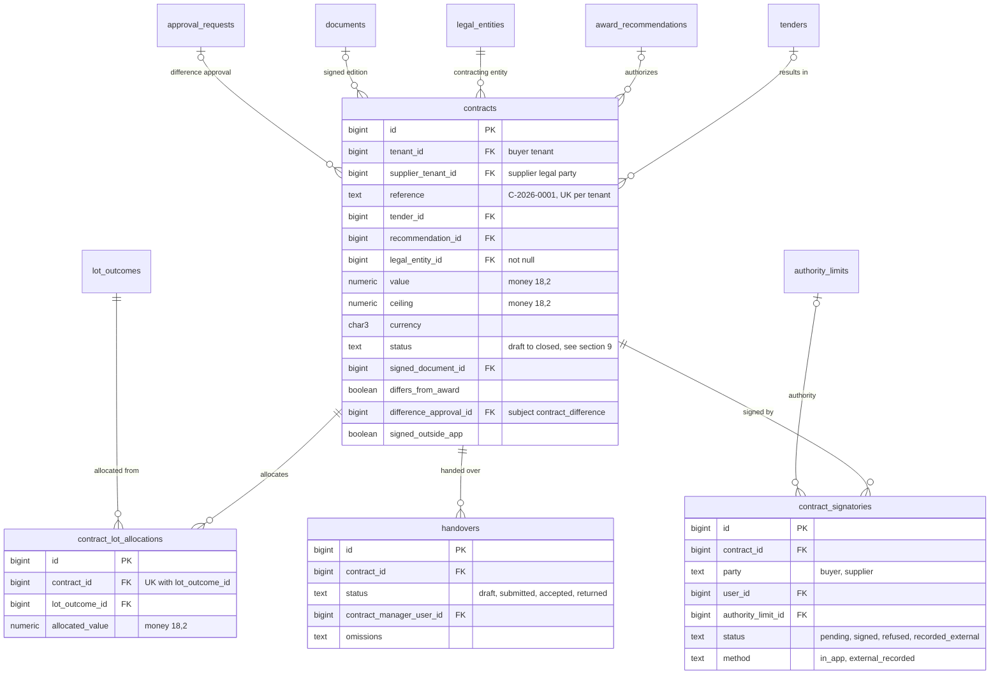
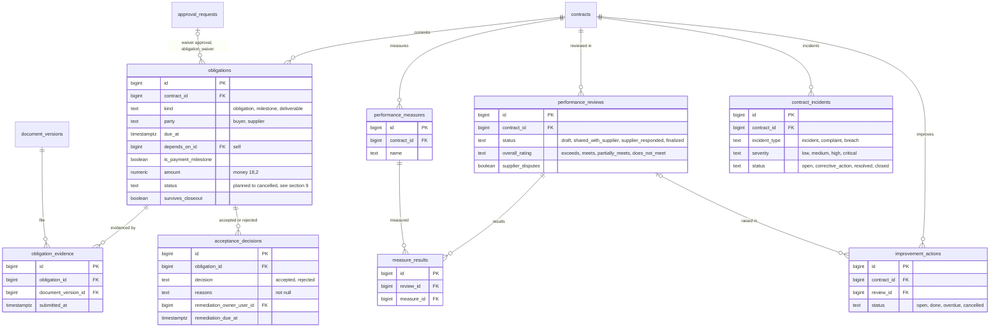
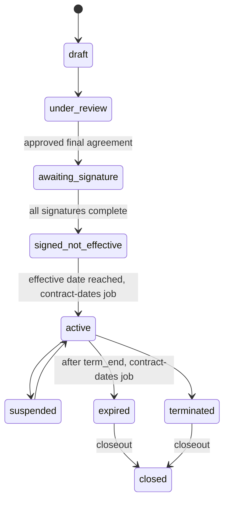
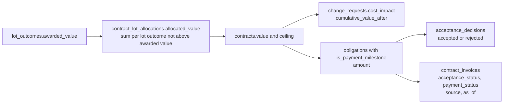

# Data model: Contracts (Migration 12)

Status: As-designed (pre-build). Updated to as-built at the end of Stage A and Stage B.

Sources:
- `docs/plan/schema-blueprint.md`: §0 Conventions; Migration 12 `20261001001200_contracts.sql`; Migration 02 (`legal_entities`, `authority_limits`); Migration 04 (`approval_requests`, `documents`, `document_versions`, `holds`); Migration 05 (`evidence_items`); Migration 06 (`procurement_requests.replaces_contract_id`, `routed_contract_id`); Migration 11 (`award_recommendations`, `lot_outcomes`); Migration 13 (`import_records`, `integration_exceptions`); §P permission catalog.
- `docs/plan/architecture-plan.md`: §3.5 approvals and authority; §3.6 state machines; §3.7 money; §3.8 notifications (`DeliveryChannel` with `in_app` and `email`); §3.9 background jobs (`obligation-status`, `renewal-windows`, `contract-dates`); §3.11 prototype mode (real Supabase Auth in Stage A); §4 cross-domain writes (operations → historical contracts; contracts → `integration_exceptions`, `evidence_submissions`); §6 domain map (domain 14 `contracts`).
- `docs/architecture-brief.md`: §5.6 tenant scoping; §5.9 file storage; §6.1 to §6.3.
- `docs/PRD.md`: §3 (contract, obligation and milestone; amount kinds); §4.3; FR-18 (§7.15); FR-19 (§7.16); §8.3 contract, obligation and change-request lifecycles; §14.3; §15.2; §20; BR-01, BR-04, BR-33, BR-35 to BR-38; screens CON-01 to CON-11, SUP-23; AC-28 to AC-33.
- `docs/plan/demo-storyline.md`: Contracts C-2026-0001, C-2026-0002, C-2025-0007; personas.
- `docs/plan/tenderiq-backend.workflow.js` (Stage B, draft): domain notes for `contracts` (allocation reconciliation, cumulative authority, signature handling).
- `docs/plan/design-decisions.md`: DD-01 (forward FKs), DD-03 ([S] and [R] tags), DD-07 (unique `change_requests (contract_id, number)`), DD-08 (currency on amounts), DD-09 (reference formats and change numbering), DD-12 (storage keys), DD-14 (approval subject types), DD-16 (exports), DD-17 (contracts → `integration_exceptions`, `evidence_submissions`), DD-19 (`contract-dates` job, alert idempotency keys), DD-24 (approver permissions), DD-26 (role scope matching), DD-43 (real Supabase Auth in local Docker from Stage A; demo personas are real accounts), DD-44 (email channel next to in-app: nodemailer over SMTP, Mailpit locally, content limited to title, official deadline and link, hosted provider deferred).

Contents:
- [1. Scope, tenancy and ownership](#1-scope-tenancy-and-ownership)
- [2. Reading the data dictionary](#2-reading-the-data-dictionary)
- [3. Diagrams](#3-diagrams)
- [4. Contract formation, milestones and value lineage](#4-contract-formation-milestones-and-value-lineage)
- [5. Data dictionary: formation and handover](#5-data-dictionary-formation-and-handover)
- [6. Data dictionary: obligations and acceptance](#6-data-dictionary-obligations-and-acceptance)
- [7. Data dictionary: performance](#7-data-dictionary-performance)
- [8. Data dictionary: finance, changes, disputes, renewals, securities and closeout](#8-data-dictionary-finance-changes-disputes-renewals-securities-and-closeout)
- [9. States and enumerations](#9-states-and-enumerations)
- [10. Constraints and indexes](#10-constraints-and-indexes)
- [11. Read access by audience](#11-read-access-by-audience)
- [12. Jobs and cross-domain touchpoints](#12-jobs-and-cross-domain-touchpoints)
- [13. Demo storyline coverage](#13-demo-storyline-coverage)
- [14. Open points finalized in Stage B](#14-open-points-finalized-in-stage-b)

Related: [data model overview](README.md), [selection and award](10-selection-award.md) (`award_recommendations`, `lot_outcomes`, `event_closeouts`), [organization and policy](02-organization-policy.md) (`legal_entities`, `authority_limits`), [shared services](03-shared-services.md) (`approval_requests`, `documents`, `holds`), [suppliers and qualification](04-suppliers-qualification.md) (`evidence_items`), [requests and planning](05-requests-planning.md) (`procurement_requests`), [records, reporting and operations](12-records-reporting-operations.md) (imports, integration exceptions), [security model](../04-security-model.md), [lifecycles](../05-lifecycles.md), [background jobs](../08-background-jobs.md), ADRs [0002](../adr/0002-buyer-owned-procurement-records.md), [0004](../adr/0004-text-check-constraints-not-enums.md), [0005](../adr/0005-decimal-strings-for-money-and-scores.md), [0007](../adr/0007-in-app-formal-notices.md).

---

## 1. Scope, tenancy and ownership

Migration 12 (`supabase/migrations/20261001001200_contracts.sql`, written in Stage B) turns final-awarded lot outcomes into accountable contracts and manages them to closeout: allocations, signatories, handover, obligations and acceptance, performance, invoices, changes, disputes, renewal options, securities and closeout.

**Owner.** Domain 14 `contracts` (`src/server/domains/contracts/`; UI feature `contracts`; FR-18, FR-19, BR-04, BR-33, BR-35 to BR-37; CON-01 to CON-11, SUP-23; AC-28 to AC-32) owns every table here. One approved cross-domain write targets this file: the `operations` domain creates **historical `contracts`** from accepted import records (architecture-plan §4; ADM-16). Two approved writes go out from contracts: `integration_exceptions` for an external signature failure (AC-33), and `evidence_submissions` snapshots through the suppliers-owned `snapshotEvidence()` helper (append-only) (DD-17). No table here is SEALED or partitioned.

"Row tenant" is `tenant_id`, always the **buyer**. [S] and [R] tables carry `supplier_tenant_id` = the supplier legal party of the contract ([ADR 0002](../adr/0002-buyer-owned-procurement-records.md)). Suppliers see only their own contracts and the records explicitly shared with them (PRD §13.1). **[S]** means supplier-accessible: the table is on the allow-list `supplier-scoped-tables.ts` that `forSupplier()` uses, generated from the blueprint tags. **[R]** means `supplier_tenant_id` is for reference only: the table is buyer-internal and never reachable through `forSupplier()`, and a guard test asserts that no [R] table is on the allow-list (DD-03). Here only `renewal_options` is [R]. Buyer-only tables ([T] without [S]) and the [R] table are not on the supplier-scoped list, so no supplier endpoint can reach them through `forSupplier()`.

| Table | Tag | Row tenant (`tenant_id`) | Mutable (`updated_at`) | Supplier-reachable |
|---|---|---|---|---|
| `contracts` | [T][S] | buyer | yes | yes |
| `contract_lot_allocations` | [T] | buyer | no | no |
| `contract_signatories` | [T][S] | buyer | yes | yes |
| `handovers` | [T] | buyer | yes | no |
| `obligations` | [T][S] | buyer | yes | yes |
| `obligation_evidence` | [T][S] | buyer | no | yes |
| `acceptance_decisions` | [T][S] | buyer | no | yes |
| `performance_measures` | [T] | buyer | yes | no |
| `performance_reviews` | [T][S] | buyer | yes | yes |
| `measure_results` | [T] | buyer | no | no |
| `contract_incidents` | [T][S] | buyer | yes | yes |
| `improvement_actions` | [T][S] | buyer | yes | yes |
| `contract_invoices` | [T][S] | buyer | yes | yes |
| `change_requests` | [T][S] | buyer | yes | yes |
| `contract_disputes` | [T][S] | buyer | yes | yes |
| `renewal_options` | [T][R] | buyer | yes | no (DD-03) |
| `contract_securities` | [T][S] | buyer | yes | yes |
| `contract_closeouts` | [T] | buyer | yes | no |

## 2. Reading the data dictionary

| Column | Meaning |
|---|---|
| Type | Plain type: stated in the blueprint, or fixed by a §0 convention (identity and FK columns `bigint`; instants `*_at` are `timestamptz` per architecture-plan §3.4; money `numeric(18,2)`; quantities `numeric(18,4)`; scores, rates and weights `numeric(12,6)`; currency `char(3)` with CHECK `~ '^[A-Z]{3}$'`; enumerations `text` + named CHECK). *Italic* type: inferred from the column's name and meaning because the blueprint states no type. `n/s`: not specified, with the candidates given. Stage B migrations fix every final type, recorded in `supabase/schema.expected.sql`. |
| Null | `no`: NOT NULL stated by the blueprint or a §0 convention. `yes`: nullable as stated, or the column is filled only by a later lifecycle event (for example `decided_at`), which forces nullability. `n/s`: not specified by the blueprint. |
| Key / constraint | `PK`, `FK → table`, `UK` (member of a unique constraint listed in §10), CHECK lists, defaults. Every FK column is indexed (§0). |

Standard columns (§0) appear in every table: `id bigint generated always as identity primary key`, `created_at timestamptz not null default now()`, `created_by bigint references users(id)` (null = system). Mutable tables add `updated_at`, maintained by `set_updated_at()`. Money is carried as decimal strings and computed with the shared helper `src/contracts/decimal.ts`, re-exported by `src/server/lib/decimal.ts` (DD-32, [ADR 0005](../adr/0005-decimal-strings-for-money-and-scores.md)).

## 3. Diagrams

Diagram legend: solid lines are FK columns. Entities without an attribute block are defined in other data-model files. `tenant_id`, `supplier_tenant_id` and user FK columns (`*_user_id`, `*_by`) are listed in the attribute blocks, but their lines to `tenants` and `users` are omitted. Self-referencing FKs are noted in attribute comments.

### 3.1 Formation, signature and handover

### 3.2 Obligations, acceptance and performance

### 3.3 Finance, changes, disputes, renewals, securities and closeout

```mermaid
erDiagram
    contracts ||--o{ contract_invoices : "invoiced"
    obligations |o--o{ contract_invoices : "milestone billed"
    contracts ||--o{ change_requests : "changed by"
    approval_requests |o--o{ change_requests : "approved via"
    contracts ||--o{ contract_disputes : "disputed"
    approval_requests |o--o{ contract_disputes : "decision approved via"
    contracts ||--o{ renewal_options : "options"
    approval_requests |o--o{ renewal_options : "decided via"
    contracts ||--o{ contract_securities : "secured by"
    evidence_items |o--o{ contract_securities : "evidence"
    approval_requests |o--o{ contract_securities : "release approved via"
    contracts ||--o{ contract_closeouts : "closed by"

    contract_invoices {
        bigint id PK
        bigint contract_id FK
        bigint obligation_id FK
        numeric amount "money 18,2"
        text acceptance_status "not_accepted, accepted, disputed"
        text payment_status "not_invoiced, invoiced, approved, paid, disputed"
        text source "local_entry, finance_system"
    }
    change_requests {
        bigint id PK
        bigint contract_id FK "UK with number"
        integer number "per contract, shown as CR-0001"
        numeric cost_impact "money 18,2"
        char3 currency
        numeric cumulative_value_after "money 18,2, computed"
        text raised_by_party "buyer, supplier"
        text status "draft to incorporated, see section 9"
        boolean affects_procurement_basis
    }
    contract_disputes {
        bigint id PK
        bigint contract_id FK
        text dispute_type "dispute, claim, remedy, credit, penalty, settlement"
        numeric amount "money 18,2"
        bigint authorized_decision_id FK "subject dispute_decision"
        text status "open, negotiating, resolved, withdrawn"
    }
    renewal_options {
        bigint id PK
        bigint supplier_tenant_id FK "reference only, R tag"
        bigint contract_id FK
        text option_type "renewal, extension, termination_notice"
        text status "available, under_review, decided, expired, not_exercised"
        text decision "renew, extend, recompete, terminate, let_expire"
    }
    contract_securities {
        bigint id PK
        bigint contract_id FK
        text security_type "performance_bond, bank_guarantee and more"
        numeric amount "money 18,2"
        timestamptz expires_at
        text status "active, expiring, expired, released, called"
        bigint release_approval_id FK "subject security_release"
        bigint evidence_item_id FK
    }
    contract_closeouts {
        bigint id PK
        bigint contract_id FK
        boolean securities_released
        text status "in_progress, closed"
    }
```

## 4. Contract formation, milestones and value lineage

**Formation.** A contract is created from final-awarded `lot_outcomes` through `contract_lot_allocations`. One tender can produce several contracts, and one contract can cover several awarded lots, provided allocation and totals stay traceable (FR-18). The contracting legal entity (`legal_entity_id`, NOT NULL) and the supplier legal party (`supplier_tenant_id`) are identified before any binding commitment (BR-04). A difference between the approved award and the proposed contract sets `differs_from_award`, needs `difference_explanation` and an approval (`difference_approval_id`) before signature or start authority (AC-28).

**Separate milestones (BR-35).** Signature completion, effective date, notice to proceed, delivery start and handover acceptance each have their own column and prerequisites. A contract cannot become `active` merely because a draft was sent for signature (FR-18).

| Milestone | Column | Note |
|---|---|---|
| Signature complete | `contracts.signed_at`, `signed_document_id`; `contract_signatories.status` | In-app signature, or `signed_outside_app` with `external_signature_evidence` and signatories `recorded_external`. In-app signing evidence is never manufactured (PRD §20). A refusal leaves the contract unexecuted. |
| Effective | `contracts.effective_date` | Status `signed_not_effective` until then; the daily `contract-dates` job moves the contract to `active` when the effective date is reached (DD-19). |
| Notice to proceed | `contracts.notice_to_proceed_at` | |
| Delivery start | `contracts.delivery_start_at` | |
| Handover accepted | `handovers.status = 'accepted'`, `accepted_at` | Accepted or returned with `omissions` by the named contract manager; the event closeout gate reads it (AC-29). |

Principal contract states (PRD §8.3). The two date-driven transitions are made by the `contract-dates` job (daily 02:50 UTC): `signed_not_effective` → `active` when the effective date is reached, and `active` → `expired` after `term_end`; open obligations remain (DD-19). The complete legality matrix is written in `domains/contracts/workflow/` in Stage B and documented in [05-lifecycles.md](../05-lifecycles.md).

**Value lineage.** PRD §3 and §15.2 require distinct amount kinds (ceiling, committed, accepted work, invoiced, paid), each with its source and freshness. Totals reconcile without double counting (BR-33), and change authority uses cumulative exposure (AC-31).

| Measure (CON-08) | Column |
|---|---|
| Award | `lot_outcomes.awarded_value` ([10-selection-award.md](10-selection-award.md)) |
| Original value, ceiling | `contracts.value`, `contracts.ceiling` |
| Approved changes, cumulative exposure | `change_requests.cost_impact`, `cumulative_value_after` (computed) |
| Accepted milestones | `obligations` with `is_payment_milestone`, `amount`, `status = 'accepted'` |
| Invoiced, approved, paid, disputed | `contract_invoices.amount` with `payment_status` |
| Source and freshness | `contract_invoices.source` (`local_entry` or `finance_system`), `as_of` |
| Committed spend | No dedicated column (§14) |

Estimated or disputed figures are never presented as paid (CON-08). A missed measure never authorizes a deduction on its own (FR-19).

## 5. Data dictionary: formation and handover

### 5.1 contracts

[T][S], mutable. Row tenant: the buyer. Owner `contracts`; `operations` also creates historical contracts from imports (architecture-plan §4). The binding arrangement with its parties, scope, values, dates, documents and status (PRD §3, CON-01 to CON-03). BR-01: every contract has an accountable owner.

| Column | Type | Null | Key / constraint | Meaning |
|---|---|---|---|---|
| id | bigint | no | PK | Standard. |
| tenant_id | bigint | no | FK → tenants | Buyer tenant. |
| supplier_tenant_id | bigint | no | FK → tenants | Supplier legal party (BR-04). |
| reference | text | no | UK (tenant_id, reference) (§0) | Human reference `C-2026-0001` from `next_reference()`; the year is the year in the buyer tenant's official time zone (DD-09). Imported contracts keep their own reference (C-2025-0007 in the demo). |
| tender_id | bigint | n/s | FK → tenders | Source tender. |
| recommendation_id | bigint | n/s | FK → award_recommendations | Approved recommendation. |
| legal_entity_id | bigint | no | FK → legal_entities; NOT NULL (blueprint, BR-04) | Contracting legal entity. |
| title | *text* | n/s | | Title. |
| scope | *text* | n/s | | Agreed scope. |
| value | numeric(18,2) | n/s | | Contract value. |
| ceiling | numeric(18,2) | n/s | | Contract ceiling (CON-01 remaining ceiling). |
| currency | char(3) | n/s | CHECK `~ '^[A-Z]{3}$'` | Currency. |
| term_start | n/s (`date` or `timestamptz`) | n/s | | Term start. |
| term_end | n/s (`date` or `timestamptz`) | n/s | | Term end. |
| options_summary | *text* | n/s | | Options (details in `renewal_options`). |
| service_locations | *text* | n/s | | Service locations. |
| payment_terms | *text* | n/s | | Payment terms. |
| securities_summary | *text* | n/s | | Securities (details in `contract_securities`). |
| contract_manager_user_id | bigint | n/s | FK → users | Named contract manager (accepts handover). |
| owner_user_id | bigint | n/s | FK → users | Accountable owner (BR-01). |
| status | text | n/s | CHECK (draft, under_review, awaiting_signature, signed_not_effective, active, suspended, expired, terminated, closed) | PRD §8.3 states. `signed_not_effective` → `active` and `active` → `expired` are set by the `contract-dates` job (DD-19). |
| signed_document_id | bigint | yes | FK → documents | Signed edition, distinguishable from drafts and negotiation copies (FR-18). |
| signed_at | timestamptz | yes | | Signature completion. |
| effective_date | *date* | yes | | Effective date. |
| notice_to_proceed_at | timestamptz | yes | | Notice to proceed. |
| delivery_start_at | timestamptz | yes | | Delivery start. |
| differs_from_award | boolean | n/s | | Material difference from the approved award (AC-28). |
| difference_explanation | *text* | yes | | Explanation of the difference. |
| difference_approval_id | bigint | yes | FK → approval_requests | Approval of the difference (subject type `contract_difference`, DD-14). |
| signed_outside_app | boolean | n/s | | Executed outside the app (PRD §20). |
| external_signature_evidence | *text* | yes | | Recorded evidence of the external execution. |
| created_at | timestamptz | no | default now() | Standard. |
| created_by | bigint | yes | FK → users | Standard. |
| updated_at | timestamptz | no | `set_updated_at()` | Mutable marker. |

### 5.2 contract_lot_allocations

[T], not mutable, buyer-only. Row tenant: the buyer. Owner `contracts`. Which awarded lot outcomes a contract covers and for how much (FR-18, BR-33).

| Column | Type | Null | Key / constraint | Meaning |
|---|---|---|---|---|
| id | bigint | no | PK | Standard. |
| tenant_id | bigint | no | FK → tenants | Buyer tenant. |
| contract_id | bigint | n/s | FK → contracts; UK (contract_id, lot_outcome_id) | Contract. |
| lot_outcome_id | bigint | n/s | FK → lot_outcomes; UK | Final-awarded lot outcome. |
| allocated_value | numeric(18,2) | n/s | | Value allocated; the sum per lot outcome must not exceed `lot_outcomes.awarded_value` (service check, blueprint). |
| created_at | timestamptz | no | default now() | Standard. |
| created_by | bigint | yes | FK → users | Standard. |

### 5.3 contract_signatories

[T][S], mutable. Row tenant: the buyer. Owner `contracts`. Required signatories for each party with authority and status (CON-03).

| Column | Type | Null | Key / constraint | Meaning |
|---|---|---|---|---|
| id | bigint | no | PK | Standard. |
| tenant_id | bigint | no | FK → tenants | Buyer tenant. |
| supplier_tenant_id | bigint | no | FK → tenants | Supplier party of the contract. |
| contract_id | bigint | n/s | FK → contracts | Contract. |
| party | text | n/s | CHECK (buyer, supplier) | Signing party. |
| user_id | bigint | n/s | FK → users | Signatory's account, when signing in-app. |
| name | *text* | n/s | | Signatory name as recorded. |
| authority_note | *text* | n/s | | Basis of authority. |
| authority_limit_id | bigint | n/s | FK → authority_limits | Authority checked (decision type `contract_signature`); for the supplier party this is a supplier-tenant limit (SUP-04). |
| status | text | n/s | CHECK (pending, signed, refused, recorded_external) | Signature state. |
| signed_at | timestamptz | yes | | Signature time. |
| method | text | n/s | CHECK (in_app, external_recorded) | Signature method. |
| verification_note | *text* | yes | | Verification of an external signature. |
| created_at | timestamptz | no | default now() | Standard. |
| created_by | bigint | yes | FK → users | Standard. |
| updated_at | timestamptz | no | `set_updated_at()` | Mutable marker. |

### 5.4 handovers

[T], mutable, buyer-only. Row tenant: the buyer. Owner `contracts`. The procurement-to-contract handover package (FR-18, CON-04). Losing bids and internal score deliberations are never included (FR-18). Procurement closure cannot hide an incomplete handover (AC-29).

| Column | Type | Null | Key / constraint | Meaning |
|---|---|---|---|---|
| id | bigint | no | PK | Standard. |
| tenant_id | bigint | no | FK → tenants | Buyer tenant. |
| contract_id | bigint | n/s | FK → contracts | Contract. |
| status | text | n/s | CHECK (draft, submitted, accepted, returned) | Handover state. |
| final_scope | *text* | n/s | | Final scope. |
| winning_commitments | *text* | n/s | | Commitments from the winning offer. |
| negotiated_exceptions | *text* | n/s | | Negotiated exceptions. |
| performance_measures_summary | *text* | n/s | | Measures (details in `performance_measures`). |
| risks | *text* | n/s | | Risks. |
| outstanding_conditions | *text* | n/s | | Conditions still open. |
| renewal_dates_summary | *text* | n/s | | Renewal dates. |
| security_expiry_summary | *text* | n/s | | Security expiry dates. |
| key_contacts | *text* | n/s | | Key contacts. |
| contract_manager_user_id | bigint | n/s | FK → users | Contract manager who accepts or returns. |
| submitted_at | timestamptz | yes | | Submitted for acceptance. |
| accepted_at | timestamptz | yes | | Accepted. |
| returned_at | timestamptz | yes | | Returned. |
| omissions | *text* | yes | | Omissions stated on return. |
| created_at | timestamptz | no | default now() | Standard. |
| created_by | bigint | yes | FK → users | Standard. |
| updated_at | timestamptz | no | `set_updated_at()` | Mutable marker. |

## 6. Data dictionary: obligations and acceptance

### 6.1 obligations

[T][S], mutable. Row tenant: the buyer. Owner `contracts`. A buyer or supplier obligation, milestone or deliverable with owner, dates, dependencies, evidence, acceptance criteria and escalation (FR-19, CON-05, CON-06). PRD §8.3 states: planned, due, evidence submitted, under review, accepted, rejected, overdue, waived by authorized decision, cancelled.

| Column | Type | Null | Key / constraint | Meaning |
|---|---|---|---|---|
| id | bigint | no | PK | Standard. |
| tenant_id | bigint | no | FK → tenants | Buyer tenant. |
| supplier_tenant_id | bigint | no | FK → tenants | Supplier party. |
| contract_id | bigint | n/s | FK → contracts | Contract. |
| kind | text | n/s | CHECK (obligation, milestone, deliverable) | Kind. |
| party | text | n/s | CHECK (buyer, supplier) | Obliged party. |
| title | *text* | n/s | | Title. |
| description | *text* | n/s | | Description. |
| owner_user_id | bigint | n/s | FK → users | Accountable owner. |
| supplier_contact | *text* | n/s | | Supplier contact for the obligation. |
| due_at | timestamptz | n/s | | Due date; drives the `obligation-status` job. |
| recurrence | *text* | n/s | | Recurrence rule, free text. |
| acceptance_criteria | *text* | n/s | | Acceptance criteria. |
| evidence_required | n/s (`boolean` or `text`) | n/s | | Evidence required for completion. |
| consequence | *text* | n/s | | Consequence of nonperformance. |
| depends_on_id | bigint | yes | FK → obligations (self) | Dependency. |
| escalation_user_id | bigint | n/s | FK → users | Escalation owner. |
| is_payment_milestone | boolean | n/s | | Acceptance makes the milestone payable (subject to invoice status). |
| amount | numeric(18,2) | n/s | | Milestone amount. |
| currency | char(3) | n/s | CHECK `~ '^[A-Z]{3}$'` | Currency. |
| status | text | n/s | CHECK (planned, due, evidence_submitted, under_review, accepted, rejected, overdue, waived, cancelled) | State. |
| waiver_approval_id | bigint | yes | FK → approval_requests | Authorized waiver (subject type `obligation_waiver`, DD-14). |
| survives_closeout | boolean | n/s | | Stays tracked after contract closeout (warranties, FR-19). |
| created_at | timestamptz | no | default now() | Standard. |
| created_by | bigint | yes | FK → users | Standard. |
| updated_at | timestamptz | no | `set_updated_at()` | Mutable marker. |

### 6.2 obligation_evidence

[T][S], not mutable. Row tenant: the buyer. Owner `contracts`. Evidence the supplier or buyer submits for an obligation (CON-05, SUP-23).

| Column | Type | Null | Key / constraint | Meaning |
|---|---|---|---|---|
| id | bigint | no | PK | Standard. |
| tenant_id | bigint | no | FK → tenants | Buyer tenant. |
| supplier_tenant_id | bigint | no | FK → tenants | Supplier party. |
| obligation_id | bigint | n/s | FK → obligations | Obligation. |
| submitted_by | bigint | n/s | FK → users | Submitter. |
| document_version_id | bigint | n/s | FK → document_versions | Evidence file edition (bucket `contract-documents`). |
| note | *text* | n/s | | Submitter's note. |
| submitted_at | timestamptz | n/s | | Submission time. |
| created_at | timestamptz | no | default now() | Standard. |
| created_by | bigint | yes | FK → users | Standard. |

### 6.3 acceptance_decisions

[T][S], not mutable. Row tenant: the buyer. Owner `contracts`. Acceptance or rejection with reasons and remediation (CON-06, AC-30). Acceptance and payment readiness are never implied by evidence submission.

| Column | Type | Null | Key / constraint | Meaning |
|---|---|---|---|---|
| id | bigint | no | PK | Standard. |
| tenant_id | bigint | no | FK → tenants | Buyer tenant. |
| supplier_tenant_id | bigint | no | FK → tenants | Supplier party. |
| obligation_id | bigint | n/s | FK → obligations | Obligation. |
| decision | text | n/s | CHECK (accepted, rejected) | Decision. |
| reasons | *text* | no | NOT NULL (blueprint) | Reasons. |
| remediation_required | n/s (`boolean` or `text`) | n/s | | Remediation required after rejection. |
| remediation_owner_user_id | bigint | yes | FK → users | Remediation owner. |
| remediation_due_at | timestamptz | yes | | Remediation due. |
| decided_by | bigint | n/s | FK → users | Decision maker (`contract.manage`). |
| decided_at | timestamptz | n/s | | Decision time. |
| created_at | timestamptz | no | default now() | Standard. |
| created_by | bigint | yes | FK → users | Standard. |

## 7. Data dictionary: performance

### 7.1 performance_measures

[T], mutable, buyer-only. Row tenant: the buyer. Owner `contracts`. Service measures for the contract (FR-19, CON-07).

| Column | Type | Null | Key / constraint | Meaning |
|---|---|---|---|---|
| id | bigint | no | PK | Standard. |
| tenant_id | bigint | no | FK → tenants | Buyer tenant. |
| contract_id | bigint | n/s | FK → contracts | Contract. |
| name | *text* | n/s | | Measure name. |
| target | n/s (`numeric` or `text`) | n/s | | Target level. |
| unit | *text* | n/s | | Unit of measure. |
| frequency | *text* | n/s | | Measurement frequency. |
| active | *boolean* | n/s | | Measure in use; inactive measures are kept for history. |
| created_at | timestamptz | no | default now() | Standard. |
| created_by | bigint | yes | FK → users | Standard. |
| updated_at | timestamptz | no | `set_updated_at()` | Mutable marker. |

### 7.2 performance_reviews

[T][S], mutable. Row tenant: the buyer. Owner `contracts`. A periodic review shared with the supplier, who may respond to a disputed assessment before it is finalized where policy requires (FR-19, CON-07, SUP-23).

| Column | Type | Null | Key / constraint | Meaning |
|---|---|---|---|---|
| id | bigint | no | PK | Standard. |
| tenant_id | bigint | no | FK → tenants | Buyer tenant. |
| supplier_tenant_id | bigint | no | FK → tenants | Supplier reviewed. |
| contract_id | bigint | n/s | FK → contracts | Contract. |
| period_start | n/s (`date` or `timestamptz`) | n/s | | Review period start. |
| period_end | n/s (`date` or `timestamptz`) | n/s | | Review period end. |
| status | text | n/s | CHECK (draft, shared_with_supplier, supplier_responded, finalized) | Review state. |
| overall_rating | text | n/s | CHECK (exceeds, meets, partially_meets, does_not_meet) | Overall rating. |
| summary | *text* | n/s | | Summary. |
| supplier_response | *text* | yes | | Supplier response. |
| supplier_disputes | boolean | n/s | | Supplier disputes the assessment. |
| finalized_by | bigint | yes | FK → users | Finalizer. |
| finalized_at | timestamptz | yes | | Finalization time. |
| created_at | timestamptz | no | default now() | Standard. |
| created_by | bigint | yes | FK → users | Standard. |
| updated_at | timestamptz | no | `set_updated_at()` | Mutable marker. |

### 7.3 measure_results

[T], not mutable, buyer-only. Row tenant: the buyer. Owner `contracts`. Result of one measure in one review.

| Column | Type | Null | Key / constraint | Meaning |
|---|---|---|---|---|
| id | bigint | no | PK | Standard. |
| tenant_id | bigint | no | FK → tenants | Buyer tenant. |
| review_id | bigint | n/s | FK → performance_reviews | Review. |
| measure_id | bigint | n/s | FK → performance_measures | Measure. |
| actual | n/s (`numeric` or `text`) | n/s | | Actual value. |
| rating | n/s (`text` or `numeric`) | n/s | no value list stated | Rating of the result. |
| note | *text* | n/s | | Note. |
| created_at | timestamptz | no | default now() | Standard. |
| created_by | bigint | yes | FK → users | Standard. |

### 7.4 contract_incidents

[T][S], mutable. Row tenant: the buyer. Owner `contracts`. Incidents, complaints and breaches during delivery (FR-19, CON-07).

| Column | Type | Null | Key / constraint | Meaning |
|---|---|---|---|---|
| id | bigint | no | PK | Standard. |
| tenant_id | bigint | no | FK → tenants | Buyer tenant. |
| supplier_tenant_id | bigint | no | FK → tenants | Supplier party. |
| contract_id | bigint | n/s | FK → contracts | Contract. |
| incident_type | text | n/s | CHECK (incident, complaint, breach) | Type. |
| severity | text | n/s | CHECK (low, medium, high, critical) | Severity. |
| description | *text* | n/s | | Description. |
| occurred_at | timestamptz | n/s | | Occurrence time. |
| status | text | n/s | CHECK (open, corrective_action, resolved, closed) | State. |
| corrective_action | *text* | n/s | | Corrective action. |
| owner_user_id | bigint | n/s | FK → users | Owner. |
| created_at | timestamptz | no | default now() | Standard. |
| created_by | bigint | yes | FK → users | Standard. |
| updated_at | timestamptz | no | `set_updated_at()` | Mutable marker. |

### 7.5 improvement_actions

[T][S], mutable. Row tenant: the buyer. Owner `contracts`. Improvement plan actions (FR-19, CON-07).

| Column | Type | Null | Key / constraint | Meaning |
|---|---|---|---|---|
| id | bigint | no | PK | Standard. |
| tenant_id | bigint | no | FK → tenants | Buyer tenant. |
| supplier_tenant_id | bigint | no | FK → tenants | Supplier party. |
| contract_id | bigint | n/s | FK → contracts | Contract. |
| review_id | bigint | n/s | FK → performance_reviews | Review that raised the action. |
| action | *text* | n/s | | Action. |
| owner | *text* | n/s | | Named owner. The blueprint uses `owner`, not `owner_user_id`, so it is free text (§14). |
| due_at | timestamptz | n/s | | Due date. |
| status | text | n/s | CHECK (open, done, overdue, cancelled) | State. |
| created_at | timestamptz | no | default now() | Standard. |
| created_by | bigint | yes | FK → users | Standard. |
| updated_at | timestamptz | no | `set_updated_at()` | Mutable marker. |

## 8. Data dictionary: finance, changes, disputes, renewals, securities and closeout

### 8.1 contract_invoices

[T][S], mutable. Row tenant: the buyer. Owner `contracts`. Invoice references with acceptance and payment status, each labelled with its source and as-of date (FR-19, CON-08).

| Column | Type | Null | Key / constraint | Meaning |
|---|---|---|---|---|
| id | bigint | no | PK | Standard. |
| tenant_id | bigint | no | FK → tenants | Buyer tenant. |
| supplier_tenant_id | bigint | no | FK → tenants | Supplier party. |
| contract_id | bigint | n/s | FK → contracts | Contract. |
| obligation_id | bigint | n/s | FK → obligations | Milestone billed. |
| invoice_ref | *text* | n/s | | Invoice reference. |
| amount | numeric(18,2) | n/s | | Invoice amount. |
| currency | char(3) | n/s | CHECK `~ '^[A-Z]{3}$'` | Currency. |
| invoice_date | *date* | n/s | | Invoice date. |
| acceptance_status | text | n/s | CHECK (not_accepted, accepted, disputed) | Work acceptance for the invoice. |
| payment_status | text | n/s | CHECK (not_invoiced, invoiced, approved, paid, disputed) | Payment status. |
| source | text | n/s | CHECK (local_entry, finance_system) | Who supplied the figure (FR-19). |
| as_of | n/s (`date` or `timestamptz`) | n/s | | Freshness of the figure (PRD §15.2). |
| created_at | timestamptz | no | default now() | Standard. |
| created_by | bigint | yes | FK → users | Standard. |
| updated_at | timestamptz | no | `set_updated_at()` | Mutable marker. |

### 8.2 change_requests

[T][S], mutable. Row tenant: the buyer. Owner `contracts`. A contract change with reason, scope, cost, schedule impact, funding, cumulative value, approvals, supplier agreement and effect on the procurement basis (FR-19, CON-09). PRD §8.3 states: draft, submitted, impact assessment, approval pending, agreed, rejected, withdrawn, incorporated. The authority check uses the **cumulative** exposure (AC-31; domain notes).

| Column | Type | Null | Key / constraint | Meaning |
|---|---|---|---|---|
| id | bigint | no | PK | Standard. |
| tenant_id | bigint | no | FK → tenants | Buyer tenant. |
| supplier_tenant_id | bigint | no | FK → tenants | Supplier party. |
| contract_id | bigint | n/s | FK → contracts | Contract. |
| number | integer | n/s | UK (contract_id, number) (DD-07) | Change number per contract: `max + 1` under a `SELECT … FOR UPDATE` lock on the contract row, displayed as `CR-0001`. It does not use `next_reference()` (DD-09). |
| title | *text* | n/s | | Title. |
| reason | *text* | n/s | | Reason. |
| scope_change | *text* | n/s | | Scope change. |
| cost_impact | numeric(18,2) | n/s | | Cost impact of this change. |
| currency | char(3) | n/s | CHECK `~ '^[A-Z]{3}$'` | Currency of `cost_impact` and `cumulative_value_after` (DD-08). |
| schedule_impact_days | *integer* | n/s | | Schedule impact in days. |
| funding_note | *text* | n/s | | Funding review (BR-36). |
| cumulative_value_after | numeric(18,2) | n/s | computed (blueprint) | Contract value after this and all earlier approved changes. |
| raised_by_party | text | n/s | CHECK (buyer, supplier) | Party that raised it. |
| status | text | n/s | CHECK (draft, submitted, impact_assessment, approval_pending, agreed, rejected, withdrawn, incorporated) | State. |
| supplier_agreed_at | timestamptz | yes | | Supplier agreement. |
| approval_request_id | bigint | n/s | FK → approval_requests | Approval (subject type `contract_change`; authority `change_approval`). The approver needs `approval.decide`, `contract.change.approve` and sufficient authority; cross-currency authority uses `exchange_rates` at the request date, and with no rate the step routes to the next level up (DD-24). |
| affects_procurement_basis | boolean | n/s | | The change affects the original procurement basis. |
| impact_assessment | *text* | n/s | | Impact assessment. |
| created_at | timestamptz | no | default now() | Standard. |
| created_by | bigint | yes | FK → users | Standard. |
| updated_at | timestamptz | no | `set_updated_at()` | Mutable marker. |

### 8.3 contract_disputes

[T][S], mutable. Row tenant: the buyer. Owner `contracts`. Disputes, claims, remedies, credits, penalties and settlements, recorded only under the agreed terms and authorized decisions (FR-19, CON-09).

| Column | Type | Null | Key / constraint | Meaning |
|---|---|---|---|---|
| id | bigint | no | PK | Standard. |
| tenant_id | bigint | no | FK → tenants | Buyer tenant. |
| supplier_tenant_id | bigint | no | FK → tenants | Supplier party. |
| contract_id | bigint | n/s | FK → contracts | Contract. |
| dispute_type | text | n/s | CHECK (dispute, claim, remedy, credit, penalty, settlement) | Type. |
| amount | numeric(18,2) | n/s | | Amount. |
| currency | char(3) | n/s | CHECK `~ '^[A-Z]{3}$'` | Currency. |
| description | *text* | n/s | | Description. |
| contract_basis | *text* | n/s | | Contract clause relied on. |
| authorized_decision_id | bigint | yes | FK → approval_requests | Authorized decision (subject type `dispute_decision`, DD-14). |
| status | text | n/s | CHECK (open, negotiating, resolved, withdrawn) | State. |
| created_at | timestamptz | no | default now() | Standard. |
| created_by | bigint | yes | FK → users | Standard. |
| updated_at | timestamptz | no | `set_updated_at()` | Mutable marker. |

### 8.4 renewal_options

[T][R], mutable. Row tenant: the buyer. Buyer-internal: `supplier_tenant_id` is for reference only and the table is not reachable through `forSupplier()` (DD-03). Owner `contracts`. Renewal, extension and termination-notice options with windows, justification and decision (FR-19, CON-10). Nothing renews because a date arrives, and supplier consent is never assumed (BR-37, AC-32).

| Column | Type | Null | Key / constraint | Meaning |
|---|---|---|---|---|
| id | bigint | no | PK | Standard. |
| tenant_id | bigint | no | FK → tenants | Buyer tenant. |
| supplier_tenant_id | bigint | no | FK → tenants | Supplier party (reference only, [R]). |
| contract_id | bigint | n/s | FK → contracts | Contract. |
| option_type | text | n/s | CHECK (renewal, extension, termination_notice) | Option. |
| period_months | *integer* | n/s | | Option period. |
| notice_window_start | n/s (`date` or `timestamptz`) | n/s | | Notice window opens; read by the `renewal-windows` job. |
| notice_deadline | n/s (`date` or `timestamptz`) | n/s | | Notice deadline. |
| status | text | n/s | CHECK (available, under_review, decided, expired, not_exercised) | Option state. |
| decision | text | yes | CHECK (renew, extend, recompete, terminate, let_expire); nullable (blueprint) | Decision. |
| justification | *text* | n/s | | Business justification. |
| performance_basis | *text* | n/s | | Performance justification. |
| funding_confirmed | n/s (`boolean` or `text`) | n/s | | Funding confirmation (BR-36). |
| approval_request_id | bigint | n/s | FK → approval_requests | Approval (subject type `renewal`; authority `renewal_approval`). |
| supplier_consent_at | timestamptz | yes | | Supplier consent, when needed. |
| decided_at | timestamptz | yes | | Decision time. |
| created_at | timestamptz | no | default now() | Standard. |
| created_by | bigint | yes | FK → users | Standard. |
| updated_at | timestamptz | no | `set_updated_at()` | Mutable marker. |

### 8.5 contract_securities

[T][S], mutable. Row tenant: the buyer. Owner `contracts`. Bonds, guarantees, insurance, licenses, certifications and retention monitored during delivery (FR-19). No release occurs solely because a date arrives (BR-37).

| Column | Type | Null | Key / constraint | Meaning |
|---|---|---|---|---|
| id | bigint | no | PK | Standard. |
| tenant_id | bigint | no | FK → tenants | Buyer tenant. |
| supplier_tenant_id | bigint | no | FK → tenants | Supplier party. |
| contract_id | bigint | n/s | FK → contracts | Contract. |
| security_type | text | n/s | CHECK (performance_bond, bank_guarantee, insurance, license, certification, retention) | Type. |
| issuer | *text* | n/s | | Issuer. |
| amount | numeric(18,2) | n/s | | Amount. |
| currency | char(3) | n/s | CHECK `~ '^[A-Z]{3}$'` | Currency. |
| expires_at | timestamptz | n/s | | Expiry. |
| status | text | n/s | CHECK (active, expiring, expired, released, called) | State. `expiring` and `expired` are set by the `contract-dates` job (DD-19); release still needs an approved decision (BR-37). |
| released_at | timestamptz | yes | | Release time. |
| release_approval_id | bigint | yes | FK → approval_requests | Release approval (subject type `security_release`, DD-14). |
| evidence_item_id | bigint | n/s | FK → evidence_items | Supplier evidence (row in the supplier tenant). |
| created_at | timestamptz | no | default now() | Standard. |
| created_by | bigint | yes | FK → users | Standard. |
| updated_at | timestamptz | no | `set_updated_at()` | Mutable marker. |

### 8.6 contract_closeouts

[T], mutable, buyer-only. Row tenant: the buyer. Owner `contracts`. Closeout evidence: final acceptance, reconciliation, claims, security release, warranties, lessons and retention start (FR-19, CON-11). Expiry does not erase unresolved obligations, warranties, disputes or retention duties; surviving obligations stay tracked (`obligations.survives_closeout`).

| Column | Type | Null | Key / constraint | Meaning |
|---|---|---|---|---|
| id | bigint | no | PK | Standard. |
| tenant_id | bigint | no | FK → tenants | Buyer tenant. |
| contract_id | bigint | n/s | FK → contracts | Contract. |
| final_acceptance_at | timestamptz | yes | | Final acceptance. |
| reconciliation_note | *text* | n/s | | Final financial reconciliation. |
| outstanding_claims | *text* | n/s | | Claims still open. |
| securities_released | boolean | n/s | | All securities released. |
| warranty_until | n/s (`date` or `timestamptz`) | n/s | | Warranty end. |
| lessons_learned | *text* | n/s | | Lessons. |
| retention_start | n/s (`date` or `timestamptz`) | n/s | | Retention start (trigger `contract_closed` in `retention_classes`). |
| status | text | n/s | CHECK (in_progress, closed) | Closeout state. |
| closed_by | bigint | yes | FK → users | Closer. |
| closed_at | timestamptz | yes | | Closure time. |
| created_at | timestamptz | no | default now() | Standard. |
| created_by | bigint | yes | FK → users | Standard. |
| updated_at | timestamptz | no | `set_updated_at()` | Mutable marker. |

## 9. States and enumerations

All enumerations are `text` columns with a named CHECK ([ADR 0004](../adr/0004-text-check-constraints-not-enums.md)). The same lists are defined once in `src/contracts/enums.ts`, and a Stage A contract test checks that they match the blueprint (architecture-plan §3.6, §8). Transition rules live in [05-lifecycles.md](../05-lifecycles.md).

| Table.column | Values | Notes |
|---|---|---|
| contracts.status | draft, under_review, awaiting_signature, signed_not_effective, active, suspended, expired, terminated, closed | PRD §8.3. |
| contract_signatories.party | buyer, supplier | |
| contract_signatories.status | pending, signed, refused, recorded_external | |
| contract_signatories.method | in_app, external_recorded | |
| handovers.status | draft, submitted, accepted, returned | |
| obligations.kind | obligation, milestone, deliverable | |
| obligations.party | buyer, supplier | |
| obligations.status | planned, due, evidence_submitted, under_review, accepted, rejected, overdue, waived, cancelled | PRD §8.3. |
| acceptance_decisions.decision | accepted, rejected | |
| performance_reviews.status | draft, shared_with_supplier, supplier_responded, finalized | |
| performance_reviews.overall_rating | exceeds, meets, partially_meets, does_not_meet | |
| measure_results.rating | n/s | No list stated. |
| contract_incidents.incident_type | incident, complaint, breach | |
| contract_incidents.severity | low, medium, high, critical | |
| contract_incidents.status | open, corrective_action, resolved, closed | |
| improvement_actions.status | open, done, overdue, cancelled | |
| contract_invoices.acceptance_status | not_accepted, accepted, disputed | |
| contract_invoices.payment_status | not_invoiced, invoiced, approved, paid, disputed | |
| contract_invoices.source | local_entry, finance_system | |
| change_requests.raised_by_party | buyer, supplier | |
| change_requests.status | draft, submitted, impact_assessment, approval_pending, agreed, rejected, withdrawn, incorporated | PRD §8.3. |
| contract_disputes.dispute_type | dispute, claim, remedy, credit, penalty, settlement | |
| contract_disputes.status | open, negotiating, resolved, withdrawn | |
| renewal_options.option_type | renewal, extension, termination_notice | |
| renewal_options.status | available, under_review, decided, expired, not_exercised | |
| renewal_options.decision | renew, extend, recompete, terminate, let_expire | Nullable. |
| contract_securities.security_type | performance_bond, bank_guarantee, insurance, license, certification, retention | |
| contract_securities.status | active, expiring, expired, released, called | |
| contract_closeouts.status | in_progress, closed | |

## 10. Constraints and indexes

**Stated in the blueprint**

| Table | Constraint |
|---|---|
| contracts | `reference text not null`, unique (tenant_id, reference) (§0, format `C-2026-0001`); `legal_entity_id` NOT NULL (BR-04) |
| contract_lot_allocations | unique (contract_id, lot_outcome_id); service check: sum of `allocated_value` per lot outcome ≤ `lot_outcomes.awarded_value` (BR-33) |
| acceptance_decisions | `reasons` NOT NULL |
| change_requests | unique (contract_id, number) (DD-07); `number` is an integer, `max + 1` under a `SELECT … FOR UPDATE` lock on the contract row (DD-09); `cumulative_value_after` computed in the service |
| renewal_options | `decision` nullable |

Currency columns carry CHECK `~ '^[A-Z]{3}$'` (`contracts`, `obligations`, `contract_invoices`, `change_requests`, `contract_disputes`, `contract_securities`). Every money column has a currency column on the same row (DD-08).

**FK ordering (DD-01)**

- Inbound: `procurement_requests.replaces_contract_id` and `routed_contract_id` (Migration 06) stay plain `bigint` columns in Migration 06. Migration 12, which creates `contracts`, adds both FKs with `ALTER TABLE … ADD CONSTRAINT`.
- Cross-tenant FK: `contract_securities.evidence_item_id` points at a supplier-tenant row; isolation is enforced in the application layer (brief §6.3).

**Service-enforced rules**

- `active` requires signature completion and the effective-date prerequisites; sending for signature is not enough (FR-18, BR-35).
- A contract with `differs_from_award` cannot reach signature or start authority until `difference_approval_id` is approved (AC-28).
- A signature needs authority checked against `authority_limits` (decision type `contract_signature`) and active delegations (architecture-plan §3.5). A hold with `blocked_actions` containing `contract_sign` blocks signing (AC-25).
- Change approval checks authority against `cumulative_value_after`, not the single change (AC-31). Deciding any approval step requires `approval.decide`, the decision-specific permission and sufficient authority (DD-24).
- Rejection of evidence records reasons, remediation owner and due date; the obligation does not become payable (AC-30).
- Renewal decisions need approval and justification; the job only alerts (AC-32, BR-37).
- Waivers, security releases, dispute decisions and award differences are approved through `approval_requests` with subject types `obligation_waiver`, `security_release`, `dispute_decision` and `contract_difference` (DD-14).
- An external signature failure leaves the contract visibly unsigned and opens an `integration_exceptions` row in the same transaction (approved cross-domain write, AC-33, DD-17).

**Indexes**

- Every FK column is indexed, including `supplier_tenant_id` on [S] and [R] tables.
- Candidate tenant-leading list indexes: `contracts (tenant_id, status)`, `(tenant_id, owner_user_id)`, `(tenant_id, term_end)` for CON-01 and the `contract-dates` sweep; `obligations (tenant_id, status, due_at)` for the `obligation-status` sweep and CON-05; `renewal_options (tenant_id, status, notice_window_start)` for the `renewal-windows` sweep; `change_requests (tenant_id, contract_id, status)`; `contract_securities (tenant_id, expires_at)` for the `contract-dates` sweep. The exact set is fixed with the Stage B list queries.

## 11. Read access by audience

Buyer access is assignment-based (contract team; role scope `contract`). A role assignment scoped to a legal entity, department, category (including descendants) or project covers a contract through its tender, and a legal-entity scope also matches the contract's own `legal_entity_id` (DD-26). Suppliers use `forSupplier()` on [S] tables only and see only their own contracts and explicitly shared records (PRD §13.1, SUP-23); the [R] table `renewal_options` is never reachable from a supplier route (DD-03). Full rules: [04-security-model.md](../04-security-model.md).

| Table | Buyer | Supplier | Relevant permissions (§P) |
|---|---|---|---|
| contracts, contract_signatories | Contract team | Own contracts and signature requests | contract.view, contract.prepare, contract.approve, contract.sign; supplier.contract.participate |
| contract_lot_allocations, handovers | Contract team, procurement team | None (not [S]); losing bids are never shared with the successful supplier (CON-04) | contract.prepare, contract.manage |
| obligations, obligation_evidence, acceptance_decisions | Contract team | Own obligations; submits evidence; sees decisions and remediation | contract.manage; supplier.contract.participate |
| performance_measures, measure_results | Contract team | None (not [S]) | contract.manage |
| performance_reviews, contract_incidents, improvement_actions | Contract team | Own shared reviews (from `shared_with_supplier`), responds or disputes; own incidents and actions | contract.manage; supplier.contract.participate |
| contract_invoices | Users with financial view | Shared financial status at the agreed level | contract.financials.view |
| change_requests, contract_disputes | Contract team, approvers | Own; may raise changes (`raised_by_party = supplier`) and record agreement | contract.change.approve |
| renewal_options ([R]) | Contract team, decision owners | Not reachable (DD-03); the supplier learns of an option and gives consent only through notices and the supplier-facing projections in the API contracts, and `supplier_consent_at` records the consent | contract.renewal.decide |
| contract_securities | Contract team | Own securities and evidence | contract.manage |
| contract_closeouts | Contract team, records staff | None (not [S]) | contract.manage |

Public visitors see only an approved public extract (PRD §4.3); no public contract view is defined in the blueprint. Operators have no automatic access.

## 12. Jobs and cross-domain touchpoints

| Mechanism | Tables | Behavior |
|---|---|---|
| `obligation-status` job, `30 2 * * *`, owner contracts | `obligations` | Due and overdue obligations, escalation tasks (architecture-plan §3.9). |
| `renewal-windows` job, `40 2 * * *`, owner contracts | `renewal_options` | Notice windows → alerts only; never auto-renews (BR-37, AC-32). |
| `contract-dates` job, `50 2 * * *`, owner contracts | `contracts`, `contract_securities` | `signed_not_effective` → `active` when the effective date is reached; `active` → `expired` after `term_end`, with open obligations remaining; securities → `expiring` / `expired` (DD-19). It never releases a security (BR-37). |
| Alert deduplication | `job_idempotency_key` | Alerts from these sweeps are deduplicated with an idempotency key `<job>:<entity>:<window>` (DD-19). |
| Notifications | notices, notifications | "Contract milestone, expiry, or renewal window" to contract owners and supplier contacts (PRD §14.3); notice type `contract_notice`. Delivery uses the `in_app` channel and, where `EMAIL_ENABLED`, the `email` channel (nodemailer over SMTP; Mailpit locally; hosted provider deferred). Formal notices go to both channels; other events follow user preferences. An email carries only the title, official deadline and a link, never confidential content (DD-44, [ADR 0007](../adr/0007-in-app-formal-notices.md)). |
| Approvals outcome registry | `contracts`, `obligations`, `change_requests`, `contract_disputes`, `renewal_options`, `contract_securities` | Subject types `contract`, `contract_signature`, `contract_change`, `renewal` (architecture-plan §4), plus `obligation_waiver`, `security_release`, `dispute_decision` and `contract_difference` (DD-14). |
| Awards | `lot_outcomes`, `event_closeouts` | Contracts are created from final-awarded outcomes; the event closeout gate reads handover status ([10-selection-award.md](10-selection-award.md)). |
| Operations imports | `contracts`, `obligations` | Accepted `import_records` create historical contracts with origin, original dates and provenance (approved cross-domain write, architecture-plan §4); imports never certify controls that were not in use (PRD §24.1). |
| Integration exceptions | `integration_exceptions` | An e-signature failure leaves the contract visibly unsigned and creates an assigned exception (AC-33); contracts → `integration_exceptions` is an approved cross-domain write (DD-17). |
| Evidence snapshots | `evidence_submissions` (context type `contract_obligation`) | Supplier evidence used for an obligation is pinned only through the suppliers-owned `snapshotEvidence()` helper, an approved append-only write (DD-17). |
| Documents | `documents`, `document_versions` | Signed editions and evidence in the private `contract-documents` bucket (Migration 01), under storage keys `<owning-record tenant_id>/<related_type>/<related_id>/<document_id>/<version_no>-<sanitized name>`; the buyer tenant owns the record even for supplier uploads, and `documents.owner_tenant_id` records who uploaded (DD-12). |
| Exports | `exports` | Export type `handover` and evidence packs through the documents service `requestExport()`; contracts registers its generators in `documents/export-registry.ts`, wired by Integration (DD-16; [12-records-reporting-operations.md](12-records-reporting-operations.md)). |

**Stage A.** None of these tables exist. Fixtures in `src/mock-api/fixtures/contracts.ts`, typed by `src/contracts`, carry the contracts below; a supplier persona sees only its own contract fixtures ([ADR 0006](../adr/0006-contracts-first-ui-prototype-stage.md)). Commands persist nothing. Personas are real accounts in the local Supabase Auth (Docker), created by `npm run auth:personas`; Auth is the only part of the Supabase stack Stage A uses, and the mock API verifies the JWT and maps the account to its fixture persona (DD-43).

## 13. Demo storyline coverage

| Storyline element | Rows |
|---|---|
| C-2026-0001 Fleet maintenance (from T-2026-0010), `active` | `contracts.status = active`; accepted `handovers` row (AC-29) |
| Milestone "Q3 service report" evidence rejected with remediation (AC-30) | `obligations` (milestone), `obligation_evidence`, `acceptance_decisions.decision = rejected` with remediation owner and due date |
| Three change requests whose cumulative value exceeds the officer's authority (AC-31) | three `change_requests` with rising `cumulative_value_after`; approval routed to a higher authority |
| Renewal option whose notice window opens in 5 days with no decision (AC-32) | `renewal_options.status = available`, `decision` null |
| Performance review shared with the supplier, who disputes it | `performance_reviews.status = supplier_responded`, `supplier_disputes = true` |
| C-2026-0002 Borehole pumps Lot 1 (T-2026-0001), `awaiting_signature`, differs from the award (AC-28) | `contracts.differs_from_award = true`, `difference_explanation`, pending `difference_approval_id`; `contract_lot_allocations` to the Lot 1 outcome |
| C-2025-0007 Legacy meter reading, imported (origin "Legacy spreadsheet 2025"), `expired` with a surviving warranty obligation | `contracts.status = expired`; `obligations.survives_closeout = true`; linked `import_records` |
| Personas | `masego.contracts` (contract manager), `<supplier>.signatory` personas |

## 14. Open points finalized in Stage B

1. **Approval subject types.** Resolved — DD-14: `approval_requests.subject_type` adds `obligation_waiver`, `security_release`, `dispute_decision` and `contract_difference`; `contracts.difference_approval_id` uses `contract_difference`.
2. **`contract_disputes.authorized_decision_id` target.** Resolved — DD-14: it references `approval_requests` (subject type `dispute_decision`).
3. **Change numbering.** Resolved — DD-09, DD-07, DD-08: `change_requests.number` is an `integer` per contract (`max + 1` under a `SELECT … FOR UPDATE` lock on the contract row, displayed `CR-0001`, not `next_reference()`), with unique `(contract_id, number)` and a `currency` column.
4. **Committed spend.** CON-08 and PRD §15.2 list committed spend separately; no column holds it.
5. **Security expiry sweep.** Resolved — DD-19: the `contract-dates` job (daily 02:50) sets securities to `expiring` / `expired`, and also moves contracts `signed_not_effective` → `active` and `active` → `expired`.
6. **Signature-failure exceptions.** Resolved — DD-17: contracts → `integration_exceptions` (external signature failure, AC-33) is an approved cross-domain write.
7. **Inbound FKs from Migration 06.** Resolved — DD-01: `procurement_requests.replaces_contract_id` and `routed_contract_id` stay plain `bigint` in Migration 06, and Migration 12 adds the FKs with `ALTER TABLE … ADD CONSTRAINT`.
8. **Imported contracts.** Whether `tender_id` and `recommendation_id` may be null for historical imports is not stated.
9. **Types left open.** Date or timestamp for `term_start`, `term_end`, `period_start`, `period_end`, `as_of`, `notice_window_start`, `notice_deadline`, `warranty_until`, `retention_start`; `performance_measures.target`, `measure_results.actual` and `rating`; `evidence_required`, `remediation_required`, `funding_confirmed`; `improvement_actions.owner` (free text or a user FK).
