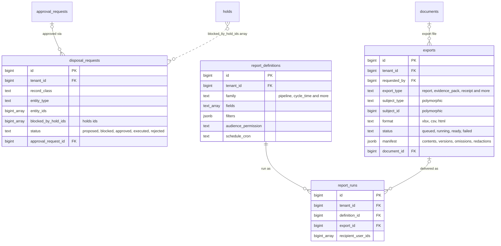
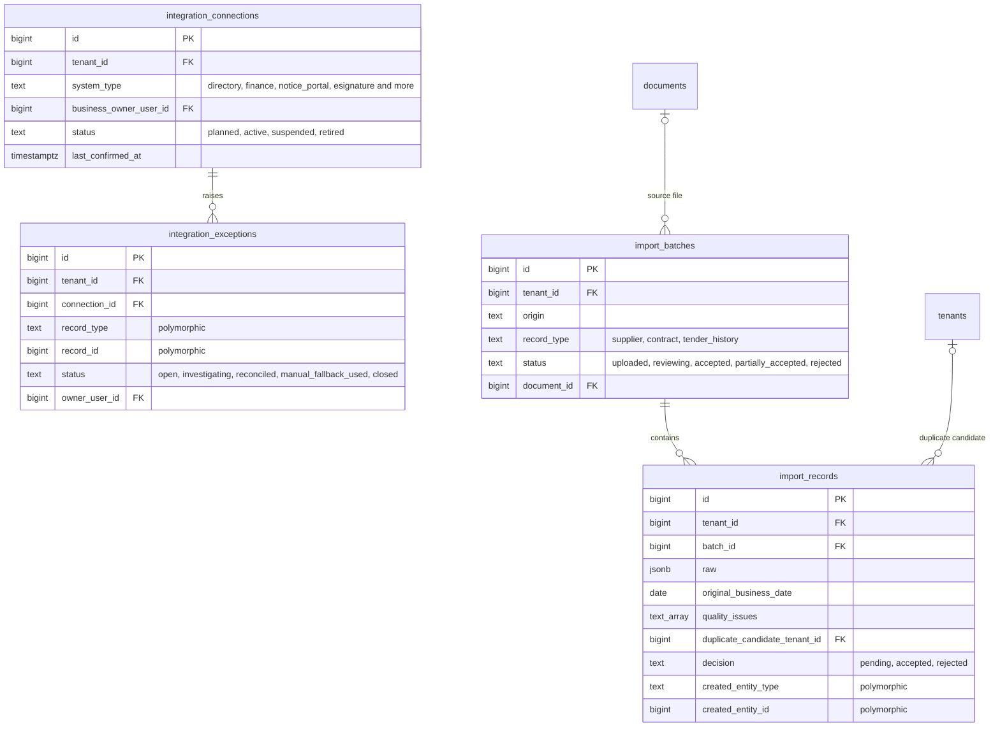
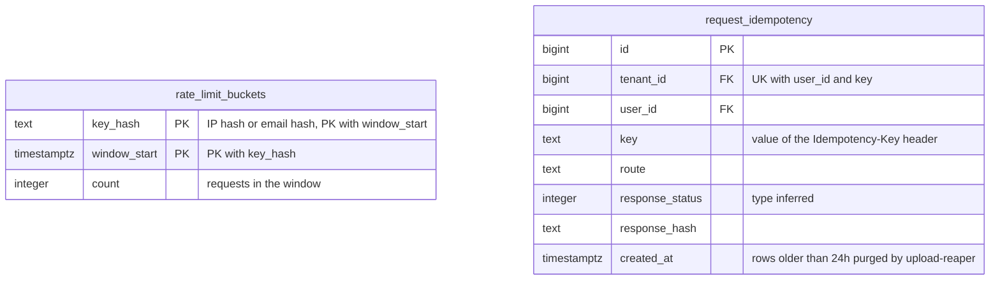
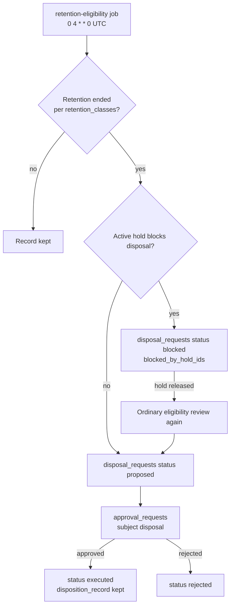
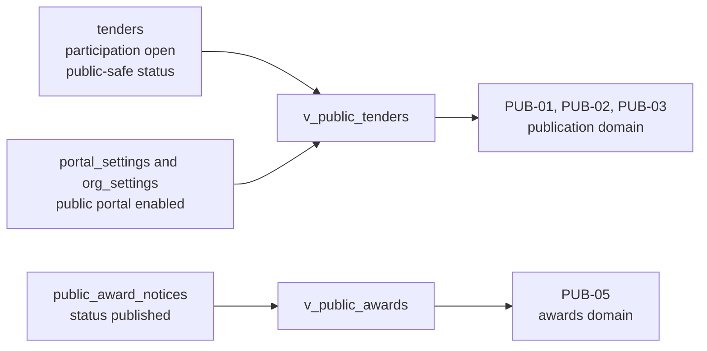
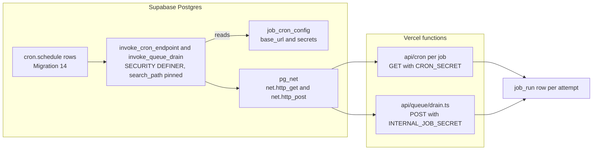

# Data model: Records, reporting and operations (Migrations 13 and 14)

Status: As-designed (pre-build). Updated to as-built at the end of Stage A and Stage B.

Sources:
- `docs/plan/schema-blueprint.md`: §0 Conventions; Migration 13 `20261001001300_records_reporting_ops.sql`; Migration 14 `20261001001400_views_grants_schedules.sql` (`v_public_tenders`, `v_public_awards`, revoke, `cron.schedule` rows); Migration 01 (job platform, `job_cron_config`, `invoke_cron_endpoint()`, `invoke_queue_drain()`, queues, storage buckets); Migration 03 (`retention_classes`, `portal_settings`); Migration 04 (`holds`, `approval_requests`, `documents`); Migration 07 (`tenders`); Migration 11 (`public_award_notices`, `lot_outcomes`); §P permission catalog.
- `docs/plan/architecture-plan.md`: §3.1 API audiences and operator support access; §3.8 notifications (`DeliveryChannel` with `in_app` and `email`); §3.9 background jobs and queues; §3.11 prototype mode (fully static since DD-50: persona picker, mock API in the browser); §4 cross-domain writes and registries; §6 domain map (domains 15 `reporting` + `records` and 16 `operations`); §11 item 4 (supplier self-registration through the API plus the Auth Admin invite, decided 2026-09-29).
- `docs/architecture-brief.md`: §5.6 tenant scoping and generated table lists; §5.9 storage; §6.3 Data API lockdown; §7.5 local jobs; §9 background jobs; §13 environments (pausing jobs).
- `docs/PRD.md`: §4.3; §13.2 (ADM-13 to ADM-17); §13.3 (OPS-01 to OPS-07); §13.4 (REP-01, REP-02); §14.1 exports; §15 reporting; §16 integrations; §18.3 retention, disclosure and exit; §21 platform operations; §24.1 imports; BR-39, BR-40, BR-43, BR-46, BR-47; screens PUB-01 to PUB-07, COM-09; AC-01, AC-33 to AC-36.
- `docs/plan/demo-storyline.md`: Records and operations; Organizations; Contracts (C-2025-0007); additional scenario anchor AC-34.
- `docs/plan/tenderiq-backend.workflow.js` (Stage B, draft): domain notes for `reporting`, `operations`, `publication` and the tenancy middleware (support grants, scheduled report recipients, exports manifest).
- `docs/plan/design-decisions.md`: DD-04 (`customer_tenant_id` renames), DD-06 (`job_run.status`, unimplemented jobs), DD-11 (audit partition of support-access events), DD-12 (storage keys), DD-13 (public views), DD-16 (exports owned by documents; shared owners), DD-17 (contracts → `integration_exceptions`), DD-18 (expiry jobs split), DD-19 (added jobs, alert idempotency keys), DD-20 (expiry and retention semantics), DD-22 (buyer slug in public URLs), DD-23 (permission additions), DD-27 (supplier registration transaction, then the Auth Admin invite), DD-28 (`rate_limit_buckets`), DD-39 (`request_idempotency`), DD-43 (real Supabase Auth; superseded for Stage A by DD-50 and moved to Stage B), DD-50 (Stage A is a static prototype: persona picker, mock API in the browser, no Supabase or Docker), DD-44 (email channel next to in-app: nodemailer over SMTP, Mailpit locally, content limited to title, official deadline and link, hosted provider deferred); §E item 7 (supplier self-registration: proposed approach, owner decision 2026-09-29).

Contents:
- [1. Scope, tenancy and ownership](#1-scope-tenancy-and-ownership)
- [2. Reading the data dictionary](#2-reading-the-data-dictionary)
- [3. Diagrams](#3-diagrams)
- [4. Retention, holds and disposal](#4-retention-holds-and-disposal)
- [5. Data dictionary: records and reporting](#5-data-dictionary-records-and-reporting)
- [6. Data dictionary: integrations and imports](#6-data-dictionary-integrations-and-imports)
- [7. Data dictionary: platform operations](#7-data-dictionary-platform-operations)
- [8. Public views: v_public_tenders and v_public_awards](#8-public-views-v_public_tenders-and-v_public_awards)
- [9. Scheduled jobs: cron.schedule rows](#9-scheduled-jobs-cronschedule-rows)
- [10. States and enumerations](#10-states-and-enumerations)
- [11. Constraints and indexes](#11-constraints-and-indexes)
- [12. Read access by audience](#12-read-access-by-audience)
- [13. Jobs and cross-domain touchpoints](#13-jobs-and-cross-domain-touchpoints)
- [14. Demo storyline coverage](#14-demo-storyline-coverage)
- [15. Open points finalized in Stage B](#15-open-points-finalized-in-stage-b)

Related: [data model overview](README.md), [platform, identity and access](01-platform-identity-access.md) (`tenants`, `job_run`, `job_cron_config`, `audit_log`), [organization and policy](02-organization-policy.md) (`retention_classes`, `portal_settings`), [shared services](03-shared-services.md) (`holds`, `approval_requests`, `documents`), [tenders](06-tenders.md) (`tenders`, `publications`), [selection and award](10-selection-award.md) (`public_award_notices`, `lot_outcomes`), [contracts](11-contracts.md) (historical contracts), [security model](../04-security-model.md), [background jobs](../08-background-jobs.md), [deployment and environments](../10-deployment-environments.md), ADRs [0001](../adr/0001-tenancy-equals-organization.md), [0004](../adr/0004-text-check-constraints-not-enums.md), [0007](../adr/0007-in-app-formal-notices.md), [0009](../adr/0009-registries-wired-by-integration.md), [0012](../adr/0012-supplier-registration-via-provisioned-accounts.md), [0013](../adr/0013-operator-support-access-grants.md).

---

## 1. Scope, tenancy and ownership

Migration 13 (`supabase/migrations/20261001001300_records_reporting_ops.sql`, written in Stage B) holds records disposal, exports, report definitions and runs, the integration register and exceptions, historical imports, the platform-operator tables (subscriptions, offboarding, support, service incidents, announcements, help content), and two request-safety tables: `rate_limit_buckets` for public POSTs (DD-28) and `request_idempotency` for `Idempotency-Key` headers (DD-39). Migration 14 (`20261001001400_views_grants_schedules.sql`) adds the views, revokes every privilege in `public` from `anon` and `authenticated` (including default privileges), and creates the `cron.schedule` rows.

Owners come from the architecture-plan §6 domain map. A domain writes only its own tables (architecture-plan §4).

- **`records`** (domain 15; FR-22, §18, BR-39, BR-40; ADM-14; AC-35): `disposal_requests`.
- **`reporting`** (domain 15; FR-21, §15, BR-43; REP-01, REP-02, ADM-13; AC-34): `report_definitions`, `report_runs`, and the `report-schedules` job (DD-19).
- **`documents`** (shared service): `exports` and the `exports` queue handler. Every export is requested through the documents service `requestExport()`; domains register a generator per `export_type` (for example bids for `receipt`, evaluation for `evaluation_report`, awards for `award_report`, contracts for `handover`) in `documents/export-registry.ts`, wired by Integration (DD-16). The documents service also runs the `upload-reaper` job, which purges `request_idempotency` rows older than 24 hours (architecture-plan §3.9, DD-39).
- **`operations`** (domain 16; FR-22, §21, BR-46, BR-47; OPS-01 to OPS-07, ADM-15 to ADM-17, COM-09; AC-33, AC-36): the integration, import and platform-operator tables, and the `expire-support-access` job (DD-18). Approved cross-domain writes: `publication` and `contracts` write `integration_exceptions` (AC-33; external signature failure, DD-17); `operations` writes `tenants` (onboarding), historical `contracts` and provisional supplier `tenants` (imports) (architecture-plan §4).
- **Request-safety tables.** `rate_limit_buckets` is written by the app middleware that limits public POSTs (registration, register interest, access requests) per IP hash and per email hash, with no external service (DD-28). `request_idempotency` stores the optional `Idempotency-Key` of commands that create records (DD-39). The decision log names no owning domain or module for either (§15).

Buyer tables are [T] and are served on `/api/v1/buyer/*`. Operator tables are [G] (global, no tenant scoping) and are served on `/api/v1/ops/*` to an operator tenant; public reads use `/api/v1/public/*` (architecture-plan §3.1). The three [G] tables that name a customer (`subscriptions`, `offboarding_plans`, `service_incident_impacts`) use **`customer_tenant_id`**, as `support_cases` and `support_access_grants` do, so the tenant-scoped table generator never picks them up (DD-04). No table here is [S], [R], SEALED or partitioned.

| Table | Tag | Row tenant | Owning domain | Mutable (`updated_at`) |
|---|---|---|---|---|
| `disposal_requests` | [T] | buyer | records | yes |
| `exports` | [T] | requesting tenant | documents (DD-16) | yes |
| `report_definitions` | [T] | buyer | reporting | yes |
| `report_runs` | [T] | buyer | reporting | no |
| `integration_connections` | [T] | buyer | operations | yes |
| `integration_exceptions` | [T] | buyer | operations (publication and contracts write) | yes |
| `import_batches` | [T] | buyer | operations | yes |
| `import_records` | [T] | buyer | operations | yes |
| `subscriptions` | [G] | none (`customer_tenant_id`) | operations | yes |
| `entitlements` | [G] | none | operations | no |
| `offboarding_plans` | [G] | none (`customer_tenant_id`) | operations | yes |
| `support_cases` | [G] | none (`customer_tenant_id`) | operations | yes |
| `support_case_messages` | [G] | none | operations | no |
| `support_access_grants` | [G] | none (`customer_tenant_id`) | operations | yes |
| `service_incidents` | [G] | none | operations | yes |
| `service_incident_impacts` | [G] | none (`customer_tenant_id` = affected customer) | operations | no |
| `announcements` | [G] | none | operations | yes |
| `help_articles` | [G] | none | operations | yes |
| `rate_limit_buckets` | [G] | none | public-POST rate-limit middleware (DD-28) | no |
| `request_idempotency` | [T] | tenant of the request | API command handling (DD-39); purged by `upload-reaper` (documents) | no |
| `v_public_tenders` (view) | n/a | public projection | publication (consumer) | n/a |
| `v_public_awards` (view) | n/a | public projection | awards (consumer) | n/a |

## 2. Reading the data dictionary

| Column | Meaning |
|---|---|
| Type | Plain type: stated in the blueprint, or fixed by a §0 convention (identity and FK columns `bigint`; instants `*_at` are `timestamptz` per architecture-plan §3.4; money `numeric(18,2)`; quantities `numeric(18,4)`; scores, rates and weights `numeric(12,6)`; currency `char(3)` with CHECK `~ '^[A-Z]{3}$'`; enumerations `text` + named CHECK). *Italic* type: inferred from the column's name and meaning because the blueprint states no type. `n/s`: not specified, with the candidates given. Stage B migrations fix every final type, recorded in `supabase/schema.expected.sql`. |
| Null | `no`: NOT NULL stated by the blueprint or a §0 convention. `yes`: nullable as stated, or the column is filled only by a later lifecycle event (for example `decided_at`), which forces nullability. `n/s`: not specified by the blueprint. |
| Key / constraint | `PK`, `FK → table`, `UK` (member of a unique constraint listed in §11), CHECK lists, defaults. Every FK column is indexed (§0). |

Standard columns (§0) appear in every table: `id bigint generated always as identity primary key`, `created_at timestamptz not null default now()`, `created_by bigint references users(id)` (null = system). Mutable tables add `updated_at`, maintained by `set_updated_at()`. [T] tables also have `tenant_id bigint not null references tenants(id)`; [G] tables do not. JSONB appears only where §0 allows it: `exports.manifest` (immutable export description), `report_definitions.filters` (report filter config) and `import_records.raw` (immutable source row).

## 3. Diagrams

Diagram legend: solid lines are FK columns; dashed lines are logical links with no FK constraint (arrays of ids, polymorphic `*_type` / `*_id` pairs). Entities without an attribute block are defined in other data-model files. User FK columns (`*_user_id`, `*_by`) are listed in the attribute blocks, but their lines to `users` are omitted. Diagram 3.3 draws lines to `tenants` because the customer link is the point of those tables.

### 3.1 Records disposal, exports and reports

### 3.2 Integrations and imports

### 3.3 Platform operations (global tables)

```mermaid
erDiagram
    tenants ||--o{ subscriptions : "customer of"
    subscriptions ||--o{ entitlements : "grants"
    tenants ||--o{ offboarding_plans : "exits via"
    exports |o--o{ offboarding_plans : "export request"
    tenants ||--o{ support_cases : "customer of"
    support_cases ||--o{ support_case_messages : "messages"
    support_cases ||--o{ support_access_grants : "access for"
    tenants ||--o{ support_access_grants : "grants access to"
    service_incidents ||--o{ service_incident_impacts : "affects"
    tenants ||--o{ service_incident_impacts : "affected customer"
    tenders |o--o{ service_incident_impacts : "affected tender"

    subscriptions {
        bigint id PK
        bigint customer_tenant_id FK "customer, not scoping"
        text plan_code
        text status "trial, active, past_due, cancelled, ended"
    }
    entitlements {
        bigint id PK
        bigint subscription_id FK
        text feature_code
        integer limit_value
        integer usage_value
    }
    offboarding_plans {
        bigint id PK
        bigint customer_tenant_id FK "customer, not scoping"
        text status "draft, agreed, in_progress, completed"
        bigint export_request_id FK "target not stated"
    }
    support_cases {
        bigint id PK
        bigint customer_tenant_id FK
        text category "usage, access and more"
        text status "open to routed_to_buyer, see section 10"
        bigint assigned_operator_user_id FK
    }
    support_case_messages {
        bigint id PK
        bigint case_id FK
        boolean internal
    }
    support_access_grants {
        bigint id PK
        bigint case_id FK
        bigint customer_tenant_id FK
        bigint operator_user_id FK
        bigint authorized_by_user_id FK "customer admin"
        text scope "metadata_only, specific_records"
        timestamptz expires_at
        text status "requested, authorized, active, expired, revoked, denied"
    }
    service_incidents {
        bigint id PK
        text status "investigating, identified, monitoring, resolved"
    }
    service_incident_impacts {
        bigint id PK
        bigint incident_id FK
        bigint customer_tenant_id FK "affected customer"
        bigint tender_id FK
    }
    announcements {
        bigint id PK
        text audience "all, buyers, suppliers, public"
        text status "draft, published, archived"
    }
    help_articles {
        bigint id PK
        text slug UK
        text audience "public, supplier, buyer, all"
        text topic "registration, qualification and more"
        text status "draft, published, archived"
    }
```

### 3.4 Request safety: rate limits and idempotency

`rate_limit_buckets` has no FK. The lines from `request_idempotency` to `tenants` and `users` are omitted, as elsewhere, so this diagram has no relationship lines.

## 4. Retention, holds and disposal

Retention classes (`retention_classes`, Migration 03) give each record class a trigger, duration, owner and disposition (PRD §18.3). Legal and investigation holds (`holds` with `hold_type` `legal_hold` or `investigation_hold`, `blocked_actions` containing `disposal`) prevent disposal even after the retention period ends (BR-40, AC-35). When a hold is released, disposal still requires ordinary eligibility review, and destruction needs approval and a retained disposition record (PRD §18.3).

The `retention-eligibility` job writes `disposal_requests` rows directly: `proposed` for eligible records, or `blocked` (with `blocked_by_hold_ids`) when a hold applies (architecture-plan §3.9, DD-20). It never disposes of anything itself; execution still needs an approved request. Underlying history is never deleted by a hold or a rejected request (AC-35). Personal account deletion and business-record retention are separate decisions (BR-39).

## 5. Data dictionary: records and reporting

### 5.1 disposal_requests

[T], mutable. Row tenant: the buyer. Owner `records`. A request to dispose of records of one class, with eligibility check, blocking holds, approval and the retained disposition record (ADM-14, AC-35). The `retention-eligibility` job creates rows in `proposed` or `blocked` status (DD-20).

| Column | Type | Null | Key / constraint | Meaning |
|---|---|---|---|---|
| id | bigint | no | PK | Standard. |
| tenant_id | bigint | no | FK → tenants | Buyer tenant. |
| record_class | *text* | n/s | CHECK list n/s | Record class; `retention_classes.record_class` uses (tender, bid, financial_evidence, communication, evaluation, contract, complaint, personal_account, audit). |
| entity_type | *text* | n/s | | Entity type of the records. |
| entity_ids | bigint[] | n/s | no FK | Records covered. |
| eligibility_checked_at | timestamptz | n/s | | When eligibility was last checked. |
| blocked_by_hold_ids | bigint[] | n/s | array of `holds.id`; no FK | Holds that block disposal. |
| status | text | n/s | CHECK (proposed, blocked, approved, executed, rejected) | Request state. |
| approval_request_id | bigint | yes | FK → approval_requests | Approval (subject type `disposal`; authority `disposal_approval`). |
| disposition_record | *text* | yes | | Retained record of what was disposed of, how and when (PRD §18.3). |
| created_at | timestamptz | no | default now() | Standard. |
| created_by | bigint | yes | FK → users | Standard. |
| updated_at | timestamptz | no | `set_updated_at()` | Mutable marker. |

### 5.2 exports

[T], mutable. Row tenant: the tenant of the requesting user (§15). Owner: the **documents** service, which also owns the `exports` queue handler; every export is requested through `requestExport()`, and each `export_type` has a generator registered by its domain in `documents/export-registry.ts` (DD-16). A controlled export produced on the `exports` pgmq queue and stored in the private `exports` bucket (Migration 01), under a storage key that starts with the owning record's tenant id (DD-12). Evidence exports identify contents, versions, omissions, redactions, creator and creation date, and never include material unavailable to the requester (PRD §14.1, BR-43). Formats are XLSX (exceljs), CSV and print-styled HTML (architecture-plan §11).

| Column | Type | Null | Key / constraint | Meaning |
|---|---|---|---|---|
| id | bigint | no | PK | Standard. |
| tenant_id | bigint | no | FK → tenants | Tenant of the request. |
| requested_by | bigint | n/s | FK → users | Requester (`export.create`); the manifest's creator. |
| export_type | text | n/s | CHECK (report, evidence_pack, tender_package, receipt, evaluation_report, award_report, handover, customer_exit) | Kind of export. |
| scope_description | *text* | n/s | | Human-readable scope. |
| subject_type | *text* | n/s | polymorphic | Subject record type (for example a tender or receipt). |
| subject_id | bigint | n/s | polymorphic; no FK | Subject record id. |
| format | text | n/s | CHECK (xlsx, csv, html) | Output format. |
| status | text | n/s | CHECK (queued, running, ready, failed) | Job state. |
| manifest | jsonb | n/s | | Contents, versions, omissions and redactions (blueprint). |
| document_id | bigint | yes | FK → documents | Produced file. |
| completed_at | timestamptz | yes | | Completion time. |
| error | *text* | yes | | Failure message (sanitized). |
| created_at | timestamptz | no | default now() | Standard; the manifest's creation date. |
| created_by | bigint | yes | FK → users | Standard. |
| updated_at | timestamptz | no | `set_updated_at()` | Mutable marker. |

### 5.3 report_definitions

[T], mutable. Row tenant: the buyer. Owner `reporting`. A saved management report with fields, filters, currency basis, audience and optional schedule (REP-02, ADM-13).

| Column | Type | Null | Key / constraint | Meaning |
|---|---|---|---|---|
| id | bigint | no | PK | Standard. |
| tenant_id | bigint | no | FK → tenants | Buyer tenant. |
| name | *text* | n/s | | Report name. |
| family | text | n/s | CHECK (pipeline, cycle_time, participation, qualification_risk, evaluation_integrity, awards, commercial_outcomes, contract_performance, complaints, audit_records) | The ten PRD §15.1 report families. |
| fields | text[] | n/s | | Selected business fields. |
| filters | jsonb | n/s | | Filter configuration (§0 allows JSONB for report filter configs). |
| currency_basis | *text* | n/s | | Currency basis for consolidated totals (PRD §15.2). |
| conversion_date | *date* | n/s | | Conversion date for the currency basis. |
| audience_permission | *text* | n/s | permission code; FK not stated | Permission a viewer or recipient must hold. |
| schedule_cron | *text* | yes | | Cron expression for scheduled delivery; the hourly `report-schedules` job runs due definitions (DD-19). |
| owner_user_id | bigint | n/s | FK → users | Owner. |
| active | *boolean* | n/s | | Definition in use. |
| created_at | timestamptz | no | default now() | Standard. |
| created_by | bigint | yes | FK → users | Standard. |
| updated_at | timestamptz | no | `set_updated_at()` | Mutable marker. |

### 5.4 report_runs

[T], not mutable. Row tenant: the buyer. Owner `reporting`. One execution of a report definition, run by a user or by the `report-schedules` job. Scheduled recipients must still be authorized when the report is issued: the job re-checks each recipient's authorization at issue time (PRD §15.2; DD-19).

| Column | Type | Null | Key / constraint | Meaning |
|---|---|---|---|---|
| id | bigint | no | PK | Standard. |
| tenant_id | bigint | no | FK → tenants | Buyer tenant. |
| definition_id | bigint | n/s | FK → report_definitions | Definition run. |
| run_by | bigint | n/s | FK → users | User who ran it (null semantics for scheduled runs not stated). |
| run_at | timestamptz | n/s | | Run time. |
| row_count | *integer* | n/s | | Rows produced. |
| export_id | bigint | yes | FK → exports | Export produced. |
| recipient_user_ids | bigint[] | n/s | array of `users.id`; no FK | Recipients, re-checked for authorization at issue time. |
| created_at | timestamptz | no | default now() | Standard. |
| created_by | bigint | yes | FK → users | Standard. |

## 6. Data dictionary: integrations and imports

### 6.1 integration_connections

[T], mutable. Row tenant: the buyer. Owner `operations`. The integration register: business owner, purpose, information scope, status, last confirmation and manual fallback (PRD §16, ADM-15). A reviewed manual handoff must remain possible when an external service is unavailable.

| Column | Type | Null | Key / constraint | Meaning |
|---|---|---|---|---|
| id | bigint | no | PK | Standard. |
| tenant_id | bigint | no | FK → tenants | Buyer tenant. |
| system_type | text | n/s | CHECK (directory, finance, purchasing, vendor_master, notice_portal, registry, credit, sanctions, insurance_verification, esignature, records_management, messaging, calendar, contract_delivery, fx_rates, bi, support) | The PRD §16 business systems. |
| name | *text* | n/s | | Connection name. |
| business_owner_user_id | bigint | n/s | FK → users | Business owner. |
| purpose | *text* | n/s | | Purpose. |
| information_scope | *text* | n/s | | Information exchanged. |
| status | text | n/s | CHECK (planned, active, suspended, retired) | Connection state. |
| last_confirmed_at | timestamptz | yes | | Last confirmation of the connection. |
| manual_fallback | *text* | n/s | | Documented manual fallback. |
| created_at | timestamptz | no | default now() | Standard. |
| created_by | bigint | yes | FK → users | Standard. |
| updated_at | timestamptz | no | `set_updated_at()` | Mutable marker. |

### 6.2 integration_exceptions

[T], mutable. Row tenant: the buyer. Owner `operations`; the `publication` domain writes rows for failed external publication and the `contracts` domain for an external signature failure (approved cross-domain writes, architecture-plan §4, AC-33, DD-17). Failed transfers stay visible until resolved, and a failure never marks an external approval, publication, signature or payment as completed (PRD §16).

| Column | Type | Null | Key / constraint | Meaning |
|---|---|---|---|---|
| id | bigint | no | PK | Standard. |
| tenant_id | bigint | no | FK → tenants | Buyer tenant. |
| connection_id | bigint | n/s | FK → integration_connections | Connection that failed. |
| record_type | *text* | n/s | polymorphic | Affected record type (for example a publication). |
| record_id | bigint | n/s | polymorphic; no FK | Affected record id. |
| description | *text* | n/s | | What failed. |
| status | text | n/s | CHECK (open, investigating, reconciled, manual_fallback_used, closed) | Exception state. |
| owner_user_id | bigint | n/s | FK → users | Assigned owner. |
| resolved_at | timestamptz | yes | | Resolution time. |
| resolution | *text* | yes | | Resolution. |
| created_at | timestamptz | no | default now() | Standard. |
| created_by | bigint | yes | FK → users | Standard. |
| updated_at | timestamptz | no | `set_updated_at()` | Mutable marker. |

### 6.3 import_batches

[T], mutable. Row tenant: the buyer. Owner `operations`. An uploaded historical import (ADM-16). Imported records state their origin, original business dates, import date and evidence gaps, and never certify that historical actions met controls not then in use (PRD §24.1).

| Column | Type | Null | Key / constraint | Meaning |
|---|---|---|---|---|
| id | bigint | no | PK | Standard. |
| tenant_id | bigint | no | FK → tenants | Buyer tenant. |
| origin | *text* | n/s | | Origin label (for example "Legacy spreadsheet 2025"). |
| record_type | text | n/s | CHECK (supplier, contract, tender_history) | What is imported. |
| status | text | n/s | CHECK (uploaded, reviewing, accepted, partially_accepted, rejected) | Batch state. |
| document_id | bigint | n/s | FK → documents | Uploaded source file (CSV or XLSX). |
| reviewed_by | bigint | yes | FK → users | Reviewer (`org.imports.manage`). |
| created_at | timestamptz | no | default now() | Standard; the import date. |
| created_by | bigint | yes | FK → users | Standard. |
| updated_at | timestamptz | no | `set_updated_at()` | Mutable marker. |

### 6.4 import_records

[T], mutable. Row tenant: the buyer. Owner `operations`. One source row with its quality issues, duplicate candidate, decision and the entity it created. Accepted rows create provisional supplier tenants or historical contracts (approved cross-domain writes).

| Column | Type | Null | Key / constraint | Meaning |
|---|---|---|---|---|
| id | bigint | no | PK | Standard. |
| tenant_id | bigint | no | FK → tenants | Buyer tenant. |
| batch_id | bigint | n/s | FK → import_batches | Batch. |
| row_no | *integer* | n/s | | Source row number. |
| raw | jsonb | n/s | | Source row as uploaded (immutable). |
| original_business_date | *date* | n/s | | Original business date kept from the source (PRD §24.1). |
| quality_issues | text[] | n/s | | Detected quality issues. |
| duplicate_candidate_tenant_id | bigint | yes | FK → tenants | Possible existing supplier (review only, BR-44, BR-48). |
| decision | text | n/s | CHECK (pending, accepted, rejected) | Review decision. |
| created_entity_type | *text* | yes | polymorphic | Type of the created record (supplier tenant or contract). |
| created_entity_id | bigint | yes | polymorphic; no FK | Id of the created record. |
| provenance_note | *text* | n/s | | Provenance statement. |
| created_at | timestamptz | no | default now() | Standard. |
| created_by | bigint | yes | FK → users | Standard. |
| updated_at | timestamptz | no | `set_updated_at()` | Mutable marker. |

## 7. Data dictionary: platform operations

These tables are [G]: they have no `tenant_id` scoping column and are read and written by the operator tenant on `/api/v1/ops/*`. Operators never see customer tender content through them (OPS-01, OPS-06). The two request-safety tables at the end of this section are different: `rate_limit_buckets` (§7.11) is [G] but written only by the public-POST middleware, and `request_idempotency` (§7.12) is [T].

### 7.1 subscriptions

[G], mutable. Owner `operations`. A buyer customer's service subscription (OPS-03; PRD §21.1). The customer column is named `customer_tenant_id`, not `tenant_id`, so the tenant-scoped table generator never picks up this global table (DD-04).

| Column | Type | Null | Key / constraint | Meaning |
|---|---|---|---|---|
| id | bigint | no | PK | Standard. |
| customer_tenant_id | bigint | n/s | FK → tenants | Customer organization (DD-04). |
| plan_code | *text* | n/s | | Plan (see also `tenants.plan_code`). |
| starts_at | timestamptz | n/s | | Start. |
| renews_at | timestamptz | n/s | | Renewal date. |
| status | text | n/s | CHECK (trial, active, past_due, cancelled, ended) | Subscription state. |
| commercial_contact | *text* | n/s | | Commercial contact. |
| notes | *text* | n/s | | Notes. |
| created_at | timestamptz | no | default now() | Standard. |
| created_by | bigint | yes | FK → users | Standard. |
| updated_at | timestamptz | no | `set_updated_at()` | Mutable marker. |

### 7.2 entitlements

[G], not mutable. Owner `operations`. Feature limits and usage for a subscription. Reaching a usage limit creates a service-management task and never blocks an invited supplier's submission (PRD §21.1; domain notes); tier never changes public eligibility or access (BR-46).

| Column | Type | Null | Key / constraint | Meaning |
|---|---|---|---|---|
| id | bigint | no | PK | Standard. |
| subscription_id | bigint | n/s | FK → subscriptions | Subscription. |
| feature_code | *text* | n/s | | Feature. |
| limit_value | integer | n/s | | Agreed limit. |
| usage_value | integer | n/s | | Current usage. |
| created_at | timestamptz | no | default now() | Standard. |
| created_by | bigint | yes | FK → users | Standard. |

### 7.3 offboarding_plans

[G], mutable. Owner `operations`. The continuity and exit plan for a departing customer: export package, open-work transition, supplier access, retention responsibilities and disposal timetable (PRD §18.3, BR-47, OPS-02, ADM-17, AC-36). Nothing is silently destroyed.

| Column | Type | Null | Key / constraint | Meaning |
|---|---|---|---|---|
| id | bigint | no | PK | Standard. |
| customer_tenant_id | bigint | n/s | FK → tenants | Departing customer (renamed from `tenant_id`, DD-04). |
| status | text | n/s | CHECK (draft, agreed, in_progress, completed) | Plan state. |
| active_events_count | *integer* | n/s | | Live events at planning time. |
| active_contracts_count | *integer* | n/s | | Live contracts at planning time. |
| export_request_id | bigint | yes | FK target n/s | Customer-exit export request; by name, an `exports` row with type `customer_exit` (§15). |
| continuity_plan | *text* | n/s | | Continuity for live procurements. |
| supplier_access_plan | *text* | n/s | | Continued supplier access. |
| retention_responsibilities | *text* | n/s | | Who retains which records. |
| disposal_timetable | *text* | n/s | | Disposal timetable. |
| agreed_by_customer_at | timestamptz | yes | | Customer agreement time. |
| created_at | timestamptz | no | default now() | Standard. |
| created_by | bigint | yes | FK → users | Standard. |
| updated_at | timestamptz | no | `set_updated_at()` | Mutable marker. |

### 7.4 support_cases

[G], mutable. Owner `operations`. A service case (COM-09, OPS-04). Support cases identify their category; business disputes are routed to the responsible buyer, and support never makes deadline or award decisions or accepts bids (PRD §21.2, §14.2).

| Column | Type | Null | Key / constraint | Meaning |
|---|---|---|---|---|
| id | bigint | no | PK | Standard. |
| customer_tenant_id | bigint | n/s | FK → tenants | Customer organization. |
| opened_by_user_id | bigint | n/s | FK → users | User who opened the case. |
| category | text | n/s | CHECK (usage, access, submission_evidence, qualification, procurement_merits, contract_performance, accessibility) | PRD §21.2 categories plus accessibility. |
| subject | *text* | n/s | | Subject. |
| description | *text* | n/s | | Description. |
| status | text | n/s | CHECK (open, in_progress, awaiting_customer, resolved, closed, routed_to_buyer) | Case state; `routed_to_buyer` for procurement-merit matters. |
| assigned_operator_user_id | bigint | n/s | FK → users | Assigned operator (`ops.support.manage`). |
| resolution | *text* | yes | | Resolution. |
| closed_at | timestamptz | yes | | Closure time. |
| created_at | timestamptz | no | default now() | Standard. |
| created_by | bigint | yes | FK → users | Standard. |
| updated_at | timestamptz | no | `set_updated_at()` | Mutable marker. |

### 7.5 support_case_messages

[G], not mutable. Owner `operations`. Messages on a support case.

| Column | Type | Null | Key / constraint | Meaning |
|---|---|---|---|---|
| id | bigint | no | PK | Standard. |
| case_id | bigint | n/s | FK → support_cases | Case. |
| author_user_id | bigint | n/s | FK → users | Author. |
| body | *text* | n/s | | Message text. |
| internal | boolean | n/s | | Operator-internal note, by its name not shown to the customer (§15). |
| created_at | timestamptz | no | default now() | Standard. |
| created_by | bigint | yes | FK → users | Standard. |

### 7.6 support_access_grants

[G], mutable. Owner `operations` (grant lifecycle and the `expire-support-access` job); enforced by the tenancy middleware (`lib/tenancy`). An operator may enter a customer tenant only while an active, customer-authorized grant exists. The customer's buyer administrator authorizes a grant with permission `org.support_access.authorize` (DD-23). Access is read-only through `support.view`, never includes sealed content, drafts or scores, never allows submit, score, approve or sign, and is audited before the handler runs (architecture-plan §3.1, PRD §4.2, OPS-04, [ADR 0013](../adr/0013-operator-support-access-grants.md)). Support-access audit events are written to the **customer** tenant's `audit_log` partition, so the customer can review them (DD-11).

| Column | Type | Null | Key / constraint | Meaning |
|---|---|---|---|---|
| id | bigint | no | PK | Standard. |
| case_id | bigint | n/s | FK → support_cases | Case that justifies access. |
| customer_tenant_id | bigint | n/s | FK → tenants | Customer tenant entered. |
| operator_user_id | bigint | n/s | FK → users | Operator granted access. |
| authorized_by_user_id | bigint | yes | FK → users | Customer administrator who authorized it (blueprint), holding `org.support_access.authorize` (DD-23). |
| business_need | *text* | n/s | | Documented business need. |
| scope | text | n/s | CHECK (metadata_only, specific_records) | Access scope. |
| record_refs | text[] | n/s | | Records covered when `scope = specific_records`. |
| starts_at | timestamptz | n/s | | Start. |
| expires_at | timestamptz | n/s | | Expiry. The middleware compares `starts_at`, `expires_at` and `revoked_at` directly on every request, so access ends at `expires_at` whether or not a job has run (DD-18). |
| revoked_at | timestamptz | yes | | Revocation time. |
| status | text | n/s | CHECK (requested, authorized, active, expired, revoked, denied) | Grant state. `expired` is a display status set by the hourly `expire-support-access` job, which also notifies and audits (DD-18). |
| created_at | timestamptz | no | default now() | Standard. |
| created_by | bigint | yes | FK → users | Standard. |
| updated_at | timestamptz | no | `set_updated_at()` | Mutable marker. |

### 7.7 service_incidents

[G], mutable. Owner `operations`. A platform service incident with times, status and customer notice (OPS-05; PRD §19). The platform supports fair deadline decisions by the responsible buyer and never decides them itself.

| Column | Type | Null | Key / constraint | Meaning |
|---|---|---|---|---|
| id | bigint | no | PK | Standard. |
| title | *text* | n/s | | Title. |
| description | *text* | n/s | | Description. |
| severity | *text* | n/s | no value list stated | Severity. |
| started_at | timestamptz | n/s | | Start of impact. |
| resolved_at | timestamptz | yes | | Resolution time. |
| status | text | n/s | CHECK (investigating, identified, monitoring, resolved) | Incident state. |
| customer_notice | *text* | n/s | | Notice text for customers (notice type `service_incident` exists for formal notices). |
| created_at | timestamptz | no | default now() | Standard. |
| created_by | bigint | yes | FK → users | Standard. |
| updated_at | timestamptz | no | `set_updated_at()` | Mutable marker. |

### 7.8 service_incident_impacts

[G], not mutable. Owner `operations`. Which customers and tenders an incident affected, and the buyer's recorded decision (OPS-05; PRD §20 "service outage near closing").

| Column | Type | Null | Key / constraint | Meaning |
|---|---|---|---|---|
| id | bigint | no | PK | Standard. |
| incident_id | bigint | n/s | FK → service_incidents | Incident. |
| customer_tenant_id | bigint | n/s | FK → tenants | Affected customer (data column, not scoping; renamed from `tenant_id`, DD-04). |
| tender_id | bigint | yes | FK → tenders | Affected tender. |
| impact_note | *text* | n/s | | Known impact and timing evidence. |
| buyer_decision_note | *text* | yes | | The responsible buyer's deadline or competition decision (§15). |
| created_at | timestamptz | no | default now() | Standard. |
| created_by | bigint | yes | FK → users | Standard. |

### 7.9 announcements

[G], mutable. Owner `operations`. Product announcements and service messages, distinct from formal tender notices (OPS-07).

| Column | Type | Null | Key / constraint | Meaning |
|---|---|---|---|---|
| id | bigint | no | PK | Standard. |
| audience | text | n/s | CHECK (all, buyers, suppliers, public) | Audience. |
| title | *text* | n/s | | Title. |
| body | *text* | n/s | | Body. |
| language | *text* | n/s | | Language. |
| status | text | n/s | CHECK (draft, published, archived) | State. |
| published_at | timestamptz | yes | | Publication time. |
| created_at | timestamptz | no | default now() | Standard. |
| created_by | bigint | yes | FK → users | Standard. |
| updated_at | timestamptz | no | `set_updated_at()` | Mutable marker. |

### 7.10 help_articles

[G], mutable. Owner `operations`. Guidance and help content (PUB-07, COM-09, OPS-07). General guidance is distinct from binding conditions in a particular tender. The public guidance page reads published articles (domain notes).

| Column | Type | Null | Key / constraint | Meaning |
|---|---|---|---|---|
| id | bigint | no | PK | Standard. |
| slug | *text* | n/s | UNIQUE (blueprint) | URL slug (`/guidance/*`). |
| title | *text* | n/s | | Title. |
| body_markdown | *text* | n/s | | Body in Markdown. |
| audience | text | n/s | CHECK (public, supplier, buyer, all) | Audience. |
| topic | text | n/s | CHECK (registration, qualification, submission, complaints, accessibility, evaluation, contracts, general) | Topic; PUB-07 covers registration, qualification, submission, complaint, accessibility and contact guidance. |
| language | *text* | n/s | | Language. |
| status | text | n/s | CHECK (draft, published, archived) | State. |
| published_at | timestamptz | yes | | Publication time. |
| created_at | timestamptz | no | default now() | Standard. |
| created_by | bigint | yes | FK → users | Standard. |
| updated_at | timestamptz | no | `set_updated_at()` | Mutable marker. |

### 7.11 rate_limit_buckets

[G], not marked mutable (no `updated_at`; `count` is incremented in place). Written by the app middleware that limits public POSTs (registration, register interest, access requests) per IP hash and per email hash; there is no external rate-limit service (DD-28). Rows hold hashes, never raw IP addresses or emails. Public endpoints run on `/api/v1/public/*` without authentication or tenant (architecture-plan §3.1). The registration POST is supplier self-registration as decided by the owner on 2026-09-29 (the proposed approach, architecture-plan §11 item 4): Supabase self-signup stays disabled, and the API validates, checks duplicates, rate-limits through this table, creates the supplier organization, user and membership in one transaction, and then asks Supabase Auth to send the invite email (Mailpit locally) (DD-27, [ADR 0012](../adr/0012-supplier-registration-via-provisioned-accounts.md)).

| Column | Type | Null | Key / constraint | Meaning |
|---|---|---|---|---|
| key_hash | text | n/s | PK (key_hash, window_start) | Hash of the throttled key: an IP hash or an email hash (DD-28). |
| window_start | timestamptz | n/s | PK (key_hash, window_start) | Start of the counting window. |
| count | integer | n/s | | Requests counted for the key in the window. |

The blueprint states the composite primary key and these three columns only. Whether the §0 standard columns (`id`, `created_at`, `created_by`) are also kept, the window length and limits, and how old buckets are removed are not stated (§15).

### 7.12 request_idempotency

[T], not mutable. Row tenant: the tenant of the request (the active `X-Tenant-Id`). Commands that create records accept an optional `Idempotency-Key` header, and the key is stored here with a hash of the response, so a retried command can be recognized instead of creating a second record (DD-39). The SPA also disables submit buttons while a request is in flight. A retried **submission** still records a new `submission_attempts` row, which is intended evidence ([08-bids-submission.md](08-bids-submission.md)). Rows older than 24 hours are purged by the `upload-reaper` job (documents, `50 3 * * *`).

| Column | Type | Null | Key / constraint | Meaning |
|---|---|---|---|---|
| id | bigint | no | PK | Standard. |
| tenant_id | bigint | no | FK → tenants; UK (tenant_id, user_id, key) | Tenant the command ran in. |
| key | *text* | n/s | UK | Value of the `Idempotency-Key` header. |
| user_id | bigint | n/s | FK → users; UK | Caller. |
| route | *text* | n/s | | Route the command was sent to. |
| response_status | *integer* | n/s | | HTTP status of the stored response. |
| response_hash | *text* | n/s | | Hash of the stored response. |
| created_at | timestamptz | no | default now() | Standard; the 24-hour retention runs from here (DD-39). |
| created_by | bigint | yes | FK → users | Standard. |

## 8. Public views: v_public_tenders and v_public_awards

Both views are created in Migration 14. They are read by public endpoints on `/api/v1/public/*`, which run without authentication or tenant (architecture-plan §3.1). The PostgREST roles `anon` and `authenticated` hold no privileges on them: the Migration 14 revoke covers every table and view in `public`, so the browser's anon key cannot read them through the Supabase Data API (brief §6.3).

| Aspect | v_public_tenders | v_public_awards |
|---|---|---|
| Definition (DD-13) | Tenders with `participation = 'open'` whose buyer has the public portal enabled (`portal_settings` / `org_settings.public_portal_enabled`), in a public-safe status; no internal budget. | Only `public_award_notices` with `status = 'published'`. |
| Row filter | `tenders.participation = 'open'`, the buyer's public portal on, and status in (open, closed, under_assessment, award_pending, awarded, partially_awarded, completed_without_award, information_collected, cancelled). Invitation-only and restricted events never appear (AC-01). Draft, `awaiting_release_approval`, `ready` and `archived` tenders never appear. | `public_award_notices.status = 'published'`; no other predicate. Lot outcome status is not a filter. |
| Excluded data | `tenders.estimated_value`, `tenders.budget_amount` and `lots.estimated_value` (internal per the blueprint). | Losing bids and unpublished contract schedules (PUB-05). Values only where `disclosed_values` allows. |
| Consumer | PUB-01 home, PUB-02 search (title, buyer, category, region, procedure, status, published and closing dates), PUB-03 notice at `/opportunities/:buyerSlug/:ref`; closed and cancelled notices clearly labelled. | PUB-05 award search and detail at `/awards/:buyerSlug/:ref` (buyer, event, lots, supplier names, disclosed values, dates, approved explanation). |
| Public URL key | References are unique per buyer, so public URLs carry the buyer slug (`tenants.slug`) with the reference (DD-22). | As for tenders (DD-22). |
| Column list | Fixed with the Migration 14 SQL in Stage B. | Fixed with the Migration 14 SQL in Stage B. |

Public documents are served by classification (`documents.classification = 'public'`), not through these views (domain notes). Clarifications published to the public use `/clarifications/:buyerSlug/:ref` in the same way (DD-22). Remaining open details are in §15.

## 9. Scheduled jobs: cron.schedule rows

Migration 14 creates one `cron.schedule` row for every job in architecture-plan §3.9 (as amended by DD-18 and DD-19), plus `queue-drain`. Job names must match `src/server/jobs/cron/registry.ts`. Schedules are UTC.

| Job | Schedule | Command | Owner domain | Purpose (architecture-plan §3.9) |
|---|---|---|---|---|
| `publish-scheduled` | `*/5 * * * *` | `select public.invoke_cron_endpoint('publish-scheduled')` | publication | Ready or scheduled tenders whose release time has passed → open. |
| `close-tenders` | `* * * * *` | `select public.invoke_cron_endpoint('close-tenders')` | bids | Open tenders past deadline → closed / awaiting opening. |
| `deadline-reminders` | `15 * * * *` | `select public.invoke_cron_endpoint('deadline-reminders')` | notifications | Closing-approaching, evaluation-due and approval-due reminders. |
| `evidence-expiry` | `10 2 * * *` | `select public.invoke_cron_endpoint('evidence-expiry')` | qualification | Flags expiring evidence and notifies (reassessment triggers, BR-25). It sets `evidence_items.status = 'expired'` only through the suppliers-owned helper (DD-20). |
| `qualification-expiry` | `20 2 * * *` | `select public.invoke_cron_endpoint('qualification-expiry')` | qualification | Creates tasks and notices for decisions past `effective_to`. It writes no decision: `v_qualification_status` derives `expired` (DD-20). |
| `obligation-status` | `30 2 * * *` | `select public.invoke_cron_endpoint('obligation-status')` | contracts | Due and overdue obligations, escalation tasks. |
| `renewal-windows` | `40 2 * * *` | `select public.invoke_cron_endpoint('renewal-windows')` | contracts | Notice windows → alerts only, never auto-renew (BR-37, AC-32). |
| `contract-dates` | `50 2 * * *` | `select public.invoke_cron_endpoint('contract-dates')` | contracts | `signed_not_effective` → `active` on the effective date; `active` → `expired` after `term_end` (open obligations remain); securities `expiring` / `expired` (DD-19). |
| `standstill-monitor` | `*/15 * * * *` | `select public.invoke_cron_endpoint('standstill-monitor')` | awards | Standstill ended with no blocking hold → task only, never auto-award. |
| `expire-access` | `0 * * * *` | `select public.invoke_cron_endpoint('expire-access')` | org-admin | Display-status expiry of grants, restrictions, delegations and invitations; request-time checks compare timestamps directly (DD-18). |
| `expire-approvals` | `5 * * * *` | `select public.invoke_cron_endpoint('expire-approvals')` | approvals | Expire approval requests past `expires_at` and notify their owners (DD-18). |
| `report-schedules` | `5 * * * *` | `select public.invoke_cron_endpoint('report-schedules')` | reporting | Run due report definitions (`report_definitions.schedule_cron`); re-check each recipient's authorization at issue time (DD-19). |
| `expire-support-access` | `10 * * * *` | `select public.invoke_cron_endpoint('expire-support-access')` | operations | Expire `support_access_grants` (display status) and audit (DD-18). |
| `notice-reconciliation` | `*/10 * * * *` | `select public.invoke_cron_endpoint('notice-reconciliation')` | notifications | Re-enqueue `notice_recipients` still `pending` after 10 minutes (brief §9.5 safety net, DD-19). |
| `notification-digests` | `0 5 * * *` | `select public.invoke_cron_endpoint('notification-digests')` | notifications | Daily and weekly digests per user preferences; mandatory notices are never digested (DD-19). |
| `upload-reaper` | `50 3 * * *` | `select public.invoke_cron_endpoint('upload-reaper')` | documents | Remove never-confirmed pending uploads; purge `request_idempotency` rows older than 24 hours (DD-39). |
| `retention-eligibility` | `0 4 * * 0` | `select public.invoke_cron_endpoint('retention-eligibility')` | records | Write `disposal_requests` rows, `proposed` or `blocked` when held, for eligible records (BR-40, DD-20). |
| `queue-drain` | `* * * * *` | `select public.invoke_queue_drain()` | platform (jobs) | Drains the `notifications` and `exports` pgmq queues. |

Operating rules (brief §9, §13):

- `job_cron_config` is created empty by migration and never populated by a migration or seed. When it is empty (the normal local state) the helpers raise a NOTICE and return, so the schedules are deliberate no-ops locally; developers run jobs with `npm run cron:run -- <job>` and `npm run queue:worker`.
- Hosted environments fill `job_cron_config` with `npm run db:cron:configure -- --env=<env>` (CI migrate job). `JOB_CRON_BASE_URL` is a stable origin, never a per-deployment preview URL.
- To pause jobs, clear `job_cron_config`; do not drop cron rows.
- Every sweep is state-guarded, per tenant and per item, each item in its own transaction, so a missed tick self-heals on the next one (architecture-plan §3.9).
- The daily sweeps run 10 minutes apart (02:10, 02:20, 02:30, 02:40, 02:50), following the brief's rule to stagger dependent schedules.
- Expiry jobs only update display statuses and send notices; request-time checks always compare `starts_at`, `expires_at` and `revoked_at` directly (DD-18).
- Alerts from these sweeps are deduplicated with an idempotency key `<job>:<entity>:<window>` stored in `job_idempotency_key` (DD-19).
- `job_run.status` is one of `running`, `succeeded`, `failed`. Endpoints for a job that is not yet implemented write a `failed` `job_run` row and return 501; they never report fake success, and there is no `not_implemented` status (DD-06).

Detailed per-job behavior (payloads, idempotency, retry): [08-background-jobs.md](../08-background-jobs.md). Stage A has no jobs (architecture-plan §0).

## 10. States and enumerations

All enumerations are `text` columns with a named CHECK ([ADR 0004](../adr/0004-text-check-constraints-not-enums.md)). The same lists are defined once in `src/contracts/enums.ts`, and a Stage A contract test checks that they match the blueprint (architecture-plan §3.6, §8).

| Table.column | Values | Notes |
|---|---|---|
| disposal_requests.record_class | n/s | Candidates from `retention_classes.record_class`. |
| disposal_requests.status | proposed, blocked, approved, executed, rejected | |
| exports.export_type | report, evidence_pack, tender_package, receipt, evaluation_report, award_report, handover, customer_exit | |
| exports.format | xlsx, csv, html | |
| exports.status | queued, running, ready, failed | |
| report_definitions.family | pipeline, cycle_time, participation, qualification_risk, evaluation_integrity, awards, commercial_outcomes, contract_performance, complaints, audit_records | PRD §15.1. |
| integration_connections.system_type | directory, finance, purchasing, vendor_master, notice_portal, registry, credit, sanctions, insurance_verification, esignature, records_management, messaging, calendar, contract_delivery, fx_rates, bi, support | PRD §16. |
| integration_connections.status | planned, active, suspended, retired | |
| integration_exceptions.status | open, investigating, reconciled, manual_fallback_used, closed | |
| import_batches.record_type | supplier, contract, tender_history | |
| import_batches.status | uploaded, reviewing, accepted, partially_accepted, rejected | |
| import_records.decision | pending, accepted, rejected | |
| subscriptions.status | trial, active, past_due, cancelled, ended | |
| offboarding_plans.status | draft, agreed, in_progress, completed | |
| support_cases.category | usage, access, submission_evidence, qualification, procurement_merits, contract_performance, accessibility | |
| support_cases.status | open, in_progress, awaiting_customer, resolved, closed, routed_to_buyer | |
| support_access_grants.scope | metadata_only, specific_records | |
| support_access_grants.status | requested, authorized, active, expired, revoked, denied | |
| service_incidents.severity | n/s | No list stated. |
| service_incidents.status | investigating, identified, monitoring, resolved | |
| announcements.audience | all, buyers, suppliers, public | |
| announcements.status | draft, published, archived | |
| help_articles.audience | public, supplier, buyer, all | |
| help_articles.topic | registration, qualification, submission, complaints, accessibility, evaluation, contracts, general | |
| help_articles.status | draft, published, archived | |

## 11. Constraints and indexes

**Stated in the blueprint**

| Table | Constraint |
|---|---|
| help_articles | `slug` unique |
| rate_limit_buckets | PK (key_hash, window_start) (DD-28) |
| request_idempotency | unique (tenant_id, user_id, key) (DD-39) |
| job_cron_config (Migration 01, used here) | single row, `id int PK CHECK (id = 1)`; revoked from `public`, `anon`, `authenticated` and `service_role` |

**Other constraints and rules**

- Arrays `disposal_requests.entity_ids`, `disposal_requests.blocked_by_hold_ids`, `report_runs.recipient_user_ids` and `support_access_grants.record_refs` are not FK-enforced; services validate them.
- Polymorphic pairs (`exports.subject_type/subject_id`, `integration_exceptions.record_type/record_id`, `import_records.created_entity_type/created_entity_id`) have no FK.
- A disposal request cannot reach `executed` while any hold in `blocked_by_hold_ids` (or any other active hold covering the records) is unreleased, and never without an approved `approval_requests` row (BR-40, AC-35).
- A support grant is effective only when it is customer-authorized and `starts_at ≤ now() < expires_at` with `revoked_at` null. The tenancy middleware compares these timestamps directly on every request, so a lagging display `status` never extends access (DD-18), and it audits the entry in the customer tenant's partition before the handler runs (DD-11).
- Export contents are assembled with the requester's own access rights; the manifest records omissions and redactions (PRD §14.1, BR-43).
- `request_idempotency` rows are kept for 24 hours and then purged by `upload-reaper` (DD-39).

**Indexes**

- Every FK column is indexed (§0), including the `customer_tenant_id` columns of [G] tables (DD-04).
- Candidate list indexes: `integration_exceptions (tenant_id, status)` for ADM-15; `disposal_requests (tenant_id, status)` for ADM-14; `exports (tenant_id, requested_by, status)`; `support_cases (customer_tenant_id, status)` and `(assigned_operator_user_id, status)` for OPS-04; `support_access_grants (customer_tenant_id, operator_user_id, status, expires_at)` for the middleware lookup and the `expire-support-access` sweep; `request_idempotency (created_at)` candidate for the `upload-reaper` purge; `help_articles (status, audience, topic)` for the public guidance page. The exact set is fixed with the Stage B list queries.

## 12. Read access by audience

| Table | Buyer | Supplier | Operator | Public | Relevant permissions (§P) |
|---|---|---|---|---|---|
| disposal_requests | Records staff | No | No | No | records.retention.manage, records.hold.manage, records.disposal.approve |
| exports | Requester, within own access; produced by the documents service (DD-16) | Requester, within own access (for example receipts) | Customer-exit packages per the offboarding plan | No | export.create |
| report_definitions, report_runs | Report owners and holders of `audience_permission`; the buyer dashboard (BUY-01) needs `dashboard.view` (DD-23) | Supplier dashboard (SUP-01, `supplier.dashboard.view`, DD-23) reads its own records, not these tables | No | No | report.view, report.manage |
| integration_connections, integration_exceptions | Integration, publication and contract owners | No | No | No | org.integrations.manage |
| import_batches, import_records | Import reviewers | No | No | No | org.imports.manage |
| subscriptions, entitlements | Own subscription view (ADM-17), matched on `customer_tenant_id` | No | Manage | No | org.subscription.view; ops.subscriptions.manage |
| offboarding_plans | Own plan (ADM-17), matched on `customer_tenant_id` | No | Manage (OPS-02) | No | org.subscription.view; ops.customers.manage |
| support_cases, support_case_messages | Own cases (COM-09); internal messages hidden | Own cases (COM-09) | Manage (OPS-04) | No | ops.support.manage |
| support_access_grants | Customer admin authorizes or denies; reviews the support-access audit events in its own partition (DD-11) | No | Own grants | No | org.support_access.authorize (DD-23); ops.support.manage; support.view (granted only through the grant) |
| service_incidents, service_incident_impacts | Affected buyers see their impacts and record decisions | Affected users receive notices | Manage (OPS-05) | Service notices only | ops.incidents.manage |
| announcements | By audience | By audience | Manage (OPS-07) | `audience = public` | ops.content.manage |
| help_articles | By audience | By audience | Manage (OPS-07) | Published, `audience` public or all (PUB-07) | ops.content.manage |
| rate_limit_buckets | Not exposed on any audience route; only the public-POST rate-limit middleware reads and writes it (DD-28) | Same | Same | Same | none |
| request_idempotency | Not exposed on any audience route; used only while handling a command that carries an `Idempotency-Key` (DD-39) | Same | Same | Same | none |
| v_public_tenders, v_public_awards | Via public pages | Via public pages | Via public pages | Yes | none (public endpoints) |

Platform oversight (OPS-06, `ops.oversight.view`) shows account administration, privileged-access reviews and aggregate usage only; it never exposes confidential procurement information or enables sealed-bid access.

## 13. Jobs and cross-domain touchpoints

| Mechanism | Tables | Behavior |
|---|---|---|
| `retention-eligibility` job, `0 4 * * 0`, owner records | `retention_classes`, `holds`, `disposal_requests` | Writes `disposal_requests` rows in `proposed` status, or `blocked` when a hold applies (§4, DD-20). |
| `report-schedules` job, `5 * * * *`, owner reporting | `report_definitions`, `report_runs`, `exports` | Runs due definitions, re-checks each recipient's authorization at issue time, and requests the export through the documents service (DD-16, DD-19). |
| `expire-support-access` job, `10 * * * *`, owner operations | `support_access_grants` | Sets the display status `expired` and audits; the middleware never relies on it, because it compares the timestamps directly (DD-18). Grants, restrictions, delegations and invitations expire through `expire-access` (org-admin), approvals through `expire-approvals` (approvals). |
| `upload-reaper` job, `50 3 * * *`, owner documents | `document_versions`, `request_idempotency` | Removes never-confirmed pending uploads and purges `request_idempotency` rows older than 24 hours (DD-39). |
| `exports` queue | `exports` | Owned by the documents service (DD-16). Producers call `requestExport()`, which enqueues ids after commit; the drain runs the generator registered for the `export_type` in `documents/export-registry.ts`, builds the file (exceljs for XLSX), writes the document and the manifest, and marks the row `ready` or `failed` (brief §9.5). |
| `notifications` queue | notices, notifications | Service-incident notices (notice type `service_incident`), scheduled report delivery notices. Delivery uses the `in_app` channel and, where `EMAIL_ENABLED`, the `email` channel (nodemailer over SMTP; Mailpit locally; hosted provider deferred); with email disabled, no email delivery rows are written. Formal notices go to both channels; other events follow user preferences. An email carries only the title, official deadline and a link, never confidential content (DD-44, [ADR 0007](../adr/0007-in-app-formal-notices.md)). |
| Publication and contracts → integration exceptions | `integration_exceptions` | Approved cross-domain writes: failed external publication leaves the tender visibly unconfirmed and opens an exception (AC-33); an external signature failure leaves the contract visibly unsigned and opens an exception (DD-17). |
| Operations → tenants and contracts | `tenants`, `contracts` | Onboarding creates buyer tenants (partitions created by trigger); accepted imports create provisional supplier tenants (`tenants.is_provisional`) and historical contracts (architecture-plan §4). |
| Tenancy middleware | `support_access_grants` | Grants `support.view` read-only access to the customer tenant and audits it before the handler, in the customer tenant's `audit_log` partition (architecture-plan §3.1, DD-11). |
| Public-POST rate limit | `rate_limit_buckets` | App middleware counts registration, register-interest and access-request POSTs per IP hash and per email hash (DD-28). |
| Approvals outcome registry | `disposal_requests.approval_request_id` | Subject type `disposal`. |
| Holds (core lifecycle service, DD-16) | `holds` | Legal and investigation holds with `blocked_actions` containing `disposal`; subject types include `record_class` and `record`. |

**Stage A.** None of these tables, views or jobs exist. Fixtures in `src/mock-api/fixtures/reporting.ts`, `records.ts` and `operations.ts` (typed by `src/contracts`) serve the screens; the public pages read fixture tenders filtered to open participation, and commands persist nothing ([ADR 0006](../adr/0006-contracts-first-ui-prototype-stage.md)). Personas are chosen in the sign-in page's persona picker; the in-browser mock API maps the chosen persona to its fixture persona, and Stage A uses no Supabase and no Docker (DD-50).

## 14. Demo storyline coverage

| Storyline element | Rows |
|---|---|
| Legal hold on T-2025 legacy records whose retention has expired; disposal blocked (AC-35) | `holds` (`legal_hold`, `blocked_actions` containing `disposal`); `disposal_requests.status = blocked` with `blocked_by_hold_ids` |
| One open external-publication integration exception (AC-33) | `integration_connections` (`notice_portal`); `integration_exceptions.status = open` |
| ODC customer offboarding plan in `draft` with a live tender (T-2026-0011) and contract (AC-36) | `offboarding_plans.status = draft`, `customer_tenant_id` = ODC, with `active_events_count` and `active_contracts_count` |
| Two support cases, one with an authorized, time-limited support access grant | `support_cases`; `support_access_grants.status = active` with `expires_at` |
| One resolved service incident linked to T-2026-0002 | `service_incidents.status = resolved`; `service_incident_impacts.tender_id` = T-2026-0002 |
| Help articles for every PUB-07 topic | `help_articles` (published) for registration, qualification, submission, complaints, accessibility and general (contact) |
| AC-34: the participation report counts unique organizations for T-2026-0001 (3 lots) and T-2026-0002 (several revisions per supplier), event-level and lot-level counts shown separately, BWP currency basis stated | `report_definitions` (`family = participation`, `currency_basis`); `report_runs` |
| C-2025-0007 imported from "Legacy spreadsheet 2025" | `import_batches.origin`, `import_records` with `created_entity_type` contract ([11-contracts.md](11-contracts.md)) |
| Personas | `ops.admin` (platform_operator), `support.agent` (support_agent), `pule.auditor` (auditor), `admin.odc` |

## 15. Open points finalized in Stage B

1. **[G] tables with a `tenant_id` column.** Resolved — DD-04: `subscriptions.tenant_id`, `offboarding_plans.tenant_id` and `service_incident_impacts.tenant_id` are renamed `customer_tenant_id`, so the tenant-scoped generator never picks them up.
2. **`offboarding_plans.export_request_id` target.** Not stated; by name an `exports` row (a [G] row pointing at a [T] row).
3. **Retention job output.** Resolved — DD-20: `retention-eligibility` writes `disposal_requests` rows in `proposed` or `blocked` status. Still open: `disposal_requests.record_class` has no CHECK list.
4. **Scheduled reports.** Resolved — DD-19: the hourly `report-schedules` job (`5 * * * *`, owner reporting) runs due report definitions and re-checks each recipient's authorization at issue time.
5. **Export ownership and tenancy.** Resolved — DD-16 for ownership: `exports` and the `exports` queue handler belong to the documents service `requestExport()`, with per-type generators registered by domains in `documents/export-registry.ts`. Still open: `exports` is [T], not [S]; the tenant of a supplier-requested receipt export (supplier or buyer) is not stated.
6. **`v_public_tenders` coverage.** Resolved — DD-13 and DD-22: the view keeps `participation = 'open'` tenders whose buyer has the public portal on, in status open, closed, under_assessment, award_pending, awarded, partially_awarded, completed_without_award, information_collected or cancelled; public URLs carry the buyer slug. Still open: the column list.
7. **`v_public_awards` predicate.** Resolved — DD-13: the only predicate is `public_award_notices.status = 'published'`; lot outcome status is not a filter. Still open: how `disclosed_values` hides values in the column list.
8. **Buyer writes to a [G] table.** `service_incident_impacts.buyer_decision_note` records the buyer's decision, but the table is global and operator-owned. The buyer-side write path is not specified. `service_incidents.severity` has no value list.
9. **Uniqueness gaps.** No unique `(subscription_id, feature_code)` on `entitlements`. `help_articles.slug` is globally unique, so language editions of the same article need distinct slugs.
10. **`support_case_messages.internal`.** Documented from its name as operator-only; the blueprint gives no definition.
11. **Request-safety table details.** DD-28 and DD-39 add `rate_limit_buckets` and `request_idempotency` but name no owning module. For `rate_limit_buckets`, whether the §0 standard columns are kept beside the composite primary key, the window length and limits, and how old buckets are removed are not stated. The type of `request_idempotency.response_status` is not stated.
