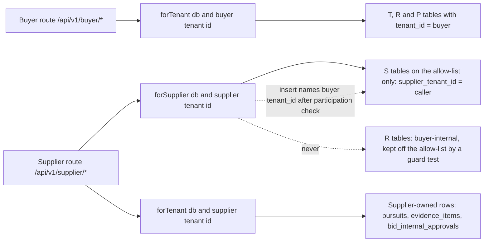
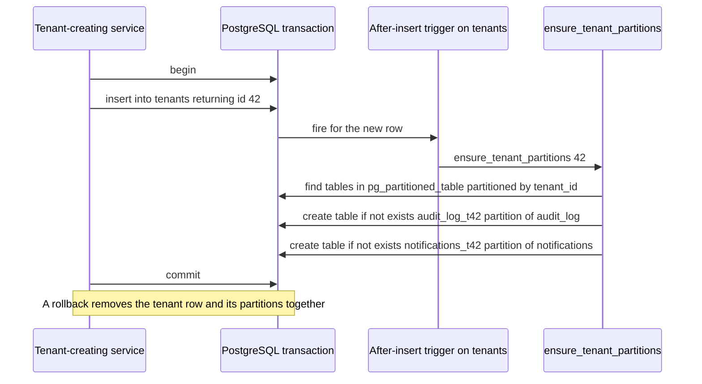
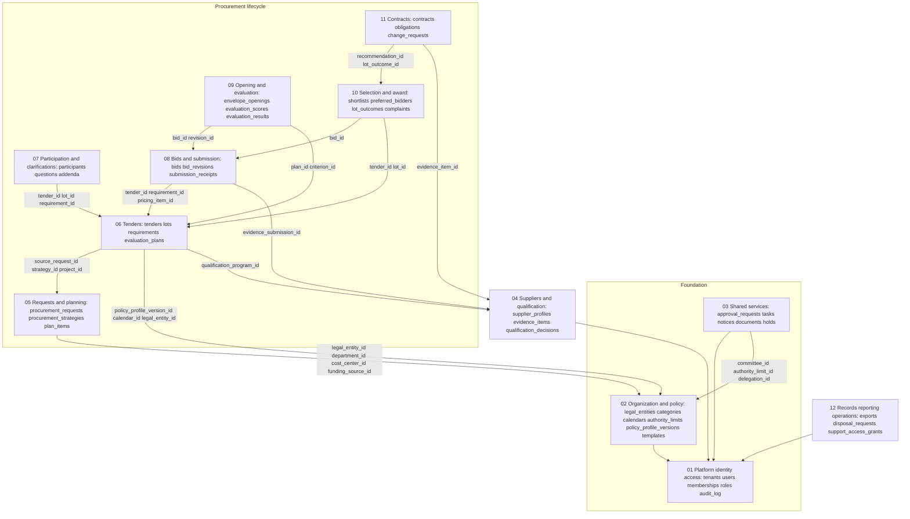
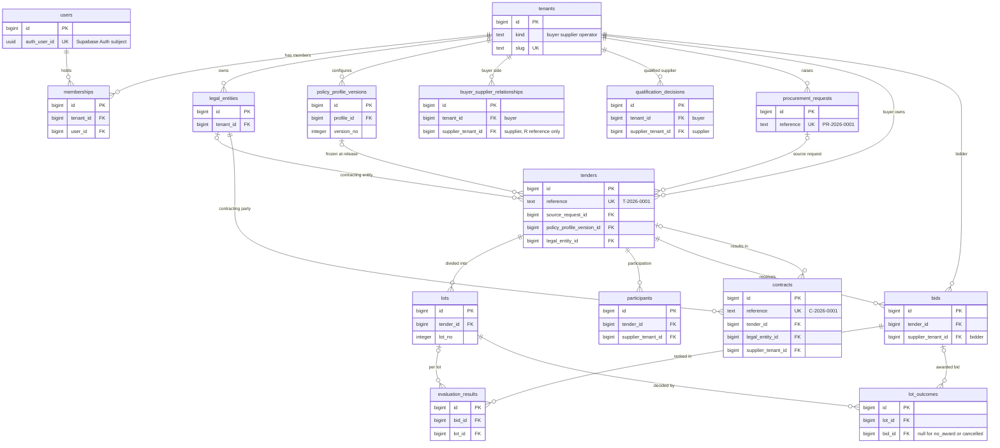

# Data Model

Status: As-designed (pre-build). Updated to as-built at the end of Stage A and Stage B.

Sources:
- `docs/plan/design-decisions.md`: DD-01 … DD-49 (DD-38 is withdrawn), in particular DD-01 (forward foreign keys), DD-02 (nullable unique keys), DD-03 (`[S]` and `[R]` tags), DD-04 (`customer_tenant_id`), DD-05 (envelope mapping), DD-07 (unique keys), DD-08 (currencies), DD-09 (reference formats), DD-10 (identity defaults), DD-11 (partition tenant), DD-13 (views), DD-16 and DD-17 (owners and cross-domain writes), DD-28 (`rate_limit_buckets`), DD-31 (audit content), DD-32 (decimal helper), DD-39 (`request_idempotency`), DD-43 (real Supabase Auth in the local Docker stack from Stage A, with no application schema), DD-44 (`email` delivery channel, which writes `email` rows to `notification_deliveries`), and §E owner decisions of 2026-09-29. The log amends the blueprint and the plan and wins where they differ
- `docs/plan/schema-blueprint.md`: §0 Conventions, Migrations 00–14, §P Permission catalog and role templates
- `docs/plan/architecture-plan.md` (revision 3): §0 Delivery stages, §3.1 Tenancy, §3.2 Authorization, §3.3 Sealing, §3.4 Official time, §3.5 Versioning, §3.6 State machines, §3.7 Money and scoring, §3.8 Notifications, §3.9 Background jobs, §3.11 Prototype mode, §4 Repository layout (registries, cross-domain writes, shared owners), §5 Build waves, §6 Domain map, §11 Deviations and owner decisions
- `docs/architecture-brief.md`: §5.6 Database access (generated types, tenant scoping), §6 Database and migrations (§6.1 rules, §6.2 multi-tenant pattern, §6.3 Data API lockdown, §6.4 seeds, §6.5 validation), §9 Background jobs, §11 Testing
- `docs/PRD.md`: §3 Business concepts and records, §4.3 Audience and confidentiality matrix, §10 Cross-cutting rules (BR-09, BR-17, BR-38, BR-39, BR-40), §18 Privacy, records and oversight
- `docs/plan/tenderiq-backend.workflow.js`: Stage B domain notes, used for owners and write paths that the plan does not name (§9, §9.1); `platform-data-auth` task (demo module `00-platform.ts` linking the Stage A Auth accounts, §6)
- `docs/plan/tenderiq-prototype.workflow.js`: Stage A rules and the `mock-platform` task (local Supabase stack for authentication only, `npm run auth:personas`, JWT verification in the mock API) (§1)
- Data-model files 01–12: §1 ownership tables and §2 dictionary legends (§1.1, §9)

Contents:
1. [How to read the data-model documents](#1-how-to-read-the-data-model-documents)
2. [Modelling conventions](#2-modelling-conventions)
3. [Tenancy](#3-tenancy)
4. [Sealed tables](#4-sealed-tables)
5. [Data API lockdown](#5-data-api-lockdown)
6. [Migrations](#6-migrations)
7. [Views](#7-views)
8. [Domain overview](#8-domain-overview)
9. [Table index](#9-table-index)
10. [Open points](#10-open-points)

---

## 1. How to read the data-model documents

**Stage relevance.** Stage A (UI prototype) builds no application schema: no migration, table or view documented here exists before Stage B. The local Supabase CLI stack runs in Docker from Stage A, but Stage A uses only its **Auth** service. `npm run auth:personas` creates the demo persona accounts in local Supabase Auth, and the mock API verifies each real Supabase JWT with `src/server/lib/auth/verify.ts` and maps the verified email to its fixture persona, because no `users` row exists yet (DD-43; architecture-plan §3.11). Stage A delivers typed contracts in `src/contracts` and static fixtures in `src/mock-api/fixtures/<domain>.ts`, and prototype actions persist nothing (architecture-plan §0, §3.11; owner decision 2026-09-29). The state enums in `src/contracts/enums.ts` mirror the CHECK lists documented here. A contract unit test fails if they drift (architecture-plan §3.6, §8). Stage B turns the blueprint into SQL migrations (agents `schema-w1/w2/w3` then `schema-apply`, architecture-plan §5) and generates the database types from the live schema.

The schema blueprint describes 224 tables across Migrations 01–13, plus four views created in Migration 14. The two tables added by the decision log, `rate_limit_buckets` (DD-28) and `request_idempotency` (DD-39), are in Migration 13. Each data-model file documents the tables of one or two migrations:

| File | Migrations | Tables | Subject |
|---|---|---|---|
| [01-platform-identity-access.md](01-platform-identity-access.md) | 00, 01 | 20 | Tenants, users, memberships, invitations, permission catalog, roles, groups, scoped assignments, grants, restrictions, reference counters, record snapshots, audit log, job platform, pgmq queues, storage buckets, SQL functions |
| [02-organization-policy.md](02-organization-policy.md) | 02, 03 | 29 | Organization settings and structure, calendars, committees, authority limits, delegations, separation of duties, conflicts, confidentiality, exchange rates, policy profiles, custom fields, templates, notification rules, portal settings, retention classes, seeded permission catalog and role templates |
| [03-shared-services.md](03-shared-services.md) | 04 | 13 | Approvals, tasks, notifications, formal notices, documents, comments, holds, saved views |
| [04-suppliers-qualification.md](04-suppliers-qualification.md) | 05 | 25 | Supplier profiles and identity, duplicates and merges, buyer–supplier relationships, evidence, qualification programs, applications and decisions |
| [05-requests-planning.md](05-requests-planning.md) | 06 | 9 | Procurement projects and requests, plan items, advance notices, strategies, market research, fairness reviews |
| [06-tenders.md](06-tenders.md) | 07 | 17 | Tenders, versions, milestones, lots, team, requirements, pricing, terms, envelopes, participation conditions, evaluation plans and criteria, release checks, publications |
| [07-participation-clarifications.md](07-participation-clarifications.md) | 08 | 16 | Participants, acknowledgments, document access, supplier pursuits and searches, questions, addenda, briefings and site visits |
| [08-bids-submission.md](08-bids-submission.md) | 09 | 19 | Bids, revisions, sealed bid content, supplier-internal approvals, submission attempts, receipts, withdrawals, late-submission exceptions |
| [09-opening-evaluation.md](09-opening-evaluation.md) | 10 | 16 | Opening sessions, envelope openings, price gate, compliance, bid clarifications, exclusions, evaluation, moderation, commercial evaluation, results, reports |
| [10-selection-award.md](10-selection-award.md) | 11 | 22 | Demonstrations, references, shortlists, preferred bidders, due diligence, negotiation, final offers, award recommendations, lot outcomes, standstill, debriefs, complaints, closeout |
| [11-contracts.md](11-contracts.md) | 12 | 18 | Contracts, allocations, signatories, handover, obligations, performance, incidents, invoices, changes, disputes, renewals, securities, closeout |
| [12-records-reporting-operations.md](12-records-reporting-operations.md) | 13 | 20 | Disposal, exports, reports, integrations, imports, subscriptions, offboarding, support cases and access grants, service incidents, announcements, public-route rate limits, request idempotency, help |

### 1.1 Data dictionary legend

Every table has a data dictionary that lists all of its columns. The dictionaries use two notations. Files 01–03 use notation 1. Files 04–12 use notation 2, and each of those files repeats its legend in its §2. The Key / constraint and Meaning columns are the same in both.

| Dictionary column | Notation 1 (files 01–03) | Notation 2 (files 04–12) |
|---|---|---|
| Type | The SQL type. It is copied from the blueprint when the blueprint states one. When the blueprint names only the column, the type follows §2: identifiers and references `bigint`, instants `timestamptz`, flags `boolean`, enumerations and free text `text`, money `numeric(18,2)`, currency `char(3)`. When the conventions do not settle a type, the Meaning cell says "type open". | A plain type is stated by the blueprint or fixed by a §2 convention. An *italic* type is inferred from the column's name and meaning because the blueprint states no type, and it stays open until Stage B. `n/s`: not specified, with the candidates given. |
| Null | `not null`: stated by the blueprint, or implied by a primary key, a standard column or the tenancy tag. `null`: stated as nullable (for example "nullable" or "null = …"). `—`: the blueprint does not fix it. | `no`: NOT NULL, stated by the blueprint or implied by a convention. `yes`: stated as nullable, **or** inferred because the column is filled only by a later lifecycle event (for example `decided_at`, `released_at`, `signed_at`). `n/s`: the blueprint does not fix it. |
| Key / constraint | `PK`, `FK → table`, `UK` (unique), `CHECK (…)`, `default …`. A composite key is written once with all of its columns. | Same |
| Meaning | Business meaning, with PRD references where useful. | Same |

The notations map as follows: `not null` = `no`, `null` = `yes` (stated), `—` = `n/s`. Notation 2 has one extra case with no notation-1 equivalent: a `yes` that is **inferred** from the lifecycle rather than stated by the blueprint. Treat such a cell as a design expectation, not a blueprint fact. For every `—`, `n/s`, inferred `yes` and italic type, the Stage B SQL decides the final value, and the dictionary is updated to as-built.

### 1.2 ERD conventions

- Diagrams are Mermaid `erDiagram` blocks. Entity names are the SQL table names in lower_snake case.
- Attribute lines show keys and the columns needed to read relationships and states. The data dictionary is the complete list.
- Attribute types are single words: `char3` = `char(3)`, `char2` = `char(2)`, `text_array` = `text[]`, `bigint_array` = `bigint[]`, `char3_array` = `char(3)[]`, `smallint_array` = `smallint[]`, `integer_array` = `int[]`. Precision appears in the attribute comment.
- Edges that repeat on every table are omitted: `created_by → users` (every table) and `tenant_id → tenants` (every `[T]` table). A `tenants` edge is drawn only where the tenant plays a named role, for example `supplier_tenant_id` or a buyer-owned anchor.
- Polymorphic pairs (`*_type` + `*_id`, see §2.2) are not foreign keys and are not drawn.

---

## 2. Modelling conventions

### 2.1 Standard columns

| Set | Columns | Applies to |
|---|---|---|
| std | `id bigint generated always as identity primary key`; `created_at timestamptz not null default now()`; `created_by bigint references users(id)` (null = system action) | Every table unless its blueprint entry states another primary key |
| mut | std + `updated_at timestamptz not null default now()`, maintained by the `set_updated_at()` trigger (Migration 00) | Tables marked "mut" in the blueprint |
| `[T]` | `tenant_id bigint not null references tenants(id)` | Tenant-scoped tables |
| `[S]` | `supplier_tenant_id bigint not null references tenants(id)` | Supplier-accessible tables, on the allow-list that `forSupplier` uses (DD-03). The one documented exception is `lot_outcomes.supplier_tenant_id`, which is nullable for `no_award` / `cancelled` outcomes |
| `[R]` | `supplier_tenant_id` carried for reference only | Buyer-internal tables that name a supplier but are never reachable through `forSupplier` (DD-03) |

The blueprint states a different primary key for the tables below, so the identity `id` is not their primary key. A `[P]` table keeps `id` as the second primary-key column.

| Table | Stated primary key | mut |
|---|---|---|
| `permissions`, `role_templates` | `code` | no |
| `rate_limit_buckets` | `(key_hash, window_start)` | no |
| `role_template_permissions` | `(role_code, permission_code)` | no |
| `role_permissions` | `(role_id, permission_code)` | no |
| `reference_counters` | `(tenant_id, prefix, year)` | no |
| `job_idempotency_key` | `key` | no |
| `job_cron_config` | `id int`, `CHECK (id = 1)` | no |
| `category_catalog` | `code` | no |
| `user_notification_preferences` | `(user_id, event_type)` | no |
| `bid_lots` | `(bid_id, lot_id)` | no |
| `org_settings`, `portal_settings`, `supplier_profiles` | `tenant_id` | yes |
| `audit_log`, `notifications` (`[P]`) | `(tenant_id, id)` | no |

The mut tables in this list carry `created_at`, `created_by` and `updated_at`. For the others, the blueprint does not fix whether `created_at` / `created_by` are present. Their dictionaries list the stated columns, and the as-built answer is recorded after Stage B.

### 2.2 Keys and references

- **Identity keys** are `bigint generated always as identity` (brief §6.1). The `pg` driver parses `int8` to a JavaScript number and throws above `Number.MAX_SAFE_INTEGER` (brief §5.6).
- **Every FK column is indexed.** Every `[T]` table has an index that leads with `tenant_id` for each list access pattern: tenant + status, tenant + owner, tenant + dates (blueprint §0).
- **Reference naming.** A column `<name>_id` references the table it names. `*_user_id` and `*_by` columns (`approved_by`, `granted_by`, `decided_by`, …) reference `users(id)`. `*_tenant_id` columns reference `tenants(id)`. Code-keyed catalogs are referenced by `*_code` (`permission_code → permissions.code`, `catalog_code → category_catalog.code`, `template_code → role_templates.code`).
- **Polymorphic pairs.** Shared services refer to records of any domain through a type/id pair, for example `approval_requests (subject_type, subject_id)`, `tasks (source_type, source_id)`, `documents (related_type, related_id)`, `audit_log (entity_type, entity_id)` and `role_assignments (scope_type, scope_id)`. Such an `*_id` is **not** a foreign key. The owning service validates it, and the shared service's registry decides what is allowed (for example `domains/documents/access-registry.ts` denies any related type that is not registered, architecture-plan §4). §8.3 lists the pairs.
- **Id arrays** (`bigint[]` such as `invitations.role_ids`, `exclusions.check_ids`, `disposal_requests.blocked_by_hold_ids`) cannot carry foreign keys in PostgreSQL. The owning service validates their elements.
- **Forward references (DD-01).** A column that references a table created by a **later** migration stays a plain `bigint` in its own migration. The migration that creates the target table adds the foreign key with `ALTER TABLE … ADD CONSTRAINT`. This covers `audit_log.delegation_id`, `audit_log.support_grant_id`, `notices.tender_id`, `holds.complaint_id`, `procurement_requests.replaces_contract_id`, `procurement_requests.routed_contract_id`, `plan_items.tender_id`, `tender_versions.addendum_id`, `participation_conditions.session_id`, `bids.final_offer_round_id` and `templates.source_tender_id`. `audit_log` is partitioned, so no foreign key is created *from* it: its `delegation_id` and `support_grant_id` stay plain ids.
- **Same-migration cycles (DD-01).** Where two tables of one migration reference each other, the cycle-closing constraint is added at the end of that migration as `DEFERRABLE INITIALLY DEFERRED`: `bids.effective_revision_id → bid_revisions`, `bid_revisions.receipt_id → submission_receipts`, `documents.current_version_id → document_versions`, `policy_profiles.current_version_id`, `templates.current_version_id` and `qualification_programs.current_version_id`.
- **Nullable columns in unique keys (DD-02).** Every unique constraint that includes a nullable column uses `UNIQUE NULLS NOT DISTINCT` (PostgreSQL 15+), for example `notice_recipients (notice_id, supplier_tenant_id, recipient_user_id)` and `bids (tender_id, supplier_tenant_id, is_alternative, round_type, final_offer_round_id)`, which replaces the earlier `coalesce` expression.
- **Additional unique keys (DD-07).** `qualification_program_versions (program_id, version_no)`, `participant_lot_selections (participant_id, lot_id)`, `addendum_lots (addendum_id, lot_id)`, `session_registrations (session_id, supplier_tenant_id) WHERE status <> 'cancelled'`, `scale_anchors (plan_id, value)`, `tie_break_rules (plan_id, sequence)`, `release_checks (tender_id, check_area, draft_revision)`, `publications (tender_id, version_no, channel)` and `change_requests (contract_id, number)`. Each is documented with its table.
- **Partitioned targets.** Nothing may reference a `[P]` table, with one exception: `notification_deliveries (tenant_id, notification_id) → notifications (tenant_id, id)` (blueprint §0).

### 2.3 Enumerations: text + CHECK

Every enumeration is a `text` column with a **named** `CHECK (col in (…))` constraint. PostgreSQL enum types are not used, because a forward-only migration can widen a CHECK constraint (blueprint §0; [ADR-0004](../adr/0004-text-check-constraints-not-enums.md)). The same lists are defined once in `src/contracts/enums.ts` for the UI, the mock API and the backend (architecture-plan §3.6). Each lifecycle's legal transitions live in `domains/<d>/workflow/*.ts` legality matrices, not in the database ([05-lifecycles.md](../05-lifecycles.md)).

### 2.4 Numbers and money

| Kind | SQL type | Examples |
|---|---|---|
| Money | `numeric(18,2)` | `approval_requests.amount`, `authority_limits.max_amount`, `contracts.value` |
| Quantity | `numeric(18,4)` | pricing quantities, bid price quantities |
| Score, rate, weight | `numeric(12,6)` | `evaluation_criteria.max_points`, `evaluation_scores.score` |
| Exchange rate | `numeric(18,8)` (stated explicitly) | `exchange_rates.rate` |
| Untyped numeric | `numeric` (no precision stated) | `custom_field_values.value_number` |
| Currency | `char(3)` with `CHECK (col ~ '^[A-Z]{3}$')` | every `currency`, `*_currency` column |

- `numeric` values stay **decimal strings** end to end. The `pg` type parser leaves `numeric` as a string, and `generated/column-overrides.ts` records which columns are `numeric`. Arithmetic uses the BigInt-based decimal helper in `src/contracts/decimal.ts`, which is pure and shared. `src/server/lib/decimal.ts` re-exports it. The SPA uses it for live totals (SUP-13), and the server recomputes authoritatively (brief §5.6; architecture-plan §3.7; DD-32; [ADR-0005](../adr/0005-decimal-strings-for-money-and-scores.md)).
- Every money column has a currency column on the same row or on an explicitly named parent (DD-08). DD-08 added `scope_currency` to `qualification_applications` and `qualification_decisions`, and `currency` to `change_requests`.
- Each amount kind has its own column and label. PRD §3 lists the amount kinds that must never be interchanged: estimate, approved budget, submitted price, evaluated cost, intended award, actual award, contract ceiling, committed spend and paid spend.
- A missing score is `null`, never `0` (AC-18; architecture-plan §3.7).

### 2.5 Time

- Every instant is `timestamptz`, stored in UTC (architecture-plan §3.4). Calendar dates without a time of day are `date` (for example `calendar_holidays.holiday_date`, `custom_field_values.value_date`).
- Official time zones are IANA names stored as `text`: `tenants.official_time_zone`, `calendars.time_zone` and `tenders.official_time_zone`. `tenants` is authoritative for an organization's official time zone, working languages and default currency. `org_settings` keeps only procurement configuration and no longer has its own time-zone or language columns (DD-10).
- Official deadlines render with the IANA name and the numeric offset from `Intl`, for example `14 Oct 2026, 12:00 (UTC+02:00) Africa/Gaborone`. A short abbreviation (CAT) is shown only when `Intl` provides one (DD-33).
- `now()` returns the start time of the transaction. `clock_timestamp()` returns the actual time when the statement executes. The blueprint uses `clock_timestamp()` where the true event time matters. `audit_log.occurred_at` defaults to it. The official receipt time of a bid is `clock_timestamp()` read inside the submission transaction after the tender row is locked `FOR SHARE` (architecture-plan §3.4; [ADR-0011](../adr/0011-official-receipt-time-from-database.md)).
- Working-day arithmetic uses the tender's calendar (`calendars.working_days`, `calendar_holidays`). The time service is pure (architecture-plan §3.4).

### 2.6 Human references

Human-readable references are `reference text not null` with `unique (tenant_id, reference)`. They are generated by `next_reference(tenant_id, prefix)`, which is backed by `reference_counters` ([01-platform-identity-access.md](01-platform-identity-access.md#reference_counters-t)).

| Record | Column | Format |
|---|---|---|
| Procurement request | `procurement_requests.reference` | `PR-2026-0001` |
| Procurement project | `procurement_projects.reference` | `PP-2026-0001` (DD-09) |
| Qualification application | `qualification_applications.reference` | `QA-2026-0001` (DD-09) |
| Tender | `tenders.reference` | `T-2026-0001` |
| Contract | `contracts.reference` | `C-2026-0001` |
| Submission receipt | `submission_receipts.receipt_no` | `RCPT-2026-000001` |
| Complaint | `complaints.reference` | `CMP-2026-0001` |
| Contract change request | `change_requests.number` | `integer` per contract, displayed as `CR-0001`. It does not use `next_reference` (DD-09) |

- The year segment is the year **in the tenant's official time zone** (`tenants.official_time_zone`), not the UTC year (DD-09).
- `next_reference` locks the counter row with `SELECT … FOR UPDATE` inside the caller's transaction. Concurrent callers for the same tenant, prefix and year are therefore serialized. A rolled-back caller also rolls back its increment, so an aborted transaction leaves no gap.
- `change_requests.number` is `max + 1` for the contract, computed under a `SELECT … FOR UPDATE` lock on the contract row, so it needs no `reference_counters` row (DD-09).
- References are unique per buyer, not platform-wide, so public and supplier URLs carry the buyer slug (`tenants.slug`), for example `/opportunities/:buyerSlug/:ref`. Supplier API paths use tender ids (DD-22).

### 2.7 History, soft delete and deactivation

- **Soft delete only where stated.** `tenants.deleted_at` is the only `deleted_at` column in the blueprint (brief §6.2: tenants are soft-deleted).
- **Reference data is deactivated, not deleted.** Tables such as `roles`, `legal_entities`, `departments` and `categories` carry `active` and `deactivated_at`. Tables such as `locations`, `cost_centers`, `funding_sources`, `committees`, `user_groups` and `custom_fields` carry `active`. Historical records keep displaying disabled values (brief §6.2; PRD FR-01).
- **Business history is never deleted** (blueprint §0; BR-38). History is append-only, and a correction adds rows instead of overwriting them (architecture-plan §3.5). The model supports this with version tables (`*_versions`), supersede links (`superseded_by_id`, `supersedes_version_id`), correction tables (for example `score_corrections`) and immutable `record_snapshots` (BR-09).
- **Disposal is a governed business action.** Records leave only through the records domain (`retention_classes`, `holds`, `disposal_requests`). A hold blocks disposal (BR-39, BR-40).

### 2.8 JSONB policy

JSONB is allowed only for immutable snapshots, audit before/after images, report filter configurations and job counts. No queryable business field is stored in JSONB (blueprint §0; brief §6.1). These are all the JSONB columns in the blueprint:

| Column | Category |
|---|---|
| `record_snapshots.snapshot` | Immutable snapshot |
| `audit_log.before_state`, `audit_log.after_state` | Audit before/after |
| `report_definitions.filters` | Report filter configuration |
| `saved_views.filters` | Filter configuration of a saved list view |
| `job_run.counts` | Job counts |
| `exports.manifest` | Immutable record of an export's contents, versions, omissions and redactions (treated as a snapshot) |
| `import_records.raw` | Immutable source row of an import, kept for provenance (treated as a snapshot) |

### 2.9 Arrays

Arrays hold small closed value sets (for example `holds.blocked_actions text[]`, `calendars.working_days smallint[]`, `policy_profile_versions.permitted_procedures text[]`) and short id lists. §2.2 applies to arrays of ids. When the blueprint limits an array's elements to a list (for example "subset of …"), the enforcement mechanism (for example an array-containment CHECK) is finalized in Stage B.

---

## 3. Tenancy

### 3.1 Tenancy tags

| Tag | Meaning | Count |
|---|---|---|
| `[T]` | Tenant-scoped: `tenant_id bigint not null references tenants(id)`. Accessed through `forTenant`. | 199 (including the `[S]` and `[R]` tables) |
| `[G]` | Global: no `tenant_id` column. Platform catalogs, people, operator records, job state, public-route rate limits. A `[G]` table that names a customer organization uses `customer_tenant_id`, so the tenant-scoped generator never picks it up. DD-04 renamed the column on `subscriptions`, `offboarding_plans` and `service_incident_impacts`. `support_cases` and `support_access_grants` already used that name. | 23 |
| `[P]` | Tenant-scoped **and** `PARTITION BY LIST (tenant_id)`, with primary key `(tenant_id, id)`. Only `audit_log` and `notifications` ([ADR-0008](../adr/0008-partition-only-high-volume-tables.md)). | 2 |
| `[S]` | A `[T]` table that is **supplier-accessible** and carries `supplier_tenant_id`. It is on the explicit allow-list `supplier-scoped-tables.ts`, and supplier routes reach it through `forSupplier` (DD-03). | 48 |
| `[R]` | A `[T]` table that carries `supplier_tenant_id` for **reference only**. It is buyer-internal and never reachable through `forSupplier`. Suppliers learn outcomes only through notices and the supplier-facing projections defined in the contracts (DD-03). | 20 |

### 3.2 Organizations are tenants; procurement records belong to the buyer

- A tenant is an organization of kind `buyer`, `supplier` or `operator` (`tenants.kind`). A person (`users`) is global and holds `memberships` in any number of tenants (AC-02). The SPA's organization/capacity switcher sets the active tenant, which travels as `X-Tenant-Id` (architecture-plan §3.1; [ADR-0001](../adr/0001-tenancy-equals-organization.md)).
- The tenant middleware checks that the active tenant's `kind` matches the route prefix (`/api/v1/buyer/*`, `/supplier/*`, `/ops/*`). Every failure returns one identical 403 (brief §5.1 step 7; [04-security-model.md](../04-security-model.md)).
- **Procurement records are buyer-owned.** Their `tenant_id` is the **buyer** tenant. Supplier-accessible records add `supplier_tenant_id` (`[S]`). Buyer-internal records that name a supplier carry the same column for reference only (`[R]`) ([ADR-0002](../adr/0002-buyer-owned-procurement-records.md); DD-03).
- `[R]` tables: `buyer_supplier_relationships`, `relationship_contacts`, `reassessment_triggers`, `integrity_screenings`, `late_submission_exceptions`, `envelope_openings`, `compliance_checks`, `exclusions`, `evaluation_scores`, `moderated_scores`, `commercial_evaluations`, `evaluation_results`, `assessment_findings`, `reference_checks`, `shortlist_entries`, `preferred_bidders`, `due_diligence_cases`, `due_diligence_findings`, `negotiations` and `renewal_options` (DD-03).
- **Supplier-private collaboration belongs to the supplier.** In these rows `tenant_id` is the supplier tenant, and the buyer never reads them. The blueprint states this for `supplier_profiles`, `supplier_membership_requests`, `evidence_items`, `evidence_shares`, `pursuits`, `pursuit_team_members`, `pursuit_notes`, `saved_searches`, `watchlist_items`, `notice_subscriptions`, `bid_internal_approvals` and `bid_internal_comments`. It also states that supplier tasks (`tasks`) and supplier-internal comments (`comments.visibility = 'supplier_internal'`) use the supplier `tenant_id`.
- `notice_recipients` is `[S]`. For a buyer-internal recipient, `supplier_tenant_id` holds the buyer tenant id.

### 3.3 Scoped query helpers

- `forTenant(db, tenantId)` returns scoped `selectFrom`, `updateTable`, `deleteFrom` and `insertInto` helpers. They add the table-qualified `tenant_id = ?` predicate. `insertInto` injects `tenant_id`, and its type forbids the caller from supplying one. `tenantPredicate(table, tenantId)` covers joins and CTEs. `TenantId` is a branded number whose only constructor is `toTenantId()`. There is no ambient current tenant (brief §5.6).
- `forSupplier(db, supplierTenantId)` works only on the explicit allow-list `supplier-scoped-tables.ts` (`[S]`). A supplier-side insert names the buyer `tenant_id` explicitly, after the service has verified participation (architecture-plan §3.1). `[R]` tables carry `supplier_tenant_id` too, but they are never on the allow-list, and a guard test asserts that no `[R]` table is on it (DD-03).
- Generated files (`npm run db:types`): `supabase-types.ts`, `column-overrides.ts` (numeric columns as `string`), `tenant-scoped-tables.ts` (every table with a `tenant_id` column; the `[G]` tables that name a customer use `customer_tenant_id` so they stay off this list, DD-04), and `supplier-scoped-tables.ts`, which is generated from the blueprint `[S]` tags, **not** from the presence of a `supplier_tenant_id` column (DD-03). A compile-time assertion checks that the tenant list matches the schema in both directions. `@ts-expect-error` type tests prove that omitting the tenant fails to compile. A drift test fails when the committed generated files differ from the live schema (brief §5.6).

### 3.4 Partitioning mechanism

`audit_log` and `notifications` are `PARTITION BY LIST (tenant_id)`. Each tenant gets its own partition, named `<table>_t<tenant id>` (for example `audit_log_t42`).

- `ensure_tenant_partitions(p_tenant_id bigint)` is `SECURITY DEFINER` with a pinned `search_path`. It discovers the partitioned tables from the catalog, so a future `[P]` table needs no change to the function (blueprint Migration 01).
- It runs in the **same transaction** as the tenant insert, so a rolled-back tenant leaves no orphan partitions. It is idempotent (`CREATE TABLE IF NOT EXISTS`), and calling it again for existing tenants is how backfill works (brief §6.2).
- The integration suite's `globalSetup` removes orphaned tenant partitions left by earlier runs (brief §11).
- Every tenant (buyer, supplier or operator) gets partitions, because the trigger fires on every insert into `tenants`.
- **Which partition receives a cross-tenant row (DD-11).** An `audit_log` row goes to the tenant that **owns the affected record**. A supplier submitting a bid on a buyer-owned row is therefore audited in the buyer's partition, with `actor_capacity` naming the supplier organization. Actions on `[G]` records go to the operator tenant, and support-access events go to the **customer** tenant so the customer can review them. A `notifications` row goes to the **recipient's** tenant for that notice, which is the supplier tenant for supplier recipients.

---

## 4. Sealed tables

Eight tables hold sealed bid content. They are documented in [08-bids-submission.md](08-bids-submission.md). Sealing is enforced in the application layer ([ADR-0003](../adr/0003-application-layer-sealing.md); [04-security-model.md](../04-security-model.md)).

| Table | Envelope (blueprint, DD-05) | Content |
|---|---|---|
| `bid_answers` | Per-row `envelope` column, copied from the requirement (`requirements.envelope`) | Answers to requirements |
| `bid_answer_documents` | The envelope of the parent answer | Files and evidence attached to answers |
| `bid_prices` | commercial | Priced lines against pricing items |
| `bid_commercial_terms` | commercial | Validity, payment terms, discounts, totals |
| `bid_declarations` | qualification | Supplier declarations |
| `bid_subcontractors` | technical | Proposed subcontractors |
| `bid_key_personnel` | technical | Named key personnel |
| `bid_exceptions` | commercial | Proposed exceptions to terms |

Envelope rules (DD-05):
- Every `envelope` column has a CHECK (`qualification`, `technical`, `commercial`). `receipt_inventory_items.envelope` records the envelope of each submitted file.
- A single-stage opening (`opening_sessions.envelope = 'all'`) writes one `envelope_openings` row **per envelope** in the same transaction, so every unseal is recorded per envelope.

Access rules (architecture-plan §3.3; PRD §4.3; BR-17):
- Buyer users read these tables **only** through `sealing.assertEnvelopeReadable()` / `readableEnvelopes()`. Both require an `envelope_openings` row (the unseal record); an assignment to the tender, lot or criterion; for a staged commercial envelope, a `price_gate_releases` row; and a signed `confidentiality_undertakings` row and a `conflict_declarations` row.
- Before opening, the only buyer-side projection is the view `v_bid_receipt_metadata` (§7). Buyers never see drafts.
- Suppliers read their own content through `forSupplier` (the tables are `[S]`).
- Operator support access never includes sealed content ([ADR-0013](../adr/0013-operator-support-access-grants.md)). The `auditor` role has no sealed access (blueprint §P).
- `audit_log.before_state` / `after_state` never contain sealed content or evaluator scores. Those actions record ids and hashes only, with `sensitivity = 'restricted'` (DD-31; [01-platform-identity-access.md](01-platform-identity-access.md#audit_log-p)).
- An architecture guard test fails when any module other than `sealing` reads a sealed table ([11-testing-strategy.md](../11-testing-strategy.md)).

---

## 5. Data API lockdown

Tenant isolation is enforced in the application layer (middleware, `forTenant` / `forSupplier`, integration tests), not by row-level security. RLS could be added later as defense in depth (brief §6.3). The browser never uses the Supabase Data API. It uses supabase-js only for authentication (brief §5.7), in both stages: from Stage A the SPA signs in against the local Supabase Auth exactly as in production (DD-43).

- No migration grants anything to `anon` or `authenticated` (blueprint §0).
- Migration 14 runs `revoke all on all tables / sequences / functions in schema public from anon, authenticated` and revokes the matching **default privileges**. Tables created by later migrations (for example Stage B's reserved slots) therefore receive no default grants, and the integration test below catches any explicit grant.
- Secret-holding tables and `SECURITY DEFINER` functions explicitly `revoke all … from anon, authenticated` and pin `search_path`. `job_cron_config` is also revoked from `public` and `service_role`. Only `postgres` and the `SECURITY DEFINER` job helpers can read it (brief §9.1).
- An integration test reads every table from the live catalog and asserts that `anon` and `authenticated` hold no SELECT/INSERT/UPDATE/DELETE, checking both `has_table_privilege` and `role_table_grants`. A stray `GRANT … TO anon` fails the build (brief §6.3).

---

## 6. Migrations

Migrations are plain SQL in `supabase/migrations/`, applied in filename order by the Supabase CLI. They are append-only and forward-only: rollback means writing a corrective migration. Each file starts with a header comment covering purpose, ownership, and rollback and recovery notes. Each must be idempotent enough to run twice from empty, because `db:validate` resets twice and diffs against `supabase/schema.expected.sql` (brief §6.1, §6.5).

| # | File | Purpose | Tables | Documented in |
|---|---|---|---|---|
| 00 | `20261001000000_extensions.sql` | `extensions` schema; `pg_cron`; `pg_net` (installed in `extensions`, functions in schema `net`); `pgmq`; the `set_updated_at()` trigger function | 0 | [01](01-platform-identity-access.md#2-migration-00-extensions-and-set_updated_at) |
| 01 | `20261001000100_platform_core.sql` | Tenants, users, memberships, invitations, permission catalog, roles, groups, scoped assignments, grants, restrictions, reference counters, record snapshots, `audit_log` `[P]` and `ensure_tenant_partitions`, job tables and invoke helpers, pgmq queues `notifications` and `exports`, the five private storage buckets | 20 | [01](01-platform-identity-access.md) |
| 02 | `20261001000200_org_structure.sql` | Organization settings (procurement configuration only, with `accepted_currencies`, DD-10), legal entities, departments, locations, category catalog and categories, cost centers, funding sources, calendars, committees, authority limits, delegations (with the delegation-limit trigger), separation-of-duties policies, conflict declarations, confidentiality undertakings, exchange rates | 18 | [02](02-organization-policy.md) |
| 03 | `20261001000300_policy_templates.sql` | Policy profiles, versions and thresholds; custom fields and values; templates, versions and checklist items; notification rules; portal settings; retention classes | 11 | [02](02-organization-policy.md) |
| 04 | `20261001000400_shared_services.sql` | Approval requests and steps, tasks, `notifications` `[P]`, deliveries, preferences, formal notices and recipients, documents and versions, comments, holds, saved views | 13 | [03](03-shared-services.md) |
| 05 | `20261001000500_suppliers_qualification.sql` | Supplier profile, identity changes, duplicates and merges, relationships, evidence, qualification programs, applications, findings, decisions, reassessment, integrity screening | 25 | [04](04-suppliers-qualification.md) |
| 06 | `20261001000600_requests_planning.sql` | Projects, requests, request links and information requests, plan items, advance notices, strategies, market research, fairness reviews | 9 | [05](05-requests-planning.md) |
| 07 | `20261001000700_tenders.sql` | Tenders and versions, milestones, lots, team, requirements, pricing, terms, envelopes, participation conditions, evaluation plans, criteria, scale anchors, tie-break rules, release checks, publications; adds FK `templates.source_tender_id → tenders` | 17 | [06](06-tenders.md) |
| 08 | `20261001000800_participation_clarifications.sql` | Participants and acknowledgments, document access log, supplier pursuits, saved searches, watchlist, notice subscriptions, questions, addenda, sessions and registrations | 16 | [07](07-participation-clarifications.md) |
| 09 | `20261001000900_bids.sql` | Bids, lots, consortium members, revisions, the eight sealed content tables, supplier-internal approvals and comments, submission attempts, receipts and inventory, withdrawals, late-submission exceptions | 19 | [08](08-bids-submission.md) |
| 10 | `20261001001000_opening_evaluation.sql` | Opening sessions and participants, envelope openings, price-gate releases, compliance checks, bid clarifications, exclusions, evaluation assignments, scores and corrections, moderation, commercial evaluation, results, reports and sign-offs | 16 | [09](09-opening-evaluation.md) |
| 11 | `20261001001100_selection_award.sql` | Assessment sessions, invites and findings, reference checks, shortlists, preferred bidders, due diligence, negotiations, final-offer rounds, process decisions, award recommendations, lot outcomes, standstill, debriefs, complaints, public award notices, event closeouts | 22 | [10](10-selection-award.md) |
| 12 | `20261001001200_contracts.sql` | Contracts, lot allocations, signatories, handovers, obligations, evidence and acceptance, performance measures and reviews, incidents, improvement actions, invoices, change requests, disputes, renewal options, securities, closeouts | 18 | [11](11-contracts.md) |
| 13 | `20261001001300_records_reporting_ops.sql` | Disposal requests, exports, report definitions and runs, integration connections and exceptions, import batches and records, subscriptions, entitlements, offboarding plans, support cases, messages and access grants, service incidents and impacts, announcements, `rate_limit_buckets` (DD-28), `request_idempotency` (DD-39), help articles | 20 | [12](12-records-reporting-operations.md) |
| 14 | `20261001001400_views_grants_schedules.sql` | The four views (§7, exact shapes in DD-13); the Data API revoke including default privileges (§5); `cron.schedule` rows for every job in architecture-plan §3.9, as amended by DD-18 and DD-19, plus `queue-drain` `* * * * *`, with job names that match `jobs/cron/registry.ts` | 0 | §5, §7, [08-background-jobs.md](../08-background-jobs.md) |

**Foreign-key placement (DD-01).** A migration never references a table that a later migration creates. The later migration adds that foreign key with `ALTER TABLE … ADD CONSTRAINT`, and cycles inside one migration are closed at its end as `DEFERRABLE INITIALLY DEFERRED` (§2.2). For example, Migration 07 adds `notices.tender_id → tenders`, `plan_items.tender_id → tenders` and `templates.source_tender_id → tenders`. `audit_log.support_grant_id` stays a plain id even though Migration 13 creates `support_access_grants`, because no foreign key is created from the partitioned `audit_log`.

**Stage B additions.** During domain work (phase B3), each domain adds additive changes in its reserved migration slot `2026100310NN*`. The Integration step (phase B4) may add integration migrations. `npm run db:sql:check` checks that these additive migrations are safe (architecture-plan §5, §9).

**Seeds.** `supabase/seed.sql` holds code-owned reference data only: the permission catalog and role templates (§P), the shared `category_catalog` taxonomy (baseline seed, DD-16), plus global default templates. It creates no users and no tenant data (brief §6.4). The demo dataset is `npm run db:seed:demo`, run as `scripts/db/demo/NN-<domain>.ts` modules that follow `docs/plan/demo-storyline.md` (architecture-plan §10). The demo personas' sign-in accounts already exist in local Supabase Auth from Stage A (`npm run auth:personas`, DD-43). The platform module `scripts/db/demo/00-platform.ts` links those accounts, or creates them, and then creates the `users`, memberships and role assignments with the same emails, slugs and memberships as `src/mock-api/fixtures/platform.ts` (Stage B `platform-data-auth` task).

---

## 7. Views

All four views are created in Migration 14. Their exact shapes are fixed by DD-13.

| View | Definition (blueprint and DD-13) | Base tables documented in |
|---|---|---|
| `v_qualification_status` | The latest non-superseded decision per (tenant, supplier tenant, program), ordered by `effective_from desc, id desc`, with scope, dates, conditions and `effective_status`. `effective_status` is `expired` when `effective_to < now()`, otherwise the outcome. `qualification-expiry` writes no decisions: expiry is derived here (DD-20). `not_assessed` rows come from active relationships × active programs. | [04-suppliers-qualification.md](04-suppliers-qualification.md) |
| `v_bid_receipt_metadata` | The only buyer-side projection of bids before opening. It exposes `tenant_id` (for `forTenant`), `supplier_tenant_id`, the supplier legal name **valid at `received_at`** (from `supplier_legal_names`), the bid, the effective receipt number, `received_at`, status (including withdrawn, never drafts) and `document_count`. It never exposes content. | [08-bids-submission.md](08-bids-submission.md) |
| `v_public_tenders` | Tenders with `participation = 'open'` whose buyer has the public portal enabled (`portal_settings` / `org_settings.public_portal_enabled`), in status open, closed, under_assessment, award_pending, awarded, partially_awarded, completed_without_award, information_collected or cancelled. It excludes the internal budget. | [06-tenders.md](06-tenders.md) |
| `v_public_awards` | Only `public_award_notices` with `status = 'published'`. | [10-selection-award.md](10-selection-award.md) |

The Data API revoke covers these views as well. Public routes read them through the backend, never through PostgREST.

---

## 8. Domain overview

### 8.1 Clusters and how they connect

Each box is one data-model file. An arrow means that tables in the source cluster hold foreign keys to tables in the target cluster, and the label names representative columns. Two families of edges are omitted because every cluster has them: references to cluster 01 (`tenant_id`, user ids) and references to cluster 03 shared services (`approval_request_id`, `notice_id`, document ids, task ids, `hold_id`).

### 8.2 Anchor entities

This ERD shows one or two anchor tables per cluster and the references that link them. Each file has the full ERDs.

`tenants` appears in several roles: buyer owner (`tenant_id`), supplier party (`supplier_tenant_id`) and, through `memberships`, the organization in which a person acts. Each `[S]` and `[R]` table carries both references. In this diagram `qualification_decisions`, `participants`, `bids`, `lot_outcomes` and `contracts` are `[S]`, and `buyer_supplier_relationships` and `evaluation_results` are `[R]` (DD-03).

### 8.3 Cross-cutting polymorphic references

Shared tables refer to records of any domain through type/id pairs, which are not foreign keys (§2.2).

| Table | Type column | Id column | Refers to |
|---|---|---|---|
| `approval_requests` | `subject_type` | `subject_id` | The record under approval, at `subject_version` / `content_hash` |
| `tasks` | `source_type` | `source_id` | The record the task works on (`source_reference` holds its human reference) |
| `notifications` | `source_type` | `source_id` | The record the notification is about |
| `notices` | `subject_type` | `subject_id` | The record a formal notice concerns (plus `tender_id` when tender-related) |
| `documents` | `related_type` | `related_id` | The owning record; access is decided by `documents/access-registry.ts` |
| `comments` | `subject_type` | `subject_id` | The record discussed |
| `holds` | `subject_type` | `subject_id` | The held tender, lot, contract, qualification application, record class or record |
| `record_snapshots` | `entity_type` | `entity_id` | The versioned record |
| `audit_log` | `entity_type` | `entity_id` | The affected record |
| `custom_field_values` | `entity_type` | `entity_id` | The record carrying the custom field |
| `conflict_declarations`, `confidentiality_undertakings` | `subject_type` | `subject_id` | The tender, lot, application, contract or complaint the declaration covers |
| `role_assignments`, `access_grants`, `access_restrictions` | `scope_type` | `scope_id` | The legal entity, department, category, project, tender, lot or contract that bounds the permission (null for organization scope) |

Domain tables use the same pattern, for example `participant_acknowledgments (subject_type, subject_id)`, `evidence_submissions (context_type, context_id)`, `reassessment_triggers (source_type, source_id)` and `exports (subject_type, subject_id)`.

---

## 9. Table index

Every blueprint table, the domain that owns it, and the one file that documents it. Tag: tenancy (§3). Sealed: sealed bid content (§4). Owning domain: the Stage B domain or module that writes the table, copied from §1 of the documenting file. Those §1 tables derive it from the architecture-plan §6 domain map, the shared owners in architecture-plan §4 and DD-16, and the Stage B workflow notes. It is confirmed as-built at the end of Stage B. A domain writes only its own tables (architecture-plan §4). A `†` marks a table that another domain may also write under an approved exception, listed under [Cross-domain writers](#91-cross-domain-writers).

| # | Table | Migration | Tag | Sealed | Owning domain | Documented in |
|---|---|---|---|---|---|---|
| 1 | `tenants` | 01 | `[G]` |  | identity † | [01-platform-identity-access.md](01-platform-identity-access.md) |
| 2 | `users` | 01 | `[G]` |  | identity | [01-platform-identity-access.md](01-platform-identity-access.md) |
| 3 | `memberships` | 01 | `[T]` |  | identity | [01-platform-identity-access.md](01-platform-identity-access.md) |
| 4 | `invitations` | 01 | `[T]` |  | identity | [01-platform-identity-access.md](01-platform-identity-access.md) |
| 5 | `permissions` | 01 | `[G]` |  | `supabase/seed.sql` (code-owned catalog) | [01-platform-identity-access.md](01-platform-identity-access.md) |
| 6 | `role_templates` | 01 | `[G]` |  | `supabase/seed.sql` (code-owned catalog) | [01-platform-identity-access.md](01-platform-identity-access.md) |
| 7 | `role_template_permissions` | 01 | `[G]` |  | `supabase/seed.sql` (code-owned catalog) | [01-platform-identity-access.md](01-platform-identity-access.md) |
| 8 | `roles` | 01 | `[T]` |  | org-admin | [01-platform-identity-access.md](01-platform-identity-access.md) |
| 9 | `role_permissions` | 01 | `[T]` |  | org-admin | [01-platform-identity-access.md](01-platform-identity-access.md) |
| 10 | `user_groups` | 01 | `[T]` |  | org-admin | [01-platform-identity-access.md](01-platform-identity-access.md) |
| 11 | `user_group_members` | 01 | `[T]` |  | org-admin | [01-platform-identity-access.md](01-platform-identity-access.md) |
| 12 | `role_assignments` | 01 | `[T]` |  | org-admin | [01-platform-identity-access.md](01-platform-identity-access.md) |
| 13 | `access_grants` | 01 | `[T]` |  | org-admin | [01-platform-identity-access.md](01-platform-identity-access.md) |
| 14 | `access_restrictions` | 01 | `[T]` |  | org-admin | [01-platform-identity-access.md](01-platform-identity-access.md) |
| 15 | `reference_counters` | 01 | `[T]` |  | platform `lib/db`, only through `next_reference()` | [01-platform-identity-access.md](01-platform-identity-access.md) |
| 16 | `record_snapshots` | 01 | `[T]` |  | lifecycle (core service) (DD-16) | [01-platform-identity-access.md](01-platform-identity-access.md) |
| 17 | `audit_log` | 01 | `[P]` |  | audit (`lib/audit` writes) | [01-platform-identity-access.md](01-platform-identity-access.md) |
| 18 | `job_run` | 01 | `[G]` |  | platform jobs | [01-platform-identity-access.md](01-platform-identity-access.md) |
| 19 | `job_idempotency_key` | 01 | `[G]` |  | platform jobs | [01-platform-identity-access.md](01-platform-identity-access.md) |
| 20 | `job_cron_config` | 01 | `[G]` |  | platform jobs | [01-platform-identity-access.md](01-platform-identity-access.md) |
| 21 | `org_settings` | 02 | `[T]` |  | org-admin | [02-organization-policy.md](02-organization-policy.md) |
| 22 | `legal_entities` | 02 | `[T]` |  | org-admin | [02-organization-policy.md](02-organization-policy.md) |
| 23 | `departments` | 02 | `[T]` |  | org-admin | [02-organization-policy.md](02-organization-policy.md) |
| 24 | `locations` | 02 | `[T]` |  | org-admin | [02-organization-policy.md](02-organization-policy.md) |
| 25 | `category_catalog` | 02 | `[G]` |  | baseline `supabase/seed.sql` (DD-16) | [02-organization-policy.md](02-organization-policy.md) |
| 26 | `categories` | 02 | `[T]` |  | org-admin | [02-organization-policy.md](02-organization-policy.md) |
| 27 | `cost_centers` | 02 | `[T]` |  | org-admin | [02-organization-policy.md](02-organization-policy.md) |
| 28 | `funding_sources` | 02 | `[T]` |  | org-admin | [02-organization-policy.md](02-organization-policy.md) |
| 29 | `calendars` | 02 | `[T]` |  | time (shared service) | [02-organization-policy.md](02-organization-policy.md) |
| 30 | `calendar_holidays` | 02 | `[T]` |  | time (shared service) | [02-organization-policy.md](02-organization-policy.md) |
| 31 | `committees` | 02 | `[T]` |  | org-admin | [02-organization-policy.md](02-organization-policy.md) |
| 32 | `committee_members` | 02 | `[T]` |  | org-admin | [02-organization-policy.md](02-organization-policy.md) |
| 33 | `authority_limits` | 02 | `[T]` |  | org-admin | [02-organization-policy.md](02-organization-policy.md) |
| 34 | `delegations` | 02 | `[T]` |  | org-admin | [02-organization-policy.md](02-organization-policy.md) |
| 35 | `sod_policies` | 02 | `[T]` |  | org-admin | [02-organization-policy.md](02-organization-policy.md) |
| 36 | `conflict_declarations` | 02 | `[T]` |  | org-admin | [02-organization-policy.md](02-organization-policy.md) |
| 37 | `confidentiality_undertakings` | 02 | `[T]` |  | org-admin | [02-organization-policy.md](02-organization-policy.md) |
| 38 | `exchange_rates` | 02 | `[T]` |  | evaluation (DD-16) | [02-organization-policy.md](02-organization-policy.md) |
| 39 | `policy_profiles` | 03 | `[T]` |  | policy | [02-organization-policy.md](02-organization-policy.md) |
| 40 | `policy_profile_versions` | 03 | `[T]` |  | policy | [02-organization-policy.md](02-organization-policy.md) |
| 41 | `policy_thresholds` | 03 | `[T]` |  | policy | [02-organization-policy.md](02-organization-policy.md) |
| 42 | `custom_fields` | 03 | `[T]` |  | policy | [02-organization-policy.md](02-organization-policy.md) |
| 43 | `custom_field_values` | 03 | `[T]` |  | policy | [02-organization-policy.md](02-organization-policy.md) |
| 44 | `templates` | 03 | `[T]` |  | policy | [02-organization-policy.md](02-organization-policy.md) |
| 45 | `template_versions` | 03 | `[T]` |  | policy | [02-organization-policy.md](02-organization-policy.md) |
| 46 | `template_checklist_items` | 03 | `[T]` |  | policy | [02-organization-policy.md](02-organization-policy.md) |
| 47 | `notification_rules` | 03 | `[T]` |  | notifications | [02-organization-policy.md](02-organization-policy.md) |
| 48 | `portal_settings` | 03 | `[T]` |  | policy | [02-organization-policy.md](02-organization-policy.md) |
| 49 | `retention_classes` | 03 | `[T]` |  | records | [02-organization-policy.md](02-organization-policy.md) |
| 50 | `approval_requests` | 04 | `[T]` |  | approvals | [03-shared-services.md](03-shared-services.md) |
| 51 | `approval_steps` | 04 | `[T]` |  | approvals | [03-shared-services.md](03-shared-services.md) |
| 52 | `tasks` | 04 | `[T]` |  | approvals (DD-16) | [03-shared-services.md](03-shared-services.md) |
| 53 | `notifications` | 04 | `[P]` |  | notifications | [03-shared-services.md](03-shared-services.md) |
| 54 | `notification_deliveries` | 04 | `[T]` |  | notifications | [03-shared-services.md](03-shared-services.md) |
| 55 | `user_notification_preferences` | 04 | `[G]` |  | notifications | [03-shared-services.md](03-shared-services.md) |
| 56 | `notices` | 04 | `[T]` |  | notifications | [03-shared-services.md](03-shared-services.md) |
| 57 | `notice_recipients` | 04 | `[T]` `[S]` |  | notifications | [03-shared-services.md](03-shared-services.md) |
| 58 | `documents` | 04 | `[T]` |  | documents | [03-shared-services.md](03-shared-services.md) |
| 59 | `document_versions` | 04 | `[T]` |  | documents | [03-shared-services.md](03-shared-services.md) |
| 60 | `comments` | 04 | `[T]` |  | lifecycle (core service) (DD-16) | [03-shared-services.md](03-shared-services.md) |
| 61 | `holds` | 04 | `[T]` |  | lifecycle (core service) (DD-16) | [03-shared-services.md](03-shared-services.md) |
| 62 | `saved_views` | 04 | `[T]` |  | reporting | [03-shared-services.md](03-shared-services.md) |
| 63 | `supplier_profiles` | 05 | `[T]` |  | suppliers | [04-suppliers-qualification.md](04-suppliers-qualification.md) |
| 64 | `supplier_locations` | 05 | `[T]` |  | suppliers | [04-suppliers-qualification.md](04-suppliers-qualification.md) |
| 65 | `supplier_categories` | 05 | `[T]` |  | suppliers | [04-suppliers-qualification.md](04-suppliers-qualification.md) |
| 66 | `supplier_membership_requests` | 05 | `[T]` |  | suppliers | [04-suppliers-qualification.md](04-suppliers-qualification.md) |
| 67 | `supplier_identity_changes` | 05 | `[T]` |  | suppliers | [04-suppliers-qualification.md](04-suppliers-qualification.md) |
| 68 | `supplier_legal_names` | 05 | `[T]` |  | suppliers | [04-suppliers-qualification.md](04-suppliers-qualification.md) |
| 69 | `duplicate_candidates` | 05 | `[G]` |  | suppliers | [04-suppliers-qualification.md](04-suppliers-qualification.md) |
| 70 | `supplier_merges` | 05 | `[G]` |  | suppliers | [04-suppliers-qualification.md](04-suppliers-qualification.md) |
| 71 | `buyer_supplier_relationships` | 05 | `[T]` `[R]` |  | suppliers | [04-suppliers-qualification.md](04-suppliers-qualification.md) |
| 72 | `relationship_contacts` | 05 | `[T]` `[R]` |  | suppliers | [04-suppliers-qualification.md](04-suppliers-qualification.md) |
| 73 | `evidence_items` | 05 | `[T]` |  | suppliers | [04-suppliers-qualification.md](04-suppliers-qualification.md) |
| 74 | `evidence_shares` | 05 | `[T]` |  | suppliers | [04-suppliers-qualification.md](04-suppliers-qualification.md) |
| 75 | `evidence_submissions` | 05 | `[T]` `[S]` |  | suppliers † (other domains write through the `snapshotEvidence()` helper, DD-17) | [04-suppliers-qualification.md](04-suppliers-qualification.md) |
| 76 | `qualification_programs` | 05 | `[T]` |  | qualification | [04-suppliers-qualification.md](04-suppliers-qualification.md) |
| 77 | `qualification_program_versions` | 05 | `[T]` |  | qualification | [04-suppliers-qualification.md](04-suppliers-qualification.md) |
| 78 | `qualification_criteria` | 05 | `[T]` |  | qualification | [04-suppliers-qualification.md](04-suppliers-qualification.md) |
| 79 | `qualification_applications` | 05 | `[T]` `[S]` |  | qualification | [04-suppliers-qualification.md](04-suppliers-qualification.md) |
| 80 | `qualification_answers` | 05 | `[T]` `[S]` |  | qualification | [04-suppliers-qualification.md](04-suppliers-qualification.md) |
| 81 | `qualification_answer_evidence` | 05 | `[T]` `[S]` |  | qualification | [04-suppliers-qualification.md](04-suppliers-qualification.md) |
| 82 | `qualification_info_requests` | 05 | `[T]` `[S]` |  | qualification | [04-suppliers-qualification.md](04-suppliers-qualification.md) |
| 83 | `qualification_findings` | 05 | `[T]` |  | qualification | [04-suppliers-qualification.md](04-suppliers-qualification.md) |
| 84 | `financial_reviews` | 05 | `[T]` |  | qualification | [04-suppliers-qualification.md](04-suppliers-qualification.md) |
| 85 | `qualification_decisions` | 05 | `[T]` `[S]` |  | qualification | [04-suppliers-qualification.md](04-suppliers-qualification.md) |
| 86 | `reassessment_triggers` | 05 | `[T]` `[R]` |  | qualification | [04-suppliers-qualification.md](04-suppliers-qualification.md) |
| 87 | `integrity_screenings` | 05 | `[T]` `[R]` |  | qualification | [04-suppliers-qualification.md](04-suppliers-qualification.md) |
| 88 | `procurement_projects` | 06 | `[T]` |  | requests | [05-requests-planning.md](05-requests-planning.md) |
| 89 | `procurement_requests` | 06 | `[T]` |  | requests † | [05-requests-planning.md](05-requests-planning.md) |
| 90 | `request_links` | 06 | `[T]` |  | requests | [05-requests-planning.md](05-requests-planning.md) |
| 91 | `request_info_requests` | 06 | `[T]` |  | requests | [05-requests-planning.md](05-requests-planning.md) |
| 92 | `plan_items` | 06 | `[T]` |  | requests | [05-requests-planning.md](05-requests-planning.md) |
| 93 | `advance_notices` | 06 | `[T]` |  | requests | [05-requests-planning.md](05-requests-planning.md) |
| 94 | `procurement_strategies` | 06 | `[T]` |  | requests | [05-requests-planning.md](05-requests-planning.md) |
| 95 | `market_research_entries` | 06 | `[T]` |  | requests | [05-requests-planning.md](05-requests-planning.md) |
| 96 | `fairness_reviews` | 06 | `[T]` |  | requests | [05-requests-planning.md](05-requests-planning.md) |
| 97 | `tenders` | 07 | `[T]` |  | tenders † | [06-tenders.md](06-tenders.md) |
| 98 | `tender_versions` | 07 | `[T]` |  | tenders | [06-tenders.md](06-tenders.md) |
| 99 | `tender_milestones` | 07 | `[T]` |  | tenders † | [06-tenders.md](06-tenders.md) |
| 100 | `lots` | 07 | `[T]` |  | tenders † | [06-tenders.md](06-tenders.md) |
| 101 | `tender_team_members` | 07 | `[T]` |  | tenders | [06-tenders.md](06-tenders.md) |
| 102 | `requirements` | 07 | `[T]` |  | tenders † | [06-tenders.md](06-tenders.md) |
| 103 | `pricing_schedules` | 07 | `[T]` |  | tenders | [06-tenders.md](06-tenders.md) |
| 104 | `pricing_items` | 07 | `[T]` |  | tenders | [06-tenders.md](06-tenders.md) |
| 105 | `tender_terms` | 07 | `[T]` |  | tenders | [06-tenders.md](06-tenders.md) |
| 106 | `tender_envelopes` | 07 | `[T]` |  | tenders | [06-tenders.md](06-tenders.md) |
| 107 | `participation_conditions` | 07 | `[T]` |  | tenders | [06-tenders.md](06-tenders.md) |
| 108 | `evaluation_plans` | 07 | `[T]` |  | tenders | [06-tenders.md](06-tenders.md) |
| 109 | `evaluation_criteria` | 07 | `[T]` |  | tenders | [06-tenders.md](06-tenders.md) |
| 110 | `scale_anchors` | 07 | `[T]` |  | tenders | [06-tenders.md](06-tenders.md) |
| 111 | `tie_break_rules` | 07 | `[T]` |  | tenders | [06-tenders.md](06-tenders.md) |
| 112 | `release_checks` | 07 | `[T]` |  | tenders | [06-tenders.md](06-tenders.md) |
| 113 | `publications` | 07 | `[T]` |  | publication | [06-tenders.md](06-tenders.md) |
| 114 | `participants` | 08 | `[T]` `[S]` |  | publication | [07-participation-clarifications.md](07-participation-clarifications.md) |
| 115 | `participant_lot_selections` | 08 | `[T]` `[S]` |  | publication | [07-participation-clarifications.md](07-participation-clarifications.md) |
| 116 | `participant_acknowledgments` | 08 | `[T]` `[S]` |  | publication | [07-participation-clarifications.md](07-participation-clarifications.md) |
| 117 | `document_access_log` | 08 | `[T]` `[S]` |  | publication | [07-participation-clarifications.md](07-participation-clarifications.md) |
| 118 | `pursuits` | 08 | `[T]` |  | publication | [07-participation-clarifications.md](07-participation-clarifications.md) |
| 119 | `pursuit_team_members` | 08 | `[T]` |  | publication | [07-participation-clarifications.md](07-participation-clarifications.md) |
| 120 | `pursuit_notes` | 08 | `[T]` |  | publication | [07-participation-clarifications.md](07-participation-clarifications.md) |
| 121 | `saved_searches` | 08 | `[T]` |  | publication | [07-participation-clarifications.md](07-participation-clarifications.md) |
| 122 | `watchlist_items` | 08 | `[T]` |  | publication | [07-participation-clarifications.md](07-participation-clarifications.md) |
| 123 | `notice_subscriptions` | 08 | `[T]` |  | publication | [07-participation-clarifications.md](07-participation-clarifications.md) |
| 124 | `questions` | 08 | `[T]` `[S]` |  | clarifications | [07-participation-clarifications.md](07-participation-clarifications.md) |
| 125 | `addenda` | 08 | `[T]` |  | clarifications | [07-participation-clarifications.md](07-participation-clarifications.md) |
| 126 | `addendum_lots` | 08 | `[T]` |  | clarifications | [07-participation-clarifications.md](07-participation-clarifications.md) |
| 127 | `addendum_requirement_changes` | 08 | `[T]` |  | clarifications | [07-participation-clarifications.md](07-participation-clarifications.md) |
| 128 | `sessions` | 08 | `[T]` |  | clarifications | [07-participation-clarifications.md](07-participation-clarifications.md) |
| 129 | `session_registrations` | 08 | `[T]` `[S]` |  | clarifications | [07-participation-clarifications.md](07-participation-clarifications.md) |
| 130 | `bids` | 09 | `[T]` `[S]` |  | bids † | [08-bids-submission.md](08-bids-submission.md) |
| 131 | `bid_lots` | 09 | `[T]` `[S]` |  | bids | [08-bids-submission.md](08-bids-submission.md) |
| 132 | `consortium_members` | 09 | `[T]` `[S]` |  | bids | [08-bids-submission.md](08-bids-submission.md) |
| 133 | `bid_revisions` | 09 | `[T]` `[S]` |  | bids | [08-bids-submission.md](08-bids-submission.md) |
| 134 | `bid_answers` | 09 | `[T]` `[S]` | yes | bids | [08-bids-submission.md](08-bids-submission.md) |
| 135 | `bid_answer_documents` | 09 | `[T]` `[S]` | yes | bids | [08-bids-submission.md](08-bids-submission.md) |
| 136 | `bid_prices` | 09 | `[T]` `[S]` | yes | bids | [08-bids-submission.md](08-bids-submission.md) |
| 137 | `bid_commercial_terms` | 09 | `[T]` `[S]` | yes | bids | [08-bids-submission.md](08-bids-submission.md) |
| 138 | `bid_declarations` | 09 | `[T]` `[S]` | yes | bids | [08-bids-submission.md](08-bids-submission.md) |
| 139 | `bid_subcontractors` | 09 | `[T]` `[S]` | yes | bids | [08-bids-submission.md](08-bids-submission.md) |
| 140 | `bid_key_personnel` | 09 | `[T]` `[S]` | yes | bids | [08-bids-submission.md](08-bids-submission.md) |
| 141 | `bid_exceptions` | 09 | `[T]` `[S]` | yes | bids | [08-bids-submission.md](08-bids-submission.md) |
| 142 | `bid_internal_approvals` | 09 | `[T]` |  | bids | [08-bids-submission.md](08-bids-submission.md) |
| 143 | `bid_internal_comments` | 09 | `[T]` |  | bids | [08-bids-submission.md](08-bids-submission.md) |
| 144 | `submission_attempts` | 09 | `[T]` `[S]` |  | bids | [08-bids-submission.md](08-bids-submission.md) |
| 145 | `submission_receipts` | 09 | `[T]` `[S]` |  | bids † | [08-bids-submission.md](08-bids-submission.md) |
| 146 | `receipt_inventory_items` | 09 | `[T]` `[S]` |  | bids | [08-bids-submission.md](08-bids-submission.md) |
| 147 | `withdrawals` | 09 | `[T]` `[S]` |  | bids | [08-bids-submission.md](08-bids-submission.md) |
| 148 | `late_submission_exceptions` | 09 | `[T]` `[R]` |  | bids | [08-bids-submission.md](08-bids-submission.md) |
| 149 | `opening_sessions` | 10 | `[T]` |  | opening | [09-opening-evaluation.md](09-opening-evaluation.md) |
| 150 | `opening_participants` | 10 | `[T]` |  | opening | [09-opening-evaluation.md](09-opening-evaluation.md) |
| 151 | `envelope_openings` | 10 | `[T]` `[R]` |  | opening | [09-opening-evaluation.md](09-opening-evaluation.md) |
| 152 | `price_gate_releases` | 10 | `[T]` |  | evaluation (DD-16; written by the chair, `evaluation.chair`) | [09-opening-evaluation.md](09-opening-evaluation.md) |
| 153 | `compliance_checks` | 10 | `[T]` `[R]` |  | opening | [09-opening-evaluation.md](09-opening-evaluation.md) |
| 154 | `bid_clarifications` | 10 | `[T]` `[S]` |  | opening | [09-opening-evaluation.md](09-opening-evaluation.md) |
| 155 | `exclusions` | 10 | `[T]` `[R]` |  | opening | [09-opening-evaluation.md](09-opening-evaluation.md) |
| 156 | `evaluation_assignments` | 10 | `[T]` |  | evaluation | [09-opening-evaluation.md](09-opening-evaluation.md) |
| 157 | `evaluation_scores` | 10 | `[T]` `[R]` |  | evaluation | [09-opening-evaluation.md](09-opening-evaluation.md) |
| 158 | `score_corrections` | 10 | `[T]` |  | evaluation | [09-opening-evaluation.md](09-opening-evaluation.md) |
| 159 | `moderation_sessions` | 10 | `[T]` |  | evaluation | [09-opening-evaluation.md](09-opening-evaluation.md) |
| 160 | `moderated_scores` | 10 | `[T]` `[R]` |  | evaluation | [09-opening-evaluation.md](09-opening-evaluation.md) |
| 161 | `commercial_evaluations` | 10 | `[T]` `[R]` |  | evaluation | [09-opening-evaluation.md](09-opening-evaluation.md) |
| 162 | `evaluation_results` | 10 | `[T]` `[R]` |  | evaluation | [09-opening-evaluation.md](09-opening-evaluation.md) |
| 163 | `evaluation_reports` | 10 | `[T]` |  | evaluation | [09-opening-evaluation.md](09-opening-evaluation.md) |
| 164 | `evaluation_report_signoffs` | 10 | `[T]` |  | evaluation | [09-opening-evaluation.md](09-opening-evaluation.md) |
| 165 | `assessment_sessions` | 11 | `[T]` |  | selection | [10-selection-award.md](10-selection-award.md) |
| 166 | `assessment_invites` | 11 | `[T]` `[S]` |  | selection | [10-selection-award.md](10-selection-award.md) |
| 167 | `assessment_findings` | 11 | `[T]` `[R]` |  | selection | [10-selection-award.md](10-selection-award.md) |
| 168 | `reference_checks` | 11 | `[T]` `[R]` |  | selection | [10-selection-award.md](10-selection-award.md) |
| 169 | `shortlists` | 11 | `[T]` |  | selection | [10-selection-award.md](10-selection-award.md) |
| 170 | `shortlist_entries` | 11 | `[T]` `[R]` |  | selection | [10-selection-award.md](10-selection-award.md) |
| 171 | `preferred_bidders` | 11 | `[T]` `[R]` |  | selection | [10-selection-award.md](10-selection-award.md) |
| 172 | `due_diligence_cases` | 11 | `[T]` `[R]` |  | selection | [10-selection-award.md](10-selection-award.md) |
| 173 | `due_diligence_findings` | 11 | `[T]` `[R]` |  | selection | [10-selection-award.md](10-selection-award.md) |
| 174 | `negotiations` | 11 | `[T]` `[R]` |  | selection | [10-selection-award.md](10-selection-award.md) |
| 175 | `negotiation_rounds` | 11 | `[T]` `[S]` |  | selection | [10-selection-award.md](10-selection-award.md) |
| 176 | `final_offer_rounds` | 11 | `[T]` |  | selection | [10-selection-award.md](10-selection-award.md) |
| 177 | `final_offer_invitees` | 11 | `[T]` `[S]` |  | selection | [10-selection-award.md](10-selection-award.md) |
| 178 | `process_decisions` | 11 | `[T]` |  | lifecycle (core service), through `recordProcessDecision()` (DD-16) | [10-selection-award.md](10-selection-award.md) |
| 179 | `award_recommendations` | 11 | `[T]` |  | awards | [10-selection-award.md](10-selection-award.md) |
| 180 | `lot_outcomes` | 11 | `[T]` `[S]` |  | awards | [10-selection-award.md](10-selection-award.md) |
| 181 | `standstill_periods` | 11 | `[T]` |  | awards | [10-selection-award.md](10-selection-award.md) |
| 182 | `debrief_requests` | 11 | `[T]` `[S]` |  | awards | [10-selection-award.md](10-selection-award.md) |
| 183 | `complaints` | 11 | `[T]` `[S]` |  | awards | [10-selection-award.md](10-selection-award.md) |
| 184 | `complaint_events` | 11 | `[T]` |  | awards | [10-selection-award.md](10-selection-award.md) |
| 185 | `public_award_notices` | 11 | `[T]` |  | awards | [10-selection-award.md](10-selection-award.md) |
| 186 | `event_closeouts` | 11 | `[T]` |  | awards | [10-selection-award.md](10-selection-award.md) |
| 187 | `contracts` | 12 | `[T]` `[S]` |  | contracts † | [11-contracts.md](11-contracts.md) |
| 188 | `contract_lot_allocations` | 12 | `[T]` |  | contracts | [11-contracts.md](11-contracts.md) |
| 189 | `contract_signatories` | 12 | `[T]` `[S]` |  | contracts | [11-contracts.md](11-contracts.md) |
| 190 | `handovers` | 12 | `[T]` |  | contracts | [11-contracts.md](11-contracts.md) |
| 191 | `obligations` | 12 | `[T]` `[S]` |  | contracts | [11-contracts.md](11-contracts.md) |
| 192 | `obligation_evidence` | 12 | `[T]` `[S]` |  | contracts | [11-contracts.md](11-contracts.md) |
| 193 | `acceptance_decisions` | 12 | `[T]` `[S]` |  | contracts | [11-contracts.md](11-contracts.md) |
| 194 | `performance_measures` | 12 | `[T]` |  | contracts | [11-contracts.md](11-contracts.md) |
| 195 | `performance_reviews` | 12 | `[T]` `[S]` |  | contracts | [11-contracts.md](11-contracts.md) |
| 196 | `measure_results` | 12 | `[T]` |  | contracts | [11-contracts.md](11-contracts.md) |
| 197 | `contract_incidents` | 12 | `[T]` `[S]` |  | contracts | [11-contracts.md](11-contracts.md) |
| 198 | `improvement_actions` | 12 | `[T]` `[S]` |  | contracts | [11-contracts.md](11-contracts.md) |
| 199 | `contract_invoices` | 12 | `[T]` `[S]` |  | contracts | [11-contracts.md](11-contracts.md) |
| 200 | `change_requests` | 12 | `[T]` `[S]` |  | contracts | [11-contracts.md](11-contracts.md) |
| 201 | `contract_disputes` | 12 | `[T]` `[S]` |  | contracts | [11-contracts.md](11-contracts.md) |
| 202 | `renewal_options` | 12 | `[T]` `[R]` |  | contracts | [11-contracts.md](11-contracts.md) |
| 203 | `contract_securities` | 12 | `[T]` `[S]` |  | contracts | [11-contracts.md](11-contracts.md) |
| 204 | `contract_closeouts` | 12 | `[T]` |  | contracts | [11-contracts.md](11-contracts.md) |
| 205 | `disposal_requests` | 13 | `[T]` |  | records | [12-records-reporting-operations.md](12-records-reporting-operations.md) |
| 206 | `exports` | 13 | `[T]` |  | documents, through `requestExport()` (DD-16) | [12-records-reporting-operations.md](12-records-reporting-operations.md) |
| 207 | `report_definitions` | 13 | `[T]` |  | reporting | [12-records-reporting-operations.md](12-records-reporting-operations.md) |
| 208 | `report_runs` | 13 | `[T]` |  | reporting | [12-records-reporting-operations.md](12-records-reporting-operations.md) |
| 209 | `integration_connections` | 13 | `[T]` |  | operations | [12-records-reporting-operations.md](12-records-reporting-operations.md) |
| 210 | `integration_exceptions` | 13 | `[T]` |  | operations † | [12-records-reporting-operations.md](12-records-reporting-operations.md) |
| 211 | `import_batches` | 13 | `[T]` |  | operations | [12-records-reporting-operations.md](12-records-reporting-operations.md) |
| 212 | `import_records` | 13 | `[T]` |  | operations | [12-records-reporting-operations.md](12-records-reporting-operations.md) |
| 213 | `subscriptions` | 13 | `[G]` |  | operations | [12-records-reporting-operations.md](12-records-reporting-operations.md) |
| 214 | `entitlements` | 13 | `[G]` |  | operations | [12-records-reporting-operations.md](12-records-reporting-operations.md) |
| 215 | `offboarding_plans` | 13 | `[G]` |  | operations | [12-records-reporting-operations.md](12-records-reporting-operations.md) |
| 216 | `support_cases` | 13 | `[G]` |  | operations | [12-records-reporting-operations.md](12-records-reporting-operations.md) |
| 217 | `support_case_messages` | 13 | `[G]` |  | operations | [12-records-reporting-operations.md](12-records-reporting-operations.md) |
| 218 | `support_access_grants` | 13 | `[G]` |  | operations | [12-records-reporting-operations.md](12-records-reporting-operations.md) |
| 219 | `service_incidents` | 13 | `[G]` |  | operations | [12-records-reporting-operations.md](12-records-reporting-operations.md) |
| 220 | `service_incident_impacts` | 13 | `[G]` |  | operations | [12-records-reporting-operations.md](12-records-reporting-operations.md) |
| 221 | `announcements` | 13 | `[G]` |  | operations | [12-records-reporting-operations.md](12-records-reporting-operations.md) |
| 222 | `rate_limit_buckets` | 13 | `[G]` |  | platform middleware that throttles public POSTs (DD-28) | [12-records-reporting-operations.md](12-records-reporting-operations.md) |
| 223 | `request_idempotency` | 13 | `[T]` |  | platform `Idempotency-Key` handling (module not named, DD-39); `upload-reaper` (documents) purges rows older than 24h | [12-records-reporting-operations.md](12-records-reporting-operations.md) |
| 224 | `help_articles` | 13 | `[G]` |  | operations | [12-records-reporting-operations.md](12-records-reporting-operations.md) |

### 9.1 Cross-domain writers

Architecture-plan §4 approves the exceptions below to "a domain writes only its own tables". Each write happens in the triggering transaction and is audited.

| Writer | Target table and columns | Owner of the target | When |
|---|---|---|---|
| tenders | `procurement_requests.status = 'converted'` | requests | A tender is created from an approved request or strategy |
| clarifications | `requirements`, `tender_milestones`, `lots.submission_deadline` | tenders | An addendum is issued, through the lifecycle snapshot API |
| lifecycle (shared service) | `tenders.status`, `lots.stage` | tenders | Every tender and lot status change. It is the only path for these columns |
| opening | `bids.compliance_status` | bids | Compliance review |
| evaluation | `bids.evaluation_status` | bids | Evaluation |
| publication | `integration_exceptions` | operations | An external publication fails (AC-33) |
| contracts | `integration_exceptions` | operations | An external signature fails (AC-33; DD-17) |
| opening | `submission_receipts.status = 'selected_for_evaluation'` | bids | A receipt is selected for evaluation (DD-17) |
| bids, selection, contracts, qualification | `evidence_submissions` (append-only snapshots) | suppliers | Evidence is used in a bid revision, due diligence, a contract obligation or a qualification application, through the suppliers-owned helper `snapshotEvidence()` (DD-17) |
| suppliers | `tenants` | identity | Buyer-created provisional supplier records (`tenants.is_provisional`, `created_by_tenant_id`; FR-02), and the pending supplier tenant created by supplier registration (DD-17, DD-27) |
| operations | `tenants` | identity | Buyer onboarding, and provisional supplier tenants created by imports |
| operations | `contracts` | contracts | Historical contracts created by imports (ADM-16) |

Plan §4 also fixes a split that is not an exception: bids owns every bid, revision and receipt row, including `round_type = 'bafo'` and `'next_stage'`, and selection owns only `final_offer_rounds` and `final_offer_invitees`.

Supplier registration writes the pending supplier tenant, the `invited` user, a pending membership and the supplier profile in one transaction and **commits**. **After the commit**, it calls the Supabase Auth Admin invite, so no network call runs inside the transaction (brief §5.6). If the invite fails, a short follow-up transaction sets the registrant’s `invitations` row to `send_failed`, and the state guard allows a retry. The registration transaction is never rolled back for an invite failure (DD-27; [01-platform-identity-access.md](01-platform-identity-access.md#tenants-g)).

**Shared owners (DD-16; architecture-plan §4).** Tables that no single domain map entry named now have owners:

| Table | Owner | Notes |
|---|---|---|
| `tasks` | approvals | Supplier tasks use the supplier `tenant_id` |
| `comments`, `holds`, `record_snapshots`, `process_decisions` | lifecycle (core service) | The service exposes `recordProcessDecision()` |
| `exports` and the `exports` queue handler | documents | `requestExport()`, with per-type generators that domains register in `documents/export-registry.ts` (wired by Integration) |
| `exchange_rates`, `price_gate_releases` | evaluation | Price-gate release is written by the chair (`evaluation.chair`) |
| `category_catalog` | baseline `supabase/seed.sql` | Code-owned taxonomy |

Shared services write on behalf of the calling domain, in the caller's transaction. For example, the notifications service writes `notices` and `notice_recipients` when a domain issues a formal notice ([03-shared-services.md §5.1](03-shared-services.md#51-notification-event-catalog)). The approvals service writes `approval_requests`, `approval_steps` and `tasks`. The lifecycle service writes `process_decisions` through `recordProcessDecision()`. The documents service writes `exports`. These are calls into the owning service, not cross-domain writes.

---

## 10. Open points

These points were raised while writing the data model. Points that the decision log resolves are marked and kept for traceability. The others are resolved in Stage B SQL and recorded here as-built.

1. **`[G]` tables that carry a `tenant_id` column.** Resolved — DD-04: `subscriptions.tenant_id`, `offboarding_plans.tenant_id` and `service_incident_impacts.tenant_id` are renamed `customer_tenant_id`, so the tenant-scoped generator never picks them up (§3.1, §3.3). *Original point:* these `[G]` tables held `tenant_id → tenants` (the customer). The generator for `tenant-scoped-tables.ts` lists "every table with a `tenant_id` column" (brief §5.6), so they would have been treated as tenant-scoped.
2. **Forward references without a stated placement.** Resolved — DD-01: a forward reference stays a plain `bigint`, and the migration that creates the target adds the FK with `ALTER TABLE … ADD CONSTRAINT`; same-migration cycles are `DEFERRABLE INITIALLY DEFERRED`; no FKs are created from partitioned `audit_log` (§2.2, §6). *Original point:* the blueprint placed only `templates.source_tender_id` (FK added in Migration 07), while `audit_log.delegation_id`, `audit_log.support_grant_id`, `notices.tender_id`, `holds.complaint_id`, `procurement_requests.replaces_contract_id` and `routed_contract_id`, `plan_items.tender_id`, `tender_versions.addendum_id`, `participation_conditions.session_id` and `bids.final_offer_round_id` also reference tables that later migrations create.
3. **Reference formats.** Resolved — DD-09: `PP-2026-0001` and `QA-2026-0001` are added, the year is the year in the tenant's official time zone, and `change_requests.number` is a per-contract integer under a contract row lock, shown as `CR-0001`, outside `next_reference` (§2.6). *Original point:* the formats of `procurement_projects.reference` and `qualification_applications.reference` were not stated, and `CR-0001` is numbered per contract without a year, which the `(tenant_id, prefix, year)` counter key does not express.
4. **Nullability and types.** For most non-key columns, the blueprint states only the name. These cells show `—` (files 01–03) or `n/s` (files 04–12) until the as-built update. In files 04–12, a `yes` in the Null column can also be an inference from the lifecycle (a column filled only by a later event), and an *italic* type is inferred from the column name (§1.1). Both are confirmed or corrected by the Stage B SQL.
5. **Standard columns on natural-key tables** (§2.1): whether `created_at` / `created_by` are present is open.
