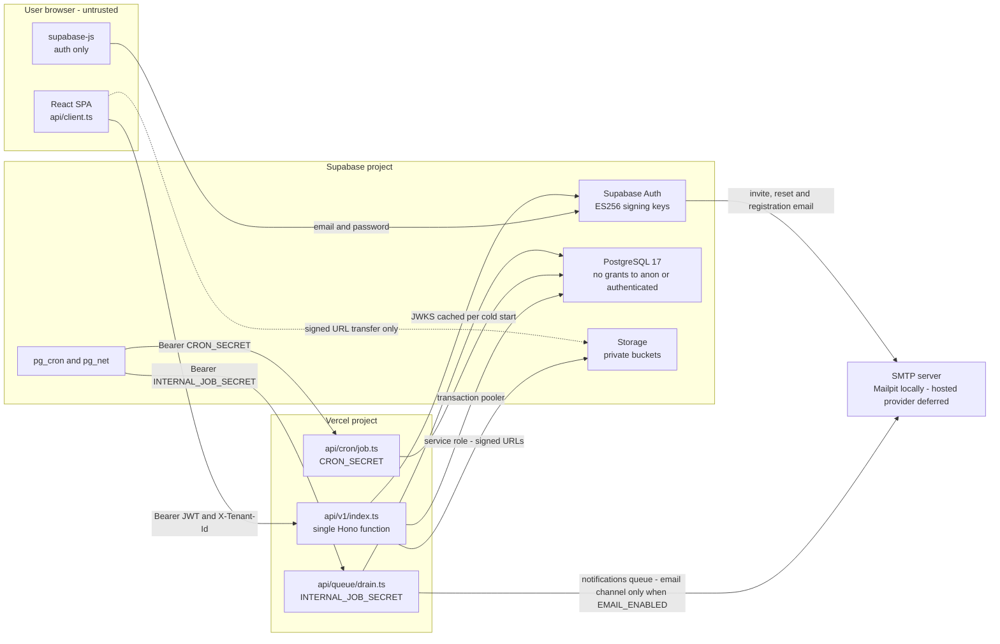
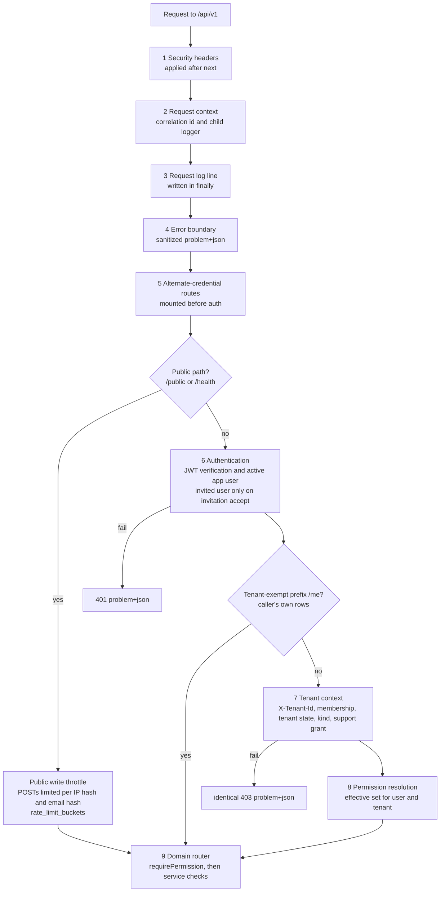
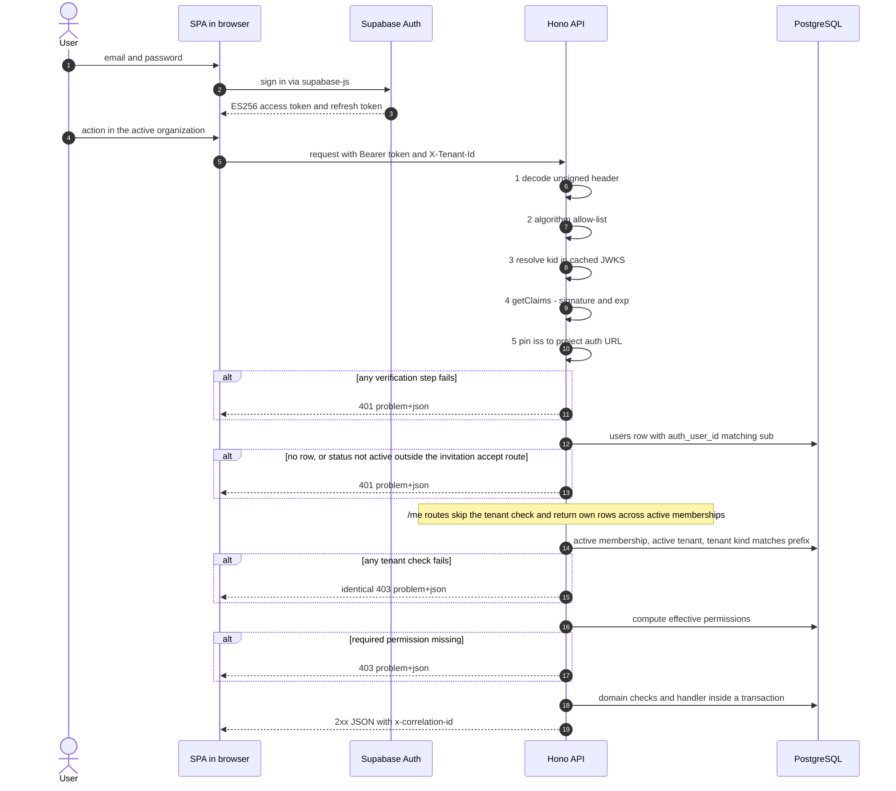
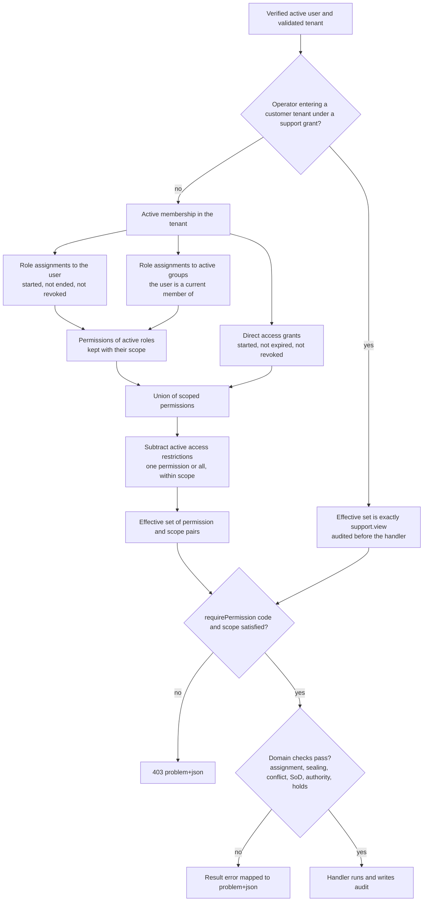
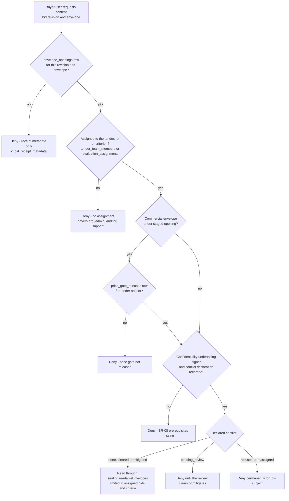
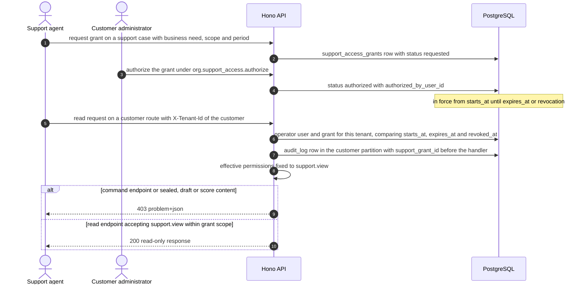

# Security Model

Status: As-designed (pre-build). Updated to as-built at the end of Stage A and Stage B.

Sources:
- [Design decision log](../plan/design-decisions.md): DD-01, DD-03 to DD-05, DD-11 to DD-14, DD-16 to DD-18, DD-21 to DD-31, DD-35, DD-36, DD-39, DD-42; DD-38 (withdrawn by the owner decision of 2026-09-29, superseded by DD-43); DD-43 (real Supabase Auth from Stage A) and DD-44 (email channel) from §D2; §E (owner decisions of 2026-09-29: local-only prototype, supplier self-registration approach, prototype actions do not persist). It amends the plan and the blueprint and wins on conflict.
- [Architecture plan](../plan/architecture-plan.md) (revision 3): §0 (delivery stages), §3.1 (tenancy, operator support access), §3.2 (authorization model), §3.3 (sealing and staged opening), §3.5 (versioning, approvals, evidence), §3.8 (notifications, `DeliveryChannel`), §3.9 (`expire-access`, `expire-approvals`, `expire-support-access`, `report-schedules`, `upload-reaper`), §3.10 and §3.11 (contracts-first API, prototype mode with local Supabase Auth), §4 (layout, URL map, registries, cross-domain writes, shared owners), §5 (Stage A `mock-platform` and `ui-shell`, Stage B `platform-data-auth` and `ui-live-api`), §8 (testing), §11 (items 1 to 4 and 8 to 10, plus the other owner answers of 2026-09-29).
- [Email delivery options](../plan/email-delivery-options.md): local SMTP to Mailpit decided (DD-44), hosted provider and its webhooks deferred.
- [Stage A workflow](../plan/tenderiq-prototype.workflow.js) and [Stage B workflow](../plan/tenderiq-backend.workflow.js): `mock-platform` (Stage A `lib/config`, `lib/supabase`, `lib/auth/verify.ts`, `seed-auth-personas.ts`, `scan-bundle`), `ui-shell` (dev-only demo accounts), `contracts-core` and `schema-apply` (`permissions.ts` and `seed.sql`), `platform-http` (DD-44 email variables), `svc-notifications` (email channel).
- [Schema blueprint](../plan/schema-blueprint.md): §0 (conventions, [S] and [R] tags, Data API rule), Migrations 01, 02, 04, 05, 08, 09, 10, 11, 12, 13 and 14, §P (permission catalog and role templates).
- [Architecture brief](../architecture-brief.md): §3.1, §5.1, §5.3, §5.5, §5.6 (tenant scoping), §5.7, §5.8, §5.9, §6.3, §7.3 (auth config), §8, §9.2, §13, §14.
- [PRD](../PRD.md): §4.1, §4.2, §4.3, §5.2, §5.3, §5.4, §7.10, §7.11, §13.2 (ADM-12), §13.3 (OPS-04, OPS-06), §14.2, §14.3, §15.2, §16, §17.2, §18.1, §18.2; BR-02, BR-05 to BR-08, BR-17, BR-26, BR-38, BR-43, BR-45, BR-46; AC-01 to AC-05, AC-08, AC-15, AC-16.
- [Demo storyline](../plan/demo-storyline.md): personas used in examples.

Contents:
1. [Principles and scope](#1-principles-and-scope)
2. [Trust boundaries and request pipeline](#2-trust-boundaries-and-request-pipeline)
3. [Authentication](#3-authentication)
4. [Tenancy and audience partitioning](#4-tenancy-and-audience-partitioning)
5. [Authorization and effective permissions](#5-authorization-and-effective-permissions)
6. [Assignment-based event access (BR-26)](#6-assignment-based-event-access-br-26)
7. [Sealing and staged opening](#7-sealing-and-staged-opening)
8. [Conflict declarations and confidentiality undertakings](#8-conflict-declarations-and-confidentiality-undertakings)
9. [Segregation of duties and authority limits](#9-segregation-of-duties-and-authority-limits)
10. [Operator support access](#10-operator-support-access)
11. [Audit logging](#11-audit-logging)
12. [Data API lockdown and storage](#12-data-api-lockdown-and-storage)
13. [Secrets handling and bundle scanning](#13-secrets-handling-and-bundle-scanning)
14. [Security headers](#14-security-headers)
15. [Error response sanitization](#15-error-response-sanitization)
16. [Audience and confidentiality matrix enforcement](#16-audience-and-confidentiality-matrix-enforcement)
17. [Stage A prototype enforcement](#17-stage-a-prototype-enforcement)
18. [Open points](#18-open-points)

Related documents: [System context](01-system-context.md), [Architecture](02-architecture.md), [Data model](03-data-model/README.md), [Lifecycles](05-lifecycles.md), [Key flows](06-key-flows.md), [API](07-api.md), [Background jobs](08-background-jobs.md), [Frontend](09-frontend.md), [Testing strategy](11-testing-strategy.md), [Traceability](12-traceability.md), [Glossary](glossary.md).

---

## 1. Principles and scope

| Principle | Design consequence | Source |
|---|---|---|
| The SPA is hostile | Every tenant, user, role and permission id from the browser is re-verified server-side. UI hiding is a convenience, never a control. | Brief §5.8, §14 |
| Isolation lives in the application layer | Middleware, the typed scopers `forTenant` / `forSupplier`, domain services and integration tests enforce isolation. Postgres RLS is not the primary mechanism. The PostgREST roles `anon` and `authenticated` hold no privileges. | Brief §6.3; blueprint §0 |
| Layered checks | Authentication, then tenant context, then permission resolution, then domain checks (assignment, sealing, conflict, segregation of duties, authority, holds), then audit. | Brief §5.1; plan §3.2 |
| Restrictions beat grants | Explicit restrictions, suspensions, conflict restrictions and sealing rules take precedence over role membership. | PRD §4.2; plan §3.2 |
| Administration is not content access | `org_admin` holds only `org.*` permissions. Operators hold no customer permissions except `support.view` through a customer-authorized grant. | Blueprint §P; PRD §17.2, BR-26 |
| Uniform rejections | One identical 403 for every tenant failure, one generic sign-in error, one identical 401 for job secrets, sanitized 5xx bodies. | Brief §5.1, §5.7, §9.2, §14 |
| Evidence is append-only | Audit rows, snapshots and history rows are only appended. Corrections add rows. | Plan §3.5; PRD §18.2 |

The same rules apply in both delivery stages ([ADR 0006](adr/0006-contracts-first-ui-prototype-stage.md)). Authentication is real in both: from Stage A the SPA signs in with supabase-js against Supabase Auth in the local Docker stack, and the mock API verifies the real JWT (DD-43). In Stage A the mock API mirrors the remaining checks against fixtures ([section 17](#17-stage-a-prototype-enforcement)). In Stage B the real backend enforces them against the database.

## 2. Trust boundaries and request pipeline

Boundary rules:
- The browser talks to Supabase only for authentication (supabase-js) and for direct file transfer to a signed URL that the API issued after authorizing the request. It never uses the Data API, the Storage client or Realtime (brief §5.7, §5.9, §10).
- Job endpoints are separate Vercel functions outside `/api/v1`. They validate their bearer secret before touching the database ([section 13](#13-secrets-handling-and-bundle-scanning)).
- The service-role key, database URLs, job secrets and SMTP credentials exist only on the server.
- Outbound email (DD-44). The `notifications` queue handler (fan-out and delivery, plan §3.9) sends through the `email` `DeliveryChannel` over SMTP with `nodemailer`, only where `EMAIL_ENABLED`. Supabase Auth sends its invite, password-reset and registration emails over SMTP too. Locally both go to Mailpit in the Supabase Docker stack (SMTP port 54325, web UI `http://127.0.0.1:54324`). An email carries only the title, the official deadline and a link into the app, never bid, evaluation or other confidential content (BR-43, ADM-12). The hosted provider and its delivery-event webhooks are deferred, so no inbound webhook route exists yet ([section 18](#18-open-points)).

The Hono middleware chain (brief §5.1) runs in this order:

| Step | Security role |
|---|---|
| 1 Security headers | Headers survive replaced and error responses. HSTS only when `APP_ENV !== 'local'` ([section 14](#14-security-headers)). |
| 2 Request context | Correlation id from `x-correlation-id` / `x-request-id` or generated, echoed on the response, carried into `audit_log.correlation_id`. |
| 3 Request log | Method, route pattern, status, duration, userId, tenantId. Values pass through the redactor. |
| 4 Error boundary | Converts any thrown error into sanitized RFC 7807 problem+json ([section 15](#15-error-response-sanitization)). |
| 5 Alternate-credential routes | Brief pattern for API-key routes. The TenderIQ sources define none for Stage B. |
| Public write throttle | An app middleware limits public POSTs (registration, register interest, access requests) per IP hash and per email hash, counted in `rate_limit_buckets` [G]. There is no external service (DD-28). See [section 2.1](#21-abuse-and-replay-controls). |
| 6 Authentication | [Section 3](#3-authentication). Only `active` app users pass, except that `POST /api/v1/me/invitations/:token/accept` also admits users in status `invited` (DD-27). Unknown routes return 404, not 401. |
| 7 Tenant context | [Section 4](#4-tenancy-and-audience-partitioning) and [section 10](#10-operator-support-access). `/me/*` is tenant-exempt: it returns the caller's own rows across all active memberships, and an action on a row requires `X-Tenant-Id` equal to the row's tenant (DD-21). |
| 8 Permission resolution | [Section 5](#5-authorization-and-effective-permissions). |
| 9 Domain router | `requirePermission(code, { scope? })` per route, then domain checks in the service. Commands that create records accept an optional `Idempotency-Key` header (DD-39, [section 2.1](#21-abuse-and-replay-controls)). |

### 2.1 Abuse and replay controls

| Control | Design | Source |
|---|---|---|
| Public write throttle | `rate_limit_buckets` [G] (`key_hash`, `window_start`, `count`; PK `key_hash` + `window_start`). The middleware counts public POSTs (registration, register interest, access requests) per hashed IP and per hashed email. Only hashes are stored. No external rate-limiting service is used. | DD-28; blueprint Migration 13 |
| Idempotency keys | Commands that create records accept an optional `Idempotency-Key` header. The key is stored in `request_idempotency` [T] (`key`, `user_id`, `route`, `response_status`, `response_hash`; unique `tenant_id`, `user_id`, `key`) and kept for 24 hours; `upload-reaper` purges older rows. The SPA also disables submit buttons while a request is in flight. | DD-39; blueprint Migration 13; plan §3.9 |
| Retried submissions | A retried bid submission still records a new `submission_attempts` row. Every attempt is intended evidence (AC-13). | DD-39 |

Both tables are server-only like every other table ([section 12.1](#121-database-privileges)): no grants to `anon` or `authenticated`.

## 3. Authentication

### 3.1 Identity provider and provisioning

| Aspect | Design | Source |
|---|---|---|
| Provider | Supabase Auth (GoTrue), email and password | Brief §1, §5.7 |
| Token | Asymmetric ES256 JWT. `SUPABASE_JWT_SECRET` is intentionally absent. Locally `scripts/db/ensure-signing-keys.mjs` generates the git-ignored `supabase/signing_keys.json`. | Brief §5.7, §8.1 |
| Self-signup | Disabled (`enable_signup = false`). Anonymous sign-ins, MFA and external providers are off in `config.toml`. MFA and step-up are not in the initial release ([section 3.7](#37-sign-in-assurance)). | Brief §5.7, §7.3; DD-29 |
| Provisioning | Administrators provision users through the Auth Admin API (service-role client). Supplier self-registration (`/register`) also creates app-provisioned accounts through an Auth Admin API invite: tenant, user, membership and supplier profile are written in one transaction that commits, the invite is sent after the commit, and a failed invite sets the registrant’s `invitations` row to `send_failed` for a retry ([section 3.6](#36-invitations-and-registration)). The owner chose this approach on 2026-09-29; it keeps self-signup disabled locally and hosted. | Brief §5.7; plan §11 item 4; design log §E item 7; DD-27; [ADR 0012](adr/0012-supplier-registration-via-provisioned-accounts.md) |
| Local stack from Stage A | The Supabase CLI stack (Auth, Postgres, Studio, Mailpit) runs in Docker from Stage A. Stage A uses **Auth** only; no application schema exists yet. `npm run auth:personas` creates or updates every demo persona in local Supabase Auth through the Admin API (email confirmed, password `test1234`). It is idempotent and refuses to run when `SUPABASE_URL` is not local. | DD-43; plan §3.11 |
| Auth email | Supabase Auth emails go to Mailpit locally. In Stage A only password-reset emails arrive there, because the demo accounts are created already confirmed by `npm run auth:personas` and the mock API persists nothing and never calls the Auth Admin invite. Invite and registration emails arrive from Stage B, when the real API calls the Auth Admin invite. Hosted Supabase needs a custom SMTP provider; the provider choice is deferred, and the same SMTP credentials will serve Supabase Auth and the app's `email` channel. | DD-43, DD-44; plan §11 item 3; [email delivery options](../plan/email-delivery-options.md) |
| Local session settings | `jwt_expiry = 3600`, refresh-token rotation on, `enable_confirmations = false`. Hosted values are set per project. | Brief §7.3, §13 |
| Bootstrap | `npm run db:admin:create -- --email … --env=<env>` creates one super-admin and prints a generated password once. | Brief §5.7 |

### 3.2 Browser session

- supabase-js in the SPA handles sign-in, the password-reset flow (`/forgot-password`, `/reset-password`), the invitation set-password flow (`/invite/:token`), session persistence, token refresh and sign-out. It is used exactly as in production in both stages. There is no mock auth adapter, no persona switcher, no `VITE_AUTH_MODE` build variable and no `/__mock/auth` endpoint (DD-43; DD-38 is withdrawn).
- Demo accounts quick-pick (DD-43). In local development builds only (`import.meta.env.DEV`), the sign-in page lists the demo personas. Picking one fills its email and password and signs in for real against local Supabase Auth. Vite removes it from production builds, and `scan-bundle` fails if its unique marker string appears in `src/ui/dist` ([section 13](#13-secrets-handling-and-bundle-scanning)).
- `api/client.ts` reads the access token per request and sends `Authorization: Bearer <jwt>`. It injects `X-Tenant-Id` from the Redux session for tenant-scoped prefixes and omits it for exempt prefixes. A 401 signs the user out or redirects to `/signin` (brief §10).
- The active tenant is remembered per user in `localStorage` as a convenience only. It grants nothing: `/me/context` re-validates it at boot, and the tenant middleware re-checks `X-Tenant-Id` on every request (DD-36).
- Sign-in errors use one generic message so the form cannot confirm which accounts exist (brief §5.7).

### 3.3 Server verification order

`lib/auth/verify.ts` runs the cheapest and most suspicious checks first (brief §5.7):

| # | Check | Rejects |
|---|---|---|
| 1 | Decode the unsigned JWT header | Malformed tokens |
| 2 | Algorithm allow-list, asymmetric only | `none` and HS* downgrade attempts |
| 3 | Resolve `kid` against the cached JWKS | Unknown key ids, without a network round-trip |
| 4 | `supabase.auth.getClaims(token, { keys: [key] })`: local WebCrypto signature check plus `exp` | Bad signatures, expired tokens |
| 5 | Pin `iss` to the project's auth URL | Tokens from another issuer |

Every failure returns 401. The rejection reason goes to the server log only.

The module is written in Stage A, together with the real `src/server/lib/config` (Stage A variable subset: `APP_ENV`, `LOG_LEVEL`, `SUPABASE_URL`, `SUPABASE_ANON_KEY`, `SUPABASE_SERVICE_ROLE_KEY`) and `src/server/lib/supabase` (memoized verification and admin clients, JWKS cache), by the A1 `mock-platform` agent. The Stage A mock API already verifies every bearer token with it. Stage B extends these modules and never rewrites them: `platform-data-auth` adds the app-user middleware, and `platform-http` extends the config to every server variable (DD-43; plan §3.11, §5).

### 3.4 App-user activation

- The verified `sub` claim is the `authUserId`. It must match `users.auth_user_id` (unique, not null).
- `users.status` must be `active`. `invited`, `suspended` and `deactivated` users receive 401, as do tokens whose `sub` has no `users` row. The one exception is `POST /api/v1/me/invitations/:token/accept`, which the middleware also allows for users in status `invited` (DD-27, [section 3.6](#36-invitations-and-registration)).
- Because this lookup runs on every request, suspending or deactivating a user takes effect on the next request even though the token itself stays cryptographically valid until `exp`.
- Organization access is separate. `memberships.status` must be `active` for the tenant named in `X-Tenant-Id`, which the tenant middleware checks ([section 4](#4-tenancy-and-audience-partitioning)).
- Deactivation never removes submissions, approvals, contracts or audit rows (BR-38, AC-04). Historical rows keep their actor foreign keys.
- Stage A has no `users` table. After the same five verification steps, the mock API maps the verified email to its fixture persona, and an unknown account receives 401 (DD-43; plan §3.11).

| Code | Meaning (brief §5.7) |
|---|---|
| 401 | No token, invalid token, unknown app user, or app user not `active` (an `invited` user is admitted only on the invitation-accept route) |
| 403 | Authenticated active user without tenant access (identical body) or without the required permission |

### 3.5 Authentication sequence

### 3.6 Invitations and registration

| Record | Controls |
|---|---|
| `invitations` [T] | Only `token_hash` is stored (unique). `expires_at`, `status` (pending, accepted, expired, revoked, reissued), `reissued_from_id` and `sent_count` support FR-03 reissue without a duplicate identity. `role_ids bigint[]` holds the **tenant role ids** to assign on acceptance (DD-06). The SPA page `/invite/:token` calls `POST /api/v1/me/invitations/:token/accept` (DD-27). Acceptance compares `expires_at` directly; the hourly `expire-access` job only updates the display status to `expired` and sends notices (DD-18). |
| `memberships` [T] | `status` (invited, pending_approval, active, suspended, revoked), `invited_by`, `approved_by`, `joined_at`, `ended_at`, `end_reason`. Unique per (tenant, user). |
| `supplier_membership_requests` [T] | A person asks to join an existing supplier organization. A supplier administrator approves or rejects it (FR-02). |
| `tenants.verification_status` | `unverified`, `contact_verified`, `identity_verified`. It is separate from membership approval and from qualification (FR-02, BR-03). |
| `duplicate_candidates` [G] | Possible duplicates are raised for review. SUP-02 must not disclose confidential information from a candidate duplicate. |
| `supplier_identity_changes` [T] | Legal-name, ownership, representation-transfer and `admin_recovery` changes require evidence and review. Emergency recovery must not compromise sealed-bid or approval controls (PRD §5.3). |

Acceptance and registration (DD-27):
- `POST /api/v1/me/invitations/:token/accept` is the one route the authentication middleware allows for users in status `invited`. Accepting activates the membership, and the user if needed. The token is matched through `token_hash`.
- Supplier registration (`/register`) creates the tenant (status `pending`), the user (`invited`), a pending membership and the supplier profile in one transaction and **commits**. **After the commit**, it calls the Auth Admin invite, because brief §5.6 forbids network calls inside a transaction; the registration transaction is never rolled back for an invite failure.
- If the invite fails, a short follow-up transaction sets the registrant’s `invitations` row to `send_failed`. The state guard allows a retry, and the registrant sees "we could not send the verification email — try again". A "resend verification" action and the unique `users.email` constraint prevent duplicate organizations and users. Abandoned pending registrations stay visible to operators in the supplier registration and duplicate review, where they can be closed. The owner confirmed this approach on 2026-09-29 (design log §E item 7; plan §11 item 4).
- Registration is a public POST and passes the public write throttle ([section 2.1](#21-abuse-and-replay-controls), DD-28).
- The invite (which doubles as contact verification for a registrant) and the password-reset email are sent by Supabase Auth. Locally they land in Mailpit (DD-43, DD-44).

See [Key flows](06-key-flows.md) for the full sequences.

### 3.7 Sign-in assurance

PRD FR-03 allows a business policy that requires stronger sign-in assurance for administrators, bid openers, approvers and signatories. MFA and step-up are **not** in the initial release: the brief configuration disables MFA. They are recorded as a later extension using Supabase MFA (DD-29; plan §11 item 10).

## 4. Tenancy and audience partitioning

### 4.1 Tenant equals organization

`tenants` rows are organizations with `kind` in (buyer, supplier, operator). A person (`users`, global) holds `memberships` in any number of tenants (AC-02). The SPA organization and capacity switcher (`/select-organization`, COM-02) sets the active tenant. Switching clears all tenant-scoped Redux state, so no data follows the user between capacities (BR-02). See [ADR 0001](adr/0001-tenancy-equals-organization.md).

Before a consequential action (submission, approval, publication, signature) the UI confirms the acting organization, capacity, scope and result (plan §7; PRD COM-02). `audit_log.actor_capacity` records the capacity in which the actor acted (plan §3.5). When a supplier acts on a buyer-owned row (for example submitting a bid), the row is audited in the buyer's partition with `actor_capacity` naming the supplier organization (DD-11). The source of the value for ordinary in-tenant actions (for example the membership's capacity label `memberships.title`, or a delegated capacity) is finalized in Stage B.

### 4.2 Tenant middleware

The middleware reads `X-Tenant-Id` and admits the request only if all of the following hold:
1. The value parses to a tenant id.
2. The tenant exists and `tenants.status = 'active'`.
3. The user has a `memberships` row in that tenant with `status = 'active'`, or, for an operator user entering a customer tenant, an active customer-authorized `support_access_grants` row exists ([section 10](#10-operator-support-access)).
4. The tenant `kind` matches the route prefix.

Any failure returns **one identical 403 problem document**, so the response cannot be used to learn which tenants exist or which check failed. The reason goes to the server log only (brief §5.1, §14).

| Prefix | Authentication | Tenant | Required `tenants.kind` |
|---|---|---|---|
| `/api/v1/public/*` | none | none | — |
| `/api/v1/health` | none | none | — |
| `/api/v1/me/*` | required (`invited` users only on the invitation-accept route) | exempt | — |
| `/api/v1/buyer/*` | required | required | `buyer` |
| `/api/v1/supplier/*` | required | required | `supplier` |
| `/api/v1/ops/*` | required | required | `operator` |

The mock API enforces the same table in Stage A (plan §3.1).

**Personal inbox (`/me`, DD-21).** `/api/v1/me/tasks`, `/me/notifications`, `/me/approvals/:id`, `/me/documents/:id` and `/me/search` return **the caller's own rows across all active memberships**, each labelled with its organization. Being tenant-exempt does not widen access:
- An action on a row requires `X-Tenant-Id` equal to the row's tenant, so the full tenant, permission and domain checks run in that tenant.
- Global search filters every result by the caller's authorization **in the row's tenant**. Restricted records never appear in results or counts (BR-43, COM-08).

**Public and supplier references (DD-22).** References are unique per buyer, not globally. Public URLs therefore carry the buyer slug (`/opportunities/:buyerSlug/:ref`, `/awards/:buyerSlug/:ref`, `/clarifications/:buyerSlug/:ref`), and supplier API paths use tender ids. A reference alone never resolves a record across buyers.

### 4.3 Data scoping

| Mechanism | Rule | Source |
|---|---|---|
| `TenantId` | Branded number. `toTenantId()` is the only constructor. There is no ambient current tenant: the tenant is always an explicit argument. | Brief §5.6 |
| `forTenant(db, tenantId)` | Buyer-side (and own-tenant) access. Applies the table-qualified `tenant_id = ?` predicate. `insertInto` injects `tenant_id` and its type forbids the caller from supplying one. Type tests prove that omitting the tenant fails to compile. | Brief §5.6; plan §3.1 |
| `forSupplier(db, supplierTenantId)` | Supplier-side access, allowed only on tables in the explicit allow-list `supplier-scoped-tables.ts` (the [S] tables). The allow-list is generated from the blueprint tags, not from column presence, so a table that merely carries `supplier_tenant_id` is not reachable. Filters on `supplier_tenant_id`. Inserts name the buyer `tenant_id` explicitly after the service has verified participation. | Plan §3.1; blueprint §0; DD-03 |
| `tenantPredicate(table, tenantId)` | For joins and CTEs. | Brief §5.6 |
| Generated lists | `tenant-scoped-tables.ts` is checked against the schema in both directions at compile time. `[G]` tables that name a customer use `customer_tenant_id` (`subscriptions`, `offboarding_plans` and `service_incident_impacts`, renamed by DD-04, as well as `support_cases` and `support_access_grants`), so the tenant-scoped generator never picks them up. A guard test asserts that no [R] table is on `supplier-scoped-tables.ts`. | Brief §5.6; DD-03, DD-04 |

Tenancy tags (blueprint §0) and their security meaning:

| Tag | Meaning | Security consequence |
|---|---|---|
| [T] | `tenant_id` not null | Reachable only through `forTenant` for the owning tenant. |
| [P] | [T] plus `PARTITION BY LIST (tenant_id)`. Only `audit_log` and `notifications`. | As [T]. Partitions are created with the tenant by `ensure_tenant_partitions` ([ADR 0008](adr/0008-partition-only-high-volume-tables.md)). |
| [S] | Supplier-accessible: [T] (tenant = buyer) plus `supplier_tenant_id` not null, and on the `supplier-scoped-tables.ts` allow-list | Buyer reaches rows through `forTenant`. The named supplier reaches its own rows through `forSupplier`. |
| [R] | [T] (tenant = buyer) plus `supplier_tenant_id` for **reference only**. Buyer-internal. | Reachable only through `forTenant`. **Never** reachable through `forSupplier`, enforced by a guard test (DD-03). |
| [G] | No `tenant_id` | Platform-wide. Reached only by the owning domain's routes, for example operations or public reference data. A customer reference is named `customer_tenant_id` (DD-04). |

**Buyer-owned procurement records** ([ADR 0002](adr/0002-buyer-owned-procurement-records.md)). Procurement records carry the buyer `tenant_id`. Supplier-private collaboration lives in rows owned by the supplier tenant, which the buyer can never reach through `forTenant(buyerId)`:

| Supplier-owned table (tenant = supplier) | Content |
|---|---|
| `pursuits`, `pursuit_team_members`, `pursuit_notes` | Bid/no-bid rationale, internal team, notes (SUP-09) |
| `bid_internal_approvals`, `bid_internal_comments` | Internal review of a revision (SUP-15) |
| `comments` with `visibility = 'supplier_internal'` | Internal collaboration |
| `saved_searches`, `watchlist_items`, `notice_subscriptions` | Discovery preferences |
| `supplier_profiles`, `supplier_locations`, `supplier_categories`, `supplier_legal_names`, `evidence_items`, `evidence_shares`, `supplier_membership_requests`, `supplier_identity_changes` | Organization profile and evidence library |
| `tasks` for supplier users | Supplier task inbox (blueprint: supplier tasks use the supplier `tenant_id`) |

**[R] tables are buyer-internal (DD-03).** These tables carry `supplier_tenant_id` for reference only and are not on `supplier-scoped-tables.ts`: `buyer_supplier_relationships`, `relationship_contacts`, `reassessment_triggers`, `integrity_screenings`, `envelope_openings`, `compliance_checks`, `exclusions`, `evaluation_scores`, `moderated_scores`, `commercial_evaluations`, `evaluation_results`, `assessment_findings`, `reference_checks`, `shortlist_entries`, `preferred_bidders`, `due_diligence_cases`, `due_diligence_findings`, `negotiations`, `late_submission_exceptions`, `renewal_options`. Suppliers learn outcomes (an exclusion, a shortlist result, a preferred-bidder decision, a renewal decision) only through notices and the supplier-facing projections defined in the API contracts (`src/contracts`). A guard test fails if any [R] table appears on the allow-list.

**[S] rows still leave the server only through a projection.** `forSupplier` limits rows to the supplier's own. The supplier-facing endpoint's contract response schema decides which columns leave the server (PRD §4.3). `qualification_answer_evidence` is [S] (DD-03). Two [S] tables have documented exceptions: `notice_recipients` uses the buyer tenant id in `supplier_tenant_id` for buyer-internal recipients, and `lot_outcomes.supplier_tenant_id` is nullable for no_award and cancelled outcomes (blueprint Migrations 04 and 11).

**Cross-buyer segregation (BR-45).** `buyer_supplier_relationships`, qualification decisions and financial reviews are rows of one buyer tenant. Supplier evidence reaches a buyer only through `evidence_shares.buyer_tenant_id` and immutable `evidence_submissions` snapshots inside that buyer's procurement. Withdrawing a share stops future sharing only (FR-02).

## 5. Authorization and effective permissions

### 5.1 Permission catalog

`permissions` [G] is a fixed, code-owned catalog seeded by `supabase/seed.sql` (blueprint §P). Each code has a `tenant_kind` (buyer, supplier, operator, any).

| Kind | Group | Codes |
|---|---|---|
| buyer | Organization | `org.settings.manage`, `org.structure.manage`, `org.users.view`, `org.users.manage`, `org.roles.manage`, `org.access.review`, `org.authority.manage`, `org.policy.manage`, `org.policy.approve`, `org.templates.manage`, `org.templates.approve`, `org.fields.manage`, `org.calendars.manage`, `org.portal.manage`, `org.notifications.manage`, `org.integrations.manage`, `org.imports.manage`, `org.subscription.view`, `org.support_access.authorize` (DD-23: a buyer administrator authorizes an operator support grant) |
| buyer | Requests and strategy | `request.create`, `request.view_all`, `request.review`, `request.approve`, `request.funding_confirm`, `plan.manage`, `strategy.manage`, `strategy.approve` |
| buyer | Suppliers and qualification | `supplier.directory.view`, `supplier.relationship.manage`, `supplier.duplicates.review`, `qualification.program.manage`, `qualification.review`, `qualification.financial_review`, `qualification.decide` |
| buyer | Tenders | `tender.view`, `tender.create`, `tender.edit`, `tender.release_approve`, `tender.publish`, `tender.participants.manage`, `tender.clarifications.manage`, `tender.addenda.approve`, `tender.sessions.manage`, `tender.close`, `tender.cancel` |
| buyer | Opening and evaluation | `bid.monitor`, `bid.open`, `bid.witness`, `compliance.assess`, `exclusion.approve`, `evaluation.chair`, `evaluation.score`, `evaluation.commercial`, `evaluation.moderate`, `evaluation.signoff` |
| buyer | Selection and award | `selection.manage`, `shortlist.approve`, `diligence.manage`, `negotiation.conduct`, `negotiation.approve`, `award.recommend`, `award.approve`, `notice.issue`, `complaint.manage`, `debrief.manage`, `event.closeout` |
| buyer | Contracts | `contract.view`, `contract.prepare`, `contract.approve`, `contract.sign`, `contract.manage`, `contract.change.approve`, `contract.renewal.decide`, `contract.financials.view` |
| buyer | Reporting and records | `report.view`, `report.manage`, `export.create`, `audit.view`, `records.retention.manage`, `records.hold.manage`, `records.disposal.approve`, `dashboard.view` (DD-23: buyer dashboard BUY-01) |
| buyer | Approvals | `approval.decide` |
| supplier | Supplier | `supplier.org.manage`, `supplier.users.manage`, `supplier.evidence.manage`, `supplier.evidence.share`, `supplier.financial.view`, `supplier.opportunities.view`, `supplier.pursuit.manage`, `supplier.response.edit`, `supplier.pricing.edit`, `supplier.response.approve`, `supplier.response.submit`, `supplier.qualification.apply`, `supplier.outcomes.view`, `supplier.complaint.submit`, `supplier.contract.participate`, `supplier.notices.acknowledge`, `supplier.dashboard.view` (both DD-23; the dashboard is SUP-01) |
| operator | Operator | `ops.customers.manage`, `ops.subscriptions.manage`, `ops.support.manage`, `ops.incidents.manage`, `ops.content.manage`, `ops.oversight.view`, `support.view` (grant-only) |

Price-gate release uses the existing `evaluation.chair` code; no separate permission is added (DD-23).

### 5.2 Roles and templates

`role_templates` [G] with `role_template_permissions` [G] are copied into each tenant as `roles` [T] with `role_permissions` [T]. Tenants may add custom roles. Roles are deactivated (`active`, `deactivated_at`), never deleted.

| Kind | Template | Restriction carried from PRD §4.1 and blueprint §P |
|---|---|---|
| buyer | `org_admin` | `org.*` only. No tender content, bids or evaluation (PRD §17.2, BR-26, AC-15). |
| buyer | `procurement_manager` | Approves within `authority_limits` and delegations. Constrained by conflicts. |
| buyer | `procurement_officer` | Tender owner. Cannot bypass sealed-bid rules or independent approvals. |
| buyer | `requester` | Cannot publish or award. |
| buyer | `budget_owner` | Funding confirmation. Financial review does not imply access to all procurement material. |
| buyer | `qualification_assessor` | Sees assigned evidence only. Cannot alter supplier declarations. |
| buyer | `financial_reviewer` | Assigned financial evidence only. |
| buyer | `evaluation_chair` | Cannot overwrite submitted scores without a recorded correction. |
| buyer | `evaluator` | No unrelated bids, premature prices or other assessors' scores. |
| buyer | `commercial_reviewer` | Commercial material only after the price gate. |
| buyer | `opening_officer` | Opening rights are separate from authoring, evaluation and award (BR-05). |
| buyer | `legal_reviewer` | Access by assignment and business need. |
| buyer | `award_approver` | Within delegated authority and without an unresolved conflict. |
| buyer | `contract_manager` | Cannot rewrite the competition or award history. |
| buyer | `auditor` | Read-only plus `audit.view` and `export.create`. No sealed access. |
| supplier | `supplier_admin` | Cannot grant buyer privileges or inspect other suppliers. |
| supplier | `bid_manager` | Submission authority must be explicitly assigned. |
| supplier | `contributor`, `commercial_contributor` | Limited by tender, section and commercial sensitivity. A contributor cannot submit or self-grant (AC-03). |
| supplier | `supplier_approver`, `authorized_signatory`, `supplier_finance` | Authority limited by entity, value, tender and dates. |
| operator | `platform_operator`, `support_agent` | No customer procurement content. `support.view` is in no template. |

The full template-to-permission matrix is written into `seed.sql` by the Stage B schema step. It must honor the restriction column above (blueprint §P).

Stage A already enforces permissions: the mock API checks each endpoint's declared `permission` against the persona's fixture permission set (plan §3.2). The platform fixtures, `src/mock-api/fixtures/platform.ts`, are owned by A1 `mock-platform` (plan §5). Because the plan requires the prototype's navigation and 403 behavior to match Stage B, both stages derive from one file. The Stage A `contracts-core` agent writes `src/contracts/permissions.ts` with the full catalog (including the DD-23 additions) and the template-to-permission matrix from blueprint §P. The mock API computes each persona's effective permissions from it (`persona.ts`, `fixtures/platform.ts`). The Stage B `schema-apply` step generates the catalog and templates in `seed.sql` from the same file, and a unit test fails if the two disagree (Stage A and Stage B workflow scripts; [section 18](#18-open-points) item 17).

### 5.3 Sources of effective permissions

Effective permissions are computed per request for (user, tenant) from four sources, with restrictions subtracted last (plan §3.2):

| Source | Table | Validity and scope |
|---|---|---|
| Role assignment to the user | `role_assignments` with `user_id` | `starts_at`, `ends_at`, `revoked_at`. `scope_type` in (organization, legal_entity, department, category, project, tender, lot, contract). `scope_id` is null only for `organization`. |
| Role assignment to a group | `role_assignments` with `group_id`, plus `user_groups` (`active`) and `user_group_members` (`removed_at`) | Same as above. Exactly one of `user_id` / `group_id` is set (CHECK). Groups cannot bypass restrictions (PRD §4.2). |
| Direct exceptional grant | `access_grants` | One `permission_code` at one scope. `reason`, `owner_user_id`, `starts_at` and `expires_at` are required. CHECK `expires_at > starts_at`. `revoked_at`, `revoked_by`. |
| Explicit restriction | `access_restrictions` | `permission_code` null means every permission in the scope. `restriction_type` in (suspension, conflict, confidentiality, other). `starts_at`, `ends_at`, `imposed_by`, `reason`. |

Validity windows are evaluated at request time: the checks always compare `starts_at`, `expires_at` (or `ends_at`) and `revoked_at` directly, so access ends at the stored instant whether or not a job has run. Expiry jobs only update display statuses and send notices. Each is owned by the table's owner (DD-18; plan §3.9, [Background jobs](08-background-jobs.md)):

| Job | Owner | Records it updates |
|---|---|---|
| `expire-access` (hourly) | org-admin | Access grants, restrictions, delegations, invitations |
| `expire-approvals` (hourly) | approvals | Approval requests past `expires_at`, with notices to their owners |
| `expire-support-access` (hourly) | operations | Support access grants, with an audit row |

Effective permissions are inspectable per user in ADM-04 (PRD §4.2).

**Scope matching (DD-26).** A role assignment scoped to a `legal_entity`, `department`, `category` or `project` covers a tender when the tender's corresponding column (`legal_entity_id`, `department_id`, `category_id`, `project_id`) matches. A `category` scope includes its descendant categories. Lots inherit from their tender. Contracts inherit through their tender and also match on their own `legal_entity_id`. The permission library (`lib/permissions`) implements the rule.

### 5.4 Granting constraints

- **Nobody can grant what they do not hold** (plan §3.2; PRD §4.2). Role assignments, direct grants and delegations are refused if the granting user does not hold the permission or authority being granted.
- A tenant can only receive permissions whose `tenant_kind` matches its own kind or `any`. A supplier administrator can never grant buyer privileges (PRD §4.1).
- Delegations: a database trigger enforces that `delegations.max_amount` is at most the delegator's own limit at creation. `delegator_user_id` and `delegate_user_id` must differ (CHECK). A delegate cannot approve a conflicting decision or expand the original authority (PRD §5.3).
- Direct grants need an owner, a reason, a start and an expiry (CHECK).
- ADM-04 access review flags grants expiring soon and excessive or incompatible authority against `sod_policies` ([section 9](#9-segregation-of-duties-and-authority-limits)).

### 5.5 Where permissions are declared and checked

| Layer | Mechanism |
|---|---|
| Contract | Every endpoint in `src/contracts/<domain>.ts` declares `permission` in `defineEndpoint({ … })` (plan §3.10). |
| Mock API (Stage A) | Enforces the declared permission against the persona's fixture permission set, so navigation and 403 behavior match Stage B (plan §3.2). |
| Real API (Stage B) | `requirePermission(code, { scope? })` per route, then domain checks in the service (plan §3.2). |
| SPA | Nav items declare `permission` (feature registry). `RouteGuard.tsx` gates routes. Hidden or disabled UI is never the control (brief §10). |

Sensitive actions and the checks layered on top of the permission (design mapping; the endpoint `permission` declarations are the as-built source). Deciding an approval step always requires `approval.decide` **and** the decision-specific permission **and** sufficient authority (DD-24, [section 9.4](#94-approval-integrity)):

| Action | Permission | Additional domain checks |
|---|---|---|
| Approve a request or funding | `request.approve`, `request.funding_confirm`, `approval.decide` | Authority `request_approval` / `funding_confirmation`, SoD `requester_vs_request_approval` (AC-05) |
| Approve tender release | `tender.release_approve`, `approval.decide` | Authority `release_approval`, SoD `draft_vs_final_approval`, approval bound to `draft_revision` (AC-06) |
| Publish | `tender.publish` | Tender `ready`, approvals still valid, no hold blocking `publish` |
| Open envelopes | `bid.open`, `bid.witness` | Assignment, quorum, SoD `submission_custody_vs_opening`, price gate, no hold blocking `open` ([section 7](#7-sealing-and-staged-opening)) |
| Score | `evaluation.score` | `evaluation_assignments`, undertaking, conflict declaration, sealing |
| Release the price gate | `evaluation.chair` (DD-23) | Chair of the evaluation; `non_price_complete_confirmed`; one `price_gate_releases` row per tender and lot, written by the evaluation domain (DD-16) |
| Commercial comparison | `evaluation.commercial` | Commercial assignment (`is_commercial`), price gate |
| Approve exclusion | `exclusion.approve` | Authority `exclusion_approval` |
| Approve award (recommendation and intent) | `award.approve`, `approval.decide` | Approval `award`. Authority `award_approval`, SoD `evaluation_vs_award_approval`, no unresolved conflict |
| Approve final award (per lot outcome) | `award.approve`, `approval.decide` | Its own approval `final_award` per lot outcome (`lot_outcomes.final_award_approval_id`, DD-14). Standstill complete, blocking complaints resolved, no hold blocking `award_final` (BR-32) |
| Sign contract | `contract.sign` | Authority `contract_signature`, legal entity present (BR-04), no hold blocking `contract_sign` |
| Decide qualification | `qualification.decide` | Authority `qualification_decision`, SoD `supplier_assessment_vs_exception_approval` |
| Approve disposal | `records.disposal.approve` | Authority `disposal_approval`, no hold blocking `disposal` (BR-40) |
| Submit a bid (supplier) | `supplier.response.submit` | Readiness checks (acknowledgments read from `participant_acknowledgments`, DD-42), official receipt time, required internal approval (AC-03, AC-11, AC-13). A retried submission records a new `submission_attempts` row (DD-39) |
| Acknowledge a formal notice (supplier) | `supplier.notices.acknowledge` (DD-23) | Recipient of the notice. Writes `participant_acknowledgments` (authoritative for readiness) and `notice_recipients.acknowledged_at` in the same transaction (DD-42) |
| Authorize an operator support grant (buyer) | `org.support_access.authorize` (DD-23) | Grant names a support case, business need, scope and period ([section 10](#10-operator-support-access)) |

## 6. Assignment-based event access (BR-26)

A permission alone never opens restricted event material. Access also requires an assignment to the event, lot, criterion or case (plan §3.2). A tenant administrator without an assignment sees nothing restricted (AC-15).

| Restricted material | Gating record | Notes |
|---|---|---|
| Tender workspace content beyond metadata | `tender_team_members` (`tender_id`, optional `lot_id`, `team_role`, `removed_at`) | `team_role` in (owner, officer, evaluator, evaluation_chair, commercial_reviewer, opening_officer, witness, legal_reviewer, finance_reviewer, observer, auditor). `tenders.owner_user_id` is the accountable owner (BR-01). |
| Opening | `opening_sessions.opening_officer_user_id`, `opening_participants` (role in opening_officer, witness, committee_member, observer; `confirmed_at`) | Opening rights are separate from authoring, evaluation and award (BR-05). |
| Evaluation content | `evaluation_assignments` (`tender_id`, `lot_id`, `evaluator_user_id`, `bid_id` null = all eligible bids, `criterion_ids` empty = all non-price criteria, `is_commercial`) | `status` in (recused, reassigned) ends access. `conflict_declaration_id` and `confidentiality_undertaking_id` link the BR-08 prerequisites. |
| Qualification evidence | `qualification_applications.assessor_user_id`, `financial_reviewer_user_id` | Financial evidence only for the assigned financial reviewer (PRD §17.2, AC-08). |
| Complaints | `complaints.case_owner_user_id`, `independence_confirmed` | Not handled solely by the person whose conduct is challenged when policy requires independent review. |
| Due diligence, negotiations | `due_diligence_cases.owner_user_id`, `due_diligence_findings.owner_user_id`, `negotiations.authorized_negotiator_ids` | Only authorized negotiators negotiate (BR-30). |
| Contracts | `contracts.contract_manager_user_id`, `owner_user_id`, role assignments with `scope_type = 'contract'`, or broader scopes matched through the tender and the contract's own legal entity (DD-26) | Supplier sees only its own contracts. |

Removing a team member or reassigning an evaluator ends restricted access immediately and preserves prior work (PRD §20, "Evaluator leaves or becomes conflicted").

## 7. Sealing and staged opening

### 7.1 Sealed tables

The sealed tables (blueprint Migration 09) hold response content. Buyer users can read them **only** through `domains/sealing`: `sealing.assertEnvelopeReadable()` and `readableEnvelopes()` (plan §3.3). See [ADR 0003](adr/0003-application-layer-sealing.md).

Envelope mapping (DD-05):

| Table | Envelope |
|---|---|
| `bid_answers` | Row-level `envelope` column, copied from the requirement (`requirements.envelope`) |
| `bid_answer_documents` | The envelope of its parent answer |
| `bid_declarations` | qualification |
| `bid_subcontractors`, `bid_key_personnel` | technical |
| `bid_prices`, `bid_commercial_terms`, `bid_exceptions` | commercial |
| `receipt_inventory_items` (receipt, not sealed content) | Row-level `envelope` records the envelope of each file |

Every envelope column has CHECK (`qualification`, `technical`, `commercial`). The bids domain writes these tables and reads them for the owning supplier's team through `forSupplier`. An architecture guard test fails if any other module reads the sealed tables (plan §3.3, §8).

### 7.2 Before opening

- Buyers see receipt metadata only, through `v_bid_receipt_metadata`: `tenant_id` (so `forTenant` applies), `supplier_tenant_id`, the supplier legal name **valid at `received_at`** (from `supplier_legal_names`), bid id, effective receipt number, `received_at`, status (including withdrawn) and `document_count`. It never exposes content and never lists drafts (DD-13; blueprint Migration 09).
- Drafts are never visible to buyers. No buyer read path exists for revisions in `draft`, `internal_review` or `approved_internally` (BR-17).
- Suppliers see their own receipts (`submission_receipts`, `receipt_inventory_items`) and content.

### 7.3 Opening

| Element | Record |
|---|---|
| Opening mode | `tenders.opening_mode` in (single_stage, staged). Staged order comes from `tender_envelopes` (`envelope`, `open_order`). Policy default `policy_profile_versions.staged_opening_default`. |
| Session | `opening_sessions` (`envelope` in all, qualification, technical, commercial; `status` in scheduled, awaiting_quorum, completed, aborted; `quorum_required`; `minutes`; `irregularities`; `public_release_summary`; `public_release_approved`). |
| Quorum and second person | `policy_profile_versions.opening_quorum`, `opening_requires_second_person`; confirmations in `opening_participants.confirmed_at`. |
| Unseal record | `envelope_openings` [R] (`session_id`, `bid_id`, `revision_id`, `envelope`, `opened_at`), unique (revision_id, envelope). **This is the unseal record.** A single-stage opening (`opening_sessions.envelope = 'all'`) writes one row **per envelope** in the same transaction (DD-05). |
| Price gate | `price_gate_releases` (`tender_id`, `lot_id`, `released_at`, `released_by`, `non_price_complete_confirmed`, `note`), unique NULLS NOT DISTINCT (tender_id, lot_id) (DD-02). Owned by evaluation and written by the chair under `evaluation.chair` (DD-16, DD-23). |
| Holds | A hold with `open` in `blocked_actions` blocks opening (blueprint Migration 04). |
| SoD | `sod_policies.rule_code = 'submission_custody_vs_opening'`. |

Openings cover the effective submitted revisions. The opening domain marks an admitted receipt `submission_receipts.status = 'selected_for_evaluation'`, an allowed and audited cross-domain write (DD-17). Late-rejected and withdrawn responses are excluded from ordinary evaluation unless an authorized policy route (`late_submission_exceptions.decision = 'accepted'`) provides otherwise (BR-21). Unopened price envelopes of failed bidders stay closed unless the approved procedure permits later release (PRD §7.10).

### 7.4 The four read conditions

A buyer user can read an envelope of a bid revision only if **all four** hold (plan §3.3):

1. An `envelope_openings` row exists for that revision and envelope.
2. The user is assigned to the tender, lot or criterion (`tender_team_members` or `evaluation_assignments`).
3. For a commercial envelope under staged opening, a `price_gate_releases` row exists for the tender and lot.
4. The user has signed a confidentiality undertaking and made a conflict declaration for the subject (BR-08), and the declaration does not block access: a declared conflict must be `cleared` or `mitigated` (DD-25, [section 8](#8-conflict-declarations-and-confidentiality-undertakings)).

Additional evaluation-stage rules apply after unsealing:
- Where `tenders.independent_evaluation` is true, an evaluator cannot see other evaluators' scores before submitting their own and before the permitted moderation stage (PRD §7.11, §17.2).
- `tenders.anonymized_evaluation` with `anonymization_limitations` states the limits of identity concealment (PRD §7.11).
- The prototype fixtures follow the same boundaries: a buyer persona's sealed bid view shows receipt metadata only, and opened content appears only for assigned personas (plan §3.3).

Documents classified `sealed` (`documents.classification`) and the `bid-submissions` bucket are covered by the same rule. The document access policy for bid documents is registered in `domains/documents/access-registry.ts`, where anything unregistered is denied (plan §4).

## 8. Conflict declarations and confidentiality undertakings

BR-08: required conflict declarations and confidentiality undertakings precede access to restricted assessment material.

| Record | Fields | Use |
|---|---|---|
| `conflict_declarations` [T] | `user_id`; `subject_type` in (tender, lot, qualification_application, contract, complaint); `subject_id`; `supplier_tenant_id`; `has_conflict`; `nature` in (financial_interest, personal_relationship, prior_employment, bid_preparation, other); `details`; `declared_at`; `disposition` in (pending_review, cleared, mitigated, recused, reassigned); `reviewed_by`, `reviewed_at`, `review_note` | A declared conflict triggers review and a recorded disposition: recusal, reassignment or mitigation (PRD §5.4). Gating (DD-25): a declaration with `has_conflict = true` blocks restricted access while its disposition is `pending_review`. Access resumes only on `cleared` or `mitigated`. `recused` and `reassigned` block permanently for that subject. |
| `confidentiality_undertakings` [T] | `user_id`, `subject_type`, `subject_id`, `text_version`, `accepted_at`; unique (tenant, user, subject_type, subject_id) | Records the exact undertaking text version accepted. |
| `evaluation_assignments` | `conflict_declaration_id`, `confidentiality_undertaking_id` | Links the prerequisites to the evaluation work. |
| `access_restrictions` | `restriction_type = 'conflict'` or `'confidentiality'` | Removes permissions while a conflict is unresolved. Restrictions win over grants. |
| Supplier side | `participants.confidentiality_accepted_at`, `confidentiality_accepted_by`; `participation_conditions.condition_type = 'confidentiality_undertaking'` | Restricted tender documents are released to a supplier only after the declared condition is met (PRD §7.5). |

Dual memberships are visible to the conflict reviewer. A person who belongs to both a buyer and a supplier (demo persona `sam.dual`, AC-02) is routed for conflict review on the affected tender without publicly exposing unrelated personal information (PRD §5.4). The query path that shows a buyer-side reviewer the user's supplier memberships is finalized in Stage B.

Approvers also cannot decide through an unresolved conflict (PRD §4.1, §5.3).

## 9. Segregation of duties and authority limits

### 9.1 Segregation of duties (BR-07)

`sod_policies` [T] holds one row per `rule_code` per tenant. `mode = 'enforced'` blocks the combination. `mode = 'alternative_oversight'` requires `alternative_oversight_note` (CHECK) and records `approved_by` and `effective_from`. Small organizations may document alternative oversight but cannot silently disable the control (PRD §5.4). `org_settings.sod_alternative_oversight_note` holds the organization-level note.

| `rule_code` | Duties kept apart | Enforced when |
|---|---|---|
| `draft_vs_final_approval` | Drafting a record vs giving its final approval | An approval step is decided (`approval_steps`) |
| `submission_custody_vs_opening` | Custody of submissions vs authorizing the opening | An opening session is authorized |
| `evaluation_vs_award_approval` | Individual evaluation vs final award approval | Award approval is decided |
| `supplier_assessment_vs_exception_approval` | Assessing a supplier vs approving an exception for it | Qualification decisions and exception approvals are decided |
| `requester_vs_request_approval` | Requesting vs approving a procurement request | Request approval is decided |

Self-approval is blocked where the adopted policy requires independent review (BR-07).

### 9.2 Authority limits (BR-06)

`authority_limits` [T] rows grant decision authority to a user, role or committee (`subject_type`). Each row names a `decision_type`, a `max_amount` (null means unlimited within scope) with `currency`, an optional `legal_entity_id` and `category_id`, and `effective_from` / `effective_to`, approved by `approved_by`.

`decision_type` values: request_approval, funding_confirmation, strategy_approval, release_approval, exclusion_approval, shortlist_approval, preferred_bidder_approval, award_approval, contract_approval, contract_signature, change_approval, renewal_approval, qualification_decision, late_submission_exception, negotiation_mandate, disposal_approval.

An approver may not exceed the value, scope, period or entity of their authority (BR-06). When the approval amount and the limit are in different currencies, the comparison uses `exchange_rates` at the request date. With no rate, the step routes to the next level up; it is never an assumed pass (DD-24). Every decided `approval_steps` row records `authority_checked_amount` and `authority_limit_id`, plus `acting_for_user_id` and `delegation_id` when acting under delegation. Demo: `mpho.manager` has a BWP 2,000,000 limit, so PR-2026-0003 routes to `keabetswe.approver` (BWP 10,000,000) (AC-05). For contract changes, the check uses the cumulative value (`change_requests.cumulative_value_after`), so several small changes cannot bypass a higher approval (AC-31).

### 9.3 Delegations

`delegations` [T]: `delegator_user_id`, `delegate_user_id` (different), `decision_types`, `max_amount`, `currency`, `legal_entity_id`, `category_id`, `starts_at`, `ends_at`, `reason`, `revoked_at`, `revoked_by`. A trigger enforces `max_amount` at most the delegator's own limit at creation. The record shows both the acting person and the delegated capacity. `audit_log.delegation_id` and `on_behalf_of_user_id` capture it (PRD §5.3). Whether a delegation is in force is decided at request time by comparing `starts_at`, `ends_at` and `revoked_at` directly. The `expire-access` job only updates display status and sends notices (DD-18).

### 9.4 Approval integrity

Approvals target an exact version: `approval_requests.subject_version`, `content_hash`, `amount` and `currency` (plan §3.5). A material edit invalidates affected approvals (`status = 'invalidated'`, `invalidated_reason`, `invalidated_at`), so an approval cannot be reused for a different commercial decision (BR-10, AC-06). The approval lifecycle, including the subject types added by DD-14 (`obligation_waiver`, `security_release`, `dispute_decision`, `contract_difference`, `final_award`), is in [Lifecycles](05-lifecycles.md#9-approval-request). A decision after `expires_at` is refused at request time; `expire-approvals` only records the display status and notifies owners (DD-18).

Before recording a step decision the approvals service checks, in order:
1. The approver is the step's `approver_user_id`, a member of its `committee_id`, or an active delegate.
2. The approver holds `approval.decide` **and** the decision-specific permission (for example `award.approve`) (DD-24).
3. Authority covers `required_decision_type`, the amount and currency, the legal entity, the category and the date. Cross-currency amounts use `exchange_rates` at the request date; with no rate, the step routes to the next level up (DD-24).
4. SoD rules pass or a documented alternative oversight applies.
5. No unresolved conflict exists for the subject ([section 8](#8-conflict-declarations-and-confidentiality-undertakings), DD-25).

## 10. Operator support access

Operators have no routine access to customer procurement content (PRD §4.1, OPS-01, OPS-06). The only path into a customer tenant is a customer-authorized support access grant ([ADR 0013](adr/0013-operator-support-access-grants.md)).

`support_access_grants` [G]: `case_id` (a `support_cases` row), `customer_tenant_id`, `operator_user_id`, `authorized_by_user_id` (customer administrator), `business_need`, `scope` in (metadata_only, specific_records), `record_refs`, `starts_at`, `expires_at`, `revoked_at`, `status` in (requested, authorized, active, expired, revoked, denied). The grant lifecycle is in [Lifecycles](05-lifecycles.md).

| Rule | Mechanism |
|---|---|
| Customer authorization | A customer administrator holding `org.support_access.authorize` authorizes the grant (`authorized_by_user_id`) (DD-23). PRD §4.2 requires documented business need, permitted authorization, limited duration and an audit record. |
| Active window | The tenant middleware admits the operator only while the grant is in force, comparing `starts_at`, `expires_at` and `revoked_at` directly on every request. The hourly `expire-support-access` job (operations) only updates the display status and writes an audit row (DD-18). |
| Fixed permission set | Effective permissions are exactly `{support.view}`. `support.view` appears in no role template. |
| Read-only | No submit, score, approve or sign actions. Command endpoints never accept `support.view` (PRD §4.2, OPS-04: no business impersonation). |
| Content exclusions | Never sealed content, supplier drafts or evaluation scores. Support has no assignment, so the sealing conditions fail regardless of scope. |
| Scope | `metadata_only` or `specific_records` limited to `record_refs`. The filtering of `record_refs` per endpoint is finalized in Stage B. |
| Audit before the handler | An `audit_log` row with `support_grant_id` is written before the handler runs, so the access is recorded even if the handler fails (brief §5.1; plan §3.1). Support-access events are written to the **customer** tenant's partition, so the customer can review them (DD-11). |
| Service boundary | Support cannot amend deadlines, accept bids or decide complaints about procurement merits. `support_cases.status = 'routed_to_buyer'` hands business disputes to the buyer (PRD §14.2, §21.2). |

## 11. Audit logging

### 11.1 Record structure

`audit_log` [P] is partitioned by tenant (PK `(tenant_id, id)`). Rows are appended in the business transaction through the audit writer in `src/server/lib/audit/` (plan §4). Because the table is partitioned, no foreign keys are created *from* it: `delegation_id`, `support_grant_id` and the actor columns hold ids only (DD-01).

Partition tenant of a row (DD-11):

| Case | Partition |
|---|---|
| Ordinary action | The tenant that **owns the affected record** |
| Supplier acting on a buyer-owned row (for example submitting a bid) | The buyer's partition, with `actor_capacity` naming the supplier organization |
| Action on a [G] record | The operator tenant |
| Support-access event | The **customer** tenant, so the customer can review it |

| Column | Content |
|---|---|
| `occurred_at` | `clock_timestamp()` |
| `actor_user_id` | Person who acted |
| `actor_capacity` | Capacity in which they acted. Names the supplier organization for supplier actions on buyer-owned rows (DD-11). The source of the value for other actions is finalized in Stage B ([section 4.1](#41-tenant-equals-organization)). |
| `on_behalf_of_user_id`, `delegation_id` | Delegated action (PRD §5.3) |
| `support_grant_id` | Operator access under a support grant |
| `action` | Dotted action code, for example `tender.published` |
| `entity_type`, `entity_id` | Affected record |
| `reason` | Required reason where the action demands one |
| `before_state`, `after_state` | JSONB before/after (one of the JSONB uses the blueprint allows). **Never** sealed content or evaluator scores (DD-31) |
| `correlation_id` | Request correlation id, also in the log line and `x-correlation-id` |
| `sensitivity` | `normal` or `restricted`. Actions on sealed content and evaluator scores record ids and hashes only, with `restricted` (DD-31) |

Indexes: (tenant_id, entity_type, entity_id), (tenant_id, occurred_at desc), (tenant_id, actor_user_id).

### 11.2 What is recorded

- Every consequential action in every domain: submissions, withdrawals, openings, amendments, approvals and their invalidation, score changes, exclusions, award decisions, contract changes, exports, public disclosures, access grants and records disposal (PRD §18.2).
- Privileged and administrative actions: user, role, group, grant, restriction, delegation and authority changes (brief §5.8).
- Cross-domain writes, which happen in the triggering transaction (plan §4; DD-17): `procurement_requests.status = 'converted'`, addendum changes to `requirements`, `tender_milestones` and `lots.submission_deadline`, `bids.compliance_status`, `bids.evaluation_status`, `submission_receipts.status = 'selected_for_evaluation'` (opening), `integration_exceptions` (publication, and contracts for an external signature failure), buyer-created provisional supplier `tenants` (suppliers), append-only `evidence_submissions` snapshots through the suppliers-owned `snapshotEvidence()` helper (bids, selection, contracts, qualification), onboarding writes to `tenants`, and imports.
- Cross-tenant access by privileged internal users, before the handler (brief §5.1).
- Supplier document downloads are also recorded per user and document version in `document_access_log` [T][S].

### 11.3 Integrity

- History is append-only. Corrections add rows and keep the original (PRD §18.2; plan §3.5). Examples: `score_corrections`, `complaint_events`, `record_snapshots` (unique per entity and version, with `content_hash`; owned by the core lifecycle service, DD-16), and `tender_versions`.
- Business history is never deleted. Soft delete exists only where the blueprint states `deleted_at` (blueprint §0).
- Audit partitions are created with the tenant, in the same transaction, by `ensure_tenant_partitions` (SECURITY DEFINER, `search_path` pinned).

### 11.4 Reading audit

`audit.view` (auditor template) opens the ADM-14 audit viewer and entity history timelines. Audit reads obey the caller's access to the audited entity type, and exports follow the same rule (PRD §4.3 closing rule, BR-43). The audit viewer cannot become a read path around sealing (DD-31):
- `before_state` and `after_state` never contain sealed content or evaluator scores. Those actions record ids and hashes only, with `sensitivity = 'restricted'`.
- The viewer shows `restricted` rows only to `audit.view` holders, redacted to metadata.

### 11.5 Operational logs versus audit

Operational logs are one JSON line per event on stdout with correlation id. The redactor masks keys such as token, authorization, password, secret, key, cookie and email, and scrubs secret-looking substrings. Tokens, auth headers, passwords, PII and confidential business data are never logged (brief §5.5). Audit is business evidence in the database. Logs are for operations.

## 12. Data API lockdown and storage

### 12.1 Database privileges

| Control | Detail | Source |
|---|---|---|
| No grants to PostgREST roles | No migration grants anything to `anon` or `authenticated`. Migration 14 revokes all privileges on tables, sequences and functions in `public` from both roles, including default privileges. | Blueprint §0, Migration 14; brief §6.3 |
| Guard test | An integration test derives every table from the live catalog and asserts that `anon` and `authenticated` hold no DML privilege, checking both `has_table_privilege` and `role_table_grants`. A stray `GRANT … TO anon` fails the build. | Brief §6.3, §11 |
| Secret table | `job_cron_config` (single row: `base_url`, `cron_secret`, `internal_job_secret`) is created empty and revoked from `public`, `anon`, `authenticated` and `service_role`. Only `postgres` and the SECURITY DEFINER helpers read it. | Blueprint Migration 01; brief §9.1 |
| SECURITY DEFINER functions | `ensure_tenant_partitions`, `invoke_cron_endpoint`, `invoke_queue_drain` pin `search_path` and revoke execution from `anon` and `authenticated`. Integration tests execute them, not only inspect them. | Blueprint Migration 01; brief §6.3, §9.1 |
| Disabled services | Realtime and Edge Runtime are disabled. The browser never uses the Data API. | Brief §1, §7.3, §10 |

### 12.2 Storage

| Control | Detail | Source |
|---|---|---|
| Private buckets by migration | `tender-documents`, `bid-submissions`, `supplier-evidence`, `contract-documents`, `exports`; all `public = false`, size limits per bucket. | Blueprint Migration 01 |
| Authorize first | The domain authorizes before calling `StorageAdapter`, which performs no checks. The document service consults `access-registry.ts` per related type and denies anything unregistered. | Brief §5.9; plan §4 |
| Keys | `<owning-record tenant_id>/<related_type>/<related_id>/<document_id>/<version_no>-<sanitized name>`. The buyer tenant owns procurement records, and so the key prefix, even for supplier uploads. `documents.owner_tenant_id` records who uploaded. | Brief §5.9; DD-12 |
| Two-step upload | Signed upload URL for a `pending` `document_versions` row, direct upload, then confirmation recording `size_bytes` and `sha256`. `upload-reaper` removes never-confirmed uploads. | Brief §5.9; blueprint Migration 04; plan §3.9 |
| Exports | The documents service owns `exports` and the `exports` queue handler through `requestExport()`. Domains register per-type generators in `documents/export-registry.ts` (wired by Integration). Output lands in the private `exports` bucket; `exports.manifest` lists contents, versions, omissions and redactions. | DD-16; blueprint Migration 13 |
| Fake adapter | `FakeStorageAdapter` is for tests and local development. Composition throws if `STORAGE_ADAPTER=fake` when `APP_ENV !== 'local'`. | Brief §5.9 |
| Redaction | `documents.is_redacted_copy` and `redacted_from_document_id` produce an audience-specific copy while the original stays controlled (PRD §14.1). | Blueprint Migration 04 |

## 13. Secrets handling and bundle scanning

| Area | Control | Source |
|---|---|---|
| Source of truth | Doppler (configs such as `dev`, `prd`) synced to Vercel environments and GitHub Actions environments, not repository secrets. Server secrets are Vercel Sensitive variables. The `Production` GitHub environment has required reviewers. | Brief §8.3 |
| Server-only | `SUPABASE_SERVICE_ROLE_KEY`, `SUPABASE_DATABASE_URL`, `SUPABASE_DIRECT_DATABASE_URL`, `CRON_SECRET`, `INTERNAL_JOB_SECRET`. Stage B adds the email variables `EMAIL_ENABLED`, `SMTP_HOST`, `SMTP_PORT`, `SMTP_USER`, `SMTP_PASSWORD` and `EMAIL_FROM` to the server config; the SMTP credentials never reach the browser. | Brief §8.1; DD-44 |
| Browser-safe | `VITE_SUPABASE_URL`, `VITE_SUPABASE_ANON_KEY`. There is no `VITE_AUTH_MODE`: the variable that DD-38 proposed is withdrawn, and the SPA always signs in through supabase-js. | Brief §8.1; plan §3.11, §11 item 8; DD-43 |
| Intentionally absent | `SUPABASE_JWT_SECRET` and any error-tracking DSN. | Brief §8.1 |
| Config access | Only `src/server/lib/config/index.ts` reads `process.env` on the server (the Vite config is the only other exception), enforced by an ESLint rule and a source-scanning test. The config is zod-validated, deep-frozen and fails listing every bad variable. The module is written in Stage A with the Stage A subset and extended in Stage B ([section 3.3](#33-server-verification-order)). | Brief §5.4; DD-43; plan §5 |
| Env example files | `.env.example` and `.env.local.example` list exactly the schema keys and contain placeholders only. A test rejects inline connection-string passwords. | Brief §5.4, §8.2 |
| `scan-secrets` | Walks `git ls-files` and fails on JWT-shaped keys, `sb_secret_` or service-role literals, and credentialed connection URLs. | Brief §8.4 |
| `scan-bundle` | Builds the SPA and fails if `src/ui/dist` contains a server variable name, a service-role literal, a `src/server` fragment or mock-api fixtures. It also verifies that the mock API is excluded from the production bundle and from `api/`. The dev-only demo-accounts quick-pick renders only under `import.meta.env.DEV` and carries a unique marker string; `scan-bundle` fails if that marker appears in a production bundle. | Brief §8.4; plan §3.11, §11 items 1 and 8; DD-43 |
| Import boundaries | Tests prove `src/ui` cannot import `src/server/**` (including `lib/supabase` and `lib/config`). `src/contracts` is pure and imports no Node or browser APIs. | Brief §8.4; plan §3.10, §11 item 1 |
| Job endpoints | `Authorization: Bearer <secret>` is validated before any database access, with a constant-time comparison of SHA-256 digests. Missing and wrong secrets receive an identical 401. No `job_run` row and no queue read on rejection. Cron and queue use distinct secrets. | Brief §9.2 |
| Demo credentials | Demo seed refuses production. Non-local targets require `DEMO_SEED_PASSWORD`. The shared password `test1234` and `@tenderiq.local` accounts are local and prototype only. From Stage A, `npm run auth:personas` creates them in local Supabase Auth and refuses a non-local `SUPABASE_URL`; the Stage B demo seed links those accounts, or creates them. The demo-accounts quick-pick that fills them in exists only in development builds. | Brief §6.4; demo storyline; DD-43; plan §3.11 |

## 14. Security headers

- Headers are set by the first Hono middleware, after `next()`, so they also appear on replaced and error responses. They are not configured in `vercel.json` because they depend on typed config (brief §3.1, §5.1).
- HSTS is emitted only when `APP_ENV !== 'local'` (brief §3.1, §14).
- For API responses the sources name HSTS explicitly and no other header. The full API header set is finalized in Stage B.
- The SPA's static files are served by Vercel from `src/ui/dist`, not by the Hono function, so app-set headers cover `/api/v1` responses only. The SPA document carries its policy itself: a Content-Security-Policy `<meta http-equiv>` in `index.html` allows `self` plus the Supabase URL for authentication. There are still no header rules in `vercel.json` (DD-30; plan §11 item 9).
- Fonts (Inter and JetBrains Mono, OFL) are self-hosted woff2 files in `src/ui/public/fonts`. The SPA makes no Google Fonts request and has no npm font dependency, so the CSP needs no external font origin (DD-35).

## 15. Error response sanitization

| Rule | Detail | Source |
|---|---|---|
| Shape | `application/problem+json`: `{ type, title, status, detail?, code?, errors?: [{ field, code, message }], correlationId }`. The same `Problem` schema lives in `src/contracts/common.ts`. | Brief §5.3; plan §3.10 |
| 5xx | Constant sanitized `detail` ("An unexpected error occurred. Quote the correlation id…"). No stack, SQL or connection string reaches the client. The real error is logged server-side. | Brief §5.3 |
| Validation | 422 with structured `errors[]`. Zod messages use `"CODE\|message"`, split into `{ field, code, message }`. | Brief §5.3 |
| Expected business failures | Returned as `Result` errors with stable codes, not exceptions. | Brief §5.3 |
| Uniform auth and tenant rejections | 401 for all authentication failures, one identical 403 for all tenant failures, unknown routes 404. | Brief §5.1, §5.7, §14 |
| Cold-start config failure | `api/v1/index.ts` returns a sanitized 500 with a correlation id instead of crashing at module load. | Brief §3.2 |
| Restricted records | List, search and count responses must not reveal restricted records (BR-43, COM-08). | PRD §10, §11.1 |

The SPA client normalizes problem+json into `{ status, title, fieldErrors[] }` (brief §10).

## 16. Audience and confidentiality matrix enforcement

Each row of PRD §4.3 is mapped to its enforcement points. "Admin" is the buyer `org_admin` template. "Operator" includes support agents.

| Information | Public visitor | Participating supplier | Assigned buyer team | Administrator or operator |
|---|---|---|---|---|
| Public notice and released award summary | `/api/v1/public/*` (no auth) reads only `v_public_tenders` and `v_public_awards` (DD-13). `v_public_tenders`: `participation = 'open'`, the buyer's portal enabled (`portal_settings` / `org_settings.public_portal_enabled`), status in open, closed, under_assessment, award_pending, awarded, partially_awarded, completed_without_award, information_collected or cancelled; no internal budget. `v_public_awards`: only `public_award_notices.status = 'published'`; `portal_settings.show_awards`. Invitation-only events are absent (AC-01). Public URLs carry the buyer slug (`/opportunities/:buyerSlug/:ref`, `/awards/:buyerSlug/:ref`, DD-22). | Same public routes. Supplier routes add participation context under `supplier.opportunities.view`. | Buyer routes with `tender.view`. | Admin: public routes only; the template has no tender content permissions. Operator: public routes; customer data only under a support grant. |
| Restricted tender documents | Not served: public routes read `documents.classification = 'public'` material of public tenders only, under `portal_settings.public_document_policy`. | `participants` row for the tender with `invitation_status = 'accepted'` or `access_status = 'granted'`, and blocking `participation_conditions` met (for example `confidentiality_accepted_at`). `forSupplier` scoping. Downloads logged in `document_access_log`. Document access registry denies unregistered types. | `tender.view` plus `tender_team_members` assignment to the tender or lot. | No template grants tender content to `org_admin`. `support.view` limited to `metadata_only` or `record_refs`. |
| General clarification and addendum | `questions.audience = 'public'` answers and issued addenda appear on PUB-04 (`/clarifications/:buyerSlug/:ref`, DD-22) for public tenders. `sanitized_question` omits the questioner and sensitive wording. | Issued addenda and `all_participants` answers go as formal notices (`notices`, `notice_recipients`) to every affected eligible participant, on the same `tender_versions` edition (BR-14). `private` answers go only to the asking supplier. Acknowledgments under `supplier.notices.acknowledge` are recorded in `participant_acknowledgments`, which is authoritative for readiness (AC-10, DD-42). | `tender.clarifications.manage`, `tender.addenda.approve` within assignment. | No special disclosure rights: permission plus assignment as for any user. |
| Supplier draft response | No route. | Own team only: bid rows via `forSupplier`, supplier-owned `pursuits`, `pursuit_team_members`, `bid_internal_approvals`, `bid_internal_comments`. Inside the team: `supplier.response.edit`, `supplier.pricing.edit`, `pursuit_team_members.section_scope`, `lot_ids`, `can_view_pricing`. | Hidden: no buyer read path for revisions in `draft`, `internal_review` or `approved_internally`. Sealed tables only via the sealing service, which requires `envelope_openings`. Guard test. | Hidden: same as buyer, and support grants exclude drafts. |
| Submitted sealed response | No route. | Own content through the bids domain, plus `submission_receipts` and `receipt_inventory_items`. | `v_bid_receipt_metadata` only (BUY-19, `bid.monitor`) until the permitted opening. | No early access: without an assignment the sealing conditions fail (AC-15). Support grants never include sealed content. |
| Opened response | Hidden, except `opening_sessions.public_release_summary` when `public_release_approved`. | Own response only (`forSupplier`). | Sealing service: opening record, assignment, price gate for staged commercial, undertaking and declaration. `evaluation_assignments.bid_id`, `criterion_ids` and `is_commercial` narrow bids and sections (AC-16). | No automatic access: `org_admin`, `auditor` and support hold no assignment. |
| Supplier financial evidence | No route. | Supplier-owned `evidence_items` with `sensitivity = 'financial'` under `supplier.financial.view`. Sharing per buyer through `evidence_shares`. | Only `evidence_submissions` snapshots inside the procurement, for the assigned `qualification_applications.financial_reviewer_user_id` or `assessor_user_id` with `qualification.financial_review` or `qualification.review`. `financial_reviews` rows (AC-08). Other buyers never see it (BR-45). | No automatic access: `org_admin` has no qualification permissions. |
| Individual evaluator scores | No route. | Unreachable: `evaluation_scores`, `moderated_scores`, `commercial_evaluations` and `evaluation_results` are [R] and not on the `forSupplier` allow-list (DD-03). No supplier endpoint projects them or `score_corrections`. | Author (`evaluation_scores.evaluator_user_id`). With `independent_evaluation`, others' scores stay hidden until the evaluator's own submission and the moderation stage. Chair and committee at moderation (`evaluation.chair`, `evaluation.moderate`). Specifically authorized oversight via assignment (`tender_team_members.team_role` auditor or observer). | No automatic access. |
| Buyer internal budget and deliberations | `v_public_tenders` excludes internal budget. Internal columns (`tenders.estimated_value`, `tenders.budget_amount`, `lots.estimated_value`) and `buyer_internal` content (`documents.classification`, `comments.visibility`, `custom_fields.audience`) never appear in public projections. | Same exclusions in supplier projections. Release only through an issued document or notice. | By permission and assignment. | No automatic access. |
| Bidder identities and participation counts | `portal_settings.disclose_bidder_identities` (never, after_award, after_opening) and `show_bidder_counts`. | Same policy. Supplier endpoints do not list other participants unless the policy permits. | `v_bid_receipt_metadata` under `bid.monitor` within assignment. Counts are unique organizations, not revisions (AC-34). | Operator: aggregate operational metadata only (OPS-06, `ops.oversight.view`). |
| Complaint documents | `complaints.public_summary`, released only when approved and redacted. | Own cases only (`complaints.supplier_tenant_id` = complainant organization, `supplier.complaint.submit`). | `complaint.manage` plus `case_owner_user_id`. `independence_confirmed` where policy requires independent review. | Service metadata only. `support_cases` about procurement merits are `routed_to_buyer`. |
| Contract and performance records | The blueprint has no public contract extract. Public visibility is limited to `v_public_awards` (open point). | Own contracts through the [S] contract tables (`contracts`, `contract_signatories`, `obligations`, `obligation_evidence`, `acceptance_decisions`, `performance_reviews`, `contract_incidents`, `improvement_actions`, `contract_invoices`, `change_requests`, `contract_disputes`, `contract_securities`) under `supplier.contract.participate`. `handovers` is [T] only and `renewal_options` is [R] (DD-03): renewal decisions reach the supplier through notices and the supplier-facing projections in `src/contracts`. Losing bids and internal score deliberations are never included (FR-18). | `contract.view` or `contract.manage` with role assignments scoped to `contract`; `contract.financials.view` for the financial view. | No automatic access. |
| Derived outputs: exports, notifications, search, dashboards, printed views | Public reports are reviewed and redacted separately from internal reports (PRD §15.2). | Same rule as the underlying record. | `exports` records `manifest` (contents, versions, omissions, redactions) and runs on the `exports` queue under `export.create`, through the documents service `requestExport()` (DD-16). The `report-schedules` job re-checks each recipient's authorization when a scheduled report is issued (DD-19). `/me/search` filters every result by the caller's authorization in the row's tenant; results and counts never reveal restricted records (COM-08, DD-21). Notification bodies never embed confidential bid content (ADM-12). Emails from the `email` channel carry only the title, official deadline and a link; the content stays behind the app's own checks (DD-44). Dashboards need `dashboard.view` or `supplier.dashboard.view` (DD-23). | Same rule. |

Verification (see [Testing strategy](11-testing-strategy.md)):
- Stage A: mock-API tests for identical 403s, permission enforcement and tenant filtering, including that a supplier persona never receives another supplier's fixtures (plan §8).
- Stage B: an integration test per endpoint for 401, 403 and tenant isolation; at least one `AC-xx` integration test per acceptance scenario; the sealed-table architecture guard; and the Data API lockdown test (plan §8; brief §11).

## 17. Stage A prototype enforcement

Stage A exercises the security model with real authentication and static fixtures (plan §0, §3.11; DD-43). The mock API is not a data security boundary: it runs only as a local development and test tool. The prototype is local only, with no hosted copy for remote reviewers, and its commands never persist anything (owner decisions of 2026-09-29, design log §E items 2 and 8).

| Control | Stage A (mock API and SPA) | Stage B (real backend) |
|---|---|---|
| Sign-in | Real Supabase Auth in the local Docker stack. The SPA signs in with supabase-js exactly as in production; demo personas (`<persona>@tenderiq.local` / `test1234`) are created by `npm run auth:personas`. The dev-only demo-accounts quick-pick fills a persona's credentials. The "Prototype — static demo data" banner shows when `/api/v1/me/context` reports `environment.mode = 'prototype'`. There is no mock auth adapter, no persona switcher, no `VITE_AUTH_MODE` and no `/__mock/auth` endpoint (DD-43; DD-38 withdrawn). | The same supabase-js sign-in, now backed by app users. `npm run dev` points the SPA at the real API; `npm run dev:prototype` keeps the mock API (`ui-live-api`, plan §5). |
| Bearer check | Five-step JWT verification with the real `src/server/lib/auth/verify.ts`, then the verified email is mapped to its fixture persona. Unknown accounts, forged, expired, `none`/HS256 and unknown-`kid` tokens get 401 (DD-43; plan §8; Stage A `mock-platform` tests). | The same five-step verification plus app-user activation |
| Tenant check | Identical-403 tenant validation, kind per prefix | Same, against `memberships` and `tenants` |
| Permissions | Enforced against the persona's fixture permission set, from the endpoint's declared `permission` | Computed from the four sources and restrictions |
| Domain checks | Fixtures demonstrate outcomes (for example AC-05 routing, AC-15 denial). Commands validate the request against the contract and return a contract-valid static response. Nothing persists. | Real sealing, assignment, conflict, SoD, authority and hold checks |
| Sealing | Fixtures respect the boundaries: sealed bid views show receipt metadata, opened content only for assigned personas | Sealing service and guard test |
| Errors | problem+json, response validation against the contract | Same contracts; conformance tests run the same zod schemas against both |
| Audit | Not persisted | `audit_log` in the business transaction |
| Email | Only Supabase Auth password-reset emails land in Mailpit. No invite or registration email is sent, because the mock API never calls the Auth Admin invite (DD-43). Notice delivery status is only displayed from fixtures; no `email` channel runs. | `email` `DeliveryChannel` over SMTP with `nodemailer` where `EMAIL_ENABLED`, to Mailpit locally; title, official deadline and link only (DD-44). Supabase Auth invite and registration emails also land in Mailpit once the real API calls the Auth Admin invite (DD-43). |
| Deployment | Local only. Mock API served on `127.0.0.1:3001` by `scripts/dev/serve-mock-api.ts`; excluded from `api/` and the production bundle, and the demo-accounts marker string is absent from production bundles (`scan-bundle`, DD-43) | Production functions under `api/` |

## 18. Open points

These details are not fixed by the sources and are finalized in Stage B (or earlier where noted). Points settled by the [design decision log](../plan/design-decisions.md) stay in the list for traceability, marked "Resolved".

1. **Sign-in assurance.** PRD FR-03 permits stronger assurance for administrators, openers, approvers and signatories. The approved configuration has MFA off, and no step-up mechanism is specified. Resolved — DD-29: MFA and step-up are not in the initial release; they are recorded as a later extension using Supabase MFA ([section 3.7](#37-sign-in-assurance)).
2. **SPA document headers.** App-set headers cover `/api/v1` only. The SPA is served statically by Vercel, and the brief keeps headers out of `vercel.json`. The Content-Security-Policy and related headers for the SPA document need a decision. Resolved — DD-30: a CSP `<meta http-equiv>` in `index.html` (self plus the Supabase URL; fonts self-hosted), API headers set by the Hono app, still no header rules in `vercel.json` ([section 14](#14-security-headers)).
3. **Header set.** Only HSTS is named in the sources. The Hono app sets the API headers (DD-30), but the full API header set is not listed.
4. **[S] tables with buyer-internal content.** Whether `evaluation_scores`, `moderated_scores`, `commercial_evaluations`, `evaluation_results`, `compliance_checks`, `reference_checks`, `integrity_screenings` and the due-diligence tables should stay on `supplier-scoped-tables.ts` (relying on endpoint projections) or be removed from it. Resolved — DD-03: these tables are tagged [R] (reference only), are not on the allow-list generated from the blueprint tags, and a guard test enforces it ([section 4.3](#43-data-scoping)).
5. **Scope matching.** How assignment scopes (`legal_entity`, `department`, `category`, `project`) cover a given tender, lot or contract. Resolved — DD-26: a scope covers a tender when the tender's corresponding column matches (categories include descendants); lots inherit from their tender; contracts inherit through their tender and also match on their own legal entity ([section 5.3](#53-sources-of-effective-permissions)).
6. **Conflict gating.** Whether a declaration with `has_conflict = true` and `disposition = 'pending_review'` blocks access until `cleared` or `mitigated`. The conservative reading is yes. Resolved — DD-25: yes; access resumes only on `cleared` or `mitigated`, and `recused` or `reassigned` block permanently for that subject ([section 8](#8-conflict-declarations-and-confidentiality-undertakings)).
7. **Audit content for sensitive records.** How `before_state` / `after_state` are stored for sealed or restricted records, and who may read `sensitivity = 'restricted'` rows, so the audit viewer never becomes a read path around sealing. Resolved — DD-31: sealed content and evaluator scores are never stored in before/after (ids and hashes only, `restricted`); restricted rows are shown only to `audit.view` holders, redacted to metadata ([section 11.4](#114-reading-audit)).
8. **Cross-tenant directory reads.** Buyers read supplier-owned rows (`supplier_profiles`, `supplier_categories`) for the directory (BUY-31). The sanctioned read path is not specified.
9. **Support grant scope.** How `record_refs` restrict each read endpoint, and which permission the customer administrator uses to authorize a grant. Partly resolved — DD-23: the customer administrator authorizes with `org.support_access.authorize`. Still open: how `record_refs` restrict each read endpoint.
10. **Supplier authority records.** Whether supplier signing limits (SUP-04) reuse `authority_limits` and `delegations` in the supplier tenant (as `contract_signatories.authority_limit_id` suggests).
11. **Decision permission pairing.** Whether an approval step requires `approval.decide`, the decision-specific permission (for example `award.approve`), or both. Resolved — DD-24: both, plus sufficient authority ([section 9.4](#94-approval-integrity)).
12. **Cross-currency authority.** How an approval amount in one currency is compared with a limit in another (`exchange_rates` exists; the rule is not stated). Resolved — DD-24: `exchange_rates` at the request date; with no rate, the step routes to the next level up, never an assumed pass ([section 9.2](#92-authority-limits-br-06)).
13. **Rate limiting.** No application-level rate limiting is specified. Resolved — DD-28: an app middleware limits public POSTs per IP hash and per email hash using `rate_limit_buckets` [G]; no external service ([section 2.1](#21-abuse-and-replay-controls)).
14. **Mock auth in production builds.** `scan-bundle` covers the mock API. Whether the mock `AuthAdapter` and persona switcher are also excluded from the production SPA bundle is not stated. (An earlier resolution, DD-38, loaded them only by dynamic import under `VITE_AUTH_MODE=mock`; DD-38 is withdrawn.) Resolved — DD-43: there is no mock auth adapter, persona switcher, `VITE_AUTH_MODE` or `/__mock/auth` endpoint at all. Both stages sign in through real Supabase Auth. The only sign-in aid, the demo-accounts quick-pick, renders only under `import.meta.env.DEV`, is stripped from production builds, and `scan-bundle` fails on its marker string ([section 3.2](#32-browser-session), [section 13](#13-secrets-handling-and-bundle-scanning)).
15. **Envelope of sealed side tables.** Which envelope `bid_answer_documents`, `bid_commercial_terms`, `bid_subcontractors`, `bid_key_personnel` and `bid_exceptions` belong to under staged opening. Resolved — DD-05: answer documents follow their parent answer; subcontractors and key personnel are technical; commercial terms and exceptions are commercial ([section 7.1](#71-sealed-tables)).
16. **Invitation acceptance path.** How an `invited` user completes acceptance when the authentication middleware admits only `active` users. Resolved — DD-27: `POST /api/v1/me/invitations/:token/accept` is the one route the middleware allows for `invited` users; supplier registration commits its records in one transaction before the Auth Admin invite, and an invite failure sets the registrant’s `invitations` row to `send_failed` for a retry ([section 3.6](#36-invitations-and-registration)).
17. **Stage A and Stage B permission parity.** The mechanism that keeps the Stage A persona permission sets (mock fixtures) and the Stage B `seed.sql` template matrix identical is not specified. Finalized in B1. Resolved — Stage A and Stage B workflow scripts: `src/contracts/permissions.ts` holds the catalog and the template matrix; the mock API computes persona permissions from it, and `schema-apply` generates `seed.sql` from it with a unit test that fails on any difference ([section 5.2](#52-roles-and-templates)).
18. **Source of `audit_log.actor_capacity`.** The blueprint defines the column as `text` only. Whether it holds `memberships.title`, a delegated capacity or another label is not stated. Partly resolved — DD-11: a supplier acting on a buyer-owned row is audited in the buyer's partition with `actor_capacity` naming the supplier organization. Still open: the value for ordinary in-tenant actions.
19. **Hosted email provider.** Deferred — DD-44: locally all email goes to Mailpit. The hosted provider, its SMTP credentials (shared by Supabase Auth and the app) and its delivery, bounce and open webhooks are chosen before the first hosted environment ([email delivery options](../plan/email-delivery-options.md)). Adding that webhook adds an inbound route with its own webhook secret, which is designed then.
