# Lifecycles and State Machines

Status: As-designed (pre-build). Updated to as-built at the end of Stage A and Stage B.

Sources:
- [PRD](../PRD.md): §7.1 to §7.16 (FR-04 to FR-19), §8.1 (procurement request), §8.2 (tender lifecycle, holds), §8.3 (related record lifecycles), §10 (BR-01 to BR-48), §14.1 to §14.3 (documents, communication, notices), §18.3 (holds and disposal), §20 (exceptional journeys), §23 (AC-05 to AC-36, AC-39).
- [Design decision log](../plan/design-decisions.md): DD-02, DD-03, DD-06 to DD-09, DD-13 to DD-20, DD-23 to DD-25, DD-27, DD-39, DD-41, DD-42; DD-43 (Supabase Auth password-reset emails in Mailpit from Stage A; invitation and registration emails from Stage B, when the real API calls the Auth Admin invite) and DD-44 (email channel) from §D2; §E (owner decisions of 2026-09-29: prototype actions do not persist, supplier self-registration approach). It amends the plan and the blueprint and wins on conflict.
- [Schema blueprint](../plan/schema-blueprint.md): every status CHECK list in Migrations 01 to 13, plus `v_qualification_status`, `v_bid_receipt_metadata` and `v_public_tenders`.
- [Architecture plan](../plan/architecture-plan.md) (revision 3): §0 (static prototype), §3.3 (sealing), §3.4 (official time), §3.5 (versioning and approvals), §3.6 (state machines), §3.8 (notifications, `in_app` and `email` channels), §3.9 (jobs, as amended by DD-18 and DD-19), §3.11 (prototype mode), §4 (cross-domain writes, shared owners, registries), §8 (tests), §11 (items 3 and 4, and the other owner answers of 2026-09-29).
- [Email delivery options](../plan/email-delivery-options.md): delivery tracking, local SMTP to Mailpit (DD-44), hosted provider and its webhooks deferred.
- [Stage B workflow](../plan/tenderiq-backend.workflow.js): `svc-notifications` (the `email` `DeliveryChannel`), `suppliers` (the registration invite as contact verification).
- [Architecture brief](../architecture-brief.md): §5.2 (`workflow/`), §5.3 (Result), §9.4 (state-guarded sweeps).
- [Demo storyline](../plan/demo-storyline.md): the seeded states used as examples.

Contents:
1. [Conventions](#1-conventions)
2. [Procurement request](#2-procurement-request)
3. [Tender](#3-tender)
4. [Lot stage](#4-lot-stage)
5. [Qualification application](#5-qualification-application)
6. [Qualification status](#6-qualification-status)
7. [Supplier response and bid revision](#7-supplier-response-and-bid-revision)
8. [Evaluation assignment](#8-evaluation-assignment)
9. [Approval request](#9-approval-request)
10. [Complaint](#10-complaint)
11. [Contract](#11-contract)
12. [Obligation and milestone](#12-obligation-and-milestone)
13. [Change request](#13-change-request)
14. [Addendum](#14-addendum)
15. [Notice and recipient delivery](#15-notice-and-recipient-delivery)
16. [Hold](#16-hold)
17. [Support access grant](#17-support-access-grant)
18. [Additional lifecycles](#18-additional-lifecycles)
19. [Index of other status columns](#19-index-of-other-status-columns)
20. [Open points](#20-open-points)

Related documents: [Security model](04-security-model.md), [Key flows](06-key-flows.md), [API](07-api.md), [Background jobs](08-background-jobs.md), [Data model](03-data-model/README.md), [Traceability](12-traceability.md), [Glossary](glossary.md), [ADR 0004](adr/0004-text-check-constraints-not-enums.md).

---

## 1. Conventions

### 1.1 Where state machines live

| Aspect | Design | Source |
|---|---|---|
| Legality matrix | Each lifecycle is a pure function `canTransition(from, to, ctx) → Result` in `src/server/domains/<domain>/workflow/*.ts`, unit-tested row by row. | Plan §3.6; brief §5.2 |
| Tender and lot | Owned by the shared `lifecycle` module. Tender and lot status change **only** through the lifecycle service. | Plan §3.6, §4 |
| Shared records | The core `lifecycle` service also owns `holds`, `comments`, `record_snapshots` and `process_decisions`; domains record a process decision through `recordProcessDecision()`. `tasks` belong to the approvals service. | DD-16; plan §4 |
| State values | Stored as `text` with a named `CHECK (col in (...))` constraint, never a PG enum ([ADR 0004](adr/0004-text-check-constraints-not-enums.md)). Defined once for code in `src/contracts/enums.ts`. A contract test checks that the enums match the CHECK lists, so the UI, mock API and backend cannot drift. | Blueprint §0; plan §3.6, §8 |
| Illegal transition | Returned as a `Result` error with a stable code, not an exception. | Brief §5.3 |
| Evidence | Every transition is audited (`audit_log` with before/after, actor, capacity, reason, correlation id). Backward transitions retain the original decision and reason and never erase history. | PRD §8.3, §18.2; plan §3.5 |
| Approvals | Transitions gated by an approval need an `approval_requests` row approved against the exact `subject_version` and `content_hash`. The final state of an approval triggers the subject's handler, registered in `domains/approvals/outcome-registry.ts`. | Plan §3.5, §4 |
| Holds | A hold is a separate record listing blocked actions. It never changes dates or states by itself (BR-13). | Plan §3.6; PRD §8.2 |
| Stage A | Fixtures show every state. Commands validate the request and return a static contract-valid response. Nothing persists, so transitions are demonstrated, not executed; the owner confirmed on 2026-09-29 that prototype actions do not persist. Sign-in is already real Supabase Auth (DD-43), but no lifecycle record changes. `StatusChip` has a tone for every state. | Plan §0, §3.11, §7, §11; design log §E item 8; DD-43 |

### 1.2 Reading the transition tables

| Column | Meaning |
|---|---|
| Transition | `from → to`. `[*]` is creation. |
| Trigger | The user action or job that requests the transition. |
| Guards and evidence | What must be true and what is recorded. |
| Permission / authority | Catalog codes (schema blueprint §P) and `authority_limits.decision_type` values. The binding of a code to each command endpoint is declared in `src/contracts` (`permission` on each endpoint) and recorded here as-built at the end of Stage A. |
| Basis | The PRD or blueprint statement that defines the row. **"Design reading"** marks rows that the sources imply but do not state. The Stage B legality matrix confirms them. |

### 1.3 Transitions performed by jobs

Jobs are state-guarded sweeps: they select only rows still needing work, so re-runs are no-ops (brief §9.4). Several jobs are deliberately forbidden from making business decisions.

| Job (plan §3.9) | Transition it may perform | What it never does |
|---|---|---|
| `publish-scheduled` | Tender `ready → open` when `scheduled_release_at` (authoritative for scheduling, DD-15) has passed | Publish without valid approvals |
| `close-tenders` | Tender and lot `open → closed` after the applicable deadline (DD-15) | Accept a late submission |
| `qualification-expiry` | None: `expired` is derived by `v_qualification_status`. The job creates tasks and notices (DD-20). | Write a decision or renew a qualification |
| `evidence-expiry` | Notifications and `reassessment_triggers` rows. `evidence_items.status = 'expired'` only through the suppliers-owned helper it calls (DD-20). | Change a qualification status (BR-25) |
| `obligation-status` | Obligations to `due` / `overdue`, plus escalation tasks | Apply a deduction or remedy |
| `renewal-windows` | Alerts only | Renew or extend a contract (BR-37, AC-32) |
| `standstill-monitor` | Creates a task when a standstill ends with no blocking hold | Award (never auto-award) |
| `contract-dates` | Contract `signed_not_effective → active` when the effective date is reached; `active → expired` after `term_end` (open obligations remain); contract securities to `expiring` or `expired` (DD-19) | Renew a contract or release a security |
| `expire-access` | Display-status expiry of access grants, restrictions, delegations; invitations `pending → expired` (DD-18) | Grant or remove access: request-time checks compare `starts_at`, `expires_at` and `revoked_at` directly |
| `expire-approvals` | Approval requests `pending → expired` past `expires_at`, with notices to their owners (DD-18) | Decide an approval |
| `expire-support-access` | Support access grants to `expired`, with an audit row (DD-18) | Extend a grant |
| `report-schedules` | No lifecycle transition. Runs due report definitions and re-checks each recipient's authorization at issue time (DD-19). | Send a report to a recipient who is no longer authorized |
| `notification-digests` | No lifecycle transition. Builds daily or weekly digests per preferences (DD-19). | Digest a mandatory notice |
| `notice-reconciliation` | No transition of its own. Re-enqueues `notice_recipients` still `pending` after 10 minutes (DD-19, [section 15.2](#152-recipient-delivery)). | Change a deadline (BR-42) |
| `retention-eligibility` | Writes `disposal_requests` in `proposed`, or `blocked` when a hold applies (DD-20) | Dispose of records (BR-40) |
| `upload-reaper` | Removes never-confirmed pending uploads; purges `request_idempotency` rows older than 24 hours (DD-39) | Touch confirmed versions |

Alerts from sweeps are deduplicated by an idempotency key `<job>:<entity>:<window>` in `job_idempotency_key` (DD-19). See [Background jobs](08-background-jobs.md) for schedules and idempotency.

---

## 2. Procurement request

Column `procurement_requests.status`. Owner: `domains/requests/workflow/`. Data model: [Requests and planning](03-data-model/05-requests-planning.md). Screens: BUY-02, BUY-03, BUY-04.

| PRD §8.1 state | Blueprint values |
|---|---|
| Draft | `draft` |
| Submitted / under review | `submitted`, `under_review` |
| Information requested | `information_requested` |
| Approved | `approved`, then `converted`, `routed_to_existing` or `rescinded` |
| Rejected / withdrawn / deferred | `rejected`, `withdrawn`, `deferred` |
| (end) | `closed` |

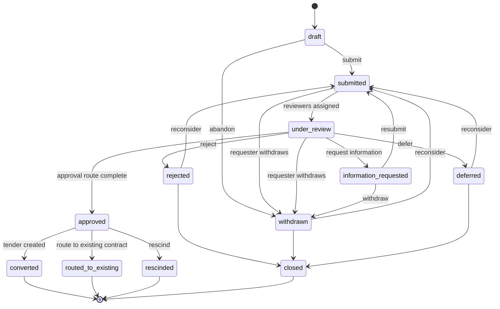

| Transition | Trigger | Guards and evidence | Permission / authority | Basis |
|---|---|---|---|---|
| draft → submitted | Requester submits | Requester and minimum business information: need, outcomes, scope, dates, estimated value and currency, estimation basis, funding source, budget owner, total commitment. Required custom fields (`custom_fields.required_mode`) filled. `submitted_at` set. | `request.create` | PRD §8.1, FR-04 |
| draft → withdrawn | Requester abandons | Reason retained | `request.create` | PRD §8.1 ("abandoned") |
| submitted → under_review | Procurement picks up the request | Procurement and budget reviewers assigned (`owner_user_id`, `budget_owner_user_id`) | `request.review` | PRD §8.1 |
| submitted, under_review → withdrawn | Requester withdraws | Reason | `request.create` | Design reading |
| under_review → information_requested | Reviewer asks for information | `request_info_requests` row with `question` and `due_at` | `request.review` | PRD §8.1 |
| information_requested → submitted | Requester resubmits | Responses linked to the requested changes (`request_info_requests.response_text`, `status = 'answered'`). A material change increments `revision`. | `request.create` | PRD §8.1 |
| information_requested → withdrawn | Requester withdraws | Reason | `request.create` | PRD §8.1 |
| under_review → approved | Approval route complete | `approval_requests` with `subject_type = 'procurement_request'` (and `'funding'` where funding confirmation applies) approved for the current `revision`. `funding_status` recorded (indicative, approved_budget, firm_commitment). `decided_at`, `decision_reason`. | `request.approve`, `request.funding_confirm`; authority `request_approval`, `funding_confirmation` over the total contemplated commitment; SoD `requester_vs_request_approval` | PRD §8.1, FR-04, BR-06, BR-07, AC-05 |
| under_review → rejected | Decision | `decision_reason` required | `request.approve` within authority | PRD §8.1, BUY-04 |
| under_review → deferred | Decision | `deferred_until`, reason | `request.review` or `request.approve` | PRD §8.1, BUY-02 |
| approved → converted | A tender is created from the request | The tenders domain writes this status in the same transaction as the tender insert (`tenders.source_request_id`). Audited cross-domain write. | `tender.create` | Plan §4; PRD §8.1 |
| approved → routed_to_existing | Routed to an existing arrangement | `routed_contract_id` set | `request.approve` | PRD §8.1, BUY-04 |
| approved → rescinded | Approval rescinded | Reason. The approval is invalidated. | `request.approve` | PRD §8.1 |
| rejected, withdrawn, deferred → submitted | Reconsideration | Review of the changed basis. New `revision`. | `request.create`, then review | PRD §8.1 |
| rejected, withdrawn, deferred → closed | Closure | Reason retained | `request.review` | PRD §8.1 |

Additional rules:
- Combining requests (`combined_into_id`, `request_links.link_type = 'combined_into'`) preserves the original requesters, funding interests and requirements. Splitting must not hide the overall value used for the policy (FR-04). Demo: PR-2026-0006 is combined into PR-2026-0005.
- A material change after approval (scope, amount, funding, risk, contracting entity) triggers reconsideration and invalidates the approval (FR-04, BR-10).
- AC-05: PR-2026-0003 exceeds `mpho.manager`'s BWP 2,000,000 limit and routes to `keabetswe.approver`.

---

## 3. Tender

Column `tenders.status`. Owner: shared `lifecycle` module. Data model: [Tenders](03-data-model/06-tenders.md). Screens: BUY-07 to BUY-30.

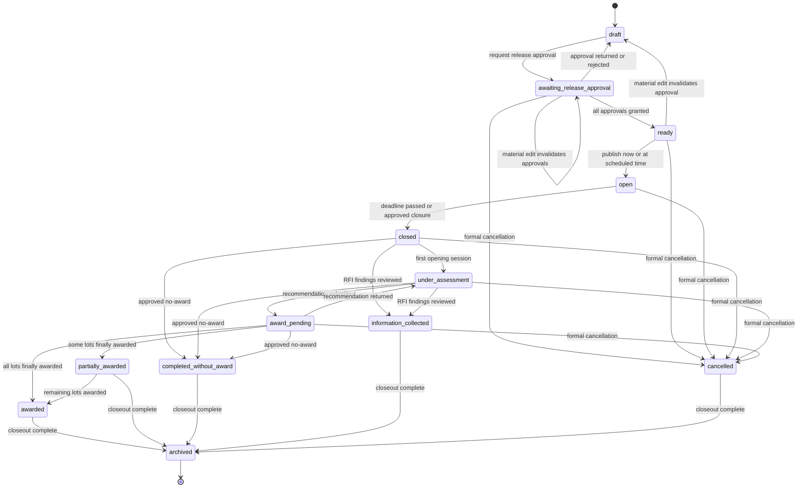

| Transition | Trigger | Guards and evidence | Permission / authority | Basis |
|---|---|---|---|---|
| [*] → draft | Tender created from an approved template, a prior event or a blank form | `owner_user_id` not null (BR-01). Reuse never copies bids, deliberations, approvals or supplier outcomes. `draft_revision = 1`. | `tender.create` | FR-07 |
| draft → awaiting_release_approval | Owner requests release approval | Required information, evaluation plan (`evaluation_plans`) and review assignments (`release_checks` for scope, funding, terms, evaluation_readiness, dates, accessibility, languages, supplier_burden, permissions, approval_authority). `approval_requests` with `subject_type = 'tender_release'`, `subject_version = draft_revision`, `content_hash`. | `tender.edit` | PRD §8.2, FR-07 |
| awaiting_release_approval → draft | Approval returned or rejected | `approval_requests.status` `returned` or `rejected`, with the step's `decision_reason` | Approver | PRD §8.2 |
| awaiting_release_approval → awaiting_release_approval | Material edit | `draft_revision` bumped. Affected approvals invalidated (`approval_requests.status = 'invalidated'` with `invalidated_reason`, `invalidated_at`; pending `approval_steps` `invalidated`). A new `tender_release` approval request is needed for the new revision before the tender can reach `ready`. | `tender.edit` | PRD §8.2, BR-10, AC-06 |
| awaiting_release_approval → ready | All required approvals granted | Every required approval approved for the current `draft_revision`. Release checks `passed` or `not_applicable`. Approved audience, dates, notice and release authority. | `tender.release_approve`; authority `release_approval`; SoD `draft_vs_final_approval` | PRD §8.2, FR-07 |
| ready → draft | Material edit after approval | Approval invalidated; re-approval before release | `tender.edit` | BR-10, AC-06; target state is a design reading, finalized in Stage B |
| ready → open | Publish now, or `publish-scheduled` when `scheduled_release_at` has passed | Approvals valid for the current `draft_revision`. No hold blocking `publish`. `policy_profile_version_id` frozen (BR-09). First `tender_versions` row and `record_snapshots`. `publications` rows (`publications.scheduled_at` mirrors `tenders.scheduled_release_at` per channel, DD-15). Notices `tender_issued` / `invitation`. `released_at`. | `tender.publish`; the job acts as system | PRD §8.2, FR-08; plan §3.9 |
| open → closed | `close-tenders` after the deadline, or approved manual closure | Official deadline passed or approved closure. `closed_at`. Sealed content stays protected. Deadline authority (DD-15): `lots.submission_deadline`, when set, is authoritative for that lot; otherwise `tender_milestones (submission_deadline, lot_id null)` applies. | `tender.close` | PRD §8.2, FR-13, DD-15 |
| closed → under_assessment | First opening session | Opening authorized with the assigned officer and any required second person or quorum ([Security model §7](04-security-model.md#7-sealing-and-staged-opening)) | `bid.open` | PRD §8.2, FR-13 |
| closed, under_assessment → information_collected | RFI concludes | `event_type = 'rfi'`. Reviewed market findings (`event_closeouts.market_findings`) and next-step decision (`next_step_decision`, `linked_next_tender_id`). No award or contract invented. | `event.closeout` | PRD §8.2, FR-05, AC-39 |
| under_assessment → award_pending | Award recommendation submitted | Evaluation report signed off (`evaluation_reports.status = 'signed_off'`). `award_recommendations` moves to `awaiting_approval` (approval `award`). A tender can have several recommendations over time, each covering the lots listed in its `lot_outcomes`, so lots can run on different timelines (DD-14). | `award.recommend` | PRD §8.2, FR-17, DD-14 |
| award_pending → under_assessment | Recommendation returned or rejected | Reason. The earlier recommendation version is kept. | Award approver | Design reading |
| award_pending → partially_awarded, awarded | Final award issued for lots | Per lot: all approvals, funding current, award conditions satisfied, blocking complaints resolved and waiting period complete (BR-32). No hold blocking `award_final`. Final award, distinct from intent, is its own approval per lot outcome (`subject_type = 'final_award'`, `lot_outcomes.final_award_approval_id`, DD-14). `lot_outcomes.status = 'final_awarded'`. Status derived from lots ([section 4](#4-lot-stage)). | `award.approve`; authority `award_approval`; SoD `evaluation_vs_award_approval` | PRD §8.2, FR-17, BR-32, BR-33, DD-14 |
| partially_awarded → awarded | Remaining lots finally awarded | Derived from lot stages | As above | Design reading |
| closed, under_assessment, award_pending → completed_without_award | Approved no-award outcome | `process_decisions` with `decision_type = 'no_award'` approved, recorded through the core `recordProcessDecision()` (DD-16). Every lot `no_award` or `cancelled`. Participant communication issued. From `closed` this covers "no responses received". | Approval `subject_type = 'process_decision'` | PRD §8.2, §20 |
| awaiting_release_approval … award_pending → cancelled | Formal cancellation | Authority and reason (`cancellation_reason`, `cancelled_at`). `process_decisions` with `decision_type = 'cancellation'` approved, recorded through `recordProcessDecision()` (DD-16). Treatment of bids, notices (`notice_type = 'cancellation'`), securities and fees. Bids, opening records and assessment work are preserved. | `tender.cancel`; approval `process_decision` | PRD §8.2, §20 |
| terminal outcome → archived | Event closeout | `event_closeouts` reaches `closed`, then `archived`. Accepted handovers (AC-29), no outstanding cases, retention class set. Unmet conditions are listed in `blocking_reasons`. For `partially_awarded`, every lot has a terminal outcome. | `event.closeout` | PRD §8.2, BUY-30 |

Additional rules:
- `current_version_no` increments with each issued version (release and each issued addendum). `draft_revision` increments with each material pre-release edit.
- Multi-stage and follow-on events are separate linked tenders (`linked_from_tender_id`, `link_type` in next_stage, re_tender, follow_on, from_rfi; `stage_no`), each with its own lifecycle (FR-05).
- Reopening after closing defaults to a formally permitted new round or linked new competition once bids are opened (PRD §20). There is no `closed → open` transition.
- Holds on a tender or lot block the listed actions only ([section 16](#16-hold)).
- An issued addendum that changes a deadline also updates `tenders.updated_at` in the same transaction, so the submission path's `FOR SHARE` lock on the tender row serializes against deadline changes (DD-15).
- Public visibility follows the status: `v_public_tenders` lists open-participation tenders of a portal-enabled buyer only in open, closed, under_assessment, award_pending, awarded, partially_awarded, completed_without_award, information_collected or cancelled. `draft`, `awaiting_release_approval`, `ready` and `archived` tenders never appear publicly (DD-13).

Demo states: T-2026-0005 `awaiting_release_approval` with an invalidated approval (AC-06); T-2026-0002 `open`; T-2026-0008 `closed`; T-2026-0003 `under_assessment`; T-2026-0007 `award_pending`; T-2026-0001 `partially_awarded`; T-2026-0010 `awarded`; T-2026-0004 `information_collected`.

---

## 4. Lot stage

Column `lots.stage`. Owner: shared `lifecycle` module. Data model: [Tenders](03-data-model/06-tenders.md).

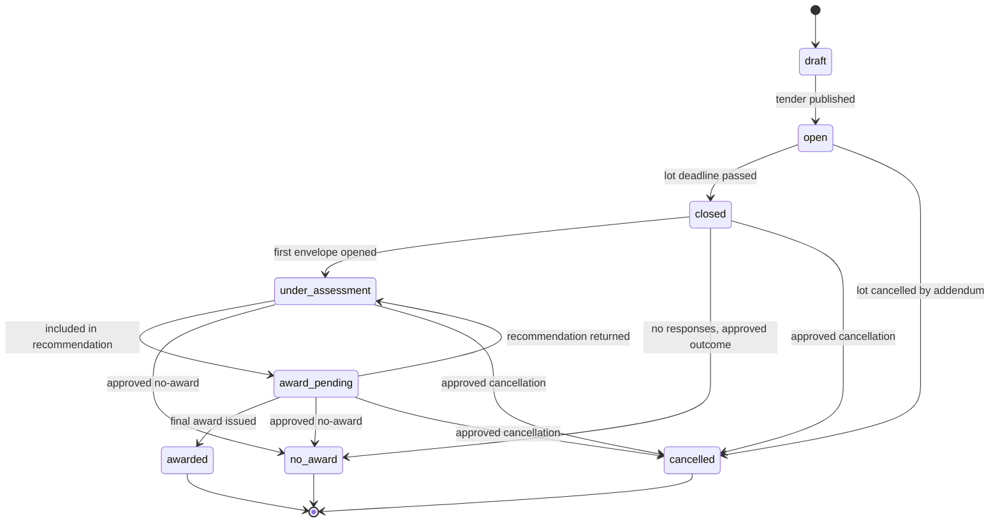

| Transition | Trigger | Guards and evidence | Permission / authority | Basis |
|---|---|---|---|---|
| draft → open | Tender published | Same guards as tender `ready → open` | `tender.publish` | PRD §8.2 |
| open → closed | `close-tenders` | `lots.submission_deadline`, when set, is authoritative for the lot; when null, the tender's `tender_milestones (submission_deadline, lot_id null)` applies. The deadline has passed in official time. | system or `tender.close` | PRD §8.2, BR-20, DD-15 |
| open → cancelled | Addendum removes the lot | Issued addendum with the lot in `addendum_lots`; affected participants notified | `tender.addenda.approve` | Design reading (BR-16) |
| closed → under_assessment | Opening | First `envelope_openings` for the lot | `bid.open` | PRD §8.2 |
| closed → no_award | No responses | Approved outcome, `outcome_reason` | Approval `process_decision` | Design reading (PRD §20) |
| under_assessment → award_pending | Recommendation | Lot included in `lot_outcomes` of a submitted recommendation. Each recommendation covers only the lots it lists, so other lots can stay in assessment (DD-14). | `award.recommend` | PRD §8.2, DD-14 |
| award_pending → under_assessment | Recommendation returned | Reason | Award approver | Design reading |
| award_pending → awarded | Final award | `lot_outcomes.status = 'final_awarded'`, `final_awarded_at`, `final_award_approved_by`, and an approved `final_award` approval in `final_award_approval_id` (DD-14). BR-32 guards as for the tender. | `award.approve`; authority `award_approval` | PRD §8.2, FR-17, DD-14 |
| under_assessment, award_pending → no_award | Approved no-award | `lot_outcomes.outcome = 'no_award'` with reason | Approval `process_decision` or `award` | PRD §8.2, FR-17, BR-33 |
| closed, under_assessment, award_pending → cancelled | Approved cancellation | `process_decisions` cancellation, reason, notices | `tender.cancel` | PRD §8.2 |

**Tender status derived from lots.** Every lot has an explicit outcome and the overall status must not imply that every lot has the same outcome (BR-33, AC-26):

| Lot stages | Tender status |
|---|---|
| At least one lot `awarded` and at least one lot not `awarded` | `partially_awarded` |
| Every lot `awarded` | `awarded` |
| Every lot `no_award` or `cancelled`, with an approved no-award outcome | `completed_without_award` |
| No lot `awarded` yet | Event-level status from [section 3](#3-tender) |

Demo: T-2026-0001 has Lot 1 `awarded`, Lot 2 `cancelled` and Lot 3 `under_assessment`, so the tender is `partially_awarded`. The exact derivation function is confirmed in Stage B ([open points](#20-open-points)).

---

## 5. Qualification application

Column `qualification_applications.status`. Owner: `domains/qualification/workflow/`. Data model: [Suppliers and qualification](03-data-model/04-suppliers-qualification.md). Screens: SUP-20, BUY-33, BUY-34, BUY-35.

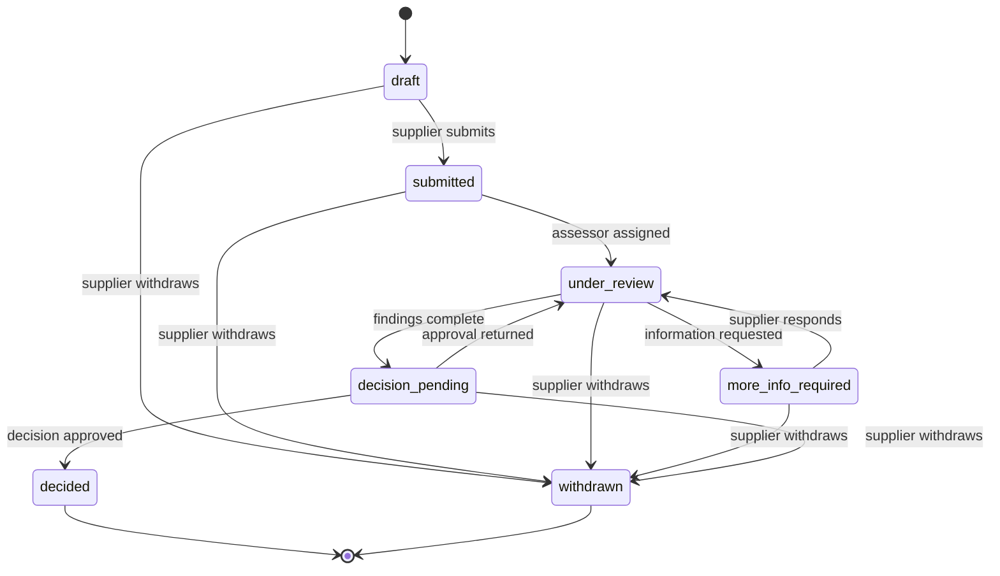

| Transition | Trigger | Guards and evidence | Permission / authority | Basis |
|---|---|---|---|---|
| draft → submitted | Supplier submits | Mandatory criteria answered. `applicability = 'not_applicable'` carries `na_reason` where `requires_na_reason`. Evidence attached as immutable `evidence_submissions` snapshots (`context_type = 'qualification_application'`) written through the suppliers-owned `snapshotEvidence()` helper (DD-17). Scope with `scope_currency` for `scope_max_value` (DD-08). `reference` (`QA-2026-0001`, DD-09), `submitted_at`, `submitted_by`. | `supplier.qualification.apply` | PRD §7.3, §8.3 |
| submitted → under_review | Buyer assigns | `assessor_user_id`, and `financial_reviewer_user_id` where required. `due_at`, `priority`, `risk_level`. | `qualification.review` | BUY-33 |
| under_review → more_info_required | Assessor or financial reviewer asks | `qualification_info_requests` row (`status = 'open'`, `due_at`) | `qualification.review`, `qualification.financial_review` | PRD §7.3, AC-08 |
| more_info_required → under_review | Supplier answers | Open info requests `answered` | `supplier.qualification.apply` | PRD §7.3 |
| under_review → decision_pending | Findings complete and outcome proposed | `qualification_findings` per criterion with `rationale` (missing evidence is never a silent pass). `financial_reviews` with period, currency, consolidation, source and conclusion where required. Screening matches with `flag_only` only flag review (BR-48). An approval request `qualification_decision` when `requires_independent_approval`. | `qualification.review`, `qualification.financial_review` | PRD §7.3, BR-48 |
| decision_pending → under_review | Approval returned | Reason retained | Approver | Design reading |
| decision_pending → decided | Decision approved | `qualification_decisions` row: outcome, scope (`scope_category_id`, `scope_max_value`, `scope_currency`, `scope_geography`), `effective_from`, `effective_to`, `reassessment_date`, `conditions`, `allowed_activities`, `blocked_gate`, `reasons`, `supplier_explanation`, `appeal_route`, reviewer and approver. Notice `qualification_decision` to the supplier. | `qualification.decide`; authority `qualification_decision`; SoD `supplier_assessment_vs_exception_approval` | PRD §7.3, BR-24 |
| any open state → withdrawn | Supplier withdraws | Reason | `supplier.qualification.apply` | PRD §8.3, SUP-20 |

Buyer queries always exclude `draft` applications (blueprint Migration 05).

---

## 6. Qualification status

Derived by the view `v_qualification_status` (DD-13): the latest non-superseded `qualification_decisions` row per (buyer tenant, supplier tenant, program), ordered by `effective_from desc, id desc`, with scope, dates, conditions and `effective_status`. `effective_status` is `expired` when `effective_to < now()`, otherwise the decision `outcome`. `not_assessed` rows come from active relationships × active programs without a decision. `qualification-expiry` writes no decision: it creates tasks and notices only (DD-20). Owner: `domains/qualification/workflow/`. Data model: [Suppliers and qualification](03-data-model/04-suppliers-qualification.md).

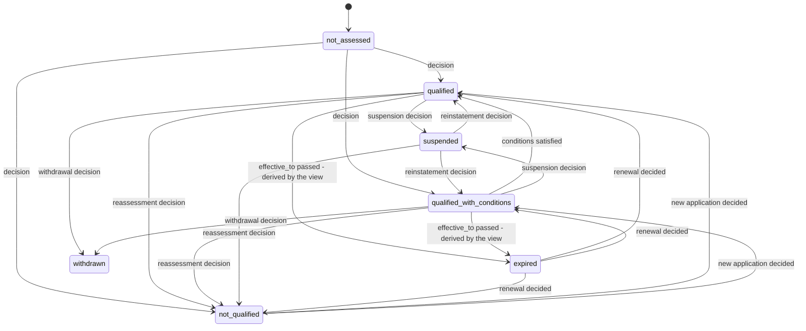

| Transition | Trigger | Guards and evidence | Permission / authority | Basis |
|---|---|---|---|---|
| not_assessed → qualified, qualified_with_conditions, not_qualified | Application decided | Decision as in [section 5](#5-qualification-application) | `qualification.decide`; authority `qualification_decision` | PRD §7.3, §8.3 |
| qualified_with_conditions → qualified | Conditions satisfied | New decision row; the prior row gets `superseded_by_id` and `supersede_reason` | As above | PRD §7.3 |
| qualified, qualified_with_conditions → suspended, not_qualified | Reassessment decision | A `reassessment_triggers` row (evidence_expiry, ownership_change, financial_change, insurance_expired, adverse_finding, poor_performance, manual) assessed, or `integrity_screenings.result = 'confirmed_restriction'` reviewed. Effect on active bids and contracts recorded (`active_bids_reviewed`, `active_contracts_reviewed`). | As above | PRD §7.3, BR-25, AC-09 |
| suspended → qualified, qualified_with_conditions, not_qualified | Reinstatement or final decision | New decision row with reasons | As above | Design reading |
| qualified, qualified_with_conditions → expired | `effective_to` passed | Derived by the view at read time; no decision row is written. `qualification-expiry` creates tasks and notices only. No automatic renewal (BR-37). | System (derived) | Blueprint `v_qualification_status`; plan §3.9; DD-13, DD-20 |
| expired, not_qualified → qualified, qualified_with_conditions, not_qualified | Renewal or new application decided | New application through [section 5](#5-qualification-application) | As above | PRD §7.3, SUP-24 |
| qualified, qualified_with_conditions → withdrawn | Withdrawal | Decision `outcome = 'withdrawn'` | `qualification.decide` | Blueprint (outcome CHECK) |

Rules:
- Every change other than expiry is a new approved decision row. Earlier rows are kept (superseded), never edited. Expiry is never written as a decision by the job (DD-20).
- Evidence expiry only flags and notifies: `evidence-expiry` raises `reassessment_triggers` and notices. `evidence_items.status = 'expired'` is set by the suppliers domain when the supplier views or renews the item, or by the suppliers-owned helper the job calls (DD-20).
- A decision is limited to its scope and validity (BR-24). Registration or portal acceptance is never shown as qualification (BR-03, AC-07).
- Evidence expiry or an adverse event triggers review; it never erases evidence or relabels an earlier submission (BR-25). New information does not rewrite eligibility at an earlier submission deadline (FR-06).
- A conditional decision states the blocked future gate: `blocked_gate` in (none, invitation, submission, award, contract_start).
- The participation gate on a tender is recorded per participant in `participants.qualification_gate` (not_required, met, not_met, pending).
- PRD §8.3 lists the status values without `withdrawn`. The blueprint adds `withdrawn` as a decision outcome, which the view passes through.

---

## 7. Supplier response and bid revision

Owner: `domains/bids/workflow/` (bids owns every bid, revision and receipt row, including `round_type` next_stage and bafo). Opening writes `bids.compliance_status` and `submission_receipts.status = 'selected_for_evaluation'`. Evaluation writes `bids.evaluation_status` (plan §4; DD-17). Data model: [Bids and submission](03-data-model/08-bids-submission.md). Screens: SUP-12 to SUP-17, BUY-19.

PRD §8.3 requires that compliance and evaluation outcomes are attributes separate from the response state. The design keeps four separate columns:

| Column | Values | Written by |
|---|---|---|
| `bid_revisions.status` | draft, internal_review, approved_internally, submitted, superseded, withdrawn, late_rejected, submission_failed | bids |
| `submission_receipts.status` | received, superseded, withdrawn, late_rejected, selected_for_evaluation | bids; opening for `selected_for_evaluation` (DD-17) |
| `bids.submission_state` | not_submitted, submitted, withdrawn | bids |
| `bids.compliance_status` | pending, compliant, non_compliant, clarification_pending, excluded | opening |
| `bids.evaluation_status` | not_started, in_evaluation, evaluated, excluded | evaluation |

### 7.1 Bid revision

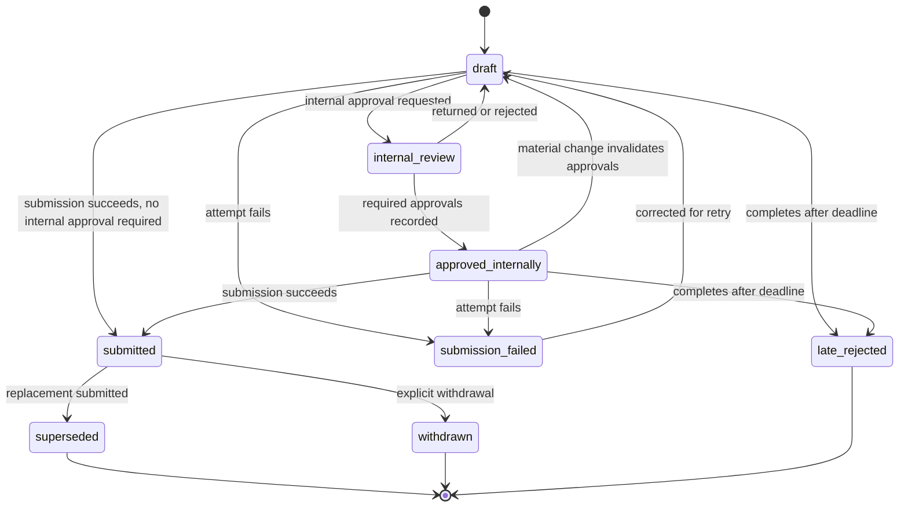

| Transition | Trigger | Guards and evidence | Permission / authority | Basis |
|---|---|---|---|---|
| [*] → draft | Response started, or replacement prepared | Replacement: new `revision_no`, `based_on_revision_id`. The earlier submitted revision stays effective meanwhile. | `supplier.response.edit` | FR-11, FR-12 |
| draft → internal_review | Bid manager requests internal approval | `bid_internal_approvals` rows `pending` per required approval type (commercial, financial, delivery, executive) | `supplier.response.edit` | FR-11, SUP-15 |
| internal_review → approved_internally | Required approvals recorded | Each approval `approved` with `content_hash_at_decision` equal to the revision's `content_hash`. `internally_approved_at`. | `supplier.response.approve` | FR-11 |
| internal_review → draft | Approval returned or rejected | Note recorded | `supplier.response.approve` | SUP-15 |
| approved_internally → draft | Material change | Internal approvals `invalidated`; reapproval before submission | `supplier.response.edit` | FR-11, SUP-15 |
| approved_internally → submitted; draft → submitted where internal approval is not required | Authorized submission succeeds | One transaction: tender row locked `FOR SHARE` (serializes against an addendum's deadline change, which updates `tenders.updated_at`, DD-15); official receipt time = `clock_timestamp()` ([ADR 0011](adr/0011-official-receipt-time-from-database.md)) at or before the applicable deadline (the lot's `submission_deadline` when set, otherwise the tender milestone, DD-15). Readiness passes: mandatory answers, mandatory addenda acknowledged (`participant_acknowledgments` is authoritative, DD-42; `acknowledged_tender_version`), submission authority, participation conditions and qualification gate, unexpired mandatory evidence, consistent pricing. Writes `submission_attempts` (`succeeded`), `submission_receipts` and `receipt_inventory_items` (each with its `envelope`), `submitted_at`, `receipt_id`, `bids.effective_revision_id`. | `supplier.response.submit` | FR-12, BR-18, AC-03, AC-11 |
| draft, approved_internally → submission_failed | Attempt fails | `submission_attempts.outcome` in (failed_validation, failed_authority, failed_error) with `failure_reason`. No receipt. The earlier effective submission is untouched. | — | FR-12, BR-19, AC-12 |
| draft, approved_internally → late_rejected | Final receipt after the deadline | `submission_attempts.outcome = 'failed_late'` with the true `completed_at` and `deadline_at_attempt`. Late acceptance only through `late_submission_exceptions` (policy basis, evidence, equal-treatment review, approval `late_submission_exception`). | — | FR-12, BR-20, AC-13 |
| submission_failed → draft | Supplier corrects and retries | Content change invalidates internal approvals | `supplier.response.edit` | Design reading |
| submitted → superseded | Replacement submitted before closing | Partial unique index: at most one `submitted` revision per bid. The previous receipt becomes `superseded`. | `supplier.response.submit` | FR-12, BR-19 |
| submitted → withdrawn | Explicit withdrawal | `withdrawals` row with `confirmation_no`. The effective submission is removed; history stays. | `supplier.response.submit` (design reading) | FR-12, BR-19, BR-21, AC-14 |

Additional rules:
- Saving, file transfer and internal approval never establish submission (BR-18). The UI never shows draft readiness as submission (AC-11).
- A submission request may carry an `Idempotency-Key` header, and the SPA disables the submit button while the request is in flight. A retried submission still records a new `submission_attempts` row, because every attempt is intended evidence (DD-39).
- An addendum states the action for existing submissions: `addenda.existing_submission_action` in (none, acknowledge, supplement, replace). An earlier receipt alone does not satisfy a new mandatory condition, and the compliance decision is explicit (FR-12, AC-10).
- Next-stage and BAFO responses are separate `bids` rows with `round_type` next_stage or bafo. Selection owns the rounds and invitees (plan §4).
- Library evidence used in a response is recorded as append-only `evidence_submissions` snapshots (`context_type = 'bid_revision'`), which bids writes only through the suppliers-owned `snapshotEvidence()` helper (DD-17).

### 7.2 Submission receipt

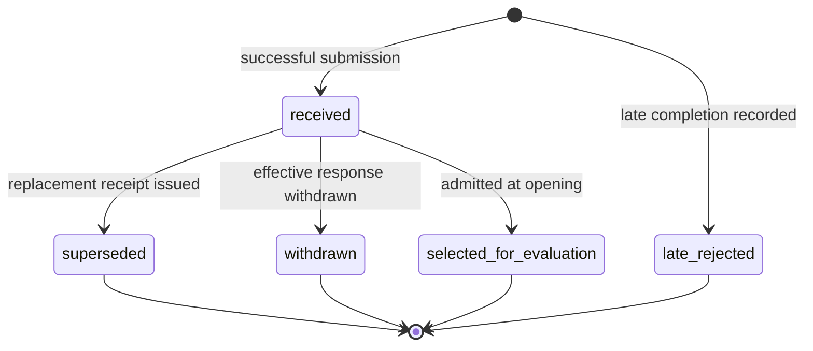

| Transition | Guards and evidence | Basis |
|---|---|---|
| [*] → received | `receipt_no` (`RCPT-2026-000001` format), `received_at`, `submitted_by`, `lots_summary`, `document_count`, `tender_version_no`. Immutable except `status` and `status_changed_at`. | FR-12 |
| received → superseded | A later receipt for the same bid | FR-12, BR-19 |
| received → withdrawn | Withdrawal confirmation | FR-12, AC-14 |
| received → selected_for_evaluation | The effective receipt is opened and admitted. Written by the opening domain as an allowed, audited cross-domain write (DD-17). | FR-12 names the state; DD-17 |
| [*] → late_rejected | Late completion with the true time | FR-12, AC-13. Whether a receipt row or only a `submission_attempts` row records a late attempt is confirmed in Stage B. |

### 7.3 Bid submission state

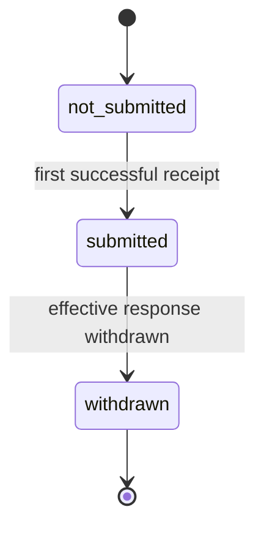

| Transition | Guards and evidence | Permission / authority | Basis |
|---|---|---|---|
| not_submitted → submitted | First successful receipt; `effective_revision_id` set | `supplier.response.submit` | FR-12, BR-18 |
| submitted → withdrawn | Effective response withdrawn (`withdrawals` row) | `supplier.response.submit` (design reading) | FR-12, AC-14 |

`bids.effective_revision_id` stays null until a successful receipt. At closing each supplier has at most one effective primary response per allowed bidding combination and lot; alternatives are explicitly related offers (`is_alternative`, `alternative_of_bid_id`) (FR-12). The bidding combination is enforced by `UNIQUE NULLS NOT DISTINCT (tender_id, supplier_tenant_id, is_alternative, round_type, final_offer_round_id)`, which replaces the earlier `coalesce` expression (DD-02). Whether a withdrawn bid can be submitted again before closing is an [open point](#20-open-points).

### 7.4 Compliance status

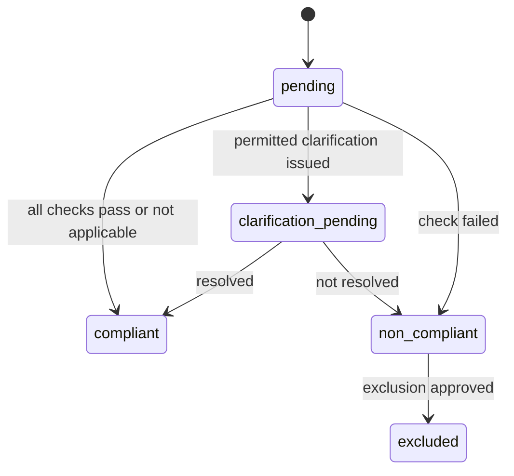

| Transition | Guards and evidence | Permission / authority | Basis |
|---|---|---|---|
| pending → compliant | Every applicable `compliance_checks` row is `pass`, or `not_applicable` with a reason | `compliance.assess` | FR-13 |
| pending → clarification_pending | `bid_clarifications` row approved and issued with `permitted_scope` and `due_at` | `compliance.assess` | FR-13, BR-22 |
| clarification_pending → compliant, non_compliant | Response recorded with `effect` (resolved, not_resolved, no_effect) and `effect_note` | `compliance.assess` | FR-13 |
| pending → non_compliant | A check `fail` with `finding_class` and `evidence_ref` | `compliance.assess` | FR-13, AC-17 |
| non_compliant → excluded | Exclusion approved ([section 18.4](#184-exclusion)) | `exclusion.approve`; authority `exclusion_approval` | FR-13 |

Each `compliance_checks` row cites evidence (`evidence_ref`) and records `result` (pending, pass, fail, clarification_required, not_applicable; not_applicable requires a reason) and `finding_class` (administrative_omission, substantive_noncompliance, clarifiable, none). A clarification (`bid_clarifications`) has a permitted scope, deadline and recorded `effect`, and cannot become an improved offer (BR-22). Mandatory failures are resolved before the affected evaluation or award gate (BR-23, AC-17). Exclusion follows [section 18.4](#184-exclusion).

### 7.5 Evaluation status

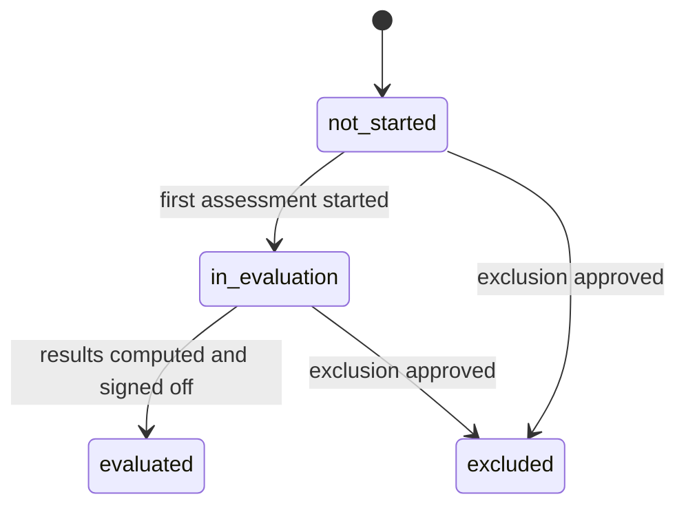

| Transition | Guards and evidence | Permission / authority | Basis |
|---|---|---|---|
| not_started → in_evaluation | First assessment on the bid starts under an accepted assignment | `evaluation.score` | Design reading |
| in_evaluation → evaluated | `evaluation_results` computed and signed off | `evaluation.signoff` | Design reading (EVA-06) |
| not_started, in_evaluation → excluded | Exclusion approved | `exclusion.approve` | FR-13 |

Excluded bids stay on record but never appear as ordinary ranked competitors (FR-13). The exact trigger for `evaluated` (result computation or report sign-off) is confirmed in Stage B.

---

## 8. Evaluation assignment

Column `evaluation_assignments.status`. Owner: `domains/evaluation/workflow/`. Data model: [Opening and evaluation](03-data-model/09-opening-evaluation.md). Screens: EVA-01, EVA-02, EVA-05.

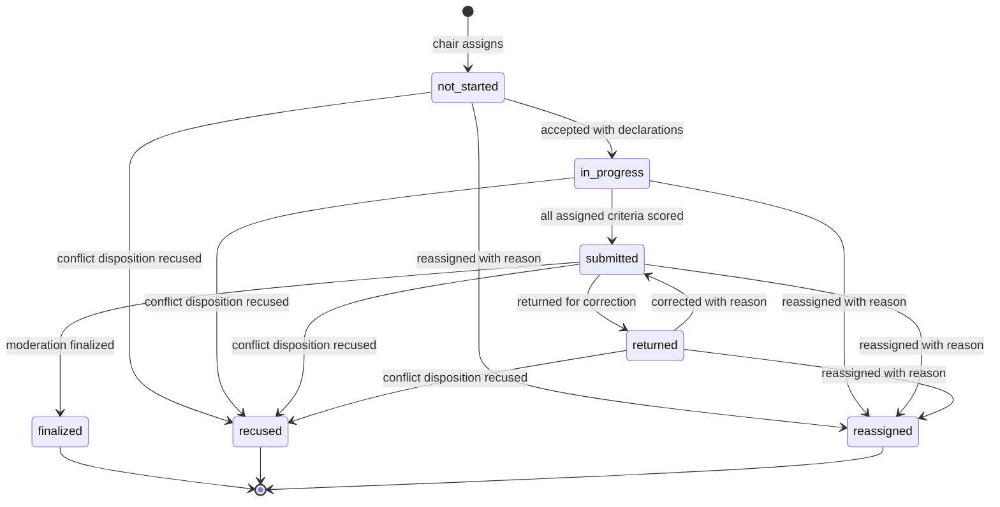

| Transition | Trigger | Guards and evidence | Permission / authority | Basis |
|---|---|---|---|---|
| [*] → not_started | Chair assigns | `evaluator_user_id`, `tender_id`, `lot_id`, `bid_id` (null = all eligible bids), `criterion_ids` (empty = all non-price criteria), `is_commercial`, `due_at` | `evaluation.chair` | FR-14, EVA-01 |
| not_started → in_progress | Evaluator accepts | `accepted_at`. Confidentiality undertaking and conflict declaration recorded and linked (`confidentiality_undertaking_id`, `conflict_declaration_id`) before any content is visible (BR-08). A declaration with `has_conflict = true` blocks access while its disposition is `pending_review`; access resumes only on `cleared` or `mitigated` (DD-25). | `evaluation.score`; `evaluation.commercial` when `is_commercial` | BR-08, FR-14, DD-25 |
| in_progress → submitted | Evaluator submits | Every assigned (bid, criterion) pair has a `score` or `is_not_applicable` (only where `na_permitted`), plus `rationale`. A missing score stays null, never 0, and blocks submission (AC-18). Scores become `submitted` with `submitted_at`. | `evaluation.score` | FR-14, §9.3, AC-18 |
| submitted → returned | Chair returns for correction | Reason | `evaluation.chair`, `evaluation.moderate` | EVA-05 |
| returned → submitted | Evaluator corrects | A `score_corrections` row per changed score (previous and new score, previous rationale, `reason`, `returned_by_chair`). `evaluation_scores.version` increments. | `evaluation.score` | FR-14, BR-27 |
| submitted → finalized | Moderation finalized | `moderation_sessions.status = 'finalized'`; `moderated_scores` with method and `reasons`. Individual assessments remain available (AC-20). | `evaluation.moderate`, `evaluation.chair` | FR-14, BR-27, AC-20 |
| any open state → recused | Conflict disposition `recused` | `conflict_declarations.disposition = 'recused'`. Restricted access ends permanently for that subject (DD-25). | Conflict reviewer | PRD §5.4, DD-25 |
| any open state → reassigned | Evaluator leaves or is reassigned | `reassigned_to_id`, `reassignment_reason`. Prior work preserved. A decision on re-evaluation is recorded. Access ends. | `evaluation.chair` | PRD §20 |

Related rules:
- `evaluation_scores.status` is draft or submitted. Submitted scores are formal records. Corrections append `score_corrections` rows.
- With independent evaluation, an evaluator cannot see other evaluators' scores before submitting their own (FR-14).
- Commercial scores need the price gate (`price_gate_releases`) under staged opening (AC-16). The evaluation domain owns the gate, and the chair releases it under `evaluation.chair` (DD-16, DD-23).
- Demo: on T-2026-0003 one evaluator is missing a criterion (AC-18) and moderation changed one score (AC-20).

---

## 9. Approval request

Column `approval_requests.status`, with per-step `approval_steps.status`. Owner: `domains/approvals/workflow/`. Data model: [Shared services](03-data-model/03-shared-services.md). Screens: COM-04, COM-05.

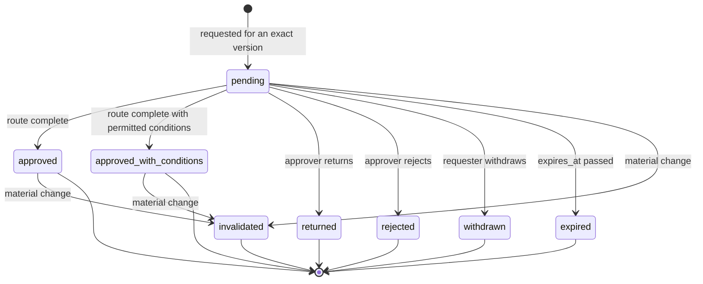

| Transition | Trigger | Guards and evidence | Permission / authority | Basis |
|---|---|---|---|---|
| [*] → pending | Subject owner requests approval | `subject_type`, `subject_id`, `subject_version`, `content_hash`, `title`, `summary`, `amount`, `currency`, `legal_entity_id`, `category_id`, `justification`, `due_at`, `expires_at`, `route_mode`, steps with `required_decision_type` | Permission of the subject's owner | Plan §3.5; PRD §8.3 |
| pending → approved | Route complete | All required steps approved per `route_mode`. Each step records `decided_by`, `decided_at`, `decision_reason`, `authority_checked_amount`, `authority_limit_id`, and `acting_for_user_id` / `delegation_id` when delegated. `decided_at` on the request. Cross-currency authority uses `exchange_rates` at the request date; with no rate, the step routes to the next level up and is never an assumed pass (DD-24). | `approval.decide` **and** the decision-specific permission (for example `award.approve`) **and** sufficient authority for `required_decision_type` (DD-24); SoD; no unresolved conflict (DD-25) | BR-06, BR-07, PRD §4.1, DD-24 |
| pending → approved_with_conditions | Route complete with permitted conditions | `conditions` recorded | As above | PRD §8.3, COM-05 |
| pending → returned | An approver returns | Reason | As above | PRD §8.3 |
| pending → rejected | An approver rejects | Reason | As above | PRD §8.3 |
| pending → withdrawn | Requester withdraws | Reason | Requester | PRD §8.3 |
| pending → expired | `expires_at` passed | A decision after `expires_at` is refused by the request-time check. The hourly `expire-approvals` job (approvals) records `expired` and notifies the owners (DD-18). | System | PRD §8.3; plan §3.9; DD-18 |
| pending, approved, approved_with_conditions → invalidated | Material change to the subject | `invalidated_reason`, `invalidated_at`. A prior approval is never reused for a different commercial decision. | System, on the subject's change | BR-10, AC-06 |

Rules:
- A returned, rejected, expired or invalidated request is not reopened. Resubmission after changes creates a new request against the new version (design reading of BR-10).
- The final state runs the subject type's handler from `domains/approvals/outcome-registry.ts`, which applies the subject's transition (for example tender `awaiting_release_approval → ready`).
- Approval tasks are `tasks` rows owned by the approvals service (DD-16).

| `route_mode` | Completion rule |
|---|---|
| `sequential` | Steps decided in `sequence` order |
| `parallel_all` | Every step approves |
| `committee_quorum` | Members of `committee_id` decide until `committees.quorum` is met |

The detailed completion rules (for example whether one rejection ends a parallel route) are confirmed in Stage B.

**Approval step.** `approval_steps.status`: pending, approved, approved_with_conditions, returned, rejected, skipped, invalidated.

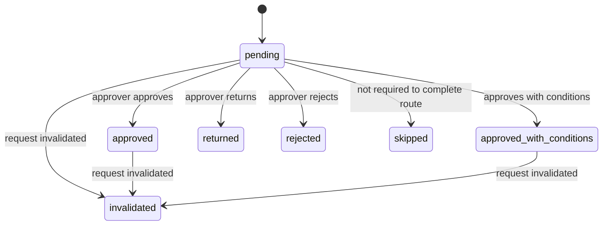

| Transition | Guards and evidence | Permission / authority | Basis |
|---|---|---|---|
| pending → approved, approved_with_conditions, returned, rejected | The step's approver (or a committee member, or an active delegate) decides. `decided_by`, `decided_at`, `decision_reason`, `conditions`, `authority_checked_amount`, `authority_limit_id`, and `acting_for_user_id` / `delegation_id` when delegated. | `approval.decide` and the decision-specific permission; authority for `required_decision_type` (cross-currency at the request-date rate, else the next level up); SoD; no unresolved conflict | BR-06, BR-07, DD-24 |
| pending → skipped | Step not needed to complete the route | System | Confirmed in Stage B |
| pending, approved, approved_with_conditions → invalidated | Parent request invalidated | System | BR-10 |

When a step is `skipped` is confirmed in Stage B.

**Subject types and authority.** `approval_requests.subject_type` values and the `authority_limits.decision_type` with the corresponding name. Each step's `required_decision_type` is set by the route and confirmed in Stage B. DD-14 adds the last five subject types.

| subject_type | decision_type | subject_type | decision_type |
|---|---|---|---|
| procurement_request | request_approval | award | award_approval |
| funding | funding_confirmation | contract | contract_approval |
| strategy | strategy_approval | contract_signature | contract_signature |
| tender_release | release_approval | contract_change | change_approval |
| addendum | — | renewal | renewal_approval |
| exclusion | exclusion_approval | qualification_decision | qualification_decision |
| shortlist | shortlist_approval | late_submission_exception | late_submission_exception |
| preferred_bidder | preferred_bidder_approval | policy_profile | — |
| negotiation_mandate | negotiation_mandate | template | — |
| final_offer_round | — | disposal | disposal_approval |
| process_decision | — | hold_release | — |
| obligation_waiver | — | security_release | — |
| dispute_decision | — | contract_difference | — |
| final_award | — | | |

Where the DD-14 subject types are referenced:

| subject_type | Referenced by | Lifecycle |
|---|---|---|
| `final_award` | `lot_outcomes.final_award_approval_id`: one final-award approval per lot outcome, distinct from the intent and from the recommendation approval (`award`) | [Section 18.7](#187-lot-outcome) |
| `contract_difference` | `contracts.difference_approval_id` | [Section 11](#11-contract) |
| `dispute_decision` | `contract_disputes.authorized_decision_id` (references `approval_requests`) | [Section 19](#19-index-of-other-status-columns) |
| `obligation_waiver` | `obligations.waiver_approval_id` (design reading: DD-14 names the subject type, the column is the matching approval link) | [Section 12](#12-obligation-and-milestone) |
| `security_release` | `contract_securities.release_approval_id` (design reading, as above) | [Section 19](#19-index-of-other-status-columns) |

---

## 10. Complaint

Column `complaints.status`. Owner: `domains/awards/workflow/` (domain 13 covers complaints, BUY-29, SUP-22). Data model: [Selection and award](03-data-model/10-selection-award.md).

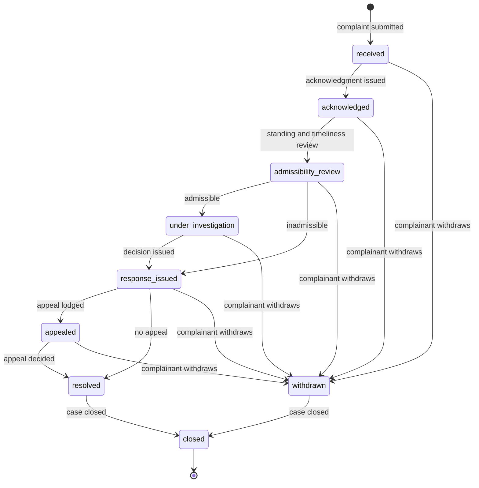

| Transition | Trigger | Guards and evidence | Permission / authority | Basis |
|---|---|---|---|---|
| [*] → received | Supplier submits | `reference` (`CMP-2026-0001`; the year is the year in the tenant's official time zone, DD-09), `subject` (tender_terms, eligibility, exclusion, evaluation, award, process, other), `grounds`, `received_at`, `within_window` against `policy_profile_versions.complaint_window_days`. `supplier_tenant_id` is the complainant organization. If `is_blocking`, a `holds` row (`hold_type = 'complaint_hold'`, `complaint_id`, `blocked_actions` such as `award_final`, `contract_sign`) is linked through `hold_id`. Holds belong to the core lifecycle service (DD-16). | `supplier.complaint.submit` | FR-17, BR-32, AC-25 |
| received → acknowledged | Buyer acknowledges | `acknowledged_at`, `case_owner_user_id`. Notice `complaint_update`. | `complaint.manage` | FR-17 |
| acknowledged → admissibility_review | Review starts | `standing_confirmed`, `within_window`. `independence_confirmed` where `complaint_requires_independent_review`. | `complaint.manage` | FR-17 |
| admissibility_review → under_investigation | Admissible | Case owner independent of the challenged conduct where policy requires | `complaint.manage` | FR-17 |
| admissibility_review → response_issued | Inadmissible | `outcome = 'inadmissible'`, `response_text` | `complaint.manage` | Design reading |
| under_investigation → response_issued | Decision | `outcome` (upheld, partially_upheld, dismissed), `remedy`, `response_text` | `complaint.manage` | FR-17 |
| response_issued → appealed | Appeal lodged | `appeal_grounds` | `supplier.complaint.submit` | FR-17 |
| response_issued → resolved | No appeal | — | `complaint.manage` | Design reading |
| appealed → resolved | Appeal decided | `appeal_outcome` | `complaint.manage` | FR-17 |
| resolved, withdrawn → closed | Case closed | `closed_at`. A blocking hold is released through its own authorized decision (approval `hold_release`). `public_summary` published only if approved. | `complaint.manage` | FR-17, PRD §8.3 |
| any open state → withdrawn | Complainant withdraws | `outcome = 'withdrawn'` | `supplier.complaint.submit` | PRD §8.3 |

Rules:
- Every transition appends a `complaint_events` row (`event_type`, `from_status`, `to_status`, `note`, `actor_user_id`, `occurred_at`).
- The procurement hold is visible separately from the complaint status (PRD §8.3).
- A successful complaint records the remedy, affected decisions, notices and any reassessment or restart. Superseded decisions and their reasons are kept (PRD §20).
- Demo: Limpopo Environmental Services' complaint on T-2026-0007 holds the award (AC-25).

---

## 11. Contract

Column `contracts.status`. Owner: `domains/contracts/workflow/`. Data model: [Contracts](03-data-model/11-contracts.md). Screens: CON-01 to CON-11, SUP-23.

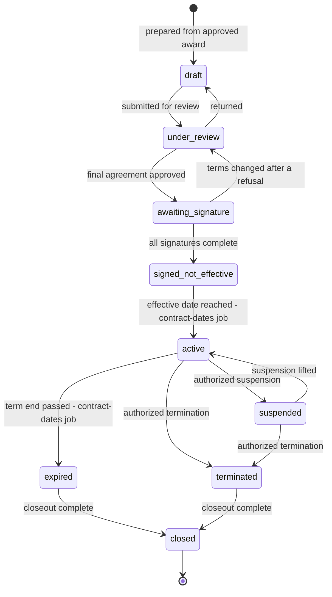

| Transition | Trigger | Guards and evidence | Permission / authority | Basis |
|---|---|---|---|---|
| [*] → draft | Contract prepared from the approved award | `reference` (`C-2026-0001`), `recommendation_id`, `legal_entity_id` not null (BR-04). `contract_lot_allocations` with the sum per lot outcome at most the awarded value (BR-33). | `contract.prepare` | FR-18 |
| draft → under_review | Submitted for review | — | `contract.prepare` | CON-02 |
| under_review → draft | Returned | Reason | `contract.approve` | Design reading |
| under_review → awaiting_signature | Final agreement approved | Approval `contract` (authority `contract_approval`). If `differs_from_award`, `difference_explanation` and an approved `difference_approval_id` with `subject_type = 'contract_difference'` (AC-28, DD-14). No blocking standstill or complaint hold (BR-32). | `contract.approve` | FR-18, BR-32, AC-28, DD-14 |
| awaiting_signature → signed_not_effective | All signatures complete | Every `contract_signatories` row `signed` (`method = 'in_app'`) or `recorded_external` with `verification_note`. `signed_document_id`, `signed_at`. For signing outside the app: `signed_outside_app` and `external_signature_evidence`, with no manufactured in-app signing evidence. An external signature failure raises an `integration_exceptions` row, written by contracts (DD-17, AC-33). No hold blocking `contract_sign`. | `contract.sign` with authority `contract_signature` per buyer signatory (`authority_limit_id`); supplier signatories under `supplier.contract.participate` | FR-18, BR-35, PRD §20 |
| awaiting_signature → under_review | Terms changed after a refusal | Resolving a refusal (CON-03) requires changed terms, which go back through review and approval. A refusal alone does not change the contract status: `contract_signatories.status = 'refused'` and the contract stays `awaiting_signature`, visibly unsigned and unexecuted (PRD §16, AC-33). | `contract.prepare` | Design reading |
| signed_not_effective → active | `contract-dates` job (daily) when the effective date is reached (DD-19) | `effective_date`. Securities and insurance preconditions. `notice_to_proceed_at` and `delivery_start_at` are separate milestones. Never active merely because a draft was sent for signature. | System | FR-18, BR-35, DD-19 |
| active ↔ suspended | Authorized suspension and its lifting | A `holds` row (`hold_type = 'suspension'`) with reason and authority | `contract.manage` | PRD §8.3 |
| active → expired | `contract-dates` job (daily) after `term_end` (DD-19) | No automatic renewal (BR-37). Open obligations remain, and unresolved warranties and disputes survive. | System | PRD §7.16, DD-19 |
| active, suspended → terminated | Authorized termination | Decision under the contract basis (for example `renewal_options.option_type = 'termination_notice'`) with approval | `contract.renewal.decide` | FR-19 |
| expired, terminated → closed | Closeout complete | `contract_closeouts.status = 'closed'`: final acceptance, reconciliation, outstanding claims, securities released or tracked, warranty, lessons, retention start. Obligations with `survives_closeout` stay tracked. | `contract.manage` | FR-19, CON-11 |

Rules:
- Imported historical contracts are created in their recorded state with provenance (`import_records`), for example C-2025-0007 `expired` with a surviving warranty obligation.
- `contract-dates` also moves `contract_securities` to `expiring` and `expired` (DD-19). A security is never released because a date arrived (BR-37); release goes through its own approval ([section 19](#19-index-of-other-status-columns)).
- Handover acceptance ([section 18.8](#188-handover)) is separate from contract status. Procurement closeout cannot hide an incomplete handover (AC-29).
- Demo: C-2026-0001 `active`; C-2026-0002 `awaiting_signature` and differs from the award (AC-28).

---

## 12. Obligation and milestone

Column `obligations.status` (`kind` in obligation, milestone, deliverable). Owner: `domains/contracts/workflow/`. Data model: [Contracts](03-data-model/11-contracts.md). Screens: CON-05, CON-06, SUP-23.

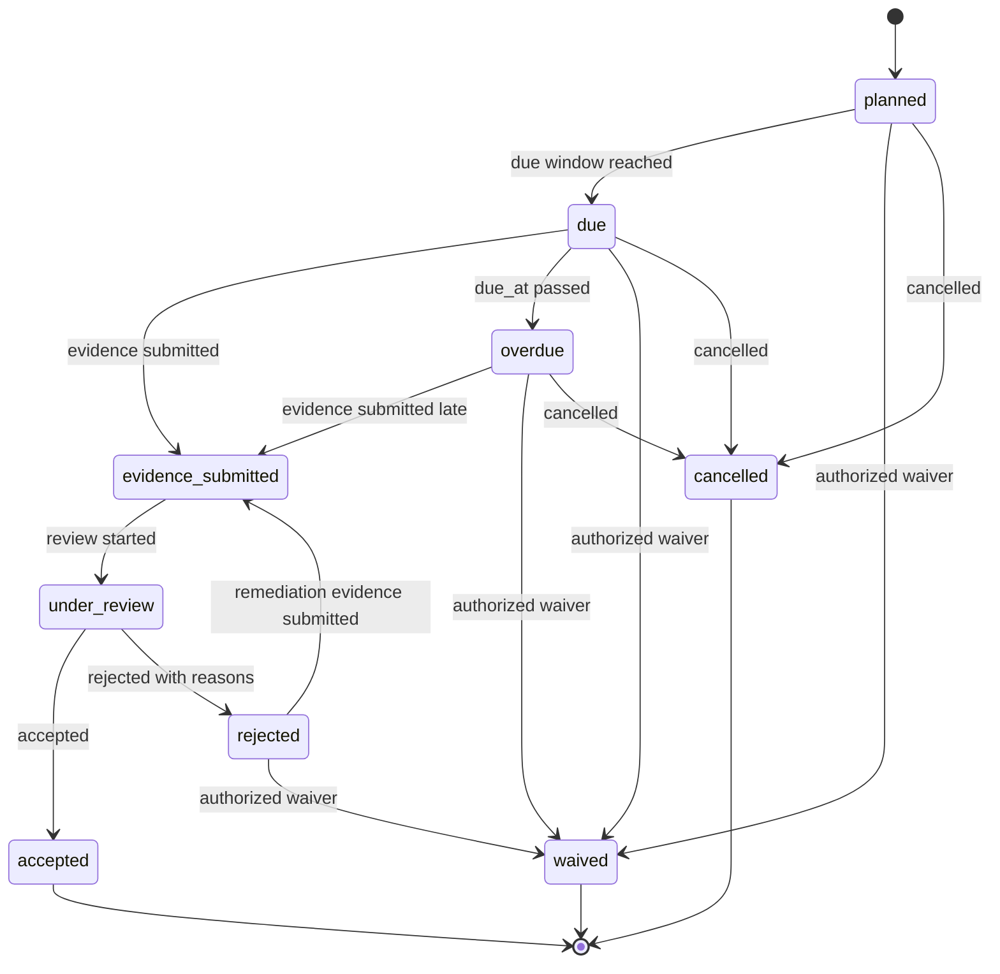

| Transition | Trigger | Guards and evidence | Permission / authority | Basis |
|---|---|---|---|---|
| planned → due | `obligation-status` job | The due window rule is confirmed in Stage B | System | Plan §3.9 |
| due, overdue → evidence_submitted | Responsible party submits evidence | `obligation_evidence` row with `document_version_id`, `submitted_by`, `submitted_at` | Supplier: `supplier.contract.participate`; buyer: `contract.manage` | FR-19, CON-06 |
| due → overdue | `obligation-status` job after `due_at` | Escalation task to `escalation_user_id` | System | FR-19 |
| evidence_submitted → under_review | Buyer review starts | — | `contract.manage` | CON-06 |
| under_review → accepted | Acceptance decision | `acceptance_decisions` with `decision = 'accepted'`, `reasons`, `decided_by`. Acceptance does not imply payment readiness (`contract_invoices` is separate). | `contract.manage` | CON-06, AC-30 |
| under_review → rejected | Rejection | `acceptance_decisions` with `decision = 'rejected'`, `reasons`, `remediation_required`, `remediation_owner_user_id`, `remediation_due_at` | `contract.manage` | AC-30 |
| rejected → evidence_submitted | Remediation evidence | New `obligation_evidence` row | As above | AC-30 |
| open states → waived | Authorized waiver | `waiver_approval_id`, read as an approval with `subject_type = 'obligation_waiver'` (added by DD-14; the column link is a design reading, see [section 9](#9-approval-request)) | Approval by an authorized decision-maker | PRD §8.3, DD-14 |
| open states → cancelled | Cancellation, for example after an incorporated change or termination | Reason | `contract.manage` | Design reading |

A missed measure never authorizes a deduction by itself (FR-19). When a contract expires, its open obligations remain and keep being tracked (DD-19). Demo: the "Q3 service report" milestone on C-2026-0001 is `rejected` with remediation (AC-30).

---

## 13. Change request

Column `change_requests.status`. Owner: `domains/contracts/workflow/`. Data model: [Contracts](03-data-model/11-contracts.md). Screen: CON-09.

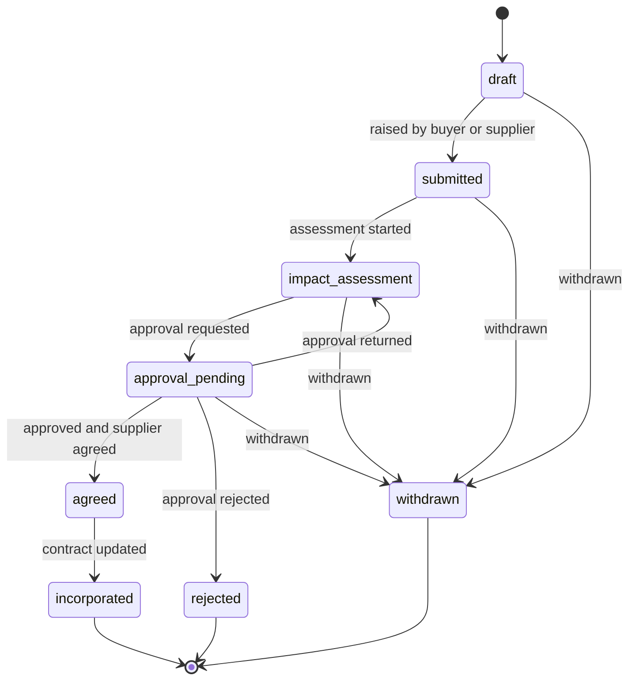

| Transition | Trigger | Guards and evidence | Permission / authority | Basis |
|---|---|---|---|---|
| [*] → draft | Change raised | `number`: an integer per contract (`max + 1` under a `SELECT … FOR UPDATE` lock on the contract row, unique per contract), displayed as `CR-0001`; it does not use `next_reference` (DD-07, DD-09). `title`, `reason`, `raised_by_party` (buyer, supplier) | Buyer: `contract.manage`; supplier: `supplier.contract.participate` | FR-19, DD-09 |
| draft → submitted | Submitted | Reason and scope | As above | PRD §8.3 |
| submitted → impact_assessment | Assessment starts | `scope_change`, `cost_impact` with its `currency` (DD-08), `schedule_impact_days`, `funding_note`, `impact_assessment`, computed `cumulative_value_after`. `affects_procurement_basis` flags a possible process decision or new competition. | `contract.manage` | FR-19, BR-36 |
| impact_assessment → approval_pending | Approval requested | Approval `contract_change`. Authority `change_approval` is checked against the cumulative value, so several small changes cannot bypass a higher approval (AC-31). | `contract.change.approve` | FR-19, AC-31 |
| approval_pending → impact_assessment | Approval returned | Reason | Approver | Design reading |
| approval_pending → agreed | Approved and agreed | Approval granted and `supplier_agreed_at` recorded | `contract.change.approve` | FR-19 |
| approval_pending → rejected | Approval rejected | Reason | Approver | PRD §8.3 |
| agreed → incorporated | Contract updated | Contract values and scope updated with an immutable snapshot. Original terms preserved (BR-36). | `contract.manage` | BR-36 |
| open states → withdrawn | Withdrawn | Reason | Raising party | PRD §8.3 |

Demo: three change requests on C-2026-0001 whose cumulative value exceeds the officer's authority (AC-31).

---

## 14. Addendum

Column `addenda.status`. Owner: `domains/clarifications/workflow/`. Data model: [Participation and clarifications](03-data-model/07-participation-clarifications.md). Screen: BUY-17.

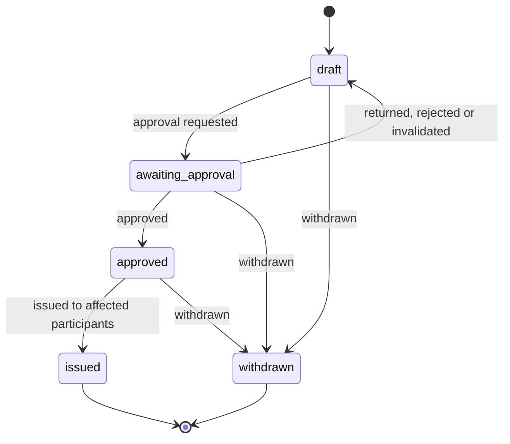

| Transition | Trigger | Guards and evidence | Permission / authority | Basis |
|---|---|---|---|---|
| [*] → draft | Change prepared, often from a question escalated to an addendum | `number` unique per tender, `title`, `change_description`, `reason` | `tender.clarifications.manage` | FR-10 |
| draft → awaiting_approval | Approval requested | `materiality` (material, non_material); `changes_scope`, `changes_terms`, `changes_submission`, `changes_evaluation`; affected lots (`addendum_lots`); requirement changes (`addendum_requirement_changes` with previous and new text and treatment); `new_submission_deadline` with `response_time_assessment`; `existing_submission_action` | `tender.clarifications.manage` | FR-10, BR-16 |
| awaiting_approval → draft | Returned, rejected or invalidated | Reason | Approver | Design reading |
| awaiting_approval → approved | Approved | Approval `addendum` | `tender.addenda.approve` | FR-10 |
| approved → issued | Issued | `issued_at`. `resulting_version_no`: a new `tender_versions` row and snapshot. Clarifications writes `requirements`, `tender_milestones` and `lots.submission_deadline` through the lifecycle snapshot API in the same transaction (audited cross-domain write). A deadline change also updates `tenders.updated_at` in that transaction, so it serializes against in-flight submissions (DD-15). Formal notice (`notice_id`, type `addendum` or `deadline_change`) to every affected eligible participant. Later registrants receive the full current package and history. | Tender owner; endpoint permission declared in the contracts | FR-10, BR-14, BR-16, plan §4 |
| draft, awaiting_approval, approved → withdrawn | Withdrawn before issue | Reason | Tender owner | Design reading |

Rules:
- An issued addendum is permanent. A correction is a new addendum (BR-16).
- Participant acknowledgments are recorded in `participant_acknowledgments` (`subject_type = 'addendum'`) and feed submission readiness (FR-10). That table is authoritative for readiness; when the acknowledgment comes from a notice, `notice_recipients.acknowledged_at` is written in the same transaction (DD-42).
- Affected lots are listed once each (`addendum_lots` unique on `addendum_id`, `lot_id`, DD-07).
- Whether a non-material addendum may skip the approval step is a policy detail confirmed in Stage B (PRD FR-10: "obtain approval where required").
- Demo: T-2026-0002 has an addendum after two submissions that adds a mandatory requirement (acknowledge and supplement) (AC-10).

---

## 15. Notice and recipient delivery

Formal notices are versioned communications with tracked delivery (PRD §14.2, §14.3). Delivery runs through the `DeliveryChannel` port, which has an `in_app` and an `email` implementation (plan §3.8; DD-44; [ADR 0007](adr/0007-in-app-formal-notices.md)). The `email` channel sends over SMTP with `nodemailer`; locally every message goes to Mailpit in the Supabase Docker stack, and the hosted provider is deferred ([email delivery options](../plan/email-delivery-options.md)). Formal notices go to both channels where email is enabled. Owner: `domains/notifications/workflow/`. Data model: [Shared services](03-data-model/03-shared-services.md).

### 15.1 Notice

Column `notices.status`.

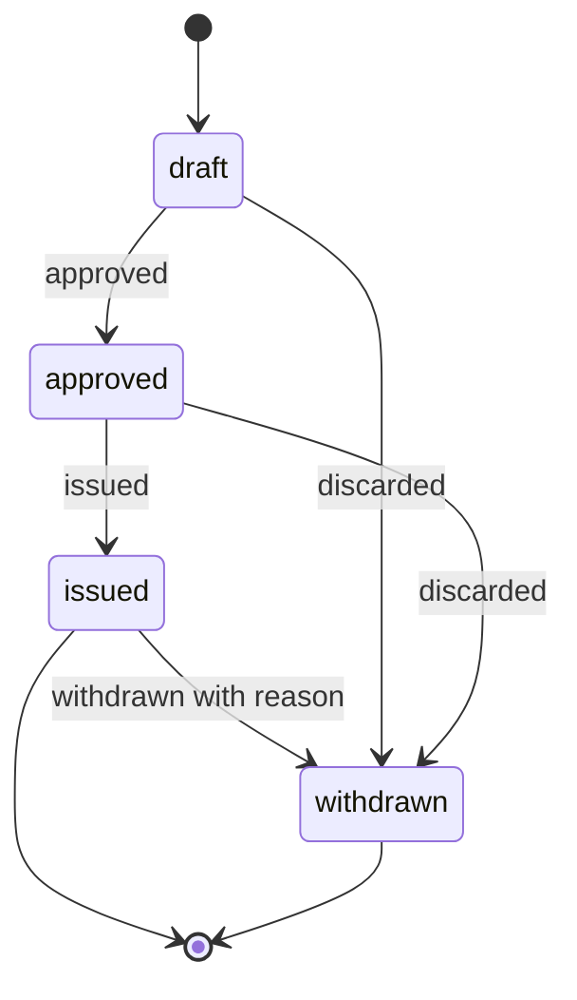

| Transition | Guards and evidence | Permission / authority | Basis |
|---|---|---|---|
| [*] → draft | `notice_type`, `subject_type`, `subject_id`, `tender_id`, `version`, `title`, `body`, `audience_description`, `requires_acknowledgment`, `period_start_basis` (publication, transmission, receipt, acknowledgment) | Owner of the subject process | PRD §14.2 |
| draft → approved | Approval recorded (`approval_request_id` where the notice needs an approval request) | Decision authority of the subject | PRD §14.2 |
| approved → issued | `issued_at`, `issued_by`. `notice_recipients` rows created. Fan-out on the `notifications` queue. | `notice.issue` | PRD §14.3; plan §3.8 |
| issued → withdrawn | Reason. Recipient history is kept. | `notice.issue` | Design reading |

### 15.2 Recipient delivery

Column `notice_recipients.delivery_status` (pending, delivered, failed). `opened_at`, `acknowledged_at` and `terms_accepted_at` are separate timestamps, shown below as sub-states of `delivered` (BR-41).

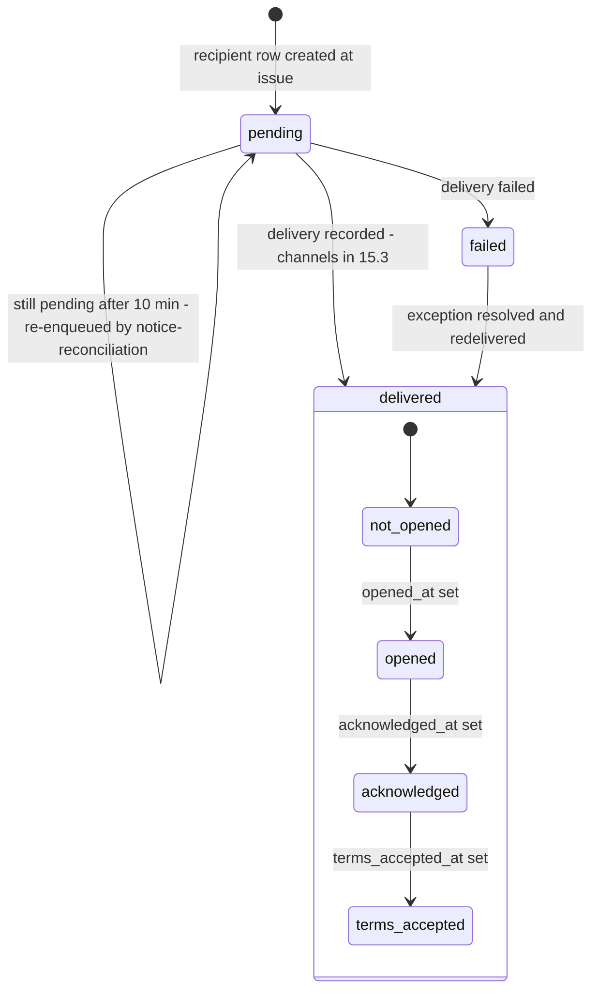

| Transition | Guards and evidence | Basis |
|---|---|---|
| [*] → pending | `UNIQUE NULLS NOT DISTINCT (notice_id, supplier_tenant_id, recipient_user_id)`: one row per notice, recipient organization and recipient user (DD-02). Buyer-internal recipients use the buyer tenant id in `supplier_tenant_id`. | Blueprint Migration 04; DD-02 |
| pending → pending | The `notice-reconciliation` job (every 10 minutes) re-enqueues recipients still `pending` after 10 minutes. It is the brief's reconciliation safety net for a queue publish that failed after the business transaction committed, and changes no status itself. | DD-19; brief §9.5 |
| pending → delivered | `delivered_at`. The in-app `notifications` row is written in the **recipient's** tenant partition (the supplier tenant for supplier recipients). Each channel's outcome is tracked separately in `notification_deliveries` ([section 15.3](#153-channel-delivery)). How the recipient status combines an `in_app` and an `email` outcome is an [open point](#20-open-points). | BR-41; DD-11, DD-44 |
| pending → failed | `failure_reason`. A delivery-exception task (`tasks.task_type = 'delivery_exception'`, `exception_task_id`) for the responsible owner. Deadlines never change because of a failure (BR-42). | BR-42; plan §3.8 |
| failed → delivered | The owner resolves the exception (for example corrects the contact) and redelivers | Design reading |
| opened, acknowledged, terms_accepted | Distinct events. Acknowledgment only where `requires_acknowledgment`, under `supplier.notices.acknowledge` for supplier users (DD-23). `acknowledged_by` recorded. `notice_recipients.acknowledged_at` records the delivery-level event. When a participant acknowledges through a notice, it is written in the same transaction as the `participant_acknowledgments` row, which is the authoritative record for submission readiness (DD-42). | BR-41; DD-23, DD-42 |

### 15.3 Channel delivery

Column `notification_deliveries.status` (per `notifications` row and `channel`).

```mermaid
stateDiagram-v2
  [*] --> queued : one row per notification and channel in use
  queued --> delivered : channel delivered - email when the SMTP server accepts it
  queued --> failed : channel failed
  delivered --> [*]
  failed --> [*]
```

| Transition | Guards and evidence | Permission / authority | Basis |
|---|---|---|---|
| [*] → queued | One row per (notification, channel), enqueued on the `notifications` queue. Formal notices get an `in_app` row and, where email is enabled, an `email` row. Other events follow the recipient's `user_notification_preferences` (`in_app`, `email`); mandatory notices ignore preferences. Where email is not enabled (`EMAIL_ENABLED` off), no `email` rows are written. | System | Plan §3.8; blueprint Migration 04; DD-44 |
| queued → delivered | `attempted_at`. For `email`, the message is `delivered` when the SMTP server accepts it; locally that is Mailpit (SMTP port 54325). | System (queue handler) | Plan §3.8; DD-44 |
| queued → failed | `failure_reason`; `exception_task_id` where a delivery exception is raised | System | BR-42 |
| queued → not_configured | No approved provider for the channel. Finalized in Stage B. Resolved — DD-44: the transition is not used. The value stays in the blueprint CHECK list, but where email is not enabled no `email` rows are written at all, and `in_app` needs no provider. | System | Blueprint Migration 04 (status value only); DD-44; [ADR 0007](adr/0007-in-app-formal-notices.md) |

`channel` is `in_app` or `email` (blueprint), and both `DeliveryChannel` implementations exist (plan §3.8; DD-44). The earlier question, whether `email` rows are written with status `not_configured` while no provider is approved, is resolved by DD-44: without email enabled, no `email` rows are written. An email carries only the notice title, the official deadline and a link into the app, never bid, evaluation or other confidential content (BR-43, ADM-12). The authoritative content stays in the app, where acknowledgment and terms acceptance are recorded on the recipient row ([section 15.2](#152-recipient-delivery)). The hosted provider's delivery, bounce and open webhooks, which would update `notification_deliveries` in hosted environments, are deferred with the provider choice ([email delivery options](../plan/email-delivery-options.md)). A failure records `failure_reason` and may link `exception_task_id`. Mandatory notices ignore user preferences (blueprint `user_notification_preferences`), and the `notification-digests` job never folds a mandatory notice into a digest (DD-19; plan §3.9). In Stage A the prototype only displays delivery status from fixtures; no channel runs.

---

## 16. Hold

Table `holds` has no status column. Its state is derived: **active** while `released_at` is null, **released** once `released_at` is set. Owner: shared `lifecycle` module (the core service, DD-16). Data model: [Shared services](03-data-model/03-shared-services.md).

```mermaid
stateDiagram-v2
  [*] --> active : hold imposed
  active --> active : reviewed on review_date and kept
  active --> released : released with authority and reason
  released --> [*]
```

| Transition | Guards and evidence | Permission / authority | Basis |
|---|---|---|---|
| [*] → active | `subject_type` (tender, lot, contract, qualification_application, record_class, record), `subject_id`, `hold_type` (procurement_hold, complaint_hold, suspension, legal_hold, investigation_hold), `reason`, `owner_user_id`, `authority_note`, `blocked_actions` (for example award_final, contract_sign, disposal, publish, open), `scope_description`, `started_at`, `review_date`, `complaint_id` for complaint holds | `records.hold.manage` for legal and investigation holds; other hold types by the owning process (confirmed in Stage B) | PRD §8.2, §18.3 |
| active → active | Review on `review_date`; the outcome is recorded | Hold owner | PRD §8.2, §18.3 |
| active → released | `released_at`, `released_by`, `release_reason`. Approval `hold_release` where required. | Hold authority | PRD §8.2, §18.3 |

Rules:
- A hold states which actions are blocked. Domain services ask whether an action is blocked for a subject before performing it.
- A hold never stops clocks, extends deadlines or cancels supplier obligations. A date change needs its own decision and communication (PRD §8.2, BR-13).
- Holds prevent disposal even after the retention period ends. After release, disposal still needs ordinary eligibility review (BR-40, PRD §18.3, AC-35).
- A complaint hold is visible separately from the complaint status (PRD §8.3).

---

## 17. Support access grant

Column `support_access_grants.status`. Owner: `domains/operations/workflow/`. Data model: [Records, reporting and operations](03-data-model/12-records-reporting-operations.md). Screen: OPS-04. Enforcement: [Security model §10](04-security-model.md#10-operator-support-access).

```mermaid
stateDiagram-v2
  [*] --> requested : operator requests on a support case
  requested --> authorized : customer administrator authorizes - org.support_access.authorize
  requested --> denied : customer administrator denies
  authorized --> active : starts_at reached
  authorized --> revoked : revoked before start
  authorized --> expired : expires_at passed before use - expire-support-access
  active --> expired : expires_at passed - expire-support-access
  active --> revoked : access ended early
  denied --> [*]
  expired --> [*]
  revoked --> [*]
```

| Transition | Guards and evidence | Permission / authority | Basis |
|---|---|---|---|
| [*] → requested | `case_id`, `customer_tenant_id`, `operator_user_id`, `business_need`, `scope` (metadata_only, specific_records), `record_refs`, requested `starts_at` and `expires_at` | `ops.support.manage` | PRD §4.2, OPS-04 |
| requested → authorized | `authorized_by_user_id` (customer administrator) | `org.support_access.authorize` (DD-23) | PRD §4.2; plan §3.1; DD-23 |
| requested → denied | Decision recorded | Customer administrator | Blueprint CHECK |
| authorized → active | `starts_at` reached | System | Blueprint CHECK |
| active, authorized → expired | `expires_at` passed. The tenant middleware compares `starts_at`, `expires_at` and `revoked_at` directly, so access ends at `expires_at` whatever the stored status. The hourly `expire-support-access` job (operations) records `expired` and writes an audit row (DD-18). | System | Plan §3.9; DD-18 |
| active, authorized → revoked | `revoked_at`. OPS-04: "end access". | Customer administrator or operator | PRD OPS-04 |

While active the operator's effective permission set is exactly `support.view`, and every access is audited before the handler with `support_grant_id`, in the **customer** tenant's audit partition so the customer can review it (DD-11).

---

## 18. Additional lifecycles

These lifecycles are not in PRD §8 but have CHECK lists and PRD rules that constrain them. Rows without an explicit PRD rule are design readings.

### 18.1 User and membership

`users.status` (global): invited, active, suspended, deactivated. `memberships.status` (per tenant): invited, pending_approval, active, suspended, revoked. Owner: identity and org-admin. Data model: [Platform, identity and access](03-data-model/01-platform-identity-access.md).

```mermaid
stateDiagram-v2
  [*] --> invited : administrator invites
  [*] --> pending_approval : membership requested
  invited --> active : invitation accepted
  invited --> pending_approval : accepted, approval required
  pending_approval --> active : administrator approves
  pending_approval --> revoked : request rejected
  invited --> revoked : invitation revoked
  active --> suspended : suspended
  suspended --> active : reinstated
  active --> revoked : access ended
  suspended --> revoked : access ended
  revoked --> [*]
```

| Transition | Guards and evidence | Basis |
|---|---|---|
| Membership [*] → invited | `invitations` row with hashed token and `expires_at`; `invited_by` | FR-03 |
| Membership [*] → pending_approval | `supplier_membership_requests` row for an existing supplier organization | FR-02, SUP-02 |
| Supplier registration [*] → pending | One transaction creates the tenant (`tenants.status = 'pending'`), the user (`users.status = 'invited'`), a pending membership and the supplier profile, and **commits**. **After the commit**, the server calls the Auth Admin invite; no network call runs while a transaction is open (brief §5.6). The invite email serves as contact verification; locally it lands in Mailpit. The owner chose this approach on 2026-09-29. | FR-02; DD-27, DD-43; plan §11 item 4; design log §E item 7 |
| Registration pending → send_failed | The Auth Admin invite fails after the commit. A short follow-up transaction sets the registrant’s `invitations` row to `send_failed`; the committed registration is not rolled back. The registrant sees "we could not send the verification email — try again". | DD-27 |
| Registration send_failed → pending (resend) | The state guard allows a retry from `send_failed`, which calls the Auth Admin invite again outside any transaction. A "resend verification" action and the unique `users.email` constraint prevent duplicates. Abandoned pending registrations stay visible to operators in the supplier registration and duplicate review, where they can be closed. | DD-27 |
| invited → active, pending_approval → active | Acceptance through `POST /api/v1/me/invitations/:token/accept`, the one route the authentication middleware allows for `invited` users. Accepting activates the membership, and the user if needed. `approved_by` where approval applies; `joined_at`. Roles from `invitations.role_ids` (tenant role ids, DD-06) assigned. | FR-03; DD-27 |
| active ↔ suspended | Administrator action; restricted access ends immediately | FR-03, ADM-03, SUP-04 |
| any → revoked | `ended_at`, `end_reason`. Open tasks reassigned and delegations reviewed. Historical actions stay attributed. | FR-03, BR-38, AC-04 |

User status: `invited → active` on first acceptance (DD-27); `active ↔ suspended`; `active, suspended → deactivated` with `deactivated_at`. Deactivation never withdraws submissions, cancels contracts or removes evidence (BR-38). Demo: `former.officer` is deactivated with historic approvals and submissions (AC-04).

### 18.2 Invitation

Column `invitations.status`: pending, accepted, expired, revoked, reissued.

```mermaid
stateDiagram-v2
  [*] --> pending : invitation sent
  pending --> accepted : accepted before expiry
  pending --> expired : expires_at passed
  pending --> revoked : revoked by administrator
  pending --> reissued : replaced by a new invitation
  expired --> reissued : replaced by a new invitation
  accepted --> [*]
  revoked --> [*]
  reissued --> [*]
```

| Transition | Guards and evidence | Permission / authority | Basis |
|---|---|---|---|
| [*] → pending | `email`, `token_hash`, `expires_at`, `role_ids`, `sent_count`. The invite email is sent by Supabase Auth through the Auth Admin API; locally it lands in Mailpit. | `org.users.manage` (buyer) or `supplier.users.manage` (supplier) | FR-03; DD-43 |
| pending → accepted | `POST /api/v1/me/invitations/:token/accept`. Token matches `token_hash` and `expires_at` has not passed (compared directly, whatever the stored status); `accepted_at`; membership activated (DD-27) | Invitee | FR-03; DD-18, DD-27 |
| pending → expired | `expires_at` passed. The hourly `expire-access` job (org-admin) records the display status and sends notices (DD-18). | System | Plan §3.9; DD-18 |
| pending → revoked | Administrator revokes | As for creation | FR-03 |
| pending, expired → reissued | A new invitation whose `reissued_from_id` points at this one. No duplicate identity is created. | As for creation | FR-03 |

### 18.3 Question

Column `questions.status`. Owner: clarifications. Data model: [Participation and clarifications](03-data-model/07-participation-clarifications.md). Screens: BUY-16, SUP-10, PUB-04.

```mermaid
stateDiagram-v2
  [*] --> received : supplier asks
  received --> assigned : owner assigned
  received --> declined : late question declined
  assigned --> draft_answer : answer drafted
  draft_answer --> in_review : confidentiality review
  in_review --> draft_answer : changes requested
  in_review --> published : shared with audience
  in_review --> answered_privately : private answer
  assigned --> escalated_to_addendum : changes the competition
  in_review --> escalated_to_addendum : changes the competition
  assigned --> declined : declined with reason
  received --> withdrawn : supplier withdraws
  assigned --> withdrawn : supplier withdraws
  published --> [*]
  answered_privately --> [*]
  escalated_to_addendum --> [*]
  declined --> [*]
  withdrawn --> [*]
```

| Transition | Guards and evidence | Permission / authority | Basis |
|---|---|---|---|
| [*] → received | `question_text` against a tender, lot, requirement or document; `asked_by_user_id`, `submitted_at`, `after_deadline` | Participating supplier user (endpoint permission declared in the contracts) | FR-10 |
| received → assigned | `owner_user_id` | `tender.clarifications.manage` | FR-10 |
| received → declined | Question after the deadline declined: `late_disposition = 'declined'`, `late_disposition_reason` | `tender.clarifications.manage` | FR-10 |
| assigned → draft_answer | `answer_text` | `tender.clarifications.manage` | FR-10 |
| draft_answer → in_review | Confidentiality review; `sanitized_question` omits identity and sensitive wording | `tender.clarifications.manage`; `confidentiality_reviewed_by` | FR-10 |
| in_review → draft_answer | Changes requested | `tender.clarifications.manage` | Design reading |
| in_review → published | `audience` all_participants or public; `published_at`; the same answer for all eligible affected participants | `tender.clarifications.manage` | FR-10, BR-14 |
| in_review → answered_privately | `audience = 'private'` for a legitimate supplier-specific matter | `tender.clarifications.manage` | FR-10 |
| assigned, in_review → escalated_to_addendum | The answer changes scope, terms, submission or evaluation; `addendum_id` ([section 14](#14-addendum)) | `tender.clarifications.manage` | FR-10, BR-16 |
| assigned → declined | Declined with reason | `tender.clarifications.manage` | Design reading |
| received, assigned → withdrawn | Supplier withdraws the question | Asking supplier | Design reading |

### 18.4 Exclusion

Column `exclusions.status`: proposed, awaiting_approval, approved, rejected, withdrawn. Owner: opening. Screen: BUY-21.

```mermaid
stateDiagram-v2
  [*] --> proposed : grounds cite failed checks
  proposed --> awaiting_approval : approval requested
  awaiting_approval --> approved : exclusion approved
  awaiting_approval --> rejected : exclusion rejected
  proposed --> withdrawn : withdrawn
  awaiting_approval --> withdrawn : withdrawn
  approved --> [*]
  rejected --> [*]
  withdrawn --> [*]
```

| Transition | Guards and evidence | Permission / authority | Basis |
|---|---|---|---|
| [*] → proposed | `grounds` and `check_ids` citing failed `compliance_checks` | `compliance.assess` | FR-13 |
| proposed → awaiting_approval | Approval `exclusion` requested (`approval_request_id`) | `compliance.assess` | FR-13 |
| awaiting_approval → approved | `bids.compliance_status = 'excluded'`; notice (`notice_id`, `notified_at`) with `challenge_route` | `exclusion.approve`; authority `exclusion_approval` | FR-13, AC-17 |
| awaiting_approval → rejected | Reason recorded | `exclusion.approve` | FR-13 |
| proposed, awaiting_approval → withdrawn | Reason recorded | `compliance.assess` | Design reading |

Unopened price envelopes of excluded bidders stay closed unless the procedure permits release (FR-13, AC-17). `exclusions` is [R]: the supplier learns of an exclusion through its notice, not by reading the row (DD-03).

### 18.5 Preferred bidder

Column `preferred_bidders.status`: proposed, awaiting_approval, approved, withdrawn, failed_diligence, superseded, converted_to_award. Owner: selection. Screens: BUY-24, BUY-25.

```mermaid
stateDiagram-v2
  [*] --> proposed
  proposed --> awaiting_approval : approval requested
  awaiting_approval --> proposed : returned
  awaiting_approval --> approved : approved
  approved --> failed_diligence : diligence failed
  approved --> withdrawn : supplier withdraws or rejects terms
  approved --> superseded : replaced by a new decision
  approved --> converted_to_award : award approved
  proposed --> withdrawn : withdrawn
  awaiting_approval --> withdrawn : withdrawn
  failed_diligence --> [*]
  withdrawn --> [*]
  superseded --> [*]
  converted_to_award --> [*]
```

| Transition | Guards and evidence | Permission / authority | Basis |
|---|---|---|---|
| [*] → proposed | `scope`, `proposed_value`, `currency`, `rationale`, `remaining_checks`, `negotiation_topics`, `decision_owner_user_id`, `contingency_plan`, `fallback_bid_id` | `selection.manage` | FR-16 |
| proposed → awaiting_approval | Approval `preferred_bidder` requested | `selection.manage` | FR-16 |
| awaiting_approval → approved | Approved | `approval.decide`; authority `preferred_bidder_approval` | FR-16 |
| awaiting_approval → proposed | Returned | Approver | Design reading |
| approved → failed_diligence | `due_diligence_cases.status = 'failed'` or an unresolved award-blocking finding | `diligence.manage` | FR-16, AC-24 |
| approved → withdrawn | Supplier withdraws or rejects terms; `status_reason` | `selection.manage` | FR-16 |
| approved → superseded | Replaced by a new preferred-bidder decision | `selection.manage` | Design reading |
| approved → converted_to_award | Award approved for the scope | `award.approve`; authority `award_approval` | FR-17 |
| proposed, awaiting_approval → withdrawn | Reason recorded | `selection.manage` | Design reading |

Preferred status is conditional and never communicated as an award (BR-31). `due_diligence_cases` (open, ready_for_decision, passed, failed) and findings with `is_award_blocking` gate the award. After failure or withdrawal, the declared contingency (`fallback_bid_id`, `contingency_plan`) proceeds only through an approved `process_decisions` row (`fallback_to_next_bidder`), recorded through the core `recordProcessDecision()` (FR-16, AC-24, DD-16). `preferred_bidders` is [R]: the supplier learns the outcome only through notices (for example `notice_type = 'preferred_bidder'`) and supplier-facing projections, never by reading the row (DD-03). Demo: T-2026-0009 preferred bidder failed due diligence and the fallback is recorded.

### 18.6 Standstill period

Column `standstill_periods.status`: running, extended, suspended, completed, not_applicable. Owner: awards. Screen: BUY-28.

```mermaid
stateDiagram-v2
  [*] --> running : intent notice issued
  [*] --> not_applicable : policy requires no standstill
  running --> extended : extension decided
  running --> suspended : suspended pending a complaint decision
  extended --> suspended : suspended pending a complaint decision
  suspended --> running : resumed with revised end
  running --> completed : end passed with no blocking hold
  extended --> completed : extended end passed with no blocking hold
  completed --> [*]
  not_applicable --> [*]
```

| Transition | Guards and evidence | Permission / authority | Basis |
|---|---|---|---|
| [*] → running | Intent notice issued (`intent_notice_id`). `starts_at` and `ends_at` from the policy (`standstill_length`, `standstill_day_type` calendar or working) on the tender calendar (BR-12). | `notice.issue` | FR-17 |
| [*] → not_applicable | Policy `standstill_required` is false; `not_applicable_reason` | System | FR-17 |
| running → extended | `extended_to`, `extension_reason`; notice `standstill_change` to the affected bidders | Buyer decision (BUY-28); authority confirmed in Stage B | FR-17 |
| running, extended → suspended | A blocking complaint decision is pending | `complaint.manage` | Design reading (AC-25) |
| suspended → running | Resumed with a revised end, communicated by notice | Buyer decision | Design reading (AC-25) |
| running, extended → completed | End passed with no blocking hold. `standstill-monitor` creates a task only and never awards. | System | Plan §3.9, BR-32 |

### 18.7 Lot outcome

Column `lot_outcomes.status`: recommended, approved, intent_notified, final_awarded, withdrawn. `outcome` is award, partial_award, conditional_award, no_award or cancelled. Owner: awards. Screen: BUY-26.

```mermaid
stateDiagram-v2
  [*] --> recommended : part of a recommendation
  recommended --> approved : recommendation approved
  approved --> intent_notified : intent notice issued
  intent_notified --> final_awarded : final award approved
  approved --> final_awarded : no standstill required
  recommended --> withdrawn : withdrawn
  approved --> withdrawn : withdrawn
  intent_notified --> withdrawn : withdrawn
  final_awarded --> [*]
  withdrawn --> [*]
```

| Transition | Guards and evidence | Permission / authority | Basis |
|---|---|---|---|
| [*] → recommended | Part of an `award_recommendations` version (`recommendation_id`): `outcome`, `bid_id`, `awarded_value`, `currency`, `conditions`, `reason`. A tender can have several recommendations over time; each covers the lots listed in its `lot_outcomes` (DD-14). | `award.recommend` | FR-17, DD-14 |
| recommended → approved | Recommendation approved (approval `award`) | `award.approve`; authority `award_approval`; SoD `evaluation_vs_award_approval` | FR-17 |
| approved → intent_notified | Intent notice issued, distinct from the final award notice; standstill starts | `notice.issue` | FR-17 |
| intent_notified → final_awarded | Its own approval per lot outcome: `final_award_approval_id` → `approval_requests` with `subject_type = 'final_award'` (DD-14). All approvals, satisfied conditions, blocking complaints resolved, waiting period complete (BR-32). `final_awarded_at`, `final_award_approved_by`. | `award.approve` | FR-17, BR-32, DD-14 |
| approved → final_awarded | Policy `standstill_required` is false. The `final_award` approval is still required (DD-14). | `award.approve` | Design reading |
| recommended, approved, intent_notified → withdrawn | Reason recorded (for example a complaint upheld) | `award.approve` | Design reading |

`supplier_tenant_id` is nullable only for no_award and cancelled outcomes. Lot awards and contract allocations reconcile to the approved totals without double counting (BR-33).

### 18.8 Handover

Column `handovers.status`: draft, submitted, accepted, returned. Owner: contracts. Screen: CON-04.

```mermaid
stateDiagram-v2
  [*] --> draft
  draft --> submitted : submitted to contract manager
  submitted --> accepted : contract manager accepts
  submitted --> returned : returned with omissions
  returned --> submitted : resubmitted
  accepted --> [*]
```

| Transition | Guards and evidence | Permission / authority | Basis |
|---|---|---|---|
| [*] → draft | Prepared from the award: `final_scope`, `winning_commitments`, `negotiated_exceptions`, `performance_measures_summary`, `risks`, `outstanding_conditions`, `renewal_dates_summary`, `security_expiry_summary`, `key_contacts` | `contract.prepare` | FR-18 |
| draft → submitted | `submitted_at`; named `contract_manager_user_id` | `contract.prepare` | FR-18 |
| submitted → accepted | Contract manager accepts; `accepted_at` | `contract.manage` | FR-18, AC-29 |
| submitted → returned | `returned_at`, `omissions` | `contract.manage` | FR-18 |
| returned → submitted | Omissions resolved and resubmitted | `contract.prepare` | Design reading |

Event closeout is blocked while a handover is not accepted (FR-18, AC-29). Losing bids are never included (CON-04).

### 18.9 Renewal option

Column `renewal_options.status`: available, under_review, decided, expired, not_exercised. `decision`: renew, extend, recompete, terminate, let_expire. Owner: contracts. Screen: CON-10.

```mermaid
stateDiagram-v2
  [*] --> available
  available --> under_review : review started
  under_review --> decided : decision approved
  under_review --> not_exercised : option not exercised
  available --> expired : notice deadline passed without decision
  under_review --> expired : notice deadline passed without decision
  decided --> [*]
  not_exercised --> [*]
  expired --> [*]
```

| Transition | Guards and evidence | Permission / authority | Basis |
|---|---|---|---|
| [*] → available | `option_type` (renewal, extension, termination_notice), `period_months`, `notice_window_start`, `notice_deadline` | `contract.manage` | FR-19 |
| available → under_review | Review started | `contract.renewal.decide` | FR-19 |
| under_review → decided | `decision`, `justification`, `performance_basis`, `funding_confirmed`, approval `renewal` (authority `renewal_approval`), `supplier_consent_at` where consent applies, `decided_at` | `contract.renewal.decide` | FR-19, BR-36 |
| under_review → not_exercised | Decision not to exercise | `contract.renewal.decide` | Design reading |
| available, under_review → expired | `notice_deadline` passed without a decision. `renewal-windows` sends alerts only; which step records `expired` is confirmed in Stage B. | System | BR-37, AC-32 |

`renewal-windows` sends alerts only. An elapsed date never renews, and supplier consent is never recorded on the supplier's behalf (BR-37, AC-32, PRD §20). `renewal_options` is [R] (buyer-internal): the supplier learns a renewal decision through notices and supplier-facing projections (DD-03). The difference between `not_exercised` and `decided` with `decision = 'let_expire'` is confirmed in Stage B.

### 18.10 Publication

Column `publications.status`: scheduled, published, failed, awaiting_confirmation, confirmed, withdrawn. `channel` is portal or external_notice. Owner: publication. Screen: BUY-14.

```mermaid
stateDiagram-v2
  [*] --> scheduled
  scheduled --> published : portal publication
  scheduled --> awaiting_confirmation : external notice sent
  awaiting_confirmation --> confirmed : confirmation received and reconciled
  awaiting_confirmation --> failed : failure reported
  scheduled --> failed : publication failed
  failed --> scheduled : exception resolved and retried
  published --> withdrawn : withdrawn
  confirmed --> withdrawn : withdrawn
```

| Transition | Guards and evidence | Permission / authority | Basis |
|---|---|---|---|
| [*] → scheduled | `tender_id`, `version_no`, `channel`, unique per (tender, version, channel) (DD-07). `scheduled_at` mirrors `tenders.scheduled_release_at`, which is authoritative (DD-15). | `tender.publish` | FR-08; DD-07, DD-15 |
| scheduled → published | Portal publication; `published_at` | `tender.publish`, or `publish-scheduled` as system | FR-08; plan §3.9 |
| scheduled → awaiting_confirmation | External notice sent | `tender.publish` | FR-08 |
| awaiting_confirmation → confirmed | `confirmation_received_at`, `external_reference`, `reconciled`. Only then is the event treated as advertised. | `tender.publish` | FR-08 |
| scheduled, awaiting_confirmation → failed | `failure_reason`, `exception_task_id`, and an `integration_exceptions` row written by publication. The event stays visibly unconfirmed. | System | Plan §4, AC-33 |
| failed → scheduled | Exception resolved and retried | `tender.publish` | Design reading |
| published, confirmed → withdrawn | Withdrawn, for example after cancellation | `tender.publish` | Design reading |

---

## 19. Index of other status columns

Every remaining status-like CHECK column in the blueprint, with its values and governing rule. Transitions for these are defined in the owning domain's `workflow/` and documented as-built at the end of Stage B.

| Column | Values | Governing rule | Data model |
|---|---|---|---|
| `tenants.status` | pending, active, suspended, offboarding, closed | Only `active` tenants pass the tenant middleware; offboarding follows a continuity plan (BR-47). Supplier self-registration creates the tenant in `pending` (DD-27) | [01](03-data-model/01-platform-identity-access.md) |
| `tenants.verification_status` | unverified, contact_verified, identity_verified | Separate from membership approval and qualification (FR-02, BR-03) | [01](03-data-model/01-platform-identity-access.md) |
| `tenants.onboarding_stage` | setup, configuring, pilot, live, offboarding, closed | OPS-01, OPS-02 | [01](03-data-model/01-platform-identity-access.md) |
| `job_run.status` | running, succeeded, failed | Brief §9.3: an unimplemented job writes a `failed` row and returns 501; `not_implemented` is not a status value (DD-06) | [01](03-data-model/01-platform-identity-access.md) |
| `calendars.status` | draft, approved, retired | Calendar changes need review of affected deadlines (BR-12) | [02](03-data-model/02-organization-policy.md) |
| `conflict_declarations.disposition` | pending_review, cleared, mitigated, recused, reassigned | PRD §5.4, BR-08. With `has_conflict = true`, `pending_review` blocks restricted access; `cleared` or `mitigated` resumes it; `recused` and `reassigned` block permanently for the subject (DD-25) | [02](03-data-model/02-organization-policy.md) |
| `policy_profiles.status` | active, retired | Issued events keep their version (BR-09) | [02](03-data-model/02-organization-policy.md) |
| `policy_profile_versions.status` | draft, in_review, approved, retired | ADM-06; approval `policy_profile` | [02](03-data-model/02-organization-policy.md) |
| `templates.status` | draft, in_review, approved, retired | PRD §17.3; retired templates are not selectable without review; approval `template` | [02](03-data-model/02-organization-policy.md) |
| `tasks.status` | open, in_progress, completed, returned, cancelled, reassigned | FR-21: owner, due date, source, escalation. Owned by the approvals service (DD-16) | [03](03-data-model/03-shared-services.md) |
| `documents.status` | draft, approved, published, submitted, superseded, signed, redacted, withdrawn | PRD §14.1: corrections create a new edition | [03](03-data-model/03-shared-services.md) |
| `document_versions.upload_status` | pending, confirmed, rejected | Two-step upload; `upload-reaper` removes unconfirmed. Storage key `<owning-record tenant_id>/<related_type>/<related_id>/<document_id>/<version_no>-<sanitized name>` (DD-12) | [03](03-data-model/03-shared-services.md) |
| `supplier_membership_requests.status` | pending, approved, rejected, withdrawn | FR-02 | [04](03-data-model/04-suppliers-qualification.md) |
| `supplier_identity_changes.status` | submitted, under_review, approved, rejected | FR-02: evidence and review | [04](03-data-model/04-suppliers-qualification.md) |
| `duplicate_candidates.status` | open, not_duplicate, merged, escalated | BR-44: merge only after review | [04](03-data-model/04-suppliers-qualification.md) |
| `buyer_supplier_relationships.status` | prospective, active, restricted, suspended, inactive | BUY-32, BR-45 | [04](03-data-model/04-suppliers-qualification.md) |
| `evidence_items.status` | current, replaced, withdrawn, expired | SUP-05: replace prospectively; BR-25. `expired` is set by the suppliers domain when the supplier views or renews the item, or by the suppliers-owned helper that `evidence-expiry` calls (DD-20) | [04](03-data-model/04-suppliers-qualification.md) |
| `evidence_items.verification_status` | supplier_provided, independently_verified, verification_failed | PRD §16: supplier-provided stays distinguishable | [04](03-data-model/04-suppliers-qualification.md) |
| `qualification_programs.status` | draft, active, retired | ADM-09 | [04](03-data-model/04-suppliers-qualification.md) |
| `qualification_program_versions.status` | draft, approved, retired | Decisions cite the criteria version (FR-06). Unique (`program_id`, `version_no`) (DD-07) | [04](03-data-model/04-suppliers-qualification.md) |
| `qualification_info_requests.status` | open, answered, closed | AC-08 | [04](03-data-model/04-suppliers-qualification.md) |
| `reassessment_triggers.status` | open, assessed, action_taken, dismissed | BR-25 | [04](03-data-model/04-suppliers-qualification.md) |
| `integrity_screenings.result` | no_match, possible_match, confirmed_restriction | A possible match is not a restriction (PRD §16, BR-48) | [04](03-data-model/04-suppliers-qualification.md) |
| `procurement_projects.status` | planning, active, completed, cancelled | PRD §3 | [05](03-data-model/05-requests-planning.md) |
| `request_info_requests.status` | open, answered, withdrawn | PRD §8.1 | [05](03-data-model/05-requests-planning.md) |
| `plan_items.status` | planned, scheduled, in_progress, released, deferred, cancelled | BUY-05 | [05](03-data-model/05-requests-planning.md) |
| `advance_notices.status` | draft, published, withdrawn | PUB-06: forecasts are not invitations | [05](03-data-model/05-requests-planning.md) |
| `procurement_strategies.status` | draft, awaiting_approval, approved, returned, superseded | FR-05; approval `strategy` | [05](03-data-model/05-requests-planning.md) |
| `fairness_reviews.outcome` | pending, no_issue, mitigated, excluded_from_drafting | FR-05 | [05](03-data-model/05-requests-planning.md) |
| `evaluation_plans.status` | draft, approved, amended | BUY-11: amendments explicit (BR-16) | [06](03-data-model/06-tenders.md) |
| `release_checks.status` | pending, passed, failed, not_applicable | FR-07: publication blocked while incomplete | [06](03-data-model/06-tenders.md) |
| `participants.invitation_status` | not_invited, invited, accepted, declined, expired | FR-08, SUP-07 | [07](03-data-model/07-participation-clarifications.md) |
| `participants.access_status` | not_required, requested, granted, denied | BR-15 | [07](03-data-model/07-participation-clarifications.md) |
| `participants.bid_intent` | undecided, intends_to_bid, no_bid | FR-09: only a shared reason reaches the buyer. Changes **only** through the explicit "notify buyer" action on SUP-07 / SUP-09, never from the pursuit decision (DD-41) | [07](03-data-model/07-participation-clarifications.md) |
| `participants.qualification_gate` | not_required, met, not_met, pending | AC-07 | [07](03-data-model/07-participation-clarifications.md) |
| `pursuits.decision` | undecided, bid, no_bid | Supplier-private (SUP-09); never copied to `participants.bid_intent` (DD-41) | [07](03-data-model/07-participation-clarifications.md) |
| `sessions.status` | scheduled, completed, cancelled | FR-10 | [07](03-data-model/07-participation-clarifications.md) |
| `session_registrations.status` | registered, cancelled, attended, absent | FR-10. At most one non-cancelled registration per (session, supplier) (DD-07) | [07](03-data-model/07-participation-clarifications.md) |
| `bid_answers.progress` | not_started, in_progress, ready_for_review, complete | FR-11 | [08](03-data-model/08-bids-submission.md) |
| `bid_internal_approvals.status` | pending, approved, rejected, returned, invalidated | SUP-15 | [08](03-data-model/08-bids-submission.md) |
| `submission_attempts.outcome` | succeeded, failed_validation, failed_late, failed_authority, failed_error | Every attempt recorded with its true time (AC-13) | [08](03-data-model/08-bids-submission.md) |
| `late_submission_exceptions.decision` | pending, accepted, rejected | FR-12: policy basis and equal-treatment review | [08](03-data-model/08-bids-submission.md) |
| `opening_sessions.status` | scheduled, awaiting_quorum, completed, aborted | FR-13 | [09](03-data-model/09-opening-evaluation.md) |
| `compliance_checks.result` | pending, pass, fail, clarification_required, not_applicable | FR-13: not_applicable needs a reason | [09](03-data-model/09-opening-evaluation.md) |
| `bid_clarifications.status` | draft, approved, issued, responded, closed, expired | BR-22 | [09](03-data-model/09-opening-evaluation.md) |
| `evaluation_scores.status` | draft, submitted | [Section 8](#8-evaluation-assignment) | [09](03-data-model/09-opening-evaluation.md) |
| `moderation_sessions.status` | open, finalized | BR-27 | [09](03-data-model/09-opening-evaluation.md) |
| `commercial_evaluations.status` | draft, approved | BR-29 | [09](03-data-model/09-opening-evaluation.md) |
| `evaluation_results.status` | draft, signed_off, superseded | §9.3 | [09](03-data-model/09-opening-evaluation.md) |
| `evaluation_reports.status` | draft, in_signoff, signed_off, superseded | EVA-06 | [09](03-data-model/09-opening-evaluation.md) |
| `evaluation_report_signoffs.decision` | signed, declined | EVA-06 | [09](03-data-model/09-opening-evaluation.md) |
| `assessment_sessions.status` | planned, scheduled, completed, cancelled | FR-15 | [10](03-data-model/10-selection-award.md) |
| `assessment_invites.status` | invited, confirmed, declined, attended, no_show | FR-15 | [10](03-data-model/10-selection-award.md) |
| `shortlists.status` | draft, awaiting_approval, approved, changed | FR-15: changes after approval need a recorded decision | [10](03-data-model/10-selection-award.md) |
| `due_diligence_cases.status` | open, ready_for_decision, passed, failed | FR-16, AC-24 | [10](03-data-model/10-selection-award.md) |
| `due_diligence_findings.disposition` | satisfied, condition, unresolved, failed | FR-16 | [10](03-data-model/10-selection-award.md) |
| `negotiations.status` | planned, awaiting_mandate, active, concluded, aborted | BR-30; approval `negotiation_mandate` | [10](03-data-model/10-selection-award.md) |
| `final_offer_rounds.status` | draft, awaiting_approval, issued, closed, evaluated, cancelled | BR-30, AC-23; approval `final_offer_round` | [10](03-data-model/10-selection-award.md) |
| `process_decisions.status` | proposed, approved, rejected | PRD §20; approval `process_decision`. Owned by the core lifecycle service and recorded through `recordProcessDecision()` (DD-16) | [10](03-data-model/10-selection-award.md) |
| `award_recommendations.status` | draft, awaiting_approval, approved, returned, rejected, superseded | FR-17; approval `award`. A tender can have several over time, each covering the lots in its `lot_outcomes` (DD-14) | [10](03-data-model/10-selection-award.md) |
| `debrief_requests.status` | requested, scheduled, provided, declined | FR-17, AC-27 | [10](03-data-model/10-selection-award.md) |
| `public_award_notices.status` | draft, approved, published, withdrawn | BR-34: confidentiality and personal-information review | [10](03-data-model/10-selection-award.md) |
| `event_closeouts.status` | in_progress, blocked, closed, archived | BUY-30, AC-29 | [10](03-data-model/10-selection-award.md) |
| `contract_signatories.status` | pending, signed, refused, recorded_external | [Section 11](#11-contract) | [11](03-data-model/11-contracts.md) |
| `performance_reviews.status` | draft, shared_with_supplier, supplier_responded, finalized | FR-19: supplier may respond before finalization | [11](03-data-model/11-contracts.md) |
| `contract_incidents.status` | open, corrective_action, resolved, closed | FR-19 | [11](03-data-model/11-contracts.md) |
| `improvement_actions.status` | open, done, overdue, cancelled | FR-19 | [11](03-data-model/11-contracts.md) |
| `contract_invoices.acceptance_status` | not_accepted, accepted, disputed | CON-08 | [11](03-data-model/11-contracts.md) |
| `contract_invoices.payment_status` | not_invoiced, invoiced, approved, paid, disputed | CON-08: never present estimates as paid | [11](03-data-model/11-contracts.md) |
| `contract_disputes.status` | open, negotiating, resolved, withdrawn | FR-19: only under agreed terms. `authorized_decision_id` references an approval with `subject_type = 'dispute_decision'` (DD-14) | [11](03-data-model/11-contracts.md) |
| `contract_securities.status` | active, expiring, expired, released, called | BR-37: no release because a date arrived. `contract-dates` sets `expiring` and `expired` (DD-19). Release through `release_approval_id`, read as an approval with `subject_type = 'security_release'` (DD-14; the column link is a design reading) | [11](03-data-model/11-contracts.md) |
| `contract_closeouts.status` | in_progress, closed | CON-11 | [11](03-data-model/11-contracts.md) |
| `disposal_requests.status` | proposed, blocked, approved, executed, rejected | BR-40, AC-35; approval `disposal`. `retention-eligibility` writes rows in `proposed`, or `blocked` when a hold applies (DD-20) | [12](03-data-model/12-records-reporting-operations.md) |
| `exports.status` | queued, running, ready, failed | PRD §14.1; `exports` queue. Owned by the documents service (`requestExport()`), with per-type generators registered in `documents/export-registry.ts` (DD-16) | [12](03-data-model/12-records-reporting-operations.md) |
| `integration_connections.status` | planned, active, suspended, retired | ADM-15 | [12](03-data-model/12-records-reporting-operations.md) |
| `integration_exceptions.status` | open, investigating, reconciled, manual_fallback_used, closed | AC-33 | [12](03-data-model/12-records-reporting-operations.md) |
| `import_batches.status` | uploaded, reviewing, accepted, partially_accepted, rejected | ADM-16 | [12](03-data-model/12-records-reporting-operations.md) |
| `import_records.decision` | pending, accepted, rejected | ADM-16: provenance kept | [12](03-data-model/12-records-reporting-operations.md) |
| `subscriptions.status` | trial, active, past_due, cancelled, ended | BR-46, BR-47. The customer is `customer_tenant_id` (DD-04) | [12](03-data-model/12-records-reporting-operations.md) |
| `offboarding_plans.status` | draft, agreed, in_progress, completed | AC-36. The customer is `customer_tenant_id` (DD-04) | [12](03-data-model/12-records-reporting-operations.md) |
| `support_cases.status` | open, in_progress, awaiting_customer, resolved, closed, routed_to_buyer | PRD §21.2 | [12](03-data-model/12-records-reporting-operations.md) |
| `service_incidents.status` | investigating, identified, monitoring, resolved | OPS-05 | [12](03-data-model/12-records-reporting-operations.md) |
| `announcements.status` | draft, published, archived | OPS-07 | [12](03-data-model/12-records-reporting-operations.md) |
| `help_articles.status` | draft, published, archived | OPS-07, PUB-07 | [12](03-data-model/12-records-reporting-operations.md) |

---

## 20. Open points

Confirmed in the Stage B legality matrices. Points settled by the [design decision log](../plan/design-decisions.md) stay in the list for traceability, marked "Resolved".

1. **Tender status aggregation.** The exact derivation of `awarded`, `partially_awarded` and `completed_without_award` from lot stages, including a mix of awarded and cancelled lots with no lot still in progress.
2. **Cancellation from draft.** Whether a `draft` tender is cancelled or simply abandoned (no `draft → cancelled` row is shown).
3. **Combined requests.** The status of a request combined into another (`combined_into_id`).
4. **Reconsideration after approval.** The request state while an approved request is reconsidered after a material change.
5. **Internal approval policy.** Where a supplier's "internal approval required" policy is configured, which decides whether `draft → submitted` is allowed.
6. **Failed and late revisions.** Whether a `submission_failed` revision is retried in place or replaced, and how an accepted late-submission exception changes `bid_revisions.status` and the receipt.
7. **Resubmission after withdrawal.** Whether a bid with `submission_state = 'withdrawn'` may submit again before closing.
8. **Approval routing.** Completion rules per `route_mode`, when a step is `skipped`, and each step's `required_decision_type`.
9. **Addendum approval.** Whether a non-material addendum may be issued without an approval request, and whether an issued addendum can ever be `withdrawn`.
10. **Contract expiry trigger.** Which job or action moves `active → expired`, and whether a suspended contract can expire. Partly resolved — DD-19: the daily `contract-dates` job moves `active → expired` after `term_end` (open obligations remain) and `signed_not_effective → active` on the effective date ([section 11](#11-contract)). Still open: whether a suspended contract can expire.
11. **Obligation due window.** When `obligation-status` moves `planned → due`.
12. **Hold authority.** Which permission imposes and releases procurement, complaint and suspension holds, and when approval `hold_release` is required.
13. **Renewal outcomes.** The difference between `not_exercised` and `decided` with `decision = 'let_expire'`.
14. **Evaluation status trigger.** Whether `bids.evaluation_status = 'evaluated'` is set at result computation or at report sign-off.
15. **Support grant authorization.** The customer-side permission that authorizes a support access grant. Resolved — DD-23: `org.support_access.authorize` ([section 17](#17-support-access-grant)).
16. **Email channel rows while no provider is approved.** Whether `email` rows are written to `notification_deliveries` with status `not_configured` while no email provider is approved. Resolved — DD-44: the `email` channel exists (SMTP with `nodemailer`, Mailpit locally), and where email is not enabled no `email` delivery rows are written, so `not_configured` is not used ([section 15.3](#153-channel-delivery)).
17. **Recipient status across two channels.** How `notice_recipients.delivery_status` combines the `in_app` and `email` outcomes, for example whether a failed email alone marks the recipient `failed` and raises a delivery-exception task (BR-42), is not stated (DD-44 adds the second channel).
18. **Hosted email delivery events.** Deferred — DD-44: the hosted provider and its delivery, bounce and open webhooks, which would update `notification_deliveries`, are chosen before the first hosted environment ([email delivery options](../plan/email-delivery-options.md)).
