# Key Flows

Status: As-designed (pre-build). Updated to as-built at the end of Stage A and Stage B.

Sources:
- `docs/plan/architecture-plan.md` (revision 3): §0 (delivery stages; real Supabase Auth in Stage A), §3.1 (tenancy, scopers, support access), §3.2 (authorization), §3.3 (sealing and staged opening), §3.4 (official time), §3.5 (versioning, approvals, evidence), §3.6 (state machines), §3.7 (money and scoring), §3.8 (notifications: `in_app` and `email` channels), §3.9 (jobs), §3.10 and §3.11 (contracts and prototype mode, local Supabase stack from Stage A), §4 (URL map, registries, cross-domain writes, shared table owners), §5 (ownership: `ui-live-api`), §6 (domain map), §11 (owner decisions of 2026-09-29: item 3 email channel, item 4 supplier self-registration, item 8 real Supabase Auth from Stage A, item 10 MFA not in this release)
- `docs/plan/design-decisions.md`: DD-02, DD-03, DD-05, DD-07, DD-09, DD-11 to DD-19, DD-21 to DD-25, DD-27 to DD-29, DD-31 to DD-33, DD-36, DD-38 (withdrawn, superseded by DD-43), DD-39, DD-41, DD-42, DD-43 (real Supabase Auth from Stage A), DD-44 (email channel); §E (owner decisions of 2026-09-29)
- `docs/plan/email-delivery-options.md`: §1 and §2 (Supabase Auth and notice emails go to Mailpit locally; hosted provider deferred)
- `docs/plan/tenderiq-prototype.workflow.js`: Stage A tasks `mock-platform` (JWT verification through `src/server/lib/auth/verify.ts`, `npm run auth:personas`, the `scan-bundle` marker check) and `ui-shell` (supabase-js sign-in, dev-only demo accounts, prototype banner)
- `docs/plan/schema-blueprint.md`: §0 (conventions), Migrations 01, 02, 04, 06, 07, 08, 09, 10, 11, 12, 13, 14; §P (permission catalog and role templates)
- `docs/architecture-brief.md`: §5.1 (request pipeline), §5.3 (errors and results), §5.6 (transactions and pooler rules), §5.7 (authentication), §5.9 (file storage), §9.5 (queues), §10 (SPA client)
- `docs/PRD.md`: FR-04, FR-07, FR-08, FR-10, FR-12, FR-13, FR-14, FR-17, FR-18, FR-19; §8 (lifecycles); §9.2 (worked scoring example); §10 (BR-06, BR-07, BR-09, BR-10, BR-13, BR-14, BR-16 to BR-21, BR-23, BR-26, BR-27, BR-32 to BR-35, BR-41, BR-42); §14 (documents and notices); §23 (AC-05, AC-06, AC-10 to AC-13, AC-15, AC-16, AC-18 to AC-20, AC-25, AC-28 to AC-30)
- `docs/plan/tenderiq-backend.workflow.js`: Stage B domain notes for publication (notices through the notifications service), opening and evaluation (`price_gate_releases` written by evaluation), suppliers (public registration through the Auth Admin invite); tasks `svc-notifications` (the `email` channel over SMTP, Mailpit in integration tests) and `ui-live-api` (invitation set-password flow, emails in Mailpit)
- `docs/plan/demo-storyline.md`: personas, PR-2026-0003, T-2026-0002, T-2026-0003, T-2026-0005, T-2026-0006, T-2026-0007, T-2026-0008, T-2026-0010, C-2026-0001, C-2026-0002

Contents:
- [1. Conventions](#1-conventions)
- [2. Flow index](#2-flow-index)
- [3. Flow 1: Sign-in and organization/capacity selection](#3-flow-1-sign-in-and-organizationcapacity-selection)
- [4. Flow 2: Procurement request approval routed by authority (AC-05)](#4-flow-2-procurement-request-approval-routed-by-authority-ac-05)
- [5. Flow 3: Tender release approval and invalidation (AC-06)](#5-flow-3-tender-release-approval-and-invalidation-ac-06)
- [6. Flow 4: Publication and invitation notices](#6-flow-4-publication-and-invitation-notices)
- [7. Flow 5: Supplier submission with official receipt time (AC-11 to AC-13)](#7-flow-5-supplier-submission-with-official-receipt-time-ac-11-to-ac-13)
- [8. Flow 6: Addendum after submissions (AC-10)](#8-flow-6-addendum-after-submissions-ac-10)
- [9. Flow 7: Sealed access, staged opening and price gate (AC-15, AC-16)](#9-flow-7-sealed-access-staged-opening-and-price-gate-ac-15-ac-16)
- [10. Flow 8: Evaluation, moderation and ranking (AC-18 to AC-20)](#10-flow-8-evaluation-moderation-and-ranking-ac-18-to-ac-20)
- [11. Flow 9: Award, standstill, complaint hold and final award (AC-25)](#11-flow-9-award-standstill-complaint-hold-and-final-award-ac-25)
- [12. Flow 10: Contract, signature, handover and closeout gate (AC-28, AC-29)](#12-flow-10-contract-signature-handover-and-closeout-gate-ac-28-ac-29)
- [13. Flow 11: Milestone evidence rejection (AC-30)](#13-flow-11-milestone-evidence-rejection-ac-30)
- [14. Flow 12: Document upload two-step envelope](#14-flow-12-document-upload-two-step-envelope)
- [15. Open points](#15-open-points)

Related: [02-architecture.md](02-architecture.md) (middleware chain and request pipeline), [04-security-model.md](04-security-model.md) (authorization, sealing, support access), [05-lifecycles.md](05-lifecycles.md) (state machines), [07-api.md](07-api.md) (endpoint inventory), [08-background-jobs.md](08-background-jobs.md) (jobs and queues), [03-data-model/README.md](03-data-model/README.md) (tables), [glossary.md](glossary.md).

---

## 1. Conventions

### 1.1 Participants

| Participant | Meaning |
|---|---|
| SPA | React SPA in `src/ui`. Every call goes through `api/client.ts` `call(endpoint, ...)`, which attaches `Authorization: Bearer <jwt>` (token read per request) and `X-Tenant-Id` from the Redux session slice, except on tenant-exempt prefixes (brief §10, architecture-plan §3.10). |
| API middleware | The single Hono function `api/v1/index.ts` and its middleware chain: security headers, request context and correlation id, request log, error boundary, authentication, tenant context, permission resolution ([02-architecture.md §3.1](02-architecture.md#31-middleware-chain)). In most flows the chain is compressed into one note, for example `auth, buyer tenant, tender.publish`. |
| Domain service | `src/server/domains/<domain>/service.ts`. Returns `Result<T, DomainError>` for expected failures (brief §5.3). |
| Shared services | `approvals`, `notifications`, `documents`, `audit`, `lifecycle`, `sealing`, `time` (architecture-plan §4). |
| Postgres | Supabase Postgres 17 through Kysely over the transaction pooler. The `pgmq` queues live in the same database. |
| Supabase Auth, Supabase Storage | Auth (GoTrue) for sign-in, Storage behind `StorageAdapter` for files. Auth is real in both stages: the local Supabase CLI stack runs in Docker from Stage A, and Stage A uses only its Auth service (DD-43). |
| SMTP server (Mailpit locally) | Receives the emails of the `email` `DeliveryChannel` (sent with `nodemailer`) and Supabase Auth's invitation, password-reset and registration emails. Locally this is Mailpit in the Supabase Docker stack (SMTP `127.0.0.1:54325`, web UI `http://127.0.0.1:54324`). The hosted provider is deferred (DD-44; `docs/plan/email-delivery-options.md`). |
| Queue drain | `api/queue/drain.ts` and the handlers in `jobs/queue/handlers.ts`, called every minute by pg_cron ([08-background-jobs.md](08-background-jobs.md)). |

### 1.2 Rules that hold in every flow

- **Endpoint notation.** Paths are written as the audience prefix plus the intent, for example `POST /api/v1/supplier/... submit revision`. `...` stands for the contract path. Exact paths, endpoint ids, request and response schemas and error codes come from the Stage A contracts (`src/contracts/<domain>.ts`) and are listed in [07-api.md](07-api.md). Where the sources do not fix the audience prefix, the diagram writes `/api/v1/...`.
- **Permission codes** are codes from the catalog (blueprint §P). The binding of a code to an endpoint is declared by the endpoint's contract (`defineEndpoint({ permission })`) and enforced by `requirePermission` in `routes.ts`.
- **Transactions.** Every multi-statement business operation runs inside `withTransaction`. There are no network calls inside a transaction. Row locks (`SELECT ... FOR UPDATE`, `FOR SHARE`) are taken only inside a transaction (brief §5.6). `BEGIN` and `COMMIT` in the diagrams mark that boundary.
- **Queue publishes happen after commit.** A failed publish is logged and never fails the user's request (brief §9.5). Payloads carry ids only. The tenant id travels on the envelope. For formal notices, the `notice-reconciliation` job re-enqueues recipients still `pending` after 10 minutes (DD-19).
- **Delivery channels.** The `DeliveryChannel` port has an `in_app` and an `email` implementation. Formal notices go to both channels, and non-mandatory events follow the user's preferences. Email is sent only where it is enabled (`EMAIL_ENABLED`) and carries the title, the official deadline and a link, never bid, evaluation or other confidential content (DD-44, BR-43). Where email is not enabled, no email delivery rows are written.
- **Audit.** State-changing commands write `audit_log` (actor, capacity, delegation, entity, action, reason, before and after state, correlation id; architecture-plan §3.5). The row goes to the partition of the tenant that **owns the affected record**: a supplier acting on a buyer-owned row is audited in the buyer's partition with `actor_capacity` naming the supplier organization, and support-access events go to the customer tenant (DD-11). For sealed records and evaluator scores, `before_state` and `after_state` hold ids and hashes only, with `sensitivity = 'restricted'` (DD-31). Diagrams show audit only where it matters to the flow.
- **Shared table owners.** A domain writes only its own tables (architecture-plan §4). `tasks` belong to the approvals service. `holds`, `record_snapshots`, `comments` and `process_decisions` belong to the core `lifecycle` service (DD-16). Diagrams that show another domain creating a task or snapshot mean a call to that owner inside the same transaction.
- **Supplier scope.** Supplier-side access goes through `forSupplier(db, supplierTenantId)`, which reaches only `[S]` tables on the generated allow-list. `[R]` tables carry `supplier_tenant_id` for reference only and stay buyer-internal. Suppliers learn outcomes through notices and supplier-facing projections (DD-03).
- **Status changes of tenders and lots** go only through the `lifecycle` service (architecture-plan §4). Legality is decided by `canTransition(from, to, ctx)` matrices ([05-lifecycles.md](05-lifecycles.md)).
- **Idempotency.** Commands that create records accept an optional `Idempotency-Key` header, stored in `request_idempotency` for 24 hours. The SPA disables submit buttons while a request is in flight (DD-39).
- **References** come from `next_reference(tenant, prefix)`. The year segment is the year in the tenant's official time zone (DD-09).
- **Errors.** Expected failures become problem+json with a `code`. Validation failures are 422 with `errors[]`. Unexpected failures are 500 with a sanitized `detail` and the correlation id (brief §5.3). The status code for each domain error is set in the contracts ([02-architecture.md §4.3](02-architecture.md#43-response-outcomes)).
- **Money and scores** travel as decimal strings and are computed with the shared helper `src/contracts/decimal.ts`, which `src/server/lib/decimal.ts` re-exports. The SPA uses it for live totals, and the server recomputes authoritatively (DD-32; [adr/0005-decimal-strings-for-money-and-scores.md](adr/0005-decimal-strings-for-money-and-scores.md)).
- **Approval decisions.** Deciding a step requires `approval.decide`, the decision-specific permission (for example `award.approve`) and sufficient authority (DD-24).

### 1.3 Stage A versus Stage B

The diagrams describe Stage B. In Stage A the mock API (`src/mock-api/`) serves the same URL surface with the same middleware behavior: real Supabase JWT verification through `src/server/lib/auth/verify.ts` (the verified email is mapped to its fixture persona, and an unknown account gets 401), identical 403 tenant validation, contract permission checks against the persona's fixture permission set, and problem+json errors. Supabase Auth is the same in both stages: the local Supabase stack runs in Docker from Stage A, which uses only its Auth service and has no application schema (DD-43). Every participant to the right of the API middleware is replaced by typed fixtures. Commands validate the request against the contract and return a contract-valid static response, for example the fixture receipt for a submission. Nothing is persisted. The SPA shows the prototype banner when `/api/v1/me/context` reports `environment.mode = 'prototype'` (architecture-plan §0, §3.11; DD-43; [adr/0006-contracts-first-ui-prototype-stage.md](adr/0006-contracts-first-ui-prototype-stage.md)). The prototype sends no notice emails and only displays delivery status from fixtures. Password-reset emails from Supabase Auth do reach Mailpit in Stage A; invitation and registration emails follow in Stage B, when the real API calls the Auth Admin invite (DD-43; `docs/plan/email-delivery-options.md`).

---

## 2. Flow index

| # | Flow | Acceptance | Screens | Domains and shared services | Principal tables |
|---|---|---|---|---|---|
| 1 | Sign-in and organization/capacity selection | AC-02 context, AC-04 inactive user | COM-01, COM-02 | session, identity; `lib/auth`, `lib/tenancy`, `lib/permissions` | `users`, `memberships`, `tenants`, `role_assignments`, `role_permissions`, `user_group_members`, `access_grants`, `access_restrictions` |
| 2 | Procurement request approval routed by authority | AC-05 | BUY-03, BUY-04, COM-04, COM-05 | requests, approvals | `procurement_requests`, `record_snapshots`, `approval_requests`, `approval_steps`, `authority_limits`, `delegations`, `sod_policies`, `tasks` |
| 3 | Tender release approval and invalidation on material edit | AC-06 | BUY-09 to BUY-13, COM-05 | tenders, approvals, lifecycle | `tenders`, `release_checks`, `record_snapshots`, `approval_requests`, `approval_steps`, `tasks` |
| 4 | Publication and invitation notices | AC-01, AC-33 | BUY-14, BUY-15, PUB-02, PUB-03, SUP-07, COM-06 | publication, lifecycle, notifications | `publications`, `tender_versions`, `participants`, `notices`, `notice_recipients`, `participant_acknowledgments`, `notifications`, `notification_deliveries`, `integration_exceptions` |
| 5 | Supplier submission with official receipt time | AC-11, AC-12, AC-13 (AC-03) | SUP-15, SUP-16, SUP-17 | bids | `bids`, `bid_revisions`, `bid_internal_approvals`, `submission_attempts`, `submission_receipts`, `receipt_inventory_items`, `reference_counters`, `late_submission_exceptions` |
| 6 | Addendum after submissions | AC-10 | BUY-16, BUY-17, SUP-08, SUP-17 | clarifications, lifecycle, approvals, notifications, publication, bids | `addenda`, `addendum_lots`, `addendum_requirement_changes`, `requirements`, `tender_milestones`, `lots`, `tender_versions`, `notices`, `notice_recipients`, `participant_acknowledgments` |
| 7 | Sealed access, staged opening and price gate | AC-15, AC-16 | BUY-19, BUY-20, EVA-02, EVA-04, OPS-04 | opening, sealing, lifecycle, evaluation | `opening_sessions`, `opening_participants`, `envelope_openings`, `price_gate_releases`, `tender_team_members`, `support_access_grants`, `v_bid_receipt_metadata` |
| 8 | Evaluation, moderation and ranking | AC-18, AC-19, AC-20 | EVA-01, EVA-02, EVA-04, EVA-05, EVA-06 | evaluation (scoring), sealing | `evaluation_assignments`, `evaluation_scores`, `score_corrections`, `moderation_sessions`, `moderated_scores`, `commercial_evaluations`, `evaluation_results`, `evaluation_reports` |
| 9 | Award recommendation to final award with a complaint hold | AC-25 | BUY-26, BUY-28, BUY-29, SUP-21, SUP-22, PUB-05 | awards, approvals, time, lifecycle, notifications | `award_recommendations`, `lot_outcomes`, `approval_requests`, `notices`, `standstill_periods`, `complaints`, `complaint_events`, `holds`, `public_award_notices` |
| 10 | Contract from award to closeout gate | AC-28, AC-29 | CON-02, CON-03, CON-04, SUP-23, BUY-30 | contracts, approvals, awards | `contracts`, `contract_lot_allocations`, `contract_signatories`, `handovers`, `event_closeouts` |
| 11 | Milestone evidence rejection | AC-30 | SUP-23, CON-06 | contracts, documents, notifications | `obligations`, `obligation_evidence`, `acceptance_decisions`, `tasks`, `contract_invoices` |
| 12 | Document upload two-step envelope | supports AC-11 to AC-14, AC-30 | COM-07 and every upload widget | documents | `documents`, `document_versions`, `document_access_log` |

---

## 3. Flow 1: Sign-in and organization/capacity selection

**Narrative.** A person is one global `users` row with `memberships` in any number of organizations (tenants). The browser uses supabase-js only for authentication, exactly the same way in both stages (DD-43). The SPA boots its session from the tenant-exempt `/api/v1/me/context`, then the user picks the organization and capacity to act in (COM-02). From then on the SPA sends `X-Tenant-Id` on every buyer, supplier or ops call. The server re-validates the tenant and recomputes effective permissions on every request, because the browser is untrusted (brief §5.8). Switching organization clears all tenant-scoped Redux state (architecture-plan §3.1). The SPA remembers the last active tenant per user in `localStorage` as a convenience only, and re-validates it against `/me/context` (DD-36). Personal pages under `/me/*` (tasks, notifications, approvals, documents, search) return the caller's own rows across all active memberships, each labelled with its organization. Acting on such a row requires `X-Tenant-Id` equal to the row's tenant, and search results are filtered by the caller's authorization in each row's tenant (DD-21). MFA and step-up sign-in are not in this release: the brief disables MFA, and Supabase MFA is recorded as a later extension (DD-29). Demo: `sam.dual` holds memberships in `kwu` (evaluator), `tsodilo` and `chobe-pipe` (contributor) and demonstrates AC-02.

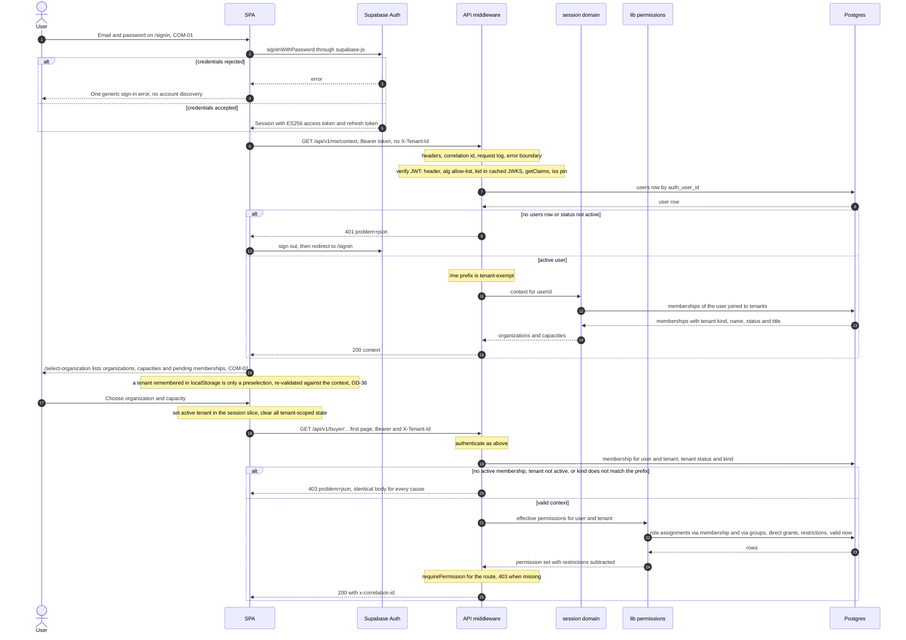

**Stage A (prototype mode).** Sign-in is real Supabase Auth from Stage A. There is no mock auth adapter, no persona switcher, no `VITE_AUTH_MODE` and no `/__mock/auth` endpoints. DD-43 supersedes the withdrawn DD-38 (architecture-plan §3.11, §11 item 8).
- **Setup.** The local Supabase CLI stack runs in Docker (`npm run supabase:start`), and Stage A uses only its Auth service. `npm run auth:personas` creates or updates every demo persona in local Supabase Auth through the Admin API, with the password `test1234`. The script is idempotent and refuses to run against anything that is not local.
- **SPA.** The SPA signs in with supabase-js exactly as in production. In local development builds only (`import.meta.env.DEV`), the sign-in page lists the demo accounts grouped by organization. Picking one fills the email and password and signs in for real. Vite strips the quick-pick from production builds, and `scan-bundle` fails if its marker string appears in the production bundle.
- **Mock API.** The mock API verifies the JWT with the real `src/server/lib/auth/verify.ts` (the brief §5.7 checks, using the real `lib/config` and `lib/supabase` modules written in Stage A and extended in Stage B). It then maps the verified email to its fixture persona instead of reading a `users` row. An account with no fixture persona gets 401.
- **Banner and email.** The prototype banner is shown when `/api/v1/me/context` reports `environment.mode = 'prototype'`. In Stage A only password-reset emails from Supabase Auth appear in Mailpit at `http://127.0.0.1:54324`: the demo accounts are created already confirmed, and the mock API persists nothing and never calls the Auth Admin invite. Invitation and registration emails appear there from Stage B, when the real API calls the Auth Admin invite.

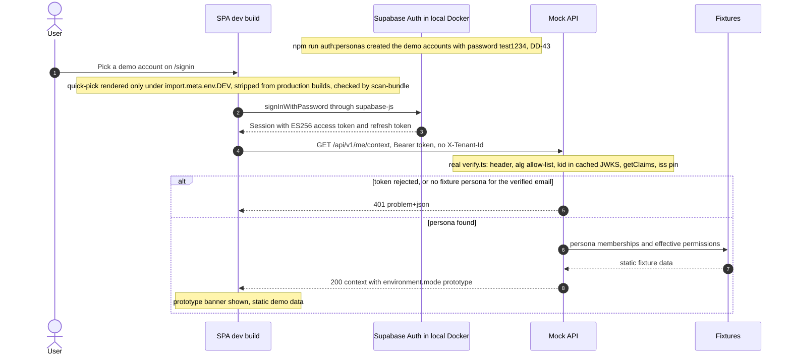

**Supplier self-registration.** The owner approved the proposed approach on 2026-09-29 (architecture-plan §11 item 4). Supabase self-signup stays disabled (`enable_signup = false`), locally and hosted (brief §5.7). The public `/register` form posts to the TenderIQ API, which does four things:
1. It validates the request and checks for duplicates.
2. It rate-limits public POSTs per IP hash and per email hash (DD-28).
3. In one transaction, it creates the supplier tenant (status `pending`), the user (`invited`), a pending membership and the supplier profile, and commits.
4. After the commit, it calls the Auth Admin invite, because brief §5.6 forbids network calls inside a transaction. If the invite fails, a short follow-up transaction sets the registrant’s `invitations` row to `send_failed`, and the state guard allows a retry. The committed registration is not rolled back (DD-27).

Supabase Auth sends the verification and set-password email, which lands in Mailpit locally. See [04-security-model.md §3.6](04-security-model.md#36-invitations-and-registration) and [adr/0012-supplier-registration-via-provisioned-accounts.md](adr/0012-supplier-registration-via-provisioned-accounts.md).

**Failure handling.**

| Condition | Decided by | Result |
|---|---|---|
| Wrong email or password | Supabase Auth | One generic message. The form cannot be used to discover accounts (brief §5.7). |
| Malformed token, disallowed algorithm, unknown `kid`, expired token, wrong `iss` | Authentication middleware | 401. The reason goes to the server log only. An unknown `kid` is rejected without a network round-trip. |
| Valid token but no `users` row, or user `suspended` or `deactivated` (AC-04) | Authentication middleware | 401. The SPA signs out and redirects. Past approvals and submissions remain attributable (BR-38). |
| Valid token for an account with no fixture persona (Stage A) | Mock API authentication | 401, the prototype's equivalent of a missing `users` row (DD-43). |
| User in status `invited` | Authentication middleware | Only `POST /api/v1/me/invitations/:token/accept` is allowed. Accepting activates the membership, and the user if needed (DD-27). The Supabase invite link leads to `/invite/:token`, where the user sets a password. Locally the invitation email lands in Mailpit (DD-43; backend workflow `ui-live-api`). |
| Forgotten password | Supabase Auth | `/forgot-password` and `/reset-password` use supabase-js. Supabase Auth sends the reset email over SMTP, which lands in Mailpit locally. The hosted SMTP provider is deferred, and the same credentials will serve Supabase Auth and the `email` channel (DD-43, DD-44). |
| Supabase Auth Admin invite fails during supplier registration | suppliers service | The invite runs after the registration transaction has committed, so nothing is rolled back. A short follow-up transaction sets the registrant’s `invitations` row to `send_failed`, and the registrant sees "we could not send the verification email — try again". The state guard allows a retry. A "resend verification" action and the unique `users.email` constraint prevent duplicate organizations and users. Abandoned pending registrations stay visible to operators in the supplier registration and duplicate review, where they can be closed (DD-27). |
| Membership `invited`, `pending_approval`, `suspended` or `revoked` | `/me/context` shows it; tenant middleware refuses it | The SPA can show a pending membership but cannot act in it. Any call with that tenant returns the identical 403. |
| `X-Tenant-Id` names a tenant the user does not belong to, an inactive tenant, or a tenant whose kind does not match the prefix | Tenant middleware | Identical 403 for every cause, so the response cannot reveal which tenants exist. |
| Permission missing for the route | `requirePermission` | 403. The SPA hides permission-bound navigation, but the backend is the authority. |
| Grant, restriction, delegation or role assignment outside its dates | Permission resolution | Applied on every request: `starts_at`, `expires_at` (or `ends_at`) and `revoked_at` are compared directly. The expiry jobs only update display statuses and send notices (DD-18). |
| Action on a `/me/*` row with `X-Tenant-Id` different from the row's tenant | Tenant middleware and the owning service | Refused. The personal list spans memberships, but every action runs in the row's tenant (DD-21). |
| Access token expires | supabase-js automatic refresh | The SPA reads the token per request. A 401 signs the user out. |
| Platform operator acting in a customer tenant | Tenant middleware | Only with a customer-authorized `support_access_grants` row whose `starts_at`, `expires_at` and `revoked_at` allow access now. A buyer administrator authorizes it with `org.support_access.authorize` (DD-23). Access is read-only through `support.view` and audited in the customer tenant before the handler (DD-11). See [Flow 7](#9-flow-7-sealed-access-staged-opening-and-price-gate-ac-15-ac-16) and [adr/0013-operator-support-access-grants.md](adr/0013-operator-support-access-grants.md). |

---

## 4. Flow 2: Procurement request approval routed by authority (AC-05)

**Narrative.** Submitting a request snapshots the exact version and opens a version-bound approval request (`subject_type = 'procurement_request'`, `subject_version`, `content_hash`, `amount`, `currency`, `legal_entity_id`, `category_id`). Authority is checked again at decision time against `authority_limits` (`decision_type = 'request_approval'`, amount, currency, entity, category, effective dates) and active `delegations` (BR-06). Self-approval is blocked by `sod_policies` rule `requester_vs_request_approval` unless the policy records alternative oversight (BR-07). Deciding a step requires `approval.decide`, the decision-specific permission and sufficient authority (DD-24). The approver finds the approval in the personal inbox (`/me/approvals/:id`, COM-04 and COM-05), and the decision call carries `X-Tenant-Id` equal to the approval's tenant (DD-21). The final state is dispatched to the requests domain through `domains/approvals/outcome-registry.ts`. Demo: PR-2026-0003 exceeds `mpho.manager`'s limit of BWP 2,000,000 and is routed to `keabetswe.approver` (limit BWP 10,000,000).

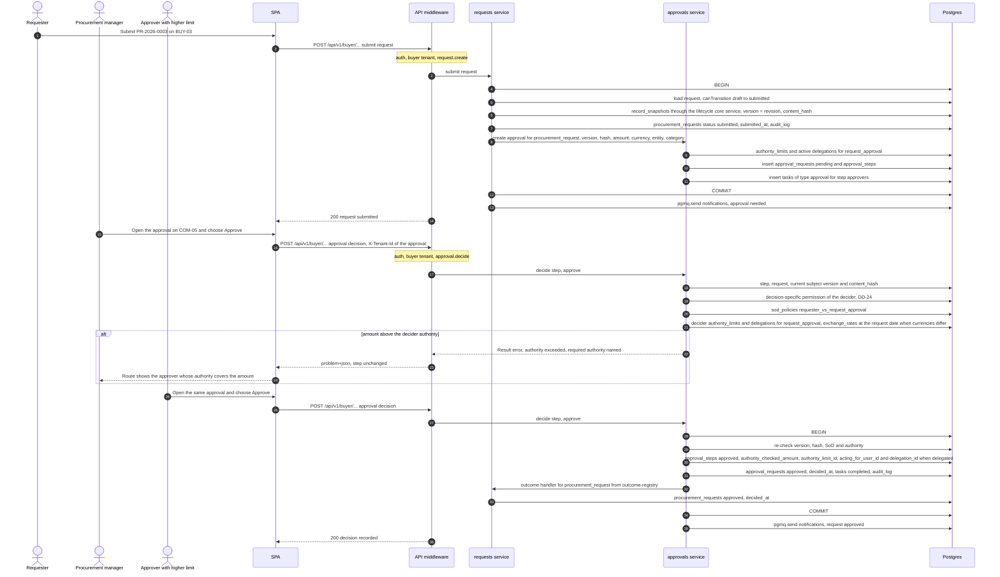

**Route selection.** The sources fix the decision-time invariant: the authority check uses `authority_limits` plus active `delegations`, and the step records `authority_checked_amount` and `authority_limit_id`. The algorithm that picks step approvers from `policy_thresholds.required_approval_level`, `authority_limits` and committees (`route_mode` sequential, parallel_all or committee_quorum) is finalized in Stage B.

**Failure handling.**

| Condition | Result |
|---|---|
| Decider's limit is below the amount, or the currency, entity, category or dates do not match | The step stays `pending`. Problem+json names the missing authority. The route shows who holds sufficient authority (AC-05). |
| Decider holds `approval.decide` but not the decision-specific permission | Refused. All three conditions are required: `approval.decide`, the decision-specific permission and sufficient authority (DD-24). |
| Authority limit in another currency than the request | Converted with `exchange_rates` at the request date. With no rate, the step routes to the next level up. It is never an assumed pass (DD-24). |
| Delegate decides | Allowed only within the delegation's `decision_types`, `max_amount`, currency, entity, category and dates. A trigger keeps a delegation's `max_amount` at or below the delegator's own limit when created. `acting_for_user_id` and `delegation_id` are recorded. |
| Requester tries to approve their own request | Blocked by `sod_policies` in `enforced` mode. In `alternative_oversight` mode the decision proceeds and the oversight note is part of the record. |
| Request edited after submission (new revision or content hash) | The approval no longer matches the current version and is invalidated, the same mechanism as [Flow 3](#5-flow-3-tender-release-approval-and-invalidation-ac-06). A prior approval is never reused for a different commercial decision (BR-10). |
| Approval passes `expires_at` while pending | The hourly `expire-approvals` job (approvals, at :05) moves it to `expired` and notifies the approver and the record owner. Expiry jobs only update display statuses and send notices (DD-18; [08-background-jobs.md](08-background-jobs.md#4-job-catalog)). |
| Notification publish fails after commit | Logged. The approval and its task exist, so the approver still sees it in COM-04, the personal inbox across memberships (DD-21). |

---

## 5. Flow 3: Tender release approval and invalidation (AC-06)

**Narrative.** A release approval targets one exact package: `subject_type = 'tender_release'`, `subject_version = tenders.draft_revision`, and the `content_hash` of the `record_snapshots` row. A material edit bumps `draft_revision`, which invalidates every approval bound to the previous revision (`approval_requests.status = 'invalidated'` with `invalidated_reason` and `invalidated_at`). `release_checks` rows carry the `draft_revision` they were recorded against, one per (`tender_id`, `check_area`, `draft_revision`) (DD-07), so checks recorded for an older revision no longer count. The snapshot is written through the lifecycle core service, which owns `record_snapshots` (DD-16). Whether release approval is required at all comes from the policy profile version (`requires_release_approval`). Demo: T-2026-0005 is `awaiting_release_approval`, then a scope and value edit invalidated its approval.

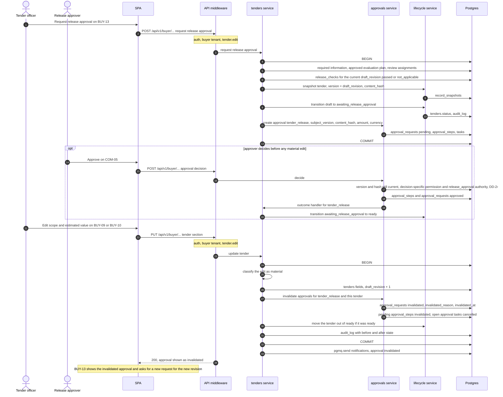

**Failure handling.**

| Condition | Result |
|---|---|
| Release approval requested with missing information, unapproved evaluation plan, or failed release checks | Result error listing the gaps. The tender stays `draft` (PRD §8.2, FR-07). |
| Approver acts on a version that was invalidated while the approval screen was open | The approvals service compares `subject_version` and `content_hash` with the current tender and refuses. No step changes. |
| Publication attempted without an approved release approval for the current `draft_revision` | Refused by the publication service ([Flow 4](#6-flow-4-publication-and-invitation-notices)). Publication is blocked while required approvals are incomplete (FR-07). |
| Non-material edit | `draft_revision` is unchanged, so approvals stand. The rule set that classifies an edit as material is finalized in Stage B. PRD FR-04 and FR-07 name scope, amount, funding, risk and contracting entity. |
| Tender was already `ready` when the material edit happened | The approval is invalidated and the tender leaves `ready`. The target state is a row in the lifecycle legality matrix, finalized in Stage B ([05-lifecycles.md](05-lifecycles.md)). |

---

## 6. Flow 4: Publication and invitation notices

**Narrative.** Releasing a tender does four things in one transaction: the lifecycle transition `ready → open`, an issued version (`tender_versions` with a `record_snapshots` snapshot, `tenders.current_version_no`), the freeze of `policy_profile_version_id` (BR-09), and formal notices (`notices` with `notice_type` `tender_issued` or `invitation`, plus `notice_recipients`). The publication service does not write `notices` itself: it asks the notifications service, which owns `notices` and `notice_recipients`, to issue them inside the same transaction ([03-data-model/03-shared-services.md §5](03-data-model/03-shared-services.md#5-notifications-and-formal-notices)). Release happens immediately or, for a scheduled publication, through the `publish-scheduled` job. `tenders.scheduled_release_at` is authoritative for the release time, and `publications.scheduled_at` mirrors it per channel (DD-15). Fan-out to people runs on the `notifications` queue, and the `notice-reconciliation` job re-enqueues recipients still `pending` after 10 minutes (DD-19). The events, producers and recipients are listed in the [notification event catalog](03-data-model/03-shared-services.md#51-notification-event-catalog) (row 3 for this flow). Formal notices go to both delivery channels: `in_app`, and `email` where email is enabled (`EMAIL_ENABLED`). The `email` channel sends over SMTP with `nodemailer`, locally to Mailpit, and carries only the title, the official deadline and a link (DD-44). Delivered, opened, acknowledged and terms-accepted are recorded as separate events (BR-41; [adr/0007-in-app-formal-notices.md](adr/0007-in-app-formal-notices.md)). For submission readiness, `participant_acknowledgments` is authoritative. `notice_recipients.acknowledged_at` records the delivery-level event and is written in the same transaction when the acknowledgment comes from a notice (DD-42). Accepting an invitation does not change the buyer-visible `participants.bid_intent`, which changes only through the explicit "notify buyer" action on SUP-07 or SUP-09 (DD-41). Public discovery reads `v_public_tenders`, which contains only `participation = 'open'` tenders of buyers whose public portal is enabled, in public-safe statuses (DD-13), so invitation-only T-2026-0006 never appears publicly (AC-01). References are unique per buyer, so public detail URLs carry the buyer slug (`/opportunities/:buyerSlug/:ref`), and supplier API paths use tender ids (DD-22).

### 6.1 Release

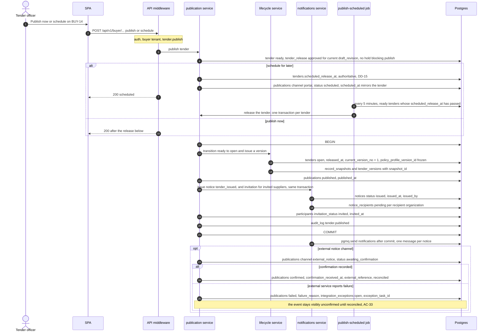

### 6.2 Notice fan-out, delivery and acknowledgment

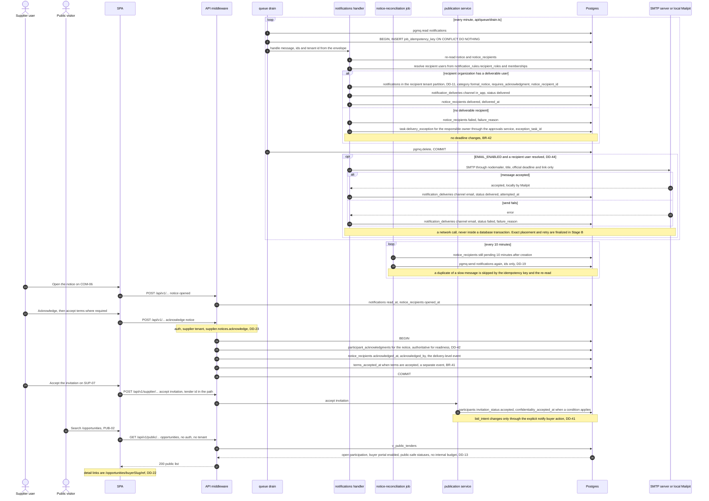

**Failure handling.**

| Condition | Result |
|---|---|
| Tender not `ready`, release approval not approved for the current `draft_revision`, or a hold whose `blocked_actions` include `publish` | Result error. Nothing is published. |
| `publish-scheduled` finds that the approval was invalidated after scheduling | The per-item re-check fails, the tender stays unreleased, and the run reports the skip ([08-background-jobs.md](08-background-jobs.md#4-job-catalog)). |
| Queue publish fails after commit | Logged. The notices and `notice_recipients` rows exist with `delivery_status = 'pending'`. The `notice-reconciliation` job (every 10 minutes) re-enqueues recipients still `pending` after 10 minutes (DD-19; [08-background-jobs.md](08-background-jobs.md#4-job-catalog)). |
| Acknowledgment arrives from the notice | `participant_acknowledgments` (authoritative for readiness) and `notice_recipients.acknowledged_at` are written in one transaction (DD-42). |
| Public detail page for a reference used by two buyers | Not ambiguous: public URLs carry the buyer slug, `/opportunities/:buyerSlug/:ref` (DD-22). |
| Recipient organization cannot be reached | `notice_recipients.delivery_status = 'failed'` and a `delivery_exception` task. The deadline is not altered (BR-42). |
| Handler fails mid-message | The message transaction rolls back, including the idempotency claim, and the message is retried after its visibility timeout. It is archived after the maximum attempts. |
| Email channel | Resolved — DD-44: the `DeliveryChannel` port has `in_app` and `email` implementations (architecture-plan §3.8). When `EMAIL_ENABLED`, formal notices are also emailed over SMTP with `nodemailer`, and non-mandatory events follow the user's preferences. Locally every message goes to Mailpit in the Supabase Docker stack (SMTP `127.0.0.1:54325`, web UI `http://127.0.0.1:54324`), and the `email` delivery is recorded as `delivered` when Mailpit accepts it. The email carries only the title, the official deadline and a link, never bid, evaluation or other confidential content (BR-43, PRD ADM-12). Original wording, kept for traceability: "No email provider is approved. Only the `in_app` `DeliveryChannel` exists (architecture-plan §3.8)." |
| Email not enabled | Notices are in-app only, and no `email` rows are written to `notification_deliveries` (DD-44). The schema's `status = 'not_configured'` value is therefore not produced by any designed flow. |
| Email delivery events in a hosted environment (bounce, open) | Deferred (DD-44). The hosted provider and its delivery-event webhooks are chosen before the first hosted environment (`docs/plan/email-delivery-options.md` §3). Opening and acknowledging a notice are recorded in the app (COM-06). |
| External notice confirmation | How confirmation or failure is captured (manual entry on BUY-14 or an integration) is finalized in Stage B. The recorded states and the `integration_exceptions` row are fixed by the schema and AC-33. |
| Recipients of `tender_issued` for open tenders | PRD §14.3 names "approved supplier audience and relevant buyer owners" ([event catalog](03-data-model/03-shared-services.md#51-notification-event-catalog) row 3). Matching against `notice_subscriptions` and `saved_searches` is finalized in Stage B. |

---

## 7. Flow 5: Supplier submission with official receipt time (AC-11 to AC-13)

**Narrative.** Saving and internal approval never establish submission (BR-18). Submission is one transaction that locks the tender row `FOR SHARE`, reads `clock_timestamp()` as the **official receipt time**, and compares it with the effective deadline: `lots.submission_deadline` when set, which is authoritative for that lot, otherwise the tender's `tender_milestones` row (`submission_deadline`, `lot_id` null) (DD-15). Every attempt, including late and failed ones, is recorded in `submission_attempts` with its true time and the deadline at the time of the attempt (AC-13). A successful replacement supersedes the earlier revision and receipt. A failed replacement leaves the earlier receipt effective and issues no receipt (BR-19, AC-12). Supplier access goes through `forSupplier(db, supplierTenantId)`, which reaches only `[S]` tables (DD-03). Inserts name the buyer `tenant_id` explicitly after the service verifies participation (architecture-plan §3.1; [adr/0011-official-receipt-time-from-database.md](adr/0011-official-receipt-time-from-database.md)). The submission is audited in the buyer's `audit_log` partition, with `actor_capacity` naming the supplier organization (DD-11). The receipt number comes from `next_reference` for the buyer tenant (`RCPT-2026-000001`), with the year taken in the buyer's official time zone (DD-09). Each `receipt_inventory_items` row records the envelope of its file (DD-05).

**Why `FOR SHARE`.** Shared locks do not conflict with each other, so submissions from different suppliers proceed in parallel. Anything that updates the tender row, such as the `close-tenders` transition or an addendum that bumps `current_version_no` ([Flow 6](#8-flow-6-addendum-after-submissions-ac-10)), waits for in-flight submission transactions to commit, and in-flight submissions wait for such an update to commit. An addendum that changes a deadline also updates `tenders.updated_at` in the same transaction, so the tender-row lock serializes deadline changes too (DD-15). A deadline or version change therefore never interleaves with a receipt.

Demo: on T-2026-0002, Gaborone Metering has an earlier effective receipt and a failed replacement attempt, and Chobe has a late attempt recorded and rejected.

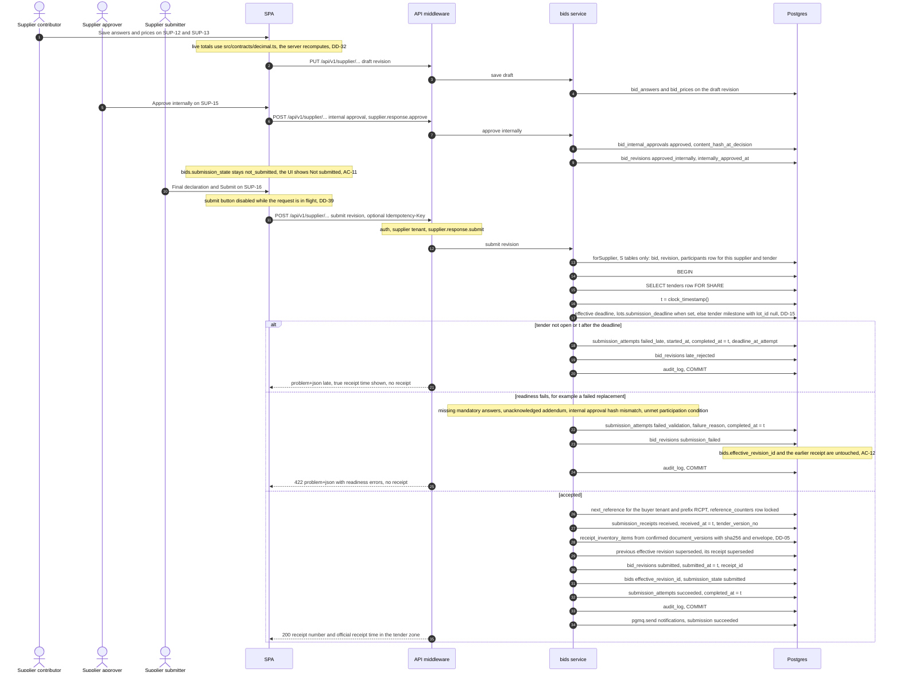

Official times render with the IANA zone name and the numeric offset from Intl, for example `14 Oct 2026, 12:00 (UTC+02:00) Africa/Gaborone`, never as a countdown alone. A short abbreviation such as CAT is shown only when Intl provides one (DD-33, architecture-plan §3.4).

**Buyer view.** Before opening, the buyer sees only `v_bid_receipt_metadata`: `tenant_id` (for `forTenant`), `supplier_tenant_id`, the supplier legal name valid at `received_at` (from `supplier_legal_names`), bid id, effective receipt number, `received_at`, status (including withdrawn) and document count. Drafts are never visible to buyers (BR-17, DD-13).

**Late submission exception.** When the policy profile version has `late_submission_policy = 'exception_route'`, the buyer can open a `late_submission_exceptions` row (`attempt_id`, `policy_basis`, `evidence`, `equal_treatment_review`, `decision` pending) decided through an approval of subject type `late_submission_exception`. The table is `[R]`: buyer-internal and not reachable through `forSupplier` (DD-03). The recorded times are never edited (BR-20).

**Failure handling.**

| Condition | Result |
|---|---|
| Contributor without `supplier.response.submit` (AC-03) | 403 from `requirePermission` before the service runs. The contributor can still edit assigned work. |
| Finer authority failure inside the service | Attempt recorded with outcome `failed_authority`. |
| Material change after internal approval | `bid_internal_approvals.content_hash_at_decision` no longer matches the revision's `content_hash`. The approval is `invalidated`, and submission readiness fails until re-approval (FR-11). |
| Deadline passed, or tender already `closed` | `failed_late`, true time preserved, revision `late_rejected`, no `received` receipt (AC-13). |
| Replacement fails validation | `failed_validation`, revision `submission_failed`. The earlier revision and receipt stay effective (AC-12). |
| Unexpected error inside the transaction | The transaction rolls back and nothing of the submission persists. AC-13 requires the attempt to be recorded as `failed_error`. How it is persisted after the rollback is finalized in Stage B. |
| Response lost in transit (network outage after commit) | The receipt list on SUP-17 is the source of truth. The UI must not imply success without an official receipt (FR-12). |
| Submission retried, with or without the same `Idempotency-Key` | Every retry still records its own `submission_attempts` row, which is intended evidence (DD-39). The SPA disables the submit button while a request is in flight. |
| Two concurrent submissions of the same bid | The partial unique index allows at most one `submitted` revision per bid. Further serialization for the same bid is finalized in Stage B. |
| Explicit withdrawal (AC-14) | Separate command: a `withdrawals` row with a `confirmation_no`, the revision and receipt move to `withdrawn`, and `bids.submission_state = 'withdrawn'`. |

---

## 8. Flow 6: Addendum after submissions (AC-10)

**Narrative.** A change to scope, terms, submission requirements or evaluation becomes a formal addendum (BR-16). The addendum records materiality, affected lots, requirement changes, any new deadline, the response-time assessment, and what existing submissions must do (`existing_submission_action`: none, acknowledge, supplement or replace). Issuing it is the only path by which the clarifications domain writes `requirements`, `tender_milestones` and `lots.submission_deadline`, through the lifecycle snapshot API (architecture-plan §4). Issuing bumps `tenders.current_version_no` and, when a deadline changes, `tenders.updated_at` (DD-15), so it waits for in-flight submissions holding `FOR SHARE` ([Flow 5](#7-flow-5-supplier-submission-with-official-receipt-time-ac-11-to-ac-13)). The `addendum` notice, and a `deadline_change` notice when dates move, are issued through the notifications service in the same transaction, as in [Flow 4](#6-flow-4-publication-and-invitation-notices). The supplier's acknowledgment is recorded in `participant_acknowledgments`, which is authoritative for submission readiness. When it comes from the notice, `notice_recipients.acknowledged_at` is written in the same transaction (DD-42). Prior receipts are retained. Demo: T-2026-0002 has an addendum issued after 2 of 3 submissions, adding a mandatory requirement with action "acknowledge and supplement".

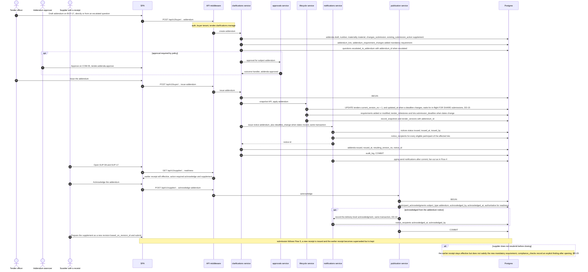

**Failure handling.**

| Condition | Result |
|---|---|
| Issue attempted while approval is required but not approved | Result error. Nothing changes. |
| Late registrant | Receives the complete current package and the amendment history (FR-10), because the package is read from the current issued version. |
| Revision prepared against an older version | Readiness compares `bid_revisions.acknowledged_tender_version` and `participant_acknowledgments` (the authoritative acknowledgment record, DD-42) with the current version. A missing mandatory acknowledgment blocks submission ([Flow 5](#7-flow-5-supplier-submission-with-official-receipt-time-ac-11-to-ac-13), `failed_validation`). |
| Notice undeliverable to a participant | `delivery_exception` task. The deadline is not changed silently (BR-42). |
| Addendum issue racing a submission | Serialized by the tender row lock. A submission that committed first carries the old `tender_version_no` on its receipt. A later one sees the new version and requirements. |

---

## 9. Flow 7: Sealed access, staged opening and price gate (AC-15, AC-16)

**Narrative.** Bid content tables are sealed. Buyer users read them only through `sealing.assertEnvelopeReadable()` or `readableEnvelopes()`, which require an `envelope_openings` row, an assignment to the tender, lot or criterion, a `price_gate_releases` row for a staged commercial envelope, and a signed confidentiality undertaking plus conflict declaration (architecture-plan §3.3; [adr/0003-application-layer-sealing.md](adr/0003-application-layer-sealing.md)). An organization administrator holds `org.*` permissions only and no assignment, so administration gives no early access (BR-26). A support agent acts through a support access grant limited to `support.view`, which never includes sealed content. A declared conflict blocks restricted access while its disposition is `pending_review`. Access resumes only on `cleared` or `mitigated`, and `recused` or `reassigned` block it permanently for that subject (DD-25). Opening needs the assigned opening officer and the quorum or second person that the policy profile version requires. Envelopes follow a fixed mapping: `bid_answers` copy the envelope of their requirement, `bid_answer_documents` follow their answer, `bid_declarations` are `qualification`, `bid_subcontractors` and `bid_key_personnel` are `technical`, and `bid_prices`, `bid_commercial_terms` and `bid_exceptions` are `commercial`. A single-stage opening (`opening_sessions.envelope = 'all'`) writes one `envelope_openings` row per envelope in the same transaction (DD-05). The opening domain may also set `submission_receipts.status = 'selected_for_evaluation'` (DD-17). The price gate (`price_gate_releases`) is written by the evaluation domain: the evaluation chair releases it with permission `evaluation.chair` after non-price moderation is finalized, and the commercial opening follows (DD-16, DD-23). Audit rows for opening and evaluation actions hold ids and hashes only, never sealed content or scores (DD-31). Demo: T-2026-0008 is `closed` with two sealed submissions that `admin.kwu` and `support.agent` cannot read. T-2026-0003 has its technical envelope opened and its price gate released.

### 9.1 Administrative and support access to a sealed bid

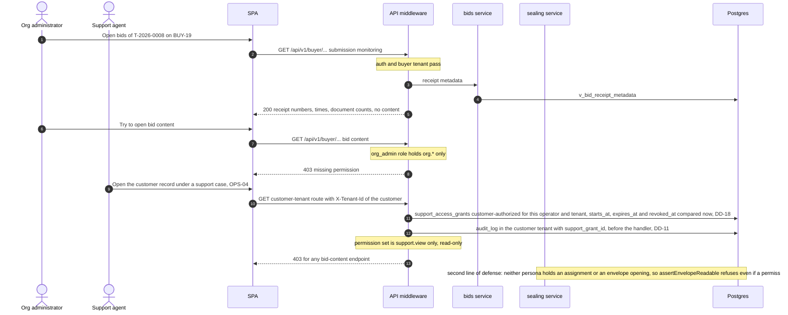

### 9.2 Staged opening and price gate

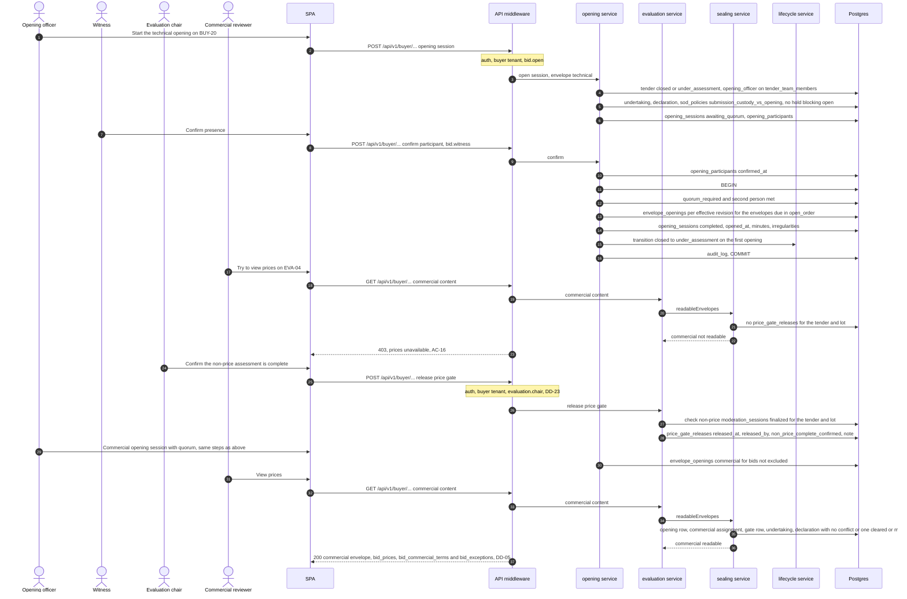

**Failure handling.**

| Condition | Result |
|---|---|
| Quorum or second person missing | Session stays `awaiting_quorum`. No `envelope_openings` rows are written. |
| Opening officer not assigned, or undertaking or declaration missing | Result error. Nothing opens (BR-08). |
| SoD rule `submission_custody_vs_opening` violated | Blocked in `enforced` mode (BR-07). |
| Hold whose `blocked_actions` include `open` | Opening refused. The hold changes no dates (BR-13). |
| Commercial read before the gate or before the commercial opening | Refused by sealing (AC-16). |
| Bid excluded before commercial opening | Its commercial envelope stays unopened unless the approved procedure permits later release (FR-13). |
| Withdrawn or late revisions | Not effective, so no `envelope_openings` row is created for them (BR-21). |
| Any module other than `sealing` reads a sealed table | A guard test fails the build (architecture-plan §3.3). |
| Permission and owner of the price-gate release | Written by the evaluation domain, which owns `price_gate_releases`. The chair releases the gate with `evaluation.chair` after non-price moderation is finalized (DD-16, DD-23; [03-data-model/09-opening-evaluation.md](03-data-model/09-opening-evaluation.md)). |
| Second release for the same tender and lot | Refused by the unique key (`tender_id`, `lot_id`), declared `UNIQUE NULLS NOT DISTINCT`, so a tender-level release (`lot_id` null) also exists at most once (DD-02). |
| Single-stage opening | `opening_sessions.envelope = 'all'` writes one `envelope_openings` row per envelope in the same transaction (DD-05). |
| Evaluator or reviewer with a declared conflict | Restricted access is blocked while the disposition is `pending_review`, resumes only on `cleared` or `mitigated`, and stays blocked for that subject after `recused` or `reassigned` (DD-25). |

---

## 10. Flow 8: Evaluation, moderation and ranking (AC-18 to AC-20)

**Narrative.** Evaluators accept an assignment only after a conflict declaration and confidentiality undertaking (BR-08). A score that has not been entered is `NULL`, never 0, and an assessment with an unscored assigned criterion cannot be submitted (AC-18). Where `independent_evaluation` is set, an evaluator does not see other evaluators' scores before submitting their own. Moderation writes `moderated_scores` with the method and reasons and never edits the individual `evaluation_scores`. Corrections add `score_corrections` rows (AC-20, BR-27). Ranking is computed by the pure scoring engine on decimal strings and reproduces PRD §9.2 exactly (AC-19). The evaluation domain writes `bids.evaluation_status`, which is one of the approved cross-domain writes (architecture-plan §4).

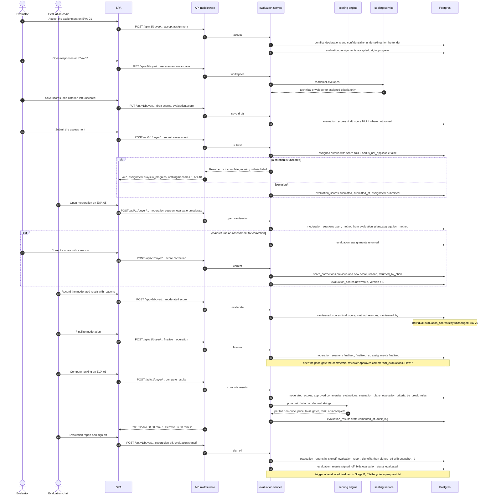

**Worked example reproduced (PRD §9.2, demo T-2026-0003).** Rating scale 0 to 5. Weighted points = final rating ÷ `scale_max` × `max_points`. Price rule `lowest_ratio`: lowest eligible evaluated cost ÷ this offer's evaluated cost × price weight 30. Calculation uses `decimal_places_calc` (default 4). Display uses `decimal_places_display` (default 2).

| Criterion | Max points | Serowe (Supplier A) | Tsodilo (Supplier B) |
|---|---|---|---|
| Solution quality | 35 | 28.00 (4 of 5) | 31.50 (4.5 of 5) |
| Delivery approach | 20 | 16.00 | 18.00 |
| Relevant experience | 15 | 12.00 | 13.50 |
| Price (evaluated cost 100,000 vs 120,000) | 30 | 30.00 | 25.00 |
| **Total** | 100 | **86.00** | **88.00**, rank 1 |

**Failure handling.**

| Condition | Result |
|---|---|
| Unscored criterion | Submission refused. The assignment stays `in_progress`. The engine reports the bid as incomplete instead of computing a total with 0 (AC-18). |
| Evaluator has not signed the undertaking or declared conflicts | Assignment cannot be accepted, and sealing refuses content (BR-08). |
| Conflict declared (for example `sam.dual` on T-2026-0003) | While the disposition is `pending_review`, restricted access is blocked. It resumes only on `cleared` or `mitigated`. `recused` or `reassigned` block access permanently for that subject, and the assignment moves to `recused` or `reassigned` with `reassignment_reason` (DD-25). Prior work is preserved. |
| Scores seen by suppliers | Never. `evaluation_scores`, `moderated_scores`, `commercial_evaluations` and `evaluation_results` are `[R]` tables, unreachable through `forSupplier` (DD-03). Audit rows for scores hold ids and hashes only (DD-31). |
| Moderated score without reasons | 422. `moderated_scores.reasons` is required. |
| Commercial evaluation not approved | The engine cannot compute the price score. Results stay incomplete. |
| Display-rounded tie with different decision values | Ties are decided on calculation precision, then by `tie_break_rules` in sequence (PRD §9.3). |
| Rank treated as award | It is not. Ranking never triggers an award ([Flow 9](#11-flow-9-award-standstill-complaint-hold-and-final-award-ac-25)). |

---

## 11. Flow 9: Award, standstill, complaint hold and final award (AC-25)

**Narrative.** The award recommendation brings together signed-off evaluation results and the other inputs FR-17 lists. Submitting it moves the tender from `under_assessment` to `award_pending`, so approval, notification and any challenge hold all happen while the tender is `award_pending` (PRD §8.2 "Award decision pending"; [05-lifecycles.md](05-lifecycles.md)). It is approved through the approvals service with `award_approval` authority. A tender can have several `award_recommendations` over time, each covering the lots listed in its `lot_outcomes`, so lots on different timelines are supported. The final award is distinct from the intent: it is its own approval per lot outcome, of subject type `final_award`, recorded in `lot_outcomes.final_award_approval_id` (DD-14). Deciding either approval requires `approval.decide`, the decision-specific permission (for an award, `award.approve`) and sufficient authority (DD-24). Complaint holds are `holds` rows owned by the core `lifecycle` service, and tasks are created through the approvals service (DD-16). Every notice in this flow (`intent_to_award`, `unsuccessful_outcome`, `complaint_update`, `standstill_change`, `final_award`) is issued through the notifications service, as in [Flow 4](#6-flow-4-publication-and-invitation-notices). The intention-to-award notice is distinct from the final award notice. Where the policy requires it, the intent notice starts a standstill period computed by the time service from the policy's `standstill_length` and `standstill_day_type` and the tender's calendar. A timely blocking complaint creates a `holds` row whose `blocked_actions` include `award_final` and `contract_sign`. The hold changes no date (BR-13). The `standstill-monitor` job only creates a task when the standstill has ended with no blocking hold, deduplicated by its job idempotency key (DD-19). It never awards. Final award checks the approvals, the standstill, the holds and the conditions (BR-32). The public award notice is read through `v_public_awards`, which shows only published notices (DD-13), at `/awards/:buyerSlug/:ref` (DD-22). Demo: T-2026-0007 is `award_pending` with an intent notice issued, standstill running, and a blocking complaint from Limpopo Environmental Services.

### 11.1 Recommendation, approval and intent notice

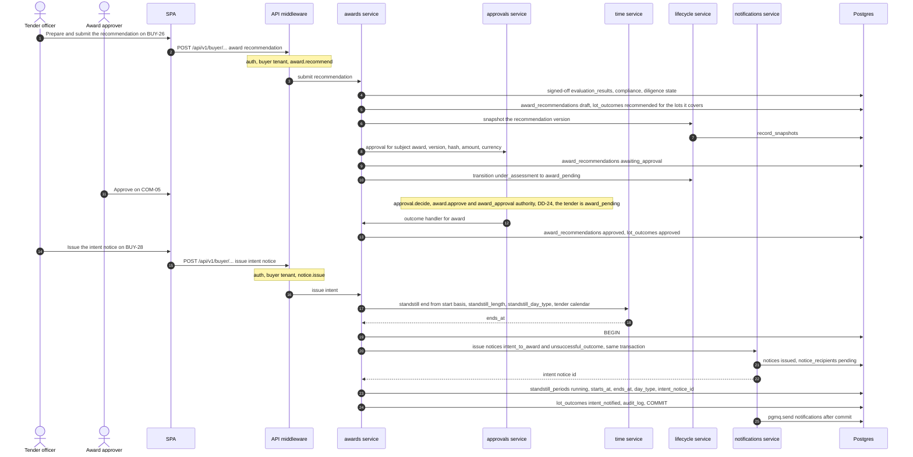

### 11.2 Complaint hold, standstill monitor and final award

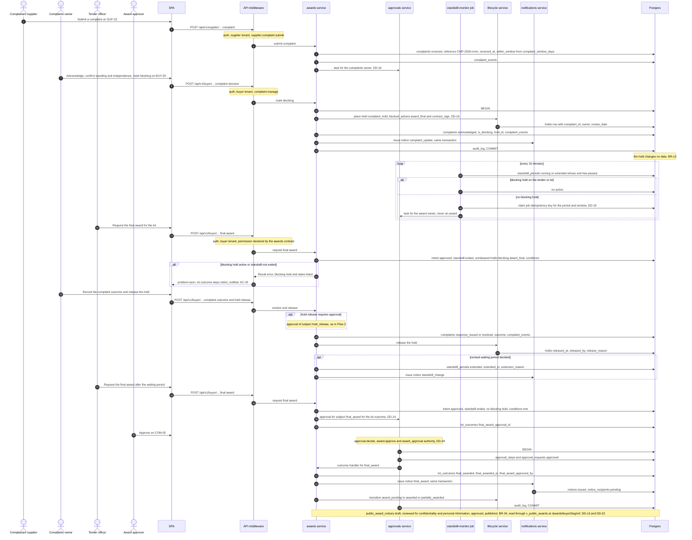

**Failure handling.**

| Condition | Result |
|---|---|
| Recommendation lacks signed-off evaluation results or has unresolved blocking conditions | Result error. Approval cannot be requested. |
| Approver lacks `award_approval` authority for the amount | As in [Flow 2](#4-flow-2-procurement-request-approval-routed-by-authority-ac-05). |
| Recommendation returned or rejected | The tender moves `award_pending → under_assessment` with a reason. The earlier recommendation version is kept ([05-lifecycles.md](05-lifecycles.md), a design reading finalized in Stage B). |
| Complaint outside `complaint_window_days` | Recorded with `within_window = false`. Admissibility is decided explicitly (`admissibility_review`). |
| Independent review required (`complaint_requires_independent_review`) | The case owner must not be the person whose conduct is challenged. `independence_confirmed` records it (FR-17). |
| Final award with an active blocking hold or before the standstill ends | Refused, and the reasons are listed (AC-25). |
| Final award approver lacks `award.approve` or authority for the lot's value | The `final_award` approval step stays `pending`, as in [Flow 2](#4-flow-2-procurement-request-approval-routed-by-authority-ac-05) (DD-14, DD-24). |
| Lots of one tender on different timelines | Each `award_recommendations` row covers the lots listed in its `lot_outcomes`, and each lot outcome has its own `final_award` approval (DD-14). |
| `standstill-monitor` misses ticks | The next tick finds the same periods. It never creates an award. A re-run creates no second task, because the task is deduplicated by a `<job>:<entity>:<window>` key in `job_idempotency_key` (DD-19; [08-background-jobs.md](08-background-jobs.md#4-job-catalog)). |
| Standstill start basis is receipt or acknowledgment (`notices.period_start_basis`) | The start instant depends on delivery events. How the period starts in that case is finalized in Stage B ([§15](#15-open-points) #8). |
| Contract signature while the hold is active | Refused by the contracts service ([Flow 10](#12-flow-10-contract-signature-handover-and-closeout-gate-ac-28-ac-29)). |

---

## 12. Flow 10: Contract, signature, handover and closeout gate (AC-28, AC-29)

**Narrative.** A contract is created from final-awarded lot outcomes. `legal_entity_id` is required before a binding commitment (BR-04). Allocations reconcile to awarded values: the sum of `contract_lot_allocations` for a lot outcome may not exceed its `awarded_value` (BR-33). A contract that differs from the award is flagged (`differs_from_award`, `difference_explanation`), and the difference must be approved before signature through its own approval of subject type `contract_difference`, recorded in `difference_approval_id` (AC-28, DD-14). Signature, effective date, notice to proceed and delivery start are separate milestones (BR-35). A contract is never active merely because it was sent for signature. The `contract-dates` job (daily 02:50 UTC) moves a `signed_not_effective` contract to `active` when its effective date is reached, and an `active` contract to `expired` after `term_end`, leaving open obligations in place (DD-19). An external signature failure is recorded by the contracts domain as an `integration_exceptions` row (DD-17, AC-33). The event closeout is gated: every lot has an explicit outcome, awarded lots have signed contracts, handovers are accepted, and no case or hold remains open. A failed gate is recorded as `event_closeouts.status = 'blocked'` with `blocking_reasons` (AC-29). Demo: C-2026-0002 is `awaiting_signature` and differs from the award. T-2026-0010 has an accepted handover leading to C-2026-0001.

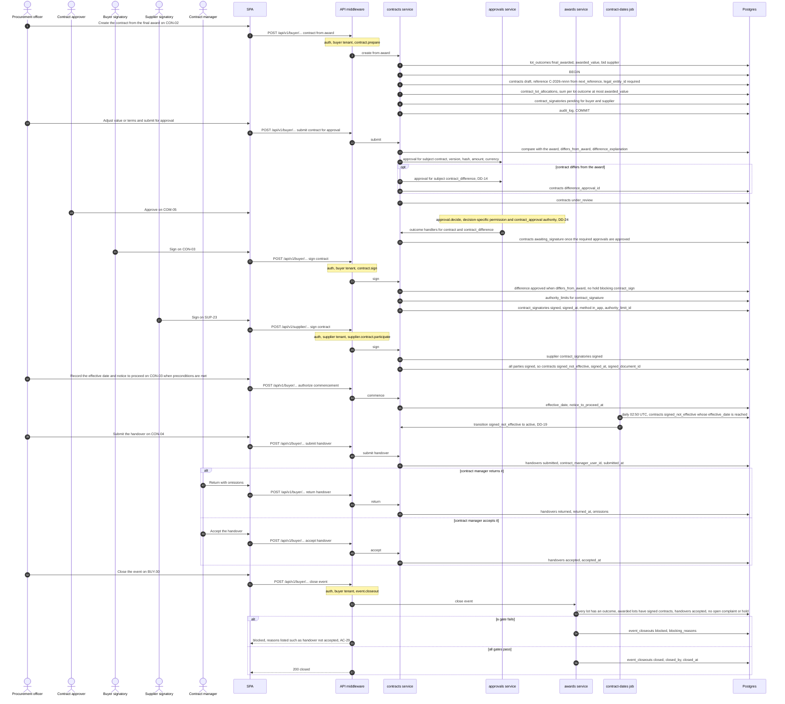

**Failure handling.**

| Condition | Result |
|---|---|
| Allocations exceed the awarded value of a lot outcome | Service check refuses (BR-33). |
| Contract differs from the award and the difference is not approved | Signature refused (AC-28). |
| Signatory lacks `contract_signature` authority for the value | Signature refused. The authority limit used is recorded on `contract_signatories.authority_limit_id` when it succeeds. |
| Complaint hold blocks `contract_sign` | Signature refused ([Flow 9](#11-flow-9-award-standstill-complaint-hold-and-final-award-ac-25)). |
| A signatory refuses | `contract_signatories.status = 'refused'`. The contract stays `awaiting_signature`. |
| Agreement signed outside the app | Recorded as `signed_outside_app` with `external_signature_evidence`, and signatories `recorded_external` with `method = 'external_recorded'`. No in-app signing evidence is manufactured (PRD §20). |
| External signature service reports a failure | The contracts domain writes an `integration_exceptions` row, an allowed cross-domain write (DD-17, AC-33). |
| Handover returned | `omissions` recorded. The event closeout gate stays blocked and the incomplete handover remains visible (AC-29). |
| Moving `signed_not_effective` to `active` | CON-03 records the effective date and notice to proceed. The `contract-dates` job (daily 02:50 UTC) performs the transition when the effective date is reached (DD-19; [08-background-jobs.md](08-background-jobs.md#4-job-catalog)). |
| Contract passes `term_end` | The `contract-dates` job moves it from `active` to `expired`. Open obligations remain (DD-19). |

---

## 13. Flow 11: Milestone evidence rejection (AC-30)

**Narrative.** A supplier submits evidence against a milestone (`obligations.kind = 'milestone'`). The file travels through the two-step upload ([Flow 12](#14-flow-12-document-upload-two-step-envelope)) into the `contract-documents` bucket. Its storage key is prefixed with the buyer tenant, which owns the contract record, and `documents.owner_tenant_id` records the supplier as the uploader (DD-12). The buyer's rejection records reasons, which are required, plus the remediation requirement, owner and due date in `acceptance_decisions`. It also creates a remediation task through the approvals service, which owns `tasks` (DD-16). A rejection never implies acceptance or payment readiness: `contract_invoices.acceptance_status` and `payment_status` are unchanged. Resubmission adds new `obligation_evidence` rows. Earlier evidence and decisions are kept. Demo: on C-2026-0001, the milestone "Q3 service report" evidence was rejected with remediation.

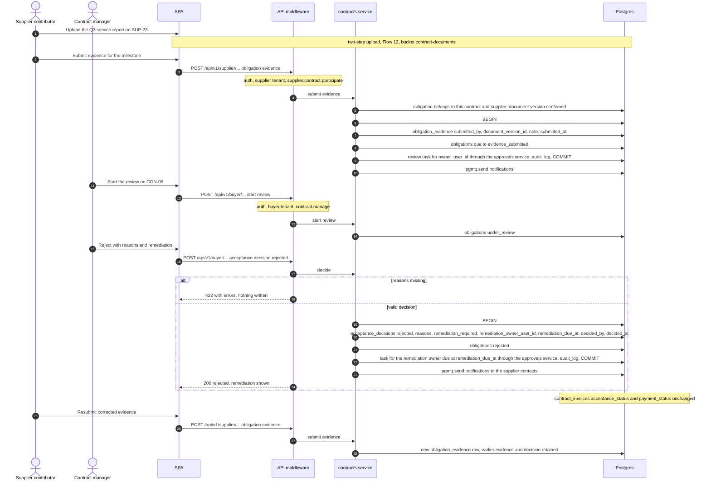

**Failure handling.**

| Condition | Result |
|---|---|
| Decision without reasons | 422. `acceptance_decisions.reasons` is required. |
| Supplier submits evidence for another supplier's contract | `forSupplier` scoping finds no row. The response matches a missing record. |
| Evidence document not confirmed (upload still `pending`) | Result error. Only confirmed versions can be referenced. |
| Obligation passes its due date without evidence | The `obligation-status` job marks it `overdue` and creates escalation tasks ([08-background-jobs.md](08-background-jobs.md)). |
| Payment milestone rejected | `is_payment_milestone` does not change invoice or payment status. Payment readiness is never implied (AC-30). |
| Status transition out of `rejected` on resubmission | Governed by the obligation legality matrix ([05-lifecycles.md](05-lifecycles.md)), finalized in Stage B. |

---

## 14. Flow 12: Document upload two-step envelope

**Narrative.** Files never pass through the API function. The client asks the documents service for a signed upload URL tied to a `pending` `document_versions` row, uploads the bytes directly to Supabase Storage with a plain HTTP request to that URL, and then confirms. The browser never uses the supabase-js Storage client (brief §5.7, §10). The documents service authorizes the request before calling `StorageAdapter`, because the adapter performs no checks. Access is decided per related type by `domains/documents/access-registry.ts`, and unregistered types are denied. Object keys follow `<owning-record tenant_id>/<related_type>/<related_id>/<document_id>/<version_no>-<sanitized name>`. The buyer tenant owns procurement records even for supplier uploads, and `documents.owner_tenant_id` records who uploaded (DD-12). Buckets are private and created by migration: `tender-documents`, `bid-submissions`, `supplier-evidence`, `contract-documents`, `exports`. Never-confirmed uploads are removed by the `upload-reaper` job (brief §5.9).

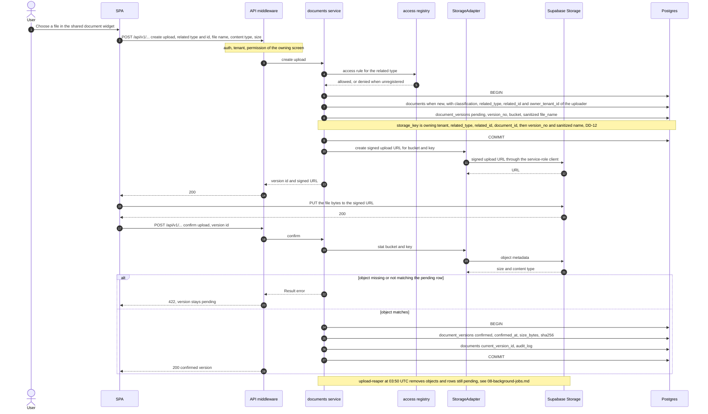

**Download.** A download goes through the same access rule and returns a short-lived signed download URL from `StorageAdapter`. Supplier access to tender documents is logged in `document_access_log` (`tender_id`, `user_id`, `document_version_id`, `accessed_at`).

**Stage notes.** In Stage A the mock API returns contract-valid static responses and no file is stored. Real upload flows go into the shared document widgets in Stage B phase B1 (agent `ui-live-api`, architecture-plan §5). `FakeStorageAdapter` serves tests and local development, and composition throws if it is selected when `APP_ENV !== 'local'`.

**Failure handling.**

| Condition | Result |
|---|---|
| Related type not registered in `access-registry.ts`, or the rule denies | Refused before any row or URL is created. |
| Signed URL creation fails after the pending row committed | Error returned. The orphan pending row is removed by `upload-reaper`. |
| Upload interrupted or never confirmed | The row stays `pending`. `upload-reaper` removes the object and the row. |
| Confirm called but the object is missing or does not match | 422. The row stays `pending`, or moves to `rejected` for a mismatch. |
| Confirmed version referenced by a submission | Immutable. A later upload creates a new version (`supersedes_version_id`). Receipts inventory the exact version with `sha256` (FR-12, PRD §14.1). |
| `sha256` source | Recorded on confirm. Whether it is computed client-side or by reading the object server-side is finalized in Stage B. |

---

## 15. Open points

These details are not fixed by the sources and are finalized in Stage B unless noted. Points resolved by the design decision log (`docs/plan/design-decisions.md`) are marked and kept for traceability.

| # | Flow | Open point |
|---|---|---|
| 1 | All | Exact endpoint paths, ids, error codes and HTTP statuses per domain error. Fixed by the Stage A contracts and listed in [07-api.md](07-api.md). The decision log fixes only the `/me/*` aggregation (DD-21), the buyer slug in public URLs with tender ids in supplier API paths (DD-22), and the invitation-accept route (DD-27). |
| 2 | 2 | The algorithm that selects step approvers from `policy_thresholds.required_approval_level`, `authority_limits`, committees and `route_mode`. DD-24 fixes only the cross-currency case: with no exchange rate, the step routes to the next level up. |
| 3 | 3 | The rule set that classifies an edit as material, and the lifecycle target state when a `ready` tender's approval is invalidated. |
| 4 | 4 | How external notice confirmation or failure is captured, and recipient resolution of `tender_issued` for open tenders (`notice_subscriptions`, `saved_searches`). |
| 5 | 5 | How a `failed_error` attempt is persisted after its transaction rolls back. Whether a late attempt also creates a `submission_receipts` row with status `late_rejected`. Serialization of concurrent submissions of the same bid beyond the partial unique index. |
| 6 | 7 | Resolved — DD-23 (with DD-16): the price gate is released with `evaluation.chair`, and `price_gate_releases` is owned by the evaluation domain. |
| 7 | 8 | Whether `bids.evaluation_status = 'evaluated'` is set at result computation or at report sign-off. Drawn at sign-off, following the `in_evaluation → evaluated` row of [05-lifecycles.md](05-lifecycles.md) ("computed and signed off", open point 14). |
| 8 | 9 | Resolved — DD-19: `standstill-monitor` deduplicates its task with a `<job>:<entity>:<window>` key in `job_idempotency_key`, so a re-run creates no second task. Still open: standstill start when `period_start_basis` is `receipt` or `acknowledgment`. |
| 9 | 10 | Resolved — DD-19: the `contract-dates` job (daily 02:50 UTC) moves `signed_not_effective` to `active` when the effective date is reached; CON-03 records the effective date and notice to proceed. |
| 10 | 12 | How `sha256` is computed on confirm. The age threshold after which `upload-reaper` treats a pending upload as abandoned. |
| 11 | 4 | DD-44 fixes the `email` channel: `nodemailer` over SMTP, Mailpit locally, `delivered` when Mailpit accepts the message, and no email rows when email is disabled. Still open: where the SMTP send sits relative to the per-message transaction (no network calls inside a transaction, brief §5.6), how a failed send is retried, and whether a failed email raises a `delivery_exception` task when in-app delivery succeeded. Deferred (DD-44): the hosted provider and its delivery-event webhooks. |
| 12 | 1 | Resolved — DD-43: real Supabase Auth in local Docker from Stage A. The mock sign-in is removed. Original design, kept for traceability: "`VITE_AUTH_MODE` (`mock` or `supabase`) selects a `mock` `AuthAdapter` that signs in demo personas against `/api/v1/__mock/auth/*`, with a persona switcher; the `supabase` adapter is written in Stage A and first used in Stage B" (the withdrawn DD-38). |
