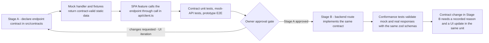
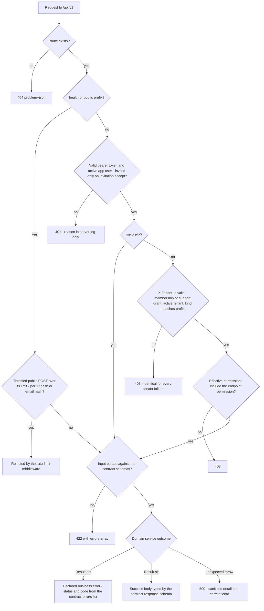
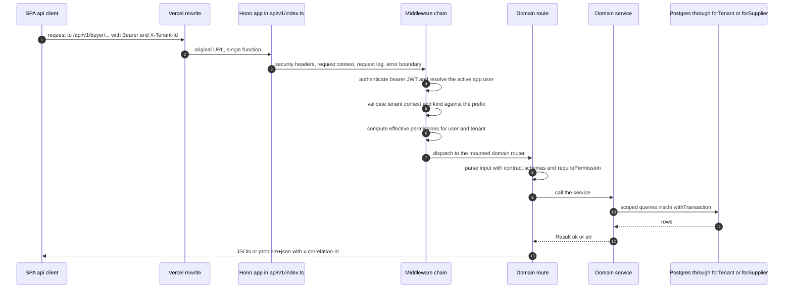
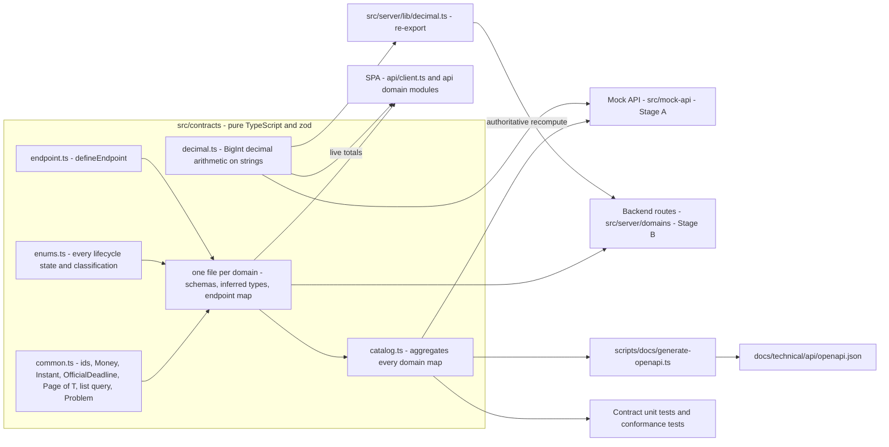
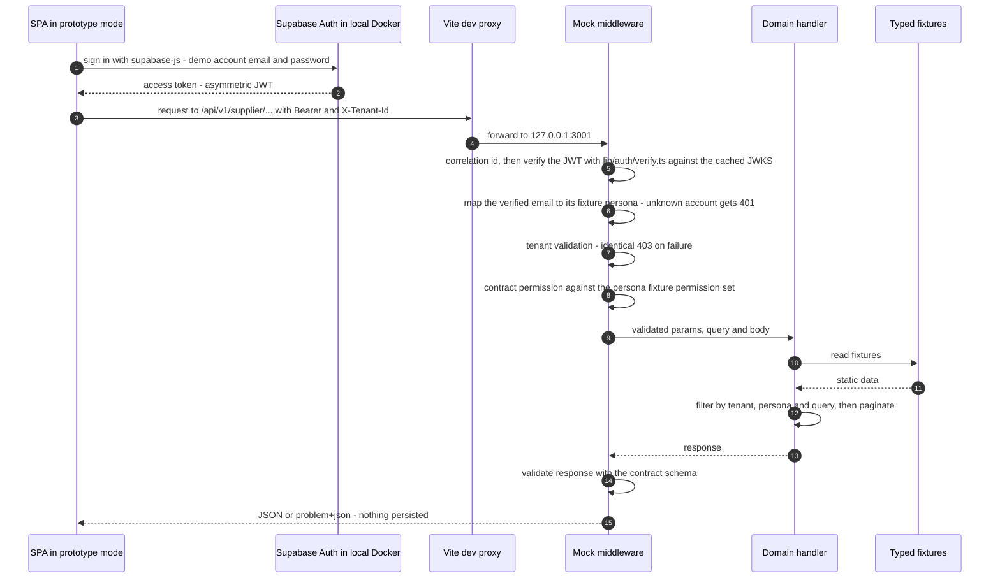

# API

Status: As-built (Stage A prototype); backend sections as-designed

Sources:
- `docs/plan/design-decisions.md`: DD-02 (`UNIQUE NULLS NOT DISTINCT`), DD-03 ([S] and [R] tags, `forSupplier` allow-list), DD-04 (`customer_tenant_id`), DD-05 (sealed envelope mapping), DD-06 (`invitations.role_ids`), DD-09 (reference formats), DD-10 (identity defaults on `tenants`), DD-11 (audit partition of cross-tenant rows), DD-12 (storage keys), DD-13 (views), DD-14 (approval subject types, including `final_award`), DD-15 (deadline authority), DD-16 (shared owners, exports, price gate), DD-18 and DD-19 (split and added jobs), DD-20 (expiry semantics), DD-21 (`/me` personal inbox), DD-22 (buyer slug in public URLs), DD-23 (permission additions), DD-24 (approver permissions), DD-27 (invitation acceptance and supplier registration), DD-28 (public write rate limiting), DD-29 (MFA deferred), DD-30 (API and SPA document headers), DD-31 (audit content for sealed records), DD-32 (shared decimal helper), DD-33 (zone display), DD-38 (**withdrawn** by the owner decision of 2026-09-29, superseded by DD-43), DD-39 (idempotency keys), DD-40 (`framework_calloff`), DD-41 (bid intent), DD-42 (acknowledgment authority), DD-43 (real Supabase Auth in local Docker from Stage A: no mock auth, real JWT verification in the mock API, dev-only demo accounts, `environment.mode`), DD-44 (email delivery channel: `nodemailer` over SMTP, Mailpit locally, hosted provider and webhooks deferred), DD-45 (Node 24), and §E (owner decisions of 2026-09-29).
- `docs/plan/architecture-plan.md` (revision 3): §0 delivery stages and the approval gate, §2 "no placeholder" rule, §3.1 tenancy and audience prefixes, §3.2 authorization model, §3.3 sealing, §3.4 official time, §3.5 versioning and approvals, §3.6 state machines, §3.7 money and scoring (shared decimal helper), §3.8 notifications (`in_app` and `email` delivery channels), §3.9 background jobs and queues, §3.10 contracts-first API, §3.11 prototype mode (local Supabase stack, real JWT verification, demo accounts), §4 repository layout, URL map, registries and cross-domain writes, §5 build waves and file ownership (A1 `mock-platform`, B1 `platform-data-auth`, B1 `ui-live-api`), §6 domain map, §8 testing strategy, §9 build commands (`supabase:start`, `auth:personas`), §11 deviations (items 2, 3, 4, 6 and 8 decided on 2026-09-29) and the other owner answers.
- `docs/plan/email-delivery-options.md`: local email through Mailpit (decided, DD-44) and the deferred hosted provider options.
- `docs/plan/tenderiq-prototype.workflow.js`: the A1 `scaffold` task (`supabase/config.toml`: `enable_signup = false`, Mailpit SMTP port 54325), the A1 `contracts-core` task (`decimal.ts`, the `idempotent` flag of `defineEndpoint`, `/me` lists), the A1 `mock-platform` task (mock middleware chain with real JWT verification through `src/server/lib/auth/verify.ts`, the Stage A `lib/config` and `lib/supabase`, `seed-auth-personas.ts`, the `environment` member of `/me/context`, the `scan-bundle` demo-accounts check) and the A1 runtime smoke gate.
- `docs/plan/tenderiq-backend.workflow.js`: the B1 `scaffold-b` task (SMTP variables for Mailpit), the B1 `platform-http` task (`lib/config` extended with the DD-44 email variables), the B1 `platform-data-auth` task (extends the Stage A `lib/supabase` and `lib/auth/verify.ts`), the B1 `ui-live-api` task and the B2 `svc-notifications` task (`DeliveryChannel` with `in_app` and `email`).
- `docs/architecture-brief.md`: §3.1 `vercel.json` rewrites, §3.2 function entrypoint shape, §5.1 request pipeline, §5.3 errors and results, §5.6 numeric and id type parsing, `forTenant`, §5.7 authentication and 401/403 semantics, §5.8 authorization, §5.9 file storage, §7.4 local API hosting, §9.2 job endpoint protection, §10 SPA API client, §13 post-deploy smoke, §14 security checklist.
- `docs/plan/schema-blueprint.md`: §0 conventions (tags, numeric types, references, forward FKs, nullable unique keys), Migration 01 (`audit_log`, job platform, `invitations`), Migration 04 (`approval_requests`, `notices`, `notice_recipients`, `documents`), Migration 09 (`bids`, `submission_attempts`, `v_bid_receipt_metadata`), Migration 11 (`lot_outcomes`), Migration 13 (`support_access_grants`, `exports`, `rate_limit_buckets`, `request_idempotency`), Migration 14 (views), §P permission catalog.
- `docs/PRD.md`: §3 amount kinds, §4.2 permission principles, §4.3 audience matrix, §10 BR-11, BR-13, BR-17 to BR-21, BR-41 to BR-43, §11 to §13 screen catalogs, §14.1 exports, §23 acceptance scenarios.
- `docs/plan/demo-storyline.md`: personas and the fixture world served by the mock API.

Contents:
1. [Scope and stage applicability](#1-scope-and-stage-applicability)
2. [Surface, base path and audiences](#2-surface-base-path-and-audiences)
3. [Request conventions](#3-request-conventions)
4. [Responses and errors](#4-responses-and-errors)
5. [Lists: pagination, filtering and sorting](#5-lists-pagination-filtering-and-sorting)
6. [Commands, state guards and idempotency](#6-commands-state-guards-and-idempotency)
7. [Correlation ids, logging and security headers](#7-correlation-ids-logging-and-security-headers)
8. [Data encoding: ids, money, decimals, instants and official deadlines](#8-data-encoding-ids-money-decimals-instants-and-official-deadlines)
9. [The contracts module (`src/contracts`)](#9-the-contracts-module-srccontracts)
10. [OpenAPI generation](#10-openapi-generation)
11. [Stage A mock API](#11-stage-a-mock-api)
12. [Endpoints outside `/api/v1`](#12-endpoints-outside-apiv1)
13. [Endpoint catalog by domain](#13-endpoint-catalog-by-domain)
14. [Open points](#14-open-points)
15. [Related documents](#15-related-documents)

---

## 1. Scope and stage applicability

TenderIQ exposes one versioned HTTP API under `/api/v1`. The SPA is its only first-party client. The API is designed **contracts-first**: every endpoint the UI calls is declared once, as a typed zod contract in `src/contracts/`, before any backend exists ([adr/0006-contracts-first-ui-prototype-stage.md](adr/0006-contracts-first-ui-prototype-stage.md)).

| Stage | What serves `/api/v1` | Data | Where it runs |
|---|---|---|---|
| **A: UI prototype** | The **mock API** (`src/mock-api/`, Hono), same URL surface, same middleware semantics, including real Supabase JWT verification (DD-43) | Static typed fixtures from the demo storyline. Nothing is persisted. The accounts are real: demo personas in local Supabase Auth | `127.0.0.1:3001` via `scripts/dev/serve-mock-api.ts`; Vite proxies `/api/v1` to it (`npm run dev:prototype`). The local Supabase CLI stack runs in Docker for Auth only (`npm run supabase:start`) |
| ⛔ Approval gate | — | — | Stage B starts only after explicit written owner approval (architecture-plan §0) |
| **B: Full backend** | The real Hono app (`src/server/`), implementing **the same contracts** | Supabase PostgreSQL 17 | Locally `127.0.0.1:3001` via `scripts/dev/serve-api.ts`; deployed as the single Vercel function `api/v1/index.ts` on Node.js 24.x (DD-45) |

The mock API remains after Stage B as a development and test tool (`npm run dev:prototype`, Playwright visual tests). The production build and `api/` never include it; `scan-bundle` verifies this (architecture-plan §11.1). The prototype runs locally only; there is no hosted prototype (owner decision of 2026-09-29, design-decisions §E.2).



## 2. Surface, base path and audiences

### 2.1 Base path and hosting

- Base path: **`/api/v1`**. The SPA calls relative URLs (`/api/v1/...`), so the browser always sees one origin and no CORS configuration exists (brief §7.4).
- Deployed, the whole versioned API is **one** Vercel function, `api/v1/index.ts`, selected by the rewrite `/api/v1/:path*` → `/api/v1`. The function receives the original URL and Hono routes on the real path (brief §3.1). The function runs on the Vercel Node.js 24.x runtime, selected through `engines` `24.x`; this deviates from the brief's Node 22 pin (DD-45). The function builds the Hono app lazily and caches it per cold start. A configuration failure returns a sanitized 500 problem+json with a correlation id instead of crashing at module load (brief §3.2).
- Health: `GET /api/v1/health` is public and returns `200 {"status":"ok","version":"v1"}` (brief §13).

### 2.2 Audience prefixes

The API surface is partitioned by **audience**. The tenant middleware enforces that the active tenant's `kind` matches the route prefix, and the mock API enforces the same rule (architecture-plan §3.1, [adr/0001-tenancy-equals-organization.md](adr/0001-tenancy-equals-organization.md)).

| Prefix | Authentication | `X-Tenant-Id` | Required active tenant kind | Data access path (Stage B) | Screen families |
|---|---|---|---|---|---|
| `/api/v1/health` | none | not sent | — | none | smoke checks |
| `/api/v1/public/*` | none | not sent | — | public projections only: `v_public_tenders` (open participation, buyer portal enabled, public-safe statuses, no internal budget), `v_public_awards` (published public award notices only), published notices, plans and guidance (DD-13). Public POSTs (registration, register interest, access requests) are rate-limited (§3.6) | PUB-01…07, SUP-02 registration |
| `/api/v1/me/*` | bearer | **exempt** for reads (an action on a listed row carries the row's tenant, see below) | — | the caller's person-level data (`users`, own memberships, preferences) and the caller's **own** tasks, notifications, approvals, documents and search results across all active memberships, each labelled with its organization (DD-21) | COM-01…08, SPA boot |
| `/api/v1/buyer/*` | bearer | required | `buyer` | `forTenant(db, tenantId)` | BUY, EVA, CON, ADM, REP |
| `/api/v1/supplier/*` | bearer | required | `supplier` | `forSupplier(db, supplierTenantId)` on the allow-list `supplier-scoped-tables.ts`, generated from the blueprint's [S] tags; [R] tables are never reachable (DD-03). `forTenant` for rows the supplier tenant owns (pursuits, supplier notes, internal approvals, evidence) | SUP-01…24 |
| `/api/v1/ops/*` | bearer | required | `operator` | operator-owned global tables (`subscriptions`, `support_cases`, `service_incidents`…); rows about a customer name it in `customer_tenant_id` (DD-04) | OPS-01…07 |

**`/me` personal inbox (DD-21).** `/api/v1/me/tasks`, `/me/notifications`, `/me/approvals/:id`, `/me/documents/:id` and `/me/search` return the caller's own rows across **all active memberships**, each labelled with its organization. Reads need no `X-Tenant-Id`. An **action** on such a row (complete a task, acknowledge a notification, decide an approval) requires `X-Tenant-Id` equal to the row's tenant. Global search still filters every result by the caller's authorization **in the row's tenant**. One more `/me` route is special: `POST /api/v1/me/invitations/:token/accept` is the only route the auth middleware allows for a user in status `invited` (§3.2, DD-27).

**No mock-only auth routes (DD-43).** Neither stage has `/api/v1/__mock/auth/*` endpoints. Sign-in, password reset, invitation set-password, token refresh and sign-out go to Supabase Auth through supabase-js in both stages; from Stage A, Supabase Auth runs in the local Supabase Docker stack ([09-frontend.md](09-frontend.md#11-authentication-demo-accounts-and-prototype-banner)).

### 2.3 Buyer-owned records seen by suppliers

Procurement records carry `tenant_id` = the **buyer** tenant, plus `supplier_tenant_id` where a supplier is involved. The blueprint tags decide what a supplier can reach (DD-03):

- **[S] supplier-accessible.** The table is on the explicit allow-list `supplier-scoped-tables.ts`, which is generated from the blueprint tags, not from column presence. `forSupplier(db, supplierTenantId)` works only on these tables and filters on `supplier_tenant_id`.
- **[R] reference only.** The table carries `supplier_tenant_id` but is buyer-internal (for example `buyer_supplier_relationships`, `compliance_checks`, `exclusions`, `evaluation_scores`, `evaluation_results`, `shortlist_entries`, `preferred_bidders`, `negotiations`, `late_submission_exceptions`, `renewal_options`). `forSupplier` can never reach it, and a guard test asserts that no [R] table is on the allow-list. Suppliers learn outcomes only through notices and the supplier-facing projections defined in the contracts, so no supplier response schema is built from an [R] table.

A supplier request carries the supplier's own tenant id in `X-Tenant-Id`. Supplier inserts into buyer-owned tables name the buyer `tenant_id` explicitly, only after the service verifies participation. Such an action is audited in the **buyer's** `audit_log` partition, with `actor_capacity` naming the supplier organization (DD-11). Supplier-private collaboration (pursuits, notes, internal approvals, internal comments) lives in rows owned by the supplier tenant, which the buyer never reads. In particular, a pursuit decision is supplier-private: the buyer-visible `participants.bid_intent` and `shared_no_bid_reason` change **only** through the explicit "notify buyer" action on SUP-07 or SUP-09 (DD-41) ([adr/0002-buyer-owned-procurement-records.md](adr/0002-buyer-owned-procurement-records.md), [04-security-model.md](04-security-model.md)).

### 2.4 Operator support access

An operator may act inside a customer tenant only while an active, customer-authorized `support_access_grants` row exists (OPS-04). A customer administrator authorizes the grant with the permission `org.support_access.authorize` (DD-23). The grant names the customer in `customer_tenant_id` (DD-04). During a grant:

- the operator sends the customer's tenant id in `X-Tenant-Id` and uses that tenant's audience prefix;
- the request-time check compares the grant's `starts_at`, `expires_at` and `revoked_at` directly. The `expire-support-access` job only updates the display status and audits it (DD-18);
- access is read-only through `support.view`. It never includes sealed content, supplier drafts or evaluation scores, and never allows submit, score, approve or sign;
- the access is written to `audit_log` (with `support_grant_id`) **before** the handler runs, in the **customer** tenant's partition, so the customer can review it (DD-11);
- an endpoint admits the grant only when it lists `support.view` **and** declares a support surface the grant `scope` opens (`supportGrantAllows()` in `src/contracts/endpoint.ts`: surface `metadata` for every grant, surface `records` only for `specific_records`); every other endpoint answers 403 `FORBIDDEN` under a grant. The mock API applies the same rule in its permission middleware.

The Stage A contracts fix which read endpoints honour `support.view`, and how the grant `scope` (`metadata_only`, `specific_records`) restricts responses ([adr/0013-operator-support-access-grants.md](adr/0013-operator-support-access-grants.md)).

## 3. Request conventions

### 3.1 Headers

| Header | Sent on | Value and rules |
|---|---|---|
| `Authorization: Bearer <token>` | every non-public request | The Supabase Auth access token (asymmetric ES256 JWT) in **both stages**. The SPA reads it **per request** from the supabase-js session. In Stage A the token comes from local Supabase Auth in Docker, and the mock API verifies it exactly as the real API does (§3.2, DD-43). |
| `X-Tenant-Id` | `/buyer/*`, `/supplier/*`, `/ops/*`; an action on a `/me` row | The active tenant id (`tenants.id`), taken from the Redux session slice. The SPA omits it on `/me/*` reads, `/public/*` and `/health`. An action on a row listed under `/me/*` sends the **row's** tenant (DD-21). The server never trusts it without verification (brief §5.8). |
| `Idempotency-Key` | optional, on commands that create records | Stored in `request_idempotency` for 24 hours (§6, DD-39). |
| `x-correlation-id` or `x-request-id` | optional | If present, the server adopts it as the correlation id. Otherwise the server generates one. The response always echoes `x-correlation-id` (see §7). |

Request and response bodies are JSON. Errors use `application/problem+json` (§4).

Every response, success or error, carries two headers set by the request-context middleware (§7.1 step 2):

| Response header | Value and rules |
|---|---|
| `x-correlation-id` | The request's correlation id (§7.2). |
| `x-server-time` | The API clock at the time of the request, as an ISO 8601 UTC instant without milliseconds (for example `2026-10-06T08:00:00Z`). In the Stage A mock API it is the storyline clock (`storylineNow()`, never earlier than `DEMO_AS_OF` in `src/mock-api/fixtures/demo-clock.ts`); in Stage B it is the server clock. The SPA uses it, together with `serverTime` of `/api/v1/me/context`, only to align its display clock (`src/ui/src/lib/clock.ts`, [09-frontend.md](09-frontend.md#13-official-deadlines-and-time-display)); deadline decisions stay on the server. |

### 3.2 Authentication

Authentication is real Supabase Auth in **both stages** (DD-43). Server-side verification runs cheapest and most suspicious checks first (brief §5.7):

1. decode the unsigned header (malformed → reject);
2. allow asymmetric algorithms only (blocks `none` and HS* downgrade);
3. resolve `kid` against the cached JWKS (unknown → reject, no network round-trip);
4. `supabase.auth.getClaims(token, { keys: [key] })` (local WebCrypto plus an exp check);
5. pin `iss` to the project's auth URL.

These checks live in `src/server/lib/auth/verify.ts`. A1 `mock-platform` writes it in **Stage A**, together with the real `src/server/lib/config` (Stage A variables `APP_ENV`, `LOG_LEVEL`, `SUPABASE_URL`, `SUPABASE_ANON_KEY`, `SUPABASE_SERVICE_ROLE_KEY`) and `src/server/lib/supabase` (memoized verification and admin clients, JWKS cache). Stage B extends these modules and never rewrites them: B1 `platform-http` extends `lib/config` to every server variable, and B1 `platform-data-auth` adds the auth middleware that resolves the application user (architecture-plan §5).

What happens after verification depends on the stage:

| Stage | Identity resolution |
|---|---|
| A: mock API | The verified email maps to its fixture persona. A verified account with no fixture persona gets 401. |
| B: real API | The verified `sub` maps to `users.auth_user_id`. The application user must exist and be `active`, with one exception: `POST /api/v1/me/invitations/:token/accept` is the one route the auth middleware allows for a user in status `invited`. Accepting activates the membership, and the user if needed (DD-27). |

Sign-in errors return one generic message.

Self-signup is disabled (`enable_signup = false` in `supabase/config.toml`, brief §5.7), locally and hosted alike; accounts are provisioned through the Auth Admin API ([adr/0012-supplier-registration-via-provisioned-accounts.md](adr/0012-supplier-registration-via-provisioned-accounts.md)). Public supplier registration creates the tenant (status `pending`), the user (`invited`), a pending membership and the supplier profile in **one transaction**, which **commits**. **After the commit**, it calls the Auth Admin invite (brief §5.6 forbids network calls inside a transaction). If the invite fails, a short follow-up transaction sets the registrant’s `invitations` row to `send_failed`; the state guard allows a retry, and the registrant sees "we could not send the verification email — try again". A "resend verification" action and the unique `users.email` constraint prevent duplicates (DD-27). The owner confirmed this approach on 2026-09-29 (architecture-plan §11.4, design-decisions §E.7). Locally, the verification and set-password email that Supabase Auth sends lands in Mailpit (`http://127.0.0.1:54324`), as do invitation and password-reset emails (DD-43).

MFA and step-up authentication (PRD FR-03 "may be required as business policy") are **not** in the initial release; the brief's auth configuration disables MFA. They are recorded as a later extension using Supabase MFA (DD-29, architecture-plan §11.10).

### 3.3 Tenant context and permissions

For `/buyer/*`, `/supplier/*` and `/ops/*`, the tenant middleware validates `X-Tenant-Id` against an active membership (or an active support grant, §2.4), the tenant's active state, and the route prefix's tenant kind. Every failure returns **one identical 403**, so the response cannot be used to learn which tenants exist.

The permission middleware then computes the effective permission set for (user, tenant) from four sources: role assignments through direct membership, role assignments through groups, direct exceptional grants, and explicit restrictions, which subtract from the result and win over everything else (architecture-plan §3.2). Grants, restrictions, delegations and invitations are always checked against their validity timestamps (`starts_at`, `expires_at` or `ends_at`, `revoked_at`) at request time; the `expire-access` job only updates display statuses and sends notices (DD-18). A role assignment scoped to a legal entity, department, category (including descendants) or project covers a tender when the tender's corresponding column matches; lots inherit from their tender, and contracts inherit through their tender and also match on their own legal entity (DD-26).

Each endpoint declares its `permission` in the contract. The route calls `requirePermission(code, { scope? })`. Domain services add the finer checks: sealing, event-level assignment (BR-26), conflicts (BR-08), segregation of duties (BR-07) and authority limits (BR-06). Two of them are fixed by the decision log:

- **Approver permissions (DD-24).** Deciding an approval step requires `approval.decide` **and** the decision-specific permission (for example `award.approve`) **and** sufficient authority. Cross-currency authority uses `exchange_rates` at the request date. With no rate, the step routes to the next level up; it never passes by assumption.
- **Conflict gating (DD-25).** A declaration with `has_conflict = true` blocks restricted access while its disposition is `pending_review`. Access resumes only on `cleared` or `mitigated`; `recused` and `reassigned` block permanently for that subject.

See [04-security-model.md](04-security-model.md).

### 3.4 Input parsing

Stage B routes parse `params`, `query` and `body` with the contract's zod schemas and type their responses with the contract's types (architecture-plan §3.10). The mock API validates requests against the same schemas. Zod v4 is the validator at every boundary. Required fields are declared as required, never as `.nullish().refine(...)`, because an optional schema short-circuits on `undefined` and the refinement never runs (brief §5.3).

### 3.5 Files

Uploads use the brief's two-step envelope (brief §5.9): the client obtains a signed upload URL for a `pending` `document_versions` row, uploads the bytes directly to that URL, then calls a confirm endpoint. A cron job (`upload-reaper`) removes pending uploads that were never confirmed. Downloads use signed download URLs issued after the domain authorizes the caller; the storage adapter itself performs no checks. The browser never uses the Supabase Storage client. Real upload flows arrive in Stage B (B1 `ui-live-api`). In Stage A, upload and download commands return contract-valid static responses.

Storage keys follow `<owning-record tenant_id>/<related_type>/<related_id>/<document_id>/<version_no>-<sanitized name>`. The buyer tenant owns procurement records even for supplier uploads, and `documents.owner_tenant_id` records who uploaded (DD-12).

Exports (`exports.format` ∈ `xlsx`, `csv`, `html`) are produced asynchronously on the `exports` queue. The **documents** service owns them: every export request goes through `requestExport()`, and each domain contributes a per-type generator registered in `documents/export-registry.ts`, which the Integration step wires (DD-16, [08-background-jobs.md](08-background-jobs.md)).

### 3.6 Public write endpoints and rate limiting

The public POSTs (supplier registration, register interest, access requests) are throttled by an application middleware, per IP hash and per email hash. Counters live in `rate_limit_buckets [G]` (`key_hash`, `window_start`, `count`; PK (`key_hash`, `window_start`)). No external service is used (DD-28). The table is created in Stage B (blueprint Migration 13).

## 4. Responses and errors

### 4.1 Success responses

A success body is JSON that validates against the endpoint's `response` schema. That schema is checked in three places: in development builds of the SPA client, in the mock API's response-validation middleware, and in the Stage B contract-conformance tests (§9.4). The Stage A contracts fix the success status code of each endpoint.

Response schemas are defined per audience. A buyer-internal field (for example `tenders.estimated_value`, `tenders.budget_amount`) has no place in a supplier or public response schema. Supplier response schemas draw only on [S] tables and on the supplier-facing projections the contracts define; [R] tables such as `evaluation_scores` or `exclusions` never feed them, and suppliers learn outcomes through notices (DD-03). Public tender data comes from `v_public_tenders`, which excludes the internal budget.

### 4.2 problem+json

Every error is RFC 7807 `application/problem+json` with this shape (brief §5.3):

| Member | Type | Presence | Meaning |
|---|---|---|---|
| `type` | string | always | Problem type identifier |
| `title` | string | always | Short, human-readable summary |
| `status` | number | always | HTTP status, repeated in the body |
| `detail` | string | optional | Explanation for this occurrence. For every 5xx it is a constant sanitized text ("An unexpected error occurred. Quote the correlation id…") |
| `code` | string | optional | Stable domain error code from the domain's `errors.ts` |
| `errors` | array of `{ field, code, message }` | optional | Field-level validation failures (422) |
| `correlationId` | string | always | Same value as the `x-correlation-id` response header |

```json
{
  "type": "<problem type>",
  "title": "<summary>",
  "status": 422,
  "code": "<DOMAIN_CODE>",
  "errors": [
    { "field": "<field path>", "code": "<CODE>", "message": "<message>" }
  ],
  "correlationId": "<correlation id>"
}
```

No stack trace, SQL text or connection string ever reaches the client. The real error is logged server-side under the same correlation id.

### 4.3 The `CODE|message` validation convention

Zod validation messages are written as `"CODE|message"`. A helper in `lib/validation` splits each zod issue into `{ field, code, message }`: `field` is the issue path, `code` is the text before the first `|`, `message` is the text after it. The mock API uses the same convention because it validates with the same contract schemas. The SPA client normalizes a problem document into `{ status, title, fieldErrors[] }` and forms bind `fieldErrors` to inputs by `field` ([09-frontend.md](09-frontend.md#12-forms-and-validation)).

### 4.4 Status semantics

| Status | When | Notes |
|---|---|---|
| 401 | No token, invalid token, or an unknown or inactive application user. A user in status `invited` passes only on `POST /api/v1/me/invitations/:token/accept` (DD-27). In the Stage A mock API, a verified account that maps to no fixture persona (DD-43) | The reason goes to the server log only. The SPA signs the user out or redirects to `/signin`. Job endpoints return an identical 401 for a missing or wrong secret (§12). |
| 403 | An authenticated, active user who lacks tenant access or a permission | All tenant-context failures (no header, no active membership, inactive tenant, kind/prefix mismatch, no active support grant) return **one identical** 403. |
| 404 | Unknown route | Unknown routes return 404, not 401 (brief §5.1). A record belonging to another tenant is not found by the tenant-scoped query, so the endpoint's not-found error applies. |
| 422 | Request fails the contract schema | `errors[]` carries `{ field, code, message }`. |
| Declared business errors | Expected failures returned as `Result` errors: illegal transitions, conflicts, invalid references, sealing and assignment denials, authority or SoD blocks, active holds | Each endpoint lists its codes in its contract `errors`. Every code has exactly **one** status, fixed in `DOMAIN_ERROR_STATUS` (`src/contracts/common.ts`): 403 denied to the caller, 404 record not in scope, 409 state forbids the action, 410 a time-limited artefact is gone (upload slot, signed download link), 422 invalid reference or input rule. `declaredErrorStatus()` (`src/contracts/endpoint.ts`) reads it; the mock dispatch answers 500 (and logs the defect) when a handler sends a code with any other status, and the OpenAPI document lists each code under its status. The concrete `AppError` subclass set is finalized in Stage B (platform-http). |
| 500 | Unexpected exception | Constant sanitized `detail` plus `correlationId`. |



The diagram shows reads under `/me/*`. An action on a row listed there must also carry `X-Tenant-Id` equal to that row's tenant (DD-21). The rate-limit check applies only to the throttled public POSTs of §3.6; the sources do not name the status code of a throttled request, so the Stage A contracts declare it.

## 5. Lists: pagination, filtering and sorting

`src/contracts/common.ts` defines a generic `Page<T>` response and a shared list-query schema (architecture-plan §3.10). Their exact member names (page or cursor parameters, page size limits, total counts) are **fixed by `common.ts` in Stage A**; this document does not pre-empt them. The requirements the list convention must meet are:

| Requirement | Source |
|---|---|
| Every list offers search, filters, status, ownership and dates, plus an empty-state and a restricted-access explanation | PRD §11 preamble |
| Tables sort by column (sort carets on uppercase headers) | architecture-plan §7 |
| Filters can be saved per user and per screen: `saved_views` stores `user_id`, `scope` (screen id), `name`, `filters` (jsonb), `is_default` | schema-blueprint Migration 04, COM-08 |
| Results, totals and counts never reveal records the caller cannot read, including through search, exports and dashboards | BR-43, COM-08, PRD §4.3 closing rule |
| `/me` lists (tasks, notifications, approvals, documents, search) span all the caller's active memberships, label each row with its organization, and filter every search result by the caller's authorization in the row's tenant | DD-21 |
| Multi-lot and multi-revision data is not double counted in list totals and reports | PRD §15.2, AC-34 |
| The mock API filters and paginates fixtures per tenant, persona and query | architecture-plan §0, §3.11 |

Totals are computed over the rows the caller is authorized to see, after tenant scoping, supplier scoping, assignment and sealing rules have been applied.

## 6. Commands, state guards and idempotency

A **command** is a request that changes business state: submit, approve, publish, open, award, sign and similar. Commands follow these rules.

1. **Legality matrices.** Each PRD §8 lifecycle is a pure legality matrix, `canTransition(from, to, ctx) → Result`, in `domains/<d>/workflow/`. Tender and lot status change only through the shared `lifecycle` service. The state enumerations are defined once in `src/contracts/enums.ts`, which mirrors the blueprint CHECK lists ([05-lifecycles.md](05-lifecycles.md)).
2. **Version-targeted decisions.** An approval targets an exact version (`approval_requests.subject_version`, `content_hash`, `amount`, `currency`). A material edit invalidates it: `tenders.draft_revision` is bumped and the approval becomes `invalidated` (BR-10, AC-06). Supplier internal approvals record `content_hash_at_decision` in the same way. Deciding an `invalidated` approval is an illegal transition. The approval subject types include `obligation_waiver`, `security_release`, `dispute_decision`, `contract_difference` and `final_award`. A final award, distinct from the intent to award, is its own approval per lot outcome (`lot_outcomes.final_award_approval_id`), so lots on different timelines are supported (DD-14). The `tasks` table belongs to the approvals service (DD-16).
3. **Holds never move dates.** A hold (`holds.blocked_actions`, for example `award_final`, `contract_sign`, `disposal`, `publish`, `open`) blocks the listed commands. It changes no date unless an authorized amendment does (BR-13). `holds` belong to the core (`lifecycle`) service (DD-16).
4. **Evidence and audit.** Consequential commands write `audit_log` with actor, capacity, delegation, entity, action, reason, before/after state and correlation id. The row goes to the partition of the tenant that **owns the affected record**; support-access events go to the customer tenant (DD-11). For sealed content and evaluator scores, `before_state` and `after_state` hold ids and hashes only, with `sensitivity = 'restricted'`; the audit viewer shows restricted rows only to `audit.view` holders, redacted to metadata (DD-31). Immutable versions go to `record_snapshots`, and procedural decisions to `process_decisions` through `recordProcessDecision()`; both belong to the core (`lifecycle`) service, like `comments` (architecture-plan §3.5, DD-16).
5. **Official receipt time.** A bid submission takes its official receipt time from `clock_timestamp()` inside the submission transaction, after the tender row is locked `FOR SHARE`. The client's clock plays no part. The deadline that applies is `lots.submission_deadline` when set, otherwise the tender's `submission_deadline` milestone; an addendum that changes a deadline also updates `tenders.updated_at` in the same transaction, so the `FOR SHARE` lock serializes submissions against deadline changes (DD-15). For submission readiness, `participant_acknowledgments` is authoritative; an acknowledgment made from a notice also writes `notice_recipients.acknowledged_at` in the same transaction (DD-42). **Every attempt is recorded** in `submission_attempts`, including late and failed ones, with its true time (AC-13). A failed replacement never supersedes an earlier effective submission (BR-19, AC-12) ([adr/0011-official-receipt-time-from-database.md](adr/0011-official-receipt-time-from-database.md)).
6. **Stage A.** The mock API validates a command against the contract and returns a contract-valid **static** response (for example, the fixture receipt for a submission). It changes no fixture, so a later read returns the same data.

**Idempotency (DD-39).** Commands that create records accept an optional **`Idempotency-Key`** header. The key is stored in `request_idempotency [T]` (`key`, `user_id`, `route`, `response_status`, `response_hash`, `created_at`; unique (`tenant_id`, `user_id`, `key`)) and kept for 24 hours; the `upload-reaper` job purges older rows. The prototype workflow marks such endpoints with the optional `idempotent` flag of `defineEndpoint` (§9.3). The SPA disables submit buttons while a request is in flight ([09-frontend.md](09-frontend.md#12-forms-and-validation)). The key does not deduplicate submission evidence: a retried **submission** still records a new `submission_attempts` row. Repeat protection also comes from the mechanisms above:

| Mechanism | Effect of repeating a command |
|---|---|
| `Idempotency-Key` | A command that creates a record and repeats a stored key of the same user within 24 hours is recognised by the unique key (`tenant_id`, `user_id`, `key`) (DD-39). |
| State-guarded transitions | The record is already in the target state, so the legality check fails with a declared business error. |
| Version targeting | A second decision on an invalidated or already-decided version is rejected. |
| Natural-key unique constraints | For example `participants (tender_id, supplier_tenant_id)`, `evaluation_scores (assignment_id, bid_id, criterion_id)`, `notice_recipients (notice_id, supplier_tenant_id, recipient_user_id)` and `bids (tender_id, supplier_tenant_id, is_alternative, round_type, final_offer_round_id)` reject duplicates. A unique key that includes a nullable column is `UNIQUE NULLS NOT DISTINCT`, so a null does not let a duplicate through (DD-02). |
| Submission attempts | **Deliberately not deduplicated.** Each attempt is evidence. |

Idempotency in the brief's sense (claimed keys, state-guarded sweeps) also applies to queue messages and cron sweeps. Alerts from state-less sweeps are deduplicated by an idempotency key `<job>:<entity>:<window>` in `job_idempotency_key` (DD-19, [08-background-jobs.md](08-background-jobs.md)).

## 7. Correlation ids, logging and security headers

### 7.1 Middleware order (Stage B, `lib/router/app.ts`)

`buildApp(deps)` registers middleware in this order (brief §5.1):

1. **Security headers**, applied after `next()` so they survive replaced responses, including error responses.
2. **Request context**: resolve the correlation id from `x-correlation-id` or `x-request-id`, or generate one; fix the request time; attach a request-scoped child logger; set `x-correlation-id` and `x-server-time` (the request time, §3.1) on the response.
3. **Request log line** (in a `finally`): method, route pattern, status, `durationMs`, `userId`, `tenantId`.
4. **Error boundary**: any thrown error becomes problem+json with a sanitized message.
5. **Alternate-credential routes**, mounted before auth. The sources name none for TenderIQ.
6. **Authentication** (public paths allow-listed: `/api/v1/health`, `/api/v1/public/*`).
7. **Tenant context** (exempt: `/me/*`, public paths).
8. **Permission resolution**.
9. Domain routers, composed by `src/server/domains/registry.ts` ([adr/0009-registries-wired-by-integration.md](adr/0009-registries-wired-by-integration.md)).

The decision log adds two behaviours to this chain without fixing their position: the authentication step lets a user in status `invited` through only on the invitation-acceptance route (DD-27), and an application middleware throttles the public POSTs (§3.6, DD-28).



### 7.2 Correlation ids

One correlation id follows a request end to end: the `x-correlation-id` response header, the problem document's `correlationId`, every structured log line (the logger is request-scoped), and `audit_log.correlation_id` for audited actions. Jobs record theirs in `job_run.correlation_id`. The SPA shows the correlation id on 5xx errors, because the sanitized detail asks the user to quote it.

### 7.3 Logging

Logs are one JSON object per line on stdout. Every value passes through the redactor, which masks tokens, authorization headers, passwords, secrets, keys, cookies, emails and similar. Request bodies, sealed content and confidential business data are never logged (brief §5.5). Rejection reasons for 401 and 403 are logged server-side only.

### 7.4 Security headers

API security headers are set **in the Hono app, not in `vercel.json`**, because they depend on typed config and must also appear on error responses. HSTS is emitted only when `APP_ENV !== 'local'` (brief §3.1, §5.1, §14). There are still no header rules in `vercel.json` (DD-30).

The SPA document is a static file, so it cannot get headers from the Hono app. It carries a Content-Security-Policy `<meta http-equiv>` tag in `index.html` instead: `self` plus the Supabase URL for authentication; fonts are self-hosted, so no font origin is needed (DD-30, DD-35, [09-frontend.md](09-frontend.md#1-scope-and-stack)).

The sources fix no API header list beyond HSTS; the complete set is finalized in Stage B by the `platform-http` agent. The prototype workflow's A1 `mock-platform` task puts security headers first in the mock middleware chain, mirroring brief §5.1.

## 8. Data encoding: ids, money, decimals, instants and official deadlines

| Kind | Database (blueprint §0) | API representation | Rules |
|---|---|---|---|
| Identifiers | `bigint generated always as identity` | JSON number | `int8` is parsed to a JS number and throws above `MAX_SAFE_INTEGER` (brief §5.6). Server-side, `TenantId` is a branded number built only by `toTenantId()`. |
| Human references | `text`, `unique (tenant_id, reference)` | string | Formats: requests `PR-2026-0001`, procurement projects `PP-2026-0001`, qualification applications `QA-2026-0001`, tenders `T-2026-0001`, contracts `C-2026-0001`, receipts `RCPT-2026-000001`, complaints `CMP-2026-0001`. The year is the year in the tenant's official time zone. Change requests use `change_requests.number`, an integer per contract (max + 1 under a lock on the contract row), displayed as `CR-0001` and not generated by `next_reference` (DD-09). References are unique **per buyer**, so public URLs carry the buyer slug (`/opportunities/:buyerSlug/:ref`, `/awards/:buyerSlug/:ref`, `/clarifications/:buyerSlug/:ref`) and supplier API paths use tender ids (DD-22). |
| Money | `numeric(18,2)` + `char(3)` currency | `Money` = **decimal string** + currency code | Never a float. Arithmetic uses the shared BigInt-based helper `src/contracts/decimal.ts`: the SPA computes live totals with it (SUP-13), and the server, which re-exports it as `src/server/lib/decimal.ts`, recomputes authoritatively (DD-32). Money always carries its currency code, on the same row or on an explicitly named parent (DD-08, [adr/0005-decimal-strings-for-money-and-scores.md](adr/0005-decimal-strings-for-money-and-scores.md)). |
| Scores, rates, weights | `numeric(12,6)` | decimal string | A missing score is `null`, never `0` (AC-18). Display rounding follows the evaluation plan (`decimal_places_display`, default 2); results carry `total_score_display`. |
| Quantities | `numeric(18,4)` | decimal string | The driver returns every `numeric` as a string (brief §5.6). |
| Exchange rates | `numeric(18,8)` | decimal string | With `fx_source` and `fx_date` wherever a conversion is shown (BR-29). |
| Currency | `char(3)`, CHECK `~ '^[A-Z]{3}$'` | string | |
| Enumerations | `text` + named CHECK | string literal union from `src/contracts/enums.ts` | Enums mirror the CHECK lists; a unit test keeps them equal ([adr/0004-text-check-constraints-not-enums.md](adr/0004-text-check-constraints-not-enums.md)). One deliberate gap: `framework_calloff` stays in the database CHECK lists for the future but is **not** offered by any contract enum used for writes (DD-40). |
| Instants | `timestamptz`, stored in UTC | `Instant` (`common.ts`) | The wire encoding is fixed by the `Instant` schema in Stage A. |
| Official deadlines | `timestamptz` + the tender's IANA `official_time_zone` | `OfficialDeadline` (`common.ts`) | Carries the instant and the official zone, so the UI can show date, time, UTC offset and IANA name, plus a short zone abbreviation only when `Intl` provides one (BR-11, DD-33). A lot's `submission_deadline`, when set, is authoritative for that lot (DD-15). |
| Calendar dates | `date` (for example `target_date`, `holiday_date`) | fixed by `common.ts` in Stage A | |

**Amount kinds.** PRD §3 distinguishes estimate, approved budget, submitted price, evaluated cost, intended award, actual award, contract ceiling, committed spend and paid spend. Each kind has its own column, field and label and is never presented interchangeably (architecture-plan §3.7). Consolidated totals state their currency basis and conversion date (PRD §15.2).

**Official time.** Working-day calculations use the tender's approved calendar in the pure `time` service (BR-12). The UI renders an official deadline as, for example, `14 Oct 2026, 12:00 (UTC+02:00) Africa/Gaborone`: the IANA name plus the numeric offset from `Intl`, with a short abbreviation (CAT) only when `Intl` provides one (DD-33). Local-time help is optional, and a deadline is never shown as a countdown alone (architecture-plan §3.4, [09-frontend.md](09-frontend.md#13-official-deadlines-and-time-display)).

## 9. The contracts module (`src/contracts`)

### 9.1 Purpose and purity

`src/contracts/` is a pure TypeScript + zod module, importable by the SPA, the mock API and the real backend. It contains no Node or browser APIs. It is the hand-off between the stages: Stage B implements the Stage A contracts (architecture-plan §0, §3.10). The SPA never imports `src/server/**`; it may import `src/contracts` (architecture-plan §11.1). That is why the decimal helper lives in `src/contracts/decimal.ts`: the SPA uses it for live totals, and `src/server/lib/decimal.ts` re-exports it (DD-32).



### 9.2 Files and ownership

| File | Contents | Written by (architecture-plan §5; prototype workflow) |
|---|---|---|
| `common.ts` | ids, `Money` (decimal string + currency), `Instant`, `OfficialDeadline`, `Page<T>`, list query, `Problem` (problem+json with `errors[]`) | A1 `contracts-core` (shared file, no parallel edits) |
| `enums.ts` | every lifecycle state and classification, mirroring the blueprint CHECK lists; write variants never offer `framework_calloff` (DD-40) | A1 `contracts-core` |
| `endpoint.ts` | `defineEndpoint(...)` | A1 `contracts-core` |
| `decimal.ts` | BigInt-based decimal arithmetic on strings, shared by the SPA, the mock API and the server (DD-32) | A1 `contracts-core` |
| `permissions.ts` | the permission catalog of schema-blueprint §P, including the DD-23 additions, and the role-template matrix; Stage B's `seed.sql` is checked against it | A1 `contracts-core` |
| shared-surface files | `session`, `approvals`, `tasks`, `notifications`, `documents`, `audit`, `calendars` | A1 `contracts-core` |
| `<domain>.ts` | one file per domain: request/response schemas, inferred types, endpoint map | A2 domain pipeline for that domain |
| `catalog.ts` | aggregates every domain map | A3 `integrate` only |

**As built (Stage A).** Besides the core files, `src/contracts` holds 25 endpoint modules: the shared-surface files `session.ts`, `tasks.ts`, `notifications.ts`, `notification-rules.ts`, `approvals.ts`, `documents.ts`, `audit.ts` and `calendars.ts`, and the domain files `org-admin.ts`, `policy.ts`, `suppliers.ts`, `qualification.ts`, `requests.ts`, `tenders.ts`, `publication.ts`, `clarifications.ts`, `bids.ts`, `opening.ts`, `evaluation.ts`, `selection.ts`, `awards.ts`, `contracts.ts`, `reporting.ts`, `records.ts` and `operations.ts`. Large domains keep their schemas in a sibling folder of the same name (for example `src/contracts/tenders/`), re-exported by the module file. `catalog.ts` exports `ENDPOINT_MAPS` (one map per module), `ENDPOINT_CATALOG` and `endpointById()`; `catalog.test.ts` fails when a module's map is missing from it, when two endpoints share an id or a method and path, or when two path templates can match the same request (`pathsCollide`).

Needs outside an agent's owned paths are reported as follow-ups and applied by the Integration step, so no two agents edit one contract file.

### 9.3 `defineEndpoint`

```ts
defineEndpoint({ id, method, path, audience, permission?, params?, query?, body?, response, status?, errors, screens, idempotent?, rowTenant?, summary?, support? })
```

architecture-plan §3.10 defines the signature without `idempotent`; the prototype workflow's A1 `contracts-core` task adds it for DD-39. As built, `defineEndpoint` also takes `status` (the success status, default 200), `rowTenant` (a `/me` action on a listed row, DD-21), `summary` (OpenAPI text) and `support` (the support-grant surface, OPS-04). It validates every definition when the module loads, so a malformed contract fails every test that imports it.

| Field | Required | Meaning |
|---|---|---|
| `id` | yes | Stable identifier of the endpoint, unique across the catalog |
| `method` | yes | HTTP method |
| `path` | yes | Path under `/api/v1`, beginning with the audience prefix; path parameters are typed by `params` |
| `audience` | yes | The audience partition (`public`, `me`, `buyer`, `supplier`, `ops`, per §2.2). Drives the tenant-kind check in the mock and real middleware, and whether the client sends `X-Tenant-Id` |
| `permission` | optional | One permission code, or a non-empty list meaning "any of these" (shared widgets whose rows belong to several domains), from the seeded catalog (schema-blueprint §P, including the DD-23 additions). The mock API and Stage B enforce it. Omitted only where no permission can apply: public endpoints (no user) and tenant-exempt `/me` reads (no active tenant to compute permissions against). An action on a `/me` row names the row's tenant in `X-Tenant-Id` (DD-21) |
| `params` | optional | zod schema for path parameters |
| `query` | optional | zod schema for the query string (list endpoints extend the shared list query) |
| `body` | optional | zod schema for the request body |
| `response` | yes | zod schema of the success body. Used for dev-time client validation, mock response validation and conformance tests |
| `errors` | yes | The declared business error codes (UPPER_SNAKE). Each code has one HTTP status, fixed centrally in `DOMAIN_ERROR_STATUS` (`common.ts`); platform codes (401, 403, 404, 422, 500) are implicit |
| `screens` | yes | PRD screen ids that call the endpoint (for example `SUP-16`). A contract unit test fails if an endpoint has none |
| `idempotent` | optional | Marks a command that creates records and accepts the `Idempotency-Key` header (§6, DD-39) |
| `status` | optional | Success status (200, 201, 202 or 204). A 204 declares `z.null()` as its response |
| `rowTenant` | optional | A `me` endpoint acting on a row listed under `/me/*`: `X-Tenant-Id` must be that row's tenant, and `permission` is checked there (DD-21) |
| `summary` | optional | Short description copied into the OpenAPI operation |
| `support` | optional | `metadata` or `records`: declared exactly when `permission` lists `support.view`, so an operator's support grant may read the endpoint (OPS-04, AC-15). Only buyer or supplier GET reads may declare it, never a path under bids, opening, evaluation, scoring or sealed content |

Request and response TypeScript types are inferred from the schemas (`z.infer`), so the SPA, the mock and the backend share one type per payload.

### 9.4 Validation and tests

| Check | Where | Stage |
|---|---|---|
| Response parses with the contract schema | SPA `call()` in **development builds** | A and B |
| Response parses with the contract schema | Mock API response-validation middleware | A (and afterwards, wherever the mock runs) |
| Every fixture parses; every endpoint has a screen reference; enums equal the blueprint CHECK lists | Contract unit tests | A |
| Real JWT verification against local Supabase Auth (a valid persona token passes; forged, expired, `alg` none or HS256, unknown `kid` and unknown-account tokens are rejected), persona mapping, identical 403s, prefix and kind enforcement, permission enforcement, tenant filtering; a supplier persona never receives another supplier's fixtures (DD-43) | Mock-API tests and the `lib/auth/verify.ts` unit tests | A |
| Every contract endpoint is implemented, and real responses validate against the contract; the same zod schemas are run against the mock and the real API | Contract-conformance tests | B |
| 401, 403 and tenant isolation per endpoint | Integration tests | B |
| No [R] table is on the `supplier-scoped-tables.ts` allow-list that `forSupplier` uses (DD-03) | Guard test | B |

See [11-testing-strategy.md](11-testing-strategy.md).

### 9.5 Change control

In Stage B, a contract change needs a recorded reason and a UI update in the same unit of work (architecture-plan §0). Enumerations change only together with the blueprint CHECK list they mirror; forward-only migrations can widen a CHECK list.

## 10. OpenAPI generation

- `npm run docs:api` runs `scripts/docs/generate-openapi.ts`, which walks `src/contracts/catalog.ts` and writes **`docs/technical/api/openapi.json`**.
- Schemas are converted with zod v4's built-in `z.toJSONSchema()`. No new dependency is added for this (architecture-plan §11.2); the only approved runtime addition in the project is `nodemailer`, for the email channel (DD-44).
- Each `defineEndpoint` becomes one operation: `method` + `path`, `params`/`query` as parameters, `body` as the request body, `response` as the success response, `errors` as problem+json responses grouped under each code's registry status (§4.4; the generator refuses a code without one). As built, the operation id is the endpoint `id` and the tag is the audience. Extension members carry what OpenAPI has no field for: `x-permission`, `x-screens`, `x-tenant-header` (`none`, `active` or `row`, DD-21), `x-idempotent` (DD-39) and `x-error-codes`. The `X-Tenant-Id` and `Idempotency-Key` headers appear as parameters where they apply. Reused sub-schemas are hoisted to `components.schemas`.
- The generator discovers every endpoint map exported by `src/contracts/*.ts` (test files excluded) and fails when two different endpoints share an id or a method and path. Its own unit test is `scripts/docs/generate-openapi.test.ts`.
- `docs/technical/api/**` is written by the Stage A Integration step (A3 `integrate`) and synced at the end of each stage by `docs-sync`. The generated file is authoritative for exact paths and schemas.
- **As built (Stage A, regenerated 2026-09-30):** OpenAPI 3.1.0, 794 paths, **920 operations**: the 919 contract endpoints plus `GET /api/v1/health`. The per-domain listing of ids, methods, paths, permissions and screens is [api/endpoint-catalog.md](api/endpoint-catalog.md), summarized in §13.

## 11. Stage A mock API

### 11.1 Structure

| Path | Role |
|---|---|
| `src/mock-api/app.ts` | `createMockApp()`: the Hono app with the same `/api/v1` surface; mounts every handler module's routes and serves `GET /api/v1/health`. Options let tests inject a token verifier, explicit handler modules, a log sink and a clock |
| `src/mock-api/middleware/chain.ts` | The middleware chain, in brief §5.1 order: security headers; request context (correlation id from `x-correlation-id` or `x-request-id`, or generated, echoed on the response, plus the `x-server-time` header); the request log line; the error boundary (every throw becomes problem+json); route resolution (an unknown route is a 404 **before** authentication); authentication (**real Supabase JWT verification** through `src/server/lib/auth/verify.ts`, then the verified email mapped to its fixture persona; no persona or an inactive one gets 401, DD-43); tenant context (`X-Tenant-Id` against an active membership or support grant, the tenant's state and the kind the prefix requires, one identical 403 for every failure; `/me` reads and `/public` are exempt, a `rowTenant` action must name the row's tenant); the permission check against the persona's effective set in that tenant; dispatch (params, query and body parsed with the contract, 422 on failure; the handler's result validated against the response schema, 500 on fixture drift) |
| `src/mock-api/middleware/{routes,problem,logger}.ts` | The route table (`mockRoute(app, endpoint, handler)`, fixture helpers such as `page()` for pagination), problem+json builders (`MockHttpError`, field errors from zod), and the structured logger |
| `src/mock-api/registry.ts` | Auto-discovers `handlers/*.ts` and `handlers/<name>/index.ts` in alphabetical order. Each module registers into its own collector, merged only when its whole registration succeeds; a module that fails, or claims a method and path another module registered, is logged and skipped |
| `src/mock-api/handlers/<domain>/` | One folder per domain (`approvals`, `audit`, `awards`, `bids`, `calendars`, `clarifications`, `contracts`, `documents`, `evaluation`, `notification-rules`, `notifications`, `opening`, `operations`, `org-admin`, `policy`, `publication`, `qualification`, `records`, `reporting`, `requests`, `selection`, `suppliers`, `tasks`, `tenders`), plus `handlers/session.ts`. Handlers are pure functions over fixtures |
| `src/mock-api/handlers/session.ts` | The `session` contract; `/me/context` includes `environment` with `mode = 'prototype'` and `appEnv`, which drives the SPA's prototype banner (DD-43), and `serverTime` from the storyline clock |
| `src/mock-api/fixtures/**` | Typed fixtures built from [demo-storyline](../plan/demo-storyline.md), one file or folder per domain. `fixtures/platform.ts` holds every tenant and persona with memberships and role templates; `fixtures/demo-clock.ts` holds the storyline clock (`DEMO_AS_OF` = 2026-10-06T08:00:00Z, Tuesday 6 October 2026, 10:00 in Africa/Gaborone): the mock serves requests at `storylineNow()`, the real clock but never earlier than `DEMO_AS_OF`, so countdowns, overdue marks and "data as of" values agree. `fixtures/consistency.test.ts` checks references, personas, slugs, in-app links against the SPA's routes, deadlines, receipts and award values across domains |
| `src/mock-api/persona.ts` | Persona and tenant lookups, active memberships, organization labels and tenant-access resolution (memberships and support grants) |
| `src/mock-api/testing/**` | Test helpers (fixture tokens with a test verifier, a real password-grant `signInAs()` against local Supabase Auth, `createTestMockApp()`) and the platform tests (pipeline, registry, session, demo accounts, scripts) |
| `src/server/lib/{config,supabase}/**`, `src/server/lib/auth/verify.ts` | The **real** platform modules with the Stage A variable subset, written by A1 `mock-platform` and extended in Stage B (§3.2) |
| `scripts/dev/seed-auth-personas.ts` | `npm run auth:personas`: creates or updates every persona in local Supabase Auth (DD-43) |
| `scripts/dev/serve-mock-api.ts` | Serves the mock on `127.0.0.1:3001`, or on `--port <P>` (agents and Playwright use their own ports) |
| `scripts/dev/dev-prototype.mjs` | `npm run dev:prototype`: mock API + Vite |

Vite proxies `/api/v1` to `127.0.0.1:3001` exactly as it does for the real API runner, so the SPA code is identical in both modes. Because sign-in is real, the local Supabase stack must be running (`npm run supabase:start`) and the demo accounts must exist (`npm run auth:personas`) before `npm run dev:prototype` is used (architecture-plan §3.11, §9).



### 11.2 Guarantees

| Guarantee | Meaning |
|---|---|
| **Static** | Handlers read fixtures and **never persist anything**. Commands (approve, submit, publish…) validate the request against the contract and return a contract-valid static response, for example the fixture receipt for a submission. A subsequent read returns unchanged fixtures. |
| **Contract-valid** | Fixtures are typed against `src/contracts` and parsed by the contract schemas in unit tests. Every response is validated on the way out. |
| **Per-tenant filtering** | Handlers filter by the active tenant, the persona and the query. A supplier persona never receives another supplier's fixtures, and a buyer persona sees only its own buyer's data (for example KWU never sees ODC's T-2026-0011). `/me` lists return the persona's own rows across all its active memberships, labelled with the organization (DD-21; for example `sam.dual` in `kwu`, `tsodilo` and `chobe-pipe`). Mock-API tests cover tenant filtering. |
| **Permission enforcement** | Each endpoint's contract `permission` is checked against the persona's fixture permission set, so navigation and 403 behaviour already match Stage B (architecture-plan §3.2). |
| **Same 401/403 semantics** | Real JWT verification returns 401 for a missing, malformed, forged or expired token and for a verified account with no fixture persona; every tenant-validation failure returns the identical 403 (DD-43). |
| **Sealing respected** | For sealed bids, a buyer persona receives receipt metadata only (the shape of `v_bid_receipt_metadata`). Opened content is returned only to assigned personas. `admin.kwu` and support personas receive no sealed content (AC-15). |
| **One consistent world** | A cross-fixture consistency test checks that tenant slugs, personas, tender and contract references resolve across domains. The Stage B demo seed uses the same storyline. |
| **Visible** | The mock API always reports `environment.mode = 'prototype'` in `/api/v1/me/context`, and the SPA then shows the "Prototype — static demo data" banner on every page (DD-43). |
| **Never deployed** | Excluded from `api/` and the production bundle; `scan-bundle` fails if mock-api fixtures leak into `src/ui/dist`. It also fails if the unique marker string of the dev-only demo-accounts quick-pick appears there (DD-43). The prototype runs locally only (owner decision of 2026-09-29). |

**Sign-in in Stage A (DD-43).** The prototype uses real authentication; nothing about sign-in is mocked.
- The Supabase CLI stack runs in Docker from Stage A (Auth, Postgres, Studio, Mailpit). Stage A uses only **Auth**; no application schema exists yet.
- `npm run auth:personas` (`scripts/dev/seed-auth-personas.ts`) creates or updates every persona of `fixtures/platform.ts` in local Supabase Auth through the Admin API, email confirmed, password `test1234` (for example `tebogo.officer@tenderiq.local`). It is idempotent and refuses to run when `SUPABASE_URL` is not local.
- The SPA signs in with supabase-js exactly as in production. In local development builds only, the sign-in page offers a demo-accounts quick-pick that fills a persona's email and password ([09-frontend.md](09-frontend.md#11-authentication-demo-accounts-and-prototype-banner)).
- There is no mock auth adapter, no persona switcher, no `VITE_AUTH_MODE` and no `/api/v1/__mock/auth/*` route. DD-38, which had introduced them, is withdrawn.
- In Stage A only password-reset emails from Supabase Auth appear in Mailpit at `http://127.0.0.1:54324`. The demo accounts are created already confirmed, and the mock API persists nothing and never calls the Auth Admin invite. Invitation and registration emails appear from Stage B, when the real API calls the Auth Admin invite.
- Docker must be running to use the prototype (architecture-plan §11.8).

The Stage A gates check this end to end: a password-grant sign-in as `tebogo.officer@tenderiq.local` against local Supabase Auth, then `GET /api/v1/me/context` on the mock API returns 200 with memberships and `environment.mode = 'prototype'`; a forged or expired token gets 401, and a buyer request with an `X-Tenant-Id` the persona is not a member of gets the uniform 403 problem+json.

## 12. Endpoints outside `/api/v1`

Stage B adds job endpoints that pg_cron calls through pg_net. They are not SPA endpoints and are not part of the contract catalog.

| Endpoint | Method | Secret | Purpose |
|---|---|---|---|
| `/api/cron/<job>` | GET | `CRON_SECRET` | One file per scheduled job (`api/cron/<job>.ts`) |
| `/api/queue/drain` | POST | `INTERNAL_JOB_SECRET` | Drains the `notifications` and `exports` pgmq queues; the `exports` handler belongs to the documents service (DD-16) |

The job set is architecture-plan §3.9 as amended by DD-18 and DD-19. The single `expire-grants` job is split into `expire-access` (org-admin), `expire-approvals` (approvals) and `expire-support-access` (operations), and `contract-dates`, `report-schedules`, `notification-digests` and `notice-reconciliation` are added. The expiry jobs only update display statuses and send notices; request-time checks never depend on them (§3.3).

Each validates `Authorization: Bearer <secret>` before touching the database, with a constant-time comparison of SHA-256 digests, and returns an identical 401 problem document for a missing or wrong secret without writing a `job_run` row (brief §9.2). Locally Vite also proxies `/api/cron` for manual testing. See [08-background-jobs.md](08-background-jobs.md).

**No email webhook endpoint yet (deferred, DD-44).** The hosted email provider, and with it the provider's delivery-event webhooks (delivery, bounce, open), is **deferred** until the first hosted environment (DD-44, [email-delivery-options.md](../plan/email-delivery-options.md)). Locally, the `email` channel records `delivered` when Mailpit accepts the message, so no inbound endpoint is needed (§13, 00 Workspace).

## 13. Endpoint catalog by domain

> **AS BUILT (Stage A).** The contracts define **919 endpoints** in 25 modules: 583 `buyer`, 195 `supplier`, 63 `ops`, 49 `me` and 29 `public`. 160 are idempotent commands (DD-39), 12 are row-tenant `/me` actions (DD-21), 3 accept an operator support grant (OPS-04), and 107 distinct permission codes are used. The mock API serves every one of them. Every endpoint's id, method, path, permission, screens and flags are listed per domain in **[api/endpoint-catalog.md](api/endpoint-catalog.md)**, generated from `src/contracts/catalog.ts`; request and response schemas and error codes are in [api/openapi.json](api/openapi.json). The screen → route → endpoint trace is [12-traceability.md §4.9](12-traceability.md#49-as-built-screen-to-route-to-contract-endpoints).
>
> The per-domain tables after the summary are the **design narrative** of each domain's resource groups (derived from the PRD screen catalogs, the domain map of architecture-plan §6 and the permission catalog of schema-blueprint §P). They explain what the endpoints are for and which rules apply in Stage B; the catalog file is authoritative for ids, paths and permissions. Where a "Permission" column names several codes, different operations in the group need different codes. A dash means the endpoint needs authentication only (`/me`) or nothing (`/public`).

Audience values: `public`, `me`, `buyer`, `supplier`, `ops` (§2.2). Deferred extensions (FR-20 / CON-12, EXT-01 to EXT-03) have no endpoints (architecture-plan §2).

**As-built summary per contract module** (reads are `GET`; commands are `POST`, `PUT`, `PATCH` and `DELETE`):

| Domain | Contract module | Endpoints | Reads / commands | Audiences | Screens served | Listing |
|---|---|---|---|---|---|---|
| 00 | `session.ts` | 2 | 1 / 1 | me 2 | COM-01, COM-02, COM-03 | [00](api/endpoint-catalog.md#00-workspace-session-and-shared-services) |
| 00 | `tasks.ts` | 7 | 4 / 3 | me 7 | BUY-01, COM-04, SUP-01 | [00](api/endpoint-catalog.md#00-workspace-session-and-shared-services) |
| 00 | `notifications.ts` | 7 | 3 / 4 | me 7 | BUY-01, COM-03, COM-06, SUP-01 | [00](api/endpoint-catalog.md#00-workspace-session-and-shared-services) |
| 00 | `notification-rules.ts` | 8 | 4 / 4 | buyer 8 | ADM-12, COM-06 | [00](api/endpoint-catalog.md#00-workspace-session-and-shared-services) |
| 00 | `approvals.ts` | 8 | 5 / 3 | me 3, buyer 5 | ADM-06, ADM-08, ADM-14, BUY-04, BUY-06, BUY-13, BUY-17, BUY-21, BUY-23, BUY-24, BUY-25, BUY-26, BUY-29, BUY-35, COM-04, COM-05, CON-02, CON-05, CON-08, CON-09 | [00](api/endpoint-catalog.md#00-workspace-session-and-shared-services) |
| 00 | `documents.ts` | 11 | 6 / 5 | me 4, buyer 4, supplier 3 | ADM-08, BUY-03, BUY-06, BUY-09, BUY-17, BUY-28, BUY-29, BUY-34, COM-07, CON-01, CON-03, CON-05, SUP-05, SUP-08, SUP-12, SUP-20, SUP-22, SUP-23 | [00](api/endpoint-catalog.md#00-workspace-session-and-shared-services) |
| 00 | `audit.ts` | 1 | 1 / 0 | buyer 1 | ADM-14, BUY-04, BUY-07, BUY-33, CON-01 | [00](api/endpoint-catalog.md#00-workspace-session-and-shared-services) |
| 00 | `calendars.ts` | 11 | 3 / 8 | buyer 11 | ADM-10, BUY-08 | [00](api/endpoint-catalog.md#00-workspace-session-and-shared-services) |
| 01 | `org-admin.ts` | 129 | 44 / 85 | public 1, me 9, buyer 83, supplier 36 | ADM-01, ADM-02, ADM-03, ADM-04, ADM-05, COM-01, COM-02, COM-03, SUP-04 | [01](api/endpoint-catalog.md#01-identity-and-organization-administration) |
| 02 | `policy.ts` | 43 | 17 / 26 | buyer 41, supplier 1, public 1 | ADM-06, ADM-07, ADM-08, ADM-11, BUY-03, BUY-06, BUY-07, BUY-08, BUY-34, CON-02, PUB-01, SUP-08, SUP-20, SUP-23 | [02](api/endpoint-catalog.md#02-policy) |
| 03 | `suppliers.ts` | 47 | 18 / 29 | public 8, me 3, supplier 17, buyer 8, ops 11 | BUY-31, BUY-32, COM-02, OPS-01, SUP-02, SUP-03, SUP-04, SUP-05 | [03](api/endpoint-catalog.md#03-suppliers) |
| 04 | `qualification.ts` | 47 | 22 / 25 | buyer 32, supplier 15 | ADM-09, BUY-15, BUY-33, BUY-34, BUY-35, SUP-20, SUP-24 | [04](api/endpoint-catalog.md#04-qualification) |
| 05 | `requests.ts` | 49 | 18 / 31 | buyer 45, public 4 | BUY-02, BUY-03, BUY-04, BUY-05, BUY-06, PUB-06 | [05](api/endpoint-catalog.md#05-requests-and-planning) |
| 06 | `tenders.ts` | 39 | 13 / 26 | buyer 39 | BUY-07, BUY-08, BUY-09, BUY-10, BUY-11, BUY-12, BUY-13 | [06](api/endpoint-catalog.md#06-tenders) |
| 07 | `publication.ts` | 62 | 26 / 36 | public 9, buyer 16, supplier 37 | BUY-14, BUY-15, PUB-01, PUB-02, PUB-03, PUB-07, SUP-06, SUP-07, SUP-08, SUP-09 | [07](api/endpoint-catalog.md#07-publication-and-participation) |
| 08 | `clarifications.ts` | 46 | 19 / 27 | buyer 30, supplier 15, public 1 | BUY-16, BUY-17, BUY-18, PUB-04, SUP-08, SUP-10, SUP-11 | [08](api/endpoint-catalog.md#08-clarifications-addenda-and-sessions) |
| 09 | `bids.ts` | 43 | 21 / 22 | supplier 39, buyer 4 | BUY-19, SUP-12, SUP-13, SUP-14, SUP-15, SUP-16, SUP-17 | [09](api/endpoint-catalog.md#09-bids-and-submission) |
| 10 | `opening.ts` | 30 | 13 / 17 | buyer 27, supplier 3 | BUY-20, BUY-21, EVA-03, SUP-18 | [10](api/endpoint-catalog.md#10-opening-and-compliance) |
| 11 | `evaluation.ts` | 33 | 9 / 24 | buyer 33 | EVA-01, EVA-02, EVA-04, EVA-05, EVA-06 | [11](api/endpoint-catalog.md#11-evaluation) |
| 12 | `selection.ts` | 49 | 21 / 28 | buyer 42, supplier 7 | BUY-22, BUY-23, BUY-24, BUY-25, BUY-27, SUP-18, SUP-19 | [12](api/endpoint-catalog.md#12-selection) |
| 13 | `awards.ts` | 53 | 21 / 32 | buyer 39, supplier 11, public 3 | BUY-26, BUY-28, BUY-29, BUY-30, PUB-01, PUB-05, SUP-21, SUP-22 | [13](api/endpoint-catalog.md#13-awards-notices-and-complaints) |
| 14 | `contracts.ts` | 67 | 20 / 47 | buyer 57, supplier 10 | CON-01, CON-02, CON-03, CON-04, CON-05, CON-06, CON-07, CON-08, CON-09, CON-10, CON-11, SUP-23 | [14](api/endpoint-catalog.md#14-contracts) |
| 15 | `reporting.ts` | 21 | 12 / 9 | buyer 15, supplier 1, me 5 | ADM-13, ADM-14, BUY-01, COM-08, REP-01, REP-02, SUP-01 | [15](api/endpoint-catalog.md#15-reporting-records-and-search) |
| 15 | `records.ts` | 16 | 9 / 7 | buyer 16 | ADM-14 | [15](api/endpoint-catalog.md#15-reporting-records-and-search) |
| 16 | `operations.ts` | 90 | 40 / 50 | ops 52, buyer 27, me 9, public 2 | ADM-15, ADM-16, ADM-17, COM-09, OPS-01, OPS-02, OPS-03, OPS-04, OPS-05, OPS-06, OPS-07 | [16](api/endpoint-catalog.md#16-operations-help-and-integrations) |

### 00 Workspace: session and shared services

As built: 55 endpoints in `session.ts` (2), `tasks.ts` (7), `notifications.ts` (7), `notification-rules.ts` (8), `approvals.ts` (8), `documents.ts` (11), `audit.ts` (1) and `calendars.ts` (11) ([listing](api/endpoint-catalog.md#00-workspace-session-and-shared-services)).

Contracts written by A1 `contracts-core`: `session`, `approvals`, `tasks`, `notifications`, `documents`, `audit`, `calendars`. UI features: `tasks`, `approvals`, `notifications`, `documents`, `calendars`. FR-21; BR-06, BR-07, BR-10, BR-41, BR-42.

| Resource group | Screens | Audience | Principal reads and commands | Permission |
|---|---|---|---|---|
| Session context | SPA boot, COM-02 | me | Read `/me/context`: user, memberships (tenant, kind, capacity, status), data the SPA needs to start. It re-validates the active tenant the SPA remembers per user in `localStorage` (DD-36). The mock API's context also reports `environment` (`mode = 'prototype'`, `appEnv`), and the SPA shows the prototype banner when `mode` is `prototype` (DD-43). Organization switching itself is client-side (it changes `X-Tenant-Id`). | — |
| Theme | shell user menu | me | Update `/me/theme` (`users.theme` ∈ `light`, `dark`) | — |
| Tasks | COM-04 | me (`/me/tasks`, DD-21) | List own tasks across all active memberships, each labelled with its organization (status, due date, urgency, overdue); open, complete, return, reassign within authority, with `X-Tenant-Id` equal to the task's tenant. `tasks` belong to the approvals service (DD-16) | own tasks; reassigning another user's work is an ADM-03 action (`org.users.manage`, AC-04) |
| Approval requests | COM-05 | me (`/me/approvals/:id`, DD-21); the decision carries the request's tenant | Read the exact version, amount, scope, justification, evidence, previous decisions, conflicts and authority; decide: approve, approve with conditions, reject, return. Subject types include `final_award` per lot outcome and `obligation_waiver`, `security_release`, `dispute_decision`, `contract_difference` (DD-14). Final-state handlers per subject type live in `approvals/outcome-registry.ts`. Requests past `expires_at` are marked expired, and their owners notified, by the `expire-approvals` job (DD-18) | `approval.decide` **and** the decision-specific permission (for example `award.approve`) **and** sufficient authority (DD-24) |
| Notifications | COM-06, COM-03 | me (`/me/notifications`, DD-21) | List across all active memberships, labelled with the organization; unread summary, mark read, acknowledge (distinct from read, BR-41), notification preferences (mandatory notices ignore preferences; non-mandatory events follow the user's preferences, DD-44; digests per preference come from the `notification-digests` job, DD-19). A notification row lives in the recipient's tenant (DD-11) | — (own) |
| Formal notices and delivery | COM-06, BUY-15, BUY-28 | buyer; supplier | Buyer: issue and track delivery, opened, acknowledged and terms-accepted events; handle delivery exceptions (BR-42). Formal notices go to both the `in_app` and the `email` channel when email is enabled (DD-44, see below). Recipients still `pending` after 10 minutes are re-enqueued by `notice-reconciliation` (DD-19). Supplier: open, acknowledge, accept terms. When the acknowledgment comes from a notice, `participant_acknowledgments` (authoritative for submission readiness) and `notice_recipients.acknowledged_at` are written in the same transaction (DD-42) | `notice.issue` (buyer); `supplier.notices.acknowledge` (supplier, DD-23) |
| Documents | COM-07 | me (`/me/documents/:id`, DD-21) and area routes (uploads) | Metadata, classification, version history, download URL; upload envelope (pending → confirm) in Stage B | inherited from the related record through `documents/access-registry.ts`; unregistered related types are denied |
| Exports | REP-02, ADM-13, ADM-14 | buyer | Request an export (`exports.export_type`: `report`, `evidence_pack`, `tender_package`, `receipt`, `evaluation_report`, `award_report`, `handover`, `customer_exit`; format `xlsx`, `csv` or `html`) and follow its status. Every export goes through the documents service's `requestExport()`, with per-type generators registered by the domains in `documents/export-registry.ts` (DD-16) | `export.create` |
| Audit trail | record history panels | buyer | Read audit entries for a record | `audit.view` |
| Calendars | ADM-10 | buyer | Calendars, holidays, working days, approval; impact review of active events when holidays change (BR-12) | `org.calendars.manage` |
| Notification rules | ADM-12 | buyer | Event types, recipients, mandatory flag, templates, reminder offsets, escalation | `org.notifications.manage` |

**Email delivery (DD-44, architecture-plan §3.8).** Delivery is not an API endpoint; it runs behind the notification endpoints above, on the `notifications` queue. The notifications service's `DeliveryChannel` port has two implementations, `in_app` and `email`, recorded per delivery in `notification_deliveries.channel` ([adr/0007-in-app-formal-notices.md](adr/0007-in-app-formal-notices.md)):
- `email` sends over SMTP with `nodemailer`, the one approved added runtime dependency (architecture-plan §11.3). It is configured by `EMAIL_ENABLED`, `SMTP_HOST`, `SMTP_PORT`, `SMTP_USER`, `SMTP_PASSWORD` and `EMAIL_FROM`.
- Locally, every email goes to **Mailpit** in the Supabase Docker stack (SMTP port 54325, web UI `http://127.0.0.1:54324`), and a message is recorded as `delivered` when Mailpit accepts it.
- Where email is not enabled, notices are in-app only and **no email delivery rows are written**.
- An email carries only the title, the official deadline and a link into the app, never bid, evaluation or other confidential content (BR-43, ADM-12). The authoritative notice stays in the product.
- The hosted provider and its delivery-event webhooks are **deferred** (§12); the same SMTP credentials will then also serve Supabase Auth.

### 01 Identity and organization administration

As built: 129 endpoints in `org-admin.ts`, for buyer and supplier administration, the personal profile and memberships, and invitation preview and acceptance ([listing](api/endpoint-catalog.md#01-identity-and-organization-administration)).

UI features: `account`, `admin-org`, `admin-access`. FR-01, FR-03, PRD §5.4; BR-02, BR-06, BR-07, BR-38.

| Resource group | Screens | Audience | Principal reads and commands | Permission |
|---|---|---|---|---|
| Sign-in and recovery | COM-01 | Supabase Auth in both stages (local Docker from Stage A, DD-43); no `/__mock/auth/*` routes exist | Sign in with one generic error, password reset, invitation set-password; locally the emails appear in Mailpit. In local development builds only, the sign-in page offers the demo-accounts quick-pick (DD-43). No MFA or step-up in this release (DD-29) | not a contract endpoint |
| Invitations | COM-01, ADM-03, SUP-04 | me for acceptance (`POST /api/v1/me/invitations/:token/accept`, DD-27); issuance under buyer or supplier | Issue, reissue, revoke, accept (`invitations.token_hash`, expiry; `role_ids` holds tenant role ids, DD-06). Acceptance is the one route open to a user in status `invited`; it activates the membership, and the user if needed. Expiry is always checked at request time; `expire-access` updates the display status (DD-18) | `org.users.manage`; `supplier.users.manage`; acceptance: — (the token) |
| Organization and capacity selection | COM-02 | me | List authorized and pending memberships and the current context | — |
| Profile and preferences | COM-03 | me | Name, contacts, locale, display time zone, notification choices, memberships | — |
| Organization and legal entities | ADM-01 | buyer | Organization settings: `tenants` is authoritative for official time zone, working languages and default currency; `org_settings` keeps procurement configuration such as `accepted_currencies` (DD-10). Legal entities (deactivated, never deleted) | `org.settings.manage`; `org.structure.manage` |
| Structure and classifications | ADM-02 | buyer | Departments, locations, categories, cost centers, funding sources; deactivate while preserving history | `org.structure.manage` |
| User directory | ADM-03 | buyer | Users with memberships, roles, scope, delegations, outstanding work; invite, activate, suspend, deactivate, recover membership, reassign responsibilities (AC-04) | `org.users.view`; `org.users.manage` |
| Roles, groups and access review | ADM-04 | buyer | Roles from templates plus custom roles, role permissions, groups, scoped assignments (scope matching per DD-26), direct grants (owner, reason, start, expiry), restrictions; effective-access inspection | `org.roles.manage`; `org.access.review` |
| Authority, committees, delegations, SoD | ADM-05 | buyer | Authority limits, committees and members, delegations (never above the delegator's limit), SoD policies | `org.authority.manage` |
| Supplier users and authority | SUP-04 | supplier | Members, groups, roles, tender assignments, signing limits; invite, approve membership requests, suspend, deactivate, reassign | `supplier.users.manage` |

### 02 Policy

As built: 43 endpoints in `policy.ts` ([listing](api/endpoint-catalog.md#02-policy)).

UI feature: `admin-policy`. FR-22, PRD §17.

| Resource group | Screens | Audience | Principal reads and commands | Permission |
|---|---|---|---|---|
| Policy profiles and versions | ADM-06 | buyer | Draft, review, approve, version and retire profiles; thresholds; list the events using each version | `org.policy.manage`; `org.policy.approve` |
| Custom fields | ADM-07 | buyer | Fields for requests, tenders, qualification applications and contracts (type, allowed values, required mode, audience, reporting) | `org.fields.manage` |
| Templates and content library | ADM-08 | buyer | Author, review, approve, retire; versions; checklist items | `org.templates.manage`; `org.templates.approve` |
| Public portal and publication policy | ADM-11 | buyer | Portal settings (advance notices, awards, bidder counts, identity disclosure, document policy, languages); approval | `org.portal.manage` |

### 03 Suppliers

As built: 47 endpoints in `suppliers.ts`, including the public registration writes and the operator review queues ([listing](api/endpoint-catalog.md#03-suppliers)).

UI features: `supplier-org`, `supplier-directory`. FR-02; BR-44, BR-45.

| Resource group | Screens | Audience | Principal reads and commands | Permission |
|---|---|---|---|---|
| Supplier registration and membership | SUP-02 | public (registration request, rate-limited, §3.6); supplier | Register an organization through a provisioned account (ADR-0012; the approach the owner confirmed on 2026-09-29, architecture-plan §11.4): one transaction creates the tenant (`pending`), the user (`invited`), a pending membership and the supplier profile and commits; the Auth Admin invite is sent after the commit (to Mailpit locally), and a failed invite sets the registrant’s `invitations` row to `send_failed` for a retry, with no rollback (DD-27). Request membership, claim an invited organization; duplicate candidates are raised without disclosing the other organization | — (public); `supplier.org.manage` |
| Organization profile and identity changes | SUP-03 | supplier | Profile, locations, categories; request a reviewed legal-identity change | `supplier.org.manage` |
| Evidence library and sharing | SUP-05 | supplier | Add, replace prospectively, withdraw, renew; share with or withdraw from buyers; financial evidence visibility | `supplier.evidence.manage`; `supplier.evidence.share`; `supplier.financial.view` |
| Supplier directory | BUY-31 | buyer | Search suppliers by category, qualification scope, restrictions, contracts, evidence freshness; invite; request qualification; flag a duplicate | `supplier.directory.view`; `supplier.relationship.manage` |
| Relationship record | BUY-32 | buyer | Buyer-specific relationship, contacts, restrictions, risk; review identity changes; never another buyer's private assessment (BR-45). `buyer_supplier_relationships` and `relationship_contacts` are [R]: the supplier never reaches them (DD-03) | `supplier.relationship.manage` |

### 04 Qualification

As built: 47 endpoints in `qualification.ts` ([listing](api/endpoint-catalog.md#04-qualification)).

UI feature: `qualification`. FR-06; BR-24, BR-25.

| Resource group | Screens | Audience | Principal reads and commands | Permission |
|---|---|---|---|---|
| Qualification programs | ADM-09 | buyer | Programs, versions, criteria; approve | `qualification.program.manage` |
| Applications | SUP-20 | supplier | Apply (reference `QA-2026-0001`, scope amount with `scope_currency`, DD-08, DD-09), answer criteria, attach evidence (`qualification_answer_evidence` is [S], DD-03; evidence is snapshotted through `snapshotEvidence()`, DD-17), respond to information requests, withdraw, renew | `supplier.qualification.apply` |
| Decisions and renewals | SUP-24 | supplier | Decision scope, dates, conditions, evidence expiry; supply updated evidence; request reconsideration | `supplier.qualification.apply` |
| Review queue | BUY-33 | buyer | Non-draft applications; assign assessor and financial reviewer; prioritize; request missing material | `qualification.review` |
| Assessment | BUY-34 | buyer | Findings per criterion (rationale required), financial review, information requests, recommendation | `qualification.review`; `qualification.financial_review` |
| Decision and monitoring | BUY-35 | buyer | Decide, supersede, suspend, renew; reassessment triggers; integrity screenings, which only flag review (BR-48). The current status comes from `v_qualification_status`, which derives `expired`; the `qualification-expiry` job writes no decision (DD-13, DD-20) | `qualification.decide` |

### 05 Requests and planning

As built: 49 endpoints in `requests.ts`, including the public procurement-plan notices ([listing](api/endpoint-catalog.md#05-requests-and-planning)).

UI features: `requests`, `planning`. FR-04, FR-05.

| Resource group | Screens | Audience | Principal reads and commands | Permission |
|---|---|---|---|---|
| Request register | BUY-02 | buyer | List own or all requests; assign, group (combine, split), defer, route | `request.create`; `request.view_all` |
| Request and business case | BUY-03 | buyer | Draft, submit, answer information requests, revise, withdraw; review and request information | `request.create`; `request.review` |
| Request and funding decision | BUY-04 | buyer | Approve, reject, return, route to an existing contract within delegation limits (AC-05); confirm funding | `request.approve`; `request.funding_confirm` |
| Procurement plan and calendar | BUY-05 | buyer | Plan items, dependencies, owners, schedule; publish or withdraw advance notices | `plan.manage` |
| Market research and strategy | BUY-06 | buyer | Research entries, fairness reviews, strategy drafting, submission for approval, approval. Procurement projects carry `PP-2026-0001` references (DD-09). The write enums never offer the procedure `framework_calloff` (DD-40) | `strategy.manage`; `strategy.approve` |
| Public plans and advance notices | PUB-06 | public | Published advance notices | — |

### 06 Tenders

As built: 39 endpoints in `tenders.ts` ([listing](api/endpoint-catalog.md#06-tenders)).

UI feature: `tender-authoring`. FR-07; BR-09, BR-10, BR-16.

| Resource group | Screens | Audience | Principal reads and commands | Permission |
|---|---|---|---|---|
| Tender register and creation | BUY-07 | buyer | List; create from an approved template, prior content or source request; link stages | `tender.view`; `tender.create` |
| Overview and team | BUY-08 | buyer | Summary, current version, lots, dates, approvals, readiness; assign team roles | `tender.view`; `tender.edit` |
| Scope, lots and requirements | BUY-09 | buyer | Lots; requirements with treatment, envelope and missing-response consequence | `tender.edit` |
| Pricing and commercial terms | BUY-10 | buyer | Pricing schedules and items; terms | `tender.edit` |
| Evaluation plan | BUY-11 | buyer | Criteria, weights, scale anchors, thresholds, price method, tie-break rules; approval before release | `tender.edit` (approval through COM-05) |
| Timetable and participation rules | BUY-12 | buyer | Official time zone, calendar, milestones, envelopes and opening mode, participation conditions. A lot's `submission_deadline`, when set, is authoritative for that lot; otherwise the tender's `submission_deadline` milestone applies. `tenders.scheduled_release_at` is authoritative for scheduling (DD-15) | `tender.edit` |
| Document package and release review | BUY-13 | buyer | Release checks, supplier and public preview, request release approval. A material edit bumps `draft_revision` and invalidates approvals (AC-06) | `tender.edit`; `tender.release_approve` |

### 07 Publication and participation

As built: 62 endpoints in `publication.ts` ([listing](api/endpoint-catalog.md#07-publication-and-participation)).

UI features: `publication`, `public-portal`, `opportunities`. FR-08, FR-09; BR-14, BR-15, BR-46.

| Resource group | Screens | Audience | Principal reads and commands | Permission |
|---|---|---|---|---|
| Publication and distribution | BUY-14 | buyer | Publish now or schedule (`publish-scheduled` job; `tenders.scheduled_release_at` is authoritative and `publications.scheduled_at` mirrors it per channel, DD-15); external notice confirmation; failures become integration exceptions (AC-33) | `tender.publish` |
| Participants and document access | BUY-15 | buyer | Invite approved suppliers, decide access requests, correct contacts, view acknowledgments and delivery status; never supplier drafts or pursuits | `tender.participants.manage` |
| Public portal | PUB-01, PUB-02, PUB-03 | public | Buyer home (`/b/:buyerSlug`) and global home; opportunity search with filters and sort (closed and cancelled clearly labelled); notice detail at `/opportunities/:buyerSlug/:ref` (DD-22) with lots, official deadlines, public documents and amendment history; register interest and request access (rate-limited public POSTs, §3.6). Data comes from `v_public_tenders` (DD-13). Invitation-only events are absent (AC-01) | — |
| Participation guidance | PUB-07 | public | Guidance and help articles by topic | — |
| Opportunity discovery and watchlist | SUP-06 | supplier | Matched opportunities, saved searches, watchlist, notice subscriptions | `supplier.opportunities.view` |
| Invitations and access requests | SUP-07 | supplier | Accept or decline, request document access, accept confidentiality conditions; the explicit "notify buyer" action is the only way to change the buyer-visible `bid_intent` and `shared_no_bid_reason` (DD-41) | `supplier.pursuit.manage` |
| Opportunity workspace | SUP-08 | supplier | Package, lots, dates, addenda; acknowledge (`participant_acknowledgments`, authoritative for readiness, DD-42); select lots | `supplier.opportunities.view`; `supplier.pursuit.manage` |
| Bid/no-bid and pursuit team | SUP-09 | supplier | Pursuit assessment, team, notes, decision (supplier-private); the explicit "notify buyer" action shares the bid intent and, optionally, the no-bid reason (DD-41) | `supplier.pursuit.manage` |

### 08 Clarifications, addenda and sessions

As built: 46 endpoints in `clarifications.ts` ([listing](api/endpoint-catalog.md#08-clarifications-addenda-and-sessions)).

UI feature: `clarifications`. FR-10; BR-14, BR-16.

| Resource group | Screens | Audience | Principal reads and commands | Permission |
|---|---|---|---|---|
| Tender Q&A | BUY-16 | buyer | Assign, draft answer, review, publish to the correct audience (all participants, public, private), escalate to an addendum, decide late questions | `tender.clarifications.manage` |
| Addenda and date changes | BUY-17 | buyer | Draft (materiality, affected lots and requirements, new deadline, action for existing submissions), approve, issue as a new tender version with a notice; issuing a deadline change also updates `tenders.updated_at` in the same transaction (DD-15); track acknowledgments (AC-10) | `tender.clarifications.manage`; `tender.addenda.approve` |
| Briefings and site visits | BUY-18 | buyer | Schedule sessions, registrations, attendance, minutes | `tender.sessions.manage` |
| Supplier questions | SUP-10 | supplier | Ask, track own questions, read published answers; never another supplier's private cases | `supplier.pursuit.manage`; `supplier.opportunities.view` |
| Supplier session registration | SUP-11 | supplier | Register, cancel, request accommodation, read minutes | `supplier.pursuit.manage` |
| Public clarifications and amendments | PUB-04 | public | Released questions, answers and addenda without supplier identities, at `/clarifications/:buyerSlug/:ref` (DD-22) | — |

### 09 Bids and submission

As built: 43 endpoints in `bids.ts` ([listing](api/endpoint-catalog.md#09-bids-and-submission)).

UI features: `responses`, `submission-monitoring`. FR-11, FR-12; BR-17 to BR-21.

| Resource group | Screens | Audience | Principal reads and commands | Permission |
|---|---|---|---|---|
| Response answers and attachments | SUP-12 | supplier | Bid and revision; answers per requirement, progress, reuse, deviations, attachments | `supplier.response.edit` |
| Pricing and commercial offer | SUP-13 | supplier | Line prices, commercial terms, totals. The SPA shows live totals computed with `src/contracts/decimal.ts`; the server recomputes them authoritatively (DD-32) | `supplier.pricing.edit` |
| Declarations, subcontractors and exceptions | SUP-14 | supplier | Declarations, subcontractors, key personnel, contract exceptions, consortium members | `supplier.response.edit` |
| Internal review and approval | SUP-15 | supplier | Request, approve, reject, return; a content change invalidates the decision | `supplier.response.approve` |
| Final review and submission | SUP-16 | supplier | Readiness checks (acknowledgments from `participant_acknowledgments`, DD-42); submit → official receipt, or a recorded failed or late attempt (AC-11, AC-13). The submit command accepts an `Idempotency-Key`, and a retried submission still records a new `submission_attempts` row (DD-39) | `supplier.response.submit` |
| Receipts, revisions and withdrawal | SUP-17 | supplier | Receipts and inventories (each inventory item records its envelope, DD-05), revision history, effective revision; explicit withdrawal with confirmation number (AC-14) | `supplier.response.edit` (read); `supplier.response.submit` (withdraw) |
| Submission monitoring and closing | BUY-19 | buyer | Receipt metadata only (`v_bid_receipt_metadata`: supplier legal name valid at `received_at`, effective receipt number, status including withdrawn, never drafts, document count; DD-13), effective submission count, close the tender; late-submission exceptions ([R]) go through approvals | `bid.monitor`; `tender.close` |

### 10 Opening and compliance

As built: 30 endpoints in `opening.ts` ([listing](api/endpoint-catalog.md#10-opening-and-compliance)).

UI feature: `opening`. FR-13; BR-22, BR-23.

| Resource group | Screens | Audience | Principal reads and commands | Permission |
|---|---|---|---|---|
| Opening sessions | BUY-20 | buyer | Schedule, confirm participants and quorum, open an envelope stage (creates `envelope_openings`; a single-stage opening with `envelope = 'all'` writes one row per envelope in the same transaction, DD-05), mark receipts `selected_for_evaluation` (DD-17), minutes, irregularities, approved public summary | `bid.open`; `bid.witness` |
| Compliance and exclusions | BUY-21 | buyer | Compliance checks and findings, bid clarifications, propose, approve and notify exclusions (AC-17). `compliance_checks` and `exclusions` are [R]: the supplier learns of an exclusion through its notice (DD-03) | `compliance.assess`; `exclusion.approve` |
| Clarification coordination | EVA-03 | buyer | Consolidate, approve and issue bid clarifications; distribute answers to affected assessors | `evaluation.chair` |
| Supplier assessment requests | SUP-18 | supplier | Respond within the permitted scope; confirm appointments | `supplier.response.edit` |

### 11 Evaluation

As built: 33 endpoints in `evaluation.ts` ([listing](api/endpoint-catalog.md#11-evaluation)).

UI feature: `evaluation`. FR-14, PRD §9; BR-26 to BR-29.

| Resource group | Screens | Audience | Principal reads and commands | Permission |
|---|---|---|---|---|
| Evaluator assignments | EVA-01 | buyer | Own assignments; accept (requires conflict declaration and confidentiality undertaking, BR-08; a declared conflict blocks restricted access while `pending_review`, DD-25), disclose a conflict, request reassignment; the chair assigns and reassigns | `evaluation.score`; `evaluation.chair` |
| Price gate | BUY-20, EVA-02 | buyer | The evaluation chair releases the commercial envelope for a staged tender after non-price completion is confirmed (`price_gate_releases`, owned by the evaluation domain, one row per tender and lot under `UNIQUE NULLS NOT DISTINCT`; AC-16, DD-02, DD-16) | `evaluation.chair` (DD-23) |
| Individual assessment | EVA-02 | buyer | Readable envelopes only; score (null until scored, AC-18), rationale, clarification flag; save, submit | `evaluation.score` |
| Commercial comparison | EVA-04 | buyer | Arithmetic corrections, FX basis (`exchange_rates`, owned by the evaluation domain, DD-16), evaluated cost, abnormally-low review, affordability | `evaluation.commercial` |
| Moderation | EVA-05 | buyer | Moderated scores with reasons, return assessments (score corrections), finalize (AC-20) | `evaluation.moderate` |
| Ranking and evaluation report | EVA-06 | buyer | Results from the pure scoring engine (AC-19), ties, report versions, sign-offs | `evaluation.signoff`; `evaluation.chair` |

### 12 Selection

As built: 49 endpoints in `selection.ts` ([listing](api/endpoint-catalog.md#12-selection)).

UI feature: `selection`. FR-15, FR-16; BR-30, BR-31.

| Resource group | Screens | Audience | Principal reads and commands | Permission |
|---|---|---|---|---|
| Demonstrations and references | BUY-22 | buyer | Assessment sessions, invites, findings, reference checks (AC-21) | `selection.manage` |
| Shortlist and stage progression | BUY-23 | buyer | Entries with reasons, approval, next-stage invitations, notices to eliminated suppliers (AC-22); `shortlist_entries` is [R], so suppliers learn the outcome from the notice (DD-03) | `selection.manage`; `shortlist.approve` |
| Preferred bidder | BUY-24 | buyer | Recommend, approve conditional preferred status, fallback | `selection.manage` (approval through COM-05) |
| Due diligence | BUY-25 | buyer | Cases, findings, dispositions; pass or fail (AC-24) | `diligence.manage` |
| Negotiation and final offers | BUY-27 | buyer | Mandate, rounds, final-offer rounds (blocked without procedural authority, AC-23), process decisions (recorded through the core service's `recordProcessDecision()`, DD-16) | `negotiation.conduct`; `negotiation.approve` |
| Supplier negotiation and final-offer rounds | SUP-19 | supplier | Own negotiation rounds (`negotiation_rounds` is [S]; `negotiations` itself is [R], DD-03); respond; submit the required round (the bids domain owns `bafo` and `next_stage` bid rows) | `supplier.response.edit`; `supplier.pricing.edit`; `supplier.response.submit` |

### 13 Awards, notices and complaints

As built: 53 endpoints in `awards.ts` ([listing](api/endpoint-catalog.md#13-awards-notices-and-complaints)).

UI features: `awards`, `outcomes`. FR-17; BR-32 to BR-34.

| Resource group | Screens | Audience | Principal reads and commands | Permission |
|---|---|---|---|---|
| Award recommendation and approval | BUY-26 | buyer | Recommendation versions, an explicit outcome per lot (BR-33, AC-26); approve, reject, return, no award. A tender can have several `award_recommendations` over time, each covering the lots in its `lot_outcomes`; the final award is a separate `final_award` approval per lot outcome (`lot_outcomes.final_award_approval_id`, DD-14) | `award.recommend`; `award.approve` |
| Outcome notices and waiting period | BUY-28 | buyer | Intent and final notices, disclosure review, recipients and acknowledgments, standstill periods and extensions, public award notice | `notice.issue` |
| Debriefings and complaints | BUY-29 | buyer | Debrief requests; complaint lifecycle; blocking holds (owned by the core service, DD-16) and their release with authority (AC-25) | `debrief.manage`; `complaint.manage` |
| Event closeout and archive | BUY-30 | buyer | Closure readiness (handover accepted, AC-29), lessons, retention class, RFI next-step link (AC-39), archive | `event.closeout` |
| Supplier outcomes and debriefings | SUP-21 | supplier | Own outcomes, acknowledge, request a debrief (AC-27) | `supplier.outcomes.view` |
| Supplier complaints | SUP-22 | supplier | Submit and track own complaints | `supplier.complaint.submit` |
| Public awards | PUB-05 | public | Award search and detail at `/awards/:buyerSlug/:ref` (DD-22), from `v_public_awards`, which shows only published public award notices (DD-13) | — |

### 14 Contracts

As built: 67 endpoints in `contracts.ts` ([listing](api/endpoint-catalog.md#14-contracts)).

UI feature: `contracts`. FR-18, FR-19; BR-35 to BR-37.

| Resource group | Screens | Audience | Principal reads and commands | Permission |
|---|---|---|---|---|
| Contract register | CON-01 | buyer | List by party, owner, value, remaining ceiling, term, renewal; assign owners | `contract.view`; `contract.manage` |
| Preparation and review | CON-02 | buyer | Prepare from the award, lot allocations (never above the awarded value), differences from the award (AC-28; approved through a `contract_difference` approval, DD-14), approve | `contract.prepare`; `contract.approve` |
| Signature and commencement | CON-03 | buyer | Signatories, sign or record an external signature (a failed external signature raises an integration exception, DD-17), effective date, start authorization. The `contract-dates` job moves `signed_not_effective` to `active` on the effective date and `active` to `expired` after `term_end`, with open obligations remaining (DD-19) | `contract.sign` |
| Procurement handover | CON-04 | buyer | Submit, accept, return | `contract.manage` |
| Obligations and milestones | CON-05, CON-06 | buyer | Obligations, evidence review, acceptance decisions with remediation (AC-30); waivers through an `obligation_waiver` approval (DD-14) | `contract.manage` |
| Performance and improvement | CON-07 | buyer | Measures, reviews shared with the supplier, incidents, improvement actions | `contract.manage` |
| Financial view | CON-08 | buyer | Ceiling, approved changes, accepted milestones, invoices and payments with source and freshness | `contract.financials.view` |
| Changes, disputes and remedies | CON-09 | buyer | Change requests with cumulative value (AC-31), numbered per contract and shown as `CR-0001`, each with its `currency` (DD-08, DD-09); disputes, whose authorized decision is a `dispute_decision` approval (DD-14) | `contract.manage`; `contract.change.approve` |
| Renewal, extension and termination | CON-10 | buyer | Renewal options and decisions; nothing happens automatically (AC-32). `renewal_options` is [R] (DD-03) | `contract.renewal.decide` |
| Closeout and continuing obligations | CON-11 | buyer | Closeout, surviving obligations, security release through a `security_release` approval (DD-14); securities turn `expiring` and `expired` through the `contract-dates` job (DD-19) | `contract.manage` |
| Supplier contracts and performance | SUP-23 | supplier | Own contracts; sign as supplier signatory; submit evidence; respond to or dispute reviews; request changes | `supplier.contract.participate` |

### 15 Reporting, records and search

As built: 37 endpoints in `reporting.ts` (21, including search and saved views) and `records.ts` (16) ([listing](api/endpoint-catalog.md#15-reporting-records-and-search)).

UI features: `dashboard`, `reports`, `records`, `search`. FR-21, PRD §15, §18; BR-40, BR-43.

| Resource group | Screens | Audience | Principal reads and commands | Permission |
|---|---|---|---|---|
| Buyer dashboard | BUY-01 | buyer | Pipeline, deadlines, workload, approvals, exceptions, renewals; every panel respects the underlying record access (BR-43) | `dashboard.view` (DD-23) |
| Supplier dashboard | SUP-01 | supplier | Invitations, pursuits, submissions, deadlines, qualifications, expiring evidence, awards, contract tasks | `supplier.dashboard.view` (DD-23) |
| Management reports | REP-01 | buyer | Report families with drill-through to permitted records (AC-34) | `report.view` |
| Report definitions and exports | REP-02, ADM-13 | buyer | Define, preview scope, schedule; request exports (`xlsx`, `csv`, `html`) through the documents service (DD-16). The `report-schedules` job runs due definitions and re-checks each recipient's authorization at issue time (DD-19) | `report.manage`; `export.create` |
| Audit, retention and legal holds | ADM-14 | buyer | Audit queries (restricted rows are shown only to `audit.view` holders, redacted to metadata, DD-31), retention classes, legal holds, disposal requests blocked by holds (AC-35; `retention-eligibility` writes them as `proposed` or `blocked`, DD-20), evidence packs | `audit.view`; `records.retention.manage`; `records.hold.manage`; `records.disposal.approve`; `export.create` |
| Global search and saved views | COM-08 | me (`/me/search`, DD-21) | Search authorized tenders, suppliers, tasks, contracts and documents across all active memberships, each result labelled with its organization; saved views | every result is filtered by the caller's authorization in the row's tenant (BR-43, DD-21); saved views are the user's own |

### 16 Operations, help and integrations

As built: 90 endpoints in `operations.ts`, covering the operator console, help and support cases, and the buyer's integrations and service screens ([listing](api/endpoint-catalog.md#16-operations-help-and-integrations)).

UI features: `ops`, `help`, `admin-integrations`. FR-22, PRD §21; BR-46, BR-47.

| Resource group | Screens | Audience | Principal reads and commands | Permission |
|---|---|---|---|---|
| Customer organization register | OPS-01 | ops | Customers, service owner, onboarding stage, plan, administrators; no tender content | `ops.customers.manage` |
| Onboarding and offboarding | OPS-02, ADM-17 | ops; buyer | Offboarding plans with continuity arrangements (AC-36); the buyer views its subscription and closure plan. `subscriptions` and `offboarding_plans` name the customer in `customer_tenant_id` (DD-04) | `ops.customers.manage`; `org.subscription.view` |
| Plans and entitlements | OPS-03 | ops | Subscriptions and entitlements | `ops.subscriptions.manage` |
| Support cases and temporary access | OPS-04, COM-09 | ops; customer audiences; me | Cases and messages; access grant lifecycle (requested → authorized by a customer administrator → active → expired or revoked; display expiry by `expire-support-access`, DD-18) | `ops.support.manage`; `support.view` during a grant; `org.support_access.authorize` for the customer administrator (DD-23) |
| Service incidents | OPS-05 | ops | Incidents, affected customers (`service_incident_impacts.customer_tenant_id`, DD-04) and events, customer notices; deadline decisions stay with the buyer | `ops.incidents.manage` |
| Platform oversight | OPS-06 | ops | Account administration, privileged-access reviews, aggregate usage; no procurement content | `ops.oversight.view` |
| Announcements and help content | OPS-07, PUB-07, COM-09 | ops (manage); public and me (read) | Announcements and help articles | `ops.content.manage` |
| Integration register and reconciliation | ADM-15 | buyer | Connections, exceptions, reconciliation, manual fallback (AC-33) | `org.integrations.manage` |
| Imports and duplicate review | ADM-16 | buyer | Import batches and records with provenance; duplicate candidates | `org.imports.manage`; `supplier.duplicates.review` |

## 14. Open points

| # | Open point | Status |
|---|---|---|
| 1 | No request-level idempotency key is defined for HTTP commands, and no double-submission rule for the SPA. A retried submission creates another `submission_attempts` row by design. | Resolved — DD-39: commands that create records accept an optional `Idempotency-Key` header stored in `request_idempotency` for 24 hours, the SPA disables submit buttons while a request is in flight, and a retried submission still records a new attempt (§6). |
| 2 | `tasks` and `notifications` rows are tenant-scoped, but the SPA serves them under `/me/*` URLs and `/api/v1/me/*` is tenant-exempt. The audience prefix for tasks, notifications and search is not fixed. | Resolved — DD-21: `/api/v1/me/tasks`, `/me/notifications`, `/me/approvals/:id`, `/me/documents/:id` and `/me/search` return the caller's own rows across all active memberships, labelled by organization; an action needs `X-Tenant-Id` equal to the row's tenant (§2.2). |
| 3 | References are unique per tenant only (`unique (tenant_id, reference)`), yet public URLs use `/opportunities/:ref`, `/awards/:ref` and `/clarifications/:ref`. Two buyers can both issue `T-2026-0001`. Public and supplier endpoints need a buyer qualifier or another unique key. | Resolved — DD-22: public URLs carry the buyer slug (`/opportunities/:buyerSlug/:ref`, `/awards/:buyerSlug/:ref`, `/clarifications/:buyerSlug/:ref`), and supplier API paths use tender ids (§8). |
| 4 | Audience and protection of invitation-token acceptance (`/invite/:token`) and public supplier registration (`/register`), including abuse controls. | Resolved — DD-27, DD-28: acceptance is `POST /api/v1/me/invitations/:token/accept`, the one route open to `invited` users; registration provisions in one transaction and then invites; public POSTs are throttled per IP hash and email hash in `rate_limit_buckets` (§3.2, §3.6). Resolved — owner decision 2026-09-29: supplier self-registration via the API plus the Auth Admin invite follows the proposed approach (architecture-plan §11.4, design-decisions §E.7). |
| 5 | Permission codes where the catalog has no obvious code: price-gate release, customer authorization of support grants, supplier-side notice acknowledgment, buyer and supplier dashboards. | Resolved — DD-23 (with DD-16): the price gate is released with `evaluation.chair`, and the catalog adds `org.support_access.authorize`, `supplier.notices.acknowledge`, `dashboard.view` and `supplier.dashboard.view` (§13). |
| 6 | Which read endpoints honour `support.view`, and how `metadata_only` vs `specific_records` restricts their responses. | Partly resolved — as built in Stage A: an endpoint opens to a support grant by listing `support.view` in its permissions and declaring `support: 'metadata' \| 'records'`; only buyer or supplier GET reads outside bid, opening, evaluation, scoring and sealed paths may, and `defineEndpoint` rejects anything else. Three endpoints declare it: `buyer.calendars.list`, `buyer.calendars.get` and `buyer.calendars.deadlinePolicy` (surface `metadata`). The `records` surface restricts reads to the grant's `record_refs`; its enforcement over real data is Stage B. |
| 7 | Member names of `Page<T>` and the list query, and wire encodings of `Instant` and calendar dates. | Resolved — as built in `common.ts`: `Page<T>` is `{ items, total, page, pageSize }` (`total` counts only rows the caller may see, BR-43); the shared `ListQuery` is `q` (at most 200 characters), `page` (1-based, default 1), `pageSize` (1 to 100, default 25), `sort` (restricted per list with `listQueryWithSort`) and `dir` (`asc` default, or `desc`). `Instant` is ISO 8601 UTC with a `Z` suffix (for example `2026-10-14T10:00:00Z`); calendar dates are `YYYY-MM-DD`. |
| 8 | The full security header set beyond HSTS. | Partly resolved — DD-30: the Hono app sets the API headers, the SPA document gets a CSP `<meta http-equiv>` tag, and `vercel.json` has no header rules (§7.4). The API header list beyond HSTS stays with Stage B (`platform-http`). |
| 9 | The status code and problem type of a throttled public POST. DD-28 fixes the mechanism, not the response. | Resolved — as built in `common.ts`: `RATE_LIMITED` is a platform error code (like 401, 403, 404, 422 and 500, implicit on every endpoint) and answers **429** problem+json. The throttling itself (`rate_limit_buckets`) is Stage B. |

## 15. Related documents

- [api/endpoint-catalog.md](api/endpoint-catalog.md) and [api/openapi.json](api/openapi.json): the as-built endpoint catalog and the generated OpenAPI document.
- [02-architecture.md](02-architecture.md): containers and components.
- [04-security-model.md](04-security-model.md): authentication, tenancy, permissions, sealing, support access.
- [05-lifecycles.md](05-lifecycles.md): the state machines behind every command.
- [06-key-flows.md](06-key-flows.md): end-to-end sequences (submission, opening, award).
- [08-background-jobs.md](08-background-jobs.md): cron and queue endpoints.
- [09-frontend.md](09-frontend.md): API client, supabase-js sign-in and the dev-only demo accounts, the prototype banner, error and deadline rendering.
- [11-testing-strategy.md](11-testing-strategy.md): contract, mock-API and conformance tests.
- [12-traceability.md](12-traceability.md): FR, BR, screen and AC traceability.
- [13-delivery-and-resilience.md](13-delivery-and-resilience.md): stages, approval gate, resume.
- [03-data-model/README.md](03-data-model/README.md): tables behind each resource group; [03-data-model/12-records-reporting-operations.md](03-data-model/12-records-reporting-operations.md): `exports`, `rate_limit_buckets` and `request_idempotency`.
- [../plan/design-decisions.md](../plan/design-decisions.md): the decision log (DD-01 … DD-48; DD-38 withdrawn) this document follows.
- [../plan/email-delivery-options.md](../plan/email-delivery-options.md): the email channel locally and the deferred hosted provider options.
- [adr/0007-in-app-formal-notices.md](adr/0007-in-app-formal-notices.md): formal notices over the `in_app` and `email` channels; [adr/0012-supplier-registration-via-provisioned-accounts.md](adr/0012-supplier-registration-via-provisioned-accounts.md): supplier registration.
- [adr/README.md](adr/README.md), [glossary.md](glossary.md).
