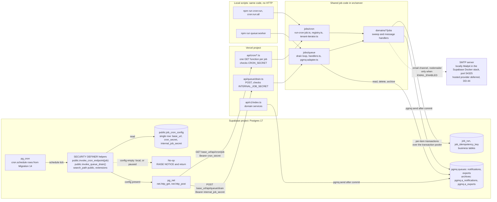
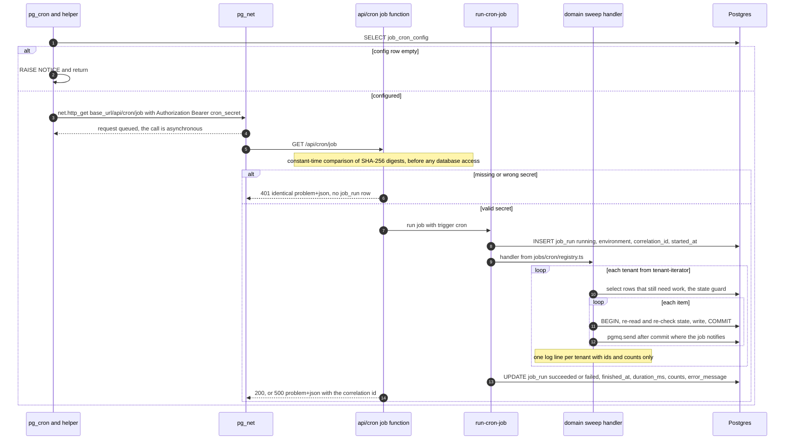
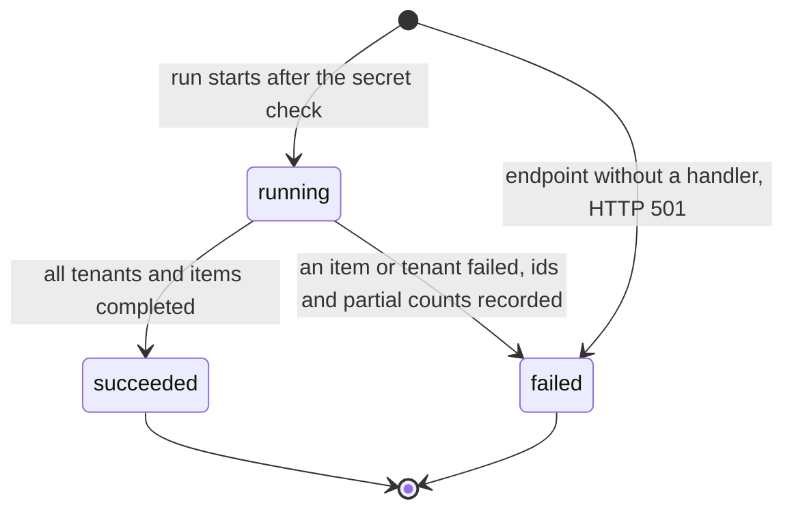
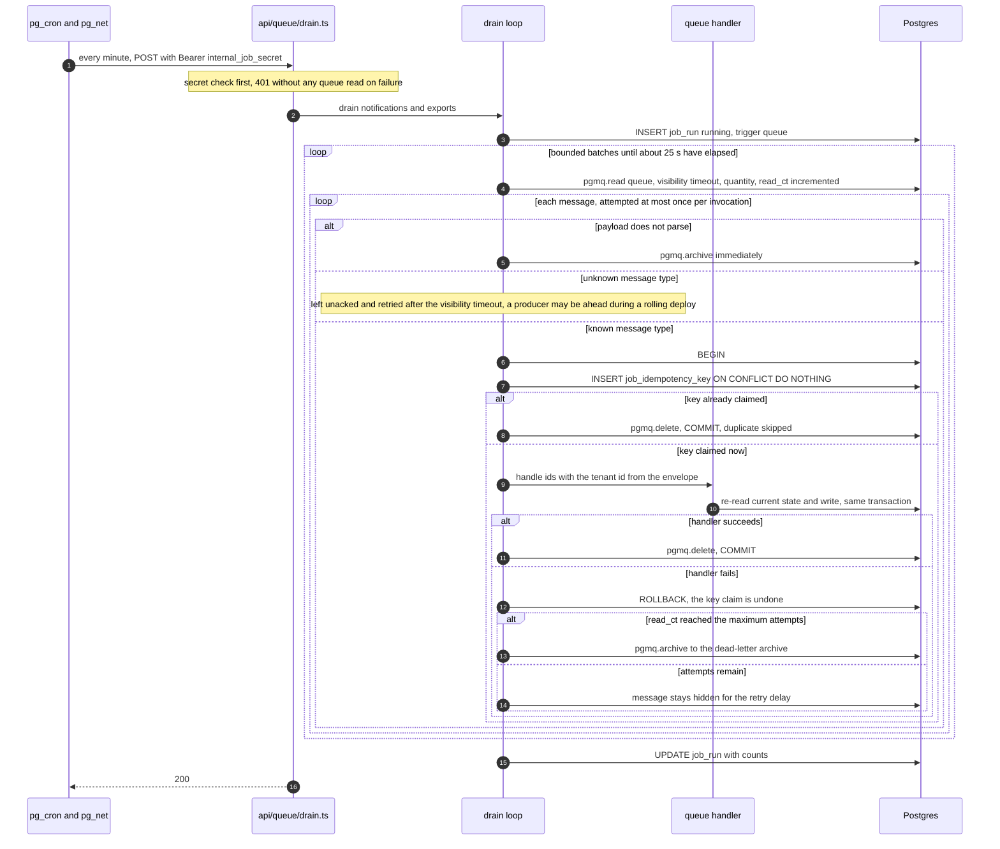
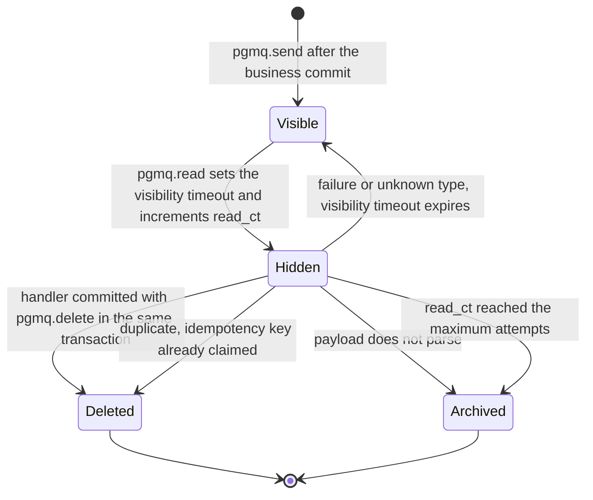

# Background Jobs

Status: As-designed (pre-build). Updated to as-built at the end of Stage A and Stage B.

Sources:
- `docs/architecture-brief.md`: §1 (platform summary and exclusions), §2 (layout of `api/cron`, `api/queue`, `src/server/jobs`, `scripts/jobs`), §3.1 (`vercel.json` functions and the ban on `crons`), §3.3 (serverless constraints), §4.3 (npm scripts), §5.6 (pooler rules), §7.4 and §7.5 (local jobs), §8.1 (`CRON_SECRET`, `INTERNAL_JOB_SECRET`, `JOB_CRON_BASE_URL`), §9 (scheduling, protection, job state, sweeps, queues, documentation), §11 (guard tests), §12 (CI `migrate` job), §13 (smoke tests, rollback, pausing)
- `docs/plan/architecture-plan.md` (revision 3): §0 (jobs are Stage B; Stage A uses no Supabase, DD-50), §3.8 (notifications queue; `in_app` and `email` channels), §3.9 (job catalog and queues, as amended by DD-18 and DD-19), §3.11 (prototype mode: fully static since DD-50; the local Supabase stack starts in Stage B), §4 (layout, registries `jobs/cron/registry.ts` and `jobs/queue/handlers.ts`, shared table owners), §5 (Stage B ownership: `platform-data-auth` owns `jobs/**`, Integration wires cron and queue), §8 (Stage B tests), §11 (owner decisions of 2026-09-29: item 3 email channel, item 6 Node 24)
- `docs/plan/schema-blueprint.md`: Migration 00 (extensions), Migration 01 (job platform tables, helpers, queues, buckets), Migration 13 (`request_idempotency`, `exports`, `report_definitions`, `report_runs`), Migration 14 (`cron.schedule` rows), and the tables each job reads (Migrations 01 to 13)
- `docs/plan/design-decisions.md`: DD-06 (`job_run.status` values), DD-11 (partition tenant of notifications and support-access audit rows), DD-14 (`final_award` approval), DD-15 (release time and deadline authority), DD-16 (owners of `tasks` and `exports`, export registry), DD-18 (expiry jobs split by table owner), DD-19 (added jobs and alert deduplication keys), DD-20 (expiry semantics), DD-39 (`request_idempotency` retention), DD-42 (acknowledgment authority), DD-43 (local Supabase stack from Stage A, Auth only; superseded for Stage A by DD-50), DD-44 (email channel over SMTP, Mailpit locally, hosted provider deferred), DD-45 (Node 24), DD-50 (Stage A is a fully static prototype with no Supabase or Docker); §E (owner decisions of 2026-09-29)
- `docs/plan/email-delivery-options.md`: §1 to §3 (content rule, local Mailpit setup, hosted provider options, deferred)
- `docs/plan/tenderiq-backend.workflow.js`: tasks `scaffold-b` (email variables in `.env.local`), `platform-http` (`lib/config` extended with the email variables) and `svc-notifications` (the `email` channel, Mailpit's API in integration tests)
- `docs/PRD.md`: BR-13, BR-25, BR-37, BR-40, BR-41, BR-42, BR-43, BR-47; §14.1 (exports), §14.3 (notification events); AC-09, AC-25, AC-32, AC-35
- `docs/plan/demo-storyline.md`: T-2026-0007 (standstill and complaint), C-2026-0001 (renewal window), Chobe insurance expiry, T-2025-legacy legal hold

Contents:
- [1. Scope and stage](#1-scope-and-stage)
- [2. Components and code locations](#2-components-and-code-locations)
- [3. Scheduling architecture](#3-scheduling-architecture)
- [4. Job catalog](#4-job-catalog)
- [5. Job details](#5-job-details)
- [6. Sweep execution model](#6-sweep-execution-model)
- [7. Queues (pgmq)](#7-queues-pgmq)
- [8. Endpoint protection](#8-endpoint-protection)
- [9. Durable job state](#9-durable-job-state)
- [10. Environments and configuration](#10-environments-and-configuration)
- [11. Local development](#11-local-development)
- [12. Observability and verification](#12-observability-and-verification)
- [13. Pausing, resuming and rollback](#13-pausing-resuming-and-rollback)
- [14. Open points](#14-open-points)

Related: [02-architecture.md](02-architecture.md) (components), [06-key-flows.md](06-key-flows.md) (flows that enqueue messages or depend on sweeps), [10-deployment-environments.md](10-deployment-environments.md) (environments and CI), [11-testing-strategy.md](11-testing-strategy.md), [03-data-model/01-platform-identity-access.md §8](03-data-model/01-platform-identity-access.md#8-job-platform-tables) (job platform tables, Migration 01), [03-data-model/03-shared-services.md §5.1](03-data-model/03-shared-services.md#51-notification-event-catalog) (notification event catalog), [05-lifecycles.md](05-lifecycles.md#13-transitions-performed-by-jobs) (transitions that jobs may perform), [adr/0007-in-app-formal-notices.md](adr/0007-in-app-formal-notices.md), [adr/0009-registries-wired-by-integration.md](adr/0009-registries-wired-by-integration.md).

---

## 1. Scope and stage

- **Stage B only.** Stage A builds no job platform. Stage A is a static prototype with no Supabase, no Docker and no database (DD-50), so there are no job tables, schedules or queues; the local Supabase stack starts in Stage B. The mock API persists nothing, so states that jobs would produce in Stage B, such as overdue obligations, expired grants, reminders, expiry triggers and contracts past their dates, appear as static fixtures from the demo storyline (architecture-plan §0, §10).
- **Platform rules** (brief §9): no resident worker, no in-memory schedules, no exactly-once assumptions, no Vercel Cron. `vercel.json` never has a `crons` key, and a regression test fails if it gains one (brief §3.1). Supabase Edge Functions and Redis are not used (brief §1).
- **Two mechanisms.** Scheduled sweeps (pg_cron to a Vercel function per job) reconcile state on a timetable. Queues (pgmq) carry work that follows a committed business transaction: notification fan-out and delivery (the `in_app` channel, and the `email` channel where it is enabled, DD-44), and export generation.
- **One code path.** The deployed endpoints and the local npm scripts run the same handler code in `src/server/jobs/` and `src/server/domains/<domain>/jobs/`.

## 2. Components and code locations

| Piece | Location | Notes |
|---|---|---|
| Extensions | Migration 00 `20261001000000_extensions.sql` | `pg_cron` (schema `cron`), `pg_net` installed `with schema extensions` (its functions live in schema `net`), `pgmq` (schema `pgmq`). Installed by migration, never by dashboard. |
| Job platform tables and helpers | Migration 01 `20261001000100_platform_core.sql` | `job_run`, `job_idempotency_key`, `job_cron_config`; `invoke_cron_endpoint(job text)`, `invoke_queue_drain()`; `pgmq.create('notifications')`, `pgmq.create('exports')` |
| Schedules | Migration 14 `20261001001400_views_grants_schedules.sql` | One `cron.schedule` row per job in architecture-plan §3.9 (as amended by DD-18 and DD-19), plus `queue-drain` at `* * * * *`. Job names must match `jobs/cron/registry.ts`. |
| Cron endpoints | `api/cron/<job>.ts` | One file per job, `GET`, `CRON_SECRET`, `maxDuration: 60`. Thin: 3 to 10 lines, named `GET` export, `runtime: 'nodejs'`. Vercel runs Node.js 24.x, selected through `engines` (DD-45). |
| Queue endpoint | `api/queue/drain.ts` | `POST`, `INTERNAL_JOB_SECRET`, `maxDuration: 60` |
| Cron infrastructure | `src/server/jobs/cron/` | `registry.ts` (job name to handler), `run-cron-job.ts` (shared by the endpoint and `npm run cron:run`), `tenant-iterator.ts` |
| Queue infrastructure | `src/server/jobs/queue/` | `QueueAdapter` port with `pgmq-adapter.ts` and `in-memory-adapter.ts` (unit tests), the drain loop, `handlers.ts` (message type to handler) |
| Domain handlers | `src/server/domains/<domain>/jobs/` | Each owning domain implements its sweep or message handler |
| Delivery channels | notifications service (`src/server/domains/notifications/`) | The `DeliveryChannel` port with its `in_app` and `email` implementations, used by the `notifications` queue handler. `email` sends over SMTP with `nodemailer` (DD-44). |
| Export generators | `src/server/domains/documents/export-registry.ts` | The `exports` message handler belongs to the documents service (`requestExport()`). Domains register one generator per export type (DD-16). |
| Scripts | `scripts/jobs/` | `run-cron`, `run-all-crons`, `local-queue-worker`, `job-status`, `enqueue-test` |
| Configuration script | `scripts/db/configure-job-cron` | Behind `npm run db:cron:configure`. Writes `job_cron_config`. |

Ownership during the build: phase B1 `platform-data-auth` owns `jobs/**` and `scripts/jobs/**`. Domain agents write their handlers inside `domains/<domain>/jobs/`. Only the B4 Integration step wires `jobs/cron/registry.ts`, `jobs/queue/handlers.ts` and the per-type generators in `documents/export-registry.ts` (architecture-plan §4, §5; DD-16; [adr/0009-registries-wired-by-integration.md](adr/0009-registries-wired-by-integration.md)).

## 3. Scheduling architecture

pg_cron fires inside Postgres. A `SECURITY DEFINER` helper reads the per-environment configuration and calls the Vercel endpoint through pg_net with a bearer secret. The Vercel function runs the shared job code.



Schedule rows follow the brief's pattern (brief §9.1):

```sql
select cron.schedule('close-tenders', '* * * * *',
  $$select public.invoke_cron_endpoint('close-tenders')$$);
select cron.schedule('queue-drain', '* * * * *',
  $$select public.invoke_queue_drain()$$);
```

Rules that keep the scheduler reliable (brief §9.1, §6.3):

- **pg_net's functions live in schema `net`** (`net.http_get`, `net.http_post`), even though the extension is registered in `extensions`. Calling `extensions.http_get` fails silently at the scheduled minute.
- The helpers are `SECURITY DEFINER` with `search_path` pinned to `public, extensions`. They are revoked from `anon` and `authenticated`.
- **Standing rule:** every `SECURITY DEFINER` function that calls an extension function has an integration test that **executes** it. Inspecting `prosrc` or catalog rows is not enough.
- The call is asynchronous: `net.http_get` or `net.http_post` queues the request and returns. The helper does not wait for the job to finish.
- `JOB_CRON_BASE_URL`, and therefore `job_cron_config.base_url`, is a **stable** origin (a custom domain or branch alias), never a per-deployment preview URL.
- Dependent schedules are staggered. The nightly sweeps run 10 minutes apart (02:10, 02:20, 02:30, 02:40, 02:50 UTC), so a sweep that writes a column another sweep reads finishes first. The hourly sweeps are spread across the hour (:00, :05, :10, :15).

Every sweep in the §3.9 catalog does the following: it is state-guarded, iterates per tenant, and runs each item in its own transaction ([§6](#6-sweep-execution-model)). A sweep whose source rows do not change state (a reminder or an alert) deduplicates its output with an idempotency key `<job>:<entity>:<window>` claimed in `job_idempotency_key` (DD-19).

End-to-end view of one cron tick:



## 4. Job catalog

All schedules are UTC. The demo locale is `Africa/Gaborone` (UTC+02:00), so 02:10 UTC is 04:10 local. Business deadlines are compared as `timestamptz` instants, so the schedule zone never affects correctness.

| Job | Schedule (UTC) | Owner domain | Purpose | State guard (rows selected) | Idempotency | Retry and failure | Observability |
|---|---|---|---|---|---|---|---|
| `publish-scheduled` | `*/5 * * * *` | publication | Ready or scheduled tenders whose release time has passed move to `open` | `tenders.status = 'ready'` whose `tenders.scheduled_release_at` has passed. That column is authoritative; `publications.scheduled_at` mirrors it per channel (DD-15). Per-item re-check: release approval approved for the current `draft_revision`, no hold blocking `publish`. | State-guarded: release moves the tender to `open` and the publication to `published`, so the row leaves the set | Failed item stays `ready` and is retried on the next tick. An item that fails the re-check is skipped and reported, never forced. | Tenders released, skipped and failed (ids). Notices enqueued. |
| `close-tenders` | `* * * * *` | bids | Open tenders past the deadline move to closed, awaiting opening | `tenders.status = 'open'`, or a lot with `stage = 'open'`, whose effective deadline has passed: `lots.submission_deadline` when set, otherwise the tender's `tender_milestones` row (`submission_deadline`, `lot_id` null) (DD-15) | State-guarded: the lifecycle transition removes the row | Retried next minute. Lateness never depends on this job: the submission transaction compares its official receipt time with the deadline ([06-key-flows.md Flow 5](06-key-flows.md#7-flow-5-supplier-submission-with-official-receipt-time-ac-11-to-ac-13)). | Tenders and lots closed, failures (ids) |
| `deadline-reminders` | `15 * * * *` | notifications | Closing-approaching, evaluation-due and approval-due reminders | Open tenders' submission deadlines, `evaluation_assignments` not yet submitted, and pending `approval_requests` whose `due_at` falls within a `notification_rules.reminder_offsets_hours` offset; escalation after `escalate_after_hours` | The source row does not change state, so each reminder is deduplicated by a `<job>:<entity>:<window>` key in `job_idempotency_key` (DD-19) | The next hourly run retries a failed run. Treatment of an offset missed during an outage is finalized in Stage B. | Reminders enqueued per event type, escalation tasks created |
| `evidence-expiry` | `10 2 * * *` | qualification | Expiring evidence produces notifications and reassessment triggers (BR-25, AC-09). It only flags and notifies (DD-20). | `evidence_items.status = 'current'` whose `expires_at` is within the notice window or has passed | Trigger: no open `reassessment_triggers` row for the same source and buyer is re-checked before insert. Notifications use the DD-19 key. A passed item is set to `expired` through the suppliers-owned helper, which removes it from the set. | Next day. Never rewrites evidence or `evidence_submissions`. | Items found, triggers created, notices enqueued |
| `qualification-expiry` | `20 2 * * *` | qualification | Decisions past `effective_to` produce tasks and notices. The job writes no decision (DD-20). | Latest non-superseded `qualification_decisions` whose `effective_to` has passed, which `v_qualification_status` already reports as `expired` | No decision row changes, so tasks and notices are deduplicated by the DD-19 key | Next day. Gates do not wait for it: `v_qualification_status` derives `expired` from `effective_to`. | Expired decisions found, tasks created, notices enqueued |
| `obligation-status` | `30 2 * * *` | contracts | Due and overdue obligations, escalation tasks | `obligations.status` in (`planned`, `due`) whose due point has been reached or passed | State-guarded: `planned → due` and `due → overdue` remove rows. The escalation task is written in the same item transaction as the move to `overdue`, so it is created once. | Next day | Obligations moved to due or overdue, escalation tasks |
| `renewal-windows` | `40 2 * * *` | contracts | Notice windows produce alerts only, never an automatic renewal (BR-37, AC-32) | `renewal_options.status` in (`available`, `under_review`), `decision` null, notice window approaching or open (`notice_window_start`, `notice_deadline`) | No state changes by design, so alerts are deduplicated by the DD-19 key | Next day. Never writes `decision`, `supplier_consent_at` or contract dates. | Options alerted |
| `standstill-monitor` | `*/15 * * * *` | awards | Standstill ended with no blocking hold produces a task only, never an automatic award | `standstill_periods.status` in (`running`, `extended`) whose end (`extended_to` when set, otherwise `ends_at`) has passed, with no unreleased `holds` row on the tender or lot whose `blocked_actions` include `award_final` | The task is deduplicated by the DD-19 key, so a re-run creates no second task | Next tick. Never writes `lot_outcomes`. | Periods ended, tasks created, periods still held |
| `expire-access` | `0 * * * *` | org-admin | Display-status expiry of grants, restrictions, delegations and invitations, with notices (DD-18) | `invitations.status = 'pending'` past `expires_at`. Date-only rows: `access_grants.expires_at`, `access_restrictions.ends_at`, `delegations.ends_at` passed. | Invitations: state-guarded, the status moves to `expired`. Date-only rows have no status to write, so their notices use the DD-19 key. | Next hour. Request-time checks compare `starts_at`, `expires_at` and `revoked_at` directly, so access never waits for this job. | Invitations expired, notices enqueued |
| `expire-approvals` | `5 * * * *` | approvals | Expire approval requests past `expires_at` and notify the owners (DD-18) | `approval_requests.status = 'pending'` past `expires_at` | State-guarded: the status moves to `expired` | Next hour | Approvals expired, notices enqueued |
| `expire-support-access` | `10 * * * *` | operations | Expire support access grants and audit the expiry (DD-18) | `support_access_grants.status` in (`authorized`, `active`) past `expires_at` | State-guarded: the status moves to `expired` | Next hour. The tenant middleware compares `starts_at`, `expires_at` and `revoked_at` on every request. | Grants expired |
| `contract-dates` | `50 2 * * *` | contracts | Date-driven contract and security statuses (DD-19) | `contracts.status = 'signed_not_effective'` whose `effective_date` is reached. `contracts.status = 'active'` whose `term_end` has passed. `contract_securities.status` in (`active`, `expiring`) approaching or past `expires_at`. | State-guarded: each transition removes the row from its set | Next day. Open obligations remain after a contract expires. | Contracts activated and expired, securities moved |
| `report-schedules` | `5 * * * *` | reporting | Run due scheduled reports and re-check each recipient's authorization at issue time (DD-19) | Active `report_definitions` with a `schedule_cron` that is due | A run is recorded in `report_runs`. Duplicate runs in one schedule window are prevented by the DD-19 key. | Next hour | Runs issued, recipients dropped by the authorization re-check |
| `notification-digests` | `0 5 * * *` | notifications | Daily and weekly digests per `user_notification_preferences.digest` (DD-19). Mandatory notices are never digested. | Users with `digest` in (`daily`, `weekly`) who have digestible notifications | Deduplicated by the DD-19 key per user and window | Next day | Digests issued |
| `notice-reconciliation` | `*/10 * * * *` | notifications | Safety net for queue publishes lost after commit (brief §9.5, DD-19) | `notice_recipients.delivery_status = 'pending'` 10 minutes after creation | Re-enqueues ids only. A duplicate of a message still in flight is absorbed by the drain's per-event idempotency key and the handler's re-read of current state. | Next tick. A recipient stays in the set until it is delivered or failed. | Recipients re-enqueued |
| `upload-reaper` | `50 3 * * *` | documents | Remove never-confirmed pending uploads. Purge `request_idempotency` rows older than 24 hours (DD-39). | `document_versions.upload_status = 'pending'` older than the abandonment threshold. `request_idempotency.created_at` older than 24 hours. | State-guarded: removal takes the row out of the set | Object deleted first through `StorageAdapter`, outside any transaction, then the row. If the delete fails, the row stays and is retried the next night. | Versions reaped, idempotency rows purged, failures |
| `retention-eligibility` | `0 4 * * 0` | records | Write `disposal_requests` rows for disposal-eligible records: `proposed`, or `blocked` when held (BR-40, AC-35, DD-20) | Records whose `retention_classes` trigger event plus `duration_months` has elapsed and that no `disposal_requests` row covers yet | State-guarded: the `disposal_requests` row takes the records out of the set | Next week. Never disposes: disposal needs an approved `disposal_requests` decision. | Requests proposed, requests blocked |
| `queue-drain` | `* * * * *` | platform (`jobs/queue`) | Drain the `notifications` and `exports` queues | Visible messages | Per-message idempotency key claimed in the same transaction as the handler's writes and the ack ([§7](#7-queues-pgmq)) | Visibility-timeout retry, archive after the maximum attempts | Messages processed, duplicates skipped, retried, archived. Backlog and oldest-message age through `jobs:status`. |

Every row except `queue-drain` is from architecture-plan §3.9 as amended by DD-18 (the former single `expire-grants` job is split into `expire-access`, `expire-approvals` and `expire-support-access`, each owned by its tables' owner) and DD-19 (`contract-dates`, `report-schedules`, `notification-digests`, `notice-reconciliation`). `queue-drain` is added by blueprint Migration 14 and brief §9.1.

## 5. Job details

Brief §9.6 requires, for every job: purpose, schedule or trigger, payload, idempotency, retry and failure behavior, required database state, and observability. The catalog above covers most of it. This section adds the per-job specifics.

**Common to every cron job.**

| Item | Design |
|---|---|
| Trigger | pg_cron schedule → `invoke_cron_endpoint('<job>')` → `GET /api/cron/<job>`, or `npm run cron:run -- <job>` locally |
| Payload | None. The endpoint takes no body. The handler selects its own work from the state guard. |
| Required database state | Migration 14 schedules present. In deployed environments, `job_cron_config` populated. The tables in the job's guard. |
| Transaction shape | One short transaction per item that re-reads and re-checks state. No network calls inside. Queue sends after commit. |
| Tasks | Jobs create `tasks` through the approvals service, which owns the table (DD-16) |
| Alert deduplication | A sweep whose source rows do not change state claims a `<job>:<entity>:<window>` key in `job_idempotency_key` before it creates a reminder, alert or task (DD-19) |
| Failure isolation | One tenant or item failing does not stop the rest. The run is marked `failed` with the failing ids and partial counts (brief §9.4). |
| Logging | One log line per tenant. `job_run.counts` holds ids and counts only, never confidential business content (brief §9.6, BR-43). |

### 5.1 `publish-scheduled` (publication, every 5 minutes)

- Per item, it calls the same release path as "publish now" ([06-key-flows.md Flow 4](06-key-flows.md#6-flow-4-publication-and-invitation-notices)): the lifecycle transition `ready → open`, the issued version and snapshot, the `policy_profile_version_id` freeze (BR-09), `publications.status = 'published'`, and `tender_issued` or `invitation` notices. Notices are enqueued after commit.
- The release time is `tenders.scheduled_release_at`. `publications.scheduled_at` mirrors it for each channel and is not read by the guard (DD-15).
- The re-check matters because a material edit after scheduling invalidates the release approval ([06-key-flows.md Flow 3](06-key-flows.md#5-flow-3-tender-release-approval-and-invalidation-ac-06)). A tender whose approval no longer matches its `draft_revision` is skipped, not released.
- Worst-case lateness of a scheduled release is one interval (5 minutes) plus function start-up, while the job is healthy.

### 5.2 `close-tenders` (bids, every minute)

- The transition goes through the lifecycle service, the only path that changes `tenders.status` and `lots.stage`.
- The effective deadline is `lots.submission_deadline` when set, otherwise the tender's `tender_milestones` row (`submission_deadline`, `lot_id` null) (DD-15).
- Updating the tender row waits for in-flight submission transactions, which hold the row `FOR SHARE`. A receipt whose official time is at or before the deadline is therefore never cut off by the close. An addendum that changes a deadline also updates `tenders.updated_at` in its transaction, so deadline changes serialize against submissions in the same way (DD-15).
- `closed_at` records when the close ran. The deadline itself is the recorded milestone. The two are different facts.

### 5.3 `deadline-reminders` (notifications, hourly at :15)

- Event types and recipients come from `notification_rules` (`event_type`, `recipient_roles`, `reminder_offsets_hours`, `escalate_after_hours`, `escalation_role`), matching PRD §14.3 ("Closing approaching", "Evaluation assigned or overdue", "Approval needed, returned, or expired"). The events this job raises are rows 8, 9 and 10 of the [notification event catalog](03-data-model/03-shared-services.md#51-notification-event-catalog).
- Each reminder claims a `deadline-reminders:<entity>:<window>` key in `job_idempotency_key`, so a re-run in the same window sends nothing twice (DD-19).
- Escalations create `tasks` of type `escalation` through the approvals service (DD-16).
- Reminders are consolidated where that does not obscure distinct obligations (PRD §14.3).
- A closing-approaching reminder never implies a guarantee of receipt (PRD §14.3).

### 5.4 `evidence-expiry` (qualification, daily 02:10)

- Iterates supplier tenants, which own `evidence_items`. It raises `reassessment_triggers` (`trigger_type` `evidence_expiry` or `insurance_expired`, `status = 'open'`, `task_id`) in each buyer tenant affected through `evidence_shares` or qualification decisions.
- Notifies the supplier evidence owner and the buyer reviewer (PRD §14.3 "Qualification evidence expiring"). The notifications use the DD-19 key.
- It only flags and notifies (DD-20). `evidence_items.status = 'expired'` belongs to the suppliers domain: it is set when the supplier views or renews the item, or by the suppliers-owned helper that this job calls.
- It never alters earlier evidence or the `evidence_submissions` snapshot of what was submitted (BR-25). Demo: Chobe Pipe & Valve's insurance expires within 10 days (AC-09).
- The source of the notice window (`qualification_programs.renewal_notice_days` or `notification_rules.reminder_offsets_hours`) is finalized in Stage B.

### 5.5 `qualification-expiry` (qualification, daily 02:20)

- Runs 10 minutes after `evidence-expiry`.
- It writes no decision row (DD-20). `v_qualification_status` derives `expired` from `effective_to`, so no outcome change or superseding decision is needed and history is never rewritten.
- Opens tasks for the program owner or assessor to renew or reassess, and sends notices. Both are deduplicated by the DD-19 key.

### 5.6 `obligation-status` (contracts, daily 02:30)

- Moves obligations along `planned → due → overdue` and creates escalation tasks for `escalation_user_id` through the approvals service. Notifies contract owners and assigned supplier contacts (PRD §14.3 "Contract milestone, expiry, or renewal window").
- Obligations in `evidence_submitted`, `under_review`, `accepted`, `waived` or `cancelled` are outside the guard.
- A missed measure never authorizes a deduction (FR-19). The job writes no financial remedy.
- The lead time at which a `planned` obligation becomes `due` is finalized in Stage B.

### 5.7 `renewal-windows` (contracts, daily 02:40)

- Alerts responsible users when a renewal, extension or termination notice window approaches or opens with no approved decision. Each alert is deduplicated by the DD-19 key.
- It never renews, never records supplier consent, and never extends a term (BR-37, AC-32). Demo: C-2026-0001 has a renewal option whose notice window opens in 5 days with no decision.
- The alert lead time is finalized in Stage B.

### 5.8 `standstill-monitor` (awards, every 15 minutes)

- When a standstill has ended and no blocking hold exists, it creates a task for the award owner to consider the final award. The final award is always an explicit, checked user action with its own `final_award` approval ([06-key-flows.md Flow 9](06-key-flows.md#11-flow-9-award-standstill-complaint-hold-and-final-award-ac-25); DD-14).
- The task claims a `standstill-monitor:<entity>:<window>` key first, so a re-run creates no second task (DD-19).
- A hold never changes dates (BR-13). Demo: on T-2026-0007 a blocking complaint hold keeps the job from producing a task after the standstill ends (AC-25).

### 5.9 `expire-access` (org-admin, hourly at :00)

- Covers user invitations (`invitations`), direct grants (`access_grants`), restrictions (`access_restrictions`) and delegations (`delegations`), all owned by org-admin (DD-18).
- Request-time checks always compare `starts_at`, `expires_at` (or `ends_at`) and `revoked_at` directly. The job only updates display statuses and sends notices, so correctness never waits for it.
- A pending invitation past `expires_at` moves to `expired`. It can then be reissued as a new row with `reissued_from_id` (FR-03). `access_grants`, `access_restrictions` and `delegations` carry dates and no status, so for them the job only notifies, with the DD-19 key.
- Notices go to the affected user and the responsible administrator ([notification event catalog](03-data-model/03-shared-services.md#51-notification-event-catalog) row 1).

### 5.10 `expire-approvals` (approvals, hourly at :05)

- Moves `approval_requests` still `pending` past `expires_at` to `expired` through the approvals service, which owns the table (DD-18).
- An expired approval notifies the approver and the record owner (PRD §14.3, event catalog row 10).
- Like the other expiry jobs, it only updates the stored status and sends notices (DD-18).

### 5.11 `expire-support-access` (operations, hourly at :10)

- Moves `support_access_grants` (a global table with `customer_tenant_id`) in `authorized` or `active` past `expires_at` to `expired` (DD-18).
- Global table: the job iterates grants directly, not tenants.
- The expiry is audited. Support-access audit rows are written to the **customer** tenant's `audit_log` partition, so the customer can review them (DD-11).
- The tenant middleware admits an operator only while `starts_at`, `expires_at` and `revoked_at` allow it, on every request ([adr/0013-operator-support-access-grants.md](adr/0013-operator-support-access-grants.md)).

### 5.12 `contract-dates` (contracts, daily 02:50)

- `signed_not_effective → active` when the contract's `effective_date` is reached. Signature and commencement stay separate milestones (BR-35, [06-key-flows.md Flow 10](06-key-flows.md#12-flow-10-contract-signature-handover-and-closeout-gate-ac-28-ac-29)).
- `active → expired` after `term_end`. Open obligations remain (DD-19).
- `contract_securities.status` moves to `expiring` as `expires_at` approaches and to `expired` once it has passed.
- Contract transitions go through the contracts legality matrix ([05-lifecycles.md](05-lifecycles.md)). The job never renews or extends a contract (BR-37).
- The lead time for `expiring` is finalized in Stage B.

### 5.13 `report-schedules` (reporting, hourly at :05)

- Runs the `report_definitions` whose `schedule_cron` is due and records each run in `report_runs` (`run_at`, `row_count`, `export_id`, `recipient_user_ids`). The file is built on the `exports` queue ([§7](#7-queues-pgmq)).
- Each recipient's authorization is re-checked at issue time (DD-19), so a report never exposes material that is unavailable to its recipient (BR-43, PRD §14.1).

### 5.14 `notification-digests` (notifications, daily 05:00)

- Builds daily and weekly digests for users whose `user_notification_preferences.digest` is `daily` or `weekly`.
- Mandatory notices are never digested (architecture-plan §3.9). Optional digests stay separately controllable from other messages (PRD §14.3).
- Each digest is deduplicated by the DD-19 key per user and window.
- The day on which weekly digests are issued is finalized in Stage B.

### 5.15 `notice-reconciliation` (notifications, every 10 minutes)

- The safety net that brief §9.5 requires for queue publishes lost after commit. It selects `notice_recipients` still `pending` 10 minutes after creation and sends their ids to the `notifications` queue again (DD-19).
- A message that was only slow, not lost, produces a duplicate. The drain's per-event idempotency key and the handler's re-read of current state absorb it ([§7.3](#73-per-message-transaction-model)).
- It never changes a deadline or a notice. A recipient that cannot be reached still ends `failed` with a `delivery_exception` task (BR-42).

### 5.16 `upload-reaper` (documents, daily 03:50)

- Deletes the storage object and then the pending `document_versions` row. It handles orphans left by abandoned two-step uploads ([06-key-flows.md Flow 12](06-key-flows.md#14-flow-12-document-upload-two-step-envelope)).
- It never touches `confirmed` versions, which may be part of a submission inventory.
- It also purges `request_idempotency` rows older than 24 hours, the retention of the `Idempotency-Key` store (DD-39).
- The abandonment threshold is finalized in Stage B.

### 5.17 `retention-eligibility` (records, Sundays 04:00)

- Evaluates `retention_classes` (`record_class`, `trigger_event`, `duration_months`, `disposition`) and holds with `subject_type` `record_class` or `record` (and tender or contract holds, where they block `disposal`).
- Writes `disposal_requests` rows (DD-20): `proposed` for eligible records, or `blocked` with `blocked_by_hold_ids` when an unreleased hold blocks `disposal`.
- Disposal itself is a separate approved decision (`disposal_requests`, approval subject `disposal`, permission `records.disposal.approve`). Demo: a legal hold on T-2025-legacy records whose retention has expired produces a `blocked` request, so they are not disposed (AC-35).

## 6. Sweep execution model

Prefer **state-guarded** sweeps over idempotency keys (brief §9.4). The query selects only rows that still need work, and doing the work removes them from the set. Re-runs are no-ops, and a missed tick heals itself on the next one.

| Aspect | Design |
|---|---|
| Registry | `jobs/cron/registry.ts` maps job name to handler. The endpoint and `npm run cron:run` both call `run-cron-job.ts`. |
| Tenant iteration | `tenant-iterator.ts` enumerates tenants. Each tenant is processed independently, and every repository call takes an explicit `TenantId` (`forTenant`). There is no ambient tenant. Jobs over global tables (`support_access_grants` in `expire-support-access`) iterate items directly. Which tenant statuses each job includes is finalized in Stage B. BR-47 requires live procurements of suspended or offboarding customers to continue. |
| Item transaction | Each item runs in its own `withTransaction` that re-reads and re-checks the guard, using a row lock or conditional update, before writing. An overlapping invocation or a concurrent user action then finds nothing to do. |
| Pooler safety | Transaction pooler, `max: 2` connections per instance, no named prepared statements, no session state. Locks only inside a transaction: `SELECT ... FOR UPDATE` and `pg_advisory_xact_lock()` (brief §5.6). |
| Time bound | `maxDuration` is 60 s. Work is split into small, bounded, idempotent units (brief §3.3). A sweep that does not finish leaves the remaining rows in the guarded set for the next tick. An explicit time budget for sweeps, like the drain's, is finalized in Stage B. |
| Side effects | Notifications are enqueued after the item commits. A failed enqueue is logged and does not undo the item (brief §9.5). `notice-reconciliation` re-enqueues formal-notice recipients left `pending` (DD-19). |
| Deduplication | State-guarded where the work changes a status. Reminders, alerts and tasks from sweeps whose source rows do not change claim a `<job>:<entity>:<window>` key in `job_idempotency_key` (DD-19). |
| Failure | Failing items and tenants are collected. The run ends `failed` with their ids and partial counts. Other items are unaffected. |

`job_run.status` lifecycle:



A run whose function is killed at `maxDuration` stays `running` with no `finished_at`. `npm run jobs:status` reports such rows as stale runs. An endpoint for a job with no handler records the attempt as a `failed` row and returns 501. It never reports fake success. The CHECK list is (`running`, `succeeded`, `failed`). The brief wins over the earlier blueprint value `not_implemented`, which is removed (DD-06). Under the no-placeholder rule (architecture-plan §2), no shipped job returns 501.

## 7. Queues (pgmq)

### 7.1 Queues

| Queue | Created by | Producers | Consumer work | Dead letter |
|---|---|---|---|---|
| `notifications` | Migration 01 `pgmq.create('notifications')` | Domain services after their business transaction commits (notices issued, approvals needed or decided, submissions, complaints, and so on), cron sweeps that notify, and `notice-reconciliation` for recipients still `pending` (DD-19) | Fan-out and delivery: resolve recipients, write `notifications` (category `formal_notice`, `task`, `reminder`, `system`, `promotional`) in the **recipient's** tenant partition, which is the supplier tenant for supplier recipients (DD-11), `notification_deliveries` (channel `in_app`, and channel `email` when `EMAIL_ENABLED`, DD-44), and `notice_recipients` delivery state. Send the email over SMTP with `nodemailer` where the channel applies. Create `delivery_exception` tasks through the approvals service for unreachable recipient organizations (BR-42, DD-16). | `pgmq.a_notifications` |
| `exports` | Migration 01 `pgmq.create('exports')` | Export requests through the documents service `requestExport()` (`exports` row `queued`): reports (ADM-13, REP-02, `report-schedules`), evidence packs (ADM-14, BUY-30), tender packages, receipts, evaluation and award reports, handovers, customer exit (ADM-17) | The documents service handler (DD-16) calls the generator that the owning domain registered for the `export_type` in `documents/export-registry.ts`. It builds the file (`xlsx` through `exceljs`, `csv`, or print-styled `html`; [adr/0010-no-icon-or-pdf-dependencies.md](adr/0010-no-icon-or-pdf-dependencies.md)), stores it in the private `exports` bucket, links `document_id`, writes the `manifest` (contents, versions, omissions, redactions), and sets `exports.status` to `ready` or `failed` | `pgmq.a_exports` |

Notification rules applied by the consumer (architecture-plan §3.8, PRD §14.3):

- Mandatory notices ignore `user_notification_preferences` and are never digested (`notification-digests`, architecture-plan §3.9).
- Delivered, opened, acknowledged and terms-accepted are separate events (BR-41). For submission readiness, `participant_acknowledgments` is authoritative; `notice_recipients.acknowledged_at` records the delivery-level event (DD-42).
- Event types, producers and recipients follow the [notification event catalog](03-data-model/03-shared-services.md#51-notification-event-catalog).
- A delivery failure never alters a deadline (BR-42).
- **Delivery channels. Resolved — DD-44.** The `DeliveryChannel` port has `in_app` and `email` implementations ([adr/0007-in-app-formal-notices.md](adr/0007-in-app-formal-notices.md)). The original wording is kept for traceability: "Only the `in_app` `DeliveryChannel` exists, because no email provider is approved."
  - Formal notices go to both channels. Non-mandatory events follow `user_notification_preferences` (`in_app`, `email`).
  - `email` sends over SMTP with `nodemailer`, the one approved added runtime dependency ([adr/0010-no-icon-or-pdf-dependencies.md](adr/0010-no-icon-or-pdf-dependencies.md)).
  - Locally, every message goes to Mailpit in the Supabase Docker stack (`supabase/config.toml` `[inbucket] smtp_port = 54325`, web UI `http://127.0.0.1:54324`). A message is recorded as `delivered` in `notification_deliveries` when Mailpit accepts it.
  - The email carries only the title, the official deadline and a link, never bid, evaluation or other confidential content (BR-43, PRD ADM-12).
  - Where email is not enabled (`EMAIL_ENABLED`), notices are in-app only, and no `email` delivery rows are written.
  - The SMTP send is a network call, so it stays outside the per-message transaction (brief §5.6). Its exact placement and retry are open ([§14](#14-open-points)).
  - The hosted provider and its delivery-event webhooks (delivery, bounce, open) are deferred. They are needed before the first hosted environment (`docs/plan/email-delivery-options.md` §3, design-decisions §E item 4).

Export rules (PRD §14.1, BR-43): an export must not expose material that is unavailable to the requesting user (`exports.requested_by`), and it identifies its contents, versions, omissions, redactions, creator and creation date. The `exports` table and its queue handler belong to the documents service. Domains contribute only the per-type generators, which the Integration step registers in `documents/export-registry.ts` (DD-16).

### 7.2 Message envelope

- Payloads carry **ids only**. The handler re-reads current state. The tenant id travels on the envelope (brief §9.5).
- The envelope carries a message type, which `jobs/queue/handlers.ts` maps to a handler, and is validated with zod (brief §1).
- **Idempotency keys are unique per event, not per entity**, for example `{entityId}:{historyRowId}`. A per-entity key would permanently drop every later event for that entity.
- The concrete envelope schema and message type names are finalized in Stage B.

### 7.3 Per-message transaction model

**Per message, in one transaction:** claim the idempotency key (`INSERT ... ON CONFLICT DO NOTHING`), run the handler writing only through that transaction, then ack (`pgmq.delete`). The commit publishes all three or none. A duplicate delivery finds the key claimed and is skipped. A failed attempt rolls back the claim, so the retry genuinely re-runs (brief §9.5).



Message lifecycle:



### 7.4 Drain rules

| Rule | Value or behavior (brief §9.5) |
|---|---|
| Time budget | `drain()` processes bounded batches and stops taking new messages after about 25 s, within `maxDuration` 60 s |
| Per-invocation limit | Each message is attempted at most once per invocation |
| Unprocessed messages | Reappear when their visibility timeout expires |
| Maximum attempts | After `max_attempts` (the brief's example is 5) the message is archived to `pgmq.a_<queue>` |
| Unparseable payload | Archived immediately |
| Unknown message type | Retried, because a producer can be ahead of the consumer during a rolling deploy |
| Adapter | `QueueAdapter` with `pgmq-adapter.ts` (production) and `in-memory-adapter.ts` (unit tests) |

The concrete visibility timeout, retry delay, batch size and `max_attempts` are finalized in Stage B.

### 7.5 Producer rules

- **Publish after the business transaction commits.** A publish failure never fails the user's request. It is logged, and a periodic reconciliation sweep is the safety net (brief §9.5): `notice-reconciliation` re-enqueues `notice_recipients` still `pending` after 10 minutes ([§5.15](#515-notice-reconciliation-notifications-every-10-minutes), DD-19).
- Producers send ids, never content. This keeps confidential bid or evaluation material out of queue tables and logs (BR-43).

## 8. Endpoint protection

| Endpoint | Method | Secret (env var) | Called by |
|---|---|---|---|
| `/api/cron/<job>` (`api/cron/<job>.ts`) | `GET` | `CRON_SECRET` | `invoke_cron_endpoint(job)` through `net.http_get`, or an operator doing a manual smoke test |
| `/api/queue/drain` (`api/queue/drain.ts`) | `POST` | `INTERNAL_JOB_SECRET` | `invoke_queue_drain()` through `net.http_post` |

Rules (brief §9.2, §8.1, §14):

1. Validate `Authorization: Bearer <secret>` (or a bare secret) **before touching the database**, with a constant-time comparison of SHA-256 digests (Node `crypto`).
2. Missing and wrong secrets get the **same** 401 problem document. Only the reason is logged, never the value. No `job_run` row is written and no queue is read.
3. Two separate secrets: a leak of one does not authorize the other. The config schema requires `INTERNAL_JOB_SECRET` to differ from `CRON_SECRET`.
4. Both secrets are server-only, marked Vercel **Sensitive**, sourced from Doppler, and never compiled into the SPA. `scan-bundle` fails the build if a server variable name reaches `src/ui/dist`.
5. The secrets reach Postgres only through `job_cron_config`, which is readable only by `postgres` and the `SECURITY DEFINER` helpers ([§9](#9-durable-job-state)).

## 9. Durable job state

Full column dictionaries are in [03-data-model/01-platform-identity-access.md §8](03-data-model/01-platform-identity-access.md#8-job-platform-tables) (Migration 01). The ERD is in §3.3 of the same file. This section records how the job platform uses them.

**`job_run` [G].** One row per execution attempt.

| Column | Use |
|---|---|
| `job_name` | Registry name, for example `close-tenders`, or the drain |
| `trigger` | `cron`, `queue` or `manual` |
| `environment` | `APP_ENV` value: `local`, `dev`, `preview`, `staging`, `production` |
| `correlation_id` | Same id as the run's log lines |
| `started_at`, `finished_at`, `duration_ms` | Timing. A `running` row without `finished_at` past `maxDuration` is stale. |
| `status` | `running`, `succeeded`, `failed`. An endpoint with no handler writes `failed` and returns 501 (DD-06). |
| `error_message` | Sanitized summary, including failing ids |
| `counts` | JSONB with ids and counts only (one of the JSONB uses the blueprint allows) |

**`job_idempotency_key` [G].** `key` (PK), `queue`, `claimed_at`. Two kinds of key use it:

- Queue messages: a per-event key, claimed in the same transaction as the handler's writes and the ack ([§7.3](#73-per-message-transaction-model)).
- Sweep alerts: `<job>:<entity>:<window>`, claimed by sweeps whose source rows do not change state, so a reminder, alert or task is produced once per window (DD-19).

A retention or cleanup rule for old keys is not defined in the sources.

**`request_idempotency` [T].** Not a job-platform table. It stores the optional `Idempotency-Key` of record-creating commands (`key`, `user_id`, `route`, `response_status`, `response_hash`), with a 24-hour retention enforced by `upload-reaper` (DD-39; [03-data-model/12-records-reporting-operations.md](03-data-model/12-records-reporting-operations.md)).

**`job_cron_config` [G].** A single row: `id` int PK with `CHECK (id = 1)`, `base_url`, `cron_secret`, `internal_job_secret`.

- Created **empty** by migration. It is **never** populated by a migration or seed.
- Written per environment by `npm run db:cron:configure -- --env=<env>` (CI `migrate` job) or by an operator's SQL.
- Revoked from `public`, `anon`, `authenticated` and `service_role`. Only `postgres` and the `SECURITY DEFINER` helpers read it.
- Empty means no-op: the helpers `RAISE NOTICE` and return. This is the normal local state and the pause mechanism ([§13](#13-pausing-resuming-and-rollback)).

## 10. Environments and configuration

| Environment | `APP_ENV` | `job_cron_config` | Effect |
|---|---|---|---|
| Local | `local` | Empty | Schedules fire and no-op with a NOTICE. Jobs run through npm scripts ([§11](#11-local-development)). |
| Dev and preview | `dev` / `preview` | Written by CI `migrate` on the `dev` branch with the stable dev origin | Schedules call the stable dev origin. Per-PR preview deployments share the non-production Supabase project but do not receive cron calls, because `base_url` is never a per-deployment URL. |
| Production | `production` | Written by CI `migrate` on `main` | Schedules call the production origin |

CI `migrate` job (brief §12): after `supabase db push --yes` and `db:seed -- --baseline`, step 6 runs `npm run db:cron:configure -- --env=$APP_ENV`. The step is **skipped, not failed**, when `JOB_CRON_BASE_URL` is unset. `APP_ENV` is derived from the branch. Every write step is safe to re-run. Variables:

| Variable | Tier | Use |
|---|---|---|
| `CRON_SECRET` | Server, Vercel Sensitive | Checked by `api/cron/*`. Copied into `job_cron_config.cron_secret`. |
| `INTERNAL_JOB_SECRET` | Server, Vercel Sensitive | Checked by `api/queue/drain.ts`. Copied into `job_cron_config.internal_job_secret`. Distinct from `CRON_SECRET`. |
| `JOB_CRON_BASE_URL` | Script-only | Stable deployed origin written to `job_cron_config.base_url` |

**Email channel variables (DD-44).** The `notifications` queue handler reads these server variables through `lib/config`, which Stage B extends from the Stage A module:

| Variable | Use |
|---|---|
| `EMAIL_ENABLED` | Turns the `email` channel on. When it is off, notices are in-app only and no `email` delivery rows are written. |
| `SMTP_HOST`, `SMTP_PORT` | SMTP server. Locally `127.0.0.1` and `54325` (Mailpit). |
| `SMTP_USER`, `SMTP_PASSWORD` | SMTP credentials. The local `.env.local` does not set them, because Mailpit needs none. |
| `EMAIL_FROM` | Sender address. Locally `notices@tenderiq.local`. |

- **Local.** The Stage B `.env.local` sets `EMAIL_ENABLED=true`, `SMTP_HOST=127.0.0.1`, `SMTP_PORT=54325` and `EMAIL_FROM=notices@tenderiq.local`.
- **Hosted.** The provider is deferred. Until SMTP is configured in a hosted environment, notices there are in-app only (architecture-plan §11 item 3). The same SMTP credentials will also serve Supabase Auth in hosted environments.

From Stage B, `vercel.json` gives `api/cron/*.ts` and `api/queue/*.ts` `maxDuration: 60`, and has no `crons` key. The Stage A `vercel.json` serves static files only and has no `functions` block (DD-50).

## 11. Local development

`pg_net` runs inside the Docker container and cannot reach the host dev server. Locally, `job_cron_config` stays empty, so every schedule is a deliberate no-op that raises a NOTICE (brief §7.5). Jobs run through the same handler code:

| Command | Behavior |
|---|---|
| `npm run cron:list` | Lists registered jobs |
| `npm run cron:run -- <job>` | Runs one sweep through `run-cron-job.ts` |
| `npm run cron:run:all` | Runs every sweep |
| `npm run queue:worker` | Local queue worker over the same drain loop. `--once` drains one pass. `--idle-exit` exits when the queues are empty. |
| `npm run queue:enqueue:test` | Enqueues a test message |
| `npm run jobs:status` | Job history, recent failures, stale runs, queue backlog, oldest-message age, dead-letter count. `--json` for machine output. |

Scripts load `.env.local` with `tsx --env-file-if-exists=.env.local`. From Stage B, Vite also proxies `/api/cron` to the local API runner on `127.0.0.1:3001` for manual endpoint testing (brief §7.4); the Stage A Vite config has no proxy (DD-50).

Typical local loop after a change to a job-driven flow:
1. Exercise the UI.
2. Run `npm run queue:worker -- --once` to deliver notifications. With `EMAIL_ENABLED`, the notice emails appear in Mailpit at `http://127.0.0.1:54324` (DD-44).
3. Run `npm run cron:run -- <job>` for the sweep under test.
4. Check `npm run jobs:status`.

In Stage A (`npm run dev:prototype`, Vite only), there is no Supabase stack, no application schema and no job platform (DD-50). Job outcomes appear only as fixtures, and the prototype sends no email of any kind. Mailpit, Supabase Auth's emails and the `email` channel all arrive in Stage B.

## 12. Observability and verification

**Signals.**

| Signal | Where | Content |
|---|---|---|
| Structured logs | Vercel runtime logs (one JSON line per call, redactor applied) | One line per tenant per run, with ids and counts only. `correlationId` matches `job_run.correlation_id`. Never tokens, secrets, PII or confidential business data (brief §5.5). |
| `job_run` | Postgres | Status, timing, counts, error summary per attempt |
| `npm run jobs:status` | Script | History, failures, stale runs, backlog, oldest-message age, dead-letter count |
| `cron.job_run_details` | pg_cron's own table | Whether each schedule fired |
| Archive tables | `pgmq.a_notifications`, `pgmq.a_exports` | Dead-lettered messages |
| Business side effects | `tasks` (for example `delivery_exception`, `escalation`), `notice_recipients.delivery_status`, `notification_deliveries.status` per channel, `disposal_requests` (`proposed`, `blocked`), `report_runs` | Items that need a person |
| Mailpit (local only) | Web UI `http://127.0.0.1:54324`. API `http://127.0.0.1:54324/api/v1/messages`. | Emails sent by the `email` channel, and Supabase Auth's emails (DD-44) |

**Post-deploy smoke** (brief §13): manually invoke each cron endpoint with the secret and confirm that a `job_run` row appears, then confirm in `cron.job_run_details` that the schedules are firing.

**Tests that guard the job platform** (brief §11, architecture-plan §8):

- `vercel.json` has no `crons` key, and the function entrypoints exist.
- The `SECURITY DEFINER` helpers are **executed** in integration tests, both with an empty config (NOTICE, no request) and with a config (request queued through `net.*`).
- Job idempotency: duplicate delivery is skipped, a failure retries, and a message is archived after the maximum attempts. The in-memory adapter covers unit tests and pgmq covers integration.
- The `email` channel: integration tests read Mailpit's API (`http://127.0.0.1:54324/api/v1/messages`) to assert delivery (DD-44).
- `npm run cron:run`, `queue:worker` and `jobs:status` are spawned as real subprocesses.
- Pool safety (max 2, no prepared statements) and a source scan for session-state SQL.
- Acceptance tests that exercise jobs, for example `standstill-monitor` never awards (AC-25), `renewal-windows` never renews (AC-32), `retention-eligibility` writes a `blocked` disposal request for held records (AC-35, DD-20), and `evidence-expiry` raises triggers without altering evidence (AC-09). Stage B has at least one integration test per acceptance scenario.

## 13. Pausing, resuming and rollback

**Pause all jobs.** Clear `job_cron_config` rather than dropping cron rows (brief §13).

1. As `postgres` (SQL editor or direct connection), empty the single row of `public.job_cron_config`.
2. The schedules keep firing. The helpers raise a NOTICE and return, so no HTTP calls leave the database. `cron.job_run_details` still shows the ticks.
3. Confirm that no new `job_run` rows appear. Producers keep enqueuing, so the backlog grows. Watch it with `npm run jobs:status`.

**Resume.** Run `npm run db:cron:configure -- --env=<env>`, or re-insert the row through operator SQL. Because sweeps are state-guarded, the first ticks catch up on everything that became due during the pause. The drain works through the backlog in bounded batches every minute.

**Effect of a pause, per job.**

| Job | While paused | Operator consideration |
|---|---|---|
| `publish-scheduled` | Scheduled tenders stay `ready` past their release time | Publication is late. Treat it as a service incident (OPS-05). Deadlines change only through an authorized buyer decision (PRD §20). |
| `close-tenders` | Tenders stay `open` after their deadline | Late submissions are still refused, because lateness is decided by the official receipt time. |
| `deadline-reminders`, `renewal-windows`, `evidence-expiry` | No reminders or alerts | Deadlines are unaffected (BR-42). Treatment of a reminder offset missed during the pause is an open point (§14). |
| `qualification-expiry` | No tasks or notices | `v_qualification_status` still reports `expired`, because the view derives it (DD-20). |
| `obligation-status` | No due, overdue or escalation updates | Contract managers lose escalations until resume. |
| `standstill-monitor` | No end-of-standstill tasks | It never awards anyway. The final award remains an explicit action. |
| `expire-access`, `expire-approvals`, `expire-support-access` | Stored `expired` statuses and expiry notices are not written | Access still ends on time: request-time checks compare `starts_at`, `expires_at` and `revoked_at` directly (DD-18). |
| `contract-dates` | Contracts stay `signed_not_effective` or `active` past their dates, and securities keep their status | Contract and security statuses lag until resume, when the first run catches up. |
| `report-schedules`, `notification-digests` | Scheduled reports and digests are not issued | Mandatory notices are never digested, so formal notices are unaffected. |
| `notice-reconciliation` | Lost publishes are not re-enqueued | Recipients stay `pending` in `notice_recipients`, which is visible. Deadlines are unchanged (BR-42). |
| `upload-reaper`, `retention-eligibility` | Orphans, `request_idempotency` rows and eligibility requests accumulate | No data risk. Disposal always needs approval. |
| `queue-drain` | Notifications (in-app and email) and exports not delivered | Formal notices remain `pending` in `notice_recipients`. The delivery state is visible, and deadlines are unchanged (BR-42). |

Pausing a single job is not defined in the sources. The designed mechanism is the global pause above. Schedule changes, such as adding, removing or rescheduling a job, are made by forward-only migrations.

**Application rollback.** Promote the previous Vercel deployment. Functions are stateless (brief §13). Two checks:

- A job scheduled in the database whose `api/cron/<job>.ts` does not exist in the promoted deployment returns 404 to pg_net and writes no `job_run` row. Compare Migration 14's schedule names with the rolled-back registry.
- Messages of a type the older code does not know are retried, not archived on first sight. Whether those retries count toward `max_attempts` is finalized in Stage B. If they do, a long rollback moves newer messages to `pgmq.a_<queue>`.

**Database rollback.** The database is forward-only. A problem is corrected with a new migration (brief §6.1, §13). Cron rows are never dropped to pause jobs.

## 14. Open points

These points are not fixed by the sources and are finalized in Stage B, unless marked as resolved by the design decision log (`docs/plan/design-decisions.md`). Resolved points stay in the list for traceability.

| # | Area | Open point |
|---|---|---|
| 1 | Queue producers | Resolved — DD-19: `notice-reconciliation` (every 10 minutes) re-enqueues `notice_recipients` still `pending` after 10 minutes, the brief §9.5 safety net. |
| 2 | Reminders and alerts | Resolved — DD-19: reminders and alerts from sweeps whose source rows do not change state are deduplicated by a `<job>:<entity>:<window>` key in `job_idempotency_key`. Still open: treatment of a reminder offset missed during an outage. |
| 3 | `standstill-monitor` | Resolved — DD-19: the end-of-standstill task is deduplicated by a `<job>:<entity>:<window>` key, so a re-run creates no second task. |
| 4 | `qualification-expiry` | Resolved — DD-20: the job writes no decision; `v_qualification_status` derives `expired`, and the job creates tasks and notices. |
| 5 | `evidence-expiry` | Resolved — DD-20: the job only flags and notifies; the suppliers domain sets `evidence_items.status = 'expired'` when the supplier views or renews the item, or through the suppliers-owned helper the job calls. Still open: the source of the notice window. |
| 6 | `expire-grants` | Resolved — DD-18: the job is split by table owner into `expire-access` (org-admin), `expire-approvals` (approvals) and `expire-support-access` (operations); request-time checks compare `starts_at`, `expires_at` and `revoked_at` directly, and the jobs only update display statuses and send notices. |
| 7 | `obligation-status`, `renewal-windows` | The lead times for `planned → due` and for renewal alerts |
| 8 | `retention-eligibility` | Resolved — DD-20: the job writes `disposal_requests` rows in `proposed`, or `blocked` when held. |
| 9 | `upload-reaper` | Abandonment threshold for pending uploads |
| 10 | `publish-scheduled` | Resolved — DD-15: `tenders.scheduled_release_at` is authoritative; `publications.scheduled_at` mirrors it per channel. |
| 11 | Exports | Resolved — DD-16: the `exports` table and queue handler belong to the documents service (`requestExport()`), with per-type generators registered by domains in `documents/export-registry.ts`. Still open: the handler writes to Storage, which brief §5.6 keeps out of transactions, so the ordering relative to the per-message transaction (for example, upload first with a deterministic object key) and the marking of an `exports` row as `failed` when its message is archived. |
| 12 | Drain parameters | Visibility timeout, retry delay, batch size, `max_attempts`, and whether unknown-type retries count toward it |
| 13 | Missing sweeps | Resolved — DD-19: `report-schedules` (hourly :05), `notification-digests` (daily 05:00) and `contract-dates` (daily 02:50, including `contract_securities` `expiring` and `expired`) are added. |
| 14 | Tenant iteration | Which tenant statuses (`suspended`, `offboarding`) each sweep includes, given BR-47 continuity |
| 15 | `job_idempotency_key` | Retention and cleanup of claimed keys, which now include the DD-19 sweep alert keys |
| 16 | Sweeps | An explicit time budget for long sweeps, like the drain's 25 s |
| 17 | `contract-dates`, `notification-digests` | The lead time at which a security becomes `expiring`, and the day on which weekly digests are issued |
| 18 | Delivery channels | Resolved — DD-44: the `notifications` handler delivers through `in_app` and `email`. `email` uses `nodemailer` over SMTP, locally to Mailpit, and is `delivered` when Mailpit accepts the message. No email rows are written when email is disabled. Original wording, kept for traceability: "Only the `in_app` `DeliveryChannel` exists, because no email provider is approved." Still open: where the SMTP send sits relative to the per-message transaction (brief §5.6), how a failed send is retried, and whether a failed email raises a `delivery_exception` task when in-app delivery succeeded. Deferred (DD-44): the hosted provider and its delivery-event webhooks, needed before the first hosted environment. |
