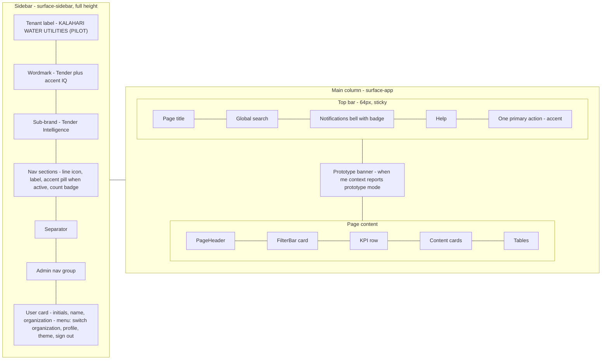
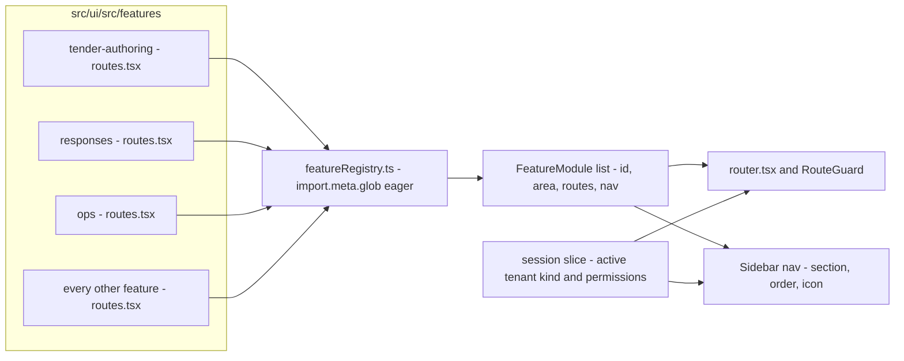
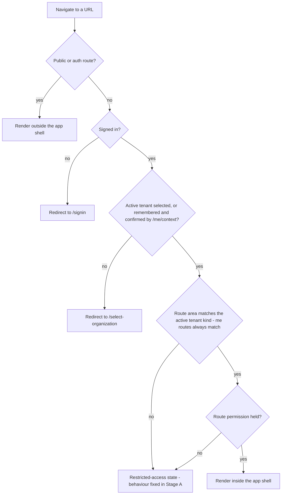
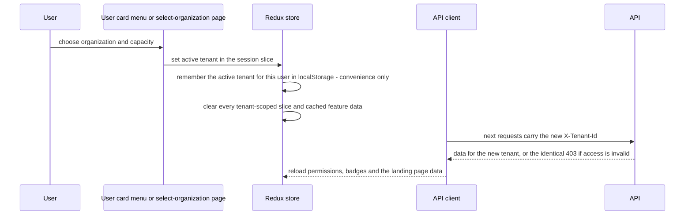
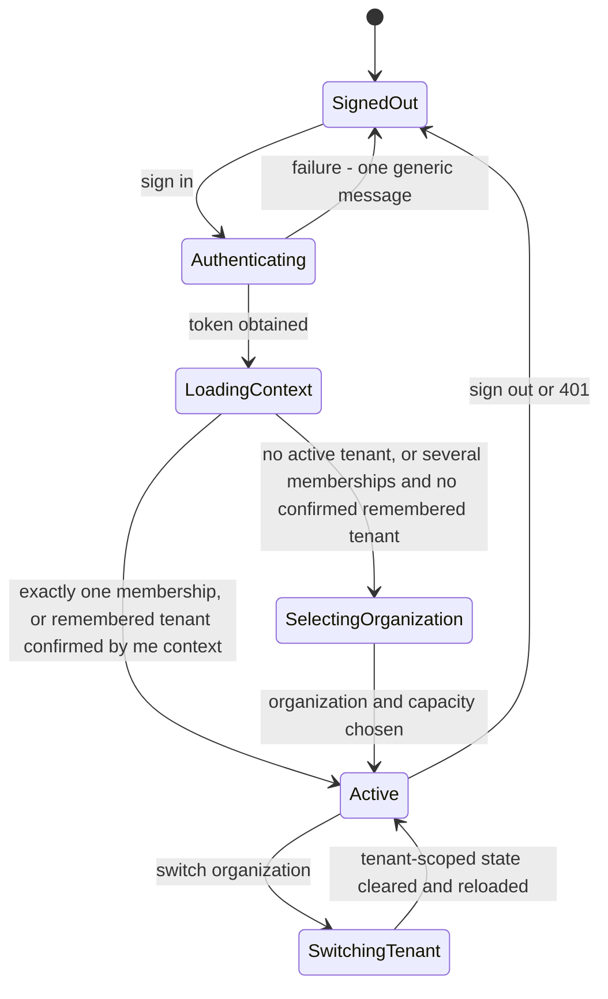
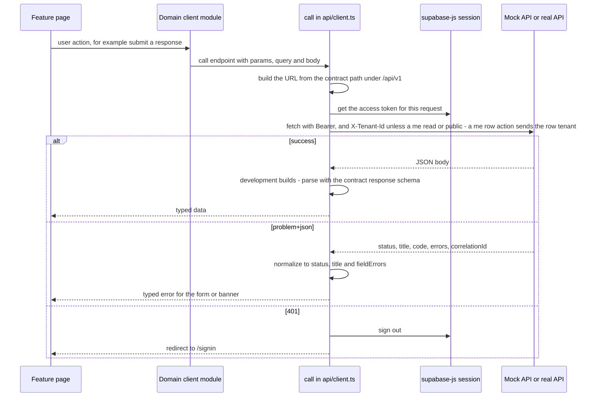
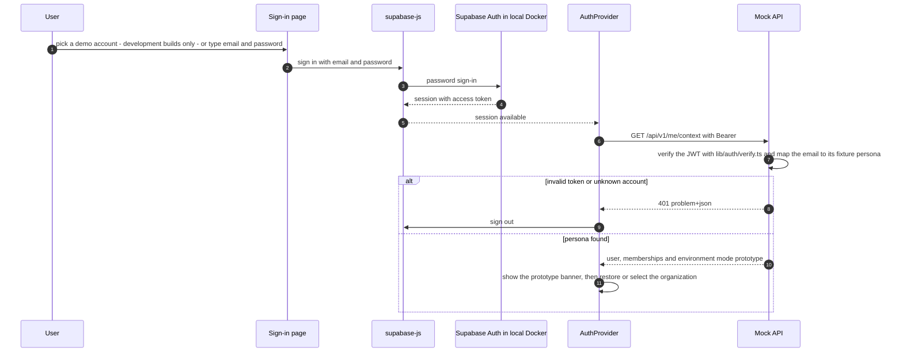

# Frontend (SPA)

Status: As-designed (pre-build). Updated to as-built at the end of Stage A and Stage B.

Sources:
- `docs/plan/design-decisions.md`: DD-09 (reference formats), DD-15 (deadline authority), DD-21 (`/me` personal inbox), DD-22 (buyer slug in public URLs), DD-23 (dashboard permissions), DD-27 (invitation acceptance and registration), DD-28 (public write rate limiting), DD-29 (MFA deferred), DD-30 (CSP meta tag), DD-32 (browser decimals), DD-33 (zone display), DD-34 (CSS port), DD-35 (self-hosted fonts), DD-36 (shell behaviour), DD-37 (language and i18n catalogs), DD-38 (**withdrawn** by the owner decision of 2026-09-29, superseded by DD-43), DD-39 (idempotency and in-flight submit buttons), DD-40 (`framework_calloff`), DD-41 (pursuit vs bid intent), DD-42 (acknowledgment authority), DD-43 (real Supabase Auth in local Docker from Stage A, supabase-js only, dev-only demo accounts, prototype banner from `environment.mode`), DD-44 (email notices; `nodemailer` is server-only), DD-45 (Node 24), and §E (owner decisions of 2026-09-29).
- `docs/plan/architecture-plan.md` (revision 3): §0 delivery stages and the "static means static" rule, §1 product identity, §2 "no placeholder" rule, §3.1 tenancy and organization switching, §3.2 permission enforcement in the prototype, §3.3 sealing in fixtures, §3.4 official time, §3.7 money and the shared decimal helper, §3.10 contracts-first API, §3.11 prototype mode (local Supabase stack, supabase-js only, demo-accounts quick-pick), §4 repository layout, feature auto-registration and URL map, §5 file ownership (`ui-shell`, `ui-live-api`), §6 domain map, §7 UI design system, §8 testing strategy, §9 build commands (`supabase:start`, `auth:personas`), §11 deviations (items 2, 4, 6 and 8 to 10) and the other owner answers of 2026-09-29.
- `docs/plan/tenderiq-prototype.workflow.js`: the A1 `scaffold` task (`supabase/config.toml` auth settings, `.env.local`, `.nvmrc`), the A1 `ui-shell` task (`auth/supabase.ts`, `DemoAccounts` under `import.meta.env.DEV` with its marker string, `PrototypeBanner` from `/me/context`, `lib/i18n.ts`, responsive shell), the A1 `mock-platform` task (`scan-bundle` demo-accounts check, `seed-auth-personas.ts`), the A1 `contracts-core` task (`decimal.ts`) and the A5 `walkthrough` task.
- `docs/plan/tenderiq-backend.workflow.js`: the B1 `ui-live-api` task.
- `docs/architecture-brief.md`: §1 platform summary, §4.1 SPA tsconfig, §4.2 SPA lint, §5.7 browser authentication, §7.4 Vite proxy and `envDir`, §8.1 browser-safe variables, §8.4 bundle and boundary scans, §10 frontend, §11 testing, §14 security checklist.
- `docs/css/index.css`, `docs/css/theme/tokens.css`, `docs/css/theme/components.css`: tokens, themes and component classes to port.
- `docs/screenshots/overview.png`, `leads.png`, `reports.png`, `settings.png`: shell and page anatomy.
- `docs/PRD.md`: §4.3 audience matrix, §10 BR-11, BR-18, BR-41, BR-43, §11 to §13 screen catalogs (COM-02 context confirmation), §14.1 documents, §15.2 metric safeguards, §19 service expectations and accessibility, §23 acceptance scenarios.
- `docs/plan/schema-blueprint.md`: `users.theme`, `users.display_time_zone`, `saved_views`, `custom_fields`, `evaluation_plans.decimal_places_display`, `evaluation_results.total_score_display`, `tenders.official_time_zone`, `lots.submission_deadline`.
- `docs/plan/demo-storyline.md`: personas and tenants for the demo-accounts quick-pick (real local Supabase Auth accounts, password `test1234`).

Contents:
1. [Scope and stack](#1-scope-and-stack)
2. [Workspace layout and ownership](#2-workspace-layout-and-ownership)
3. [Design system](#3-design-system)
4. [Component inventory](#4-component-inventory)
5. [App shell anatomy](#5-app-shell-anatomy)
6. [Page anatomy](#6-page-anatomy)
7. [Feature modules and auto-registration](#7-feature-modules-and-auto-registration)
8. [Routing and URL map](#8-routing-and-url-map)
9. [State management](#9-state-management)
10. [API client](#10-api-client)
11. [Authentication, demo accounts and prototype banner](#11-authentication-demo-accounts-and-prototype-banner)
12. [Forms and validation](#12-forms-and-validation)
13. [Official deadlines and time display](#13-official-deadlines-and-time-display)
14. [Money, numbers, references and statuses](#14-money-numbers-references-and-statuses)
15. [Accessibility](#15-accessibility)
16. [Frontend testing](#16-frontend-testing)
17. [Open points](#17-open-points)
18. [Related documents](#18-related-documents)

---

## 1. Scope and stack

The SPA is the whole product UI: the public portal, the buyer, evaluator, supplier and operator workspaces, and the personal `/me` area. **Stage A builds all of it**: every in-scope screen, navigation, the design system and all states, running against the mock API with static fixture data. Sign-in is real from Stage A: the SPA authenticates with supabase-js against Supabase Auth running in the local Supabase Docker stack (DD-43). Stage B points the SPA at the real API without rewriting screens (architecture-plan §0, §5). The prototype runs locally only; there is no hosted prototype (owner decision of 2026-09-29).

| Concern | Choice (brief §1, §10; architecture-plan §11.2) |
|---|---|
| Language and build | TypeScript strict, React 18 functional components, Vite. `tsconfig.app.json`: `moduleResolution: bundler`, `jsx: react-jsx`, `types: ["vite/client"]`, `strict`, `noUncheckedIndexedAccess`, `erasableSyntaxOnly` |
| State | Redux Toolkit + react-redux |
| Routing | React Router 7 |
| Charts | Recharts |
| Auth (browser) | `@supabase/supabase-js`, used **only** for authentication, in both stages (local Supabase Auth in Docker from Stage A, DD-43) |
| Icons | hand-rolled inline-SVG set; no icon dependency ([adr/0010-no-icon-or-pdf-dependencies.md](adr/0010-no-icon-or-pdf-dependencies.md)) |
| Fonts | Inter and JetBrains Mono (both OFL), **self-hosted** as woff2 files in `src/ui/public/fonts`; no Google Fonts request and no npm font dependency (DD-35, architecture-plan §11.9) |
| Decimals | the pure shared helper `src/contracts/decimal.ts` (BigInt-based) for live totals; the server recomputes authoritatively (DD-32) |
| Language | English only in this release; every UI string goes through `t()` with per-feature catalogs (DD-37, §7) |
| Lint and format | the SPA's own ESLint config (react-hooks, react-refresh, prettier) |
| Tests | Vitest + jsdom + React Testing Library + jest-dom; Playwright + `@axe-core/playwright` |
| Output | `src/ui/dist` (Vercel `outputDirectory`) |
| Tooling runtime | Node 24 for Vite, tests and builds: `engines` `24.x`, `.nvmrc` `24`, CI Node 24, Vercel Node.js 24.x (DD-45, a deviation from the brief's Node 22 pin) |

The SPA adds no runtime dependency beyond react, react-dom, @reduxjs/toolkit, react-redux, react-router, recharts and @supabase/supabase-js (architecture-plan §11.2). In particular there is no date library, no icon library, no font package and no PDF library. The project's one approved runtime addition, `nodemailer` for the email channel (DD-44), is server-only and never reaches the SPA. Business-readable downloads (receipts, evaluation reports, evidence packs) are server-produced exports in `xlsx`, `csv` or print-styled `html`.

**Boundaries.** The SPA never imports `src/server/**`. It imports `src/contracts` (pure TypeScript + zod) for endpoint definitions, schemas, inferred types, enums and the decimal helper. Import-boundary tests prove `src/ui` cannot reach `src/server/lib/supabase` or `src/server/lib/config`. `scan-bundle` fails the build if `src/ui/dist` contains a server variable name, a service-role literal, server code, or the mock API (brief §8.4, architecture-plan §11.1). It also fails if the unique marker string of the dev-only demo-accounts quick-pick appears, which proves that Vite stripped it from the production build (DD-43, §11).

**Document security headers.** `src/ui/index.html` carries a Content-Security-Policy `<meta http-equiv>` tag allowing `self` plus the Supabase URL for authentication; fonts are self-hosted, so no font origin is needed. The Hono app sets the API's headers, and `vercel.json` still has no header rules (DD-30, [07-api.md](07-api.md#7-correlation-ids-logging-and-security-headers)).

**Local serving.** Vite serves the SPA on `http://localhost:5173`. Its `envDir` is the repository root, so `VITE_*` values come from the root `.env.local`. It proxies `/api/v1` (and `/api/cron`, for manual testing) to `http://127.0.0.1:3001`, where either the mock API (`npm run dev:prototype`) or the real API runner (`npm run dev`, Stage B) listens. The browser sees one origin, so no CORS configuration exists (brief §7.4). Sign-in is real in both modes, so the local Supabase stack must be running (`npm run supabase:start`) and, for the prototype, the demo accounts must exist (`npm run auth:personas`); `.env.local` supplies `VITE_SUPABASE_URL` and `VITE_SUPABASE_ANON_KEY` from that stack (architecture-plan §3.11, §9). Deployed, the Vercel rewrite `/((?!api/).*)` → `/index.html` makes deep links and hard refreshes load the SPA (brief §3.1).

## 2. Workspace layout and ownership

`src/ui/` is an npm workspace with its own `package.json`, tsconfig, ESLint and Vite config (architecture-plan §4):

| Path (`src/ui/src/`) | Contents | Owner |
|---|---|---|
| `app/` | `store.ts`, `hooks.ts` (typed hooks), `router.tsx`, `RouteGuard.tsx`, `featureRegistry.ts`, `slices/` | A1 `ui-shell` |
| `api/client.ts` | `call(endpoint, { params, query, body })` and the transport rules | A1 `ui-shell` |
| `api/<domain>.ts` | thin domain client wrappers over `call` | A2 domain pipeline |
| `auth/` | `supabase.ts` (the one browser Supabase client, authentication only, brief §10), `AuthProvider`, sign-in, forgot-password and reset-password pages, `DemoAccounts` (local development builds only, DD-43), `permissions.ts` | A1 `ui-shell` |
| `components/` | `shell/`, `ui/`, `charts/`, and the shared widgets `approvals/`, `documents/`, `audit/` | A1 `ui-shell` |
| `features/<feature>/` | `routes.tsx`, `pages/`, `components/`, `i18n/en.ts` (the feature's string catalog, DD-37), colocated `*.test.tsx` | A2 domain pipeline |
| `pages/` | shell-level pages | A1 `ui-shell` |
| `theme/` | `tokens.css`, `components.css`, `index.css` (`--tiq-` prefix), `@font-face` rules for the self-hosted fonts | A1 `ui-shell` |
| `lib/` | `format`, `download`, `i18n` (`t()`, prototype workflow) | A1 `ui-shell` |
| `test/` | Vitest setup (`setup.ts`) | A1 `ui-shell` |

Outside `src/ui/src/`, `src/ui/public/fonts/` holds the Inter and JetBrains Mono woff2 files (DD-35), and `src/ui/index.html` carries the CSP meta tag (DD-30); both belong to A1 `ui-shell`, which owns `src/ui/**` except the features and domain client files. The decimal helper is not an SPA file: it is `src/contracts/decimal.ts`, written by A1 `contracts-core` (DD-32).

`ui-shell` also owns the Playwright `prototype` and `smoke` specs in `e2e_tests/`. `app/**`, `components/**`, `theme/**` and `lib/**` are shared files that no parallel agent edits; a feature agent that needs a change there reports a follow-up for the Integration step (architecture-plan §5). In Stage B, B1 `ui-live-api` (owning `src/ui/src/{auth,api,app,components,lib}/**` and the Playwright `smoke` and `full` specs) points `npm run dev` at the real API while `npm run dev:prototype` keeps serving the mock API. Authentication is already real, so it changes no auth mode: it completes the invitation set-password flow against the real accept endpoint, handles real 401, 403, 409 and 422 flows in the client, and wires the real two-step upload envelope into the shared document widgets (architecture-plan §5).

## 3. Design system

### 3.1 Porting rules

- `docs/css/theme/*.css` is ported into `src/ui/src/theme/`, renaming `--qiq-*` → `--tiq-*` and `.qiq-*` → `.tiq-*` (architecture-plan §7). `docs/css/index.css` becomes `theme/index.css`: it imports the two theme files and adds the global reset (border-box, full-height root, body font and background from tokens, antialiasing) and the `prefers-reduced-motion` rule.
- **Components never contain raw hex values or literal pixel gaps.** Every colour and spacing value comes from a token. The Stage B no-raw-hex architecture guard enforces this (architecture-plan §8).
- **Port fixes (DD-34).** During the port:
  - the source's literal pixel gaps (for example `gap: 8px` in buttons, `gap: 6px` in chips) become spacing tokens;
  - the QuoteIQ-only tokens and chips (`series-*`, `quadrant-*`, `--quoted`, `--won`, `--lost`) are dropped;
  - chip classes are generated per TenderIQ enum tone;
  - in dark mode, the brand name and hovered nav items use a sidebar-legible token instead of `accent-contrast`, which is almost invisible on the dark sidebar;
  - the reference footer bar is kept for dashboards and reports (§4).
- **Fonts (DD-35).** Inter and JetBrains Mono are self-hosted woff2 files in `src/ui/public/fonts`, declared with `@font-face`. There is no Google Fonts request and no npm font dependency. The font stacks below keep their system fallbacks.
- Light and dark themes are token-driven. Theme selection is the `data-theme` attribute on `<html>` (`light` or `dark`); each theme block also sets `color-scheme`.
- The user's theme is stored in `users.theme` (`light` default, `dark`) and changed from the user-card menu through the `/me/theme` endpoint.

### 3.2 Tokens

Colour tokens (light / dark, from `docs/css/theme/tokens.css`):

| Token (`--tiq-…`) | Light | Dark | Use |
|---|---|---|---|
| `surface-sidebar` | `#0f2a3f` | `#0b1e2e` | sidebar background |
| `surface-app` | `#f4f6f8` | `#0e1621` | page background |
| `surface-card` | `#ffffff` | `#16232f` | cards, top bar, inputs |
| `surface-raised` | `#ffffff` | `#1c2b39` | dialogs, menus, toasts |
| `surface-hover` | `#f8fafb` | `#1b2a37` | row and control hover |
| `surface-inset` | `#eef2f5` | `#101c27` | disabled inputs, tab tracks, skeletons |
| `border-subtle` / `border-strong` | `#e3e8ee` / `#d0d9e0` | `#263644` / `#35485a` | dividers, control borders |
| `text-primary` / `text-secondary` | `#1b2733` / `#5b6b7a` | `#eaf0f5` / `#9db0bf` | body and muted text |
| `text-on-sidebar` | `#d7e3ec` | `#d7e3ec` | sidebar text |
| `accent` / `accent-strong` | `#159aa6` / `#0f7d87` | `#2fb6c2` / `#49c5d0` | primary actions, active nav pill, links |
| `accent-contrast` | `#ffffff` | `#08202a` | text on accent (not on the dark sidebar; DD-34) |
| `accent-soft` | `#e3f4f5` | `#123b41` | KPI icon halo, accent chips, active vertical tab |
| `success`, `warning`, `danger`, `info`, `neutral` (+ `-soft`) | `#1e8e5a`, `#c9820a`, `#c0392b`, `#2a6fb0`, `#6b7a88` | `#3fbf86`, `#e3a93c`, `#e56b5d`, `#5aa0dd`, `#8497a5` | status chips, banners, deltas, overdue |
| `shadow-card`, `shadow-raised`, `scrim`, `sidebar-hover` | per theme | per theme | elevation and overlays |
| `focus-ring` | `0 0 0 2px surface-card, 0 0 0 4px accent` | same formula | `:focus-visible` outline |
| `select-chevron` | data-URI SVG with the secondary text colour baked in | same, dark colour | native select arrow |

Theme-independent tokens:

| Token (`--tiq-…`) | Value |
|---|---|
| `font-sans` | `Inter, 'Segoe UI', system-ui, -apple-system, sans-serif` |
| `font-mono` | `'JetBrains Mono', 'SFMono-Regular', Consolas, monospace` |
| `space-1` … `space-7` | 4, 8, 12, 16, 24, 32, 48 px (4 px base scale) |
| `radius-card` / `radius-chip` | 10px / 999px |

The source also defines QuoteIQ-specific tokens (`series-motor`, `series-property`, `series-engineering`, `series-marine`, `series-grouplife` and the four `quadrant-*` aliases) that have no TenderIQ meaning. They are dropped in the port (DD-34).

## 4. Component inventory

Names in the first column are the ones the plan and the prototype workflow use (`PageHeader`, `FilterBar`, `StatusChip`, `DemoAccounts`, `PrototypeBanner`, `AuthProvider`, `RouteGuard`) or, where the plan names none, the component family defined by `docs/css/theme/components.css`. The React component names of the families are fixed in Stage A.

| Component or family | Location | Source | Rules |
|---|---|---|---|
| Sidebar: brand block, nav, separator, user card | `components/shell` | plan §7; `.qiq-sidebar`, `.qiq-brand*`, `.qiq-nav*`, `.qiq-sidebar-sep`, `.qiq-user-card*`, `.qiq-avatar`, `.qiq-menu` | See §5; icon rail below 1280px, drawer below 768px (DD-36) |
| Top bar: title, global search, notifications bell, help, primary action | `components/shell` | plan §7; `.qiq-topbar`, `.qiq-searchbox`, `.qiq-global-search`, `.qiq-search-*`, `.qiq-icon-btn`, `.qiq-count` | One primary action only |
| Organization and capacity switcher | `components/shell`, `/select-organization` | plan §3.1, COM-02 | Switching clears tenant-scoped state (§9) |
| `DemoAccounts` quick-pick | `auth/` (on the sign-in page) | plan §3.11, DD-43 | Local development builds only (`import.meta.env.DEV`); Vite strips it from production builds and `scan-bundle` checks its marker string (§11) |
| `PrototypeBanner` | `components/shell` | plan §0, §3.11, DD-43 | Shown when `/me/context` reports `environment.mode = 'prototype'` (§11) |
| Buttons | `components/ui` | `.qiq-btn` + `--primary`, `--danger`, `--danger-soft`, `--ghost`, `--sm`; unclassed buttons render as secondary | Accent primary; danger-soft for repeated row-level destructive actions |
| `PageHeader` | `components/ui` | plan §7; `.qiq-page-head`, `.qiq-page-actions` | Page-local title and actions row below the top bar |
| `FilterBar` | `components/ui` | plan §7; `.qiq-filterbar` inside a card | Labelled selects, date ranges, quick-range buttons, "Clear filters" (screenshots) |
| KPI card | `components/ui` | `.qiq-kpi-halo`, `.qiq-kpi-label`, `.qiq-kpi-value`, `.qiq-kpi-delta` | Icon halo, label, value, optional delta |
| Card | `components/ui` | `.qiq-card`, `.qiq-card-head`, `.qiq-card-title`, `.qiq-card-sub`, `.qiq-card-link`, `.qiq-menu-dots` | Title, subtitle, "View … →" link, overflow menu |
| Data table | `components/ui` | `table`, `.qiq-table-wrap`, `.qiq-th-sort`, `.qiq-sort-arrow*`, `.qiq-num`, `.qiq-mono`, `.qiq-row-actions`, `.qiq-row-clickable` | Uppercase headers; sortable headers are buttons with a fixed arrow slot; numeric cells right-aligned with tabular numerals; tables scroll horizontally inside their card (DD-36) |
| `StatusChip` | `components/ui` | plan §7; `.qiq-chip` tones: info, accent, success, danger, neutral, neutral-outlined, warning | A tone mapping for **every** lifecycle state in `enums.ts`, with chip classes generated per TenderIQ enum tone and the QuoteIQ chips dropped (DD-34); the label text is always shown |
| Definition list | `components/ui` | `.qiq-dl` | Read-only label/value panels |
| Form field, grid and sections | `components/ui` | `.qiq-field`, `.qiq-required`, `.qiq-field-hint`, `.qiq-field-error`, `[aria-invalid]`, `.qiq-form-grid`, `.qiq-form-full`, `.qiq-form-section-title`, `.qiq-fieldset`, `.qiq-check-list`, `.qiq-sticky-footer` | See §12 |
| Type-ahead select | `components/ui` | `.qiq-searchselect-*` | Record pickers |
| Dialog, including the consequential-action confirmation | `components/ui` | `.qiq-scrim`, `.qiq-dialog`, `--lg`, `-header`, `-body`, `-footer` | Confirmation shows acting organization, capacity, scope and result (COM-02) |
| Banners | `components/ui` | `.qiq-banner--error`, `--warning`, `--info`, `--success` | Blocking condition, warning, information and completed decision each look distinct (PRD §19) |
| Toasts | `components/ui` | `.qiq-toasts`, `.qiq-toast--success`, `--error` | Transient results of actions |
| Skeleton, empty state | `components/ui` | `.qiq-skeleton`, `.qiq-empty` | Loading, empty and restricted-access explanations (PRD §11) |
| Tabs, vertical tabs | `components/ui` | `.qiq-tabs`, `.qiq-tab`, `.qiq-vtabs` | Record workspaces and settings sub-navigation |
| Page scaffolding | `components/ui` | `.qiq-page`, `.qiq-grid` | Vertical rhythm `space-4` |
| Auth surfaces | `auth/` | `.qiq-auth-page`, `.qiq-auth-card` | Sign-in, forgot and reset password render outside the shell; in local development builds the sign-in page also lists the demo accounts (DD-43) |
| Charts | `components/charts` | Recharts | Colours from tokens |
| Approval widgets | `components/approvals` | plan §5 | Approval status and decision panels reused by many features (COM-05 mechanics) |
| Document widgets | `components/documents` | plan §5 | Document lists, version history, viewer and upload (COM-07); real uploads in Stage B |
| Audit widgets | `components/audit` | plan §5 | Record history panels |
| Icons | `components/ui` | plan §7 | Hand-rolled inline-SVG line icons |
| Footer bar | — | `.qiq-footer`; screenshots | Kept for dashboards and reports: currency basis of the amounts, "data as of" time and refresh (DD-34, PRD §15.2 freshness) |

## 5. App shell anatomy

The authenticated shell reproduces the layout of `docs/screenshots/*.png` in TenderIQ's identity (architecture-plan §1, §7):

**Sidebar** (dark `surface-sidebar`, full height, sticky, scrolls independently). Below 1280px it collapses to an icon rail; below 768px it becomes a drawer (DD-36).
- **Brand block**: the tenant label `<TENANT NAME (PILOT)>` in small uppercase letter-spaced text (for example `KALAHARI WATER UTILITIES (PILOT)`), the wordmark `Tender` + accent `IQ`, and the sub-brand "Tender Intelligence". In dark mode the brand name uses a sidebar-legible token (DD-34).
- **Navigation**: grouped sections of items, each a line icon plus label. The active item is an accent pill. An item may show a count badge (danger pill; inverted on the active item). Items come from the feature registry, filtered by the active tenant's kind and the user's permissions (§7).
- A **separator** before the **admin group**.
- **User card** at the bottom: avatar initials, name and current organization, and a menu with switch organization, profile (`/me/profile`), theme toggle and sign out.

**Top bar** (64 px, sticky, `surface-card` with a bottom border): page title, global search (to `/me/search`, COM-08), notifications bell with a count badge (to `/me/notifications`, COM-06), help (to `/me/help`, COM-09), and **one** primary action in accent teal. Search and notifications cover all the user's active memberships, and each row names its organization (DD-21). The `leads.png` reference repeats Export and New Lead in the page body; TenderIQ follows the plan's single-primary-action rule.

**Prototype banner**: shown on every page whenever `/me/context` reports `environment.mode = 'prototype'`, which the mock API always does (§11, DD-43).

**Page content**: on `surface-app`, composed as in §6.



Public routes and auth routes render **outside** this shell. Auth pages use the centred auth card. The public portal layout is defined in Stage A.

PRD §19 requires navigation to show the current organization, event or contract, stage, deadline and next required action. The shell supplies the organization (tenant label and user card). Record workspaces (tender, contract, bid, qualification application) supply the record reference, stage chip, official deadline and next required action in their header.

## 6. Page anatomy

Pages follow **`PageHeader` → `FilterBar` card → KPI row → content cards → tables** (architecture-plan §7). A page uses the parts it needs.

| Reference screenshot | Pattern | TenderIQ screens that follow it |
|---|---|---|
| `overview.png` | Filter bar with quick ranges and selects, KPI grid (icon halo, label, value, delta), chart cards with "View … →" links, table card, attention list, footer bar with the amounts' currency, "data as of" and refresh (DD-34) | Dashboards BUY-01 (`dashboard.view`), SUP-01 (`supplier.dashboard.view`) (DD-23); REP-01 |
| `leads.png` | Filter card (selects, date range, search, "my items" toggle, Clear filters) over a register table: selection column, monospace accent references, status chips, age in danger, overdue chip, owner, flags | Registers: BUY-02, BUY-07, BUY-31, BUY-33, CON-01, the SUP-06 lists |
| `reports.png` | Introductory text, grid of report cards with an accent "Open report" action and a CSV action; footer bar as above (DD-34) | REP-01, REP-02, ADM-13 |
| `settings.png` | Vertical sub-navigation (`vtabs`) beside a page-local header ("Brokers" + "Add broker") and a table with status chips and row "Edit" actions | Administration screens ADM-01 to ADM-17, SUP-04 |

Table conventions: uppercase headers, sort carets, monospace accent references (`T-2026-0003`), `StatusChip` for every lifecycle state, overdue chips in danger, and right-aligned money with its currency (architecture-plan §7). Every list has search, filters, status, ownership and dates, plus an empty state and a restricted-access explanation (PRD §11). Every consequential action shows its scope and result.

**No placeholders.** Every button calls a contract endpoint and handles its response. UI code never hard-codes data; it always calls the API client. Deferred extensions (FR-20 / CON-12, EXT-01 to EXT-03) do not appear as dead links (architecture-plan §2).

## 7. Feature modules and auto-registration

Each feature lives in `src/ui/src/features/<feature>/` with `routes.tsx`, `pages/`, `components/` and colocated tests. `routes.tsx` exports:

```ts
export const features: FeatureModule[] // { id, area, routes, nav }
// area: 'buyer' | 'supplier' | 'ops' | 'public' | 'common'
// nav items declare: section, order, icon, permission
```

`app/featureRegistry.ts` collects every module with `import.meta.glob('../features/*/routes.tsx', { eager: true })`. The router mounts each module's routes under its area, and the shell builds the sidebar from the `nav` items. Parallel feature agents therefore never edit a shared SPA file (architecture-plan §4).

**String catalogs (DD-37).** This release is English only, but every UI string goes through `t()`. Each feature keeps its strings in `features/<feature>/i18n/en.ts`, and the catalogs are merged by glob; the prototype workflow places `t(key, params)` in `lib/i18n.ts` with an extra shell catalog. Languages can therefore be added later without refactoring (PRD §19, §25.2).



The sidebar shows a nav item only when its module's area matches the active tenant's kind (`common` items always qualify) and the user holds the item's `permission`. Hiding is a convenience: the API enforces every permission (brief §5.8).

Feature directories by domain (architecture-plan §6). The split of a domain's screens across its feature directories is indicative; the plan fixes the domain-level mapping.

| Domain | Feature directories | Areas | Screens |
|---|---|---|---|
| 00 workspace | `tasks`, `approvals`, `notifications`, `documents`, `calendars` | common, buyer | COM-04, COM-05, COM-06, COM-07, ADM-10, ADM-12 |
| 01 identity and org-admin | `account`, `admin-org`, `admin-access` | common, buyer, supplier | COM-01 to COM-03, ADM-01 to ADM-05, SUP-04 |
| 02 policy | `admin-policy` | buyer | ADM-06, ADM-07, ADM-08, ADM-11 |
| 03 suppliers | `supplier-org`, `supplier-directory` | supplier, buyer | SUP-02, SUP-03, SUP-05, BUY-31, BUY-32 |
| 04 qualification | `qualification` | buyer, supplier | ADM-09, SUP-20, SUP-24, BUY-33 to BUY-35 |
| 05 requests | `requests`, `planning` | buyer, public | BUY-02 to BUY-06, PUB-06 |
| 06 tenders | `tender-authoring` | buyer | BUY-07 to BUY-13 |
| 07 publication | `publication`, `public-portal`, `opportunities` | buyer, public, supplier | BUY-14, BUY-15, PUB-01 to PUB-03, PUB-07, SUP-06 to SUP-09 |
| 08 clarifications | `clarifications` | buyer, supplier, public | BUY-16 to BUY-18, SUP-10, SUP-11, PUB-04 |
| 09 bids | `responses`, `submission-monitoring` | supplier, buyer | SUP-12 to SUP-17, BUY-19 |
| 10 opening | `opening` | buyer, supplier | BUY-20, BUY-21, SUP-18, EVA-03 |
| 11 evaluation | `evaluation` | buyer | EVA-01, EVA-02, EVA-04, EVA-05, EVA-06 |
| 12 selection | `selection` | buyer, supplier | BUY-22 to BUY-25, BUY-27, SUP-19 |
| 13 awards | `awards`, `outcomes` | buyer, supplier, public | BUY-26, BUY-28 to BUY-30, SUP-21, SUP-22, PUB-05 |
| 14 contracts | `contracts` | buyer, supplier | CON-01 to CON-11, SUP-23 |
| 15 reporting and records | `dashboard`, `reports`, `records`, `search` | buyer, supplier, common | BUY-01, SUP-01, REP-01, REP-02, ADM-13, ADM-14, COM-08 |
| 16 operations | `ops`, `help`, `admin-integrations` | ops, public, common, buyer | OPS-01 to OPS-07, ADM-15 to ADM-17, COM-09 |

Each domain also owns its client wrapper `src/ui/src/api/<domain>.ts` and the tests for its features.

## 8. Routing and URL map

Top-level URL map (architecture-plan §4). Routes below an area prefix are declared by the features' `routes.tsx`; exact deep paths are fixed in Stage A. References are unique per buyer, so public record URLs carry the buyer slug (DD-22).

| URL | Screens | Access |
|---|---|---|
| `/` | PUB-01 (global home) | public |
| `/b/:buyerSlug` | PUB-01 (buyer home) | public |
| `/opportunities`, `/opportunities/:buyerSlug/:ref` | PUB-02, PUB-03 | public |
| `/clarifications/:buyerSlug/:ref` | PUB-04 | public |
| `/awards`, `/awards/:buyerSlug/:ref` | PUB-05 | public |
| `/plans` | PUB-06 | public |
| `/guidance/*` | PUB-07, COM-09 (public help) | public |
| `/signin`, `/forgot-password`, `/reset-password` | COM-01 | auth pages |
| `/invite/:token` | COM-01 (invitation acceptance through `POST /api/v1/me/invitations/:token/accept`, the one API route open to an `invited` user, DD-27) | auth pages |
| `/register` | SUP-02 (supplier registration; a rate-limited public POST, DD-28) | auth pages |
| `/select-organization` | COM-02 | signed in |
| `/buyer/*` | BUY, EVA, CON, ADM, REP | signed in, active tenant kind `buyer` |
| `/supplier/*` | SUP | signed in, active tenant kind `supplier` |
| `/ops/*` | OPS | signed in, active tenant kind `operator` |
| `/me/profile` | COM-03 | signed in |
| `/me/tasks` | COM-04 | signed in |
| `/me/approvals/:id` | COM-05 | signed in |
| `/me/notifications` | COM-06 | signed in |
| `/me/documents/:id` | COM-07 | signed in |
| `/me/search` | COM-08 | signed in |
| `/me/help` | COM-09 | signed in |

**Personal `/me` pages (DD-21).** `/me/tasks`, `/me/notifications`, `/me/approvals/:id`, `/me/documents/:id` and `/me/search` show the user's **own** rows across all active memberships, each labelled with its organization. Acting on a row requires the row's tenant to be active: the action request carries `X-Tenant-Id` equal to that row's tenant (§10).

`RouteGuard.tsx` gates authentication and permissions (brief §10). After sign-in, the active tenant remembered for this user in `localStorage` is restored when `/me/context` confirms it; the remembered value is a convenience only (DD-36). An authenticated user with several memberships and no confirmed remembered tenant, or with no active tenant yet, goes to `/select-organization` (COM-02). Area routes additionally require the active tenant's kind to match the area, mirroring the API's audience prefixes ([07-api.md](07-api.md#22-audience-prefixes)).



The guard is a usability layer. A user who bypasses it still meets the API's 401, identical 403 and permission checks.

## 9. State management

Redux Toolkit holds client state in `app/store.ts`, with typed hooks in `app/hooks.ts`. The sources name three slices (brief §10):

| Slice | Holds | Tenant-scoped |
|---|---|---|
| `session` | signed-in user, memberships (tenant, kind, capacity, status), **active tenant**, the active tenant's effective permissions | user and memberships: no; active tenant and permissions: yes |
| `filters` | current filter and sort state per screen, and the applied saved view (`saved_views.scope` = screen id) | yes |
| `badges` | counts for the notifications bell and nav badges | yes, except the `/me` counts, which cover all active memberships (DD-21) |

The session slice is the single source of `X-Tenant-Id` for the API client. How feature pages hold server data they fetch through `call()` is fixed in Stage A; every such store is tenant-scoped, except the `/me` lists, which span all active memberships and label each row with its organization (DD-21).

**Remembered tenant (DD-36).** The active tenant is remembered per user in `localStorage`. This is a convenience only: on the next load the SPA re-validates it through `/me/context` before using it, and the API still validates `X-Tenant-Id` on every request.

**Switching organization clears all tenant-scoped state** (architecture-plan §3.1, brief §10). BR-02 requires that changing organizations transfers no permissions or confidential information, so nothing fetched under one tenant may render under another.





## 10. API client

`api/client.ts` exposes `call(endpoint, { params, query, body })`, where `endpoint` is a `defineEndpoint` value from `src/contracts`. Domain modules in `api/<domain>.ts` are thin wrappers (architecture-plan §3.10). The brief's transport rules for `apiGet`/`apiPost`/`apiPut` (brief §10) apply to every request `call()` makes:

| Behaviour | Rule |
|---|---|
| URL | Built from the contract `path` and typed `params` and `query`, under the relative base `/api/v1` |
| Bearer token | `Authorization: Bearer <token>`, read **per request** from the supabase-js session (`auth/supabase.ts`), in both stages (DD-43) |
| Tenant | `X-Tenant-Id` from the session slice; omitted for `/me/*` reads, `/public/*` and `/health`. An action on a row listed under `/me/*` carries the row's tenant (DD-21) |
| Double submission | Submit buttons are disabled while their request is in flight. Commands that create records accept an optional `Idempotency-Key` header (DD-39, [07-api.md](07-api.md#6-commands-state-guards-and-idempotency)) |
| Response validation | In **development builds**, the body is parsed with the contract's `response` schema, so drift between UI, mock and backend surfaces immediately |
| Errors | problem+json is normalized to `{ status, title, fieldErrors[] }`; `fieldErrors` come from `errors[]` (`{ field, code, message }`) |
| 401 | Sign out and redirect to `/signin` |
| 403 | Restricted-access explanation; nothing about other tenants is revealed |
| 5xx | Sanitized message plus the `correlationId`, which the user is asked to quote |



When the mock API serves the SPA (prototype mode), a command returns a static response and changes no fixture (architecture-plan §0); prototype actions do not persist (owner decision of 2026-09-29). A page shows the command's own response (for example the returned receipt); lists re-read afterwards still show the unchanged fixture world.

## 11. Authentication, demo accounts and prototype banner

Authentication is **real Supabase Auth in both stages** (DD-43, architecture-plan §3.11). There is no mock auth adapter, no persona switcher, no `VITE_AUTH_MODE` build variable and no `/api/v1/__mock/auth/*` endpoint; DD-38, which had introduced them, is withdrawn. The SPA needs only the brief's browser-safe variables `VITE_SUPABASE_URL` and `VITE_SUPABASE_ANON_KEY`.

**Local Supabase stack from Stage A.** The Supabase CLI runs in Docker (Auth, Postgres, Studio, Mailpit) from Stage A and is started with `npm run supabase:start`. Stage A uses Auth only; no application schema exists yet. `npm run auth:personas` creates or updates every demo persona in local Supabase Auth through the Admin API (email confirmed, password `test1234`). It is idempotent and refuses to run against anything that is not local. Local Supabase Auth is configured with `site_url` `http://localhost:5173`, redirect URLs that include `/reset-password` and `/invite`, and self-signup disabled (`enable_signup = false`). The cost of this choice is that Docker must be running to use the prototype (architecture-plan §11.8).

**supabase-js only.** `auth/supabase.ts` is the one browser Supabase client, built only from `VITE_SUPABASE_URL` and `VITE_SUPABASE_ANON_KEY` and used for **authentication only**: never the Data API, Storage or Realtime (brief §5.7, §10). The SPA uses it exactly as in production for email + password sign-in, forgot and reset password, invitation set-password, session persistence, automatic token refresh and sign-out. The CSP meta tag allows its Supabase URL (DD-30). `AuthProvider` exposes the auth state, gives the API client the current token and loads the session context (`/me/context`) after sign-in. `permissions.ts` answers "does the active membership hold permission X?" for navigation and control visibility.

The mock API verifies the resulting JWT with the real `src/server/lib/auth/verify.ts` and maps the verified email to its fixture persona; an account with no persona gets 401 ([07-api.md](07-api.md#32-authentication)). In Stage B the real API verifies the same token and resolves the application user.



**Emails in Mailpit.** Emails sent by Supabase Auth are visible in Mailpit at `http://127.0.0.1:54324`. In Stage A only password-reset emails arrive there: the demo accounts are created already confirmed by `npm run auth:personas`, and the mock API persists nothing and never calls the Auth Admin invite. Invitation and registration emails arrive from Stage B, when the real API calls the Auth Admin invite (DD-43). Locally, TenderIQ's own notice emails from the Stage B `email` channel go there too (DD-44, [07-api.md](07-api.md#00-workspace-session-and-shared-services)).

**Sign-in rules.** One generic error message for any sign-in failure, so the form cannot reveal which accounts exist. MFA and step-up sign-in are not in this release; they are recorded as a later extension using Supabase MFA (DD-29). Self-signup is disabled: `/register` submits a supplier registration that the platform turns into a provisioned account in one transaction before sending the Auth Admin invite, and the public POST is rate-limited (DD-27, DD-28, [adr/0012-supplier-registration-via-provisioned-accounts.md](adr/0012-supplier-registration-via-provisioned-accounts.md)). The owner confirmed this approach on 2026-09-29 (architecture-plan §11.4). `/invite/:token` accepts an invitation through `POST /api/v1/me/invitations/:token/accept`, the only API route open to a user in status `invited`; accepting activates the membership, and the user if needed (DD-27). In Stage B, B1 `ui-live-api` completes this set-password flow through the Supabase invite link against the real accept endpoint. The password-reset redirect lands on `/reset-password`.

**Demo accounts** (local development builds only). `DemoAccounts` on the sign-in page lists the demo personas grouped by organization. Choosing one fills its email and the password `test1234`, and the SPA then signs in **for real** through supabase-js. The component is rendered only under `import.meta.env.DEV`, so Vite strips it from production builds. It carries a unique marker string, and `scan-bundle` fails if that string appears in `src/ui/dist` (§1, §16). The personas include `tebogo.officer` (tender owner), `boitumelo.chair`, `thato.eval`, `refilwe.commercial`, `oratile.opener`, `admin.kwu` (no sealed access, AC-15), `keabetswe.approver`, `masego.contracts`, `pule.auditor`, `tsodilo.bidmanager`, `sam.dual` (one person in a buyer and two suppliers, AC-02), `ops.admin` and `support.agent`. Each persona's fixture permission set drives both navigation and the mock API's 403s, so the prototype demonstrates Stage B access behaviour. With no persona switcher, changing persona means signing out and signing in with another demo account.

**Prototype banner.** `PrototypeBanner` shows "Prototype — static demo data" whenever `/me/context` reports `environment.mode = 'prototype'` (DD-43). The mock API always reports that mode (together with `appEnv`), so in the prototype the banner is visible on every page. It cannot be dismissed, so nobody mistakes fixture data for live data (architecture-plan §0). Against the real API, the banner shows only when `/me/context` reports that mode (B1 `ui-live-api`).

## 12. Forms and validation

| Concern | Design |
|---|---|
| Field anatomy | Every input has a visible label (`.tiq-field`), a required marker (`.tiq-required`), optional hint (`.tiq-field-hint`) and an error line (`.tiq-field-error`); the invalid input carries `aria-invalid="true"`, which the CSS styles in danger. Labels, hints and messages come from `t()` (DD-37) |
| Layout | Two-column `.tiq-form-grid` (one column below 1200 px), full-width rows (`.tiq-form-full`), section titles or `fieldset` legends, check lists, and a sticky footer holding the save and submit actions |
| Schemas | Request bodies are defined by the contract schemas in `src/contracts`. The server's (or mock's) 422 is authoritative |
| Server errors | `errors[]` (`{ field, code, message }`, from the `CODE|message` convention) become `fieldErrors`, bound to inputs by `field`. No field error is dropped silently; where errors without a matching input are shown is fixed in Stage A |
| Enumerations | Option lists come from `src/contracts/enums.ts`, never from hand-typed strings. `framework_calloff` is never offered: the write enums exclude it and it never appears in the UI (DD-40) |
| Custom fields | Request, tender, qualification-application and contract forms render the tenant's configured `custom_fields` (text, number, date, boolean, choice; optional, required or conditional; audience) (ADM-07) |
| Money input | Entered and held as a **decimal string** plus a currency code; never converted to a JavaScript number ([adr/0005-decimal-strings-for-money-and-scores.md](adr/0005-decimal-strings-for-money-and-scores.md)). Live totals, for example on the SUP-13 pricing schedule, are computed in the browser with `src/contracts/decimal.ts`; the server recomputes them authoritatively (DD-32) |
| Deadline input | Date and time are entered in the tender's official time zone, which is displayed beside the input |
| Large forms | Split into sections with progress, assigned responsibilities, search and clear validation instead of one long form (PRD §19); for example responses by lot and section (SUP-12) and pricing schedules (SUP-13) |
| Save vs submit | Saving a draft, internal approval and readiness checks are visibly different from submission. Only an official receipt shows a response as submitted (BR-18, SUP-16, AC-11). A failed replacement never shows as a new effective submission (AC-12). Readiness takes acknowledgments from `participant_acknowledgments` (DD-42) |
| Double submission | Submit buttons are disabled while their request is in flight (DD-39). A retried submission still records a new submission attempt on the server, as intended evidence |
| Bid intent | A supplier's pursuit decision (SUP-09) is private. The buyer-visible bid intent and shared no-bid reason change **only** through the explicit "notify buyer" action on SUP-07 or SUP-09 (DD-41) |
| Unsaved work | The user is warned before leaving a form with unsaved changes (PRD §19) |
| Consequential actions | Submit, approve, publish, sign and similar actions open a confirmation dialog that states the **acting organization, capacity, scope and result** (COM-02, architecture-plan §7) |
| Outcome display | Warnings, blocking errors and completed decisions use distinct banners and chips (PRD §19) |

## 13. Official deadlines and time display

Rules (BR-11, BR-12, PRD §19, architecture-plan §3.4):

1. An official deadline always shows **date, time, UTC offset and IANA zone name**, for example: `14 Oct 2026, 12:00 (UTC+02:00) Africa/Gaborone`. The numeric offset comes from `Intl`. A short abbreviation (such as CAT) is shown only when `Intl` provides one (DD-33).
2. The zone is the tender's `official_time_zone` (from the `OfficialDeadline` contract type), never the browser's zone and never the user's `display_time_zone`.
3. Local-time help is optional and secondary. It uses the user's `display_time_zone` and never replaces or obscures the official line.
4. A countdown may accompany the official deadline, **never replace it**.
5. Lot-specific deadlines (`lots.submission_deadline`) are shown per lot where they differ from the tender's. A lot's deadline, when set, is authoritative for that lot; otherwise the tender's submission deadline applies (DD-15).
6. After an addendum changes a date, the current deadline is shown with the amendment history (PUB-03).
7. Official receipt times (`submission_receipts.received_at`) come from the server and are shown in the same official format. The client clock is never used for deadline logic. Countdowns, overdue marks and relative times use the application clock of `src/ui/src/lib/clock.ts`: the browser clock plus the server offset measured from the `x-server-time` response header ([07-api.md](07-api.md#31-headers)) and from `serverTime` of `/api/v1/me/context`, so in the prototype they follow the storyline clock. Components read it through `useNow()` (`src/ui/src/lib/useNow.ts`) and never call `Date.now()` during render; event handlers use `clockNow()` / `clockDate()` instead of `Date.now()` or `new Date()`.
8. Holds never move dates in the UI: a hold is displayed as a hold with its blocked actions (BR-13).
9. Overdue items (tasks, obligations, follow-ups) use a danger chip.

Formatting uses the platform `Intl` API in `lib/format`; no date library is approved. Page tests cover official deadline rendering (architecture-plan §8).

## 14. Money, numbers, references and statuses

| Item | Display rule |
|---|---|
| Money | Right-aligned, tabular numerals, always with the currency code (screenshots: `BWP 1,500,000`; KPI cards may abbreviate, for example `BWP 5.3M`). Formatting works on the decimal string; arithmetic uses `src/contracts/decimal.ts` (DD-32). Each amount kind carries its own label: estimate, approved budget, submitted price, evaluated cost, intended award, actual award, contract ceiling, committed spend, paid spend (PRD §3) |
| Consolidated totals | State the currency basis and conversion date (PRD §15.2) |
| Price adjustments | Corrections, FX conversions and discounts are shown separately from the supplier's original offer (BR-29) |
| Scores | Server-provided display values (`total_score_display`, decimals from `evaluation_plans.decimal_places_display`); the SPA does not re-round. A missing score is shown as not scored, never as 0 (AC-18) |
| References | Monospace accent text (`T-2026-0003`, `PR-2026-0001`, `PP-2026-0001`, `QA-2026-0001`, `C-2026-0001`, `RCPT-2026-000001`, `CMP-2026-0001`, and change requests as `CR-0001` within their contract) linking to the record (DD-09). References are unique per buyer, so public links also carry the buyer slug (DD-22). Rows in `/me` lists name their organization (DD-21) |
| Statuses | `StatusChip` with the state's label and tone; the label text is always present, so colour is never the only signal |
| Empty values | An em dash, as in the reference screenshots |
| Restricted data | Never rendered, counted or totalled for a user who cannot read it (BR-43); restricted areas show an explanation, not a zero |

## 15. Accessibility

| Requirement (PRD §19, architecture-plan §7) | How the SPA meets it |
|---|---|
| Keyboard operation | Native buttons and links everywhere; sortable headers are buttons; menus, dialogs and tabs are keyboard operable |
| Visible focus | `:focus-visible` uses the `--tiq-focus-ring` token (two-ring outline) |
| Understandable labels | Every input is labelled; required fields are marked; hints explain unfamiliar terms where decisions are made |
| Meaningful errors | Field-level messages from `errors[]`; blocking conditions, warnings and completed decisions look distinct |
| Progress announcements | `aria-live` regions announce progress (uploads, submission, long-running exports) |
| Readable contrast | Token pairs per theme; in dark mode the brand and hovered nav text use a sidebar-legible token instead of `accent-contrast` (DD-34) |
| Reduced motion | The global `prefers-reduced-motion` rule from `index.css` disables animations and transitions |
| Current context | Organization in the shell; record, stage, official deadline and next action in record headers |
| Save and resume | Drafts save without losing completed work; unsaved-work warning; saved vs submitted always distinct |
| Time zones | Official deadlines per §13; never a countdown alone |
| Mobile use | Reading, approvals and notifications work on common mobile devices; below 1280px the sidebar collapses to an icon rail and below 768px it becomes a drawer, forms collapse to one column, and tables scroll horizontally inside their card (DD-36) |
| Language | English only in this release; every string goes through `t()` with per-feature catalogs, so languages can be added without refactoring (DD-37, PRD §19) |
| Accommodation requests | Help and support cases (COM-09) and session accessibility needs (SUP-11) |
| Verification | axe checks run in the Playwright `prototype` project on every nav destination for each key persona |

## 16. Frontend testing

| Layer | Tooling | Scope | Stage |
|---|---|---|---|
| Component and page tests | Vitest + jsdom + React Testing Library + jest-dom (`setupFiles: ./src/test/setup.ts`), colocated `*.test.ts(x)` | Every shared component. At least one test per page covering permission-hidden navigation, readiness vs submitted, and official deadline rendering | A, extended in B |
| Contract checks in the client | development-build response validation | Drift between contract and mock or backend | A and B |
| Playwright `prototype` | against `npm run dev:prototype` (`npm run test:e2e:prototype`), with the local Supabase stack running and the demo accounts created; personas sign in through real local Supabase Auth (DD-43) | Every nav destination for each key persona, plus axe | A |
| Playwright `smoke` | against the app started by Playwright's `webServer` | Login, logout, shell | A and B |
| Playwright `full` | real stack and demo seed | End-to-end journeys | B |
| Visual tests | Playwright against the mock API | Screen appearance | after Stage B |
| Guards | boundary and scan tests | Browser Supabase client used only for auth; `src/ui` cannot import server modules; `scan-bundle`, including the check that the marker string of the dev-only demo-accounts quick-pick is absent from `src/ui/dist` (DD-43); no raw hex values in components | A (scans), B (architecture guards) |

`ci:test:ui` fails on any skipped test and enforces a minimum test count, set after each stage's integration. The Stage A `verify` sequence is typecheck → typecheck:ui → lint → lint:ui → test → test:ui → build:ui (architecture-plan §9). At Stage A handoff, `docs/prototype/walkthrough.md` records a screenshot per screen; the screenshots in `docs/prototype/screens/` are committed (owner decision of 2026-09-29). See [11-testing-strategy.md](11-testing-strategy.md).

## 17. Open points

| # | Open point | Status |
|---|---|---|
| 1 | `VITE_AUTH_MODE` is not in the brief's browser-safe variable list (only `VITE_SUPABASE_URL` and `VITE_SUPABASE_ANON_KEY`) and not in the plan's §11 deviations. It needs owner confirmation. Whether the mock adapter is tree-shaken out of production builds is not specified. | Resolved — DD-43 (owner decision 2026-09-29): there is no `VITE_AUTH_MODE`, no mock auth adapter and no persona switcher. The SPA signs in with supabase-js against Supabase Auth in local Docker from Stage A, so only the brief's `VITE_SUPABASE_URL` and `VITE_SUPABASE_ANON_KEY` are used and no deviation is needed. The dev-only demo-accounts quick-pick renders only under `import.meta.env.DEV`, Vite strips it from production builds, and `scan-bundle` fails on its marker string (§11). The earlier resolution, DD-38, is withdrawn. |
| 2 | `Intl` may render `GMT+2` instead of `CAT` for `Africa/Gaborone`. The required format needs a defined source of zone abbreviations. | Resolved — DD-33: deadlines render as `14 Oct 2026, 12:00 (UTC+02:00) Africa/Gaborone` (IANA name plus the numeric offset from `Intl`); an abbreviation is shown only when `Intl` provides one (§13). |
| 3 | `lib/decimal.ts` is server code, which the SPA may not import. Live totals on pricing forms (SUP-13) need decimal arithmetic in the browser, or server-computed totals only. | Resolved — DD-32: the helper lives in `src/contracts/decimal.ts`, re-exported by `src/server/lib/decimal.ts`; the SPA computes live totals with it and the server recomputes authoritatively (§12). |
| 4 | The source `components.css` contains literal pixel gaps (for example `gap: 8px` in buttons, `gap: 6px` in chips), which conflicts with the no-literal-pixel-gap rule. It also has QuoteIQ-specific tokens and chip names (`series-*`, `quadrant-*`, `--quoted`, `--won`, `--lost`). | Resolved — DD-34: literal gaps become spacing tokens, the QuoteIQ-only tokens and chips are dropped, and chips are generated per TenderIQ enum tone (§3.1). |
| 5 | In dark theme, `.qiq-brand-name` and hovered nav items use `--qiq-accent-contrast` (`#08202a`) on the dark sidebar (`#0b1e2e`), which is almost invisible. The port must use a sidebar-legible token. | Resolved — DD-34: in dark mode the brand and nav hover text use a sidebar-legible token (§3.1). |
| 6 | The reference footer bar (`.qiq-footer`: copyright, "All amounts in …", data-as-of time with refresh) is not in plan §7. | Resolved — DD-34: the footer bar (amounts currency, "data as of", refresh) is kept for dashboards and reports, for PRD §15.2 freshness (§4, §6). |
| 7 | Font files for Inter and JetBrains Mono: loading them is not specified, and no font dependency is approved. The stacks fall back to system fonts. | Resolved — DD-35: both fonts are self-hosted woff2 files in `src/ui/public/fonts`, with no Google Fonts request and no npm font dependency (§1, §3.1). |
| 8 | PRD §19 asks for consistent languages where a buyer operates multilingually; no i18n mechanism is specified. | Resolved — DD-37: English only in this release; every UI string goes through `t()` with per-feature catalogs `features/<f>/i18n/en.ts` merged by glob (§7). |
| 9 | Persistence of the active tenant across page reloads is not specified. | Resolved — DD-36: the active tenant is remembered per user in `localStorage` as a convenience and re-validated by `/me/context` (§9). |
| 10 | Responsive breakpoints beyond the form grid's 1199 px rule, and the sidebar's behaviour on narrow screens. | Resolved — DD-36: below 1280px the sidebar collapses to an icon rail, below 768px it becomes a drawer, and tables scroll horizontally inside their card (§5, §15). |

## 18. Related documents

- [07-api.md](07-api.md): contracts, problem+json, mock API, planned endpoint catalog.
- [02-architecture.md](02-architecture.md): containers and components.
- [04-security-model.md](04-security-model.md): tenancy, permissions, sealing (the UI only mirrors them).
- [05-lifecycles.md](05-lifecycles.md): the states `StatusChip` must cover.
- [06-key-flows.md](06-key-flows.md): journeys the screens implement.
- [10-deployment-environments.md](10-deployment-environments.md): Vercel output, environment variables.
- [11-testing-strategy.md](11-testing-strategy.md): the full test pyramid.
- [12-traceability.md](12-traceability.md): screens to FR, BR and AC.
- [13-delivery-and-resilience.md](13-delivery-and-resilience.md): Stage A, approval gate, Stage B.
- [adr/0006-contracts-first-ui-prototype-stage.md](adr/0006-contracts-first-ui-prototype-stage.md), [adr/0010-no-icon-or-pdf-dependencies.md](adr/0010-no-icon-or-pdf-dependencies.md), [adr/0005-decimal-strings-for-money-and-scores.md](adr/0005-decimal-strings-for-money-and-scores.md), [adr/0001-tenancy-equals-organization.md](adr/0001-tenancy-equals-organization.md), [adr/0012-supplier-registration-via-provisioned-accounts.md](adr/0012-supplier-registration-via-provisioned-accounts.md).
- [../plan/design-decisions.md](../plan/design-decisions.md): the decision log (DD-01 … DD-45); DD-32 to DD-37 and DD-43 shape this document, and DD-38 is withdrawn.
- [glossary.md](glossary.md).
