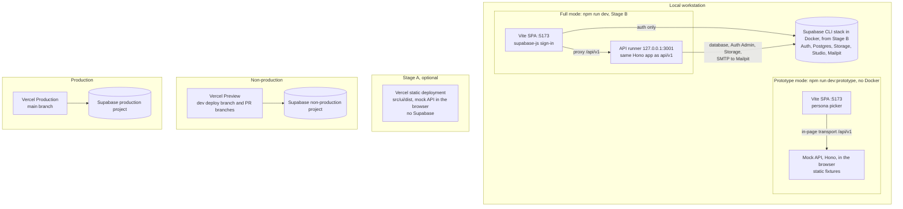
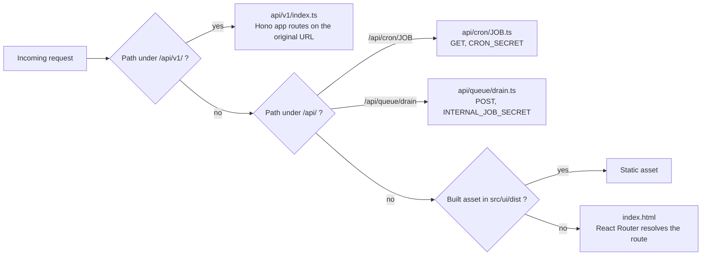
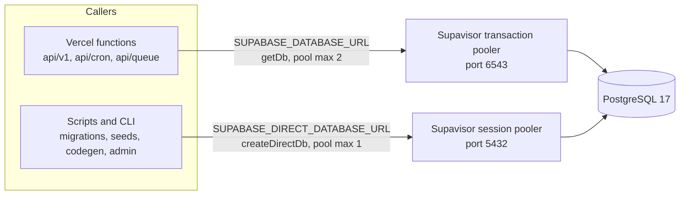
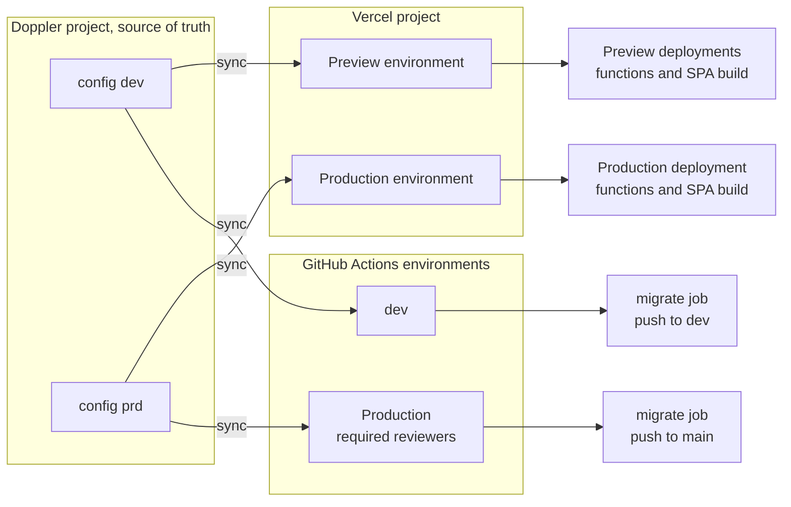
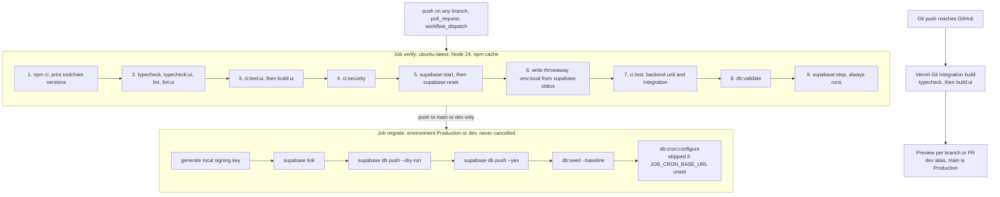
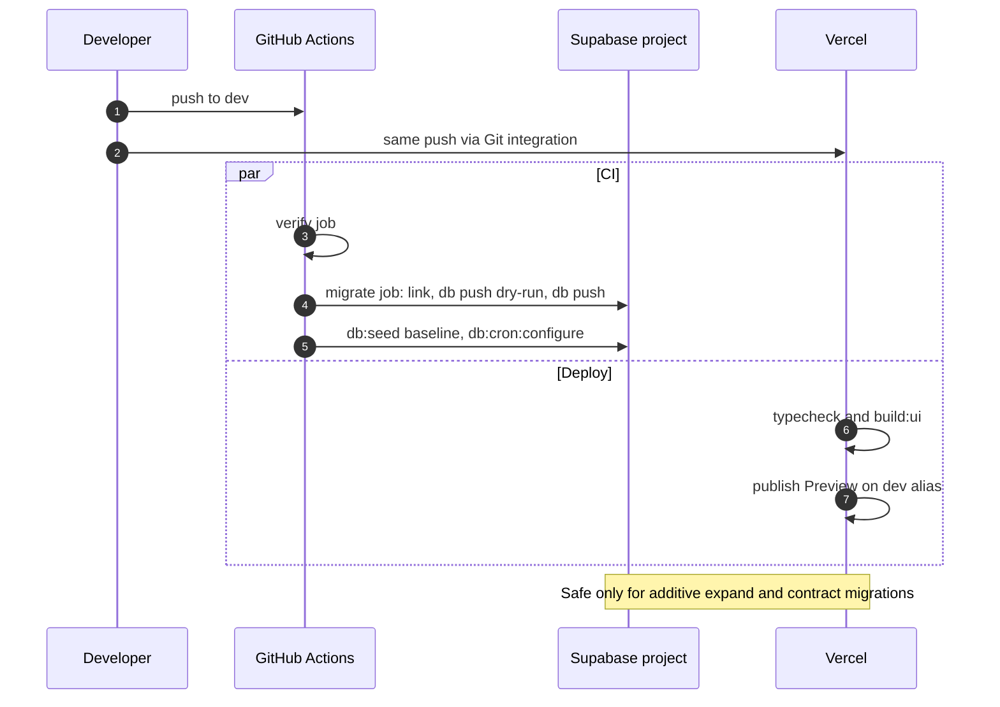

# Deployment and Environments

Status: As-designed (pre-build). Updated to as-built at the end of Stage A and Stage B.

Sources:
- `docs/architecture-brief.md`: §1 Platform summary, §3 Vercel configuration, §4.3 scripts, §5.4 Configuration, §5.6 Database access, §5.7 Authentication, §6.3–6.4 Data API lockdown and seeds, §7 Local development, §8 Environment variables and secrets, §9.1 Scheduling model, §12 CI/CD, §13 Environments, §14 Security checklist, §15 Documentation
- `docs/plan/design-decisions.md`: DD-06 (`job_run` status), DD-16 (`category_catalog` in the baseline seed), DD-23 (permission additions), DD-18 and DD-19 (split and added jobs), DD-28 (`rate_limit_buckets`), DD-29 (MFA deferred), DD-30 (CSP meta tag), DD-35 (self-hosted fonts), DD-38 (withdrawn; there is no `VITE_AUTH_MODE`), DD-39 (`request_idempotency` purge), DD-43 (real Supabase Auth in local Docker, dev-only demo accounts; superseded for Stage A by DD-50 and moved to Stage B), DD-44 (SMTP email channel with nodemailer, Mailpit locally, hosted provider deferred), DD-45 (Node 24 everywhere), DD-50 (Stage A is a fully static prototype: no Supabase, no Docker, static Vercel deployment with no environment variables); §E owner decisions of 2026-09-29: items 2 (hosted prototype: local only, amended 2026-10-30 by DD-50 to allow static Vercel hosting), 4 (email delivery), 5 (Node version), 6 (Stage A authentication, re-decided by DD-50) and 7 (supplier self-registration)
- `docs/plan/architecture-plan.md` (revision 3): §0 Delivery stages, §3.8 Notifications (email channel), §3.9 Background jobs (as amended by DD-18 and DD-19), §3.11 Prototype mode (fully static, DD-50), §4 Repository layout, §5 Build waves and file ownership, §9 Build and verification commands, §11 Deviations and assumptions (items 1–10, all accepted or decided on 2026-09-29; item 11, approved 2026-10-30 for DD-50; and the other owner answers)
- `docs/plan/email-delivery-options.md`: §1 (Supabase Auth email), §2 (local SMTP to Mailpit), §3 (hosted provider options; the choice is deferred)
- `docs/plan/schema-blueprint.md`: Migration 01 (job platform, storage buckets), Migration 13 (`rate_limit_buckets`, `request_idempotency`), Migration 14 (schedules, grants)
- `docs/plan/demo-storyline.md`: preamble (seed safety, persona password)
- `docs/plan/tenderiq-prototype.workflow.js`: `ownedPaths` for `scaffold` and `mock-platform`; the A1 scaffold task (`engines`, dependencies, `.nvmrc`, `supabase/config.toml`, `.env.local`, the CI `verify` job, `docs/local-development.md`), the A1 mock-platform task (`lib/config`, `lib/supabase`, `lib/auth/verify.ts`, `seed-auth-personas.ts`, `scan-bundle`), the A1 ui-shell task (fonts, CSP, supabase-js auth, `DemoAccounts`) and `A_GATE_BASE`. Its Supabase items (`supabase/config.toml` start-up, `.env.local`, `seed-auth-personas.ts`, supabase-js auth, `DemoAccounts`) were replaced in Stage A by DD-50 and move to Stage B.
- `docs/plan/tenderiq-backend.workflow.js`: `ownedPaths` for `scaffold-b`, `platform-http` and `integration`; B1 scaffold-b tasks 2, 4 and 5 (`[inbucket] smtp_port`, runbooks, Stage B `.env.local` including the email settings); B1 platform-http task (config extension, rate limiting, idempotency, `scripts/ci`); B2 svc-notifications task (email channel); B4 integration task 7 (runbook ownership)

Contents:
1. [Stage applicability](#1-stage-applicability)
2. [Environments](#2-environments)
3. [Local runtime](#3-local-runtime)
4. [Vercel project](#4-vercel-project)
5. [Supabase projects](#5-supabase-projects)
6. [Database connection strings](#6-database-connection-strings)
7. [Environment variables](#7-environment-variables)
8. [Secrets flow](#8-secrets-flow)
9. [CI/CD pipeline](#9-cicd-pipeline)
10. [Scheduled jobs per environment](#10-scheduled-jobs-per-environment)
11. [Post-deploy smoke checks](#11-post-deploy-smoke-checks)
12. [Rollback and pausing](#12-rollback-and-pausing)
13. [Operational runbooks](#13-operational-runbooks)
14. [Open items](#14-open-items)

Related: [01-system-context.md](01-system-context.md), [02-architecture.md](02-architecture.md), [04-security-model.md](04-security-model.md), [08-background-jobs.md](08-background-jobs.md), [11-testing-strategy.md](11-testing-strategy.md), [13-delivery-and-resilience.md](13-delivery-and-resilience.md), [adr/0006-contracts-first-ui-prototype-stage.md](adr/0006-contracts-first-ui-prototype-stage.md).

---

## 1. Stage applicability

TenderIQ is delivered in two stages separated by a human approval gate (plan §0; see [13-delivery-and-resilience.md](13-delivery-and-resilience.md)). The deployment model in this document is the Stage B target. Stage A is a fully static prototype (DD-50, superseding DD-43 for Stage A): a Vite SPA whose mock API runs in the browser, with a persona picker for sign-in. It needs no Supabase, no Docker, no database and no environment variable. It runs locally with `npm run dev:prototype` and may be deployed to Vercel as static files; the owner creates the Vercel project and deploys (DD-50, amending the owner decision of 2026-09-29 "local only"). The local Supabase stack in Docker and real Supabase Auth are introduced in Stage B.

| Artifact | Created in | Owner (plan §5, `ownedPaths` in the workflow scripts) | Notes |
|---|---|---|---|
| `vercel.json` | Stage A, phase A1; replaced in Stage B | `scaffold`; `scaffold-b` | Stage A (DD-50, plan §11 item 11): static only, `framework` `vite`, `buildCommand` `npm run typecheck && npm run build:ui`, `outputDirectory` `src/ui/dist` and one rewrite `/(.*)` → `/index.html`; no `/api` rewrite and no `functions` block, because there is no `api/` directory. Stage B restores the brief §3.1 file (§4). |
| Root `package.json` (`engines` `24.x`, every dependency for both stages), `.nvmrc` (`24`) | Stage A, phase A1 | `scaffold` | Node 24 everywhere (DD-45). The runtime dependencies include `nodemailer` (and `@types/nodemailer` as a dev dependency), the one approved added runtime dependency (DD-44). Stage B adds no dependencies. |
| `.github/workflows/ci.yml`: `verify` job | Stage A, phase A1 | `scaffold` | The Stage A job runs on Node 24: install, typecheck, lint, unit and SPA tests, build, `ci:security` and the prototype E2E (DD-45). It starts no Supabase stack and writes no `.env.local` (DD-50). Stage B extends the job to the full brief §12 step list, including the Supabase stack. |
| `.github/workflows/ci.yml`: `migrate` job | Stage B, phase B1 | `scaffold-b` | Needs migrations, which only exist from Stage B. In Stage A it is present only as a commented reservation. |
| `src/ui/index.html`, `src/ui/public/fonts/` | Stage A, phase A1 | `scaffold` owns `index.html`; the `ui-shell` task adds the CSP meta tag and the fonts | CSP `<meta http-equiv>` (DD-30), filled in by `vite.config.ts`: in Stage A the production policy has `connect-src 'self'` and no Supabase origin (the dev server adds `ws: wss:`), DD-50; Stage B adds the Supabase URL for auth. Inter and JetBrains Mono woff2 files are self-hosted, with no external font request (DD-35). |
| `scripts/ci/{scan-secrets,scan-bundle,assert-test-run}.ts` | Stage A, phase A1 | `mock-platform` | Stage A versions. `scan-bundle` fails if `src/ui/dist` contains `src/server` code, server variable names or the service-role key, and checks the production CSP. In Stage A the static prototype is the production build, so the mock API, its fixtures (persona e-mails) and the persona picker ship on purpose and are not flagged (DD-50). `platform-http` restores the mock-code, persona e-mail and demo-accounts-marker checks and extends the scans for Stage B in B1 (plan §4 marks `scripts/ci/` as Ⓐ/Ⓑ). |
| `supabase/config.toml`, `supabase/.gitignore` | Stage A, phase A1 (kept, unused by the prototype since DD-50); used from Stage B | `scaffold`. In B1 `scaffold-b` adjusts them only if Stage B needs it. | Local stack configuration (brief §7.3), including `[inbucket]` enabled with `smtp_port = 54325` for the app email channel (DD-44). The stack is first started in Stage B (DD-50). The signing-key script `scripts/db/ensure-signing-keys.mjs` was removed from Stage A and returns in Stage B with the `supabase:*` scripts. |
| `.env.local` (git-ignored, local only) | Stage B, phase B1 | `scaffold-b` | Stage A needs none (DD-50). In Stage B it is written from `npx supabase status -o env`: `APP_ENV=local`, `LOG_LEVEL`, `SUPABASE_URL`, `SUPABASE_ANON_KEY`, `SUPABASE_SERVICE_ROLE_KEY`, `VITE_SUPABASE_URL`, `VITE_SUPABASE_ANON_KEY`, the two database URLs, `CRON_SECRET`, `INTERNAL_JOB_SECRET`, `STORAGE_ADAPTER=supabase` and the Mailpit email settings (DD-44, §3.2). |
| `src/server/lib/config/**`, `src/server/lib/supabase/**`, `src/server/lib/auth/verify.ts` | Stage A, phase A1 (kept, unused by the prototype since DD-50); extended in B1 | `mock-platform`. In B1 `platform-http` extends `lib/config`, and `platform-data-auth` extends `lib/supabase` and `lib/auth`. | The real modules (brief §5.4, §5.7), written in Stage A with the Stage A variable subset (§7) under DD-43. The Stage A mock API does not use them: it accepts the persona token instead (DD-50). The real API verifies Supabase JWTs with them from Stage B; their local-stack test (`verify.local-stack.test.ts`) is excluded from the Stage A unit project. |
| `scripts/dev/seed-auth-personas.ts` (`npm run auth:personas`) | Stage B, phase B1 (written in A1 under DD-43, removed from Stage A by DD-50) | `scaffold-b` | Creates or updates every demo persona in local Supabase Auth through the Admin API, with password `test1234`. It is idempotent and refuses a `SUPABASE_URL` that is not local. |
| `.env.example`, `.env.local.example` | Stage A, phase A1 (Stage A subset); extended in B1 | `mock-platform`; `platform-http` | Deployed and local variable catalogs (brief §8.2), placeholders only. Their headers state that the Stage A prototype reads none of them (DD-50). |
| `api/**`, `scripts/dev/{serve-api.ts,dev.mjs}`, `scripts/ci/**` (Stage B extensions) | Stage B, phase B1 | `platform-http` | Function entrypoints, the local API runner and the Stage B scans. |
| `docs/environment-variables.md` | Stage B, phase B1 | `platform-http` | Runbook (see §13). |

No external accounts are created by the build. Doppler, GitHub environments and the Vercel project exist as files and runbooks only (plan §11 item 5). An operator provisions them by following `docs/deployment.md`.

## 2. Environments

| Environment | `APP_ENV` | Supabase | Vercel | Git branch | Data | Sign-in and email |
|---|---|---|---|---|---|---|
| Local prototype (Stage A onward) | none read; the in-browser mock API reports `appEnv` `local` on the dev server | none (DD-50) | none: `npm run dev:prototype` (Vite alone; the mock API runs in the page) | any | Static fixtures in `src/mock-api/fixtures/<domain>.ts` built from the demo storyline; nothing is persisted. | The persona picker (no password, DD-50) and the "Prototype — static demo data" banner. No email is sent. |
| Hosted static prototype (Stage A, optional) | none read; the mock API reports `appEnv` `preview` in a deployed build | none (DD-50) | a static deployment of `src/ui/dist`, created and deployed by the owner; no environment variables | owner's choice | As the local prototype | As the local prototype: the persona picker ships in the public build because the data is fictional (DD-50) |
| Local full stack (Stage B) | `local` | The Supabase CLI stack in Docker, introduced in Stage B (DD-50) | `npm run dev` (API runner + Vite) or `npm run dev:vercel` | any | Baseline seed (`supabase/seed.sql`) plus optional demo seed (`npm run db:seed:demo`, password `test1234`). Its `00-platform` module links the Auth accounts created by `npm run auth:personas`, or creates them. | Supabase Auth through supabase-js, with the demo-accounts quick-pick in development builds. Auth emails and the app's email notices land in Mailpit (`EMAIL_ENABLED=true`, SMTP 127.0.0.1:54325, DD-44). |
| Dev | `dev` | Shared non-production project | Preview deployment of the `dev` deploy branch | `dev` | Baseline seed via the `migrate` job. The demo seed is optional and needs `DEMO_SEED_PASSWORD`. | Supabase Auth; production build, so no demo-accounts quick-pick. Email needs the hosted SMTP provider, which is deferred (DD-44). Without it, notices are in-app only and no email delivery rows are written. |
| Preview | `preview` | Same shared non-production project as Dev | Preview deployment per PR or branch | PR branches | Whatever the shared non-production project holds | As Dev |
| Production | `production` | Dedicated production project | Production deployment | `main` | Baseline seed via the `migrate` job. The demo seed refuses to run (brief §6.4). | As Dev |

Rules (brief §13):
- There is one Supabase project per persistent environment. Preview and staging never reach the production project or production data.
- `APP_ENV` also accepts `staging` (brief §5.4, and the `job_run.environment` CHECK in the blueprint), but no staging environment is defined in the sources.
- The only behavioral branch on `APP_ENV` in server code is `!== 'local'`. It enables HSTS and forbids `STORAGE_ADAPTER=fake` (brief §5.4, §5.9).
- Only pushes to `main` and `dev` run the `migrate` job (brief §12). A PR preview therefore runs against the schema last migrated from `dev`. A PR that adds a migration is not applied to the shared project until it is merged into `dev`.
- From Stage B, the demo-accounts quick-pick exists only in development builds: it renders under `import.meta.env.DEV`, Vite strips it from production builds, and `scan-bundle` checks that its marker string is absent (DD-43's design, moved to Stage B by DD-50). Every Vercel deployment is a production build. The Stage A static prototype is the exception: its persona picker is the sign-in page of every build, including a deployed one (DD-50).



## 3. Local runtime

### 3.1 Prototype mode (Stage A, kept after Stage B)

| Process | Address | Started by | Notes |
|---|---|---|---|
| Vite dev server (SPA) | http://localhost:5173 | `npm run dev:prototype` (`npm run dev -w @tenderiq/ui`) | The only process (DD-50, plan §3.11). No proxy, no environment file, no Docker and no Supabase. |
| Mock API (Hono) | in the page (`/api/v1`) | `src/ui/src/api/prototypeTransport.ts`, which lazy-loads `src/mock-api/browser.ts` on the first request | Same `/api/v1` surface and middleware chain as the real API, run in the browser. The bearer token is the chosen persona's e-mail; `personaTokenVerifier` (`src/mock-api/prototype-auth.ts`) accepts it and the chain maps it to the fixture persona. An unknown or deactivated persona gets 401 (DD-50). |

The standalone mock-API server (`scripts/dev/serve-mock-api.ts`, `npm run dev:mock-api`), its orchestrator `scripts/dev/dev-prototype.mjs` and the `supabase:*` and `auth:personas` scripts were removed from Stage A (DD-50). In Stage A the static prototype is the production build, so the mock API and its fixtures are part of the SPA bundle (a lazy chunk); they are never part of `api/`. From Stage B the production build excludes the mock API again and `scan-bundle` verifies this (plan §11 items 1 and 11).

Sign-in is the persona picker on `/signin`; the chosen persona is kept in `sessionStorage` and cleared on sign-out. No password is handled, and there are no password-recovery pages in Stage A. There is still no mock auth adapter, no `/__mock/auth` endpoint and no `VITE_AUTH_MODE` (DD-38 stays withdrawn). The "Prototype — static demo data" banner appears when `/api/v1/me/context` reports `environment.mode = 'prototype'`, which the mock API always does. Because the prototype listens only on 5173, it does not conflict with a Stage B API runner on 127.0.0.1:3001; `dev:prototype` and the Stage B `dev` both use Vite's port 5173, so only one of them runs at a time.

### 3.2 Full mode (Stage B)

| Service | Address |
|---|---|
| SPA (Vite) | http://localhost:5173 |
| API runner | http://127.0.0.1:3001/api/v1 (proxied by Vite, which also proxies `/api/cron` for manual testing) |
| Supabase API gateway | http://127.0.0.1:54321 |
| Postgres | 127.0.0.1:54322 (user/password `postgres`) |
| Studio | http://127.0.0.1:54323 |
| Mailpit (catches Supabase Auth email and the app's email notices) | Web UI and API http://127.0.0.1:54324. SMTP 127.0.0.1:54325 (`[inbucket] smtp_port`, DD-44). |

Clean-checkout sequence (brief §7.2): `npm install` → copy `.env.local.example` to `.env.local` and fill it from `npx supabase status` → `npm run supabase:start` → `npm run supabase:reset` → optional `npm run db:seed:demo` → `npm run dev`. `run.ps1` wraps this sequence on Windows with `-Reset`, `-Demo` and `-StopDb`. Vite's `envDir` is the repository root, so the SPA reads `VITE_*` values from the root `.env.local`.

The stack is first started in Stage B (DD-50); `run.ps1` gains the full-mode options then. The Stage B `.env.local` also turns on the email channel against Mailpit: `EMAIL_ENABLED=true`, `SMTP_HOST=127.0.0.1`, `SMTP_PORT=54325` and `EMAIL_FROM=notices@tenderiq.local` (B1 scaffold-b task 5, DD-44). A message that Mailpit accepts is recorded as `delivered`.

Locally, pg_cron schedules are deliberate no-ops because `job_cron_config` is empty. Jobs are run with `npm run cron:run -- <job>`, `npm run cron:run:all` and `npm run queue:worker` (brief §7.5).

## 4. Vercel project

### 4.1 Project shape

**Stage A (DD-50, plan §11 item 11).** The static prototype deploys to Vercel as static files with no environment variables and no functions. The Stage A `vercel.json` keeps `framework`, `buildCommand`, `outputDirectory` and the SPA fallback, and drops the `/api/v1` rewrite and the `functions` block, because Stage A has no `api/` directory:

```json
{
  "$schema": "https://openapi.vercel.sh/vercel.json",
  "framework": "vite",
  "buildCommand": "npm run typecheck && npm run build:ui",
  "outputDirectory": "src/ui/dist",
  "rewrites": [
    { "source": "/(.*)", "destination": "/index.html" }
  ]
}
```

The owner creates the Vercel project and deploys; agents create no accounts and do not deploy. Every request for `/api/v1` is answered in the browser by the mock API, so the deployment serves only files.

**Stage B (the target).** One Vercel project builds the static SPA and the Node.js serverless functions together (brief §3.1). Stage B restores the brief's `vercel.json` verbatim:

```json
{
  "$schema": "https://openapi.vercel.sh/vercel.json",
  "framework": "vite",
  "buildCommand": "npm run typecheck && npm run build:ui",
  "outputDirectory": "src/ui/dist",
  "rewrites": [
    { "source": "/api/v1/:path*", "destination": "/api/v1" },
    { "source": "/((?!api/).*)", "destination": "/index.html" }
  ],
  "functions": {
    "api/v1/index.ts":  { "maxDuration": 30 },
    "api/cron/*.ts":    { "maxDuration": 60 },
    "api/queue/*.ts":   { "maxDuration": 60 }
  }
}
```

| Setting | Value | Reason |
|---|---|---|
| `buildCommand` | `npm run typecheck && npm run build:ui` (the same as `npm run build`, plan §9) | The backend typecheck runs first, so a type error fails the deploy. |
| `outputDirectory` | `src/ui/dist` | Vite build output of the SPA workspace. |
| Rewrite `/api/v1/:path*` → `/api/v1` | One function serves the whole versioned API | Outside Next.js, Vercel's zero-config `api/` routing has no catch-all filename syntax. A rewrite only selects the function, and the function still receives the original URL, so Hono routes on the real path. |
| Rewrite `/((?!api/).*)` → `/index.html` | SPA fallback | Deep links and hard refreshes of the URL map (plan §4) load the SPA. |
| No `crons` key | — | Scheduling lives in the database (pg_cron). A regression test fails if `vercel.json` gains one. |
| No headers block | — | API security headers come from the Hono app, because HSTS depends on typed config and the headers must also appear on error responses. The SPA document gets its Content-Security-Policy from a `<meta http-equiv>` tag in `index.html` (`connect-src 'self'` in Stage A, DD-50; Stage B adds the Supabase URL for auth), so `vercel.json` still has no header rules (DD-30). |
| Fonts | Inter and JetBrains Mono (OFL) woff2 files in `src/ui/public/fonts`, served from `src/ui/dist` with the other static assets | No Google Fonts request and no npm font dependency (DD-35, plan §11 item 9). |
| Node.js | 24 | Node 24 everywhere: `engines` `24.x` (Vercel selects Node.js 24.x from it), `.nvmrc` `24`, and `node-version: 24` in CI (DD-45). This deviates from the brief's Node 22 pin, because Node 22 reaches end-of-life on 2027-04-30 (plan §11 item 6). |

### 4.2 Function entrypoints (Stage B)

| Entrypoint | Method | Protection | `maxDuration` | Delegates to |
|---|---|---|---|---|
| `api/v1/index.ts` | named exports per HTTP method | Session JWT + tenant + permission chain (except public paths) | 30 s | `buildApp(...)` from `src/server/lib/router`, wrapped with `hono/vercel` `handle()`. The app is built lazily and cached per cold start. A configuration failure returns a sanitized 500 problem+json with a correlation id. |
| `api/cron/<job>.ts`, one per job in plan §3.9 (17 files, see §10) | `GET` | `CRON_SECRET` bearer, constant-time comparison | 60 s | `src/server/jobs/cron` registry via the shared `run-cron-job` runner |
| `api/queue/drain.ts` | `POST` | `INTERNAL_JOB_SECRET` bearer | 60 s | `src/server/jobs/queue` drain loop (about a 25 s time budget) |

Every entrypoint exports `config = { runtime: 'nodejs' }`, uses named `GET`/`POST` exports (never `export default`), and contains no logic (brief §3.2).



### 4.3 Deploy branches

Deployment is Vercel's Git integration, not a CI step (brief §12):

| Git event | Vercel result | Environment variables from |
|---|---|---|
| Push to `main` | Production deployment | Vercel Production, synced from Doppler `prd` |
| Push to `dev` (configured as a deploy branch) | Preview deployment with a stable branch alias | Vercel Preview, synced from Doppler `dev` |
| Push to any other branch, or a PR | Preview deployment per branch or PR | Vercel Preview, synced from Doppler `dev` |

The build runs in parallel with the `migrate` job. This is safe for additive expand/contract migrations. A breaking schema change needs human sequencing, or a `vercel deploy` step behind `needs: migrate` with the Git integration disabled (brief §12).

## 5. Supabase projects

| Environment | Project | Created by |
|---|---|---|
| Local | CLI stack in Docker (`supabase/config.toml`: `[db] major_version = 17`, pooler disabled, realtime, edge runtime and analytics disabled, storage enabled, `[inbucket]` enabled with `smtp_port = 54325`, `enable_signup = false`, `signing_keys_path = "./signing_keys.json"`) | `npm run supabase:start` (generates `supabase/signing_keys.json` first, git-ignored). The stack is used from Stage B; the Stage A prototype needs no Supabase (DD-50, superseding DD-43 for Stage A). |
| Dev and Preview | One shared non-production hosted project | Operator, following `docs/deployment.md` |
| Production | One dedicated hosted project | Operator, following `docs/deployment.md` |

Per hosted project (brief §13, plan §11 item 3):

| Item | How it is set |
|---|---|
| Extensions `pg_cron`, `pg_net` (schema `extensions`, functions in `net`) and `pgmq` | First migration `20261001000000_extensions.sql`. Never set through the dashboard. |
| Schema, views, grants revocation, cron schedules | Migrations `…0100` to `…1400`, applied by `supabase db push` in the `migrate` job |
| Private storage buckets `tender-documents`, `bid-submissions`, `supplier-evidence`, `contract-documents`, `exports` | Migration 01 (`storage.buckets` insert) |
| pgmq queues `notifications` and `exports` | Migration 01 (`pgmq.create`) |
| Permission catalog (including the DD-23 additions), role templates (blueprint §P), `category_catalog` (DD-16) and other code-owned reference data | `npm run db:seed -- --baseline --env=<env>` in the `migrate` job. It runs the delimited block of `supabase/seed.sql` in one transaction over the direct URL. |
| `job_cron_config` (base URL + two secrets) | `npm run db:cron:configure -- --env=<env>` in the `migrate` job. The step is skipped when `JOB_CRON_BASE_URL` is unset. |
| Asymmetric JWT signing keys (ES256) | Enabled in the project settings. `SUPABASE_JWT_SECRET` is intentionally absent. |
| Auth Site URL and redirect URLs (including `/reset-password`) | Set to the deployed origin(s) |
| Self-signup | Disabled (`enable_signup = false`, brief §5.7). Supplier registration posts to the TenderIQ API, which creates the organization, user and membership in one transaction and then sends the Auth Admin invite (plan §11 item 4; the owner chose this proposed approach on 2026-09-29; DD-27; [adr/0012](adr/0012-supplier-registration-via-provisioned-accounts.md)). |
| MFA and step-up sign-in | Not in the initial release. The brief's configuration disables MFA, and Supabase MFA is recorded as a later extension (DD-29, plan §11 item 10). |
| Auth email (invite, reset, registration) | Locally, Mailpit in the Supabase Docker stack, from Stage B. Stage A sends no email (DD-50). In Stage B the demo accounts are created already confirmed by `npm run auth:personas`, password-reset emails arrive in Mailpit, and invite and registration emails arrive when the real API calls the Auth Admin invite. Hosted Supabase needs a custom SMTP provider for real use, because the built-in sender is only for testing and is heavily rate-limited (`docs/plan/email-delivery-options.md` §1). The provider choice is deferred until before the first hosted environment (DD-44, see §14). The same SMTP credentials will serve Supabase Auth and the app's email channel. |
| App email channel (notices) | The `email` `DeliveryChannel` sends over SMTP with `nodemailer` ([adr/0007](adr/0007-in-app-formal-notices.md)), configured by `EMAIL_ENABLED`, `SMTP_*` and `EMAIL_FROM` (§7). Where email is not enabled, notices are in-app only and no email delivery rows are written. The hosted provider's delivery-event webhooks are deferred with the provider (DD-44). |
| Public-write throttling | Table `rate_limit_buckets` [G] (Migration 13) and an app middleware that limits public POSTs (registration, register interest, access requests) per IP hash and per email hash. There is no external service (DD-28). |
| First user | `npm run db:admin:create -- --email … --env=<env>`, run by an operator holding the service-role key. It prints the generated password once. The operator tenant `tenderiq-ops` is created by this command or by the `00-platform` demo module (demo storyline). |
| Demo data | `npm run db:seed:demo` refuses production. For non-local targets it needs `DEMO_SEED_PASSWORD` and `--env=<name>` equal to the loaded `APP_ENV` (brief §6.4). |

Data API lockdown applies to every project. `anon` and `authenticated` hold no privileges on `public`, which is enforced by the final migration and by an integration test (brief §6.3; see [04-security-model.md](04-security-model.md)).

## 6. Database connection strings

Two connection strings are used, and the split is load-bearing (brief §5.6):

| Variable | Deployed target | Local target | Used by | Pool |
|---|---|---|---|---|
| `SUPABASE_DATABASE_URL` | Supavisor transaction pooler, port 6543 | 127.0.0.1:54322 | All request and job traffic through `getDb()` | `max: 2` per function instance, `idleTimeoutMillis: 10000`, `connectionTimeoutMillis: 10000`, `allowExitOnIdle: true` |
| `SUPABASE_DIRECT_DATABASE_URL` | Supavisor session pooler, port 5432 | 127.0.0.1:54322 | Migrations, seeds, codegen and admin scripts through `createDirectDb()` | `max: 1`. The caller closes it. |

Why the split exists:
- **Transaction pooling suits serverless.** Many short-lived Vercel instances share a small number of server connections. Each instance holds at most 2 client connections, so bursts of instances do not exhaust Supavisor.
- **Transaction pooling forbids session state.** The code uses no named prepared statements, no `LISTEN/NOTIFY`, no session advisory locks, no bare `SET`, no cross-statement temp tables and no `pg_cancel_backend` cancellation. Only `SET LOCAL`, `pg_advisory_xact_lock()` and `SELECT … FOR UPDATE` inside a transaction are allowed. Guard tests enforce this (see [11-testing-strategy.md](11-testing-strategy.md)). The official receipt time relies on this rule: it is taken with `clock_timestamp()` inside the submission transaction after `FOR SHARE` on the tender row ([adr/0011](adr/0011-official-receipt-time-from-database.md)).
- **Migrations and scripts need a session.** Multi-statement DDL, seeding and type generation run over the session pooler.
- **Both use the pooler hostname** (`aws-<region>.pooler.supabase.com`), not `db.<ref>.supabase.co`. The direct host is IPv6-only without the paid IPv4 add-on, and GitHub runners are IPv4-only.
- **`numeric` values stay strings.** Money and scores never pass through floating point ([adr/0005](adr/0005-decimal-strings-for-money-and-scores.md)).



## 7. Environment variables

The config module `src/server/lib/config` is the only reader of `process.env`. It validates the whole server environment with one zod schema and fails listing every bad variable (brief §5.4). `mock-platform` writes the module in Stage A with the Stage A subset (column "From" = A), and `platform-http` extends it in B1 to every server variable, including the DD-44 email variables (B). Since DD-50 the Stage A static prototype reads **no** environment variable, locally or on Vercel: the "A" variables are catalogued and validated by the module kept for Stage B, but nothing in the prototype consumes them.

| Variable | Tier | From | Consumer | Notes |
|---|---|---|---|---|
| `APP_ENV` | server | A | config | `local`, `dev`, `preview`, `staging` or `production`. Must be explicit when deployed. The `migrate` job derives it from the branch. The Stage A prototype does not read it: its in-browser mock API reports `local` on the dev server and `preview` in a deployed build as `environment.appEnv` of `/me/context` (DD-50). |
| `NODE_ENV` | server, optional | B | config | Vercel sets `production`. |
| `LOG_LEVEL` | server, optional | A | logger | Defaults to `info`. |
| `SUPABASE_URL` | server | A | JWKS and auth clients | Project URL. Used from Stage B to verify Supabase JWTs; the Stage A mock API does not read it (DD-50). |
| `SUPABASE_ANON_KEY` | server | A | verification client (`getClaims`) | — |
| `SUPABASE_SERVICE_ROLE_KEY` | server, Vercel Sensitive | A | admin client: Auth Admin API, Storage | Never reaches the browser. Locally it is used by `npm run auth:personas` (Stage B, DD-50), which refuses a non-local `SUPABASE_URL`. |
| `SUPABASE_DATABASE_URL` | server, Vercel Sensitive | B | `getDb()` | Transaction pooler, port 6543. |
| `SUPABASE_DIRECT_DATABASE_URL` | server, Vercel Sensitive | B | `createDirectDb()` | Session pooler, port 5432. |
| `CRON_SECRET` | server, Vercel Sensitive | B | `api/cron/*` | Distinct from `INTERNAL_JOB_SECRET`. |
| `INTERNAL_JOB_SECRET` | server, Vercel Sensitive | B | `api/queue/drain` | — |
| `STORAGE_ADAPTER`, `STORAGE_<BUCKET>` | server, optional | B | storage composition | Default `supabase` and the migration-created buckets. `fake` throws when `APP_ENV !== 'local'`. |
| `EMAIL_ENABLED` | server | B | notifications `email` channel | Turns the email channel on. Where email is not enabled, no email delivery rows are written and notices are in-app only (DD-44). The local Stage B value is `true`. |
| `SMTP_HOST`, `SMTP_PORT` | server | B | `email` channel (`nodemailer`) | Locally `127.0.0.1` and `54325` (Mailpit). Hosted values come from the deferred provider (DD-44). |
| `SMTP_USER` | server | B | `email` channel | Provider credential. Not set in the local `.env.local`, which points at Mailpit (B1 scaffold-b task 5). |
| `SMTP_PASSWORD` | server, Vercel Sensitive | B | `email` channel | Provider credential. Not set in the local `.env.local`. |
| `EMAIL_FROM` | server | B | `email` channel | Sender address. Locally `notices@tenderiq.local`. |
| `JOB_CRON_BASE_URL` | script-only | B | `db:cron:configure` | A stable origin, never a per-deployment preview URL. |
| `DEMO_SEED_PASSWORD` | script-only | B | `db:seed:demo` | Required for non-local targets. |
| `SUPABASE_ACCESS_TOKEN`, `SUPABASE_PROJECT_REF`, `SUPABASE_DB_PASSWORD` | script-only (CLI) | B | `migrate` job | The password is passed as an environment variable, never as `--password`. |
| `VITE_SUPABASE_URL`, `VITE_SUPABASE_ANON_KEY` | browser-safe | B | SPA auth client | Compiled into the bundle. Used for authentication only. These are the only browser-safe variables, exactly as in brief §8.1. The Stage A SPA reads neither (DD-50). |

Intentionally absent: `SUPABASE_JWT_SECRET`, any error-tracking DSN, and `VITE_AUTH_MODE` (DD-43; the variable that DD-38 had added is withdrawn).

Files (brief §8.2): `.env.example` is the deployed catalog and `.env.local.example` is the local catalog. Both contain placeholders only, and neither contains an inline connection-string password. `mock-platform` writes them in A1 with the Stage A subset, and `platform-http` extends them in B1. Their headers state that the Stage A prototype needs none of them (DD-50). Adding a variable changes four things together: the config `schema.ts`, both example files and `docs/environment-variables.md`. A test enforces that the example files list exactly the keys the schema reads.

## 8. Secrets flow

Doppler is the single source of truth. One Doppler project has configs `dev` and `prd`, and each config syncs outward to one Vercel environment and one GitHub Actions environment (brief §8.3):

| Doppler config | Vercel environment | GitHub Actions environment | Consumed by |
|---|---|---|---|
| `dev` | Preview | `dev` | Preview functions and SPA builds (dev branch and PRs). The `migrate` job on pushes to `dev`. |
| `prd` | Production | `Production` (required reviewers) | Production functions and SPA build. The `migrate` job on pushes to `main`. |



Rules:
- Secrets sync to GitHub environments, not repository secrets, so the same `${{ secrets.X }}` resolves to a different Supabase project per branch.
- Server secrets are Vercel Sensitive variables. The browser receives only `VITE_*` values.
- `npm run ci:security` runs `scan-secrets` (JWT-shaped keys, `sb_secret_` and service-role literals, credentialed URLs in any tracked file) and `scan-bundle` (server variable names, service-role keys or `src/server` fragments in `src/ui/dist`, plus the production CSP check). In Stage A the mock API, its fixtures and the persona picker ship in the static prototype on purpose and are not flagged; Stage B restores the mock-code, persona e-mail and dev-only demo-accounts-marker checks (DD-50).
- Hosted SMTP credentials do not exist yet, because the provider is deferred (DD-44).

## 9. CI/CD pipeline

`.github/workflows/ci.yml` (brief §12):
- Triggers: push on all branches, pull requests, `workflow_dispatch`.
- `permissions: contents: read` and `env: DO_NOT_TRACK: '1'`.
- Concurrency: one group per ref, with `cancel-in-progress` except on `main` and `dev`. Cancelling a running `db push` could leave a hosted schema half-migrated.



### 9.1 `verify` job

The job is a single job because the integration suite needs the stack that is started earlier in the same job. Steps run from cheapest to most expensive.

| # | Step | Fails the build when | Stage |
|---|---|---|---|
| 1 | `npm ci`, print versions | install fails | A, B |
| 2 | Backend typecheck → SPA typecheck → backend lint → SPA lint | any type or lint error (`no-explicit-any`, `process.env` ban, `no-console`) | A, B |
| 3 | `ci:test:ui` → `build:ui` | any SPA test fails or is skipped, the test count is below the floor, or the build fails | A, B |
| 4 | `ci:security` | secret or bundle leak found, or the production CSP is missing or relaxed; from Stage B also the mock API, persona e-mails or the dev-only demo-accounts marker in the production bundle | A, B. Stage A uses the `mock-platform` scan scripts with the DD-50 rules; `platform-http` extends them in B1. |
| 5 | `supabase:start` → `supabase:reset` | a migration fails from clean. The Docker volume is not cached, because migrating from clean is what is under test. | B. Stage A starts no stack (DD-50). |
| 6 | Write `.env.local` from `npx supabase status -o env` | — | B |
| 7 | `ci:test` (backend unit + integration) | any test fails or is skipped, or the count is below the floor | B |
| 8 | `db:validate` | double reset fails, CLI output contains error markers, the migration list differs from disk, or the schema snapshot differs from `supabase/schema.expected.sql` | B |
| 9 | `supabase:stop` (`if: always()`) | — | B |

In Stage A the job runs on Node 24 (DD-45) in this order: install, typecheck, lint, unit and SPA tests, build, `ci:security` and the Playwright prototype E2E. It starts no Supabase stack and writes no `.env.local` (DD-50): the mock-API tests send the prototype persona token, and the prototype E2E starts Vite alone on port 5280 and signs in through the persona picker. Stage A has no migrations and no backend integration suite. See [11-testing-strategy.md](11-testing-strategy.md) for the skip and floor rules.

### 9.2 `migrate` job (Stage B)

- `needs: verify`. It runs on push events to `main` or `dev` only, never on PRs.
- `environment: ${{ github.ref_name == 'main' && 'Production' || 'dev' }}`, which selects the GitHub environment secrets synced from Doppler.
- It has its own concurrency group and is never cancelled.
- `APP_ENV` is derived from the branch, not from the secret store.
- Every write step is safe to re-run: `db push` applies only pending migrations, the baseline seed uses `ON CONFLICT`, and `db:cron:configure` writes the single config row.

### 9.3 Optional `e2e_smoke` job

The job is kept commented out and ready to enable (brief §12). It starts its own stack, runs the demo seed, runs `npx playwright install chromium`, then runs `npm run test:e2e:smoke`.



## 10. Scheduled jobs per environment

Job wiring differs per environment only through data (brief §9.1). See [08-background-jobs.md](08-background-jobs.md) for the job catalog.

| Environment | `job_cron_config` | Effect |
|---|---|---|
| Local | Empty (the normal state) | `invoke_cron_endpoint()` and `invoke_queue_drain()` `RAISE NOTICE` and return. Jobs run through `npm run cron:run` and `npm run queue:worker`. |
| Dev | Written by `db:cron:configure --env=dev`, with `base_url` = `JOB_CRON_BASE_URL`, a stable origin such as the `dev` branch alias | pg_cron → pg_net → the deployment behind that stable origin |
| Preview (PR) | Not configured separately. PR previews share the non-production project, whose single config row points at the stable dev origin. | PR deployments never receive cron calls. |
| Production | Written by `db:cron:configure --env=production` | pg_cron → pg_net → the production origin |

Schedules (17 jobs from plan §3.9 plus `queue-drain` every minute) are created by migration 14, and their names must match `jobs/cron/registry.ts` and the `api/cron/<job>.ts` files. The job list follows the decision log:
- DD-18 replaces the single `expire-grants` job with jobs owned by each table's owner: `expire-access` (org-admin), `expire-approvals` (approvals) and `expire-support-access` (operations). They update display statuses and send notices only. Request-time checks compare `starts_at`, `expires_at` and `revoked_at` directly, so access never waits for a job run.
- DD-19 adds `contract-dates` (daily 02:50), `report-schedules` (hourly :05), `notification-digests` (daily 05:00) and `notice-reconciliation` (every 10 minutes). Alerts from state-less sweeps are deduplicated by the key `<job>:<entity>:<window>` in `job_idempotency_key`.
- `upload-reaper` also purges `request_idempotency` rows older than 24 hours (DD-39).
- A job without an implementation writes `job_run.status = 'failed'` and returns 501 (DD-06).

## 11. Post-deploy smoke checks

Run these after each production or dev deployment of Stage B (brief §13). A Stage A static deployment has no API, functions or schedules: check only that `/signin` shows the persona picker, that a deep link loads the SPA, that a persona signs in and sees the "Prototype — static demo data" banner, and that `index.html` carries the CSP with `connect-src 'self'` (DD-50).

| Check | How | Expected |
|---|---|---|
| Health | `GET /api/v1/health` | `200 {"status":"ok","version":"v1"}` |
| Sign-in | Sign in with a provisioned account | Session established, SPA shell loads for the selected organization |
| Correlation | Inspect any API response | `x-correlation-id` header present. The same id appears in Vercel runtime logs. |
| Cron endpoints | Invoke each `api/cron/<job>` manually with `Authorization: Bearer <CRON_SECRET>` | A `job_run` row appears for the job |
| Schedules firing | Query `cron.job_run_details` | Recent runs for each schedule |

Additional checks that follow from the design:
- **Security headers.** Any API response, including an error response, carries the headers set by the Hono app, and HSTS is present because `APP_ENV !== 'local'` (brief §3.1, §5.1).
- **SPA document.** `index.html` carries the CSP meta tag (DD-30), and the fonts load from the deployment's own origin, with no Google Fonts request (DD-35).
- **No demo accounts (Stage B).** The deployed sign-in page shows no demo-accounts quick-pick, because it renders only in development builds, and the Stage B `scan-bundle` fails a bundle that contains its marker (DD-43's design, moved to Stage B by DD-50). A Stage A static deployment shows the persona picker on purpose (DD-50).
- **Email.** Until the hosted SMTP provider is configured (deferred, DD-44), no SMTP is configured, so notices are in-app only and no email delivery rows are written (plan §3.8).
- **Data API lockdown.** The CI integration test covers it: `anon` and `authenticated` hold no privileges on `public` (brief §6.3).

The Playwright `smoke` project (login, logout, shell) automates the sign-in and shell checks when it is pointed at a deployed origin or run by the optional `e2e_smoke` job.

## 12. Rollback and pausing

| Concern | Procedure | Constraint |
|---|---|---|
| Application | Promote the previous Vercel deployment | Functions are stateless (brief §3.3), so promotion is immediate. |
| Database | Write and ship a corrective forward migration | Migrations are append-only and forward-only. Never edit an applied migration (brief §6.1). |
| App and schema together | Promote the previous deployment only while the schema stays backward-compatible | Deploy and migrate run in parallel, so every migration must be additive (expand/contract). |
| Background jobs | Clear `job_cron_config` for the environment | Do not drop `cron.job` rows. With the config empty, the helpers no-op. |
| Secrets | Rotate in Doppler, let the sync update Vercel and GitHub, then redeploy | `CRON_SECRET` and `INTERNAL_JOB_SECRET` are independent, so one can be rotated without the other. Rotating either also means re-running `db:cron:configure`. |

Build-time git checkpoints (branch `build/tenderiq-core`) protect the build process, not deployments. See [13-delivery-and-resilience.md](13-delivery-and-resilience.md).

## 13. Operational runbooks

The build creates these runbooks (brief §15, plan §4). This document describes the design, and the runbooks give the step-by-step procedures. None of them exists yet, so they are listed as paths, not links. The as-built docs-sync at the end of each stage turns each path into a link once its file exists.

| Runbook | Contents | Created by (workflow scripts) |
|---|---|---|
| `docs/local-development.md` (created during the build) | Clean-checkout runbook for prototype mode and full mode, local services (in Stage A only Vite: no Docker, no Supabase and no environment file, DD-50; Stage B adds the local Supabase stack, the demo accounts and Mailpit), `run.ps1`, troubleshooting | `scaffold`, A1 (Stage A content). `scaffold-b`, B1, updates it for both modes. |
| `docs/deployment.md` (created during the build) | Environment model, Vercel project settings, hosted Supabase checklist, Doppler/GitHub/Vercel setup, smoke tests, rollback | `scaffold-b`, B1 |
| `docs/environment-variables.md` (created during the build) | Every variable, its tier (Vercel Sensitive, browser-safe or script-only) and where it comes from | `platform-http`, B1 |
| `docs/background-jobs.md` (created during the build) | Scheduling model and per-job table (brief §9.6) | `scaffold-b`, B1 (initial, from plan §3.9). `integrate`, B4, updates it. |

## 14. Open items

- **Hosted prototype.** Resolved — owner decision 2026-09-29 (design-decisions §E item 2): the prototype is local only (`npm run dev:prototype`). Amended 2026-10-30 by DD-50: the Stage A prototype is fully static and may be hosted on Vercel as static files with no environment variables; the owner creates the project and deploys (§2, §4.1). Original point: owner decision (design-decisions §E item 2): whether the Stage A prototype is also hosted, for example as a Vercel preview, for remote reviewers. The default is local only (`npm run dev:prototype`). A hosted prototype is not designed: the mock API is excluded from `api/` and from the production bundle.
- **`VITE_AUTH_MODE` tier.** Resolved — DD-43: there is no `VITE_AUTH_MODE`. The SPA signs in with supabase-js only, so the browser-safe variables are exactly brief §8.1's `VITE_SUPABASE_URL` and `VITE_SUPABASE_ANON_KEY` (§7). The earlier resolution, DD-38 (a browser-safe `mock`/`supabase` build variable with a dynamically imported mock adapter and persona switcher), is withdrawn. Amended 2026-10-30 by DD-50: this holds from Stage B; the Stage A prototype uses the persona picker and reads no browser variable. Original point: plan §3.11 introduced the variable, but brief §8.1 lists only `VITE_SUPABASE_URL` and `VITE_SUPABASE_ANON_KEY` as browser-safe, and plan §11 did not list it as a deviation.
- **Stage A CI scope.** Settled by the Stage A workflow script (no DD entry): `mock-platform` writes `scripts/ci/{scan-secrets,scan-bundle,assert-test-run}.ts` in A1, `ci:security` runs in every Stage A gate and in the Stage A CI `verify` job, and `platform-http` extends the scans in B1. Under DD-43 the Stage A job also started the local Supabase stack and ran `auth:personas`; since DD-50 it starts no stack (§9.1). Original point: plan §4 marks `scripts/ci/` as Ⓐ/Ⓑ, but plan §5 gives `scripts/ci/**` to `platform-http` in B1, so the scans run in the Stage A `verify` job were unclear.
- **`APP_ENV` values per Vercel environment.** Doppler `dev` feeds both the `dev` branch and PR previews, while brief §13 lists `dev` and `preview` as separate `APP_ENV` values. How the two values are assigned is finalized in Stage B (`docs/environment-variables.md`).
- **Hosted SMTP provider.** Resolved — DD-44, with the hosted provider deferred: Stage B builds an SMTP `email` channel with `nodemailer`, and locally all mail (the app's notices and Supabase Auth's invites and resets) goes to Mailpit. The provider and its delivery-event webhooks are chosen before the first hosted environment (options in `docs/plan/email-delivery-options.md` §3), and the same SMTP credentials then serve Supabase Auth. Original point: owner decision (design-decisions §E item 4): the SMTP provider for Supabase Auth emails (invite, reset). It is needed only before the first hosted Stage B environment and does not affect code.
- **Node version.** Resolved — DD-45: Node 24 everywhere (`engines` `24.x`, `.nvmrc` `24`, CI Node 24, Vercel Node.js 24.x), a deviation from the brief's Node 22 pin (§4.1). Original point: this document stated Node 22, pinned in `engines` as `>=22 <25`, in CI and on Vercel (brief §1, plan §11 item 6), while the build machine has Node 24.
