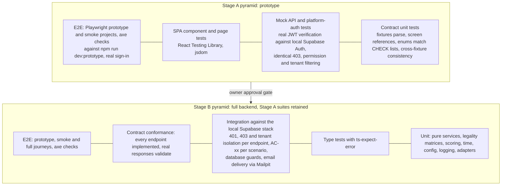
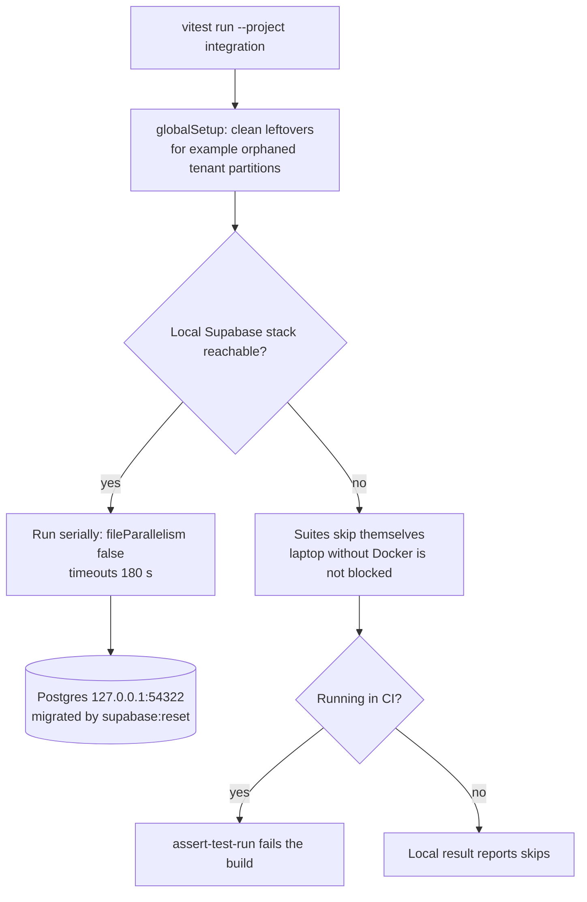
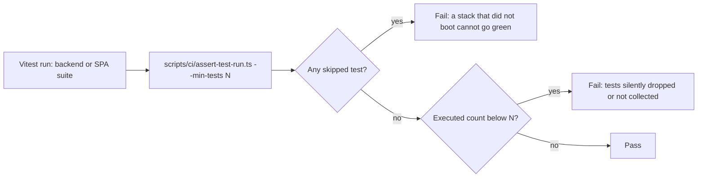
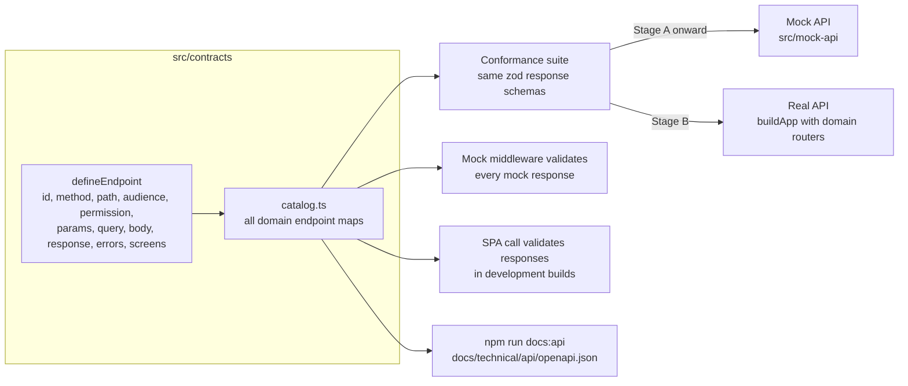

# Testing Strategy

Status: As-built (Stage A prototype); backend sections as-designed

Sources:
- `docs/plan/architecture-plan.md` (revision 3): §0 Delivery stages (contract hand-off, static mock), §3.3 Sealing, §3.4 Official time, §3.6 State machines, §3.7 Money and scoring, §3.8 Notifications (email channel), §3.10 Contracts-first API, §3.11 Prototype mode (real Supabase JWT verification), §4 Repository layout, §5 Build waves and file ownership, §6 Domain map, §7 UI design system, §8 Testing strategy, §9 Build and verification commands, §10 Demo data, §11 Deviations (items 3, 6 and 8 decided on 2026-09-29)
- `docs/architecture-brief.md`: §3.1 `vercel.json` rules, §4.3 scripts, §5.4 Configuration, §5.5 Logging, §5.6 Database access, §5.9 File storage, §6.3 Data API lockdown, §6.5 Schema validation, §8.4 Secret hygiene, §9 Background jobs, §10 Frontend, §11 Testing strategy, §12 CI/CD
- `docs/plan/design-decisions.md`: DD-03 and DD-04 (supplier allow-list and tenant-list generation), DD-06 (`job_run` status), DD-11 and DD-31 (audit partition and content), DD-13 (view shapes), DD-15 (deadline authority), DD-16 (price-gate owner), DD-18 to DD-20 (jobs and expiry semantics), DD-21 (`/me` aggregation), DD-22 (buyer slug in public URLs), DD-23 (permission additions), DD-24 to DD-26 (approver permissions, conflict gating, role scope matching), DD-27 (invitation acceptance), DD-28 (public-write rate limiting), DD-32 (decimal helper in `src/contracts`), DD-33 (zone display), DD-38 (withdrawn; its `VITE_AUTH_MODE` bundle check no longer applies), DD-39 (idempotency keys), DD-40 (`framework_calloff` not writable), DD-42 (acknowledgment authority), DD-43 (real Supabase Auth from Stage A: real JWT verification in the mock API, dev-only demo accounts and their bundle check), DD-44 (email channel, asserted through Mailpit); §E owner decisions of 2026-09-29, items 4 and 6
- `docs/plan/email-delivery-options.md`: §2 (local SMTP to Mailpit)
- `docs/plan/demo-storyline.md`: tenders, contracts, records and operations, and the additional scenario anchors for AC-11, AC-17 and AC-34 (the records each acceptance scenario is demonstrated on)
- `docs/plan/tenderiq-prototype.workflow.js`: the A1 scaffold task (Vitest projects and include globs, ESLint `process.env` rule, CI `verify` job with `supabase start` and `auth:personas`), the A1 contracts-core task (contract unit tests), the A1 mock-platform task (JWT verification tests, `scan-bundle`), the A1 ui-shell task (`DemoAccounts`, `PrototypeBanner`, shell E2E spec), `A_GATE_BASE` (runtime smoke with real sign-in) and `ownedPaths('mock-platform')` (`scripts/ci`, `src/server/tests/unit/platform-auth/**`)
- `docs/plan/tenderiq-backend.workflow.js`: the B1 schema-apply task (parity tests), the B1 platform-http and platform-data-auth task test lists, the B1 ui-live-api task (smoke specs) and the B2 svc-notifications task (email delivery asserted through Mailpit's API)
- `docs/PRD.md`: §9.2 Illustrative weighted model, §19 accessibility, §23 Business acceptance scenarios

Contents:
1. [Principles](#1-principles)
2. [Test layers by stage](#2-test-layers-by-stage)
3. [Vitest configuration](#3-vitest-configuration)
4. [Stage A suites](#4-stage-a-suites)
5. [Stage B suites](#5-stage-b-suites)
6. [Integration tests against the local stack](#6-integration-tests-against-the-local-stack)
7. [CI skip and floor enforcement](#7-ci-skip-and-floor-enforcement)
8. [Architecture guard tests](#8-architecture-guard-tests)
9. [Contract-conformance tests](#9-contract-conformance-tests)
10. [End-to-end tests](#10-end-to-end-tests)
11. [Test naming](#11-test-naming)
12. [Acceptance coverage matrix](#12-acceptance-coverage-matrix)
13. [Open items](#13-open-items)

Related: [07-api.md](07-api.md), [09-frontend.md](09-frontend.md), [04-security-model.md](04-security-model.md), [10-deployment-environments.md](10-deployment-environments.md), [12-traceability.md](12-traceability.md), [13-delivery-and-resilience.md](13-delivery-and-resilience.md).

---

## 1. Principles

- **Tests prove the design's controls, not only the happy path.** Every acceptance scenario AC-01 … AC-36 and AC-39 gets at least one `AC-xx` integration test in Stage B (plan §8). Stage A makes every scenario demonstrable from the UI on the demo storyline records.
- **Contracts are the hand-off between stages.** The same zod response schemas in `src/contracts` validate the mock API (Stage A) and the real API (Stage B), so the prototype that was approved and the backend that implements it cannot drift apart (plan §0, §3.10).
- **Deterministic, isolated, order-independent and CI-safe.** Each test follows arrange-act-assert, and its name states the behavior, condition and expected outcome (brief §11).
- **A skipped test is a failure in CI.** Suites that depend on the local stack skip themselves on a laptop without Docker. In CI, `assert-test-run` fails on any skip and enforces a minimum test count (brief §11, plan §8).
- **Real authentication from Stage A.** The mock API verifies real Supabase JWTs, so the tests that use tokens (the mock-API auth tests and the prototype E2E) need the local Supabase stack from Stage A. The Stage A CI job starts it and creates the demo accounts before testing (DD-43).

## 2. Test layers by stage

| Layer | Tool | Location | Runs against | Stage |
|---|---|---|---|---|
| Contract unit tests | Vitest `unit` project (node) | `src/contracts/**/*.test.ts` | Contract schemas, the decimal helper and `src/mock-api/fixtures/**` | A → |
| Mock API tests | Vitest `unit` project (node) | `src/mock-api/**/*.test.ts` (owned by `mock-platform` and the domain units) | The mock Hono app, in process. Authenticated requests carry tokens issued by the local Supabase Auth (DD-43). | A → |
| Platform auth and config unit tests | Vitest `unit` project (node) | `src/server/tests/unit/platform-auth/**` (owned by `mock-platform`) | The real `src/server/lib/config` and `src/server/lib/auth/verify.ts`, written in Stage A (DD-43) | A → |
| SPA component and page tests | Vitest + jsdom + React Testing Library + jest-dom | Colocated `src/ui/src/**/*.test.ts(x)`. Setup in `src/ui/src/test/setup.ts`. | Components and pages rendered in jsdom | A → |
| Backend unit tests | Vitest `unit` project (node) | `src/server/tests/unit/**` | Pure modules, no database | B (the platform-auth tests above start in A) |
| Type tests | TypeScript compiler (`npm run typecheck`) | `src/server/tests/types/**` | `@ts-expect-error` assertions | B |
| Backend integration tests | Vitest `integration` project | `src/server/tests/integration/**` | The real local Supabase stack | B |
| Contract conformance | Vitest | Owned by each domain's API unit in B3 | The mock API and the real Hono app | A (mock) → B (real) |
| E2E | Playwright + `@axe-core/playwright` | `e2e_tests/` workspace | `dev:prototype` with the local Supabase stack for sign-in (prototype project), or the full local stack | A → |

"A →" means the suite is created in Stage A and kept in Stage B. The mock API stays after Stage B as a development and test tool (plan §0).

## 3. Vitest configuration

| Config | Projects | Environment | Key settings |
|---|---|---|---|
| Root `vitest.config.ts` | `unit`: `src/server/tests/unit/**`, `src/contracts/**/*.test.ts`, `src/mock-api/**/*.test.ts` and `scripts/**/*.test.ts`. `integration`: `src/server/tests/integration/**/*.test.ts`, with `passWithNoTests` until Stage B. | node | Integration uses `testTimeout` and `hookTimeout` of 180 s, `fileParallelism: false`, and a `globalSetup` that cleans leftovers such as orphaned tenant partitions from earlier runs. |
| SPA `src/ui` workspace | one project | jsdom | `setupFiles: ./src/test/setup.ts`, React Testing Library, jest-dom, colocated `*.test.ts(x)` |

In Stage A the root `unit` project runs the contract and mock-API suites and the platform-auth unit tests. The only Stage A `src/server` code is the real `lib/config`, `lib/supabase` and `lib/auth/verify.ts` modules, which the mock API uses to verify real Supabase JWTs (DD-43). The A1 `scaffold` task in `tenderiq-prototype.workflow.js` sets the include globs above, and the Stage A as-built update records the final configuration.

| Command | Runs | Used by |
|---|---|---|
| `npm run test` | Root Vitest (`vitest run`, all root projects) | `verify` (plan §9) |
| `npm run test:unit`, `npm run test:integration` | One root project | Local runs and domain agents |
| `npm run test:ui` | SPA suite | `verify` |
| `npm run ci:test` | `ci:security` + backend suite + `assert-test-run` (fails on skip, enforces floor) | CI `verify` step 7 |
| `npm run ci:test:ui` | SPA suite + `assert-test-run` | CI `verify` step 3 |
| `npm run auth:personas` | Creates or updates the demo accounts in local Supabase Auth (idempotent, local only) | Stage A CI `verify` job before the tests, and the runtime smoke of the Stage A gates (DD-43) |
| `npm run test:e2e:prototype` | Playwright `prototype` project. Needs the local Supabase stack and the demo accounts. | Stage A gates, CI `verify` job, QA and visual checks |
| `npm run test:e2e:smoke`, `npm run test:e2e` | Playwright `smoke` project, full suite | Stage B QA, optional CI job |
| `npm run verify` | typecheck → typecheck:ui → lint → lint:ui → test → test:ui → build:ui | Local gate, resume gate ([13-delivery-and-resilience.md](13-delivery-and-resilience.md)) |

## 4. Stage A suites

Plan §8 defines the Stage A suites.

| Suite | Asserts | Owner (plan §5) |
|---|---|---|
| Contract schemas vs fixtures | Every fixture in `src/mock-api/fixtures/<domain>.ts` parses with its contract schema. Money and scores are decimal strings ([adr/0005](adr/0005-decimal-strings-for-money-and-scores.md)). | Domain units (A2) |
| Endpoint screen references | Every `defineEndpoint(...)` lists at least one screen ID in `screens`. This makes screen → endpoint traceability machine-checkable ([12-traceability.md](12-traceability.md)). | `contracts-core`, domain units |
| Endpoint shape and permissions | Every endpoint path starts with `/api/v1/{public,me,buyer,supplier,ops}` (or is `/api/v1/health`), its audience is valid, and its `permission` exists in `src/contracts/permissions.ts`, which holds the catalog including the DD-23 additions and the role-template matrix. | `contracts-core` |
| Enum parity | Every state list in `src/contracts/enums.ts` equals the matching blueprint `CHECK (...)` list; the test parses the markdown blueprint ([adr/0004](adr/0004-text-check-constraints-not-enums.md)). Write-enum variants leave out `framework_calloff`, which stays in the CHECK lists but is never offered for writes (DD-40). | `contracts-core` |
| Decimal helper | `src/contracts/decimal.ts` (pure, BigInt-based, shared by the SPA, the mock API and the server) adds, subtracts, multiplies, divides with explicit scale, compares, rounds half-up and formats, including the PRD §9.2 numbers (DD-32). | `contracts-core` |
| Cross-fixture consistency | References, tenders, suppliers and personas resolve across domains, for example that every `T-2026-00NN` referenced in the bids fixtures exists in the tenders fixtures (plan §10). | `integrate` (A3) |
| Mock API: auth | Real Supabase JWT verification through `src/server/lib/auth/verify.ts` (brief §5.7 checks) against the local stack: a valid persona token passes, and forged, expired, `alg` none or HS256, unknown-`kid` and unknown-account tokens are rejected with 401. The verified email maps to its fixture persona (plan §3.11, §8; DD-43). Personas are `<persona>@tenderiq.local` / `test1234`, created in local Supabase Auth by `npm run auth:personas`. | `mock-platform` |
| Platform auth and config | `src/server/tests/unit/platform-auth/**`: `lib/config` (a `ConfigurationError` listing every bad variable, blanks treated as unset) and `lib/auth/verify.ts` with forged, expired and none/HS256 tokens. | `mock-platform` |
| Mock API: tenancy | An `X-Tenant-Id` that is not the persona's membership, or whose tenant `kind` does not match the route prefix, returns one identical 403 (plan §3.1). `/me` lists return the caller's own rows across all active memberships, each labelled with its organization, and an action on a row requires `X-Tenant-Id` equal to the row's tenant (DD-21). | `mock-platform`, domain units owning `/me` endpoints |
| Mock API: permissions | Each endpoint's declared `permission` is enforced against the persona's fixture permission set, so the prototype's 403 behavior matches Stage B (plan §3.2). | `mock-platform`, domain units |
| Mock API: data boundaries | A supplier persona never receives another supplier's fixtures, and learns outcomes only through notices and supplier-facing projections, never from buyer-internal `[R]` records such as scores or shortlist entries (DD-03). A buyer persona sees only receipt metadata for sealed bids, and opened content appears only for assigned personas (plan §3.3). | Domain units |
| Mock API: statelessness | Commands validate the request against the contract and return a contract-valid static response. Nothing is persisted (plan §0). | Domain units |
| SPA shared components | Every shared component (plan §8). Examples of the behavior under test: `StatusChip` tones for every lifecycle state (plan §7), deadlines rendered with official zone and offset and never as a countdown alone, in the form `14 Oct 2026, 12:00 (UTC+02:00) Africa/Gaborone` with an abbreviation such as CAT only when Intl provides one (plan §3.4, DD-33), confirmation of acting organization + capacity + scope + result before consequential actions, visually distinct warnings, blocking errors and completed decisions (plan §7), and the `PrototypeBanner`, shown when `/me/context` reports `environment.mode = 'prototype'` (DD-43). | `ui-shell` |
| SPA pages | At least one test per page covering permission-hidden navigation, readiness vs submitted, and official deadline rendering (plan §8). | Domain units |
| Runtime smoke in every Stage A gate | `A_GATE_BASE`: `GET /api/v1/health` returns 200 with `x-correlation-id`. With the local stack running and the demo accounts created, a password-grant sign-in as `tebogo.officer@tenderiq.local` against local Supabase Auth gives a token for which `/api/v1/me/context` returns 200 with memberships and `environment.mode = "prototype"`. A forged or expired token gets 401, and an `X-Tenant-Id` the persona is not a member of gets the uniform 403 problem+json. | Gate agents (read-only) |
| E2E prototype | Every navigation destination for each key persona, with axe checks (see §10). Personas sign in for real through supabase-js (DD-43). | `ui-shell`, QA (A4) |

## 5. Stage B suites

Stage B keeps every Stage A suite and adds the following (plan §8, brief §11).

| Suite | Layer | Asserts |
|---|---|---|
| Endpoint access matrix | Integration | For every endpoint: 401 without or with an invalid token, 403 for the wrong tenant kind, a missing permission or a missing assignment, and cross-tenant isolation (plan §8). A user in status `invited` reaches only `POST /api/v1/me/invitations/:token/accept` (DD-27). `/me` rows span the caller's active memberships, and actions on them need `X-Tenant-Id` equal to the row's tenant (DD-21). |
| Permission resolution | Integration | Effective permissions from roles via membership and groups, scope matching including category descendants (DD-26), direct grants and restrictions (restrictions win). Validity is compared at request time from `starts_at`, `expires_at` and `revoked_at`, so an expired grant is refused before any expiry job runs (DD-18). A conflict declaration in `pending_review` blocks restricted access until `cleared` or `mitigated` (DD-25). |
| Approver authority | Unit + integration | Deciding a step needs `approval.decide`, the decision-specific permission and sufficient authority. Cross-currency authority uses `exchange_rates` at the request date, and with no rate the step routes to the next level up (DD-24). |
| Public-write rate limiting | Integration | Public POSTs (registration, register interest, access requests) are limited per IP hash and per email hash over `rate_limit_buckets` (DD-28). |
| Idempotency keys | Integration | Commands declared idempotent honor an `Idempotency-Key` header stored in `request_idempotency` (24 h). A retried submission still records a new `submission_attempts` row (DD-39). |
| Audit writer | Integration | Rows go to the partition of the tenant that owns the affected record, support-access events to the customer tenant (DD-11). `before_state` and `after_state` never contain sealed content or evaluator scores, and such rows are `restricted` (DD-31). |
| Acceptance scenarios | Integration | At least one `AC-xx …` test per in-scope scenario (§12). |
| Contract conformance | Integration | Every catalog endpoint is implemented, and every response validates against its contract (§9). |
| Workflow legality matrices | Unit | Each `domains/<d>/workflow/*.ts` `canTransition(from, to, ctx)` is tested row by row (plan §3.6). |
| Scoring engine | Unit | Reproduces PRD §9.2 exactly with the shared decimal helper (`src/contracts/decimal.ts`, re-exported by `src/server/lib/decimal.ts`, DD-32): 86.00 vs 88.00, the 120,000 offer ranks first, and a missing score is `null`, never 0 (plan §3.7, AC-18, AC-19). |
| Time service | Unit | Pure working-day math on the tender's calendar (plan §3.4). |
| Config | Unit | `loadConfig(env)` lists every bad variable, treats blanks as unset and never returns partial config (brief §5.4). Stage B extends the Stage A module and its tests to every server variable, including `EMAIL_ENABLED`, `SMTP_*` and `EMAIL_FROM` (DD-44). |
| Email channel | Integration | With `EMAIL_ENABLED`, the `email` `DeliveryChannel` sends through `nodemailer` to Mailpit (SMTP 127.0.0.1:54325), and the tests read Mailpit's API (`http://127.0.0.1:54324/api/v1/messages`) to assert delivery. A message that Mailpit accepts is recorded as `delivered`. The message carries only the title, official deadline and link, never bid, evaluation or other confidential content. With email not enabled, no email delivery rows are written (B2 svc-notifications task, DD-44). |
| Logger redaction | Unit | Fixtures containing fake secrets are masked (brief §5.5). |
| Storage adapters | Unit + integration | One conformance suite runs against `FakeStorageAdapter` and `SupabaseStorageAdapter` (brief §5.9). |
| Queue | Unit + integration | In-memory adapter for unit tests. pgmq for idempotency, duplicate delivery, retry and archive (brief §9.5). |
| Cron sweeps | Integration | State-guarded re-runs are no-ops. Failures are isolated per tenant and per item (brief §9.4). Alerts from state-less sweeps are deduplicated by the key `<job>:<entity>:<window>` (DD-19). An unimplemented job writes `job_run.status = 'failed'` and returns 501 (DD-06). `qualification-expiry` and `evidence-expiry` write no decisions (DD-20). |
| Enum and permission parity | Unit | Every enum in `src/contracts/enums.ts` equals the live CHECK constraint list, and the `seed.sql` permission catalog and role templates equal `src/contracts/permissions.ts` (B1 `schema-apply`). |
| Guards | Unit, integration, type | See §8. |
| Scripts | Integration | `db:seed`, `cron:run`, `queue:worker` and `jobs:status` are spawned as real subprocesses (brief §11). |
| Migrations and seed | Integration + `db:validate` | Reset from empty twice. The schema snapshot diff is clean (brief §6.5). |

## 6. Integration tests against the local stack

- **Target.** The real local stack from `supabase/config.toml`, reset from migrations by `npm run supabase:reset` and seeded with the baseline `seed.sql`. The CI `verify` job runs no demo seed before `ci:test`, so integration tests build their own data with `src/server/tests/{helpers,fixtures}`.
- **App under test.** `buildApp(deps)` takes every dependency explicitly, so tests build the app with real or fake dependencies. Local development and tests call the Hono app directly, not through Vercel's routing layer, which is why a separate test checks the `vercel.json` rewrites and entrypoints (brief §3.1, §5.1).
- **Serial execution.** Integration runs with `fileParallelism: false` (brief §11).
- **Execute, do not inspect.** Every `SECURITY DEFINER` function that calls an extension function, for example `invoke_cron_endpoint` and `invoke_queue_drain`, has a test that executes it (brief §9.1).
- **Email through Mailpit.** Mailpit is part of the same local stack. It receives the email channel's SMTP messages on 127.0.0.1:54325, and the notifications integration tests assert delivery through its API (DD-44).

## 7. CI skip and floor enforcement

| Gate | Command | Floor |
|---|---|---|
| Backend suite | `npm run ci:test` (CI `verify` step 7) | `--min-tests N`, set after Stage B integration (B4) |
| SPA suite | `npm run ci:test:ui` (CI `verify` step 3) | As built in Stage A: `--min-tests 1451` (the suite runs 1,456 tests in 265 files at the end of Stage A); set again after Stage B integration (B4) |
| Root unit project | `npm run ci:test:unit` | As built in Stage A: `--min-tests 2900` (100 files, 2,900 tests at the end of Stage A) |

Plan §8: floors are set after each stage's integration step. The floor values themselves are recorded here as-built.

## 8. Architecture guard tests

These are tests about the codebase and schema, not about features. Plan §8 schedules them for Stage B. Guards whose subject exists in Stage A (vercel.json, the `process.env` rule, import boundaries, the auth-only browser client, no raw hex, bundle scan) may be introduced earlier, and the Stage A as-built update records which ones were. Since DD-43, Stage A already contains `src/server/lib/config`, `lib/supabase` and `lib/auth/verify.ts`, and the SPA already signs in with supabase-js, so G1, G10 and G11 have real subjects from Stage A.

| # | Guard | Assertion | Mechanism | Source |
|---|---|---|---|---|
| G1 | Config is the only env reader | `process.env` appears only in `src/server/lib/config/index.ts` | ESLint `no-restricted-properties`, set in A1 (the rule also exempts the Vite config), + integration test that scans the source | brief §5.4 |
| G2 | No `any` | No explicit `any` anywhere | Lint-gate test (`@typescript-eslint/no-explicit-any: error`) | brief §4.2, §11 |
| G3 | `vercel.json` shape | No `crons` key. Rewrites and function entrypoints exist and match. | Integration test | brief §3.1 |
| G4 | Data API lockdown | `anon` and `authenticated` hold no SELECT/INSERT/UPDATE/DELETE on any `public` table (live catalog, `has_table_privilege` and `role_table_grants`) | Integration test | brief §6.3 |
| G5 | Pool safety | Pool `max ≤ 2`. `pg_prepared_statements` stays empty after queries. | Integration test | brief §5.6 |
| G6 | No session-state SQL | No `LISTEN/NOTIFY`, session advisory locks, bare `SET` or cross-statement temp tables | Source-scanning test | brief §5.6 |
| G7 | Generated types current | `generated/supabase-types.ts`, `column-overrides.ts`, `tenant-scoped-tables.ts` and `supplier-scoped-tables.ts` match the live schema. `supplier-scoped-tables.ts` is generated from the blueprint `[S]` tags, not from column presence (DD-03). | `db:types:check` drift test | brief §5.6, plan §3.1, DD-03 |
| G8 | Tenant scoping compiles strictly | Omitting the tenant fails to compile. The generated tenant list equals the schema in both directions. `[G]` tables that name a customer use `customer_tenant_id`, so the generator does not pick them up (DD-04). | Type tests (`@ts-expect-error`) + compile-time assertion | brief §5.6, DD-04 |
| G9 | Env catalogs | `.env.example` and `.env.local.example` list exactly the schema's keys. Examples contain no inline connection-string password. | Unit/integration test | brief §5.4, §8.2 |
| G10 | Server code unreachable from the SPA | `src/ui` never imports `src/server/**` (in particular `lib/supabase`, `lib/config`) | Import-boundary test | brief §8.4, plan §11 item 1 |
| G11 | Browser Supabase client is auth-only | The one browser client is never used for data, storage or realtime | Boundary test | brief §10 |
| G12 | Sealed tables | No module other than `domains/sealing` reads the sealed bid tables (`bid_answers`, `bid_answer_documents`, `bid_prices`, `bid_commercial_terms`, `bid_declarations`, `bid_subcontractors`, `bid_key_personnel`, `bid_exceptions`) on a buyer path. The allow-list also covers the bids domain's supplier-side paths (`forSupplier`), which write these tables and read them for the owning supplier's team. The exact allow-list is finalized in Stage B (ADR-0003). | Source-scanning guard | plan §3.3, [adr/0003](adr/0003-application-layer-sealing.md) |
| G13 | No raw hex | UI components contain no raw hex colors or literal pixel gaps. Only `--tiq-*` tokens are used. | Source-scanning guard | plan §7 |
| G14 | Logger redaction | Sensitive keys and secret-like substrings are masked | Unit test | brief §5.5 |
| G15 | Access enforcement | 401/403 and tenant isolation per sensitive endpoint | Integration tests (§5) | brief §11, plan §8 |
| G16 | Jobs | Idempotency, duplicate delivery, retry and archive. `SECURITY DEFINER` helpers are executed. | Integration tests | brief §9, §11 |
| G17 | Scripts are real | `db:seed`, `cron:run`, `queue:worker` and `jobs:status` run as subprocesses | Integration tests | brief §11 |
| G18 | Migrations reset | Reset from empty twice, CLI error markers, applied list equals disk, snapshot diff | `db:validate` | brief §6.5 |
| G19 | Secret and bundle hygiene | No secrets in tracked files. No server variable names, service-role literals, `src/server` fragments or mock API fixtures in `src/ui/dist`. The production bundle does not contain the marker string of the dev-only demo-accounts quick-pick, which renders only under `import.meta.env.DEV` (DD-43). | `ci:security` (`scan-secrets`, `scan-bundle`) | brief §8.4, plan §3.11, §11 items 1 and 8, DD-43 |
| G20 | Contracts purity | `src/contracts`, including the shared decimal helper `decimal.ts` (DD-32), uses no Node or browser APIs and is importable by the SPA, the mock API and the backend | As built in Stage A: the ESLint block `tenderiq/contracts-purity` (root `eslint.config.js`) allows only `zod` and sibling contract imports and bans Node and browser APIs in `src/contracts` (test files excepted) | plan §3.10, §11 item 1 |
| G21 | Reference-only tables unreachable by suppliers | No `[R]` table (for example `evaluation_scores`, `shortlist_entries`, `buyer_supplier_relationships`) is on the `forSupplier` allow-list `supplier-scoped-tables.ts` | Guard test (B1 `schema-apply`) | DD-03 |

## 9. Contract-conformance tests

Contracts are validated at four points:
1. **At the source, Stage A.** Contract unit tests parse every fixture and check enum parity and screen references (§4).
2. **At the mock boundary, Stage A.** The mock API's middleware validates each response against the contract before sending it (plan §3.11).
3. **At the client, development builds.** `call(endpoint, …)` in `src/ui/src/api/client.ts` validates responses with the contract schema (plan §3.10).
4. **At the real API, Stage B.** For every endpoint in `catalog.ts`, the conformance suite asserts that the endpoint is implemented and that its responses validate against the contract (plan §8).

Rules:
- A contract change in Stage B needs a recorded reason and a UI update in the same unit (plan §0).
- Stage B routes parse input with the contract schemas and type responses with the contract types, so a divergence is a type error before it is a test failure (plan §3.10).
- Coverage is enumerated from `catalog.ts`, so an endpoint cannot be left out by omission.

## 10. End-to-end tests

The Playwright workspace is `e2e_tests/`, with `@axe-core/playwright` for accessibility. Playwright's `webServer` starts the app under test (brief §11).

| Project | Created | Target | Scope | Command |
|---|---|---|---|---|
| `prototype` | Stage A (A1 `ui-shell`, extended in A4) | `npm run dev:prototype`: mock API + Vite, with the local Supabase stack running and the demo accounts from `npm run auth:personas`. Personas sign in for real through supabase-js (DD-43). | Every navigation destination for each key persona from the demo storyline, axe checks on each, and Playwright visual tests against the mock API (plan §0, §8). The A1 shell spec signs in as `tebogo.officer`, switches organization, signs out and runs axe on the shell. | `npm run test:e2e:prototype` |
| `smoke` | Plan §5: Stage A (A1 `ui-shell`). The workflow scripts reserve the project for Stage B, where `ui-live-api` writes the smoke specs in B1. | The app started by `webServer`. Stage B targets the full local stack. | Login, logout and the application shell | `npm run test:e2e:smoke` |
| `full` | Stage B | Full local stack with demo seed | Full user journeys across buyer, supplier, evaluator, approver and administrator personas (plan §8) | `npm run test:e2e` |

Accessibility (PRD §19, plan §7): axe checks run in E2E. The other §7 accessibility rules are keyboard operation, the focus-ring token, labelled inputs and `aria-live` progress announcements. Which of them get dedicated E2E or component assertions beyond axe is finalized during the build.

## 11. Test naming

- Names state behavior, condition and expected outcome (brief §11). An illustrative pattern: `rejects submission when official receipt time is after the deadline`.
- Acceptance tests start with the scenario ID (plan §8, "`AC-xx` integration test"). An illustrative name from the text of AC-12 is `AC-12 keeps the earlier receipt effective when a replacement fails before closing`. The prefix makes acceptance coverage searchable across the test tree, which the QA auditors in A4 and B5 can use.
- Tests follow arrange-act-assert (brief §11).

## 12. Acceptance coverage matrix

The Stage A column names the storyline record on which the scenario is demonstrated in the prototype (demo storyline). The Stage B column gives the planned integration directory (`src/server/tests/integration/<domain>/`, following plan §5 B3 `src/server/tests/**/<d>/**`) that holds the `AC-xx` test, plus any additional layer. Directory names follow the server domain directories (plan §4). For the combined units 01 (identity + org-admin) and 15 (reporting + records), the directory split is finalized in Stage B.

| AC | Scenario (short) | Stage A demonstration | Stage B planned tests |
|---|---|---|---|
| AC-01 | Public vs invitation-only discovery | T-2026-0006 (invitation-only, invisible to public). PUB-01..03 as an anonymous visitor (public URLs carry the buyer slug, `/opportunities/:buyerSlug/:ref`, DD-22). | `integration/publication/`. Public endpoints and `v_public_tenders` exclude invitation-only events, buyers whose public portal is off and non-public statuses (DD-13). |
| AC-02 | One person, buyer + two suppliers | `sam.dual` (kwu evaluator, tsodilo and chobe-pipe contributor). Conflict routed on T-2026-0003. | `integration/identity/` (tenant switch separation, identical 403, conflict routed for review, restricted access blocked while the declaration is `pending_review`, DD-25; `/me` rows labelled per organization, DD-21). SPA test: org switch clears tenant state (plan §3.1). |
| AC-03 | Contributor cannot submit | `<supplier>.contributor` personas. SUP-04, SUP-12. | `integration/bids/` (submit 403 without `supplier.response.submit`). `integration/identity/` (no self-grant). |
| AC-04 | Employee leaves mid-event | `former.officer` (deactivated, historic approvals and submissions) | `integration/identity/` (401 for an inactive user, reassignment, attribution intact) |
| AC-05 | Request exceeds manager's authority | PR-2026-0003 routed from `mpho.manager` to `keabetswe.approver` | `integration/requests/`. Approvals service tests for the authority and delegation check, including the permission pair and the cross-currency and no-rate routing (DD-24). |
| AC-06 | Change after release approval | T-2026-0005 (approval invalidated by a scope and value edit) | `integration/tenders/` (material edit invalidates the approval by version and hash) |
| AC-07 | Registered but not qualified | `makgadikgadi` not qualified for WTR-PUMP | `integration/qualification/`, `integration/suppliers/` |
| AC-08 | Unclear financial evidence | `makgadikgadi` application `more_info_required`. Info request from `lesego.finance`. | `integration/qualification/` |
| AC-09 | Insurance expires during assessment | `chobe-pipe` insurance evidence expiring within 10 days | `integration/qualification/`, including the `evidence-expiry` sweep (flags and notifies only, writes no decision, DD-20) |
| AC-10 | Addendum after some submissions | T-2026-0002 addendum (new mandatory requirement, acknowledge + supplement) | `integration/clarifications/`, `integration/bids/` (readiness blocks until the addendum is acknowledged in `participant_acknowledgments`, the authoritative record, DD-42) |
| AC-11 | Internally approved is not submitted | Serowe ICT's response on T-2026-0002 is `approved_internally` with no receipt, shown as "Not submitted" (storyline scenario anchors) | `integration/bids/`. SPA page test "readiness vs submitted". |
| AC-12 | Failed replacement keeps earlier receipt | T-2026-0002 (Gaborone Metering failed replacement) | `integration/bids/` |
| AC-13 | Late completion rejected | T-2026-0002 (Chobe late attempt recorded and rejected) | `integration/bids/` (true receipt time from `clock_timestamp()`, compared with the lot deadline when set, otherwise the tender deadline, DD-15) |
| AC-14 | Explicit withdrawal | T-2026-0008 (one withdrawn submission) | `integration/bids/` |
| AC-15 | Admin or support cannot see sealed bid | T-2026-0008 with `admin.kwu` and `support.agent` | `integration/opening/`, `integration/operations/` (support grant). Guard G12. |
| AC-16 | Price hidden until non-price gate | T-2026-0003 (staged opening, price gate released) | `integration/opening/`, `integration/evaluation/` (the chair releases the gate with `evaluation.chair`, DD-16, DD-23) |
| AC-17 | Mandatory requirement failed | T-2026-0003: Makgadikgadi fails REQ-Q-03 (ISO 9001 certificate), the compliance check cites the evidence, an exclusion awaits approval and the commercial envelope stays sealed (storyline scenario anchors) | `integration/opening/` (compliance and exclusion approval) |
| AC-18 | Criterion not scored | T-2026-0003 (one evaluator missing a criterion) | `integration/evaluation/`. Unit: scoring engine `null` handling. |
| AC-19 | PRD §9.2 worked example | T-2026-0003 (Serowe 86.00, Tsodilo 88.00. Evaluated cost 100,000 vs 120,000.) | Unit: scoring engine under `unit/evaluation/`. `integration/evaluation/`. |
| AC-20 | Moderation changes result | T-2026-0003 (moderation changed one score) | `integration/evaluation/` |
| AC-21 | Demonstration or reference affects selection | T-2026-0009 (demos held) | `integration/selection/` |
| AC-22 | Shortlist to further stage | T-2026-0009 (shortlist approved, 2 of 3) | `integration/selection/` |
| AC-23 | Final offer where negotiation not permitted | T-2026-0009 (BAFO blocked) | `integration/selection/` |
| AC-24 | Preferred bidder fails diligence | T-2026-0009 (fallback recorded) | `integration/selection/` (award-blocking diligence finding, fallback decision) |
| AC-25 | Complaint creates blocking hold | T-2026-0007 (Limpopo complaint during standstill) | `integration/awards/`, including the `standstill-monitor` sweep (task only) |
| AC-26 | Per-lot outcomes | T-2026-0001 (lot 1 awarded, lot 2 cancelled, lot 3 under evaluation) | `integration/awards/` |
| AC-27 | Debrief without others' content | T-2026-0007 (debrief) | `integration/awards/` |
| AC-28 | Contract differs from award | C-2026-0002 (differs from award, awaiting signature) | `integration/contracts/` |
| AC-29 | Close before handover accepted | T-2026-0010 / C-2026-0001 | `integration/awards/` (closeout gate) |
| AC-30 | Milestone evidence rejected | C-2026-0001 ("Q3 service report" rejected with remediation) | `integration/contracts/` |
| AC-31 | Cumulative changes exceed authority | C-2026-0001 (three change requests) | `integration/contracts/` |
| AC-32 | Renewal deadline without decision | C-2026-0001 (notice window opens in 5 days) | `integration/contracts/`, including the `renewal-windows` sweep (alerts only) |
| AC-33 | External publication or signature failure | Open external-publication integration exception | `integration/operations/`, `integration/publication/` |
| AC-34 | Report counts not inflated | The participation report counts unique organizations for T-2026-0001 (3 lots) and T-2026-0002 (several revisions per supplier), with event-level and lot-level counts shown separately and the BWP currency basis stated (storyline scenario anchors) | `integration/reporting/` |
| AC-35 | Legal hold blocks disposal | Legal hold on T-2025-legacy records | `integration/records/`, including the `retention-eligibility` sweep (writes `disposal_requests` as `proposed` or `blocked`, DD-20) |
| AC-36 | Customer exit with live work | ODC offboarding plan `draft` with a live tender and contract | `integration/operations/` |
| AC-39 | RFI closes with findings | T-2026-0004 (`information_collected`, linked to T-2026-0009) | `integration/awards/` (closeout), `integration/requests/` (strategy) |

AC-37 and AC-38 are deferred with FR-20 and EXT-03 and have no tests. See [12-traceability.md](12-traceability.md) §6.

## 13. Open items

- **Missing storyline records.** Resolved — demo storyline, "Additional scenario anchors" (amended with the decision log): AC-11 is Serowe ICT's `approved_internally` response on T-2026-0002, AC-17 is Makgadikgadi failing REQ-Q-03 on T-2026-0003, and AC-34 is the participation report over T-2026-0001 and T-2026-0002 (§12). Original point: the storyline named no specific record for AC-11, AC-17 or AC-34.
- **Stage A include globs.** Settled by the A1 `scaffold` task in `tenderiq-prototype.workflow.js` (no DD entry): the root `unit` project includes `src/contracts/**/*.test.ts`, `src/mock-api/**/*.test.ts` and `scripts/**/*.test.ts`, and the `integration` project passes with no tests until Stage B (§3). Original point: the include globs and Vitest project assignment for the `src/contracts` and `src/mock-api` tests were left to the A1 `scaffold` agent.
- **Test directories for combined units.** The per-domain integration directory names for units 01 and 15, and for the shared services (`approvals`, `notifications`, `documents`, `audit`, `lifecycle`, `sealing`, `time`, built in B2), are not fixed in the plan.
- **Test count floors.** Resolved for Stage A: `ci:test:ui --min-tests 1451` and `ci:test:unit --min-tests 2900` (§7). The Stage B floors are set after B4.
- **E2E scope.** Resolved for Stage A: the `prototype` project's `a11y` spec signs in as `tebogo.officer`, `admin.kwu`, `mpho.manager`, `boitumelo.chair`, `amantle.eval`, `tsodilo.admin`, `serowe-ict.signatory` and `ops.admin`, and checks every sidebar destination with axe in both themes, plus flagged detail and form pages; the `shell` spec covers real sign-in against local Supabase Auth, the session context, the app shell, organization switching (COM-02) and sign-out. The journey list for the `full` project is finalized in Stage B.
- **Email settings in CI.** The email integration tests need `EMAIL_ENABLED` and the SMTP settings pointing at Mailpit (DD-44). The local `.env.local` gets them from the B1 scaffold-b task, but the CI `verify` job writes its throwaway `.env.local` from `npx supabase status -o env` (brief §12), and the sources do not say how the email variables are set there. This is finalized when `scaffold-b` enables the Stage B CI steps.
