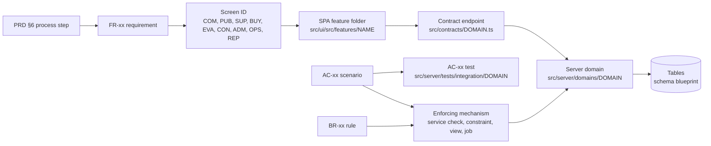

# Traceability

Status: As-designed (pre-build). Updated to as-built at the end of Stage A and Stage B.

Sources:
- `docs/PRD.md`: §2.3 Optional extensions, §5 Organization and user management (FR-01..03), §6 Coverage of the original 16-step process, §7 Functional requirements (FR-04..22), §10 Business rules, §11–§13 Screen catalogs, §22 Delivery priorities, §23 Business acceptance scenarios
- `docs/plan/design-decisions.md`: DD-02 (nullable unique keys), DD-03 (`[S]` and `[R]` tags), DD-04 (`customer_tenant_id`), DD-05 (envelope mapping), DD-08 and DD-09 (currencies, reference formats), DD-11 (partition tenant), DD-13 (views), DD-14 (approval subject types, including `final_award`), DD-15 (deadline authority), DD-16 and DD-17 (shared owners, cross-domain writes), DD-18 to DD-20 (jobs and expiry semantics), DD-21 and DD-22 (`/me` aggregation, buyer slug in public URLs), DD-23 to DD-26 (permissions, approver authority, conflict gating, scope matching), DD-28 (`rate_limit_buckets`), DD-31 (audit content), DD-32 (decimal helper), DD-33 (zone display), DD-39 (`request_idempotency`), DD-40 (`framework_calloff`), DD-41 (pursuit vs bid intent), DD-42 (acknowledgment authority), DD-43 (real Supabase Auth from Stage A: COM-01 sign-in and the prototype's JWT verification), DD-44 (`email` delivery channel for notices); §E owner decisions of 2026-09-29, items 4 (email delivery), 6 (Stage A authentication) and 7 (supplier self-registration)
- `docs/plan/architecture-plan.md` (revision 3): §2 Release scope, §3 Key decisions (§3.8 Notifications with the `in_app` and `email` channels, §3.11 Prototype mode), §3.9 Background jobs, §3.10 Contracts-first API, §4 Repository layout (URL map, feature registration, cross-domain writes, shared owners), §5 Ownership, §6 Domain map with PRD traceability, §8 Testing strategy, §11 items 3 (email) and 4 (supplier self-registration)
- `docs/plan/email-delivery-options.md`: §1 (notice content rule, BR-41/BR-42 tracking)
- `docs/plan/schema-blueprint.md`: Migrations 01–14, §P Permission catalog and role templates
- `docs/plan/demo-storyline.md`: tenders, contracts, records and operations, and the additional scenario anchors (AC-11, AC-17, AC-34)
- `docs/plan/tenderiq-prototype.workflow.js`: `DOMAINS` (contract files, UI folders, FR/BR/screen/AC scope per unit), `ownedPaths` (`contracts-core`)
- `docs/plan/tenderiq-backend.workflow.js`: `DOMAINS` (including the suppliers registration notes), `contractsOf`, `ownedPaths` (test directories), the B1 ui-live-api task (invitation set-password flow), B2 shared-service tasks (the email channel in svc-notifications), B3 adversarial review ("every screen, FR, BR and AC in scope")

Contents:
1. [Trace model](#1-trace-model)
2. [(a) PRD process steps to FR, screens and domains](#2-a-prd-process-steps-to-fr-screens-and-domains)
3. [(b) Functional requirements to domains, tables and contracts](#3-b-functional-requirements-to-domains-tables-and-contracts)
4. [(c) Screens to domains, feature folders and audience](#4-c-screens-to-domains-feature-folders-and-audience)
5. [(d) Acceptance scenarios to enforcing mechanisms and tests](#5-d-acceptance-scenarios-to-enforcing-mechanisms-and-tests)
6. [(e) Deferred items](#6-e-deferred-items)
7. [(f) Business rules to enforcing mechanisms](#7-f-business-rules-to-enforcing-mechanisms)
8. [Open items](#8-open-items)

Related: [03-data-model/README.md](03-data-model/README.md), [07-api.md](07-api.md), [09-frontend.md](09-frontend.md), [11-testing-strategy.md](11-testing-strategy.md), [05-lifecycles.md](05-lifecycles.md), [06-key-flows.md](06-key-flows.md).

---

## 1. Trace model

Several links are machine-checkable once built, so the matrices below can be regenerated as-built instead of maintained by hand:

| Link | Carried by | Checked by |
|---|---|---|
| Endpoint → screens | `defineEndpoint({ …, screens })` in each `src/contracts/<domain>.ts` | Contract unit test: every endpoint has a screen reference (plan §8). `docs/technical/api/openapi.json` via `npm run docs:api`. |
| Endpoint → permission | `defineEndpoint({ …, permission })` | Mock API and real API both enforce it (plan §3.2) |
| Screen → feature folder, audience | `FeatureModule { id, area, routes, nav }` exported by `features/<feature>/routes.tsx` | `app/featureRegistry.ts` collects them (plan §4) |
| Scenario → test | Test names starting `AC-xx` | Search of the test tree (plan §8) |
| State lists → schema | `src/contracts/enums.ts` vs blueprint CHECK lists | Enum parity test (plan §3.6, §8) |

Domain numbering follows plan §6: 00 workspace, 01 identity + org-admin, 02 policy, 03 suppliers, 04 qualification, 05 requests, 06 tenders, 07 publication, 08 clarifications, 09 bids, 10 opening, 11 evaluation, 12 selection, 13 awards, 14 contracts, 15 reporting + records, 16 operations. In Stage B, domain 00 is the set of shared services `approvals`, `notifications`, `documents`, `audit`, `lifecycle`, `sealing` and `time` (plan §5, B2). The shared owners of otherwise unowned tables follow DD-16: `tasks` belong to the approvals service; `comments`, `holds`, `record_snapshots` and `process_decisions` to the core (lifecycle) service, which exposes `recordProcessDecision()`; `exports` and the `exports` queue handler to the documents service (`requestExport()`, with per-type generators in `documents/export-registry.ts`); `exchange_rates` and `price_gate_releases` to evaluation.

## 2. (a) PRD process steps to FR, screens and domains

From PRD §6, with the domain assigned to each screen by plan §6.

| # | Process step (PRD §6) | FR | Screens | Domain(s) |
|---|---|---|---|---|
| 1 | Buyer identifies a need | FR-04 | BUY-02, BUY-03, BUY-04 | 05 requests |
| 2 | Buyer decides how to approach the market | FR-05 | BUY-05, BUY-06 | 05 requests |
| 3 | Buyer prepares tender documents | FR-07 | BUY-07 … BUY-13 | 06 tenders |
| 4 | Buyer issues the tender | FR-08 | PUB-01, PUB-02, PUB-03, BUY-14, BUY-15 | 07 publication |
| 5 | Suppliers study the tender and decide whether to bid | FR-09 | SUP-06 … SUP-09 | 07 publication |
| 6 | Suppliers ask questions, buyers clarify or amend | FR-10 | SUP-10, BUY-16, BUY-17 | 08 clarifications |
| 7 | Suppliers prepare bids | FR-11 | SUP-09, SUP-12 … SUP-15 | 07 publication (SUP-09), 09 bids |
| 8 | Suppliers submit before the deadline | FR-12 | SUP-16, SUP-17, BUY-19 | 09 bids |
| 9 | Buyer checks compliance | FR-13 | BUY-20, BUY-21 | 10 opening |
| 10 | Buyer evaluates bids against weighted criteria | FR-14 | EVA-01 … EVA-06 | 11 evaluation, 10 opening (EVA-03) |
| 11 | Buyer conducts demonstrations, interviews or references | FR-15 | BUY-22, SUP-18 | 12 selection (BUY-22), 10 opening (SUP-18) |
| 12 | Buyer shortlists suppliers | FR-15 | BUY-23 | 12 selection |
| 13 | Buyer identifies a preferred bidder | FR-16 | BUY-24, BUY-26 | 12 selection (BUY-24), 13 awards (BUY-26) |
| 14 | Buyer conducts due diligence and negotiations | FR-06, FR-16 | BUY-25, BUY-27, SUP-19 | 12 selection, 04 qualification (FR-06) |
| 15 | Buyer awards the contract | FR-17, FR-18 | BUY-28, BUY-29, BUY-30, CON-02, CON-03 | 13 awards, 14 contracts |
| 16 | Delivery begins and the contract is managed | FR-18, FR-19 | CON-04 … CON-11 | 14 contracts |

Qualification (FR-06) runs across steps 5, 9, 14 and 16. It is not confined to step 14 (PRD §6). The cross-cutting FRs (FR-01..03, FR-21, FR-22) have no single step. They are covered in (b).

## 3. (b) Functional requirements to domains, tables and contracts

Contract files are `src/contracts/<name>.ts` (plan §3.10). The file names per domain unit are fixed by the `DOMAINS` list in `docs/plan/tenderiq-prototype.workflow.js`: unit 01 writes `org-admin.ts`, unit 15 writes `reporting.ts` and `records.ts`, and unit 00 (workspace) owns `approvals`, `tasks`, `notifications`, `documents`, `audit`, `calendars` and `notification-rules`. `contracts-core` writes the first versions of the shared-surface contracts (`session`, `approvals`, `tasks`, `notifications`, `documents`, `audit`, `calendars`) in A1 (plan §5), together with `permissions.ts` (the catalog, including the DD-23 additions) and the shared decimal helper `decimal.ts` (DD-32). The workspace unit then extends the shared-surface contracts in A2 and adds `notification-rules.ts`.

| FR | Requirement | Domain(s) | Key tables | Contract file(s) |
|---|---|---|---|---|
| FR-01 | Establish and maintain buying organizations | 01 identity + org-admin, 16 operations (customer onboarding) | `tenants`, `org_settings`, `legal_entities`, `departments`, `locations`, `categories`, `cost_centers`, `funding_sources`, `committees`, `committee_members`, `calendars` | `org-admin.ts`, `calendars.ts`, `operations.ts` |
| FR-02 | Establish accountable supplier organizations | 03 suppliers. Public registration posts to the TenderIQ API, which creates the organization, user and membership and then sends the Auth Admin invite (plan §11 item 4, decided by the owner on 2026-09-29; DD-27). | `tenants` (`kind = supplier`, `is_provisional`, `verification_status`), `supplier_profiles`, `supplier_locations`, `supplier_categories`, `supplier_membership_requests`, `supplier_identity_changes`, `supplier_legal_names`, `duplicate_candidates`, `supplier_merges`, `evidence_items`, `evidence_shares`, `buyer_supplier_relationships` | `suppliers.ts` |
| FR-03 | Manage individual access and authority | 01 identity + org-admin | `users`, `memberships`, `invitations`, `roles`, `role_permissions`, `user_groups`, `user_group_members`, `role_assignments`, `access_grants`, `access_restrictions`, `authority_limits`, `delegations`, `sod_policies`, `conflict_declarations`, `confidentiality_undertakings` | `org-admin.ts`, `session.ts` |
| FR-04 | Convert a need into an authorized procurement | 05 requests, 00 approvals | `procurement_requests`, `request_links`, `request_info_requests`, `approval_requests`, `approval_steps` | `requests.ts`, `approvals.ts` |
| FR-05 | Select and authorize a procedure | 05 requests | `procurement_strategies`, `market_research_entries`, `fairness_reviews`, `procurement_projects`, `plan_items`, `advance_notices` | `requests.ts` |
| FR-06 | Assess supplier suitability | 04 qualification | `qualification_programs`, `qualification_program_versions`, `qualification_criteria`, `qualification_applications`, `qualification_answers`, `qualification_answer_evidence`, `qualification_info_requests`, `qualification_findings`, `financial_reviews`, `qualification_decisions`, `reassessment_triggers`, `integrity_screenings`, `evidence_submissions`, view `v_qualification_status` | `qualification.ts` |
| FR-07 | Produce a complete, consistent invitation | 06 tenders, 02 policy (profile version frozen at release) | `tenders`, `tender_versions`, `tender_milestones`, `lots`, `tender_team_members`, `requirements`, `pricing_schedules`, `pricing_items`, `tender_terms`, `tender_envelopes`, `participation_conditions`, `evaluation_plans`, `evaluation_criteria`, `scale_anchors`, `tie_break_rules`, `release_checks` | `tenders.ts` |
| FR-08 | Release the opportunity to the approved audience | 07 publication | `publications`, `participants`, `participant_lot_selections`, `participant_acknowledgments`, `document_access_log`, `notices`, `notice_recipients`, view `v_public_tenders` | `publication.ts` |
| FR-09 | Supplier participation decision | 07 publication | `pursuits`, `pursuit_team_members`, `pursuit_notes`, `saved_searches`, `watchlist_items`, `notice_subscriptions`, `participants` (`bid_intent`, `shared_no_bid_reason`, changed only by the explicit "notify buyer" action; pursuit decisions stay supplier-private, DD-41) | `publication.ts` |
| FR-10 | Fair, authoritative clarification process | 08 clarifications | `questions`, `addenda`, `addendum_lots`, `addendum_requirement_changes`, `sessions`, `session_registrations`, `notices` | `clarifications.ts` |
| FR-11 | Prepare a complete, controlled response | 09 bids | `bids`, `bid_lots`, `consortium_members`, `bid_revisions`, `bid_answers`, `bid_answer_documents`, `bid_prices`, `bid_commercial_terms`, `bid_declarations`, `bid_subcontractors`, `bid_key_personnel`, `bid_exceptions`, `bid_internal_approvals`, `bid_internal_comments` | `bids.ts` |
| FR-12 | Unambiguous official response record | 09 bids | `submission_attempts`, `submission_receipts`, `receipt_inventory_items`, `withdrawals`, `late_submission_exceptions`, `bid_revisions`, view `v_bid_receipt_metadata` | `bids.ts` |
| FR-13 | Protect submissions, determine admissibility | 10 opening, 00 sealing | `opening_sessions`, `opening_participants`, `envelope_openings`, `compliance_checks`, `bid_clarifications`, `exclusions` | `opening.ts` |
| FR-14 | Defensible assessment | 11 evaluation | `evaluation_assignments`, `evaluation_scores`, `score_corrections`, `moderation_sessions`, `moderated_scores`, `commercial_evaluations`, `evaluation_results`, `evaluation_reports`, `evaluation_report_signoffs`, `exchange_rates`, `price_gate_releases` (written by the evaluation chair with `evaluation.chair`, read by the opening domain and the sealing service; DD-16, DD-23) | `evaluation.ts` |
| FR-15 | Supplementary assessment and stage selection | 12 selection | `assessment_sessions`, `assessment_invites`, `assessment_findings`, `reference_checks`, `shortlists`, `shortlist_entries` | `selection.ts` |
| FR-16 | Resolve risks, complete the recommendation | 12 selection, 09 bids (BAFO and next-stage bid rows), 00 lifecycle (`process_decisions`) | `preferred_bidders`, `due_diligence_cases`, `due_diligence_findings`, `negotiations`, `negotiation_rounds`, `final_offer_rounds`, `final_offer_invitees`, `process_decisions` (written through the core service's `recordProcessDecision()`, DD-16), `bids` (`round_type`) | `selection.ts`, `bids.ts` |
| FR-17 | Authorized award decision and communication | 13 awards | `award_recommendations`, `lot_outcomes` (`final_award_approval_id`, approval subject type `final_award`, DD-14), `standstill_periods`, `debrief_requests`, `complaints`, `complaint_events`, `public_award_notices`, `event_closeouts`, `holds` (core service, DD-16), view `v_public_awards` | `awards.ts` |
| FR-18 | Turn the award into an accountable contract | 14 contracts | `contracts`, `contract_lot_allocations`, `contract_signatories`, `handovers` | `contracts.ts` |
| FR-19 | Manage obligations through the relationship | 14 contracts | `obligations`, `obligation_evidence`, `acceptance_decisions`, `performance_measures`, `performance_reviews`, `measure_results`, `contract_incidents`, `improvement_actions`, `contract_invoices`, `change_requests`, `contract_disputes`, `renewal_options`, `contract_securities`, `contract_closeouts` | `contracts.ts` |
| FR-20 | Frameworks, call-offs, extended procedures | Deferred (see §6) | — | — |
| FR-21 | Shared business services | 00 workspace, 15 reporting + records | `tasks` (approvals service), `approval_requests`, `approval_steps`, `notifications`, `notification_deliveries` (channels `in_app` and `email`, DD-44), `user_notification_preferences`, `notices`, `notice_recipients`, `documents`, `document_versions`, `comments` and `holds` (core service), `saved_views`, `calendars`, `calendar_holidays`, `report_definitions`, `report_runs`, `exports` (documents service `requestExport()`); shared owners per DD-16 | `tasks.ts`, `approvals.ts`, `notifications.ts`, `notification-rules.ts`, `documents.ts`, `calendars.ts`, `audit.ts`, `reporting.ts` |
| FR-22 | Administer policy, records and operations | 02 policy, 15 reporting + records, 16 operations | `policy_profiles`, `policy_profile_versions`, `policy_thresholds`, `custom_fields`, `custom_field_values`, `templates`, `template_versions`, `template_checklist_items`, `notification_rules`, `portal_settings`, `retention_classes`, `disposal_requests`, `audit_log`, `record_snapshots`, `integration_connections`, `integration_exceptions`, `import_batches`, `import_records`, `subscriptions`, `entitlements`, `offboarding_plans`, `support_cases`, `support_case_messages`, `support_access_grants`, `service_incidents`, `service_incident_impacts`, `announcements`, `help_articles`. The `[G]` tables that name a customer use `customer_tenant_id` (DD-04). | `policy.ts`, `records.ts`, `operations.ts` |

Platform tables that serve every requirement rather than one FR are not listed above: the job platform (`job_run`, `job_idempotency_key`, `job_cron_config`), `reference_counters`, `rate_limit_buckets` (public-write throttling, DD-28) and `request_idempotency` (`Idempotency-Key` replay protection with a 24 h retention, DD-39). `category_catalog` is baseline reference data seeded by `seed.sql` (DD-16) and supports supplier discovery (FR-02, FR-09).

Table ownership (which domain writes each table) and the full column dictionaries are in [03-data-model/README.md](03-data-model/README.md); the two decision-log tables are in [03-data-model/12-records-reporting-operations.md](03-data-model/12-records-reporting-operations.md). Cross-domain writes are listed in plan §4 (with DD-17) and in [02-architecture.md](02-architecture.md).

## 4. (c) Screens to domains, feature folders and audience

- **Domain.** From plan §6.
- **Feature folder.** A folder under `src/ui/src/features/`. Where a domain owns several folders (plan §6), the table shows the closest match by name. Entries marked † are ambiguous and are confirmed by the domain unit in Stage A.
- **UI area.** From the URL map in plan §4: public paths, auth paths, `/select-organization`, `/buyer/*`, `/supplier/*`, `/ops/*` and personal `/me/*`. References are unique per buyer, so public URLs that name a record carry the buyer slug (`/opportunities/:buyerSlug/:ref`, `/clarifications/:buyerSlug/:ref`, `/awards/:buyerSlug/:ref`), and supplier API paths use tender ids (DD-22).
- **API audience.** The contract endpoints behind `/buyer`, `/supplier`, `/ops` and public screens use the matching API audience prefix (`/api/v1/buyer/*`, `/api/v1/supplier/*`, `/api/v1/ops/*`, `/api/v1/public/*`). The tenant middleware enforces that the active tenant's `kind` matches the prefix (plan §3.1). For `/me/*` screens, each endpoint declares its `audience` in its contract. The personal inbox endpoints (`/me/tasks`, `/me/notifications`, `/me/approvals/:id`, `/me/documents/:id`, `/me/search`) return the caller's own rows across all active memberships, each labelled with its organization; acting on a row requires `X-Tenant-Id` equal to the row's tenant, and search filters every result by the caller's authorization in the row's tenant (DD-21).

### 4.1 Shared (COM)

| Screen | Name | Domain | Feature folder | UI area |
|---|---|---|---|---|
| COM-01 | Sign-in, invitation acceptance, recovery | 01 identity + org-admin | `auth/` pages (A1 `ui-shell`): real Supabase Auth through supabase-js from Stage A, with the demo-accounts quick-pick in development builds only (DD-43). Invitation acceptance in `account`†. B1 `ui-live-api` completes the invitation set-password flow against the real accept endpoint (emails in Mailpit locally). | Auth: `/signin`, `/forgot-password`, `/reset-password`, `/invite/:token` |
| COM-02 | Organization and capacity selection | 01 identity + org-admin | `account`† (also the shell user-card menu) | `/select-organization` |
| COM-03 | Personal profile and preferences | 01 identity + org-admin | `account` | `/me/profile` |
| COM-04 | Task and approval inbox | 00 workspace | `tasks` | `/me/tasks` |
| COM-05 | Approval decision | 00 workspace | `approvals` | `/me/approvals/:id` |
| COM-06 | Notification center | 00 workspace | `notifications` | `/me/notifications` |
| COM-07 | Document and evidence viewer | 00 workspace | `documents` | `/me/documents/:id` |
| COM-08 | Global search and saved views | 15 reporting + records | `search` | `/me/search` |
| COM-09 | Help, accessibility, service cases | 16 operations | `help` | `/me/help`, public `/guidance/*` |

### 4.2 Public (PUB)

| Screen | Name | Domain | Feature folder | UI area |
|---|---|---|---|---|
| PUB-01 | Public procurement home | 07 publication | `public-portal` | `/`, `/b/:buyerSlug` |
| PUB-02 | Opportunity search | 07 publication | `public-portal` | `/opportunities` |
| PUB-03 | Tender notice and public documents | 07 publication | `public-portal` | `/opportunities/:buyerSlug/:ref` |
| PUB-04 | Public clarifications and amendments | 08 clarifications | `clarifications` | `/clarifications/:buyerSlug/:ref` |
| PUB-05 | Award search and detail | 13 awards | `outcomes`† | `/awards`, `/awards/:buyerSlug/:ref` |
| PUB-06 | Procurement plans and advance notices | 05 requests | `planning` | `/plans` |
| PUB-07 | Supplier participation guidance | 07 publication | `public-portal` | `/guidance/*` |

### 4.3 Supplier (SUP)

| Screen | Name | Domain | Feature folder | UI area |
|---|---|---|---|---|
| SUP-01 | Supplier dashboard | 15 reporting + records | `dashboard` | `/supplier` |
| SUP-02 | Organization registration and membership | 03 suppliers | `supplier-org` | Auth `/register` (public; the form posts to the API, which provisions the account through the Auth Admin invite, plan §11 item 4), `/supplier` |
| SUP-03 | Organization profile | 03 suppliers | `supplier-org` | `/supplier` |
| SUP-04 | Supplier users and authority | 01 identity + org-admin | `admin-access`† | `/supplier` |
| SUP-05 | Evidence library | 03 suppliers | `supplier-org` | `/supplier` |
| SUP-06 | Opportunity discovery and watchlist | 07 publication | `opportunities` | `/supplier` |
| SUP-07 | Invitations and access requests | 07 publication | `opportunities` | `/supplier` |
| SUP-08 | Opportunity workspace | 07 publication | `opportunities` | `/supplier` |
| SUP-09 | Bid/no-bid and pursuit team | 07 publication | `opportunities` | `/supplier` |
| SUP-10 | Tender questions and clarifications | 08 clarifications | `clarifications` | `/supplier` |
| SUP-11 | Briefings and site visits | 08 clarifications | `clarifications` | `/supplier` |
| SUP-12 | Response answers and attachments | 09 bids | `responses` | `/supplier` |
| SUP-13 | Pricing and commercial offer | 09 bids | `responses` | `/supplier` |
| SUP-14 | Declarations, qualifications, exceptions | 09 bids | `responses` | `/supplier` |
| SUP-15 | Internal bid review and approval | 09 bids | `responses` | `/supplier` |
| SUP-16 | Final review and submission | 09 bids | `responses` | `/supplier` |
| SUP-17 | Receipts, revision history, withdrawal | 09 bids | `responses` | `/supplier` |
| SUP-18 | Assessment requests and appointments | 10 opening | `opening` | `/supplier` |
| SUP-19 | Negotiation and final-offer rounds | 12 selection | `selection` | `/supplier` |
| SUP-20 | Qualification applications | 04 qualification | `qualification` | `/supplier` |
| SUP-21 | Outcomes and debriefings | 13 awards | `outcomes` | `/supplier` |
| SUP-22 | Complaints and appeals | 13 awards | `outcomes`† | `/supplier` |
| SUP-23 | Supplier contracts and performance | 14 contracts | `contracts` | `/supplier` |
| SUP-24 | Qualification decisions and renewals | 04 qualification | `qualification` | `/supplier` |

### 4.4 Buyer procurement (BUY)

| Screen | Name | Domain | Feature folder | UI area |
|---|---|---|---|---|
| BUY-01 | Procurement dashboard | 15 reporting + records | `dashboard` | `/buyer` |
| BUY-02 | Request register | 05 requests | `requests` | `/buyer` |
| BUY-03 | Request and business case | 05 requests | `requests` | `/buyer` |
| BUY-04 | Request and funding decision | 05 requests | `requests` | `/buyer` |
| BUY-05 | Procurement plan and calendar | 05 requests | `planning` | `/buyer` |
| BUY-06 | Market research and strategy | 05 requests | `planning`† | `/buyer` |
| BUY-07 | Tender register and creation | 06 tenders | `tender-authoring` | `/buyer` |
| BUY-08 | Tender overview and team | 06 tenders | `tender-authoring` | `/buyer` |
| BUY-09 | Scope, lots, requirements | 06 tenders | `tender-authoring` | `/buyer` |
| BUY-10 | Pricing and commercial terms | 06 tenders | `tender-authoring` | `/buyer` |
| BUY-11 | Evaluation plan | 06 tenders | `tender-authoring` | `/buyer` |
| BUY-12 | Timetable and participation rules | 06 tenders | `tender-authoring` | `/buyer` |
| BUY-13 | Document package and release review | 06 tenders | `tender-authoring` | `/buyer` |
| BUY-14 | Publication and distribution | 07 publication | `publication` | `/buyer` |
| BUY-15 | Participants and document access | 07 publication | `publication` | `/buyer` |
| BUY-16 | Tender Q&A | 08 clarifications | `clarifications` | `/buyer` |
| BUY-17 | Addenda and date changes | 08 clarifications | `clarifications` | `/buyer` |
| BUY-18 | Briefings and visits | 08 clarifications | `clarifications` | `/buyer` |
| BUY-19 | Submission monitoring and closing | 09 bids | `submission-monitoring` | `/buyer` |
| BUY-20 | Opening session | 10 opening | `opening` | `/buyer` |
| BUY-21 | Compliance and exclusions | 10 opening | `opening` | `/buyer` |
| BUY-22 | Demonstrations and references | 12 selection | `selection` | `/buyer` |
| BUY-23 | Shortlist and stage progression | 12 selection | `selection` | `/buyer` |
| BUY-24 | Preferred-bidder recommendation | 12 selection | `selection` | `/buyer` |
| BUY-25 | Due-diligence case | 12 selection | `selection` | `/buyer` |
| BUY-26 | Award recommendation and approval | 13 awards | `awards` | `/buyer` |
| BUY-27 | Negotiation and final offers | 12 selection | `selection` | `/buyer` |
| BUY-28 | Outcome notices and waiting period | 13 awards | `awards` | `/buyer` |
| BUY-29 | Debriefings and complaints | 13 awards | `awards` | `/buyer` |
| BUY-30 | Event closeout and archive | 13 awards | `awards` | `/buyer` |
| BUY-31 | Supplier directory | 03 suppliers | `supplier-directory` | `/buyer` |
| BUY-32 | Supplier relationship record | 03 suppliers | `supplier-directory` | `/buyer` |
| BUY-33 | Qualification review queue | 04 qualification | `qualification` | `/buyer` |
| BUY-34 | Qualification assessment | 04 qualification | `qualification` | `/buyer` |
| BUY-35 | Qualification decision and monitoring | 04 qualification | `qualification` | `/buyer` |

### 4.5 Evaluation (EVA)

| Screen | Name | Domain | Feature folder | UI area |
|---|---|---|---|---|
| EVA-01 | Evaluator assignments | 11 evaluation | `evaluation` | `/buyer` |
| EVA-02 | Individual assessment | 11 evaluation | `evaluation` | `/buyer` |
| EVA-03 | Clarification coordination | 10 opening | `opening` | `/buyer` |
| EVA-04 | Commercial comparison | 11 evaluation | `evaluation` | `/buyer` |
| EVA-05 | Moderation | 11 evaluation | `evaluation` | `/buyer` |
| EVA-06 | Ranking and evaluation report | 11 evaluation | `evaluation` | `/buyer` |

### 4.6 Contracts (CON)

| Screen | Name | Domain | Feature folder | UI area |
|---|---|---|---|---|
| CON-01 | Contract register | 14 contracts | `contracts` | `/buyer` |
| CON-02 | Contract preparation and review | 14 contracts | `contracts` | `/buyer` |
| CON-03 | Signature and commencement | 14 contracts | `contracts` | `/buyer` |
| CON-04 | Procurement handover | 14 contracts | `contracts` | `/buyer` |
| CON-05 | Contract overview and obligations | 14 contracts | `contracts` | `/buyer` |
| CON-06 | Milestones and acceptance | 14 contracts | `contracts` | `/buyer` |
| CON-07 | Performance and improvement | 14 contracts | `contracts` | `/buyer` |
| CON-08 | Contract financial view | 14 contracts | `contracts` | `/buyer` |
| CON-09 | Changes, disputes, remedies | 14 contracts | `contracts` | `/buyer` |
| CON-10 | Renewal, extension, termination | 14 contracts | `contracts` | `/buyer` |
| CON-11 | Closeout and continuing obligations | 14 contracts | `contracts` | `/buyer` |

The supplier-side counterpart of CON-05..CON-10 is SUP-23 (PRD §13.1: supplier access is limited to its own contracts and explicitly shared information).

### 4.7 Buyer administration (ADM)

| Screen | Name | Domain | Feature folder | UI area |
|---|---|---|---|---|
| ADM-01 | Organization and legal entities | 01 identity + org-admin | `admin-org` | `/buyer` |
| ADM-02 | Departments, locations, classifications | 01 identity + org-admin | `admin-org` | `/buyer` |
| ADM-03 | User directory and user detail | 01 identity + org-admin | `admin-access` | `/buyer` |
| ADM-04 | Roles, groups, access review | 01 identity + org-admin | `admin-access` | `/buyer` |
| ADM-05 | Authority, committees, delegations | 01 identity + org-admin | `admin-access` | `/buyer` |
| ADM-06 | Procurement policy profiles | 02 policy | `admin-policy` | `/buyer` |
| ADM-07 | Forms and business fields | 02 policy | `admin-policy` | `/buyer` |
| ADM-08 | Template and content library | 02 policy | `admin-policy` | `/buyer` |
| ADM-09 | Qualification programs | 04 qualification | `qualification` | `/buyer` |
| ADM-10 | Calendars and deadline policies | 00 workspace | `calendars` | `/buyer` |
| ADM-11 | Public portal and publication policy | 02 policy | `admin-policy` | `/buyer` |
| ADM-12 | Notification rules and messages | 00 workspace | `notifications`† | `/buyer` |
| ADM-13 | Reports and controlled exports | 15 reporting + records | `reports` | `/buyer` |
| ADM-14 | Audit, retention, legal holds | 15 reporting + records | `records` | `/buyer` |
| ADM-15 | Integration register and reconciliation | 16 operations | `admin-integrations` | `/buyer` |
| ADM-16 | Imports, duplicate review, historical onboarding | 16 operations | `admin-integrations`† | `/buyer` |
| ADM-17 | Subscription and organization offboarding | 16 operations | `admin-integrations`† | `/buyer` |

### 4.8 Platform operator (OPS) and reporting (REP)

| Screen | Name | Domain | Feature folder | UI area |
|---|---|---|---|---|
| OPS-01 | Customer organization register | 16 operations | `ops` | `/ops` |
| OPS-02 | Customer onboarding and offboarding | 16 operations | `ops` | `/ops` |
| OPS-03 | Plans, entitlements, commercial accounts | 16 operations | `ops` | `/ops` |
| OPS-04 | Support cases and temporary access | 16 operations | `ops` | `/ops` |
| OPS-05 | Service incidents and continuity | 16 operations | `ops` | `/ops` |
| OPS-06 | Platform oversight | 16 operations | `ops` | `/ops` |
| OPS-07 | Product announcements and help content | 16 operations | `ops` | `/ops` |
| REP-01 | Management reports | 15 reporting + records | `reports` | `/buyer` |
| REP-02 | Report definition and export review | 15 reporting + records | `reports` | `/buyer` |

Totals: 9 COM + 7 PUB + 24 SUP + 35 BUY + 6 EVA + 11 CON + 17 ADM + 7 OPS + 2 REP = **118 in-scope screens**. CON-12 and EXT-01..03 are deferred (§6).

The DD-23 permission additions trace to screens as follows: `dashboard.view` gates BUY-01, `supplier.dashboard.view` gates SUP-01, `org.support_access.authorize` lets a buyer administrator authorize the operator support grant behind OPS-04, and `supplier.notices.acknowledge` covers a supplier user's acknowledgment of formal notices.

## 5. (d) Acceptance scenarios to enforcing mechanisms and tests

The domain assignment follows plan §6. The mechanisms name the schema-blueprint objects and plan §3 services that make each outcome true in Stage B. Stage A demonstrates the same outcome on static fixtures (see [11-testing-strategy.md](11-testing-strategy.md) §12 for the storyline record per scenario). Planned tests are `AC-xx`-named tests in `src/server/tests/integration/<domain>/`, unless another layer is given.

| AC | PRD coverage | Domain(s) | Enforcing mechanism | Planned test |
|---|---|---|---|---|
| AC-01 | FR-08; BR-15 | 07 publication | The public audience `/api/v1/public/*` serves only `v_public_tenders` (`participation = 'open'`, the buyer's public portal enabled, public-safe statuses only, no internal budget; DD-13), under buyer-slug URLs (DD-22). Invitation-only events are reachable only by invited supplier tenants through `participants` and `forSupplier`. | `integration/publication/` |
| AC-02 | FR-01..03; BR-02, BR-08 | 01 identity + org-admin | One `memberships` row per tenant. `X-Tenant-Id` is validated server-side with one identical 403 for every failure. The SPA switcher clears tenant-scoped state, and `/me` lists label each row with its organization (DD-21). `conflict_declarations` (`supplier_tenant_id`, `disposition = pending_review`) route the dual membership to a conflict reviewer; restricted access stays blocked until `cleared` or `mitigated` (DD-25). | `integration/identity/`; SPA switcher test |
| AC-03 | FR-03, FR-11; BR-05 | 09 bids, 01 identity + org-admin | Submission requires `supplier.response.submit`, which the contributor role lacks. Nobody can grant what they do not hold (plan §3.2). | `integration/bids/`, `integration/identity/` |
| AC-04 | FR-03; BR-38 | 01 identity + org-admin | A deactivated `users` row gets 401 from the authentication middleware (inactive user). A revoked or suspended membership gets the identical 403 from the tenant middleware. Open `tasks` are reassigned by the approvals service, which owns `tasks` (`status = reassigned`, `delegated_from_user_id`; DD-16). `audit_log`, `approval_steps.decided_by` and `submission_receipts.submitted_by` stay attributed. | `integration/identity/` |
| AC-05 | FR-04; BR-06 | 05 requests, 00 approvals | Approval steps check `authority_limits` and active `delegations` (value, currency, entity, category, dates) and record `authority_checked_amount` and `authority_limit_id`. Deciding needs `approval.decide`, the decision-specific permission and sufficient authority; cross-currency authority uses `exchange_rates` at the request date (DD-24). An over-limit amount, or one with no exchange rate, cannot be approved and routes to the next level up. | `integration/requests/` |
| AC-06 | FR-07; BR-10 | 06 tenders, 00 approvals, 02 policy | Approvals target `subject_version` and `content_hash`. A material edit bumps `tenders.draft_revision` and sets the affected `approval_requests.status = invalidated` with `invalidated_reason` before release. | `integration/tenders/` |
| AC-07 | FR-02, FR-06; BR-03, BR-24 | 03 suppliers, 04 qualification | Registration and verification (`tenants.verification_status`) are separate from qualification (`v_qualification_status`, with `not_assessed` rows from active relationships × active programs when no decision exists, DD-13). `participation_conditions` (`qualification_required`) and `participants.qualification_gate` apply the declared gate. | `integration/qualification/`, `integration/suppliers/` |
| AC-08 | FR-06 | 04 qualification | The `qualification.financial_review` permission restricts the reviewer. `qualification_info_requests` carry the clarification. `financial_reviews` records `financial_period_end`, `reporting_currency`, `is_consolidated` and `source`. `qualification_decisions.reasons` is not null. | `integration/qualification/` |
| AC-09 | FR-06; BR-25 | 04 qualification | The `evidence-expiry` job only flags and notifies: it raises notifications and `reassessment_triggers` (`active_bids_reviewed`, `active_contracts_reviewed`) and writes no decision. `evidence_items.status = expired` is set by the suppliers domain or its helper (DD-20). `evidence_submissions` keeps the historical edition. The outcome is an explicit `qualification_decisions` row. | `integration/qualification/` (with the sweep) |
| AC-10 | FR-10, FR-12; BR-14, BR-16 | 08 clarifications, 09 bids | `addenda.existing_submission_action` (`acknowledge`, `supplement`, `replace`). Formal `notices` and `notice_recipients` go to all affected participants. `participant_acknowledgments` is authoritative for submission readiness; `notice_recipients.acknowledged_at` is written in the same transaction when the acknowledgment comes from a notice (DD-42). Earlier `submission_receipts` are untouched. The addendum updates `requirements`, `tender_milestones` and `lots.submission_deadline` through the lifecycle snapshot API, and a deadline change also updates `tenders.updated_at` in the same transaction (DD-15). | `integration/clarifications/`, `integration/bids/` |
| AC-11 | FR-11, FR-12; BR-18 | 09 bids | `bid_revisions.status` `approved_internally` is distinct from `submitted`. `bids.effective_revision_id` stays null until a `submission_receipts` row exists. | `integration/bids/`; SPA page test "readiness vs submitted" |
| AC-12 | FR-12; BR-19 | 09 bids | A failed attempt writes `submission_attempts` (a `failed_*` outcome) and `bid_revisions.status = submission_failed`, and no receipt. The earlier revision stays effective through `bids.effective_revision_id` and the partial unique index (at most one `submitted` revision per bid). | `integration/bids/` |
| AC-13 | FR-12; BR-20 | 09 bids | Official receipt time is `clock_timestamp()` after `FOR SHARE` on the tender row, compared with the applicable deadline: `lots.submission_deadline` when set, otherwise the tender's `submission_deadline` milestone. Because an addendum that changes a deadline also updates the tender row, the lock serializes submission against deadline changes (DD-15). The attempt records `failed_late` and the revision `late_rejected` with the true time. Exceptions go only through `late_submission_exceptions` (`[R]`, buyer-internal, DD-03) with approval. | `integration/bids/` |
| AC-14 | FR-12; BR-21 | 09 bids | `withdrawals` with `confirmation_no`. `bids.submission_state = withdrawn` and receipt status `withdrawn`. History rows are retained, and the bid is excluded from ordinary evaluation. | `integration/bids/` |
| AC-15 | FR-03, FR-13; BR-17, BR-26 | 10 opening, 00 sealing | `sealing.assertEnvelopeReadable()` requires an `envelope_openings` row, an assignment, the price gate for staged commercial content, and an undertaking plus declaration. Every sealed table maps to an envelope (DD-05): answers take the requirement's envelope and their documents follow the answer, declarations are `qualification`, subcontractors and key personnel are `technical`, and prices, commercial terms and exceptions are `commercial`. The `org_admin` template holds `org.*` only. `support.view` never includes sealed content, the customer authorizes a support grant with `org.support_access.authorize` (DD-23), and support-access events are audited in the customer tenant (DD-11). Audit rows never hold sealed content (DD-31). Before opening, buyers see `v_bid_receipt_metadata` only (never drafts, DD-13). | `integration/opening/`; guard G12 |
| AC-16 | FR-13, FR-14 | 10 opening, 11 evaluation | `tenders.opening_mode = staged` with `tender_envelopes.open_order`. Commercial content is readable only after a `price_gate_releases` row (`non_price_complete_confirmed`, unique per tender and lot with `NULLS NOT DISTINCT`, DD-02) written by the evaluation chair (`evaluation.chair`, DD-16, DD-23) and the commercial opening. A single-stage opening writes one `envelope_openings` row per envelope (DD-05). | `integration/opening/`, `integration/evaluation/` |
| AC-17 | FR-13; BR-23 | 10 opening | `compliance_checks` carry `result`, `finding_class`, `reason` and `evidence_ref` (`not_applicable` requires a reason). `exclusions` need approval (`exclusion.approve`). `bids.compliance_status = excluded` removes the bid from ranking. `bid_clarifications.effect` records a resolving clarification. | `integration/opening/` |
| AC-18 | FR-14; PRD §9 | 11 evaluation | `evaluation_scores.score` NULL means not yet scored. The scoring engine treats a missing score as `null`, never 0 (plan §3.7). The assessment remains incomplete. | `integration/evaluation/`; unit scoring engine |
| AC-19 | FR-14 | 11 evaluation | A pure scoring engine over decimal strings (the BigInt helper `src/contracts/decimal.ts`, re-exported by `src/server/lib/decimal.ts`, DD-32), with `numeric(12,6)` scores, `evaluation_plans.price_method = lowest_ratio` and the declared decimal places. The T-2026-0003 data reproduces PRD §9.2. | Unit `unit/evaluation/`; `integration/evaluation/` |
| AC-20 | FR-14; BR-27 | 11 evaluation | `moderated_scores` (`method`, `reasons` not null) sit alongside unchanged `evaluation_scores`. Corrections are appended to `score_corrections` with a reason. | `integration/evaluation/` |
| AC-21 | FR-15 | 12 selection | `assessment_sessions.assessment_basis` (`scored_criterion`, `claim_verification`, `eligibility_gate`) is declared up front. `assessment_findings.effect` and `evidence_document_id` record the effect. | `integration/selection/` |
| AC-22 | FR-15 | 12 selection | `shortlists` approval (`shortlist.approve`, `approval_request_id`). `shortlist_entries.reason` is not null; the entries are `[R]`, so suppliers learn the outcome only through `notices` (DD-03). Only included bids get next-stage `participants` (`source = next_stage`) and `notices`. | `integration/selection/` |
| AC-23 | FR-16; BR-22, BR-30 | 12 selection | `final_offer_rounds.procedural_authority_ref` is not null and needs approval. The policy and tender `negotiation_permitted` and `bafo_permitted` flags block the round without a valid `process_decisions` record. `bid_clarifications.permitted_scope` stops a clarification from acting as a negotiation round. | `integration/selection/` |
| AC-24 | FR-16, FR-17 | 12 selection (award blocked in 13) | `due_diligence_findings.is_award_blocking`. `preferred_bidders.status = failed_diligence`. Fallback is a `process_decisions` row (`fallback_to_next_bidder`) with approval, written through the core service's `recordProcessDecision()` (DD-16). Preferred status is not an award (BR-31). | `integration/selection/` |
| AC-25 | FR-17; BR-32 | 13 awards | `complaints.is_blocking` creates a `holds` row (core service, DD-16) whose `blocked_actions` include `award_final` and `contract_sign`. `standstill_periods` can be extended or suspended. The final award is its own approval per lot outcome (`lot_outcomes.final_award_approval_id`, subject type `final_award`, DD-14). `standstill-monitor` creates tasks only and never awards. | `integration/awards/` |
| AC-26 | FR-17; BR-33 | 13 awards | `lot_outcomes` per lot and `lots.stage`. A tender can have several `award_recommendations` over time, each covering the lots in its `lot_outcomes`, so lots on different timelines are supported (DD-14). Tender status `partially_awarded` is set only through the lifecycle service. `contract_lot_allocations` per lot outcome sum to no more than the awarded value. | `integration/awards/` |
| AC-27 | FR-17; PRD §18 | 13 awards | `debrief_requests` and outcome views are scoped to the requester's own `bid_id` through `forSupplier`. Evaluation, shortlist and preferred-bidder tables are `[R]` and never reachable by `forSupplier`; suppliers see outcomes only through notices and supplier-facing projections (DD-03). `notices` (`unsuccessful_outcome`) carry the challenge route. | `integration/awards/` |
| AC-28 | FR-18; BR-35 | 14 contracts | `contracts.differs_from_award`, `difference_explanation` and `difference_approval_id` (approval subject type `contract_difference`, DD-14) must be resolved before the contract legality matrix allows signature or start. | `integration/contracts/` |
| AC-29 | FR-18 | 13 awards (closeout), 14 contracts (handover) | `event_closeouts.status = blocked` with `blocking_reasons` while `handovers.status` is not `accepted`. | `integration/awards/` |
| AC-30 | FR-19 | 14 contracts | `acceptance_decisions` (`reasons` not null, `remediation_required`, `remediation_owner_user_id`, `remediation_due_at`). `obligations.status = rejected`. `contract_invoices` track acceptance and payment status separately. | `integration/contracts/` |
| AC-31 | FR-19; BR-36 | 14 contracts | `change_requests.cumulative_value_after` (with the row's own `currency`, DD-08) is checked against `authority_limits` (`change_approval`), and the change routes to a higher approver. `change_requests.number` is a per-contract integer shown as `CR-0001` (DD-09). | `integration/contracts/` |
| AC-32 | FR-19; BR-37 | 14 contracts | The `renewal-windows` job raises alerts only, deduplicated by the key `<job>:<entity>:<window>` (DD-19). `renewal_options` is `[R]` (DD-03). `renewal_options.decision` stays null until an approved decision. Nothing sets `supplier_consent_at` automatically. | `integration/contracts/` (with the sweep) |
| AC-33 | FR-08, FR-18, FR-22 | 16 operations, 07 publication, 14 contracts | `publications.status` (`failed`, `awaiting_confirmation`), `reconciled = false` and `exception_task_id`. Publication writes `integration_exceptions` in the triggering transaction (plan §4), and contracts write them for an external signature failure (DD-17). An unsigned contract stays `awaiting_signature`. | `integration/operations/`, `integration/publication/` |
| AC-34 | FR-21; PRD §15 | 15 reporting + records | Counts of suppliers and values must not be inflated by lots or revisions (the aggregation rule is finalized in Stage B; the storyline anchors the participation report on T-2026-0001 and T-2026-0002). `report_definitions.currency_basis` and `conversion_date` state the currency assumptions. Drill-through respects permissions (BR-43), and `report-schedules` re-checks each recipient's authorization at issue time (DD-19). | `integration/reporting/` |
| AC-35 | FR-22; BR-40 | 15 reporting + records | `holds` (`hold_type = legal_hold`, `blocked_actions` including `disposal`). The `retention-eligibility` sweep writes `disposal_requests` as `proposed`, or as `blocked` with `blocked_by_hold_ids` for held records (DD-20). | `integration/records/` (with the sweep) |
| AC-36 | FR-22; BR-47 | 16 operations | `offboarding_plans` (`customer_tenant_id`, DD-04; `active_events_count`, `active_contracts_count`, `continuity_plan`, `supplier_access_plan`, `export_request_id`). `exports.export_type = customer_exit`, requested through the documents service's `requestExport()` (DD-16). `tenants.status = offboarding`. | `integration/operations/` |
| AC-39 | FR-05 | 13 awards (closeout), 05 requests (strategy) | Tender status `information_collected`. `event_closeouts.market_findings`, `next_step_decision` and `linked_next_tender_id`. The follow-on tender has `link_type = from_rfi`. No award or contract is required. | `integration/awards/`, `integration/requests/` |

## 6. (e) Deferred items

These optional extensions are outside both stages (plan §2). The PRD labels them "Extension", and PRD §22 places them after the core end-to-end release. Deferred items never appear in the UI as dead links (plan §2), and the schema blueprint defines no tables for them.

| Item | PRD reference | What it would cover | Reason for deferral |
|---|---|---|---|
| FR-20 | §7.17 | Framework agreements, panels, call-offs and mini-competitions. Reverse auctions. Specialized dialogue. Construction extensions. | Labelled optional in PRD §2.3. PRD §22 lists frameworks and call-offs under "Optional extensions", after the core release. |
| CON-12 | §13.1 | Framework and call-off management screen | The screen for FR-20, marked "extension" in the PRD screen catalog |
| EXT-01 | §13.4 | Joint procurement workspace | PRD §2.3 optional extension. Joint procurement "if enabled" (PRD §5.1). |
| EXT-02 | §13.4 | Reverse-auction event | PRD §2.3 optional extension. It needs separately published auction rules (PRD §7.17). |
| EXT-03 | §13.4 | Assisted content review | PRD §2.3 optional extension. PRD §22 lists "optional assistance" separately. |
| Construction-specific schedules | §2.3, §7.17 | Bills of quantities, bonds, progress claims, defects and retention | Deferred with FR-20 (plan §2) |
| AC-37 | §23 | Framework call-off exceeding term or scope | Coverage is FR-20 and CON-12, marked "extension" |
| AC-38 | §23 | Assistance suggests an unsupported exclusion or score | Coverage is EXT-03 and BR-48, marked "extension" |

Consequences for in-scope work:
- **BR-48 stays in scope** (plan §2: BR-01..BR-48) even though EXT-03 is deferred. It is enforced where screening already exists: `qualification_findings.flag_only` marks a screening match that only flags a review, and `integrity_screenings` rows carry `reviewed_by`, `disposition` and `effect`.
- **`framework_calloff` remains a procedure value in the database only.** The PRD §7.2 (FR-05) procedure table lists it, and so do the blueprint CHECK lists on `procurement_strategies.procedure`, `tenders.procedure` and `policy_profile_versions.permitted_procedures`. It is not offered by any contract enum used for writes and never appears in the UI (DD-40, §8).

## 7. (f) Business rules to enforcing mechanisms

All 48 rules of PRD §10 are in scope in both stages (plan §2). The table maps each rule to the mechanism that makes it true in Stage B. Mechanisms come from the schema blueprint, plan §3 and the detailed documents linked in each row. Where the sources state only the required outcome, the row says so. In Stage A the mock API and fixtures show the same outcome on static data (plan §0) and enforce only real Supabase JWT verification (DD-43), permissions, tenant validation and audience boundaries (plan §3.11).

The sources name tests by acceptance scenario (`AC-xx`), not by rule. The planned-test column therefore gives the test directory and, where one exists, the `AC-xx` test that exercises the rule. Directories follow the convention of §5. The Stage B per-domain review must find the enforcing server code and the proving test for every BR in scope (`tenderiq-backend.workflow.js`, B3 task 3/4). The as-built update adds the test names.

Detail links: DM nn is the data-model file `03-data-model/nn-*.md`.

| BR | Rule (short) | Domain(s) | Enforcing mechanism | Detail | Planned test |
|---|---|---|---|---|---|
| BR-01 | Accountable business owner for every procurement, lot, qualification review, complaint and contract | 05 requests, 06 tenders, 04 qualification, 13 awards, 14 contracts | Owner columns: `tenders.owner_user_id` (NOT NULL, checked at creation), `procurement_requests.owner_user_id`, `lots.owner_user_id`, `qualification_programs.owner_user_id` and `qualification_applications.assessor_user_id`, `complaints.case_owner_user_id`, `contracts.owner_user_id`. Only the tender column is NOT NULL in the blueprint. The transition at which the other owners become mandatory is finalized in Stage B. | [DM 06](03-data-model/06-tenders.md), [lifecycles](05-lifecycles.md) | `integration/tenders/` and each owning domain's directory |
| BR-02 | Users act in an identified organization and capacity. Switching transfers nothing. | 01 identity + org-admin | One `memberships` row per (tenant, user), with `title` as the capacity label. `X-Tenant-Id` is validated by the tenant middleware with one identical 403. The SPA switcher clears tenant-scoped Redux state. `audit_log.actor_capacity` records the capacity on audited actions. | [security](04-security-model.md), [ADR 0001](adr/0001-tenancy-equals-organization.md) | `integration/identity/` (AC-02); SPA switcher test |
| BR-03 | Registration, verification, qualification, compliance, evaluation success and award are distinct decisions | 03 suppliers, 04 qualification, 10 opening, 11 evaluation, 13 awards | Separate records and states: `supplier_membership_requests`, `tenants.verification_status`, `qualification_decisions` and `v_qualification_status` (`not_assessed` when no decision exists), `bids.compliance_status`, `bids.evaluation_status`, `lot_outcomes`. | [DM 04](03-data-model/04-suppliers-qualification.md), [lifecycles](05-lifecycles.md) | `integration/suppliers/`, `integration/qualification/` (AC-07) |
| BR-04 | Contracting legal entity and supplier legal party identified before a binding commitment | 14 contracts | `contracts.legal_entity_id` (NOT NULL, FK `legal_entities`) and `contracts.supplier_tenant_id` (supplier legal party) are set before signature is authorized. | [DM 11](03-data-model/11-contracts.md), [DM 02](03-data-model/02-organization-policy.md) | `integration/contracts/` |
| BR-05 | Release, opening, evaluation, award, signature and start are separate authorities | 06 tenders, 10 opening, 11 evaluation, 13 awards, 14 contracts, 01 identity + org-admin | Separate permission codes (`tender.release_approve`, `bid.open`, `evaluation.score`, `evaluation.signoff`, `award.approve`, `contract.sign`, `contract.manage`), separate `authority_limits.decision_type` values (`release_approval`, `award_approval`, `contract_signature`), the `opening_officer` template, and `sod_policies` rules `submission_custody_vs_opening` and `evaluation_vs_award_approval`. | [security](04-security-model.md) | Per-endpoint 403 tests in each domain directory (plan §8); `integration/bids/` (AC-03) |
| BR-06 | An approver cannot exceed the value, scope, period or entity of their delegation | 00 approvals, 01 identity + org-admin | Approval steps check `authority_limits` and active `delegations` (value, currency, entity, category, dates) and record `authority_checked_amount` and `authority_limit_id`. Deciding needs `approval.decide`, the decision-specific permission and sufficient authority; cross-currency authority uses `exchange_rates` at the request date, and with no rate the step routes up (DD-24). A trigger keeps `delegations.max_amount` within the delegator's own limit when the delegation is created. Request-time checks compare `starts_at`, `expires_at` and `revoked_at` directly; the `expire-access` job only updates display statuses and sends notices (DD-18). | [security](04-security-model.md), [DM 02](03-data-model/02-organization-policy.md) | `integration/requests/` (AC-05), `integration/approvals/` |
| BR-07 | Self-approval and incompatible duties blocked. Alternative oversight documented. | 00 approvals, 01 identity + org-admin | `sod_policies` (five `rule_code` values; `mode` enforced or `alternative_oversight`, the latter requiring `alternative_oversight_note`), checked by the approvals service (plan §3.5). | [security](04-security-model.md), [DM 02](03-data-model/02-organization-policy.md) | `integration/approvals/` |
| BR-08 | Conflict declarations and confidentiality undertakings precede restricted assessment material | 01 identity + org-admin, 10 opening, 11 evaluation, 00 sealing | `conflict_declarations` and `confidentiality_undertakings`. `evaluation_assignments.conflict_declaration_id` and `confidentiality_undertaking_id`. `sealing.assertEnvelopeReadable()` requires both (plan §3.3, condition 4). A declared conflict routes to review (`disposition = pending_review`) and blocks restricted access until the disposition is `cleared` or `mitigated`; `recused` and `reassigned` block that subject permanently (DD-25). | [security](04-security-model.md), [ADR 0003](adr/0003-application-layer-sealing.md) | `integration/opening/`, `integration/evaluation/` (AC-15); `integration/identity/` (AC-02) |
| BR-09 | Applicable policy and document versions identifiable for the life of the event | 02 policy, 06 tenders, shared `record_snapshots` | `tenders.policy_profile_version_id` is frozen at release. An approved `policy_profile_versions` row is immutable (domain notes). Each issue writes a `tender_versions` row with a `record_snapshots` snapshot (owned by the core service, DD-16) and `content_hash`. `bid_revisions.acknowledged_tender_version` and `submission_receipts.tender_version_no` record the edition a response used. | [DM 06](03-data-model/06-tenders.md), [DM 01](03-data-model/01-platform-identity-access.md) | `integration/tenders/`, `integration/policy/` |
| BR-10 | Material changes invalidate affected approvals. No reuse for a different commercial decision. | 00 approvals, 05 requests, 06 tenders | Approvals bind `subject_version`, `content_hash`, `amount` and `currency`. A material edit sets `approval_requests.status = invalidated` with `invalidated_reason` and `invalidated_at` (for tenders, on a `draft_revision` bump). | [lifecycles](05-lifecycles.md), [DM 03](03-data-model/03-shared-services.md) | `integration/tenders/` (AC-06), `integration/requests/` |
| BR-11 | Official deadline shows date, time, named zone and offset | 00 time, 06 tenders, SPA | Instants are `timestamptz`. `tenders.official_time_zone` is NOT NULL (IANA name). `OfficialDeadline` in `src/contracts/common.ts`. The SPA renders zone and offset and never a countdown alone, in the form `14 Oct 2026, 12:00 (UTC+02:00) Africa/Gaborone`, with an abbreviation such as CAT only when Intl provides one (DD-33). `users.display_time_zone` only adds local-time help. | [frontend](09-frontend.md), [DM 06](03-data-model/06-tenders.md) | Unit tests of `time`; SPA official-deadline rendering test (plan §8) |
| BR-12 | Working days use the event's approved calendar. Calendar changes need review of affected deadlines. | 00 time, 06 tenders | `tenders.calendar_id` → `calendars` (`status` draft, approved, retired) and `calendar_holidays`. The pure `time` service computes working days (exhaustive unit tests including DST, backend script B2 `svc-core`). How a calendar change triggers review of affected deadlines is stated only as a rule and is finalized in Stage B. | [DM 02](03-data-model/02-organization-policy.md), [architecture](02-architecture.md) | Unit tests of `time` |
| BR-13 | A hold does not change dates unless an authorized amendment changes them | 00 lifecycle, 15 reporting + records, 13 awards | `holds` rows (owned by the core service, DD-16) list `blocked_actions`. The lifecycle service refuses those actions and never changes dates (plan §3.6). Dates change only through an issued `addenda` row, which writes `tender_milestones` and `lots.submission_deadline` through the lifecycle snapshot API. | [lifecycles](05-lifecycles.md), [DM 03](03-data-model/03-shared-services.md) | Unit tests of `lifecycle`; `integration/awards/` (AC-25) |
| BR-14 | All eligible affected participants get the same issued requirements and general clarifications | 07 publication, 08 clarifications | Issued addenda and `all_participants` answers go as formal `notices` and `notice_recipients` to every affected eligible participant, on the same `tender_versions` edition. Later registrants receive the full current package. Acknowledgments in `participant_acknowledgments`, which is authoritative for readiness (DD-42). | [lifecycles](05-lifecycles.md), [DM 07](03-data-model/07-participation-clarifications.md) | `integration/clarifications/` (AC-10) |
| BR-15 | Public notice, invitation, restricted-document access and permission to submit have separate conditions and audiences | 07 publication, 06 tenders, 02 policy | `tenders.participation`. `v_public_tenders` serves `participation = 'open'` only, for buyers whose public portal is enabled and in public-safe statuses (DD-13). `participants` keeps `invitation_status`, `access_status`, `confidentiality_accepted_at` and `qualification_gate` apart. `participation_conditions`. `portal_settings.public_document_policy`. | [DM 07](03-data-model/07-participation-clarifications.md), [DM 06](03-data-model/06-tenders.md) | `integration/publication/` (AC-01) |
| BR-16 | Published requirements and evaluation rules are never silently edited. Material changes need an addendum and a response-time assessment. | 08 clarifications, 06 tenders, 00 lifecycle | After release, `requirements`, `tender_milestones` and `lots.submission_deadline` change only through an issued addendum via the lifecycle snapshot API (plan §4). `addendum_requirement_changes` keeps before and after. `addenda.response_time_assessment`. A new `tender_versions` row per issue. | [DM 07](03-data-model/07-participation-clarifications.md), [lifecycles](05-lifecycles.md) | `integration/clarifications/` (AC-10) |
| BR-17 | Buyers cannot inspect supplier drafts. Content stays sealed until the opening gate. | 09 bids, 10 opening, 00 sealing | No buyer read path exists for revisions in `draft`, `internal_review` or `approved_internally`. Before opening, buyers read only `v_bid_receipt_metadata`, which never shows drafts (DD-13). Afterwards, only through `sealing.assertEnvelopeReadable()` and `readableEnvelopes()`, which require an `envelope_openings` row for the content's envelope (envelope mapping DD-05). Audit `before_state`/`after_state` never hold sealed content (DD-31). Guard G12. | [security](04-security-model.md), [ADR 0003](adr/0003-application-layer-sealing.md) | `integration/opening/` (AC-15, AC-16); guard G12 |
| BR-18 | Only a successful official receipt establishes submission | 09 bids | `bids.effective_revision_id` stays null until a `submission_receipts` row exists. `bid_revisions.status` `approved_internally` is distinct from `submitted`. | [DM 08](03-data-model/08-bids-submission.md), [ADR 0011](adr/0011-official-receipt-time-from-database.md) | `integration/bids/` (AC-11); SPA "readiness vs submitted" test |
| BR-19 | A failed replacement does not supersede an accepted submission. Withdrawal removes it. | 09 bids | A failed attempt writes `submission_attempts` (a `failed_*` outcome) and `bid_revisions.status = submission_failed`, and no receipt. The partial unique index allows at most one `submitted` revision per bid. `withdrawals` sets `bids.submission_state = withdrawn`. | [DM 08](03-data-model/08-bids-submission.md), [lifecycles](05-lifecycles.md) | `integration/bids/` (AC-12, AC-14) |
| BR-20 | Deadlines apply to all affected suppliers. No acceptance by changing a recorded time. | 09 bids | Receipt time is `clock_timestamp()` after `FOR SHARE` on the tender row, compared with the applicable deadline (`submission_attempts.deadline_at_attempt`): the lot deadline when set, otherwise the tender's (DD-15). Late attempts record `failed_late` and `late_rejected` with the true time. `submission_receipts` are immutable except status. The only route is `late_submission_exceptions` with approval. | [ADR 0011](adr/0011-official-receipt-time-from-database.md), [flows](06-key-flows.md) | `integration/bids/` (AC-13) |
| BR-21 | Late or withdrawn responses stay identifiable and are excluded from ordinary evaluation | 09 bids, 11 evaluation | `late_rejected` and `withdrawn` revision and receipt statuses are retained, with `withdrawals` history. Readmission needs an accepted `late_submission_exceptions` row with approval, where `policy_profile_versions.late_submission_policy = exception_route`. | [DM 08](03-data-model/08-bids-submission.md) | `integration/bids/` (AC-13, AC-14) |
| BR-22 | Post-closing clarifications cannot become unauthorized improvements | 10 opening, 12 selection | `bid_clarifications.permitted_scope`, `due_at` and `effect`. The supplier's answer is text or documents on the clarification, never a new bid revision. Offer changes happen only in authorized `negotiations` or `final_offer_rounds` (BR-30). | [DM 09](03-data-model/09-opening-evaluation.md), [DM 10](03-data-model/10-selection-award.md) | `integration/opening/`, `integration/selection/` (AC-23) |
| BR-23 | Mandatory failures and qualification restrictions resolved before the affected gate | 10 opening, 04 qualification, 11 evaluation, 13 awards | `compliance_checks` (`result`, `finding_class`, `reason`), `exclusions` with approval, `bids.compliance_status`. `qualification_decisions.blocked_gate` and `participants.qualification_gate`. The evaluation and award transitions require them to be resolved. | [lifecycles](05-lifecycles.md), [DM 09](03-data-model/09-opening-evaluation.md) | `integration/opening/` (AC-17) |
| BR-24 | A qualification decision is limited to its scope and validity | 04 qualification | `qualification_decisions` scope columns (`scope_category_id`, `scope_max_value`, `scope_geography`), `effective_from`, `effective_to`, `conditions`, `allowed_activities`. `v_qualification_status` derives `expired` after `effective_to`; the `qualification-expiry` job writes no decision and only creates tasks and notices (DD-20). A new decision supersedes the old one (`superseded_by_id`). | [DM 04](03-data-model/04-suppliers-qualification.md) | `integration/qualification/` |
| BR-25 | Evidence expiry or an adverse event triggers review without erasing earlier evidence | 04 qualification, 03 suppliers | The `evidence-expiry` job only flags and notifies (notifications and `reassessment_triggers`); `evidence_items.status = expired` is set by the suppliers domain (DD-20). `evidence_submissions` keeps the edition that was used. `evidence_items.replaced_by_id` chains editions. The outcome is an explicit `qualification_decisions` row. | [jobs](08-background-jobs.md), [DM 04](03-data-model/04-suppliers-qualification.md) | `integration/qualification/` (AC-09) |
| BR-26 | Assignments and stage restrictions determine access. Organization administration does not override them. | 06 tenders, 10 opening, 11 evaluation, 00 sealing, 01 identity + org-admin | `tender_team_members` and `evaluation_assignments` gate restricted material (plan §3.2). A role assignment scoped to a legal entity, department, category (with descendants) or project covers a tender only when the tender's column matches; lots inherit from their tender, contracts through their tender and their own legal entity (DD-26). The `org_admin` template holds `org.*` only. `access_restrictions` win over grants. `support.view` never includes sealed content. | [security](04-security-model.md) | `integration/opening/` (AC-15) |
| BR-27 | Individual assessments and moderation are both preserved | 11 evaluation | Moderation never edits `evaluation_scores`. `moderated_scores` (`method`, `reasons` NOT NULL, `superseded_by_id`). `score_corrections` is append-only with a mandatory `reason`. | [DM 09](03-data-model/09-opening-evaluation.md), [flows](06-key-flows.md) | `integration/evaluation/` (AC-20) |
| BR-28 | Evaluation uses the issued method and the approved response version, with transparent calculations | 11 evaluation, 06 tenders, 09 bids | Method: `evaluation_plans` (`status = approved`, `version`, `approval_request_id`). After release it changes only through an addendum (BR-16), and each issue is a `tender_versions` snapshot (BR-09). Response version: scoring is bound to the receipted revision through `bids.effective_revision_id`, and `envelope_openings.revision_id`, `compliance_checks.revision_id` and `commercial_evaluations.revision_id` name it. Calculations: the pure scoring engine on decimal strings (`src/contracts/decimal.ts`, DD-32) with `evaluation_plans.price_method`, `decimal_places_calc` and `decimal_places_display`. `commercial_evaluations.assumptions`. `evaluation_results` stores the component and total scores. | [DM 09](03-data-model/09-opening-evaluation.md), [ADR 0005](adr/0005-decimal-strings-for-money-and-scores.md) | Unit `unit/evaluation/` scoring engine; `integration/evaluation/` (AC-19) |
| BR-29 | Corrections, conversions, discounts and adjustments are visible and distinct from the original offer | 11 evaluation | `commercial_evaluations` keeps `submitted_total` and `submitted_currency` apart from `arithmetic_correction`, `correction_rule`, `correction_approved_by`, `supplier_ack_at`, `fx_rate`, `fx_source`, `fx_date` and `evaluated_cost`. The supplier's own discounts stay in the sealed `bid_prices.discount_amount` and `bid_commercial_terms.conditional_discounts`. The SPA shows adjustments separately from the original offer. | [DM 09](03-data-model/09-opening-evaluation.md), [frontend](09-frontend.md) | `integration/evaluation/` |
| BR-30 | Negotiation and final-offer rounds need explicit procedural authority and documented participant treatment | 12 selection | `final_offer_rounds.procedural_authority_ref` (NOT NULL) with approval, `permitted_changes` and `evaluation_treatment`. `final_offer_invitees` records who was invited. `negotiations` (`allowed_topics`, `authorized_negotiator_ids`, `commercial_authority_amount`, `approval_request_id`). The policy and tender `negotiation_permitted` and `bafo_permitted` flags, otherwise a `process_decisions` record first. | [DM 10](03-data-model/10-selection-award.md) | `integration/selection/` (AC-23) |
| BR-31 | Preferred-bidder status is not communicated as an unconditional award | 12 selection, 13 awards | `preferred_bidders.status` is separate from `lot_outcomes`. `notices.notice_type` `preferred_bidder` is distinct from `intent_to_award` and `final_award`, and the final award needs its own approval per lot outcome (subject type `final_award`, DD-14). The UI never shows preferred status as an award (domain notes). | [DM 10](03-data-model/10-selection-award.md) | `integration/selection/` (AC-24) |
| BR-32 | A waiting period or blocking complaint prevents the specified award and contracting actions | 13 awards, 00 lifecycle | `standstill_periods` (running, extended, suspended). `complaints.is_blocking` creates a `holds` row (core service, DD-16) whose `blocked_actions` include `award_final` and `contract_sign`. `policy_profile_versions.standstill_required`. `standstill-monitor` creates tasks only. | [DM 10](03-data-model/10-selection-award.md), [jobs](08-background-jobs.md) | `integration/awards/` (AC-25) |
| BR-33 | Each lot has an explicit outcome. Allocations reconcile to award totals without double counting. | 13 awards, 14 contracts, 00 lifecycle | `lot_outcomes` per lot and `lots.stage`. Tender status (for example `partially_awarded`) is derived only through the lifecycle service. `contract_lot_allocations` is unique on (`contract_id`, `lot_outcome_id`), and a service check keeps the allocations for a lot outcome within `awarded_value`. | [DM 10](03-data-model/10-selection-award.md), [DM 11](03-data-model/11-contracts.md) | `integration/awards/` (AC-26) |
| BR-34 | Public award disclosure requires confidentiality, personal-information and content review | 13 awards | `public_award_notices.review_confidentiality_by` and `review_personal_info_by`, `disclosed_values`, and `status` draft → approved → published. `v_public_awards` reads only published notices and approved final lot outcomes. | [DM 10](03-data-model/10-selection-award.md), [flows](06-key-flows.md) | `integration/awards/` |
| BR-35 | Signature, effective date, handover acceptance and start of work each have their own prerequisites | 14 contracts, 13 awards | Separate columns `signed_at`, `effective_date`, `notice_to_proceed_at` and `delivery_start_at`. `contract_signatories` with `authority_limit_id`. `handovers.status = accepted`. The contract legality matrix blocks `active` until the prerequisites hold, requires `differs_from_award` to be resolved (approval subject type `contract_difference`, DD-14), and respects holds that block `contract_sign`. The `contract-dates` job moves `signed_not_effective` to `active` only when the effective date is reached (DD-19). | [DM 11](03-data-model/11-contracts.md), [lifecycles](05-lifecycles.md) | `integration/contracts/` (AC-28), `integration/awards/` (AC-29) |
| BR-36 | Changes and renewals need authority and funding review, and preserve original terms | 14 contracts | `change_requests.cumulative_value_after` (with `currency`, DD-08) is checked against `authority_limits` (`change_approval`); `funding_note`; `approval_request_id`. `renewal_options.funding_confirmed` with approval (`renewal_approval`). Incorporating a change writes an immutable snapshot, and the original terms are preserved. | [lifecycles](05-lifecycles.md), [DM 11](03-data-model/11-contracts.md) | `integration/contracts/` (AC-31) |
| BR-37 | Nothing renews, is released or is remedied only because a reminder date arrives | 14 contracts, 04 qualification | `renewal-windows` raises alerts only; `renewal_options.decision` stays null until an approved decision, and nothing sets `supplier_consent_at` automatically. `qualification-expiry` writes no decision: `v_qualification_status` derives `expired`, and the job creates tasks and notices; renewal needs a new `qualification_decisions` row (DD-20). `contract-dates` sets `active` → `expired` after `term_end` while open obligations remain, and marks securities `expiring` or `expired` (DD-19). `contract_securities.release_approval_id` (subject type `security_release`) for releases, `obligations.waiver_approval_id` (`obligation_waiver`) for waivers, and `contract_disputes.authorized_decision_id`, which references `approval_requests` (`dispute_decision`), for remedies, credits and penalties (DD-14). | [DM 11](03-data-model/11-contracts.md), [jobs](08-background-jobs.md) | `integration/contracts/` (AC-32) |
| BR-38 | Deactivation does not erase submissions, approvals, contracts or audit records | 01 identity + org-admin | `users.status = deactivated` with `deactivated_at`. Memberships end with `ended_at` and `end_reason`. Historical rows keep their actor foreign keys (`audit_log.actor_user_id`, `approval_steps.decided_by`, `submission_receipts.submitted_by`). Open `tasks` are reassigned by the approvals service, which owns them (`status = reassigned`, `delegated_from_user_id`; DD-16). | [lifecycles](05-lifecycles.md), [security](04-security-model.md) | `integration/identity/` (AC-04) |
| BR-39 | Personal account deletion and business-record retention are separate decisions | 15 reporting + records, 01 identity + org-admin | `retention_classes` has a separate `personal_account` class with trigger `account_deactivated`, apart from the business record classes. Each class has an `owner_user_id` and a `disposition`. The account-deletion procedure itself is not specified in the sources and is finalized in Stage B. | [DM 02](03-data-model/02-organization-policy.md), [DM 12](03-data-model/12-records-reporting-operations.md) | `integration/records/` |
| BR-40 | Legal or investigation holds prevent disposal, even after retention ends | 15 reporting + records | `holds` (`hold_type` `legal_hold` or `investigation_hold`, `blocked_actions` including `disposal`). The `retention-eligibility` sweep writes `disposal_requests` rows as `proposed`, or as `blocked` with `blocked_by_hold_ids` for held records (DD-20). Disposal approval needs authority `disposal_approval`. After release, disposal still needs ordinary eligibility review. | [lifecycles](05-lifecycles.md), [DM 12](03-data-model/12-records-reporting-operations.md) | `integration/records/` (AC-35) |
| BR-41 | Delivery, opening, acknowledgment and acceptance of terms are distinct events | 00 notifications | `notice_recipients.delivered_at`, `opened_at`, `acknowledged_at` (with `acknowledged_by`) and `terms_accepted_at`. `notifications.read_at` is distinct from `acknowledged_at`. `notice_recipients.acknowledged_at` records the delivery-level event, while `participant_acknowledgments` is authoritative for submission readiness; both are written in one transaction when the acknowledgment comes from a notice (DD-42). Notifications are stored in the recipient's tenant partition (DD-11). Delivery goes through the `DeliveryChannel` port, which has an `in_app` and an `email` implementation (plan §3.8, DD-44). Formal notices go to both channels; non-mandatory events follow user preferences. The `email` channel sends over SMTP with `nodemailer`, locally to Mailpit, where an accepted message is recorded as `delivered`. Where email is not enabled, no email delivery rows are written. The hosted provider and its delivery-event webhooks are deferred. | [ADR 0007](adr/0007-in-app-formal-notices.md), [DM 03](03-data-model/03-shared-services.md) | `integration/notifications/` (email delivery asserted through Mailpit's API); `integration/clarifications/` (AC-10 acknowledgments) |
| BR-42 | A notification failure never silently alters a deadline. It creates a delivery exception. | 00 notifications | `notice_recipients.delivery_status = failed` with `failure_reason` and `exception_task_id`. `notification_deliveries.status = failed` for the failing channel (`in_app` or `email`, DD-44), with `exception_task_id`. The exception is a `tasks` row with `task_type = delivery_exception`. The `notice-reconciliation` job re-enqueues `notice_recipients` still `pending` after 10 minutes (DD-19). Delivery never alters a deadline (plan §3.8). | [DM 03](03-data-model/03-shared-services.md), [jobs](08-background-jobs.md) | `integration/notifications/` |
| BR-43 | Sensitive information never leaks through search, totals, exports, activity summaries or notifications | 15 reporting + records, 00 notifications and audit, every domain | List, search and count responses are filtered by the caller's access; `/me/search` filters every result by the caller's authorization in the row's tenant (DD-21). Exports are assembled by the documents service (`requestExport()`, DD-16) with the requester's own rights, and `exports.manifest` records omissions and redactions. `report_definitions.audience_permission`, and `report-schedules` re-checks each recipient's authorization at issue time (DD-19). `[R]` tables are never reachable through `forSupplier` (DD-03). Queue producers send ids, never content. Notice emails carry only the title, official deadline and a link, never bid, evaluation or other confidential content (DD-44). `job_run.counts` holds ids and counts only. Audit reads obey access to the audited entity; restricted audit rows carry ids and hashes only and are shown only to `audit.view` holders, redacted to metadata (DD-31). | [security](04-security-model.md), [jobs](08-background-jobs.md), [DM 12](03-data-model/12-records-reporting-operations.md) | `integration/reporting/` (AC-34 drill-through); 401/403/isolation tests per endpoint |
| BR-44 | Duplicate suppliers merge only after review. History stays traceable and segregated. | 03 suppliers, 16 operations | `duplicate_candidates` (`status` open, not_duplicate, merged, escalated; `reviewed_by`). `supplier_merges` with `approved_by` and `reason`; records are never re-pointed. `supplier_legal_names` keeps historic legal names. `import_records.duplicate_candidate_tenant_id` is review-only. | [DM 04](03-data-model/04-suppliers-qualification.md), [ADR 0002](adr/0002-buyer-owned-procurement-records.md) | `integration/suppliers/` |
| BR-45 | Buyer-specific supplier assessments are not shared with unrelated buyers | 03 suppliers, 04 qualification | `buyer_supplier_relationships`, qualification decisions and financial reviews are rows of one buyer tenant. `buyer_supplier_relationships`, `reassessment_triggers` and `integrity_screenings` are `[R]`, never reachable through `forSupplier` (DD-03). Supplier evidence reaches a buyer only through `evidence_shares`; withdrawal stops future sharing. | [security](04-security-model.md), [ADR 0002](adr/0002-buyer-owned-procurement-records.md) | `integration/suppliers/`, `integration/qualification/` (second buyer ODC in the demo) |
| BR-46 | Public eligibility and access are not changed by a supplier's subscription or optional purchases | 07 publication, 16 operations | `v_public_tenders` and `v_public_awards` are defined over tenders, portal settings, published award notices and lot outcomes only, not over `subscriptions` (`customer_tenant_id`, DD-04) or `entitlements` (blueprint Migration 14, DD-13). Participation is decided by `participants`, `participation_conditions` and `portal_settings`. Reaching an entitlement limit creates a service-management task and never blocks an invited supplier's submission (PRD §21.1). | [DM 12](03-data-model/12-records-reporting-operations.md), [DM 02](03-data-model/02-organization-policy.md) | `integration/publication/`, `integration/operations/` |
| BR-47 | Suspension, offboarding and commercial disputes follow a continuity plan | 16 operations | `offboarding_plans` (`customer_tenant_id`, DD-04; `active_events_count`, `active_contracts_count`, `continuity_plan`, `supplier_access_plan`, `export_request_id`). `exports.export_type = customer_exit`. `tenants.status = offboarding`. Which tenant statuses each background job includes is finalized in Stage B. | [DM 12](03-data-model/12-records-reporting-operations.md), [jobs](08-background-jobs.md) | `integration/operations/` (AC-36) |
| BR-48 | Suggestions and screening matches never approve, exclude, score or award on their own | 04 qualification, 03 suppliers, 16 operations | `qualification_findings.flag_only`. `integrity_screenings` rows carry `reviewed_by`, `disposition` and `effect`. Duplicate matches are review-only. Official outcomes are recorded only by authorized users through permissioned actions (`qualification_decisions`, `exclusions`, `moderated_scores`, `lot_outcomes`). EXT-03 is deferred (§6). | [DM 04](03-data-model/04-suppliers-qualification.md) | `integration/qualification/` |

## 8. Open items

- **`framework_calloff` in the UI.** Resolved — DD-40: the value stays in the DB CHECK lists for the future, but no contract enum used for writes offers it and it never appears in the UI. Original point: the procedure value is in scope through FR-05 and the blueprint CHECK lists, but framework management (FR-20, CON-12) is deferred, so Stage A had to decide whether the value is selectable, hidden, or shown with an explanation, without creating a dead link.
- **Test directories for combined units.** §5 and §7 use the server-domain directory names (`identity`, `records`). The draft Stage B script assigns test paths by unit id (`src/server/tests/{unit,integration}/org-admin/**` and `.../reporting/**`). The split is settled when that script is revised before launch ([11-testing-strategy.md](11-testing-strategy.md) §12).
- **Ambiguous feature folders.** Folder assignments marked † in §4 are confirmed by the domain units in Stage A. The as-built update regenerates §4 from `featureRegistry` and the contract `screens` fields.
- **AC-34 aggregation.** The mechanism for "counts are not inflated" is stated only as a required outcome in the sources. The exact aggregation rule is finalized in Stage B.
