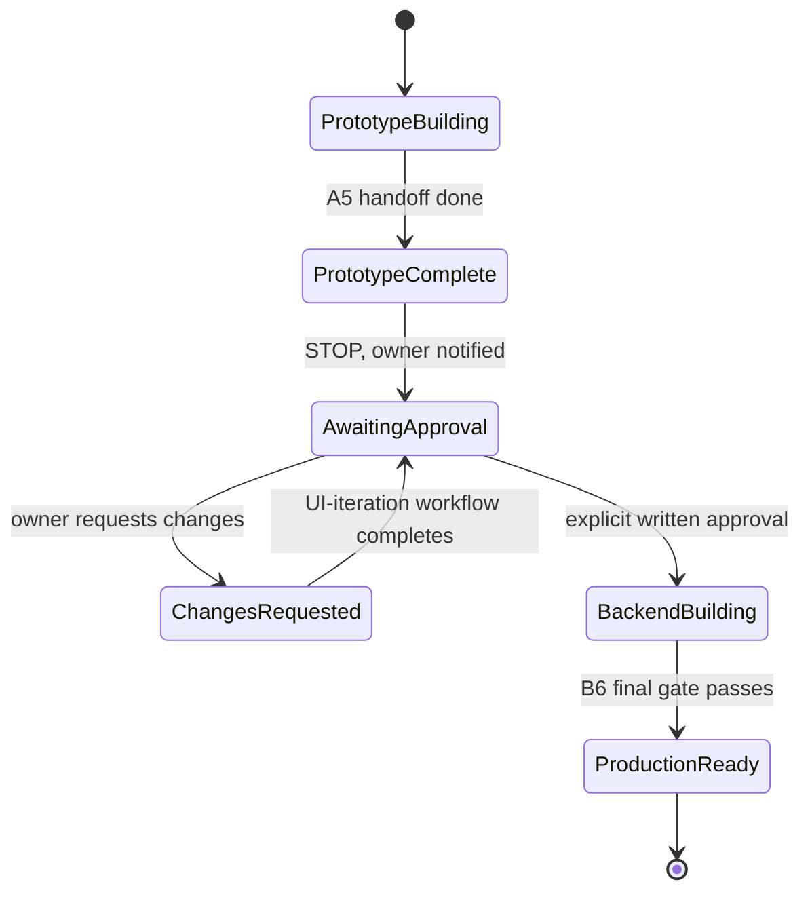
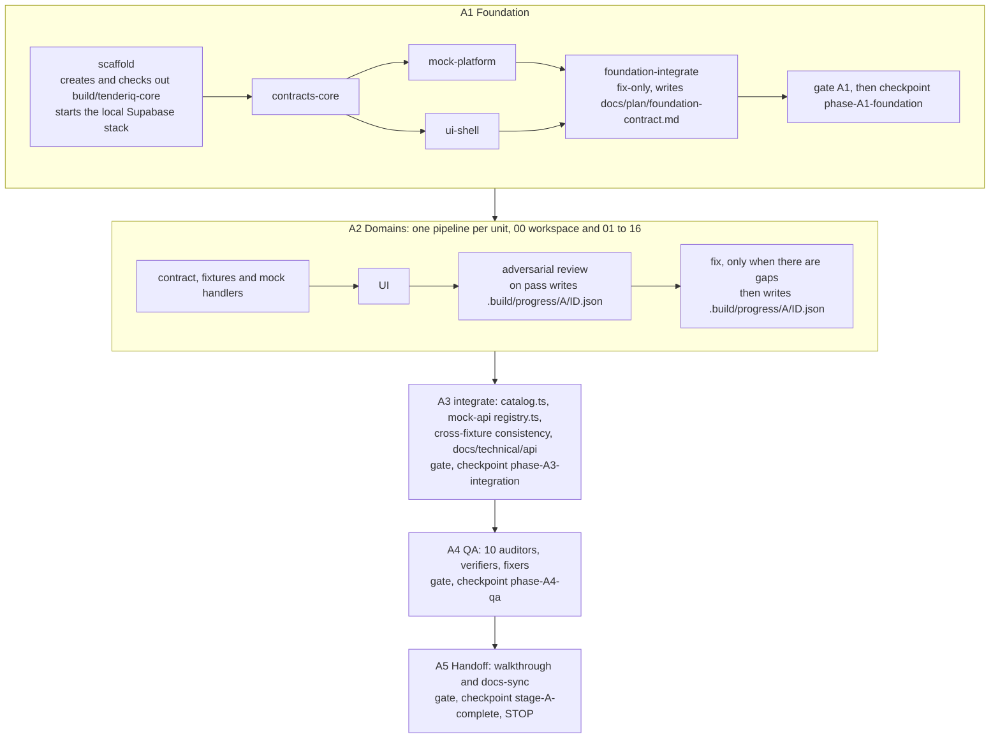
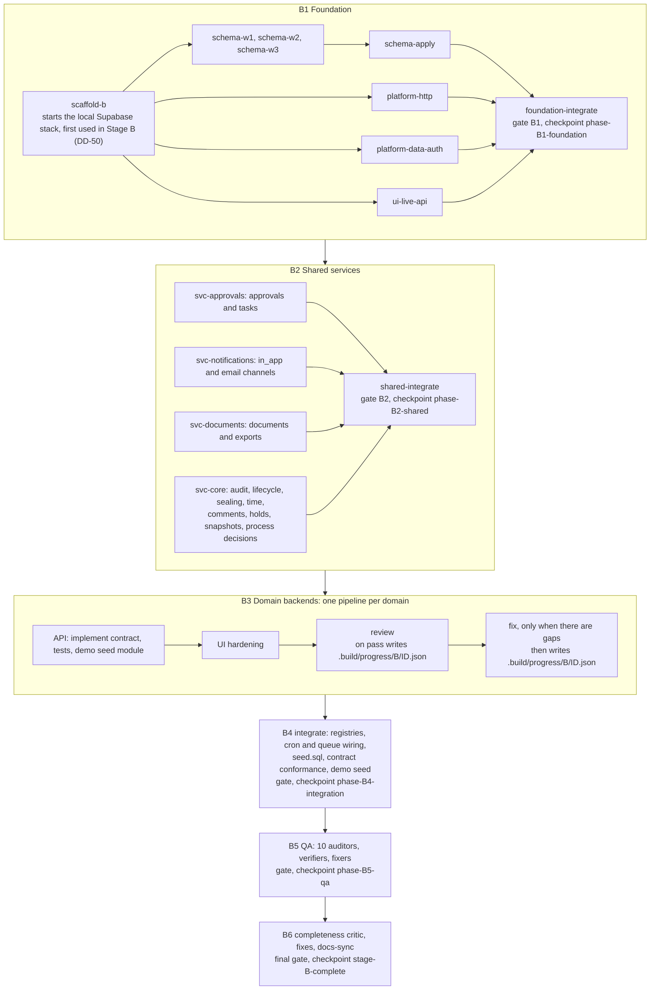
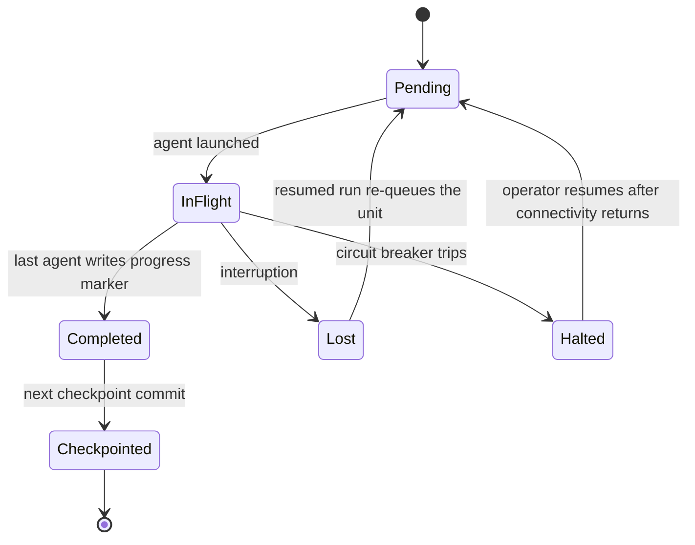
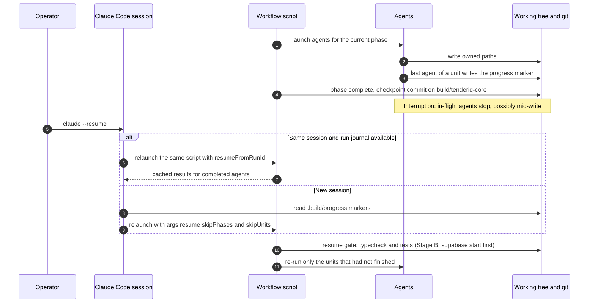

# Delivery and Resilience

Status: As-built (Stage A prototype); backend sections as-designed

Sources:
- `docs/plan/design-decisions.md`: the binding status of the log for both stages (preamble); DD-16 (shared owners, export registry); DD-28 and DD-39 (rate limiting, idempotency keys); DD-30, DD-32, DD-34 to DD-37 (Stage A foundation items: CSP meta tag, decimal helper, CSS port, fonts, shell behaviour, i18n catalogs); DD-38 (withdrawn); DD-43 (real Supabase Auth in local Docker from Stage A; superseded for Stage A by DD-50 and moved to Stage B), DD-44 (email channel: `nodemailer` declared in A1, built in B2), DD-45 (Node 24), DD-50 (Stage A is a fully static prototype with no Supabase and no Docker, 2026-10-30); §E owner decisions of 2026-09-29: items 1 (plan and log approval), 2 (hosted prototype: local only; amended 2026-10-30 by DD-50 to allow static Vercel hosting), 3 (no remote: checkpoints local only), 6 (Stage A authentication, re-decided 2026-10-30 by DD-50), 8 (prototype actions do not persist, screenshots committed) and 9 (the approval gate)
- `docs/plan/architecture-plan.md` (revision 3): header (companion workflow scripts and decision log), §0 Delivery stages and the human approval gate, §2 Release scope ("no placeholder" rule), §3.8 Notifications, §3.10 Contracts-first API, §3.11 Prototype mode (fully static since DD-50; the local Supabase stack moves to Stage B), §4 Repository layout (registries, cross-domain writes, shared owners, `.build/progress/`), §5 Build waves and file ownership, §8 Testing strategy, §9 Build and verification commands, §10 Demo data, §11 Deviations (items 3, 5, 6, 7 and 8, and the other owner answers), §12 Resilience and resume
- `docs/architecture-brief.md`: §4.3 scripts, §7.2 local quick start, §16 Build order
- `docs/plan/demo-storyline.md`: preamble (single story for fixtures and seeds)
- `docs/plan/tenderiq-prototype.workflow.js`: `meta.phases`, configuration and resume (`args.resume`, `branch`, `checkpointCommits`), `RULES` (binding documents, Node 24, the local Supabase stack for authentication only, as written before DD-50), `DOMAINS`, `ownedPaths`, `run()` (one retry per agent call; the circuit breaker halts after 4 consecutive agent failures), `gateLoop()`, `checkpoint()` (marker, then a local commit that is never pushed), `A_GATE_BASE` (runtime smoke with real sign-in) and `A_GATE_FULL`, the A1 scaffold task (branch, dependencies, `.nvmrc`, `supabase/config.toml`, starting the stack, `.env.local`, `.gitignore`), the A1 contracts-core, mock-platform and ui-shell tasks, the A2 review and fix tasks (domain markers), phase skips in `main()`, the return statuses including `interrupted`
- As built (Stage A): the resume markers in `.build/progress/A/`, the checkpoint commits on `build/tenderiq-core`, and the test and catalog counts of 2026-09-30
- `docs/plan/tenderiq-backend.workflow.js` (draft): the same items for Stage B, plus the `prototypeApproved` guard, `BASE_GATE`, `INT_GATE` and `FINAL_GATE`, the B1 scaffold-b, platform and ui-live-api tasks, the B2 shared-service tasks (the email channel in svc-notifications) and the B6 completeness critic

Contents:
1. [Delivery overview](#1-delivery-overview)
2. [Stage A: UI prototype](#2-stage-a-ui-prototype), with the [as-built status](#21-stage-a-status-as-built)
3. [The approval gate](#3-the-approval-gate)
4. [Stage B: full backend](#4-stage-b-full-backend)
5. [Workflow phases](#5-workflow-phases)
6. [Agent ownership model](#6-agent-ownership-model)
7. [Resilience and resume design](#7-resilience-and-resume-design)
8. [Runbook: what to do after an interruption](#8-runbook-what-to-do-after-an-interruption)
9. [Open items](#9-open-items)

Related: [adr/0006-contracts-first-ui-prototype-stage.md](adr/0006-contracts-first-ui-prototype-stage.md), [adr/0009-registries-wired-by-integration.md](adr/0009-registries-wired-by-integration.md), [11-testing-strategy.md](11-testing-strategy.md), [10-deployment-environments.md](10-deployment-environments.md), [12-traceability.md](12-traceability.md), [07-api.md](07-api.md).

---

## 1. Delivery overview

TenderIQ is built by two multi-agent workflow scripts, run in sequence. A human approval sits between them (plan §0). Every agent in both scripts reads the decision log `docs/plan/design-decisions.md` in full before writing anything: it amends the plan and the schema blueprint and wins on any conflict. The log now runs to DD-50: DD-43 to DD-45 record the owner decisions of 2026-09-29, DD-38 is withdrawn, and DD-50 (2026-10-30) makes Stage A a fully static prototype, superseding DD-43 for Stage A.

| Stage | Workflow script | Purpose |
|---|---|---|
| A: UI prototype | `docs/plan/tenderiq-prototype.workflow.js` | Complete clickable SPA, typed API contracts and a static mock API |
| B: full backend | `docs/plan/tenderiq-backend.workflow.js` (draft) | Real backend implementing the Stage A contracts |

```mermaid
flowchart LR
  subgraph stageA["Stage A: UI prototype, tenderiq-prototype workflow"]
    a1["A1 Foundation"] --> a2["A2 Domains"]
    a2 --> a3["A3 Integration"]
    a3 --> a4["A4 QA"]
    a4 --> a5["A5 Handoff"]
  end
  a5 --> stop["STOP<br/>npm run dev:prototype<br/>docs/prototype/walkthrough.md"]
  stop --> gate{"Owner review"}
  gate -->|"changes requested"| iter["UI-iteration workflow"]
  iter --> gate
  gate -->|"explicit written approval: Stage A approved"| b1
  subgraph stageB["Stage B: full backend, tenderiq-backend workflow"]
    b1["B1 Foundation"] --> b2["B2 Shared services"]
    b2 --> b3["B3 Domain backends"]
    b3 --> b4["B4 Integration"]
    b4 --> b5["B5 QA"]
    b5 --> b6["B6 Final gate"]
  end
  b6 --> done["Production-ready build<br/>build, verify, E2E pass"]
```

Stage B is never launched without explicit written approval, and the Stage B script enforces it: without `args.prototypeApproved = true` it returns `status: "refused"` before launching any agent. Resuming an interrupted Stage A run never crosses into Stage B (§7).

## 2. Stage A: UI prototype

| Builds | Does not build |
|---|---|
| Repository skeleton: every root config and every `package.json` (all dependencies for both stages, including `nodemailer` for the Stage B email channel, DD-44), `engines` `24.x` and `.nvmrc` `24` (DD-45), tsconfigs, ESLint, Vitest config, `vercel.json`, `run.ps1`, the CI `verify` job, `CLAUDE.md`, README skeleton, and `supabase/config.toml` (kept for Stage B; the A1 signing-key script and the git-ignored `.env.local` were removed or made unnecessary by DD-50) | Database schema and migrations |
| A static deployable: Vercel serves `src/ui/dist` with the SPA fallback rewrite only, and no environment variables are needed (DD-50) | Anything that needs Docker or Supabase. A1 started the local Supabase stack for Auth under DD-43; since DD-50 Stage A uses no Supabase at all, and the stack is first used in Stage B. |
| The complete SPA (`src/ui`): every in-scope screen (118, see [12-traceability.md](12-traceability.md) §4), navigation, the design system (ported per DD-34), the responsive shell (DD-36), and all states (empty, restricted, error, readiness, submitted). Fonts are self-hosted (DD-35), `index.html` carries a CSP meta tag (DD-30), and every UI string goes through `t()` with per-feature English catalogs (DD-37). | Real business logic |
| Typed API contracts (`src/contracts`) for every endpoint the UI calls, plus the aggregated `catalog.ts`, the permission catalog `permissions.ts` and the shared decimal helper `decimal.ts` (DD-32) | Background jobs |
| A mock API (`src/mock-api`, Hono, same `/api/v1` surface and middleware chain) serving static fixtures from the demo storyline. It runs in the browser: the SPA's `prototypeTransport.ts` lazy-loads `src/mock-api/browser.ts` and answers every `/api/v1` request in the page (DD-50). | Seeds |
| Sign-in through a persona picker (DD-50). The user chooses a demo persona; there are no passwords. The persona's e-mail is kept in `sessionStorage` and sent as the bearer token, and the mock API maps it to its fixture persona (an unknown or deactivated persona gets 401). The picker ships in the public build, because the data is fictional. The "Prototype — static demo data" banner shows when `/me/context` reports `environment.mode = 'prototype'`. | `api/` entrypoints, `src/server` code other than the three platform modules on the next row, password recovery and any email (real Supabase Auth, the demo-accounts quick-pick and `auth:personas` arrive in Stage B, DD-50) |
| The real platform modules `src/server/lib/config` (Stage A variable subset), `src/server/lib/supabase` and `src/server/lib/auth/verify.ts`, written in A1 under DD-43. Since DD-50 the Stage A prototype does not use them; they stay in the repository and Stage B extends them. | — |
| UI, contract, mock-API, platform-auth and E2E tests ([11-testing-strategy.md](11-testing-strategy.md) §4) | — |
| `docs/technical/api/openapi.json` (`npm run docs:api`), `docs/prototype/walkthrough.md` (a screenshot per screen; the screenshots are committed), technical docs synced to the as-built contracts | — |

Rules that keep the prototype honest (plan §0, §2):
- **Static means static.** The mock API filters and paginates fixtures per tenant, persona and query, but persists nothing. Commands validate the request against the contract and return a contract-valid static response. The owner confirmed on 2026-09-29 that prototype actions show realistic results but do not persist (§E item 8).
- **No Docker, no Supabase (DD-50).** Sign-in is a persona picker with no credentials, and the mock API runs in the browser. There is no `VITE_AUTH_MODE` (DD-38 stays withdrawn). Real Supabase Auth, as designed by DD-43, arrives in Stage B (plan §11 item 11).
- **No dead ends.** Every button calls a contract endpoint and handles its response. UI code never hard-codes data. Deferred items never appear as dead links.
- **Fixtures are the intended design** in Stage A, not placeholders.
- **Permissions and boundaries are real.** The mock API enforces each endpoint's declared `permission`, the identical-403 tenant validation and the sealing boundaries against persona fixtures, so the prototype's navigation and 403 behavior already match Stage B.

Verification before STOP:

| Check | Command or artifact |
|---|---|
| Type, lint, unit and SPA tests, SPA build (with Docker stopped, DD-50) | `npm run verify` (typecheck → typecheck:ui → lint → lint:ui → test → test:ui → build:ui) |
| Vercel build command | `npm run build` (`npm run typecheck && npm run build:ui`) |
| Secret and bundle scans: no secrets, server code, server variable names or service-role keys, and the production CSP (`connect-src 'self'`). The mock API, persona e-mails and persona picker ship on purpose in Stage A (DD-50). | `npm run ci:security` |
| Runtime smoke: health, `/me/context` with a persona token and `environment.mode = "prototype"`, 401 for an unknown or deactivated persona, the uniform 403 (DD-50; the original gates signed in against local Supabase Auth under DD-43) | Part of every Stage A gate (`A_GATE_BASE`) |
| OpenAPI regenerates and validates | `npm run docs:api` |
| Every navigation destination per key persona, plus axe | `npm run test:e2e:prototype` |
| Contracts vs fixtures, enum parity, screen references, cross-fixture consistency | Part of `npm run test` |
| Adversarial acceptance and PRD review | A2 per-domain review and A4 auditors → verifiers → fixers |
| Clickable result | `npm run dev:prototype` (Vite only, DD-50) |
| Screen evidence | `docs/prototype/walkthrough.md` |

### 2.1 Stage A status (as built)

**Stage A is complete and awaits the owner's explicit written approval.** Phases A1 to A4 have passed their gates and are checkpointed; the A5 handoff delivers the walkthrough and this as-built documentation, and then the run stops. Stage B has not started: no migration, no business code under `src/server` and no `api/` function exists, and the Stage B script refuses to launch without `args.prototypeApproved = true` (§3).

| Phase | State | Evidence |
|---|---|---|
| A1 Foundation | Done, gate passed | Marker `phase-A1-foundation.json`; checkpoint commit `prototype: foundation (scaffold, contracts core, mock API platform, SPA shell)` |
| A2 Domains | Done for all 17 units | Markers `workspace`, `org-admin`, `policy`, `suppliers`, `qualification`, `requests`, `tenders`, `publication`, `clarifications`, `bids`, `opening`, `evaluation`, `selection`, `awards`, `contracts`, `reporting`, `operations` in `.build/progress/A/`, each with status `done` after its adversarial review and fixes |
| A3 Integration | Done, gate passed | Marker `phase-A3-integration.json` (`report.gate = true`); checkpoint commit `prototype: all domains integrated (contracts catalog, mock handlers, fixtures)` |
| A4 QA | Done, gate passed | Marker `phase-A4-qa.json`: 106 findings raised, 104 confirmed by the verifiers and fixed, `report.gate = true`; checkpoint commit `prototype: QA fixes (style, accessibility, completeness, PRD screens, contracts, confidentiality, journeys)` |
| A5 Handoff | In progress at the time of this sync | `docs-sync` (this documentation update and `docs/technical/api/**`) and `walkthrough` (`docs/prototype/**`) run in parallel; the A5 gate then writes the `stage-A-complete` checkpoint and the run stops |

What the prototype contains:

| Item | As built | Where documented |
|---|---|---|
| API contracts | 919 endpoints in 25 modules; `openapi.json` has 920 operations including `/health` | [07-api.md §13](07-api.md#13-endpoint-catalog-by-domain), [api/endpoint-catalog.md](api/endpoint-catalog.md) |
| Mock API | Every contract endpoint served from static fixtures on the storyline clock (6 October 2026, 10:00 Africa/Gaborone), in the browser, with persona-token authentication (DD-50; real JWT verification as built under DD-43 moved to Stage B) | [07-api.md §11](07-api.md#11-stage-a-mock-api), [02-architecture.md §7.4](02-architecture.md#74-as-built-prototype-stage-a) |
| SPA | 50 feature modules, 284 routes, 68 sidebar items; every one of the 118 in-scope screens reachable | [09-frontend.md §7, §8](09-frontend.md#8-routing-and-url-map), [12-traceability.md §4.9](12-traceability.md#49-as-built-screen-to-route-to-contract-endpoints) |
| Sign-in | Persona picker with the 42 demo personas, no passwords, in every build (DD-50; it replaced supabase-js sign-in and the dev-only quick-pick) | [09-frontend.md §11](09-frontend.md#11-authentication-demo-accounts-and-prototype-banner) |
| Tests | Root `unit` project 100 files and 2,900 tests; SPA suite 265 files and 1,456 tests; Playwright `prototype` specs `shell` and `a11y` | [11-testing-strategy.md](11-testing-strategy.md) |

How the owner reviews it (§3): run `npm run dev:prototype` and open `http://localhost:5173` (no Docker or Supabase, DD-50), or open the static build the owner deployed to Vercel; sign in by choosing any demo persona. The walkthrough with its committed screenshots is `docs/prototype/walkthrough.md`. Approval is given in writing ("Stage A approved"); change requests go to a UI-iteration workflow first.

## 3. The approval gate

| Aspect | Design (plan §0, design-decisions §E) |
|---|---|
| Before Stage A | The owner approves the architecture plan, its §11 deviations and the decision log. The ADRs then move to Accepted (§E item 1). After the owner review of 2026-09-29, every §11 item is accepted or decided, and the final approval follows the consistency re-verification. |
| Who | The owner |
| Reviews | The running prototype (`npm run dev:prototype`), the walkthrough with its committed screenshots, and the as-built contracts and technical docs |
| Where | Locally (owner decision 2026-09-29, §E item 2), or as a static site on Vercel since DD-50 (2026-10-30; the owner creates the project and deploys). No Docker or Supabase is needed. |
| Outcomes | "Stage A approved" (§E item 9, due now that the prototype is delivered, §2.1), or change requests |
| Change requests | Run as a UI-iteration workflow. That workflow's script, phases and scope are not detailed in the sources and are finalized when first needed. |
| Launch rule | Stage B is never launched without explicit written approval. The Stage B script refuses to run unless it is launched with `args.prototypeApproved = true`. |

Why the gate is meaningful:
- **Contracts are the hand-off.** Stage B implements the Stage A contracts. A Stage B contract change needs a recorded reason and a UI update in the same unit.
- **One conformance suite for both stages.** The same zod response schemas validate the mock and the real API ([11-testing-strategy.md](11-testing-strategy.md) §9).
- **One story.** The demo storyline drives Stage A fixtures and Stage B seed modules, so the approved prototype and the live system show the same world (plan §10).
- **The mock stays.** After Stage B the mock API remains a development and test tool (`npm run dev:prototype`, Playwright visual tests). In Stage A the static prototype is the production build and includes it (DD-50); from Stage B it never ships in `api/` or the production bundle.

## 4. Stage B: full backend

| Builds | Verified by |
|---|---|
| Schema from the blueprint (migrations `20261001000000` … `20261001001400`, reserved domain slots `2026100310NN*`), baseline seed, generated types, `schema.expected.sql` | `db:validate`, `db:types:check`, and the Data API lockdown test |
| Platform layer: config (extending the Stage A module to every server variable, including the DD-44 email variables), logging, errors, validation, decimal (a re-export of `src/contracts/decimal.ts`, DD-32), router, public-write rate limiting over `rate_limit_buckets` (DD-28), `Idempotency-Key` handling over `request_idempotency` (DD-39), `api/**`, db, auth (extending the Stage A `lib/supabase` and `lib/auth` with the middleware that resolves an active `users` row and the invited-user exception, DD-27), tenancy, permissions, storage, audit, jobs | Unit and integration guard tests ([11-testing-strategy.md](11-testing-strategy.md) §8) |
| Shared services: approvals (with `tasks`), notifications (with the `in_app` and `email` delivery channels; `email` sends over SMTP with `nodemailer`, locally to Mailpit, DD-44), documents (with `exports` and the `exports` queue handler), and core: audit, lifecycle (with `comments`, `holds`, `record_snapshots` and `process_decisions`), sealing, time (DD-16) | Unit and integration tests. The email tests read Mailpit's API. |
| Real domain backends implementing the same contracts, plus demo seed modules `scripts/db/demo/NN-<domain>.ts` | Contract conformance, the 401/403/tenant-isolation matrix, `AC-xx` tests |
| The SPA pointed at the real API for `npm run dev`, with real Supabase Auth introduced in Stage B (DD-43's design, moved to Stage B by DD-50): the local Supabase stack, `npm run auth:personas`, supabase-js sign-in and recovery, the dev-only demo-accounts quick-pick and the full `scan-bundle` checks. The storage and job platform, and the demo seed, whose `00-platform.ts` module links the Auth accounts created by `npm run auth:personas`, or creates them. | E2E `smoke` and `full` |
| Full QA and docs sync | `npm run build`, `npm run verify` and E2E pass (plan §0) |

Stage B adds the full brief §4.3 script catalog, plus `db:migrate` (`supabase migration up --local --include-all`) and `db:sql:check`, which lets parallel agents check additive migrations safely (plan §9). It adds no npm dependencies: `scaffold` declared every dependency for both stages in A1, including `nodemailer`, the one approved added runtime dependency (DD-44).

## 5. Workflow phases

### 5.1 Stage A (`tenderiq-prototype`)

| Phase | Agent(s) | Writes (owned paths: plan §5 and `ownedPaths` in the script) |
|---|---|---|
| A1 | `scaffold` (runs alone first) | Root configs, all `package.json` files (every dependency for both stages, including `nodemailer`, DD-44; `engines` `24.x`, DD-45), tsconfigs, ESLint, Vitest config, `vercel.json`, `.gitignore`/`.gitattributes`, `.nvmrc` (`24`), `supabase/config.toml` (with `[inbucket] smtp_port = 54325`), `supabase/.gitignore`, `scripts/db/ensure-signing-keys.mjs`, the local `.env.local`, `run.ps1`, CI yml (Stage A `verify` job), `CLAUDE.md`, README, `docs/local-development.md`, `src/ui/{index.html,vite.config.ts,…}`, `e2e_tests/playwright.config.ts`. It started the local Supabase stack and left it running (DD-43; since DD-50 Stage A uses no stack). Its only git command creates or checks out `build/tenderiq-core`. |
| A1 | `contracts-core` (after `scaffold`) | `src/contracts/{common,enums,endpoint,permissions}.ts`, the shared decimal helper `decimal.ts` (DD-32), and the shared-surface contracts `session`, `approvals`, `tasks`, `notifications`, `documents`, `audit`, `calendars` |
| A1 | `mock-platform` (parallel with `ui-shell`) | `src/mock-api/{app.ts,middleware/**,registry.ts,persona.ts,fixtures/platform.ts,fixtures/session.ts,handlers/session.ts,testing/**}`, the real platform modules `src/server/lib/{config,supabase}/**` and `src/server/lib/auth/verify.ts` with `src/server/tests/unit/platform-auth/**` (DD-43), `.env.example` and `.env.local.example` (Stage A subset), `scripts/dev/{serve-mock-api.ts,dev-prototype.mjs,seed-auth-personas.ts}`, `scripts/docs/**`, `scripts/ci/{scan-secrets,scan-bundle,assert-test-run}.ts`, mock-api tests |
| A1 | `ui-shell` (parallel with `mock-platform`) | `src/ui/**` except `features/**` and domain client files, including the theme port (DD-34), self-hosted fonts and the CSP meta tag (DD-35, DD-30), `lib/i18n.ts` (DD-37), the responsive shell (DD-36), the shared widgets `components/{approvals,documents,audit}`, the supabase-js auth pages and `AuthProvider`, the dev-only `DemoAccounts` quick-pick, the `PrototypeBanner` (DD-43), and `e2e_tests/specs/**` |
| A1 | `foundation-integrate` | Fix-only anywhere in Stage A paths. Writes `docs/plan/foundation-contract.md`. |
| A2 | Per domain unit (17 units): contract + fixtures + mock → UI → adversarial review → fix | `src/contracts/<d>.ts`, `src/mock-api/{handlers,fixtures}/<d>.ts`, `src/ui/src/api/<d>.ts`, `src/ui/src/features/<f>/**`, their tests, `.build/progress/A/<d>.json` |
| A3 | `integrate` | `src/contracts/catalog.ts`, `src/mock-api/registry.ts`, `src/mock-api/fixtures/consistency.test.ts`, `docs/technical/api/**`, the test-count floors, and fix-only edits in Stage A paths |
| A4 | 10 auditors (read-only) → deduplication → adversarial verification (1 to 3 voters by severity) → fixers | Fixers write within the owning area's paths |
| A5 | `walkthrough`, `docs-sync` (parallel) | `docs/prototype/**` and `e2e_tests/specs/prototype/walkthrough.spec.ts`; `docs/technical/**` |

The table records what the Stage A workflow built. DD-50 (2026-10-30) later made Stage A fully static: `scripts/dev/{serve-mock-api.ts,dev-prototype.mjs,seed-auth-personas.ts}` and `scripts/db/ensure-signing-keys.mjs` were removed, the supabase-js auth pages and the dev-only `DemoAccounts` quick-pick were replaced by the persona picker (`src/ui/src/auth/{SignInPage,PersonaPicker}.tsx`), the mock API runs in the browser (`src/mock-api/browser.ts`, mounted from the static list `src/mock-api/handler-modules.ts`; on-disk discovery moved to `registry-discovery.ts` for tests), and the `src/server` platform modules and `supabase/config.toml` stay unused until Stage B.

### 5.2 Stage B (`tenderiq-backend`, launched only after approval)

| Phase | Agent(s) | Writes (owned paths: plan §5 and `ownedPaths` in the script) |
|---|---|---|
| B1 | `scaffold-b` (runs alone first) | Stage B npm scripts (no dependency changes; including `supabase:*` and `auth:personas`, which DD-50 removed from Stage A), `supabase/config.toml` and `supabase/.gitignore` (adjusted only if Stage B needs it; `[inbucket] smtp_port = 54325` is kept, DD-44), the signing-key script (restored), the CI Stage B `verify` steps and `migrate` job, the local `.env.local` (created with the Stage B variables, including `EMAIL_ENABLED`, `SMTP_HOST`, `SMTP_PORT` and `EMAIL_FROM` for Mailpit), `run.ps1`, README, `docs/local-development.md`, `docs/deployment.md`, `docs/background-jobs.md`, the Playwright `smoke` and `full` projects. It starts the local Supabase stack (`npm run supabase:start`), which Stage B uses for the first time (DD-50). |
| B1 | `schema-w1`, `schema-w2`, `schema-w3` → `schema-apply` | Migrations 00–13 written in parallel per the blueprint and DD-01 … DD-15; `schema-apply` writes Migration 14, `seed.sql` (generated from `src/contracts/permissions.ts`), the generated types including `supplier-scoped-tables.ts` from the `[S]` tags with the `[R]` guard test (DD-03), `schema.expected.sql`, and the type and validation scripts |
| B1 | `platform-http` | `lib/{config,logging,errors,validation,router}` (`lib/config` extends the Stage A module to every server variable, including the DD-44 email variables), `lib/result.ts`, `lib/decimal.ts` (re-exports `src/contracts/decimal.ts`, DD-32), the public-write rate limiting middleware (DD-28) and `Idempotency-Key` handling (DD-39), `api/**`, `scripts/dev/{serve-api.ts,dev.mjs}`, `scripts/ci/**`, `.env.example`, `.env.local.example`, `docs/environment-variables.md` |
| B1 | `platform-data-auth` | `lib/db` (not the generated files), `lib/{supabase,auth,tenancy,permissions,storage,audit}` (`lib/supabase` and `lib/auth` extend the Stage A modules with the auth middleware and the invited-user exception, DD-27, DD-43), `domains/session`, `jobs/**`, `scripts/db/**` (not generate-types or validate), `scripts/jobs/**`, test helpers, the demo `00-platform.ts` module and its runner |
| B1 | `ui-live-api` | `src/ui/src/{auth,api,app,components,lib}/**` and `e2e_tests/specs/{smoke,full}/**`. Points the SPA at the real API for `npm run dev` and brings in real auth (DD-43's design, moved to Stage B by DD-50): supabase-js sign-in, forgot and reset password, the dev-only demo-accounts quick-pick and its `scan-bundle` check, while `dev:prototype` keeps serving the in-browser mock API with the persona picker. The `PrototypeBanner` shows only when `/me/context` reports prototype mode. It completes the invitation set-password flow (emails in Mailpit), puts real upload flows into the shared document widgets, and writes the smoke specs. |
| B2 | `svc-approvals`, `svc-notifications`, `svc-documents`, `svc-core` (parallel), then `shared-integrate` | `domains/{approvals,notifications,documents,audit,lifecycle,sealing,time}`, implementing the workspace contracts. `svc-notifications` builds the `in_app` and `email` `DeliveryChannel` implementations; `email` uses `nodemailer` over SMTP, only when `EMAIL_ENABLED` (DD-44). Shared owners per DD-16: `tasks` in approvals; `exports`, the `exports` queue handler and `documents/export-registry.ts` in documents; `comments`, `holds`, `record_snapshots` and `process_decisions` (`recordProcessDecision()`) in core. `shared-integrate` writes `docs/plan/shared-services-contract.md`. |
| B3 | Per domain (16 units): API → UI hardening → review → fix | `src/server/domains/<server dirs>/**`, `src/ui/src/features/<f>/**`, the unit's own contract file with its mock handlers and fixtures (changes only with a recorded reason), `src/server/tests/{unit,integration,types}/<id>/**`, `scripts/db/demo/NN-<id>.ts`, reserved migration slot `2026100310NN*`, `.build/progress/B/<id>.json` |
| B4 | `integrate` | Server registries (including `documents/export-registry.ts`), `api/cron/*.ts`, cron and queue wiring, `seed.sql`, integration migrations `20261005*`, `src/server/tests/integration/contract-conformance/**`, `docs/background-jobs.md`, README, test-count floors, and fix-only edits anywhere |
| B5, B6 | 10 auditors → verifiers → fixers → gate; B6 adds a completeness critic, fixes and `docs-sync` before the final gate | As in Stage A |

## 6. Agent ownership model

Agents run concurrently in one working tree. The model prevents write conflicts without locks (plan §5):

| Rule | Effect |
|---|---|
| **Ownership is by path.** An agent writes only the paths it owns and may read anything. | Two parallel agents never write the same file. |
| **Shared files have no parallel editor:** `package.json` files, `src/contracts/{common,enums,endpoint}.ts`, `lib/**`, `components/**`, `theme/**`, `app/**`, `seed.sql`. | Foundation agents create them. Afterwards, only Integration or fixers change them. |
| **Needs outside an agent's paths are reported as `followUps`** and applied by the Integration step. | Cross-cutting changes are serialized. |
| **Registries are wired only by Integration** ([adr/0009](adr/0009-registries-wired-by-integration.md)): `src/mock-api/registry.ts` Ⓐ, `src/contracts/catalog.ts` Ⓐ, `domains/registry.ts` Ⓑ, `jobs/cron/registry.ts` Ⓑ, `jobs/queue/handlers.ts` Ⓑ, `domains/approvals/outcome-registry.ts` Ⓑ, `domains/documents/access-registry.ts` Ⓑ, `domains/documents/export-registry.ts` Ⓑ (per-type export generators, DD-16) | Domain units never edit a shared composition file. They export handlers and generators, and Integration registers them. |
| **SPA feature auto-registration.** `app/featureRegistry.ts` collects `features/*/routes.tsx` with `import.meta.glob`. Each feature exports its routes and nav items. | Parallel feature agents never edit a shared SPA file. |
| **Reserved migration slots** `2026100310NN*` per Stage B domain | Additive migrations from parallel domains cannot collide on timestamps. `db:sql:check` validates them. |
| **Cross-domain writes are enumerated** (plan §4, extended by DD-17) and must happen in the triggering transaction and be audited | A domain writes only its own tables, except for the listed exceptions. Tables without a domain owner have a shared owner (DD-16). |
| **One decision log for every agent.** `docs/plan/design-decisions.md` is in every agent's binding documents and wins over the plan and the blueprint. | Parallel agents resolve the same design questions the same way. |
| **Adversarial review inside each pipeline, then independent QA** (read-only auditors → verifiers → fixers) | Findings are verified before any fix is applied. Fixers stay within the owning area's paths. |

A consequence that matters for resilience: an interrupted agent can leave half-written files only inside its own paths. Re-running its unit rewrites exactly those paths.

## 7. Resilience and resume design

Interruptions in scope: power loss, internet outage, a crashed Claude Code process, and, in Stage B, a Docker restart (plan §12; Stage A uses no Docker since DD-50). The work is protected in four layers, followed by a verification gate.

| Layer | Protects against | Needs | Granularity | Mechanism |
|---|---|---|---|---|
| 1. Run-journal replay | Process crash or outage while the session survives | The same Claude Code session (`claude --resume`) | Per agent | Relaunch the same script with `resumeFromRunId`. Completed agents return cached results, and only unfinished agents re-run. |
| 2. Progress markers | Loss of the session | The working tree on disk | Per unit (a phase, or one domain pipeline) | The last agent of a unit writes `.build/progress/<A or B>/<unit>.json` with the unit's report. The markers are not git-ignored and are committed with the next checkpoint. The script is relaunched with `args.resume = { skipPhases: [...], skipUnits: [...] }`. Integration reads skipped units' reports from their markers. |
| 3. Git checkpoints | Bad or partial writes, and the need for a known-good baseline | The local repository | Per checkpointed phase | One commit per checkpointed phase on branch `build/tenderiq-core`: A1, A3, A4 and stage end in Stage A; B1, B2, B4, B5 and stage end in Stage B. The repository has no git remote, so checkpoints are local only and never pushed (plan §11 item 7; the owner decided on 2026-09-29 to keep them local only, design-decisions §E item 3). A2 and B3 domain work is committed with the next checkpoint and is protected meanwhile only by domain markers on disk. |
| 4. Outage circuit breaker | A cascade of failures through later phases while the network is down | — | Per run | After 4 consecutive agent failures (attempts that return no result), the workflow stops launching agents and returns `status: "interrupted"` with the completed units (§7.5). |

### 7.1 Unit lifecycle across an interruption

On resume, a `Completed` or `Checkpointed` unit is skipped: layer 1 skips it through the run journal, and layer 2 through `skipUnits` or `skipPhases`. A `Lost` unit re-runs from its first agent under layer 2. Under layer 1 it re-runs from the first agent that had not finished.

### 7.2 Resume sequence

### 7.3 Resume gate

On resume, the first action is always a verification gate (plan §12):

| Stage | Gate | Why |
|---|---|---|
| A | Typecheck and tests | Typecheck and tests catch half-written files from agents interrupted mid-write. Stage A needs no Docker or Supabase (DD-50), so nothing else has to be restarted. |
| B | `npm run supabase:start`, then typecheck and tests | The same, and the local stack must be up again, because Docker restarts after a power loss and Stage B signs in and integrates against it |

In the scripts, this gate is `A1-resume` or `B1-resume`. It runs when the stage's first phase is in `skipPhases`. When the first phase is not skipped, that phase re-runs in full and ends with its own gate. The exact commands are listed in §7.5.

### 7.4 Worst-case loss

- **Lost:** the work of the agents that were in flight at the moment of interruption. Their units re-run (plan §12).
- **Kept:** every completed agent (layer 1, same session), every completed unit (layer 2) and every checkpointed phase (layer 3).
- **Not covered:** loss of the local disk or working tree. The repository has no remote, so checkpoints exist only in the local repository (plan §11 item 7), and markers live in the working tree. No external accounts or remotes are part of the build (plan §11 item 5). The owner decided on 2026-09-29 that checkpoints stay local only, with no remote (design-decisions §E item 3).

### 7.5 Resume identifiers

These are the exact values an operator or orchestrator passes on resume, taken from the two workflow scripts. The Stage B script is a draft that is revised against the as-built Stage A contracts before launch, so its identifiers are checked again at that point.

**Launch arguments.**

| Argument | Stage | Meaning |
|---|---|---|
| `resume.skipPhases` | A, B | Phase titles to skip (table below) |
| `resume.skipUnits` | A, B | Domain unit ids whose pipeline is skipped in A2 or B3 |
| `prototypeApproved: true` | B | Required on every Stage B launch, including a resume. The script checks `args.prototypeApproved !== true` before anything else, so only the boolean `true` passes. Without it the script launches no agent and returns `{ status: "refused", reason }`. |
| `branch` | A, B | Checkpoint branch. Default `build/tenderiq-core`. |
| `checkpointCommits: false` | A, B | Phase markers are still written, but no checkpoint commits are made |
| `resumeFromRunId` | A, B | Layer 1 replay in the same session. It is a workflow run option and is not read by the scripts. |

**Circuit breaker.** `run()` halts the workflow after 4 consecutive agent failures, where a failure is an attempt that returns no result. Each agent call gets two attempts (one retry). A retry counts as an attempt, and any successful attempt resets the counter. When the breaker trips, no new agents are launched and the script returns `{ status: "interrupted", reason, completedUnits, resumeHint }`. `completedUnits` lists marker unit names (for example `phase-A1-foundation`) and domain ids, not `skipPhases` strings. Use the next table to translate them. Domain ids are added to `completedUnits` only after the whole A2 or B3 pipeline returns, so after an interruption during A2 or B3 the domain markers on disk are the authority.

**Unit names.** Markers, checkpoints and `completedUnits` use the same unit names:
- Stage A: `phase-A1-foundation`, the 17 domain ids, `phase-A3-integration`, `phase-A4-qa`, `stage-A-complete`.
- Stage B: `phase-B1-foundation`, `phase-B2-shared`, the 16 domain ids, `phase-B4-integration`, `phase-B5-qa`, `stage-B-complete`.

**Return statuses.**

| Status | Stage | Meaning |
|---|---|---|
| `awaiting-approval` | A | Stage A finished and its final gate passed. STOP for the owner's review. |
| `complete` | B | Stage B finished and its final gate passed |
| `needs-attention` | A, B | The stage ran to the end, but its final gate did not pass. `finalGateFailures` lists the failures. |
| `failed` | A, B | A foundation step returned nothing, or the A1, B1 or B2 gate failed (also on the resume check). No checkpoint is made for that phase. |
| `interrupted` | A, B | The circuit breaker tripped. Resume with §8. |
| `refused` | B | Launched without `args.prototypeApproved = true` |

**Phase identifiers.**

| Phase (script title) | `skipPhases` string | Phase marker (`.build/progress/<stage>/…`) and checkpoint | Effect of skipping |
|---|---|---|---|
| A1 Foundation | `A1 Foundation` | `phase-A1-foundation.json` | The `A1-resume` gate runs instead of the foundation agents |
| A2 Domains | None: not skippable as a phase | None. Domain markers only. | Skip domains with `skipUnits` |
| A3 Integration | `A3 Integration` | `phase-A3-integration.json` | Integration, its gate and its checkpoint are skipped |
| A4 QA | `A4 QA` | `phase-A4-qa.json` | Audits, verification, fixes, gate and checkpoint are skipped |
| A5 Handoff | None: always runs | `stage-A-complete.json` | — |
| B1 Foundation | `B1 Foundation` | `phase-B1-foundation.json` | The `B1-resume` gate runs instead of the foundation agents |
| B2 Shared services | `B2 Shared services` | `phase-B2-shared.json` | Shared-service agents, gate and checkpoint are skipped |
| B3 Domain backends | None: not skippable as a phase | None. Domain markers only. | Skip domains with `skipUnits` |
| B4 Integration | `B4 Integration` | `phase-B4-integration.json` | Integration, its gate and its checkpoint are skipped |
| B5 QA | `B5 QA` | `phase-B5-qa.json` | Audits, verification, fixes, gate and checkpoint are skipped |
| B6 Final gate | None: always runs | `stage-B-complete.json` | — |

- Matching is an exact, case-sensitive comparison with the phase title. A misspelled string is ignored without a warning, and the phase re-runs.
- The plan calls B3 "B3 Domains". The script title, used in the diagrams in §1 and §5, is "B3 Domain backends". Neither string is accepted in `skipPhases`.
- A3, A4, A5, B4, B5 and B6 write their marker and checkpoint even when their gate did not pass. The marker's `report.gate` is then `false`. A1, B1 and B2 return `status: "failed"` before checkpointing when their gate fails. Add a phase to `skipPhases` only when its marker exists and `report.gate` is not `false`.

**Domain unit ids (`skipUnits`).**

| Stage | Ids |
|---|---|
| A (17 units) | `workspace`, `org-admin`, `policy`, `suppliers`, `qualification`, `requests`, `tenders`, `publication`, `clarifications`, `bids`, `opening`, `evaluation`, `selection`, `awards`, `contracts`, `reporting`, `operations` |
| B (16 units) | The Stage A list without `workspace`. The workspace contracts are implemented by the B2 shared services. |

`org-admin` is the unit for domain 01 (identity + org-admin), and `reporting` is the unit for domain 15 (reporting + records).

**Marker files.**

| Marker | Written by | JSON shape |
|---|---|---|
| Phase or stage marker, `.build/progress/<A or B>/<unit>.json` | The checkpoint agent, just before its commit | `{ "stage", "unit", "message", "report" }`. `report` holds the integration summary, the gate result or QA counts. |
| Domain marker, review passed | The review agent (task 3 of 4) | `{ "stage", "unit", "status": "done", "review": "pass" }` |
| Domain marker, after fixes | The fix agent (task 4 of 4) | Stage A: `{ "stage", "unit", "status": "done", "gapsFixed", "followUps" }`. Stage B: `{ "stage", "unit", "status": "done", "gapsFixed", "report" }`. |

**Markers in git.** The A1 scaffold task writes a `.gitignore` that deliberately does not ignore `.build/`, and every checkpoint writes its marker first and then runs `git add -A` before it commits. Markers are therefore committed with the checkpoints (plan §12). A2 and B3 domain markers stay uncommitted until the A3 or B4 checkpoint. Before committing, each checkpoint confirms that `.env.local`, `node_modules`, `dist` and `.qa-scratch` are ignored (in Stage B also `supabase/signing_keys.json`), and it never pushes. With `checkpointCommits: false` the marker is still written.

**Resume gate commands.** Both gates run for up to 3 rounds, with fix agents between rounds.

| Gate | Commands |
|---|---|
| `A1-resume` | `npm run typecheck`, `typecheck:ui`, `lint`, `lint:ui`, `test:unit`, `test:ui`, `build`, `ci:security`, and a runtime smoke test. Under DD-50 the smoke test needs no Docker: it checks the mock API's health route, `/me/context` with a persona token (`environment.mode = "prototype"`), 401 for an unknown or deactivated persona and the uniform 403. (The script's `A_GATE_BASE` text was written under DD-43 and still names the mock-API server, `supabase:start`, `auth:personas` and a password-grant sign-in.) |
| `B1-resume` | Starts the local stack with `npm run supabase:start` if it is down. Then `typecheck`, `typecheck:ui`, `lint`, `lint:ui`, `supabase:reset`, `db:types:check`, `test`, `test:ui`, `build`, `ci:security`, a real-API runtime smoke test, and `test:e2e:prototype`. `supabase:reset` rebuilds the local database from migrations and seed, so local data is lost. |

## 8. Runbook: what to do after an interruption

Use this after a power outage, internet outage, crash, or a workflow that returned `status: "interrupted"`.

**1. Restore the environment.**
- Confirm internet connectivity.
- In Stage B only, start Docker Desktop and wait until it reports running: the local Supabase stack provides sign-in and the database. Stage A needs no Docker (DD-50).

**2. Establish where the build stopped.** Run these commands in the repository root:

| Command | Tells you |
|---|---|
| `git branch --show-current` | You should be on `build/tenderiq-core` |
| `git log --oneline -10` | The last checkpoint commit, which is the last checkpointed phase. Domain work finished after it (A2, B3) shows only as markers. |
| `ls .build/progress/A .build/progress/B` | Units completed since the build started: phase markers (`phase-*.json`, `stage-*-complete.json`) and domain markers (`<unit id>.json`), see §7.5 |
| `git status --short` | Work written after the last checkpoint: completed units plus possibly half-written files from in-flight agents |

If git reports an `index.lock` left by an interrupted checkpoint commit, first confirm that no git process is running. Then remove `.git/index.lock`.

The repository has no git remote, so there is nothing to fetch or pull: the local branch `build/tenderiq-core` and the working tree are the only copy of the build (owner decision 2026-09-29, design-decisions §E item 3).

**3. Try run-journal replay first (layer 1).**
- Run `claude --resume` and select the build session.
- Ask the orchestrator to relaunch the same workflow script with `resumeFromRunId` set to the interrupted run. Completed agents return cached results.

**4. If the session cannot be resumed, resume from markers (layer 2).**
- Start a new Claude Code session in the repository.
- Ask it to resume the build from `.build/progress`. The orchestrator reads the markers, derives `skipPhases` and `skipUnits`, and relaunches the stage's workflow script with `args.resume`: `docs/plan/tenderiq-prototype.workflow.js` for Stage A, or `docs/plan/tenderiq-backend.workflow.js` for Stage B.
- Translate markers with the tables in §7.5. Phase markers map to `skipPhases` strings, which must match exactly. Domain markers map to `skipUnits` ids. Leave out any phase whose marker has `report.gate: false`.
- A Stage B relaunch also passes `prototypeApproved: true`. This is valid only because the owner has already approved Stage A. Without it the script returns `status: "refused"` and does nothing.

**5. Let the resume gate run** (typecheck and tests; in Stage B first `npm run supabase:start`, with the demo accounts through `npm run auth:personas`).
- If the gate fails only in paths owned by a unit without a marker, no action is needed: that unit re-runs.
- If the gate fails in paths owned by a unit that has a marker, do not skip that unit. Remove it from `skipUnits`, or restore its paths from the last checkpoint, before relaunching.
- In Stage B, the `B1-resume` gate runs `npm run supabase:reset`, which rebuilds the local database from migrations and the baseline seed. This destroys local data (§7.5).

**6. If the run returns `status: "interrupted"` again,** the circuit breaker tripped (4 consecutive agent failures, §7.5), most likely because connectivity is still failing. Fix connectivity, then repeat step 3 or step 4. For any other status, see the return-status table in §7.5.

**7. Never cross the gate on resume.**
- Resuming Stage A ends at the Stage A STOP.
- Stage B starts only after the owner's explicit written approval, even if Stage A completed during the resumed run.

**8. After the run completes,** confirm that the stage's verification passes (§2 or §4) and that a checkpoint commit exists for every checkpointed phase (§7.5).

## 9. Open items

- **Draft Stage B script.** `docs/plan/tenderiq-backend.workflow.js` is marked draft and is revised against the as-built Stage A contracts (919 endpoints in 25 modules, [api/endpoint-catalog.md](api/endpoint-catalog.md)) before launch. The Stage B identifiers in §7.5 are checked again then.
- **Checkpoint granularity.** Plan §11 item 7 and §12 describe one checkpoint commit per phase. The scripts make no checkpoint for A2 or B3, so domain work between the A1 and A3 checkpoints (or B2 and B4) is protected only by markers on disk until the integration checkpoint.
- **UI-iteration workflow.** Its script, phases and approval loop are not detailed in the sources.
- **Checkpoint durability.** Resolved — owner decision 2026-09-29 (design-decisions §E item 3; no DD entry): checkpoints stay local only, with no remote. Disk loss therefore remains outside the design (§7.4). Earlier wording: owner decision (design-decisions §E item 3; no DD entry): the repository has no remote, so checkpoint commits are local only; off-machine backup of the build branch, or a private remote to push to (plan §11 item 7), is for the owner to decide. Original point: checkpoints are local only (never pushed), so disk loss is outside the design, and the owner may choose to back up the working tree or add a remote.
- **Hosted prototype.** Resolved — owner decision 2026-09-29 (design-decisions §E item 2): the prototype is reviewed locally only (§3). Original point: whether the prototype is also hosted, for example as a Vercel preview, for remote reviewers was an owner decision (§E item 2).
