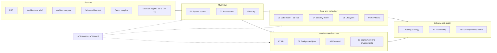
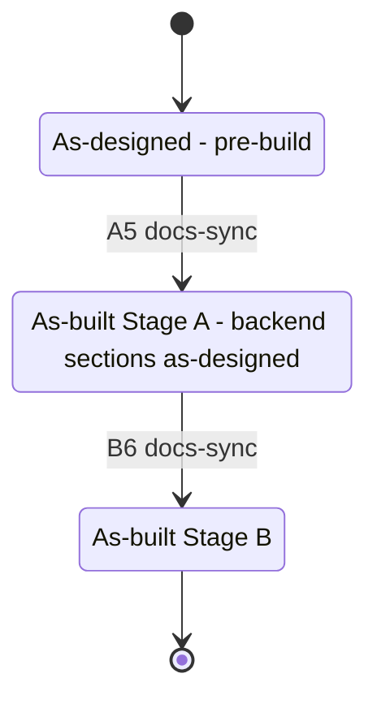

# TenderIQ Technical Documentation

Status: As-designed (pre-build). Updated to as-built at the end of Stage A and Stage B.

Sources:
- `docs/plan/architecture-plan.md` (revision 3): header (companion documents), §0 delivery stages and the approval gate (real Supabase Auth in Stage A), §3.8 notifications (`in_app` and `email` channels), §3.10 contracts-first API (OpenAPI generation), §3.11 prototype mode, §4 repository layout (`docs/technical/`, `docs/prototype/`, `.build/progress/`), §5 build waves and file ownership (A1 `mock-platform`, A3 `integrate`, A5 `walkthrough` and `docs-sync`, B1 `ui-live-api`, B4 `integrate`, B6 `docs-sync`), §11 deviations (owner review of 2026-09-29: every item ACCEPTED or DECIDED) and "Other owner answers", §12 resilience and resume.
- `docs/plan/tenderiq-prototype.workflow.js`: agent rules for `docs/technical/*`, `ownedPaths('integration')`, the A3 integration task (`npm run docs:api`), the A5 `walkthrough` and `docs-sync` tasks, `A_GATE_FULL`.
- `docs/plan/tenderiq-backend.workflow.js` (draft): the B4 integration task (contract changes recorded in `07-api.md`), the B6 `critic` and `docs-sync` tasks, `FINAL_GATE`.
- `docs/architecture-brief.md`: §15 documentation to create in the new repository.
- `docs/plan/design-decisions.md`: DD-01 … DD-45 (binding for both stages; wins over the plan and the blueprint), including DD-38 (WITHDRAWN, superseded by DD-43) and §D2 (DD-43 real authentication from Stage A, DD-44 email channel, DD-45 Node 24), and §E owner decisions (status after the owner review of 2026-09-29); used for the open-decisions index (§6), the source table (§1) and the companion artifacts (§7).
- `docs/plan/email-delivery-options.md`: status (local development decided, hosted provider deferred).
- `docs/technical/**`: the Contents, diagrams and open-points section of every document in this set. This index is compiled from them.

Contents:
1. [Purpose](#1-purpose)
2. [Audience](#2-audience)
3. [Reading paths](#3-reading-paths)
4. [Document catalog](#4-document-catalog)
5. [Diagram inventory](#5-diagram-inventory)
6. [Open decisions index](#6-open-decisions-index)
7. [Generated and companion artifacts](#7-generated-and-companion-artifacts)
8. [Keeping the documentation in sync](#8-keeping-the-documentation-in-sync)
9. [Conventions](#9-conventions)

---

## 1. Purpose

TenderIQ is not built yet. This folder is the engineering reference for the design set out in the architecture plan and its companions. It restates the source documents as architecture views, data models, security rules, state machines, flows, interfaces and delivery mechanics, and it records every point the sources leave open.

The design is delivered in two stages with a human approval between them (plan §0; [13-delivery-and-resilience.md](13-delivery-and-resilience.md)):

| Stage | Builds | Uses these documents for |
|---|---|---|
| **A: UI prototype** | The complete SPA, typed API contracts in `src/contracts`, and a Hono mock API that serves static fixtures from the demo storyline. Real sign-in with Supabase Auth in the local Docker stack: demo accounts come from `npm run auth:personas`, the mock API verifies real JWTs, and password-reset emails land in Mailpit; invite and registration emails follow in Stage B (DD-43). No application database schema, jobs or business logic. | Screens, navigation, contracts, persona permissions, audience rules, state enums, fixture shapes |
| **Approval gate** | Owner review of the running prototype. Stage B never starts without explicit written approval. | Review guide, traceability, decisions awaiting the owner |
| **B: Full backend** | Schema from the blueprint, platform layer (extending the Stage A auth and configuration modules), shared services (including the `in_app` and `email` notification channels, DD-44), domain backends that implement the same contracts, Supabase Auth, jobs, demo seed, full QA | Everything, with the data model, security model, lifecycles, flows and jobs as the implementation specification |

The documents are derived from these sources. They add no components, tables or technologies the sources do not contain. Where the sources are silent, the document says so and names the stage that decides.

| Source | Role |
|---|---|
| [`docs/PRD.md`](../PRD.md) | Business requirements: FR-01 to FR-22, BR-01 to BR-48, screen IDs, acceptance scenarios AC-01 to AC-39 |
| [`docs/architecture-brief.md`](../architecture-brief.md) | Platform, conventions, jobs, authentication, deployment and CI. Followed literally. |
| [`docs/plan/architecture-plan.md`](../plan/architecture-plan.md) | Build contract: delivery stages, key decisions, repository layout, ownership, registries, resilience. Where it disagrees with the brief, the brief wins unless plan §11 lists an approved deviation. |
| [`docs/plan/schema-blueprint.md`](../plan/schema-blueprint.md) | Database: 224 tables in Migrations 01 to 13 (including `rate_limit_buckets` and `request_idempotency`, DD-28, DD-39), four views in Migration 14, the permission catalog and role templates (§P) |
| [`docs/plan/design-decisions.md`](../plan/design-decisions.md) | Decision log DD-01 to DD-45 resolving the documentation open points; binding for both stages and wins over the plan and the blueprint (both were amended to match, as was the storyline). DD-43 to DD-45 record the owner decisions of 2026-09-29 (real Supabase Auth from Stage A, the email channel, Node 24), and DD-38 is withdrawn. §E gives the status of every owner decision. |
| [`docs/plan/email-delivery-options.md`](../plan/email-delivery-options.md) | Email delivery: how it runs locally (Mailpit), the `nodemailer` dependency note, and the hosted provider options. Local development is decided (DD-44); the hosted provider is deferred. |
| [`docs/plan/demo-storyline.md`](../plan/demo-storyline.md) | The single demo world, used by the Stage A fixtures and the Stage B seed |
| `docs/css/`, `docs/screenshots/` | Visual style: tokens, component classes and page anatomy to port |
| [`docs/plan/tenderiq-prototype.workflow.js`](../plan/tenderiq-prototype.workflow.js), [`docs/plan/tenderiq-backend.workflow.js`](../plan/tenderiq-backend.workflow.js) | The Stage A build workflow and the draft Stage B workflow: phases, agents, owned paths, gates |

Until the as-built updates (§8), a disagreement between a document here and its sources is a documentation defect, and the source governs. Where the sources disagree with each other, the decision log wins over the plan and the blueprint (design-decisions preamble).

This folder does not hold runbooks. Step-by-step procedures live in the repository-level documents that the build creates (§7).

## 2. Audience

| Reader | Needs from this set | Start with |
|---|---|---|
| **New engineer** (either stage) | The product, the containers, the tenancy and sealing model, the vocabulary | [Reading path 3.1](#31-new-engineer) |
| **Stage A UI and contract engineer** (build agents in A1 to A5) | Contracts, the mock API rules, SPA structure, screen-to-endpoint traceability, the states each screen shows | [Reading path 3.2](#32-stage-a-ui-and-contract-engineer) |
| **Prototype reviewer** (owner, at the approval gate) | What the prototype demonstrates, what is static, which decisions need owner confirmation | [Reading path 3.3](#33-prototype-reviewer) |
| **Stage B backend engineer** (build agents in B1 to B6) | Tables, legality matrices, security checks, flows, jobs, environments, test obligations | [Reading path 3.4](#34-stage-b-backend-engineer) |
| **DBA** | Schema conventions, tenancy and partitioning, sealed tables, migrations, views, queues and cron | [Reading path 3.5](#35-dba) |
| **Security reviewer** | Trust boundaries, authentication, authorization, sealing, operator access, audit, secrets | [Reading path 3.6](#36-security-reviewer) |
| **Operator** (environments, jobs and platform operations) | Environments, deployment, secrets, scheduled jobs, pausing and rollback, operator support access, interruption recovery | [Reading path 3.7](#37-operator) |

Build agents read `docs/plan/architecture-plan.md` first (plan preamble) and read the decision log `docs/plan/design-decisions.md` in full (the binding documents in both workflow scripts). The Stage A workflow treats `docs/technical/*` as read-only for every agent unless its task says otherwise. The owners are listed in §8.

## 3. Reading paths

Each path is ordered. Read the named sections first and the rest of a document when you need it. [glossary.md](glossary.md) is the reference for every path.

### 3.1 New engineer

1. [01-system-context.md](01-system-context.md): product purpose, actors, external systems, context diagrams, scope.
2. [02-architecture.md](02-architecture.md): [§1](02-architecture.md#1-architecture-at-a-glance) to [§5](02-architecture.md#5-tenancy-and-audience-prefix-routing) (containers, backend components, request pipeline, tenancy routing), then [§7](02-architecture.md#7-prototype-mode-stage-a-and-live-mode-stage-b) (prototype mode and live mode).
3. [13-delivery-and-resilience.md](13-delivery-and-resilience.md): [§1](13-delivery-and-resilience.md#1-delivery-overview) to [§4](13-delivery-and-resilience.md#4-stage-b-full-backend) (the two stages and the gate).
4. [03-data-model/README.md](03-data-model/README.md): [§2](03-data-model/README.md#2-modelling-conventions) to [§4](03-data-model/README.md#4-sealed-tables) (conventions, tenancy, sealed tables) and [§8](03-data-model/README.md#8-domain-overview) (domain overview).
5. [04-security-model.md](04-security-model.md): [§1](04-security-model.md#1-principles-and-scope) to [§7](04-security-model.md#7-sealing-and-staged-opening).
6. [05-lifecycles.md](05-lifecycles.md): [§1](05-lifecycles.md#1-conventions) and [§3](05-lifecycles.md#3-tender) (the tender lifecycle).
7. [06-key-flows.md](06-key-flows.md): [§2](06-key-flows.md#2-flow-index) (flow index), then the flows for your area.
8. [adr/README.md](adr/README.md): the decision index and how the decisions relate.

### 3.2 Stage A UI and contract engineer

1. [13-delivery-and-resilience.md](13-delivery-and-resilience.md): [§2](13-delivery-and-resilience.md#2-stage-a-ui-prototype), [§5](13-delivery-and-resilience.md#5-workflow-phases) and [§6](13-delivery-and-resilience.md#6-agent-ownership-model) (Stage A scope, phases, path ownership).
2. [02-architecture.md §7](02-architecture.md#7-prototype-mode-stage-a-and-live-mode-stage-b): one SPA, two API implementations behind the same proxy.
3. [07-api.md](07-api.md): conventions ([§2](07-api.md#2-surface-base-path-and-audiences) to [§8](07-api.md#8-data-encoding-ids-money-decimals-instants-and-official-deadlines)), [§9](07-api.md#9-the-contracts-module-srccontracts) (the contracts module), [§11](07-api.md#11-stage-a-mock-api) (mock API guarantees), [§13](07-api.md#13-planned-endpoint-catalog-by-domain) (planned endpoint catalog).
4. [09-frontend.md](09-frontend.md): design system, shell and page anatomy, feature auto-registration, routing, state, API client, and authentication (supabase-js only, with the dev-only demo-accounts quick-pick, DD-43).
5. [12-traceability.md](12-traceability.md): [§4](12-traceability.md#4-c-screens-to-domains-feature-folders-and-audience) (screens to feature folders and audience) and [§5](12-traceability.md#5-d-acceptance-scenarios-to-enforcing-mechanisms-and-tests) (acceptance scenarios).
6. [05-lifecycles.md](05-lifecycles.md): the states every screen must show. They are mirrored once in `src/contracts/enums.ts`.
7. [04-security-model.md §17](04-security-model.md#17-stage-a-prototype-enforcement) (what the mock API enforces) and [§16](04-security-model.md#16-audience-and-confidentiality-matrix-enforcement) (audience matrix).
8. [11-testing-strategy.md §4](11-testing-strategy.md#4-stage-a-suites): the Stage A suites.
9. [ADR-0006](adr/0006-contracts-first-ui-prototype-stage.md), then §6 of this index for the decisions Stage A must make.

### 3.3 Prototype reviewer

1. `docs/prototype/README.md` and `docs/prototype/walkthrough.md`: how to run the prototype, the personas, and a screenshot per screen. Written in A5 (§7). They do not exist before then.
2. [13-delivery-and-resilience.md §3](13-delivery-and-resilience.md#3-the-approval-gate): what approval means and what happens next.
3. [ADR-0006](adr/0006-contracts-first-ui-prototype-stage.md): why the prototype comes first and why contracts are the hand-off.
4. [12-traceability.md §4](12-traceability.md#4-c-screens-to-domains-feature-folders-and-audience) and [§5](12-traceability.md#5-d-acceptance-scenarios-to-enforcing-mechanisms-and-tests): every in-scope screen and acceptance scenario.
5. [11-testing-strategy.md §12](11-testing-strategy.md#12-acceptance-coverage-matrix): which scenarios Stage A demonstrates and which Stage B proves.
6. [adr/README.md: Decisions that need explicit owner confirmation](adr/README.md#decisions-that-need-explicit-owner-confirmation), the owner decisions in [§6.3](#63-owner-decisions) of this index, and the decision log they approve ([`docs/plan/design-decisions.md`](../plan/design-decisions.md), §E).

### 3.4 Stage B backend engineer

1. [03-data-model/README.md](03-data-model/README.md), then the data-model file for your domain ([§9 table index](03-data-model/README.md#9-table-index) names it).
2. [04-security-model.md](04-security-model.md): all of it. Every endpoint you implement applies it.
3. [05-lifecycles.md](05-lifecycles.md): the legality matrices you implement in `domains/<d>/workflow/`.
4. [06-key-flows.md](06-key-flows.md): the sequences, transactions and cross-domain writes.
5. [07-api.md](07-api.md): [§3](07-api.md#3-request-conventions) to [§9](07-api.md#9-the-contracts-module-srccontracts) and [§12](07-api.md#12-endpoints-outside-apiv1). Stage B implements the Stage A contracts. The generated `docs/technical/api/openapi.json` is authoritative for exact paths.
6. [08-background-jobs.md](08-background-jobs.md): scheduling, sweeps, queues, endpoint protection.
7. [10-deployment-environments.md](10-deployment-environments.md): environments, variables, secrets, CI/CD.
8. [11-testing-strategy.md](11-testing-strategy.md): [§5](11-testing-strategy.md#5-stage-b-suites) to [§12](11-testing-strategy.md#12-acceptance-coverage-matrix).
9. [ADR-0003](adr/0003-application-layer-sealing.md), [ADR-0004](adr/0004-text-check-constraints-not-enums.md), [ADR-0005](adr/0005-decimal-strings-for-money-and-scores.md), [ADR-0008](adr/0008-partition-only-high-volume-tables.md), [ADR-0009](adr/0009-registries-wired-by-integration.md), [ADR-0011](adr/0011-official-receipt-time-from-database.md).

### 3.5 DBA

1. [03-data-model/README.md](03-data-model/README.md): [§2](03-data-model/README.md#2-modelling-conventions) conventions, [§3](03-data-model/README.md#3-tenancy) tenancy tags and partitioning, [§4](03-data-model/README.md#4-sealed-tables) sealed tables, [§5](03-data-model/README.md#5-data-api-lockdown) Data API lockdown, [§6](03-data-model/README.md#6-migrations) migrations, [§7](03-data-model/README.md#7-views) views, [§9](03-data-model/README.md#9-table-index) table index.
2. Data-model files [01](03-data-model/01-platform-identity-access.md) to [12](03-data-model/12-records-reporting-operations.md): ERDs and the full data dictionary of every table.
3. [ADR-0004](adr/0004-text-check-constraints-not-enums.md), [ADR-0005](adr/0005-decimal-strings-for-money-and-scores.md), [ADR-0008](adr/0008-partition-only-high-volume-tables.md), [ADR-0011](adr/0011-official-receipt-time-from-database.md).
4. [05-lifecycles.md](05-lifecycles.md): the main status CHECK lists as state machines, and [§19](05-lifecycles.md#19-index-of-other-status-columns) for every other status-like CHECK column.
5. [08-background-jobs.md](08-background-jobs.md): [§3](08-background-jobs.md#3-scheduling-architecture) pg_cron and pg_net, [§7](08-background-jobs.md#7-queues-pgmq) pgmq queues, [§9](08-background-jobs.md#9-durable-job-state) durable job state.
6. [10-deployment-environments.md](10-deployment-environments.md): [§5](10-deployment-environments.md#5-supabase-projects) Supabase projects and [§6](10-deployment-environments.md#6-database-connection-strings) connection strings.
7. [04-security-model.md §12](04-security-model.md#12-data-api-lockdown-and-storage): Data API lockdown and storage.

### 3.6 Security reviewer

1. [04-security-model.md](04-security-model.md): all sections, including [§18](04-security-model.md#18-open-points) open points.
2. [02-architecture.md §4](02-architecture.md#4-request-pipeline) and [§5](02-architecture.md#5-tenancy-and-audience-prefix-routing): request pipeline and audience-prefix routing.
3. [ADR-0001](adr/0001-tenancy-equals-organization.md), [ADR-0002](adr/0002-buyer-owned-procurement-records.md), [ADR-0003](adr/0003-application-layer-sealing.md), [ADR-0011](adr/0011-official-receipt-time-from-database.md), [ADR-0012](adr/0012-supplier-registration-via-provisioned-accounts.md), [ADR-0013](adr/0013-operator-support-access-grants.md).
4. [06-key-flows.md](06-key-flows.md): Flow 1 (sign-in and context), Flow 5 (submission and official receipt time), Flow 7 (sealed access, staged opening, price gate), Flow 12 (document upload).
5. [03-data-model/README.md](03-data-model/README.md): [§3](03-data-model/README.md#3-tenancy) to [§5](03-data-model/README.md#5-data-api-lockdown).
6. [07-api.md](07-api.md): [§4](07-api.md#4-responses-and-errors) errors, [§7](07-api.md#7-correlation-ids-logging-and-security-headers) correlation ids, logging and headers, [§12](07-api.md#12-endpoints-outside-apiv1) job endpoints. [08-background-jobs.md §8](08-background-jobs.md#8-endpoint-protection).
7. [10-deployment-environments.md](10-deployment-environments.md): [§7](10-deployment-environments.md#7-environment-variables) environment variables and [§8](10-deployment-environments.md#8-secrets-flow) secrets flow.
8. [11-testing-strategy.md §8](11-testing-strategy.md#8-architecture-guard-tests): architecture guard tests (Data API lockdown, import boundaries, sealed tables, logger redaction, secret and bundle hygiene).

### 3.7 Operator

1. [10-deployment-environments.md](10-deployment-environments.md): all sections, especially [§9](10-deployment-environments.md#9-cicd-pipeline) CI/CD, [§11](10-deployment-environments.md#11-post-deploy-smoke-checks) smoke checks, [§12](10-deployment-environments.md#12-rollback-and-pausing) rollback and pausing, [§13](10-deployment-environments.md#13-operational-runbooks) runbooks.
2. [08-background-jobs.md](08-background-jobs.md): [§4](08-background-jobs.md#4-job-catalog) job catalog, [§10](08-background-jobs.md#10-environments-and-configuration) to [§13](08-background-jobs.md#13-pausing-resuming-and-rollback) configuration, local runs, observability, pausing.
3. [04-security-model.md §10](04-security-model.md#10-operator-support-access) and [ADR-0013](adr/0013-operator-support-access-grants.md): operator support access to customer tenants. [05-lifecycles.md §17](05-lifecycles.md#17-support-access-grant): the grant lifecycle.
4. [03-data-model/12-records-reporting-operations.md §7](03-data-model/12-records-reporting-operations.md#7-data-dictionary-platform-operations): the platform operations tables (subscriptions, support cases, incidents, announcements).
5. [04-security-model.md §13](04-security-model.md#13-secrets-handling-and-bundle-scanning): secrets handling.
6. Whoever runs the build workflows: [13-delivery-and-resilience.md §7](13-delivery-and-resilience.md#7-resilience-and-resume-design) and [§8](13-delivery-and-resilience.md#8-runbook-what-to-do-after-an-interruption), the resume design and the runbook after a power or network interruption.

## 4. Document catalog

Stage column: **A** = used to build the Stage A prototype, **B** = used to build the Stage B backend. Main sources use these short names: plan = architecture-plan, brief = architecture-brief, blueprint = schema-blueprint, storyline = demo-storyline, log = design-decisions. Every document also takes the decision log as a source; its own Sources list names the DD entries it applies.

### 4.1 Overview and reference

| Document | Scope | Stage | Main sources |
|---|---|---|---|
| [README.md](README.md) | This index: audiences, reading paths, catalog, diagram inventory, open decisions, artifacts, sync process, conventions | A, B | Plan §0, §4, §5; workflow scripts; brief §15; log (all entries, §E) |
| [01-system-context.md](01-system-context.md) | Product purpose, actors, external systems, business and technical context diagrams, constraints, scope summary | A, B | PRD §1, §2, §4, §11–§13, §16; plan §0–§4, §11; brief §1, §13 |
| [glossary.md](glossary.md) | Procurement, access, technical and identifier terms with where each appears; terms with more than one meaning | A, B | PRD §3–§18; plan §3; blueprint; brief §5–§11 |

### 4.2 Architecture and data

| Document | Scope | Stage | Main sources |
|---|---|---|---|
| [02-architecture.md](02-architecture.md) | Container view, backend components, request pipeline, tenancy routing, frontend architecture, prototype vs live mode, repository layout, module dependency rules, key decisions | A, B | Plan §0–§4; brief §1–§5; blueprint §0 |
| [03-data-model/README.md](03-data-model/README.md) | Data-model overview: dictionary legend, modelling conventions, tenancy tags, sealed tables, Data API lockdown, migrations, views, domain clusters, index of all 224 tables | B (A mirrors CHECK lists in `enums.ts`) | Blueprint §0, Migrations 00–14, §P; plan §3, §6; brief §5.6, §6 |
| [03-data-model/01-platform-identity-access.md](03-data-model/01-platform-identity-access.md) | Migrations 00–01 (20 tables): tenants, users, memberships, invitations, permission catalog, roles, groups, scoped assignments, grants, restrictions, reference counters, snapshots, audit log, job platform, queues, buckets, SQL functions | B | Blueprint Migrations 00–01; plan §3.1, §3.2, §3.5; brief §5–§6, §9 |
| [03-data-model/02-organization-policy.md](03-data-model/02-organization-policy.md) | Migrations 02–03 (29 tables): organization settings and structure, calendars, committees, authority limits, delegations, SoD, conflicts, confidentiality, exchange rates, policy profiles, custom fields, templates, notification rules, portal, retention; seeded permission catalog and role templates | B | Blueprint Migrations 02–03, §P; PRD §5, §17 |
| [03-data-model/03-shared-services.md](03-data-model/03-shared-services.md) | Migration 04 (13 tables): approvals, tasks, notifications, formal notices, documents, comments, holds, saved views | B | Blueprint Migration 04; plan §3.5, §3.8; PRD §14, BR-41, BR-42 |
| [03-data-model/04-suppliers-qualification.md](03-data-model/04-suppliers-qualification.md) | Migration 05 (25 tables): supplier profiles and identity, duplicates, buyer relationships, evidence, qualification programs, applications, decisions, `v_qualification_status` | B | Blueprint Migration 05; PRD FR-02, FR-06, BR-24, BR-25, BR-44, BR-45 |
| [03-data-model/05-requests-planning.md](03-data-model/05-requests-planning.md) | Migration 06 (9 tables): procurement projects and requests, plan items, advance notices, strategies, market research, fairness reviews | B | Blueprint Migration 06; PRD FR-04, FR-05 |
| [03-data-model/06-tenders.md](03-data-model/06-tenders.md) | Migration 07 (17 tables): tenders, versions, milestones, lots, team, requirements, pricing, terms, envelopes, participation conditions, evaluation plans, release checks, publications | B | Blueprint Migration 07; PRD FR-07, FR-08, BR-09, BR-10, BR-16 |
| [03-data-model/07-participation-clarifications.md](03-data-model/07-participation-clarifications.md) | Migration 08 (16 tables): participants, acknowledgments, document access, supplier pursuits and searches, questions, addenda, briefings, site visits | B | Blueprint Migration 08; PRD FR-08 to FR-10, BR-14 to BR-16, BR-41, BR-42 |
| [03-data-model/08-bids-submission.md](03-data-model/08-bids-submission.md) | Migration 09 (19 tables): bids, revisions, sealed content, supplier-internal review, submission attempts, receipts, withdrawal, late exceptions, `v_bid_receipt_metadata` | B | Blueprint Migration 09; PRD FR-11, FR-12, BR-17–BR-21 |
| [03-data-model/09-opening-evaluation.md](03-data-model/09-opening-evaluation.md) | Migration 10 (16 tables): opening sessions, envelope openings, price gate, compliance, clarifications, exclusions, scoring, moderation, commercial comparison, results, reports; the PRD §9.2 example in rows | B | Blueprint Migration 10; PRD FR-13, FR-14, §9, BR-22–BR-29 |
| [03-data-model/10-selection-award.md](03-data-model/10-selection-award.md) | Migration 11 (22 tables): demonstrations, references, shortlists, preferred bidders, due diligence, negotiation, final offers, recommendations, lot outcomes, standstill, debriefs, complaints, closeout | B | Blueprint Migration 11; PRD FR-15–FR-17, BR-30–BR-34 |
| [03-data-model/11-contracts.md](03-data-model/11-contracts.md) | Migration 12 (18 tables): contracts, allocations, signatories, handover, obligations, performance, incidents, invoices, changes, disputes, renewals, securities, closeout | B | Blueprint Migration 12; PRD FR-18, FR-19, BR-35–BR-37 |
| [03-data-model/12-records-reporting-operations.md](03-data-model/12-records-reporting-operations.md) | Migrations 13–14 (20 tables, plus the Migration 14 public views and job schedules): disposal, exports, reports, integrations, imports, subscriptions, offboarding, support cases and grants, incidents, announcements, help, rate limit buckets, request idempotency, public views, `cron.schedule` rows | B | Blueprint Migrations 13–14; PRD §13.2 to §13.4, §15, §16, §18.3, §21, BR-39, BR-40, BR-43 |

### 4.3 Behaviour

| Document | Scope | Stage | Main sources |
|---|---|---|---|
| [04-security-model.md](04-security-model.md) | Trust boundaries, abuse and replay controls, authentication, tenancy and audience partitioning, effective permissions, assignment-based access, sealing and staged opening, conflicts, SoD and authority, operator support access, audit, Data API lockdown, secrets, headers, error sanitization, audience matrix, Stage A enforcement | A (§17), B | Plan §3.1–§3.5; blueprint §0, §P; brief §5, §6.3, §8, §14; PRD §4, BR-02–BR-08, BR-17, BR-26 |
| [05-lifecycles.md](05-lifecycles.md) | 33 state diagrams covering the PRD §8 lifecycles and the blueprint status columns, with transition tables (trigger, guards and evidence, permission or authority, basis), the transitions jobs may perform, and an index of the remaining status columns | A (states), B (matrices) | PRD §8, §10; blueprint status CHECK lists; plan §3.6 |
| [06-key-flows.md](06-key-flows.md) | 12 end-to-end sequences: sign-in and context, request and release approvals, publication and notices, submission with official receipt time, addendum, sealed access and price gate, evaluation, award and standstill, contract and closeout, milestone rejection, document upload | B (A shows the screens) | Plan §3; blueprint; brief §5; PRD FR, BR and AC cited per flow; storyline records |

### 4.4 Interfaces and runtime

| Document | Scope | Stage | Main sources |
|---|---|---|---|
| [07-api.md](07-api.md) | Surface and audiences, request and response conventions (including public-write rate limiting), problem+json errors, lists, commands and idempotency, correlation and headers, data encoding, the `src/contracts` module, OpenAPI generation, the Stage A mock API, job endpoints, planned endpoint catalog by domain | A, B | Plan §0, §3.1, §3.2, §3.10, §3.11; brief §3, §5; blueprint §0; PRD §11–§13 |
| [08-background-jobs.md](08-background-jobs.md) | pg_cron to `api/cron/<job>.ts` scheduling, the 17-job catalog plus `queue-drain` (DD-18, DD-19), sweep execution model, pgmq queues and drain, endpoint protection, durable job state, environments, local runs, observability, pausing and rollback | B | Brief §9; plan §3.8, §3.9; blueprint Migrations 00, 01, 14 |
| [09-frontend.md](09-frontend.md) | Stack, workspace layout, design system port, component inventory, shell and page anatomy, feature auto-registration, routing and URL map, state, API client, authentication (supabase-js, dev-only demo accounts), forms, official deadlines, money and statuses, accessibility, frontend tests | A, B | Plan §1, §3.10, §3.11, §4, §7; brief §10; `docs/css`, `docs/screenshots`; PRD §19; log DD-43 |
| [10-deployment-environments.md](10-deployment-environments.md) | Stage applicability, environments, local runtime, Vercel project, Supabase projects, connection strings, environment variables, secrets flow, CI/CD, jobs per environment, smoke checks, rollback, runbook index | A (local, CI verify), B | Brief §3, §7, §8, §12, §13; plan §0, §3.11, §9, §11 |

### 4.5 Delivery and quality

| Document | Scope | Stage | Main sources |
|---|---|---|---|
| [11-testing-strategy.md](11-testing-strategy.md) | Test layers by stage, Vitest configuration, Stage A and Stage B suites, integration against the local stack, CI skip and floor enforcement, architecture guards, contract conformance, E2E, naming, acceptance coverage matrix | A, B | Plan §8, §9; brief §11, §12; PRD §23 |
| [12-traceability.md](12-traceability.md) | PRD process steps, FR, screens, acceptance scenarios and business rules traced to domains, tables, contracts, feature folders, enforcing mechanisms and tests; deferred items | A, B | PRD §6, §7, §10–§13, §22, §23; plan §2, §6; blueprint |
| [13-delivery-and-resilience.md](13-delivery-and-resilience.md) | The two stages and the approval gate, workflow phases, path ownership, resilience layers (replay, progress markers, checkpoints, circuit breaker) and the post-interruption runbook | A, B | Plan §0, §5, §12; workflow scripts |

### 4.6 Architecture decision records

| Document | Decision | Stage | Main sources |
|---|---|---|---|
| [adr/README.md](adr/README.md) | ADR format (MADR), decision index, how the decisions relate, decisions needing owner confirmation and their status after the owner review of 2026-09-29, record lifecycle | A, B | Plan §3, §11; blueprint §0; log DD-43, DD-44, §E |
| [adr/0001-tenancy-equals-organization.md](adr/0001-tenancy-equals-organization.md) | A tenant is an organization of kind buyer, supplier or operator; people are global with memberships | A, B | Plan §3.1; blueprint Migration 01; brief §5.1, §5.6 |
| [adr/0002-buyer-owned-procurement-records.md](adr/0002-buyer-owned-procurement-records.md) | Procurement records carry the buyer `tenant_id` plus `supplier_tenant_id`; two typed scopers; `forSupplier` reaches only `[S]` tables, never `[R]` | A, B | Plan §3.1, §4; blueprint §0; log DD-03 |
| [adr/0003-application-layer-sealing.md](adr/0003-application-layer-sealing.md) | Sealed bid content is read only through the sealing module, enforced by guard tests, not row-level security | A, B | Plan §3.3, §8; blueprint Migrations 09, 10 |
| [adr/0004-text-check-constraints-not-enums.md](adr/0004-text-check-constraints-not-enums.md) | States are `text` columns with CHECK lists, mirrored once in `src/contracts/enums.ts` | A, B | Blueprint §0; plan §3.6 |
| [adr/0005-decimal-strings-for-money-and-scores.md](adr/0005-decimal-strings-for-money-and-scores.md) | Money, quantities, rates and scores travel as decimal strings and are computed with the shared helper `src/contracts/decimal.ts`, which `src/server/lib/decimal.ts` re-exports (DD-32) | A, B | Plan §3.7; blueprint §0; PRD §9; log DD-32 |
| [adr/0006-contracts-first-ui-prototype-stage.md](adr/0006-contracts-first-ui-prototype-stage.md) | Stage A builds the UI on typed contracts and a static mock API, with real Supabase Auth in local Docker (no mock auth, no `VITE_AUTH_MODE`); Stage B implements the same contracts | A, B | Plan §0, §3.10, §3.11, §11.1, §11.8; log DD-43 (DD-38 withdrawn) |
| [adr/0007-in-app-formal-notices.md](adr/0007-in-app-formal-notices.md) | Formal notices are delivered in-app and by email, with full delivery and acknowledgment tracking. Email uses SMTP with `nodemailer`, goes to Mailpit locally, and carries only the title, official deadline and link; the hosted provider is deferred. | A, B | Plan §3.8, §11.3; email-delivery-options; PRD §14, BR-41, BR-42; log DD-44 |
| [adr/0008-partition-only-high-volume-tables.md](adr/0008-partition-only-high-volume-tables.md) | Only `audit_log` and `notifications` are partitioned by tenant | B | Blueprint §0, Migration 01; brief §6.2 |
| [adr/0009-registries-wired-by-integration.md](adr/0009-registries-wired-by-integration.md) | Shared registries are written only by each stage's Integration step | A, B | Plan §4, §5 |
| [adr/0010-no-icon-or-pdf-dependencies.md](adr/0010-no-icon-or-pdf-dependencies.md) | Hand-rolled SVG icons; print-styled HTML plus XLSX/CSV instead of a PDF library; self-hosted fonts; `nodemailer` is the single approved runtime dependency exception | A, B | Plan §7, §11.2, §11.3, §11.9; log DD-35, DD-44 |
| [adr/0011-official-receipt-time-from-database.md](adr/0011-official-receipt-time-from-database.md) | Official receipt time is `clock_timestamp()` inside the submission transaction | B (rendering in A) | Plan §3.4; blueprint Migration 09; PRD BR-18–BR-20 |
| [adr/0012-supplier-registration-via-provisioned-accounts.md](adr/0012-supplier-registration-via-provisioned-accounts.md) | Supplier self-registration creates app-provisioned accounts; Supabase self-signup stays disabled; public POSTs are rate-limited; MFA is not in this release | A, B | Plan §11.4, §11.10; brief §5.7; log DD-27 to DD-29, DD-43, DD-44 |
| [adr/0013-operator-support-access-grants.md](adr/0013-operator-support-access-grants.md) | Operators enter a customer tenant only under an active, customer-authorized, audited, read-only support access grant | A, B | Plan §3.1; blueprint Migration 13, §P |

## 5. Diagram inventory

All diagrams are Mermaid blocks inside the documents (§9.2). There are no image files. Counts include this index.

| Document | flowchart | sequenceDiagram | stateDiagram-v2 | erDiagram | What they show |
|---|---|---|---|---|---|
| [README.md](README.md) | 1 | | 1 | | Documentation map; document status transitions |
| [01-system-context.md](01-system-context.md) | 2 | | | | C4-style business context and technical context |
| [02-architecture.md](02-architecture.md) | 7 | 1 | | | C4-style container and component views, request pipeline, tenant-context decision, frontend structure, prototype vs live mode, import directions |
| [03-data-model/README.md](03-data-model/README.md) | 2 | 1 | | 1 | Scoped query helpers, partitioning mechanism, domain clusters, anchor entities |
| [03-data-model/01-platform-identity-access.md](03-data-model/01-platform-identity-access.md) | 2 | | | 3 | ERDs; job platform; effective-permission resolution |
| [03-data-model/02-organization-policy.md](03-data-model/02-organization-policy.md) | | | | 5 | ERDs |
| [03-data-model/03-shared-services.md](03-data-model/03-shared-services.md) | 1 | 2 | | 3 | ERDs; approval flow data; notice fan-out; document upload |
| [03-data-model/04-suppliers-qualification.md](03-data-model/04-suppliers-qualification.md) | 1 | | | 4 | ERDs; evidence across the tenant boundary |
| [03-data-model/05-requests-planning.md](03-data-model/05-requests-planning.md) | 1 | | | 2 | ERDs; record lineage from need to event |
| [03-data-model/06-tenders.md](03-data-model/06-tenders.md) | 1 | | | 4 | ERDs; revision, approval and issued version |
| [03-data-model/07-participation-clarifications.md](03-data-model/07-participation-clarifications.md) | 2 | | | 4 | ERDs; buyer–supplier boundary; question to addendum |
| [03-data-model/08-bids-submission.md](03-data-model/08-bids-submission.md) | 1 | | 1 | 3 | ERDs; receipts and the effective revision |
| [03-data-model/09-opening-evaluation.md](03-data-model/09-opening-evaluation.md) | 2 | | | 3 | ERDs; unsealing and the price gate |
| [03-data-model/10-selection-award.md](03-data-model/10-selection-award.md) | 1 | | | 3 | ERDs; evaluation result to final award |
| [03-data-model/11-contracts.md](03-data-model/11-contracts.md) | 1 | | 1 | 3 | ERDs; contract formation and value lineage |
| [03-data-model/12-records-reporting-operations.md](03-data-model/12-records-reporting-operations.md) | 3 | | | 4 | ERDs; retention and disposal; public views; cron schedule; request safety (rate limits, idempotency) |
| [04-security-model.md](04-security-model.md) | 4 | 2 | | | Trust boundaries, pipeline, authentication, permission sources, sealed-read conditions, operator support access |
| [05-lifecycles.md](05-lifecycles.md) | | | 33 | | Every lifecycle state machine |
| [06-key-flows.md](06-key-flows.md) | | 16 | | | The 12 key flows (some in two parts) |
| [07-api.md](07-api.md) | 3 | 2 | | | Stage applicability, status semantics, middleware order, contracts module, mock API request |
| [08-background-jobs.md](08-background-jobs.md) | 1 | 2 | 2 | | Scheduling architecture, cron invocation, sweep states, per-message transaction, message states |
| [09-frontend.md](09-frontend.md) | 3 | 3 | 1 | | Shell anatomy, feature registration, routing, state and org switching, API client, sign-in with demo accounts and the prototype banner |
| [10-deployment-environments.md](10-deployment-environments.md) | 5 | 1 | | | Environments, function entrypoints, connection strings, secrets flow, CI/CD, smoke job |
| [11-testing-strategy.md](11-testing-strategy.md) | 4 | | | | Test layers, local-stack integration, CI floors, contract conformance |
| [12-traceability.md](12-traceability.md) | 1 | | | | Trace model |
| [13-delivery-and-resilience.md](13-delivery-and-resilience.md) | 3 | 1 | 2 | | Delivery overview, stage states, Stage A and Stage B phases, unit lifecycle across an interruption, resume sequence |
| [adr/README.md](adr/README.md) | 1 | | | | How the decisions relate |
| ADR-0001 to ADR-0013 | 12 | 4 | 1 | | One or two decision diagrams per record |
| **Total (184)** | **65** | **35** | **42** | **42** | |

By view:

| View | Where |
|---|---|
| System context (C4 level 1, as a flowchart) | [01-system-context.md §4](01-system-context.md#4-context-diagrams) |
| Containers (C4 level 2) | [02-architecture.md §2](02-architecture.md#2-container-view), [10-deployment-environments.md §2](10-deployment-environments.md#2-environments) |
| Components (C4 level 3) | [02-architecture.md §3](02-architecture.md#3-backend-components), [09-frontend.md](09-frontend.md) |
| Entity-relationship diagrams | [03-data-model/](03-data-model/README.md): 42 ERDs, about 15 entities or fewer each, every table in exactly one file |
| State machines | [05-lifecycles.md](05-lifecycles.md) (33), plus local views in data-model files 08 and 11, 08-background-jobs, 09-frontend, 13-delivery-and-resilience and ADR-0013 |
| Sequences | [06-key-flows.md](06-key-flows.md) (16), plus [04-security-model.md](04-security-model.md), [07-api.md](07-api.md), [08-background-jobs.md](08-background-jobs.md), [09-frontend.md](09-frontend.md) and four ADRs |

## 6. Open decisions index

Each topic document ends with an open-points section. It lists the details the sources leave open and the stage that settles them.

The decision log [`docs/plan/design-decisions.md`](../plan/design-decisions.md) (DD-01 to DD-45) resolves many of these points. It is binding for both stages and wins over the plan and the blueprint, which were amended to match it (the demo storyline was amended too). Resolved entries stay in each document's list for traceability, marked "Resolved — DD-xx: <decision>", or "Resolved — owner decision 2026-09-29: <decision>" for the owner answers that have no DD entry. An entry the log settles only in part says "Partly resolved" or names what is "Still open". The log's §E gives the status of every owner decision ([§6.3](#63-owner-decisions)). After the owner review of 2026-09-29, all of them are decided except the deferred hosted email provider (§E.4), the final approval of the plan (§E.1) and the "Stage A approved" gate (§E.9).

The set holds 234 entries: 111 resolved, 19 partly resolved and 104 open. Two of the open entries concern the one owner decision that is deferred rather than decided, the hosted email provider (§E.4): [04 §18 #19](04-security-model.md#18-open-points) and [05 §20 #18](05-lifecycles.md#20-open-points). Five of the resolved entries were settled by the amended demo storyline or by the workflow scripts, and seven by an owner decision of 2026-09-29 that has no DD entry (hosted prototype, backup of the build branch, supplier self-registration, prototype behaviour); each says so. Some decisions appear in more than one document (for example `framework_calloff`, `VITE_AUTH_MODE`, the hosted email provider, forward foreign keys), so the number of distinct decisions is lower. The counts reflect the documents after the owner decisions of 2026-09-29 were applied.

### 6.1 Open points by document

"Resolved" counts entries marked Resolved (or Settled). "Partly" counts entries with a remaining open part. "Open" counts entries the log does not settle.

| Document | Section | Entries | Resolved | Partly | Open | Remaining points settled mainly in |
|---|---|---|---|---|---|---|
| [02-architecture.md](02-architecture.md#11-open-points) | §11 Open points | 17 | 8 | 0 | 9 | 6 in Stage B, 2 in Stage A, 1 after each integration |
| [03-data-model/README.md](03-data-model/README.md#10-open-points) | §10 Open points | 5 | 3 | 0 | 2 | Stage B SQL |
| [03-data-model/01-platform-identity-access.md](03-data-model/01-platform-identity-access.md#12-open-points) | §12 Open points | 8 | 6 | 0 | 2 | Stage B |
| [03-data-model/02-organization-policy.md](03-data-model/02-organization-policy.md#10-open-points) | §10 Open points | 7 | 2 | 0 | 5 | Stage B (event codes in Stage A) |
| [03-data-model/03-shared-services.md](03-data-model/03-shared-services.md#9-open-points) | §9 Open points | 8 | 5 | 0 | 3 | Stage B (event codes in Stage A) |
| [03-data-model/04-suppliers-qualification.md](03-data-model/04-suppliers-qualification.md#13-open-points-finalized-in-stage-b) | §13 | 10 | 7 | 0 | 3 | Stage B |
| [03-data-model/05-requests-planning.md](03-data-model/05-requests-planning.md#11-open-points-finalized-in-stage-b) | §11 | 7 | 5 | 0 | 2 | Stage B |
| [03-data-model/06-tenders.md](03-data-model/06-tenders.md#13-open-points-finalized-in-stage-b) | §13 | 8 | 4 | 2 | 2 | Stage B (evaluation-plan disclosure in Stage A contracts) |
| [03-data-model/07-participation-clarifications.md](03-data-model/07-participation-clarifications.md#13-open-points-finalized-in-stage-b) | §13 | 7 | 3 | 1 | 3 | Stage B |
| [03-data-model/08-bids-submission.md](03-data-model/08-bids-submission.md#15-open-points-finalized-in-stage-b) | §15 | 11 | 3 | 1 | 7 | Stage B |
| [03-data-model/09-opening-evaluation.md](03-data-model/09-opening-evaluation.md#15-open-points-finalized-in-stage-b) | §15 | 10 | 3 | 1 | 6 | Stage B |
| [03-data-model/10-selection-award.md](03-data-model/10-selection-award.md#14-open-points-finalized-in-stage-b) | §14 | 9 | 4 | 0 | 5 | Stage B |
| [03-data-model/11-contracts.md](03-data-model/11-contracts.md#14-open-points-finalized-in-stage-b) | §14 | 9 | 6 | 0 | 3 | Stage B |
| [03-data-model/12-records-reporting-operations.md](03-data-model/12-records-reporting-operations.md#15-open-points-finalized-in-stage-b) | §15 | 11 | 2 | 4 | 5 | Stage B |
| [04-security-model.md](04-security-model.md#18-open-points) | §18 Open points | 19 | 13 | 2 | 4 | Stage B (permission parity in B1); the hosted email provider is deferred (§E.4) |
| [05-lifecycles.md](05-lifecycles.md#20-open-points) | §20 Open points | 18 | 2 | 1 | 15 | Stage B legality matrices; hosted email delivery events are deferred with the provider (§E.4) |
| [06-key-flows.md](06-key-flows.md#15-open-points) | §15 Open points | 12 | 3 | 2 | 7 | Stage B (endpoint details in Stage A) |
| [07-api.md](07-api.md#14-open-points) | §14 Open points | 9 | 5 | 1 | 3 | Stage A contracts (headers in Stage B) |
| [08-background-jobs.md](08-background-jobs.md#14-open-points) | §14 Open points | 18 | 7 | 4 | 7 | Stage B |
| [09-frontend.md](09-frontend.md#17-open-points) | §17 Open points | 10 | 10 | 0 | 0 | None open (DD-32 to DD-37, DD-43) |
| [10-deployment-environments.md](10-deployment-environments.md#14-open-items) | §14 Open items | 6 | 5 | 0 | 1 | Stage B (`APP_ENV` per Vercel environment) |
| [11-testing-strategy.md](11-testing-strategy.md#13-open-items) | §13 Open items | 6 | 2 | 0 | 4 | Stage A and Stage B integration; CI email settings when `scaffold-b` enables the Stage B CI steps |
| [12-traceability.md](12-traceability.md#8-open-items) | §8 Open items | 4 | 1 | 0 | 3 | Stage A and Stage B |
| [13-delivery-and-resilience.md](13-delivery-and-resilience.md#9-open-items) | §9 Open items | 5 | 2 | 0 | 3 | Before the Stage B launch |
| **Total** | | **234** | **111** | **19** | **104** | |

The ADRs record open details in their Consequences sections ("finalized in Stage A" or "finalized in Stage B"), and mark the ones the log settles as Resolved. [01-system-context.md](01-system-context.md) and [glossary.md](glossary.md) have no open points.

### 6.2 Decided in Stage A

These decisions shape the contracts, fixtures and screens, so the prototype makes them. The approved prototype then fixes them for Stage B (plan §0: contracts are the hand-off). Rows the decision log has settled stay here for traceability, marked Resolved.

| Decision | Made by | Open point |
|---|---|---|
| Exact endpoint paths, ids, success statuses, declared errors and each endpoint's `permission`; how `audience`, `permission` and `screens` appear in OpenAPI. The log fixes only the `/me/*` aggregation (DD-21), the buyer slug in public URLs (DD-22) and the invitation-accept route (DD-27). | A2 domain units; A3 `integrate` publishes `catalog.ts` and `openapi.json` | [02 §11](02-architecture.md#11-open-points), [06 §15 #1](06-key-flows.md#15-open-points), [07 §10](07-api.md#10-openapi-generation), [07 §13](07-api.md#13-planned-endpoint-catalog-by-domain) |
| Member names of `Page<T>` and the list query; wire encodings of `Instant` and calendar dates | A1 `contracts-core` (`common.ts`) | [07 §14 #7](07-api.md#14-open-points) |
| Resolved — DD-21: `/api/v1/me/*` returns the caller's own rows across all active memberships; acting on a row needs `X-Tenant-Id` equal to its tenant. | DD-21 (A1 `contracts-core`) | [07 §14 #2](07-api.md#14-open-points) |
| Resolved — DD-22: public URLs carry the buyer slug (`/opportunities/:buyerSlug/:ref`, `/awards/:buyerSlug/:ref`, `/clarifications/:buyerSlug/:ref`); supplier API paths use tender ids. | DD-22 (Stage A contracts) | [07 §14 #3](07-api.md#14-open-points) |
| Resolved — DD-27 (`POST /api/v1/me/invitations/:token/accept`) and DD-28 (`rate_limit_buckets`); still open: the status code and problem type of a throttled public POST | DD-27, DD-28; the throttled response in the Stage A contracts and Stage B | [07 §14 #4](07-api.md#14-open-points), [07 §14 #9](07-api.md#14-open-points), [04 §18 #16](04-security-model.md#18-open-points) |
| Resolved — DD-23: `evaluation.chair` (price-gate release), `org.support_access.authorize`, `supplier.notices.acknowledge`, `dashboard.view`, `supplier.dashboard.view`. | DD-23 (Stage A contracts) | [07 §14 #5](07-api.md#14-open-points), [06 §15 #6](06-key-flows.md#15-open-points), [05 §20 #15](05-lifecycles.md#20-open-points) |
| Which read endpoints honour `support.view`, and how `record_refs` restrict them (enforcement in Stage B; the authorizing permission is resolved by DD-23) | Stage A contracts | [07 §14 #6](07-api.md#14-open-points), [04 §18 #9](04-security-model.md#18-open-points) |
| Notification `event_type` codes | Stage A `notifications` and `notification-rules` contracts | [03-data-model/02 §10 #4](03-data-model/02-organization-policy.md#10-open-points), [03-data-model/03 §9 #5](03-data-model/03-shared-services.md#9-open-points) |
| Persona permission sets: every storyline persona with memberships and role templates in `src/mock-api/fixtures/platform.ts`, effective permissions computed from `src/contracts/permissions.ts`. The mechanism that keeps them equal to the `seed.sql` template matrix is fixed in B1. | A1 `mock-platform` | [04 §18 #17](04-security-model.md#18-open-points) |
| Resolved — DD-39: commands that create records accept an optional `Idempotency-Key` header, stored in `request_idempotency` for 24 hours; the SPA disables submit buttons while a request is in flight. | DD-39 (Stage A contracts and UI) | [07 §14 #1](07-api.md#14-open-points) |
| Resolved — DD-40: `framework_calloff` stays in the DB CHECK lists only; it is never offered by write enums or the UI. | DD-40 (Stage A contracts) | [03-data-model/05 §11 #7](03-data-model/05-requests-planning.md#11-open-points-finalized-in-stage-b), [03-data-model/06 §13 #8](03-data-model/06-tenders.md#13-open-points-finalized-in-stage-b), [12 §8](12-traceability.md#8-open-items) |
| Resolved — DD-41: a supplier's pursuit decision stays private; the buyer-visible bid intent changes only through the explicit notify-buyer action. | DD-41 (Stage A contracts) | [03-data-model/07 §13 #1](03-data-model/07-participation-clarifications.md#13-open-points-finalized-in-stage-b) |
| Evaluation-plan disclosure in the supplier and public projections. Buyer-internal fields: Resolved — DD-03 (`[R]` tables are unreachable by `forSupplier`). | Supplier-facing and public contracts | [03-data-model/06 §13 #5](03-data-model/06-tenders.md#13-open-points-finalized-in-stage-b), [03-data-model/04 §13 #9](03-data-model/04-suppliers-qualification.md#13-open-points-finalized-in-stage-b) |
| Redux slice list beyond `session`, `filters`, `badges` | Stage A | [02 §11](02-architecture.md#11-open-points) |
| Resolved — DD-32 to DD-36: decimal helper in `src/contracts/decimal.ts` (DD-32), IANA zone name plus numeric offset (DD-33), CSS port fixes (DD-34), self-hosted fonts (DD-35), active tenant in `localStorage` and the 1280px and 768px breakpoints (DD-36). | DD-32 to DD-36 (CSS port and `lib/format` by A1 `ui-shell`) | [09 §17 #2–#5, #7, #9, #10](09-frontend.md#17-open-points) |
| Settled by the Stage A workflow script (no DD entry): `mock-platform` writes the scan scripts in A1, and `ci:security` runs in every Stage A gate and in the Stage A CI `verify` job. | Stage A workflow script | [10 §14](10-deployment-environments.md#14-open-items) |
| Resolved — DD-43: authentication in the prototype is real Supabase Auth in local Docker. A1 `scaffold` starts the local Supabase stack; A1 `mock-platform` writes `src/server/lib/config`, `src/server/lib/supabase`, `src/server/lib/auth/verify.ts` (Stage A variable subset) and `npm run auth:personas`; A1 `ui-shell` builds the supabase-js sign-in, the dev-only demo-accounts quick-pick (checked by `scan-bundle`) and the prototype banner shown when `/me/context` reports `environment.mode = 'prototype'`. There is no `VITE_AUTH_MODE`, mock auth adapter or persona switcher (DD-38 withdrawn). | DD-43 (A1 `scaffold`, `mock-platform`, `ui-shell`) | [09 §17 #1](09-frontend.md#17-open-points) |
| E2E persona list and test-count floors after A3. Include globs: settled by the A1 `scaffold` task. Records for AC-11, AC-17 and AC-34: Resolved in the amended demo storyline. | A1 `scaffold`, domain units, A3 | [11 §13](11-testing-strategy.md#13-open-items) |
| Feature folders marked † | A2 domain units | [12 §8](12-traceability.md#8-open-items) |

### 6.3 Owner decisions

These are the owner decisions in decision log §E. At the owner review of 2026-09-29 the owner decided every one of them except three: the hosted email provider, which is deferred (§E.4), the final approval of the plan and the log (§E.1), and the "Stage A approved" gate (§E.9). Settled rows stay in the table for traceability, with their original wording, marked Resolved. The log renumbered §E at the review: the former §E.4 (hosted SMTP provider) is now part of §E.4 (email delivery), and the former §E.5 ("Stage A approved") is now §E.9.

| Log item | Decision | Status | Open point |
|---|---|---|---|
| §E.1 | Approval of the architecture plan, its §11 deviations and assumptions, and the decision log (ADRs move from Proposed to Accepted) | Open. Every §11 item is now accepted or decided; the plan and the log await the owner's final approval after the consistency re-verification. | [adr/README.md](adr/README.md#decisions-that-need-explicit-owner-confirmation), [`docs/plan/design-decisions.md` §E](../plan/design-decisions.md#e-owner-decisions), [02 §11](02-architecture.md#11-open-points) |
| §E.2 | Whether the Stage A prototype is also hosted (for example a Vercel preview) for remote reviewers. The default is local only, and a hosted prototype is not designed. | Resolved — owner decision 2026-09-29: local only. | [02 §11](02-architecture.md#11-open-points), [10 §14](10-deployment-environments.md#14-open-items), [13 §9](13-delivery-and-resilience.md#9-open-items) |
| §E.3 | Off-machine backup of the build branch: the repository has no remote, so checkpoint commits are local only | Resolved — owner decision 2026-09-29: local only (no remote). | [02 §11](02-architecture.md#11-open-points), [13 §9](13-delivery-and-resilience.md#9-open-items) |
| §E.4 | Hosted SMTP provider for Supabase Auth emails. Needed only before the first hosted Stage B environment; it does not affect code. (Now "Email delivery" in the log.) | Partly resolved — DD-44: an SMTP `email` channel with `nodemailer` next to `in_app`, with Mailpit locally for all mail. Still open (deferred): the hosted provider and its delivery-event webhooks, needed before the first hosted environment; the same SMTP credentials will serve Supabase Auth. | [02 §11](02-architecture.md#11-open-points), [10 §14](10-deployment-environments.md#14-open-items), [ADR-0007](adr/0007-in-app-formal-notices.md) |
| §E.5 | Node version: the brief pins Node 22, and this machine has Node 24 | Resolved — DD-45: Node 24 everywhere (`engines` `24.x`, `.nvmrc` 24, CI Node 24, Vercel Node.js 24.x), a deviation from the brief's Node 22 pin. | [02 §11](02-architecture.md#11-open-points), [10 §14](10-deployment-environments.md#14-open-items) |
| §E.6 | Authentication in the Stage A prototype: mock sign-in with `VITE_AUTH_MODE` (DD-38) or real Supabase Auth | Resolved — DD-43: real Supabase Auth in local Docker from Stage A. DD-38 is withdrawn. | [02 §11](02-architecture.md#11-open-points), [09 §17 #1](09-frontend.md#17-open-points), [ADR-0006](adr/0006-contracts-first-ui-prototype-stage.md) |
| §E.7 | Supplier self-registration via the API plus the Auth Admin invite | Resolved — owner decision 2026-09-29: the proposed approach (brief-compliant). | [02 §11](02-architecture.md#11-open-points), [ADR-0012](adr/0012-supplier-registration-via-provisioned-accounts.md) |
| §E.8 | Prototype behaviour: whether actions persist, and whether walkthrough screenshots are committed | Resolved — owner decision 2026-09-29: actions do not persist, and walkthrough screenshots are committed. | [02 §11](02-architecture.md#11-open-points) |
| §E.9 | "Stage A approved": the gate before Stage B | Open. Due after the prototype is delivered. | [13 §3](13-delivery-and-resilience.md#3-the-approval-gate) |

Earlier owner rows that the log settled, kept for traceability:

| Former owner row | Status | Open point |
|---|---|---|
| `VITE_AUTH_MODE` as a browser variable not in the brief's list | Resolved — DD-43: DD-38 is withdrawn (owner decision 2026-09-29), so there is no `VITE_AUTH_MODE` at all. Earlier status, kept for traceability: "Resolved — DD-38 (plan §11 item 8); it needs only the §E.1 approval of the plan deviations and the log." | [09 §17 #1](09-frontend.md#17-open-points), [10 §14](10-deployment-environments.md#14-open-items) |
| Reference footer bar; multilingual UI (i18n) | Resolved — DD-34 (footer kept for dashboards and reports) and DD-37 (English only, per-feature `t()` catalogs); no owner decision needed. | [09 §17 #6, #8](09-frontend.md#17-open-points) |
| UI-iteration workflow details | Not a §E item; listed in §6.4 | [13 §9](13-delivery-and-resilience.md#9-open-items) |

### 6.4 Decided in Stage B

Everything not listed in §6.2 or §6.3 is settled in Stage B, or for the UI-iteration workflow when it is first needed, and recorded in the as-built update.

| Theme | Where it is settled | Open points |
|---|---|---|
| Column types, nullability and the remaining CHECK lists and uniqueness gaps. Resolved: forward FKs (DD-01), nullable unique keys (DD-02), named CHECKs and keys (DD-06, DD-07), currencies (DD-08), reference formats (DD-09), identity defaults (DD-10), partition tenant (DD-11) and views (DD-13). | The Stage B migrations (B1 `schema-w1/w2/w3`, then `schema-apply`) | [03-data-model/README.md §10](03-data-model/README.md#10-open-points) and data-model files 01 to 12 |
| Table ownership and cross-domain write paths: Resolved — DD-16 (shared owners) and DD-17 (approved cross-domain writes). Still open: how the tenders domain creates tender-subject fairness reviews, the buyer-side write to `service_incident_impacts`, and the owning module of `rate_limit_buckets` and `request_idempotency`. | Stage B | Data-model files [05 §11](03-data-model/05-requests-planning.md#11-open-points-finalized-in-stage-b) and [12 §15](03-data-model/12-records-reporting-operations.md#15-open-points-finalized-in-stage-b); [02 §11](02-architecture.md#11-open-points) |
| Legality-matrix rows (tender aggregation, withdrawal and resubmission, approval routing, hold authority, whether a suspended contract can expire). The contract expiry job is resolved by DD-19 (`contract-dates`). | The Stage B legality matrices in `domains/<d>/workflow/` | [05 §20](05-lifecycles.md#20-open-points) |
| Cross-tenant directory reads, the API header set beyond HSTS, support-grant `record_refs`, `audit_log.actor_capacity` values, supplier authority records, the middleware slots of the rate limiter and of `Idempotency-Key` handling, and the limit values. Resolved: sign-in assurance (DD-29), SPA headers (DD-30), scope matching (DD-26), conflict gating (DD-25), audit content (DD-31), decision permissions and cross-currency authority (DD-24) and rate limiting (DD-28). | Stage B | [04 §18](04-security-model.md#18-open-points), [07 §14 #8](07-api.md#14-open-points), [02 §11](02-architecture.md#11-open-points) |
| Flow mechanics (approver selection, materiality rules, failed-attempt persistence, standstill start, hash on confirm) | Stage B | [06 §15](06-key-flows.md#15-open-points) |
| Job behaviour: thresholds and lead times, missed reminder offsets, the evidence notice window, tenant iteration, drain parameters, `job_idempotency_key` retention, sweep time budgets, export handler ordering against Storage. The reconciliation sweep, dedupe and missing sweeps are resolved by DD-19, and the expiry semantics by DD-18 and DD-20. | Stage B (job platform in B1 `platform-data-auth`, cron and queue wiring in B4 `integrate`) | [08 §14](08-background-jobs.md#14-open-points) |
| `APP_ENV` per Vercel environment. Resolved — DD-43: "`VITE_AUTH_MODE` catalog entry. The production exclusion of the mock adapter is resolved by DD-38." DD-38 is withdrawn, so there is no `VITE_AUTH_MODE` to catalog and no mock adapter; the dev-only demo accounts are excluded from production builds and checked by `scan-bundle`. B1 `platform-http` extends `lib/config` with the DD-44 email variables (`EMAIL_ENABLED`, `SMTP_HOST`, `SMTP_PORT`, `SMTP_USER`, `SMTP_PASSWORD`, `EMAIL_FROM`). | Stage B (`docs/environment-variables.md`, owned by B1 `platform-http`) | [10 §14](10-deployment-environments.md#14-open-items), [04 §18 #14](04-security-model.md#18-open-points) |
| Test directories for combined units, test-count floors after B4, full E2E journey list, AC-34 aggregation | Stage B script revision, B4 integration, Stage B QA | [11 §13](11-testing-strategy.md#13-open-items), [12 §8](12-traceability.md#8-open-items) |
| Revision of the draft Stage B script against the as-built contracts; checkpoint granularity | Before the Stage B launch | [13 §9](13-delivery-and-resilience.md#9-open-items) |
| UI-iteration workflow: its script, phases and approval loop | When first needed, if the owner requests changes at the approval gate | [13 §9](13-delivery-and-resilience.md#9-open-items) |

## 7. Generated and companion artifacts

The decision log in the first row exists now and is linked. None of the other files exists yet. They are written as paths, not links, until the as-built update links them.

| Artifact | Produced by | When | Content |
|---|---|---|---|
| [`docs/plan/design-decisions.md`](../plan/design-decisions.md) | Written with the architecture plan (Status: PROPOSED with the plan) | Before Stage A; approved together with the plan at owner decision §E.1 | Decision log DD-01 to DD-45 resolving the open points raised while writing this set; DD-43 to DD-45 record the owner decisions of 2026-09-29, and DD-38 is withdrawn. Binding for both stages; wins over the plan and the blueprint, which were amended to match. §E gives the status of every owner decision (§6.3). Both workflow scripts list it as a binding document that agents read in full. |
| `docs/technical/api/openapi.json` | `npm run docs:api` (`scripts/docs/generate-openapi.ts`), owned by A3 `integrate` | First in A3; re-run by A5 `docs-sync`, the A5 gate (`A_GATE_FULL`) and the Stage B final gate (`FINAL_GATE`), and whenever contracts change | OpenAPI 3.1 built from `src/contracts/catalog.ts` with zod v4 `z.toJSONSchema()`; the generator fails on duplicate ids or paths. Authoritative for exact paths ([07-api.md §10](07-api.md#10-openapi-generation)). |
| `docs/prototype/README.md` | A5 `walkthrough` | End of Stage A | How to run the prototype, persona table, what is static, guided tour of the 16-step lifecycle, demonstrable acceptance scenarios, known limitations, approval checklist and feedback template |
| `docs/prototype/walkthrough.md` and `docs/prototype/screens/<SCREEN-ID>--<persona>.jpg` | A5 `walkthrough` (Playwright spec `e2e_tests/specs/prototype/walkthrough.spec.ts`) | End of Stage A | Every in-scope screen, grouped by audience: persona, URL, what it demonstrates, what to evaluate, screenshot |
| `docs/plan/foundation-contract.md` | A1 `foundation-integrate` | End of A1 | The verified foundation API that every domain agent uses |
| `README.md` (repository root), `CLAUDE.md` | A1 `scaffold` | A1 (Stage A content) | Brief §15: stack, quick start, demo users, commands, doc index; agent conventions and a pointer to `docs/plan` and `docs/technical` |
| `docs/local-development.md` | A1 `scaffold` (Stage A content); B1 `scaffold-b` updates it for both modes | A1, B1 | Clean-checkout runbook for prototype mode and full mode, both of which need the local Supabase stack in Docker (DD-43) ([10-deployment-environments.md §13](10-deployment-environments.md#13-operational-runbooks)) |
| `docs/deployment.md` | B1 `scaffold-b` | B1 | Environment model, Vercel and hosted Supabase setup, smoke tests, rollback |
| `docs/environment-variables.md` | B1 `platform-http` | B1 | Every variable, its tier and where it comes from |
| `docs/background-jobs.md` | B1 `scaffold-b` (initial); B4 `integrate` updates it | B1, B4 | Scheduling model and per-job table |
| `.build/progress/<stage>/<unit>.json` | The last agent of each completed unit | Throughout both stages | Resume markers ([13-delivery-and-resilience.md §7](13-delivery-and-resilience.md#7-resilience-and-resume-design)) |

## 8. Keeping the documentation in sync

### 8.1 Status transitions

| Status line | Set by | Applies to |
|---|---|---|
| `Status: As-designed (pre-build). Updated to as-built at the end of Stage A and Stage B.` | This documentation set | Every document now |
| `As-built (Stage A prototype); backend sections as-designed` | A5 `docs-sync` | Each document it touches |
| `As-built (Stage B)` | B6 `docs-sync` | Every document |

### 8.2 Who updates what

| When | Owner | Updates |
|---|---|---|
| During Stage A | Build agents read `docs/technical/*` and do not write it unless their task says so | None, except the owners in the rows below |
| A3 Integration | `integrate` (owns `docs/technical/api/**`) | Runs `npm run docs:api` and writes `docs/technical/api/openapi.json` |
| A5 Handoff | `docs-sync` (owns `docs/technical/**`) | [07-api.md](07-api.md): endpoint catalog from `src/contracts`, `openapi.json` regenerated, then summarized per domain with ids, methods, paths, permissions and screens. [09-frontend.md](09-frontend.md): actual components, routes, feature modules, navigation, authentication (the workflow task still says "auth adapters"; since DD-43 there is one supabase-js path plus the dev-only demo accounts). [12-traceability.md](12-traceability.md): screen → route → contract endpoints. [02-architecture.md](02-architecture.md): prototype-mode details. [13-delivery-and-resilience.md](13-delivery-and-resilience.md): Stage A complete, awaiting approval. Resolves the "finalized in Stage A" notes. |
| Approval gate | Owner | ADRs move from Proposed to Accepted when the plan is approved ([adr/README.md](adr/README.md#lifecycle-of-a-record)). UI-iteration changes before approval are not detailed in the sources ([13 §9](13-delivery-and-resilience.md#9-open-items)). |
| B4 Integration | `integrate` | Records every `contract_change` follow-up in [07-api.md](07-api.md). A Stage B contract change needs a recorded reason and a UI update in the same unit (plan §0). A change that alters a recorded decision gets a new ADR. |
| B6 Final gate | `critic` (read-only), then `docs-sync` | The critic flags docs that do not match reality. `docs-sync` updates every document to the as-built system: data model from the applied migrations and generated types (ERDs regenerated where tables or columns changed), API (`npm run docs:api` plus the catalog), security, lifecycles, flows, jobs, deployment, testing, and traceability with the actual test name for every AC. |

Rules that hold across both syncs:
- The generated `openapi.json` is regenerated from the contracts, never edited by hand.
- Data dictionaries follow the applied SQL after Stage B. Cells marked `—`, `n/s`, inferred `yes` or italic types are replaced by the as-built value ([03-data-model/README.md §1.1](03-data-model/README.md#11-data-dictionary-legend)).
- Each `docs-sync` resolves the "finalized in Stage A" or "finalized in Stage B" notes against the code as built ([adr/README.md](adr/README.md#lifecycle-of-a-record)). The open-decisions index in §6 is updated in the same pass. Entries resolved by the decision log stay in the lists, marked Resolved.
- Mermaid diagrams stay valid (both `docs-sync` tasks require it). Render every changed block with mermaid-cli before committing (§9.2).

## 9. Conventions

### 9.1 Document structure

- Line 1 is the H1 title. It is followed by the status line, a `Sources:` list (source document plus sections) and a `Contents:` list linking the numbered H2 sections.
- Topic documents end with an "Open points" or "Open items" section and usually a "Related documents" section. ADRs use the MADR sections instead (§9.3). An entry that the decision log settles stays in the list, marked "Resolved — DD-xx: <one-line decision>" (§6).
- Sources are cited inline in short form: `plan §3.3`, `brief §5.6`, `blueprint Migration 09`, `PRD §9.2`, and requirement IDs (`FR-12`, `BR-17`, `AC-15`) and screen IDs (`BUY-20`).
- Undecided details say which stage decides them ("Finalized in Stage A", "Finalized in Stage B"). They never guess.
- Identifiers are written exactly as the sources give them, in code style: SQL table and column names, state codes, permission codes, module paths, npm scripts, job names.
- Tenancy tags: `[T]` tenant-scoped, `[G]` global, `[P]` tenant-partitioned, `[S]` supplier-accessible (on the generated allow-list `supplier-scoped-tables.ts` used by `forSupplier`), `[R]` carries `supplier_tenant_id` for reference only and is never reachable by `forSupplier` (DD-03) ([03-data-model/README.md §3](03-data-model/README.md#3-tenancy)).
- Terms follow [glossary.md](glossary.md). Where a word has two meanings (for example "contract"), the glossary says which one a document means.
- Links are relative. Files that do not exist yet are written as code paths, not links.

### 9.2 Mermaid

Diagrams are fenced `mermaid` blocks so they render on GitHub and in VS Code. Only conservative syntax is used:

| Diagram | Rules |
|---|---|
| Context, container, component, dependency and process views | `flowchart TB` or `flowchart LR` with subgraphs. The experimental `C4Context` syntax is not used. |
| Flows | `sequenceDiagram` |
| Lifecycles | `stateDiagram-v2` |
| Data model | `erDiagram`. Entity names are the SQL table names in lower_snake case. Attribute lines are `type name [PK/FK/UK] "comment"`, where the type is one bare word (`bigint`, `text`, `numeric`, `timestamptz`, `boolean`, `date`, `jsonb`, `uuid`, `char3`, `integer`, `smallint`, `text_array`, `bigint_array`). Precision and CHECK lists go in the comment, which contains no double quotes. Relationship labels are quoted words. About 15 entities at most per diagram. The repeated `created_by` and `tenant_id` edges are omitted. |
| All | Node ids contain no parentheses, commas or quotes. Labels with special characters are quoted. |

Every block in this set was rendered with mermaid-cli (`@mermaid-js/mermaid-cli`) during the documentation QA. Re-render changed blocks the same way before committing.

### 9.3 Architecture decision records

- Records live in [adr/](adr/README.md) as `NNNN-kebab-case-title.md`, numbered in sequence, and are listed in the [decision index](adr/README.md#decision-index).
- Each record uses the MADR sections: Status, Context, Decision, Consequences, Alternatives considered, References ([adr/README.md](adr/README.md#purpose-and-format)).
- Status values: `Proposed`, `Accepted`, `Superseded by ADR-NNNN`, `Deprecated`. Every record is Proposed until the owner approves the architecture plan.
- An accepted record is never rewritten to change its decision. A new record supersedes it, and the old record is marked `Superseded by ADR-NNNN`.
- A new record is written when a Stage B contract change alters a recorded decision ([adr/README.md](adr/README.md#lifecycle-of-a-record)), or when a new architectural decision is made. Add the record to the index and to the relationship diagram in [adr/README.md](adr/README.md#how-the-decisions-relate).
