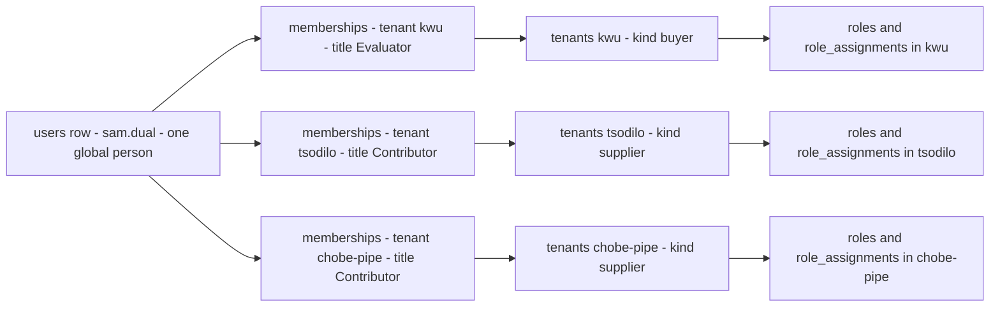
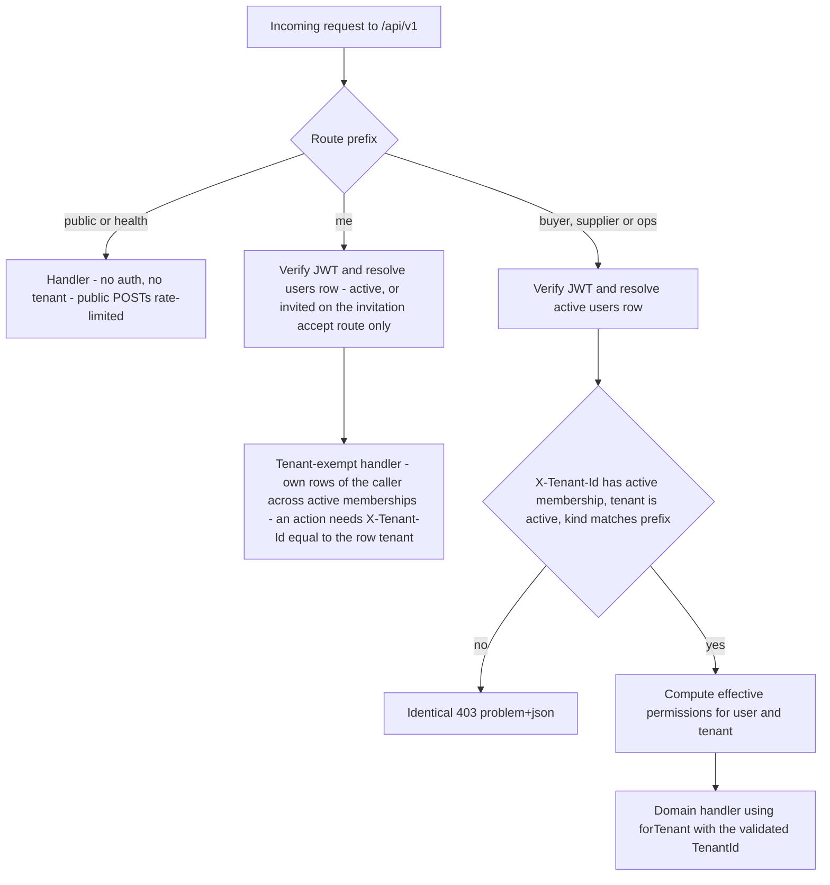

# ADR-0001: Tenancy equals organization

Status: As-designed (pre-build). Updated to as-built at the end of Stage A and Stage B.

Sources:
- `docs/plan/architecture-plan.md`: §3.1 tenancy = organization, §3.2 authorization model, §4 URL map (buyer slug in public URLs, personal `/me/*` pages), §7 UI design system (context confirmation).
- `docs/plan/schema-blueprint.md`: §0 conventions (tags [T]/[G]/[P]/[S]/[R]), Migration 01 (`tenants`, `users`, `memberships`, `invitations`, `roles`, `role_templates`, `permissions`), Migration 02 (`org_settings`), Migration 13 (`subscriptions`, `offboarding_plans`, `service_incident_impacts`, `rate_limit_buckets`), §P permission catalog and role templates.
- `docs/plan/design-decisions.md`: DD-04 `customer_tenant_id` on [G] tables, DD-10 identity defaults, DD-21 `/me` personal inbox, DD-22 public and supplier references, DD-26 role scope matching, DD-27 invitation acceptance, DD-36 shell behaviour.
- `docs/architecture-brief.md`: §5.1 request pipeline (tenant context, step 7), §5.6 tenant scoping (`forTenant`, branded `TenantId`), §5.8 authorization, §6.2 multi-tenant data pattern, §10 frontend (tenant switch).
- `docs/PRD.md`: §2.1 organizational model, §4.1 user roles, §5.1 to §5.3, BR-02, COM-02, AC-02.
- `docs/plan/demo-storyline.md`: organizations and personas (`sam.dual`).

Contents:
1. [Status](#status)
2. [Context](#context)
3. [Decision](#decision)
4. [Consequences](#consequences)
5. [Alternatives considered](#alternatives-considered)
6. [References](#references)

---

## Status

- Status: Accepted (owner approval of the architecture plan, 2026-09-29)
- Date: 2026-09-29
- Deciders: product owner (approval of `docs/plan/architecture-plan.md` and `docs/plan/design-decisions.md` is pending)
- Affects: Stage A (mock API tenant middleware, fixtures, org/capacity switcher) and Stage B (schema, `lib/tenancy`, `lib/db`, `lib/permissions`)

## Context

The architecture brief prescribes a multi-tenant pattern: every tenant-scoped table has a non-null `tenant_id` foreign key to `tenants`, the SPA sends `X-Tenant-Id`, the server validates it against membership and tenant state, and all tenant-scoped queries go through `forTenant(db, tenantId)` (brief §5.1, §5.6, §6.2). The brief does not say what a tenant *is*. TenderIQ has three kinds of parties that each need an isolated workspace:

| Party | PRD basis | What must be isolated |
|---|---|---|
| Buyer organization | §2.1: "the primary boundary for its procurement policies, users, confidential records, supplier assessments, and reporting" | Tenders, deliberations, evaluations, qualification decisions, contracts, policy, users and roles |
| Supplier organization | §2.1: "a business organization, not merely an individual login"; one supplier responds to many buyers | Pursuits, private notes, internal approvals, draft responses, evidence library, supplier users and authority |
| Platform operator | §4.1, §13.3, §21.2: customer accounts, support cases, incidents, help content | Operator users and operator functions; no routine access to customer content |

A single person can belong to several of these. PRD §2.1 states that "an individual may represent more than one organization or act in different capacities" and that "being an employee of a buyer does not authorize that person to see another organization's information when acting as a supplier". BR-02 requires users to act "in an identified organization and capacity", and changing organizations must not transfer permissions or confidential information. AC-02 tests exactly this with one person who belongs to a buyer and two suppliers (`sam.dual` in the demo storyline: evaluator at `kwu`, contributor at `tsodilo` and at `chobe-pipe`).

## Decision

1. **A tenant is an organization.** Every row in `tenants` [G] is one organization with `kind` CHECK (`buyer`, `supplier`, `operator`). This includes:
   - buyer customers (demo: `kwu`, `odc`);
   - supplier organizations, including provisional suppliers created by a buyer (`is_provisional = true`, `created_by_tenant_id` set; FR-02);
   - one operator organization (demo: `tenderiq-ops`).

   `tenants` is authoritative for an organization's `official_time_zone`, `working_languages` and `default_currency`. `org_settings` keeps procurement configuration only, with `accepted_currencies` (DD-10).
2. **A person is global; access to an organization is a membership.** `users` [G] holds one row per person, keyed to Supabase Auth by `auth_user_id`. `memberships` [T] links a user to one tenant, with `unique (tenant_id, user_id)`, a `title` that carries the capacity label (for example "Procurement Officer"), and `status` CHECK (`invited`, `pending_approval`, `active`, `suspended`, `revoked`).
3. **Roles and permissions are per tenant.** The permission catalog (`permissions` [G]) tags each code with a `tenant_kind` (`buyer`, `supplier`, `operator`, `any`). Role templates (`role_templates` [G]) are copied into each tenant as `roles` [T]. Effective permissions are computed per request for the pair (user, active tenant) (plan §3.2). A permission held in one organization has no effect in another. Within a tenant, a role assignment scoped to a legal entity, department, category (including descendants) or project covers a tender when the tender's corresponding column matches. Lots inherit from their tender, and contracts inherit through their tender and also match on their own legal entity (DD-26).
4. **The active tenant is explicit on every request.** The SPA sends `X-Tenant-Id` from the Redux session. The tenant middleware validates it server-side against an active membership and the tenant's state, and returns one identical 403 for every failure (brief §5.1 step 7). There is no ambient "current tenant" in server code (brief §5.6). The org/capacity switcher (COM-02, route `/select-organization`) sets the active tenant, and switching clears all tenant-scoped Redux state (plan §3.1). The SPA remembers the last active tenant per user in `localStorage` as a convenience only. The value is re-validated by `/me/context` before use (DD-36).
5. **The API surface is partitioned by audience.** The tenant middleware also enforces that the active tenant's `kind` matches the route prefix. The Stage A mock API enforces the same rules (plan §3.1, §3.11).

| Route prefix | Authentication | Tenant header | Required tenant `kind` |
|---|---|---|---|
| `/api/v1/public/*` | none | none | none |
| `/api/v1/health` | none | none | none |
| `/api/v1/me/*` | required | exempt | none |
| `/api/v1/buyer/*` | required | required | `buyer` |
| `/api/v1/supplier/*` | required | required | `supplier` |
| `/api/v1/ops/*` | required | required | `operator` |

6. **`/me` is the caller's personal inbox across organizations** (DD-21). `/api/v1/me/tasks`, `/me/notifications`, `/me/approvals/:id`, `/me/documents/:id` and `/me/search` return the caller's own rows across all active memberships, each labelled with its organization. Acting on a row requires `X-Tenant-Id` equal to the row's tenant, so every action still runs in one validated tenant. Global search filters every result by the caller's authorization in the row's tenant. `POST /api/v1/me/invitations/:token/accept` is the one route the auth middleware allows for a user in status `invited` (DD-27).
7. **References are unique per buyer, not globally.** Public URLs therefore carry the buyer slug: `/opportunities/:buyerSlug/:ref`, `/awards/:buyerSlug/:ref` and `/clarifications/:buyerSlug/:ref`. Supplier API paths use tender ids (DD-22).
8. **Consequential actions restate the context.** Before a submission, approval, publication or signature, the UI confirms the acting organization, capacity, scope and result (plan §7, COM-02).

The person-to-organization model:

How a request is admitted:

## Consequences

Positive:
- One isolation mechanism (the `tenant_id` column, the tenant middleware and `forTenant`) serves buyers, suppliers and the operator. Supplier-private work (pursuits, private notes, internal approvals, internal comments) is isolated by the same mechanism, which satisfies PRD §7.6 ("private pursuit notes and draft progress remain invisible to the buyer").
- One person can hold several memberships without duplicate identities (FR-03), and permissions never carry from one organization to another (BR-02, AC-02).
- A person with several memberships still sees one work queue: `/me/*` aggregates their own tasks, notifications, approvals and documents, labelled by organization, while every action is re-validated in the row's tenant (DD-21).
- The operator uses the same authentication, tenant and permission chain as customers. Operator entry into a customer tenant is a separate, explicit and audited mechanism ([ADR-0013](0013-operator-support-access-grants.md)).
- The demo world and Stage A fixtures are organized by tenant slug, persona and tenant kind, so the mock API can reproduce tenant filtering and the identical-403 behavior before any database exists.

Negative:
- A procurement record concerns two organizations (the buyer that runs the event and the supplier that responds). One `tenant_id` cannot express both, so a second scoping column and a second scoper are needed ([ADR-0002](0002-buyer-owned-procurement-records.md)).
- Correctness depends on the active tenant being chosen correctly. The UI must show the current organization and capacity at all times and clear tenant-scoped state on a switch, and the server must re-validate the header on every request. The remembered tenant in `localStorage` is never trusted without re-validation (DD-36).
- The tenant count includes every supplier organization, including provisional ones. That multiplies per-tenant partitions ([ADR-0008](0008-partition-only-high-volume-tables.md)) and the per-tenant iteration performed by cron sweeps (brief §9.4).
- Global tables ([G]: `users`, `tenants`, `category_catalog`, `duplicate_candidates`, `supplier_merges`, `subscriptions`, `support_cases`, `support_access_grants`, `rate_limit_buckets` and others) are outside `forTenant`. Each route that touches them needs its own explicit authorization. [G] tables that name a customer use `customer_tenant_id` rather than `tenant_id` (`subscriptions`, `offboarding_plans`, `service_incident_impacts`, as already on `support_cases` and `support_access_grants`), so the generated tenant-scoped table list never picks them up (DD-04).
- `/me` reads span several tenants in one request. Those handlers must apply the caller's authorization in each row's tenant rather than in one active tenant (DD-21).
- PRD §5.4 requires that "membership of both buyer and supplier organizations must be visible to the appropriate conflict reviewer". A buyer-side reviewer reading a person's supplier memberships is a cross-tenant read. The exact projection that exposes this without revealing unrelated personal information is finalized in Stage B.

## Alternatives considered

| Alternative | Why it was not chosen |
|---|---|
| Tenant = buyer customer only; suppliers as global records with user-level access | Supplier-private collaboration (pursuits, drafts, internal approvals) would need a second isolation mechanism. Supplier permissions (`supplier.*`) and supplier role templates would have no tenant to live in. |
| Separate supplier registration per buyer | PRD §25.2 lists this as an open product decision. Its proposed starting position is "a reusable supplier profile with buyer-specific relationships and selective sharing". Buyer-specific supplier data therefore lives in `buyer_supplier_relationships` [T][R] (buyer-internal, DD-03), not in duplicate supplier tenants. |
| One organization per user account (duplicate accounts per organization) | Breaks AC-02 and FR-03 ("without creating duplicate business identities"), and hides dual-capacity conflicts from reviewers. |
| One Supabase project or database per customer | The brief provides one Supabase project per persistent environment (brief §13). Suppliers would need separate accounts in every buyer's database. |
| One PostgreSQL schema per tenant | The brief prescribes a `tenant_id` column with `LIST (tenant_id)` partitions for large tables (brief §6.2), and the typed `forTenant` helper depends on it. Per-tenant schemas would multiply every migration. |

## References

- Architecture plan §3.1, §3.2, §3.11, §4 (URL map), §7.
- Schema blueprint §0, Migrations 01, 02 and 13, §P.
- Design decision log DD-03, DD-04, DD-10, DD-21, DD-22, DD-26, DD-27, DD-36.
- Architecture brief §5.1, §5.6, §5.8, §6.2, §10, §13.
- PRD §2.1, §4.1, §5.1 to §5.4, BR-02, COM-02, AC-02.
- Related documents: [System context](../01-system-context.md), [Architecture](../02-architecture.md), [Security model](../04-security-model.md), [Platform, identity and access data model](../03-data-model/01-platform-identity-access.md), [API](../07-api.md), [Frontend](../09-frontend.md), [Glossary](../glossary.md).
- Related decisions: [ADR-0002](0002-buyer-owned-procurement-records.md), [ADR-0008](0008-partition-only-high-volume-tables.md), [ADR-0012](0012-supplier-registration-via-provisioned-accounts.md), [ADR-0013](0013-operator-support-access-grants.md).
