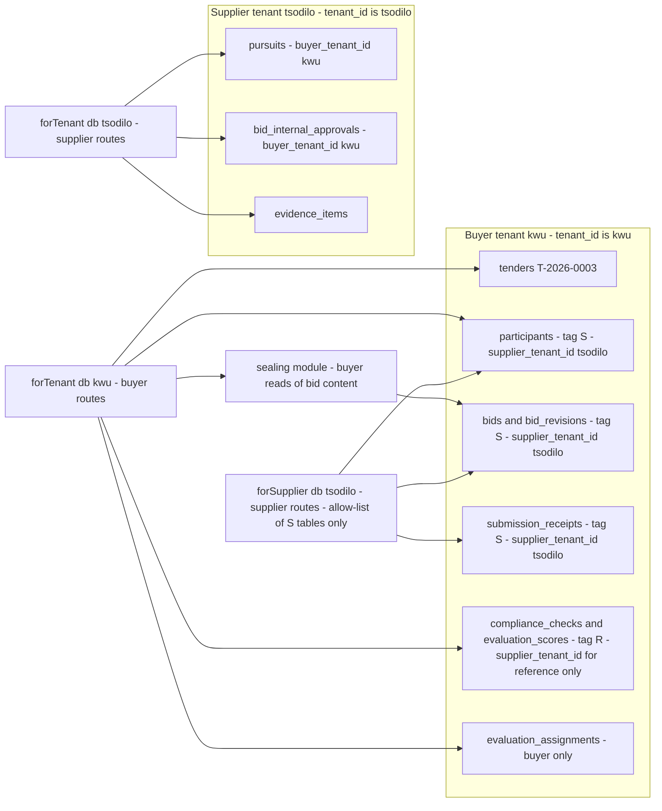

# ADR-0002: Buyer-owned procurement records

Status: As-designed (pre-build). Updated to as-built at the end of Stage A and Stage B.

Sources:
- `docs/plan/architecture-plan.md`: §3.1 cross-tenant records and supplier-private collaboration, §3.3 sealing, §4 cross-domain writes and shared owners.
- `docs/plan/schema-blueprint.md`: §0 conventions ([S] supplier-accessible tag, [R] reference-only tag, generated `supplier-scoped-tables.ts` allow-list), Migration 01 (`audit_log`), Migration 04 (`tasks`, `notice_recipients`, `documents`, `comments`), Migrations 05 and 08 to 12 (every [T][S] and [T][R] table), Migration 09 (`v_bid_receipt_metadata`).
- `docs/plan/design-decisions.md`: DD-03 supplier-scope tags, DD-11 partition tenant of cross-tenant rows, DD-12 storage keys, DD-13 views, DD-16 unowned tables, DD-17 additional cross-domain writes, DD-41 pursuit vs bid intent.
- `docs/architecture-brief.md`: §5.6 tenant scoping and generated table lists, §6.3 isolation in the application layer, §5.9 storage.
- `docs/PRD.md`: §2.1, §4.3 audience and confidentiality matrix, §7.6, §7.9, FR-02, BR-17, BR-38, BR-44, BR-45, BR-47.

Contents:
1. [Status](#status)
2. [Context](#context)
3. [Decision](#decision)
4. [Consequences](#consequences)
5. [Alternatives considered](#alternatives-considered)
6. [References](#references)

---

## Status

- Status: Accepted (owner approval of the architecture plan, 2026-09-29)
- Date: 2026-09-29
- Deciders: product owner (approval of `docs/plan/architecture-plan.md` and `docs/plan/design-decisions.md` is pending)
- Affects: Stage B schema and every domain repository. Stage A fixtures follow the same ownership so the mock API filters the way the backend will.

## Context

[ADR-0001](0001-tenancy-equals-organization.md) makes each organization a tenant. Many procurement records concern two tenants at once: a participant record, a question, a bid and its revisions, a receipt, a compliance finding, a complaint, a contract and its obligations. The buyer runs the process and the supplier contributes to it.

The PRD settles who owns the official record:
- PRD §2.1: "Each buyer owns its own qualification decisions, internal assessments, communications, and procurement records. Those assessments are not visible to other buyers by default."
- PRD §4.3: a participating supplier sees its own draft, its own submitted response and receipt, and its own opened response. Buyers see receipt metadata only until opening. Individual evaluator scores are hidden from participating suppliers.
- BR-38: deactivating a user or account does not erase formal submissions, approvals, contracts or audit records.
- BR-44: after a supplier merge, historical bids and legal parties remain traceable and segregated.
- BR-45: buyer-specific supplier assessments are not shared with unrelated buyers.
- BR-47: customer offboarding follows a continuity plan for live procurements and retained records.

Some supplier work must never reach the buyer at all: pursuit analysis, private notes, internal approvals and internal comments (PRD §7.6, §7.8). Other buyer work about a supplier is buyer-internal: compliance findings, scores, shortlisting, due diligence and negotiation records (DD-03). The supplier learns outcomes through notices and supplier-facing projections, not by reading those records.

## Decision

1. **Procurement records belong to the buyer tenant.** Their `tenant_id` is the buyer tenant. A record that concerns a supplier also carries `supplier_tenant_id bigint not null references tenants(id)`, with one of two tags (blueprint §0, DD-03):
   - **[S] supplier-accessible.** The table is on the explicit allow-list `supplier-scoped-tables.ts`. The allow-list is generated from the blueprint tags, not from column presence.
   - **[R] reference only.** The table carries `supplier_tenant_id` for buyer-internal reference and is never reachable through `forSupplier`. The [R] tables are `buyer_supplier_relationships`, `relationship_contacts`, `reassessment_triggers`, `integrity_screenings`, `envelope_openings`, `compliance_checks`, `exclusions`, `evaluation_scores`, `moderated_scores`, `commercial_evaluations`, `evaluation_results`, `assessment_findings`, `reference_checks`, `shortlist_entries`, `preferred_bidders`, `due_diligence_cases`, `due_diligence_findings`, `negotiations`, `late_submission_exceptions` and `renewal_options`. A guard test asserts that no [R] table is on the allow-list.

   Suppliers learn outcomes only through notices and the supplier-facing projections defined in the contracts (DD-03).
2. **Two typed scopers** (plan §3.1):
   - `forTenant(db, tenantId)` is the buyer-side scoper (brief §5.6).
   - `forSupplier(db, supplierTenantId)` is the supplier-side scoper. It works only on [S] tables in the generated `supplier-scoped-tables` allow-list and applies the `supplier_tenant_id` predicate.
   - When a supplier creates a buyer-owned row, the insert names the buyer `tenant_id` explicitly, and only after the owning service has verified participation (for example an accepted `participants` row).
3. **Supplier-private collaboration belongs to the supplier tenant.** Pursuits, pursuit teams and notes, saved searches, watchlists, notice subscriptions, internal bid approvals and internal bid comments have `tenant_id` equal to the supplier tenant. Where they refer to a buyer they carry `buyer_tenant_id`. The buyer never reads them (plan §3.1). A pursuit decision stays private: the buyer-visible `participants.bid_intent` and `shared_no_bid_reason` change only through the explicit "notify buyer" action on SUP-07 or SUP-09 (DD-41).
4. **Sealed and draft content is protected by the sealing module, not by ownership.** Bid drafts and sealed content physically live in buyer-owned rows. Buyer users reach them only through the sealing module ([ADR-0003](0003-application-layer-sealing.md)), and before opening they see `v_bid_receipt_metadata` only, which never includes drafts (DD-13). Buyer queries on `qualification_applications` always exclude `draft` (blueprint Migration 05).
5. **Each table has one owning domain, and cross-domain writes are listed** (plan §4). The bids domain owns every bid, revision and receipt row, including `round_type = 'bafo' | 'next_stage'`. Other domains write another domain's table only through the listed cross-domain writes, inside the triggering transaction and audited. Those that touch cross-tenant records:
   - opening sets `bids.compliance_status` and `submission_receipts.status = 'selected_for_evaluation'`; evaluation sets `bids.evaluation_status` (DD-17);
   - bids, selection, contracts and qualification append `evidence_submissions` snapshots through the suppliers-owned helper `snapshotEvidence()` (DD-17);
   - suppliers create buyer-created provisional supplier `tenants` rows (DD-17).

   Shared tables have named owners: `tasks` belongs to the approvals service, and `comments`, `holds`, `record_snapshots` and `process_decisions` belong to the core (lifecycle) service (DD-16).
6. **A cross-tenant record has one owner for audit and storage.**
   - `audit_log` rows go to the partition of the tenant that owns the affected record. A supplier submitting a bid on a buyer-owned row is audited in the buyer's partition, with `actor_capacity` naming the supplier organization (DD-11).
   - Storage keys are `<owning-record tenant_id>/<related_type>/<related_id>/<document_id>/<version_no>-<sanitized name>`. The buyer tenant owns procurement records even for supplier uploads, and `documents.owner_tenant_id` records who uploaded (DD-12).

Ownership by record family:

| Record family | `tenant_id` | Second party column | Examples (blueprint) |
|---|---|---|---|
| Buyer procurement records accessible to the supplier [T][S] | buyer | `supplier_tenant_id` | `participants`, `questions`, `bids`, `bid_revisions`, `submission_attempts`, `submission_receipts`, `bid_clarifications`, `lot_outcomes`, `complaints`, `contracts`, `obligations`, `qualification_applications`, `qualification_decisions`, `notice_recipients` |
| Buyer-internal records that name a supplier [T][R] | buyer | `supplier_tenant_id` (reference only) | `buyer_supplier_relationships`, `envelope_openings`, `compliance_checks`, `exclusions`, `evaluation_scores`, `moderated_scores`, `evaluation_results`, `shortlist_entries`, `preferred_bidders`, `due_diligence_cases`, `negotiations`, `renewal_options` (full list in point 1) |
| Buyer-internal records [T] | buyer | none | `evaluation_assignments`, `price_gate_releases`, `moderation_sessions`, `award_recommendations`, `standstill_periods`, `final_offer_rounds`, `handovers` |
| Supplier-private records [T] | supplier | `buyer_tenant_id` where needed | `pursuits`, `pursuit_team_members`, `pursuit_notes`, `saved_searches`, `watchlist_items`, `notice_subscriptions`, `bid_internal_approvals`, `bid_internal_comments` |
| Supplier-owned reusable records [T] | supplier | `buyer_tenant_id` on shares | `supplier_profiles`, `evidence_items`, `evidence_shares` |
| Immutable evidence used in a buyer process [T][S] | buyer | `supplier_tenant_id` | `evidence_submissions` (which edition of an evidence item was used, FR-02), appended through `snapshotEvidence()` (DD-17); `qualification_answer_evidence` links answers to them and is also [S] (DD-03) |
| Files | owner of the related record | `owner_tenant_id` records who uploaded | `documents`, `document_versions`. The storage key is prefixed with the owning record's `tenant_id`, which is the buyer for procurement records even when a supplier uploads (DD-12). |
| Work items | whichever side does the work | none | `tasks` (approvals service) and `comments` (core service, `visibility = 'supplier_internal'`) use the supplier `tenant_id` for supplier work (DD-16) |

Documented exceptions to the [S] rule (blueprint): `lot_outcomes.supplier_tenant_id` is nullable only for `no_award` and `cancelled` outcomes. `notice_recipients.supplier_tenant_id` holds the buyer tenant id when the recipient is a buyer-internal user.

`forSupplier` has no path to the [R] table in the diagram. The supplier learns the outcome of a compliance check or an evaluation only through a notice or a supplier-facing projection.

## Consequences

Positive:
- The buyer's complete record for an event (issued versions, participants, receipts, openings, evaluation, award, contract) sits in one tenant. Per-tenant controls apply to all of it without cross-tenant joins: retention classes, holds and disposal (BR-40), exports and evidence packs, customer offboarding (BR-47), audit (one partition, DD-11) and storage (one key prefix, DD-12).
- Buyer-to-buyer segregation (BR-45) follows from ownership. A supplier's rows for buyer A are in buyer A's tenant, and buyer B's `forTenant` cannot reach them.
- The supplier sees its own records through a typed scoper, never through the buyer's scoper. It can query only [S] tables on the generated allow-list. [R] tables such as `evaluation_scores` and `compliance_checks` are unreachable from supplier routes, and a guard test keeps them off the allow-list (DD-03).
- Supplier account changes cannot remove the buyer's record (BR-38). Merges never re-point records (`supplier_merges`), so historical bids keep their original legal party (BR-44).
- Supplier-private work stays in the supplier tenant, so no buyer query path exists for it. The buyer-visible bid intent changes only when the supplier deliberately notifies the buyer (DD-41).

Negative:
- Supplier drafts (draft `bid_revisions` and their sealed child rows, and draft `qualification_applications`) are stored in buyer-owned rows. Keeping them from buyers depends entirely on application code: the sealing module, draft exclusion in buyer queries, and the guard tests. The database provides no row-level barrier ([ADR-0003](0003-application-layer-sealing.md)).
- There are two scopers and two generated table lists to maintain, plus an explicit-buyer-id insert path that needs integration tests for participation checks and tenant isolation (plan §8). Every new table that carries `supplier_tenant_id` needs a deliberate [S] or [R] tag, because the allow-list comes from the tags and not from the column (DD-03).
- Supplier-wide views such as the supplier dashboard (SUP-01) span many buyer tenants, so they filter on `supplier_tenant_id` rather than `tenant_id`. `supplier_tenant_id` is a foreign key and therefore indexed (blueprint §0: every FK column is indexed).
- An [S] tag means the table is *reachable* through `forSupplier`, not that every column is shown to the supplier. Buyer-internal columns on [S] tables are hidden by the supplier-facing projections defined per endpoint in the Stage A contracts ([API](../07-api.md)). Tables whose whole content the PRD hides from suppliers, for example `evaluation_scores`, `moderated_scores` and `evaluation_results` (PRD §4.3), are [R] and not reachable at all (DD-03).
- Open details from the original sources, now settled:
  - Resolved — DD-11: a supplier action on a buyer-owned row is audited in the partition of the tenant that owns the record (the buyer), with `actor_capacity` naming the supplier organization.
  - Resolved — DD-12: storage keys are prefixed with the owning record's `tenant_id` (the buyer for procurement records, even for supplier uploads), and `documents.owner_tenant_id` records who uploaded.

## Alternatives considered

| Alternative | Why it was not chosen |
|---|---|
| Supplier-owned responses (`bids.tenant_id` = supplier) with buyer access across tenants | The buyer's official record (receipt, opening, compliance, evaluation references) would be split across tenants. Retention, holds, exports and offboarding would need cross-tenant reads for every event. The supplier account lifecycle would affect the buyer's evidence. |
| Duplicate rows per party (a buyer copy and a supplier copy) | Two copies of an official receipt or submission could diverge. FR-12 requires "an unambiguous official response record". |
| A neutral shared tenant per procurement | Adds a tenant kind outside the model in ADR-0001. There would be no accountable owner for retention, holds or disposal (BR-01, BR-40). |
| Database row-level security policies for cross-party access | Not the isolation mechanism under brief §6.3; see [ADR-0003](0003-application-layer-sealing.md). |
| Supplier-scoped table list generated from the presence of `supplier_tenant_id` | Every buyer-internal table that names a supplier (scores, compliance findings, due diligence, negotiations) would become reachable from supplier routes. The allow-list is generated from the [S] tags instead (DD-03). |

## References

- Architecture plan §3.1, §3.3, §4 (cross-domain writes and shared owners).
- Schema blueprint §0, Migrations 01, 04, 05, 08, 09, 10, 11, 12.
- Design decision log DD-03, DD-11, DD-12, DD-13, DD-16, DD-17, DD-41.
- Architecture brief §5.6, §5.9, §6.3.
- PRD §2.1, §4.3, §7.6, §7.8, §7.9, FR-02, FR-12, BR-17, BR-38, BR-40, BR-44, BR-45, BR-47.
- Related documents: [Data model overview](../03-data-model/README.md), [Bids and submission](../03-data-model/08-bids-submission.md), [Opening and evaluation](../03-data-model/09-opening-evaluation.md), [Participation and clarifications](../03-data-model/07-participation-clarifications.md), [Suppliers and qualification](../03-data-model/04-suppliers-qualification.md), [Security model](../04-security-model.md).
- Related decisions: [ADR-0001](0001-tenancy-equals-organization.md), [ADR-0003](0003-application-layer-sealing.md), [ADR-0008](0008-partition-only-high-volume-tables.md).
