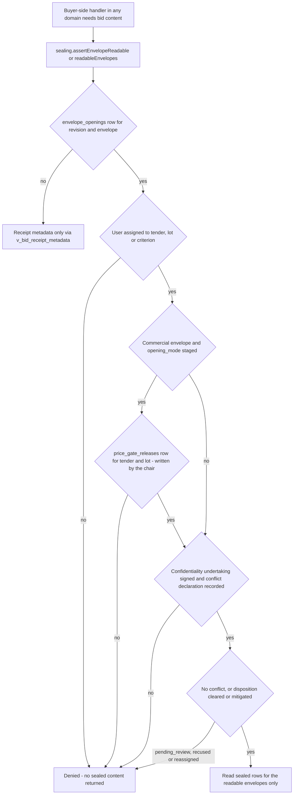
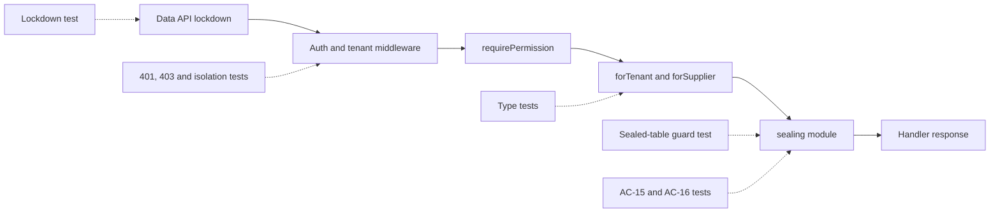

# ADR-0003: Application-layer sealing instead of row-level security

Status: As-designed (pre-build). Updated to as-built at the end of Stage A and Stage B.

Sources:
- `docs/architecture-brief.md`: §1 (RLS listed as "explicitly not used" as the primary isolation mechanism), §5.1 request pipeline, §5.6 database access (pooler, no session state, tenant scoping), §5.7 browser uses supabase-js only for auth, §6.3 Data API lockdown, §11 architecture and guard tests.
- `docs/plan/architecture-plan.md`: §3.1 cross-tenant records and operator support access, §3.2 event-level access, §3.3 sealing and staged opening, §4 shared owners (`price_gate_releases` → evaluation), §8 testing strategy (sealed-table guard), §11 deviations (none for sealing).
- `docs/plan/schema-blueprint.md`: Migration 01 (`audit_log.sensitivity`), Migration 02 (`conflict_declarations`, `confidentiality_undertakings`), Migration 07 (`tenders.opening_mode`, `tender_envelopes`, `tender_team_members`), Migration 09 (tables marked SEALED with their envelopes, `receipt_inventory_items.envelope`, `v_bid_receipt_metadata`), Migration 10 (`opening_sessions`, `envelope_openings`, `price_gate_releases`, `evaluation_assignments`), Migration 14 (views; revoke from `anon` and `authenticated`), §P (`evaluation.chair`, `audit.view`).
- `docs/plan/design-decisions.md`: DD-05 sealed envelope mapping, DD-13 views, DD-16 unowned tables (`price_gate_releases`), DD-23 permission catalog additions (price-gate release uses `evaluation.chair`), DD-25 conflict gating, DD-31 audit content for sealed records.
- `docs/PRD.md`: §4.3, §7.10, §7.11, FR-13, FR-14, BR-08, BR-17, BR-26, AC-15, AC-16.

Contents:
1. [Status](#status)
2. [Context](#context)
3. [Decision](#decision)
4. [Why row-level security is not the primary mechanism](#why-row-level-security-is-not-the-primary-mechanism)
5. [How the sealing module and guard tests compensate](#how-the-sealing-module-and-guard-tests-compensate)
6. [Consequences](#consequences)
7. [Alternatives considered](#alternatives-considered)
8. [References](#references)

---

## Status

- Status: Accepted (owner approval of the architecture plan, 2026-09-29)
- Date: 2026-09-29
- Deciders: product owner (approval of `docs/plan/architecture-plan.md` and `docs/plan/design-decisions.md` is pending)
- Affects: Stage B (`src/server/domains/sealing/`, every buyer-side domain that reads bid content, guard tests, audit writes for sealed actions). Stage A fixtures and mock handlers apply the same visibility boundaries.

## Context

Sealed-bid integrity is a baseline control. PRD §1.3 expects "zero unauthorized disclosure of sealed bid content". BR-17 states that buyer personnel cannot inspect supplier drafts and that submitted content stays sealed until the relevant opening gate. AC-15 requires that a buyer administrator or support agent gets no early access. AC-16 requires that prices stay unavailable until the non-price assessment gate and the opening authorization are both complete. BR-08 requires conflict declarations and confidentiality undertakings before any access to restricted assessment material. BR-26 makes access depend on assignment, not on organization administration.

Under [ADR-0002](0002-buyer-owned-procurement-records.md), bid content is stored in buyer-owned rows (`tenant_id` = buyer). Tenant scoping alone would therefore let any buyer user with a tender permission read it. The blueprint marks eight tables as SEALED, and the design decision log fixes the envelope each one belongs to (DD-05):

| Table | Envelope |
|---|---|
| `bid_answers` | Copied from the requirement (`requirements.envelope`) into `bid_answers.envelope` |
| `bid_answer_documents` | Follows its parent answer |
| `bid_prices` | `commercial` |
| `bid_commercial_terms` | `commercial` |
| `bid_declarations` | `qualification` |
| `bid_subcontractors` | `technical` |
| `bid_key_personnel` | `technical` |
| `bid_exceptions` | `commercial` |

`receipt_inventory_items.envelope` records the envelope of each submitted file, and every envelope column has a CHECK (`qualification`, `technical`, `commercial`) (DD-05).

Resolved — DD-05: the envelope of the tables that had no envelope note in the original sources is fixed by the mapping above (this detail was previously left to Stage B).

## Decision

1. **Only the sealing module unseals.** The shared `sealing` module (`src/server/domains/sealing/`) exposes `sealing.assertEnvelopeReadable()` and `readableEnvelopes()`. Buyer users read sealed tables only through them. A read is allowed only when all of these hold (plan §3.3):
   1. an `envelope_openings` row exists for the bid revision and envelope (the unseal record, `unique (revision_id, envelope)`). A single-stage opening (`opening_sessions.envelope = 'all'`) writes one `envelope_openings` row per envelope in the same transaction (DD-05);
   2. the user is assigned to the tender, lot or criterion (`tender_team_members`, `evaluation_assignments`);
   3. for a commercial envelope under staged opening (`tenders.opening_mode = 'staged'`), a `price_gate_releases` row exists for the tender and lot. The evaluation domain owns that table, and the evaluation chair writes it with permission `evaluation.chair` (DD-16, DD-23);
   4. the user has a signed `confidentiality_undertakings` row and a `conflict_declarations` row for the subject, and the declaration does not block access. A declaration with `has_conflict = true` blocks restricted access while its `disposition` is `pending_review`. Access resumes only on `cleared` or `mitigated`, and `recused` or `reassigned` block access permanently for that subject (DD-25).
2. **Before opening, buyers see receipt metadata only.** The only buyer-side projection before opening is `v_bid_receipt_metadata`. It exposes `tenant_id` (for `forTenant`), `supplier_tenant_id`, the supplier legal name valid at `received_at` (from `supplier_legal_names`), the bid, the effective receipt number, `received_at`, the status (including withdrawn, never drafts) and the document count. It never exposes content (blueprint Migration 09, DD-13).
3. **Drafts are never visible to buyers**, whether or not an opening has happened.
4. **A guard test fails if any module other than the sealing module reads sealed tables** (plan §3.3, §8).
5. **Audit rows never carry sealed content.** `audit_log.before_state` and `after_state` never contain sealed content or evaluator scores. Those actions record ids and hashes only, with `sensitivity = 'restricted'`. The audit viewer shows restricted rows only to `audit.view` holders, redacted to metadata (DD-31).
6. **Support access never includes sealed content** ([ADR-0013](0013-operator-support-access-grants.md)).
7. **Stage A fixtures respect the same boundaries.** A buyer persona's sealed bid view shows receipt metadata only, and opened content appears only for assigned personas (plan §3.3).
8. **Row-level security is not adopted as the isolation mechanism.** The brief allows it to be added later as defense in depth (brief §6.3). This release does not include it.

The read gate:

Resolved — DD-25: the conflict disposition that permits access is fixed. A declared conflict blocks access while `pending_review`, access resumes only on `cleared` or `mitigated`, and `recused` or `reassigned` block access permanently for that subject (this was previously left to Stage B under BR-08 and PRD §5.4).

## Why row-level security is not the primary mechanism

1. **The brief rules it out.** Brief §1 lists "Postgres RLS as the primary isolation mechanism" under "Explicitly not used". Brief §6.3 states that tenant isolation is enforced in the application layer (middleware, `forTenant` helpers and integration tests) and that RLS "could be added later as defense in depth". The architecture plan follows the brief literally unless §11 records an approved deviation, and §11 lists none for isolation.
2. **The browser has no data path to protect.** RLS mainly protects the PostgREST Data API, which runs queries as the browser's `anon` or `authenticated` role. Here the browser uses supabase-js for authentication only (brief §5.7, §10). The final migration revokes every privilege on `public` from `anon` and `authenticated`, including default privileges (blueprint Migration 14). An integration test checks the live catalog with both `has_table_privilege` and `role_table_grants` (brief §6.3). The only reader of sealed tables is server code.
3. **The requesting user is not a database identity.** All request traffic uses one connection string through the Supavisor transaction pooler (brief §5.6). Session state is forbidden: no bare `SET`, no session advisory locks, no `LISTEN/NOTIFY`. For RLS policies to see the requesting user, assignments and grants, every query would have to run inside a transaction that first injects that identity with `SET LOCAL`. That is a second, implicit tenancy channel beside the explicit `TenantId` argument, which the brief keeps free of ambient state (brief §5.6: "There is no ambient or global 'current tenant'").
4. **The sealing rule is multi-table state, not a row attribute.** Readability depends on four other tables: the opening record, the assignment, the price-gate release and the declarations. It also depends on the tender's opening mode and on the declaration's disposition, and it differs between the supplier (who sees its own content) and the buyer. Expressed as policies, this becomes correlated subqueries evaluated for every row read, with no way to return the receipt-metadata projection or a structured problem+json reason. In TypeScript it is a pure, unit-testable function behind one module boundary.
5. **Silent filtering hides the reason.** A policy that filters rows makes a sealed bid look the same as no bid. The application needs to say "sealed until opening" and show receipt metadata (BUY-19), and it needs to audit privileged cross-tenant access before the handler runs (brief §5.1).

## How the sealing module and guard tests compensate

Without a database-level barrier, the control is layered. Each layer has its own test.

| Layer | Mechanism | Verified by |
|---|---|---|
| No browser data path | Revoke all on `public` from `anon` and `authenticated` (Migration 14) | Data API lockdown integration test (brief §6.3, §11) |
| Authenticated, validated context | JWT verification, active `users` row, `X-Tenant-Id` membership check with an identical 403 | Per-endpoint 401, 403 and tenant-isolation integration tests (plan §8) |
| Declared permission per endpoint | `requirePermission(code)`. Every contract endpoint declares its `permission`. | Mock API permission tests (Stage A). Integration tests (Stage B). |
| Typed scoping | `forTenant` and `forSupplier`. The branded `TenantId` makes an unscoped query fail to compile. `forSupplier` reaches only [S] tables, never [R] tables such as `envelope_openings` or `evaluation_scores` (DD-03). | Type tests with `@ts-expect-error` (brief §5.6, §11). Guard test that no [R] table is on the supplier allow-list (DD-03). |
| Single unseal path | `sealing.assertEnvelopeReadable()` and `readableEnvelopes()` implementing the four conditions | Unit tests of the rule. Acceptance tests AC-15 and AC-16 (plan §8: at least one `AC-xx` integration test per scenario). |
| No bypass | Guard test that fails if any other module reads sealed tables | Architecture guard suite (plan §8, "sealed-table guard") |
| Pre-opening projection | `v_bid_receipt_metadata` as the only buyer view before opening | Integration tests on BUY-19 endpoints |
| Evidence of privileged access | Cross-tenant access by privileged internal users is audited before the handler runs | Integration tests on support access ([ADR-0013](0013-operator-support-access-grants.md)) |
| Same boundaries in the prototype | Fixtures return receipt metadata to unassigned buyer personas | Stage A mock-API and Playwright tests (plan §3.3, §8) |

The exact guard mechanism and its allow-list are finalized in Stage B. The mechanism is expected to be a source scan like the brief's other guards. The allow-list must cover at least the sealing module and the bids domain's supplier-side draft editing paths, which have to read and write the same tables.

## Consequences

Positive:
- One small module holds the complete unseal rule. It can be reviewed, unit-tested row by row and audited.
- Error semantics fit the product: receipt metadata before opening, and explicit denial reasons afterward.
- The rule is expressed in the same language and types as the contracts. The Stage A prototype can reproduce the visible behavior of AC-15 and AC-16 before any database exists.
- There is no hidden per-transaction identity state, so the brief's pooling rules (no session state, `max: 2` pool) stay intact.
- The audit trail cannot become a side channel for sealed content or scores: sealed actions are recorded as ids and hashes with `sensitivity = 'restricted'`, and even `audit.view` holders see those rows redacted to metadata (DD-31).

Negative:
- Correctness depends on every buyer read path going through the module. A new query in another module can leak content unless the guard test catches it. Dynamic SQL built from strings can evade a source scan, so typed Kysely table references and code review remain part of the control.
- Nothing in the database stops a server bug from reading sealed rows. The protection is only as strong as the guard and integration tests.
- Every audited action on sealed records or scores must build its audit entry from ids and hashes rather than from row states (DD-31).
- Neither this design nor RLS stops people who hold privileged database credentials (`SUPABASE_DIRECT_DATABASE_URL`, or Studio access to a hosted project). That exposure is controlled operationally: secrets live in Doppler, and the Production GitHub environment has required reviewers (brief §8.3).
- Adding RLS later as defense in depth would need per-transaction identity injection (`SET LOCAL`) across all request traffic. That is a separate decision.

## Alternatives considered

| Alternative | Why it was not chosen |
|---|---|
| RLS policies as the primary isolation and sealing mechanism | Excluded by brief §1 and §6.3. See [Why row-level security is not the primary mechanism](#why-row-level-security-is-not-the-primary-mechanism). |
| RLS as an additional layer in this release | Allowed later by brief §6.3, but not in the approved plan. It needs identity injection on every transaction, and its value is limited because the Data API path is already closed. |
| Encrypting sealed content at rest with keys released at opening | No custom cryptography (brief §14). The design has no key-management component, and none is approved. |
| Separate storage for sealed content (another schema or database) | Adds a second data store outside the brief's platform. Opening, evaluation and audit would need cross-store transactions. |
| Letting each domain check the opening conditions itself | Scatters the rule across evaluation, opening, selection, awards and reporting. Any one of them could drift or skip a condition. |

## References

- Architecture brief §1, §5.1, §5.6, §5.7, §6.3, §8.3, §10, §11, §14.
- Architecture plan §3.1, §3.2, §3.3, §4, §8.
- Schema blueprint Migrations 01, 02, 07, 09, 10, 14, §P.
- Design decision log DD-03, DD-05, DD-13, DD-16, DD-23, DD-25, DD-31.
- PRD §1.3, §4.3, §5.4, §7.10, §7.11, FR-13, FR-14, BR-08, BR-17, BR-26, AC-15, AC-16.
- Related documents: [Security model](../04-security-model.md), [Opening and evaluation data model](../03-data-model/09-opening-evaluation.md), [Bids and submission data model](../03-data-model/08-bids-submission.md), [Key flows](../06-key-flows.md), [Testing strategy](../11-testing-strategy.md).
- Related decisions: [ADR-0002](0002-buyer-owned-procurement-records.md), [ADR-0013](0013-operator-support-access-grants.md).
