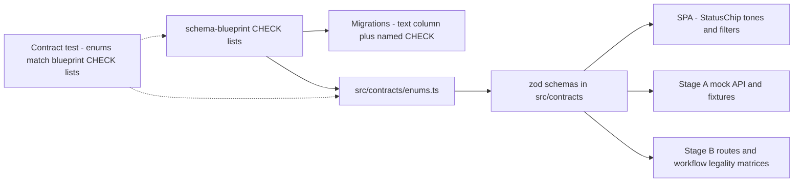

# ADR-0004: Text columns with CHECK constraints instead of PostgreSQL enum types

Status: As-designed (pre-build). Updated to as-built at the end of Stage A and Stage B.

Sources:
- `docs/plan/schema-blueprint.md`: §0 conventions ("Enumerations are `text` + a named `CHECK (col in (...))` constraint ... PG enum types are not used"), every table's CHECK lists.
- `docs/plan/architecture-plan.md`: §3.6 state machines (state enums defined once in `src/contracts/enums.ts`), §3.10 contracts-first API, §8 testing strategy (enums match the blueprint CHECK lists).
- `docs/plan/design-decisions.md`: DD-06 missing CHECK lists and types, DD-14 approval subject types, DD-40 deferred procedure value.
- `docs/architecture-brief.md`: §5.6 generated DB types, §6.1 migration rules (append-only, forward-only, idempotent enough to run twice), §6.5 schema validation.
- `docs/PRD.md`: §8 lifecycle states and transition gates (state labels may be localized; meaning stays consistent).

Contents:
1. [Status](#status)
2. [Context](#context)
3. [Decision](#decision)
4. [Consequences](#consequences)
5. [Alternatives considered](#alternatives-considered)
6. [References](#references)

---

## Status

- Status: Accepted (owner approval of the architecture plan, 2026-09-29)
- Date: 2026-09-29
- Deciders: product owner (approval of `docs/plan/schema-blueprint.md`, `docs/plan/architecture-plan.md` and `docs/plan/design-decisions.md` is pending)
- Affects: Stage A (`src/contracts/enums.ts`, contract tests) and Stage B (every migration that defines a classification or lifecycle column)

## Context

TenderIQ has a large number of closed value lists:
- the lifecycle states from PRD §8 (request, tender, lot, qualification application and status, supplier response, evaluation assignment, approval request, complaint, contract, obligation, change request);
- classifications such as document classification, envelope, procedure, hold type, notice type and approval subject type.

These lists will grow. PRD §22 describes operational breadth and optional extensions to be added after the core release, and procedures such as frameworks and call-offs are deferred (plan §2). The lists already grew once before any SQL was written: the design decision log added the approval subject types `obligation_waiver`, `security_release`, `dispute_decision`, `contract_difference` and `final_award` (DD-14).

The brief makes migrations append-only and forward-only. An applied migration is never edited, rollback means a corrective migration, and every migration must be "idempotent enough to run twice from empty" because `db:validate` resets the database twice (brief §6.1, §6.5).

The same values must also be identical in four places: the database, the backend, the Stage A mock API and the SPA. Otherwise a state the UI does not know about (or a `StatusChip` tone with no matching state) becomes a runtime defect.

## Decision

1. **Every enumerated column is `text` with a named CHECK constraint** of the form `CHECK (col in (...))` (blueprint §0). PostgreSQL enum types are not used. The naming pattern for the constraints is finalized when the Stage B schema agents write the SQL. The design decision log closed the gaps where a list was missing (DD-06):
   - `tenders.award_model` CHECK (`single`, `per_lot`, `multiple`);
   - `evaluation_criteria.envelope` CHECK (`technical`, `commercial`, `qualification`);
   - `job_run.status` CHECK (`running`, `succeeded`, `failed`). There is no `not_implemented` value: an unimplemented job writes `failed` and returns 501, as the brief requires;
   - `requirements.evidence_required` is free `text` (null = none), not an enumerated column.
2. **Widening a list is a forward-only migration.** The migration drops the named constraint and adds it again with the extended list.
3. **The application's single source of truth is `src/contracts/enums.ts`.** It mirrors the blueprint CHECK lists and is imported by the SPA, the mock API and the backend through the zod contracts (plan §3.6, §3.10). A value can stay in a CHECK list for the future without being offered: `framework_calloff` remains in the database CHECK lists (`procurement_strategies.procedure` and `tenders.procedure`), but no contract enum used for writes offers it, and it never appears in the UI (DD-40).
4. **Drift is caught by tests.** A Stage A contract unit test asserts that the enums match the blueprint CHECK lists (plan §8). Whether Stage B adds the same comparison against the live catalog's constraint definitions is finalized in Stage B.
5. **Stored values are stable codes.** Displayed labels are separate and may be localized (PRD §8.3).

## Consequences

Positive:
- Adding a value is a routine migration that drops and re-adds one named constraint. No type has to be recreated and no dependent columns or functions have to be rewritten.
- `create table if not exists` with inline CHECK constraints stays idempotent. PostgreSQL has no `IF NOT EXISTS` form of `CREATE TYPE ... AS ENUM`, so enum types would need guard blocks to satisfy the run-twice rule.
- Removing or renaming a value is possible as a controlled data migration followed by a narrower constraint. With a native enum, dropping a value requires recreating the type.
- A deferred value can be kept in the database without exposing it. The write enums in the contracts decide what the product offers, and the CHECK list decides what the database accepts (DD-40).
- One list in `enums.ts` drives UI rendering, mock validation and backend legality matrices (`canTransition(from, to, ctx)`, plan §3.6), so the three cannot drift silently.

Negative:
- The generated Supabase types type these columns as `string`, not as literal unions (brief §5.6). Domain code narrows to the contract enum types at the repository or schema boundary. Nothing in the generated DB types enforces the narrowing.
- The list exists in two representations, SQL and TypeScript. Keeping them equal depends on tests, not on the type system. `framework_calloff` is the one documented difference between a CHECK list and the write enums (DD-40), so the drift test in decision 4 must allow for it.
- Re-adding a CHECK constraint validates existing rows while holding a lock on the table. On large tables the constraint can be added `NOT VALID` and validated separately.
- Some array columns take their elements from fixed lists, for example `policy_profile_versions.permitted_procedures`, `delegations.decision_types` and `holds.blocked_actions`. Whether these carry element-level CHECK constraints is not stated in the blueprint and is finalized in Stage B.

## Alternatives considered

| Alternative | Why it was not chosen |
|---|---|
| PostgreSQL enum types | Values cannot be removed or reordered without recreating the type. A newly added value cannot be used in the same transaction that adds it. `CREATE TYPE` has no idempotent form. All three conflict with forward-only, run-twice migrations (brief §6.1). |
| Lookup tables with foreign keys for every list | Suited to tenant-configurable lists (brief §6.2), which the blueprint does use (categories, cost centers, funding sources). Lifecycle states are code-owned and drive state machines, so a join table adds queries without adding configurability. |
| Unconstrained `text` validated only in the application | Allows invalid states through scripts, imports or future code paths, and the database stops documenting the allowed values. |
| Smallint codes | Unreadable in audit before/after snapshots, SQL diagnostics and exports. Adds a mapping layer to every boundary. |

## References

- Schema blueprint §0 and all Migration sections.
- Design decision log DD-06, DD-14, DD-40.
- Architecture plan §3.6, §3.10, §8.
- Architecture brief §5.6, §6.1, §6.2, §6.5.
- PRD §8, §22.
- Related documents: [Lifecycles](../05-lifecycles.md), [Data model overview](../03-data-model/README.md), [API](../07-api.md), [Testing strategy](../11-testing-strategy.md).
- Related decisions: [ADR-0006](0006-contracts-first-ui-prototype-stage.md).
