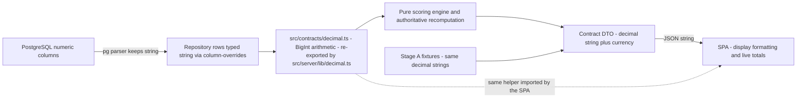

# ADR-0005: Decimal strings for money, quantities, rates and scores

Status: As-designed (pre-build). Updated to as-built at the end of Stage A and Stage B.

Sources:
- `docs/plan/architecture-plan.md`: §1 (money always carries its currency code), §3.7 money and scoring (shared decimal helper `src/contracts/decimal.ts`), §3.10 (`common.ts` `Money`), §4 (`lib/decimal.ts` re-exports the contracts helper), §11.2 (no new runtime dependencies beyond the brief), §11.3 (`nodemailer` as the one added runtime dependency).
- `docs/plan/schema-blueprint.md`: §0 conventions (numeric precisions, currency CHECK), Migration 02 (`exchange_rates.rate numeric(18,8)`), Migration 05 (`qualification_applications.scope_currency`, `qualification_decisions.scope_currency`), Migration 07 (`evaluation_plans` decimal places, `evaluation_criteria.max_points`), Migration 10 (`evaluation_scores.score`, `commercial_evaluations`, `evaluation_results`), Migration 12 (`change_requests.currency`).
- `docs/plan/design-decisions.md`: DD-08 currency on amounts, DD-24 approver permissions (cross-currency authority), DD-32 browser decimals, DD-44 email channel (`nodemailer` is the one approved added runtime dependency).
- `docs/architecture-brief.md`: §4.3 runtime dependencies, §5.6 type parsers ("`numeric` stays a string because money must not pass through floating point"; `int8` throws above `MAX_SAFE_INTEGER`), generated `column-overrides.ts`.
- `docs/PRD.md`: §3 (distinct amount kinds), §7.11, §9.2 illustrative weighted model, §9.3 calculation and ranking behavior, BR-29, AC-18, AC-19.
- `docs/plan/demo-storyline.md`: T-2026-0003 scoring fixture.

Contents:
1. [Status](#status)
2. [Context](#context)
3. [Decision](#decision)
4. [Consequences](#consequences)
5. [Alternatives considered](#alternatives-considered)
6. [References](#references)

---

## Status

- Status: Accepted (owner approval of the architecture plan, 2026-09-29)
- Date: 2026-09-29
- Deciders: product owner (approval of `docs/plan/architecture-plan.md` and `docs/plan/design-decisions.md` is pending)
- Affects: Stage A (`src/contracts/common.ts` `Money`, `src/contracts/decimal.ts`, fixtures, SPA formatting and live totals) and Stage B (`src/server/lib/decimal.ts` re-export, the scoring engine, repositories, generated `column-overrides.ts`)

## Context

Procurement decisions turn on exact arithmetic:
- PRD §9.2 fixes a worked example that must reproduce exactly (AC-19). Supplier A scores 86.00 and Supplier B 88.00. B's price score is `100,000 / 120,000 x 30 = 25`, and the 120,000 offer ranks first.
- PRD §9.3 requires declared decimal places for calculation, display and tie decisions. "A display-rounded tie must not obscure different decision values."
- A missing evaluator score must not be treated as zero (AC-18).
- PRD §3 distinguishes estimate, approved budget, submitted price, evaluated cost, intended award, actual award, contract ceiling, committed spend and paid spend, "and must not be presented interchangeably". BR-29 requires corrections, conversions and adjustments to stay distinguishable from the supplier's original offer.

JavaScript `number` is an IEEE 754 double and cannot represent most decimal fractions exactly. The brief already configures `pg` so that `numeric` values arrive as strings and `int8` values throw above `Number.MAX_SAFE_INTEGER` (brief §5.6). New runtime dependencies are not permitted beyond the brief's list (brief §4.3, §14; plan §11.2). The single owner-approved exception is `nodemailer` for the email channel (DD-44, [ADR-0010](0010-no-icon-or-pdf-dependencies.md)), which has nothing to do with arithmetic.

## Decision

1. **Fixed SQL precisions** (blueprint §0):

| Kind | SQL type | Examples |
|---|---|---|
| Money | `numeric(18,2)` | `procurement_requests.estimated_value`, `tenders.budget_amount`, `bid_prices.unit_price`, `bid_prices.line_total`, `commercial_evaluations.evaluated_cost`, `lot_outcomes.awarded_value`, `contracts.value`, `contracts.ceiling`, `contract_invoices.amount` |
| Quantity | `numeric(18,4)` | `pricing_items.quantity`, `bid_prices.quantity` |
| Score, rate, weight | `numeric(12,6)` | `evaluation_scores.score`, `evaluation_criteria.max_points`, `evaluation_plans.price_weight`, `evaluation_results.total_score` |
| Exchange rate | `numeric(18,8)` | `exchange_rates.rate` |
| Currency | `char(3)` with CHECK `~ '^[A-Z]{3}$'` | every `currency` column, including `scope_currency` on `qualification_applications` and `qualification_decisions`, and `change_requests.currency` (DD-08) |

2. **Decimal strings end to end.** Values are never converted to `number`:
   - The `pg` type parser keeps `numeric` as `string`, and `column-overrides.ts` types those columns as `string` in Kysely (brief §5.6).
   - `src/contracts/common.ts` defines `Money` as a decimal string plus a currency code.
   - Scores, rates and quantities travel as decimal strings in every contract.
   - The mock API fixtures use the same strings.
3. **All arithmetic goes through one shared decimal helper, `src/contracts/decimal.ts`**, a pure BigInt-based module written in-house. It lives in the contracts module so that both sides can import it: `src/server/lib/decimal.ts` re-exports it, and the SPA uses it to compute live totals such as the pricing totals on SUP-13. The server always recomputes authoritatively (plan §3.7, §4; DD-32).
4. **Each amount kind has its own column and its own label** (plan §3.7). Money is never shown without its currency code (plan §1). Every money column has a currency column on the same row or on an explicitly named parent (DD-08).
5. **The scoring engine is pure** and unit-tested to reproduce PRD §9.2 exactly. The Stage A fixtures for T-2026-0003 carry those numbers.
6. **A missing score is `null`, never 0.** `evaluation_scores.score` is `NULL` until scored.
7. **Calculation precision and display precision are separate.** Calculations use `evaluation_plans.decimal_places_calc` (default 4), display uses `decimal_places_display` (default 2), and `evaluation_results` keeps both `total_score` and `total_score_display`. A display-rounded value never decides a tie (PRD §9.3).

## Consequences

Positive:
- Results are exact and reproducible. AC-19 can be asserted with string equality on the documented values.
- Money cannot be silently rounded by floating point anywhere between database, API and screen.
- Contracts make the representation explicit: every amount field has a decimal-string schema and a currency. Mixing currencies or amount kinds therefore shows up in review.
- No dependency is added.
- The SPA and the server use the same decimal code, so a live total shown while a supplier prices an offer is computed exactly as the server will recompute it (DD-32).

Negative:
- `+`, `*` and `<` cannot be used on these values, so arithmetic and comparison must always go through the decimal module. A wrong call such as `Number(amount)` compiles, so code review and tests have to catch it.
- Division is the only inexact operation (relative price formulas, averages, FX conversion). It needs an explicit scale and rounding mode. The sources fix the scales (`decimal_places_calc`, `decimal_places_display`) but not the rounding mode. The rounding mode is finalized in Stage B and must be documented in the evaluation plan's disclosed method (PRD §9.3).
- Amounts in different currencies are never compared directly. Cross-currency approval authority converts with `exchange_rates` at the request date, and when no rate exists the step routes to the next level up rather than assuming a pass (DD-24).
- The hand-written BigInt module carries correctness risk and needs thorough unit tests: signs, scale alignment, rounding and overflow of `numeric(18,2)`.
- The helper must stay pure and free of Node and browser APIs, because it lives in `src/contracts` (plan §3.10).
- Resolved — DD-32: the SPA cannot import `src/server/lib/decimal.ts`, so the decimal helper lives in `src/contracts/decimal.ts`, which the server re-exports. The SPA computes live totals (SUP-13) with it, and the server recomputes authoritatively (this was previously left to Stage A).
- API consumers, including the generated OpenAPI document, must treat amounts as strings.

## Alternatives considered

| Alternative | Why it was not chosen |
|---|---|
| JavaScript `number` (double) end to end | Decimal fractions are inexact, so AC-19 and tie decisions at a declared precision cannot be guaranteed. The brief explicitly keeps `numeric` out of floating point. |
| Integer minor units (for example cents) in `number` or `bigint` | Scores need 6 decimals, quantities 4 and exchange rates 8, so one integer scale does not fit. The full `numeric(18,2)` range in cents exceeds `Number.MAX_SAFE_INTEGER`. |
| A third-party decimal library | Not in the brief's runtime dependency list. Adding one requires owner approval (brief §4.3, §14; plan §11.2). |
| PostgreSQL `money` type | Has no currency code and depends on locale settings. The blueprint pairs `numeric` with an explicit `char(3)` currency. |
| `double precision` columns | Same floating-point defect as JavaScript `number`, moved into the database. |

## References

- Architecture plan §1, §3.7, §3.10, §4, §11.2, §11.3.
- Design decision log DD-08, DD-24, DD-32, DD-44.
- Schema blueprint §0, Migrations 02, 05, 07, 10, 12.
- Architecture brief §4.3, §5.6, §14.
- PRD §3, §7.11, §9.2, §9.3, BR-29, AC-18, AC-19.
- Related documents: [Opening and evaluation data model](../03-data-model/09-opening-evaluation.md), [API](../07-api.md), [Frontend](../09-frontend.md), [Testing strategy](../11-testing-strategy.md).
- Related decisions: [ADR-0006](0006-contracts-first-ui-prototype-stage.md), [ADR-0010](0010-no-icon-or-pdf-dependencies.md).
