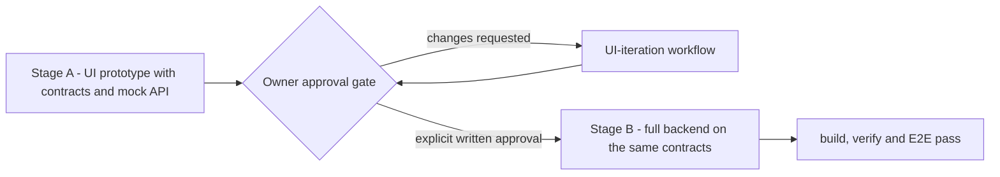
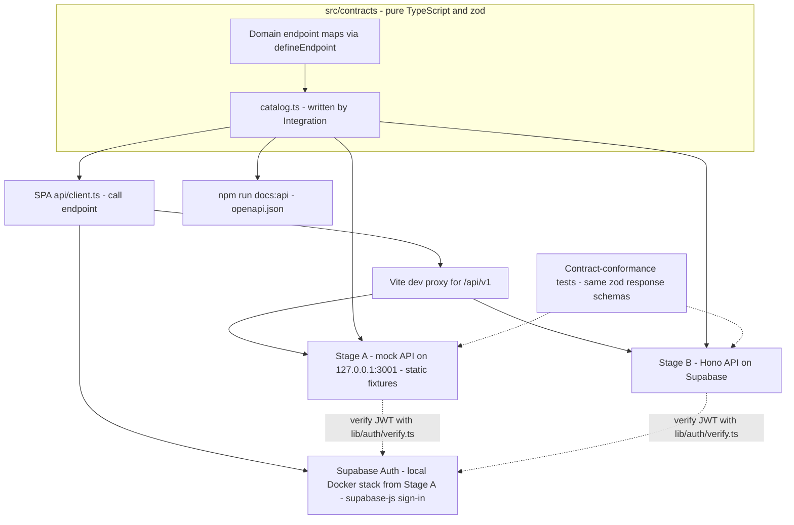

# ADR-0006: Contracts-first UI prototype stage before the backend

Status: As-designed (pre-build). Updated to as-built at the end of Stage A and Stage B.

Sources:
- `docs/plan/architecture-plan.md`: §0 delivery stages and the human approval gate (Stage A uses real Supabase Auth), §2 "no placeholder" rule, §3.2 (permission declared per endpoint), §3.10 contracts-first API, §3.11 prototype mode (local Supabase stack, real JWT verification, demo accounts), §4 repository layout (Ⓐ/Ⓑ paths, `DemoAccounts`), §5 build waves (A1 `mock-platform` writes `lib/config`, `lib/supabase` and `lib/auth/verify.ts`; B1 `ui-live-api`), §8 testing strategy, §9 build and verification commands (`supabase:start`, `auth:personas`), §10 demo data, §11.1 ACCEPTED (`src/contracts/`, `src/mock-api/`), §11.8 DECIDED (real Supabase Auth from Stage A, option b), §12 resilience.
- `docs/plan/design-decisions.md`: DD-21 `/me` personal inbox, DD-22 public and supplier references, DD-32 browser decimals, DD-37 language, DD-38 `VITE_AUTH_MODE` (WITHDRAWN, superseded by DD-43), DD-39 idempotency, DD-40 deferred procedure value, DD-43 real authentication from Stage A, §E.6 authentication in the Stage A prototype, §E.8 prototype behaviour.
- `docs/plan/tenderiq-prototype.workflow.js`: stage rules (Supabase Docker stack for authentication only), `mock-platform` and `ui-shell` tasks (JWT verification, `seed-auth-personas.ts`, the dev-only `DemoAccounts` marker checked by `scan-bundle`), `A_GATE_BASE` runtime smoke. `docs/plan/tenderiq-backend.workflow.js` (draft): stage rules and the `ui-live-api` task.
- `docs/architecture-brief.md`: §2 repository layout, §5.4 typed configuration, §5.7 authentication (JWT verification), §7.4 local API hosting (Vite proxy), §8.4 bundle scan, §10 frontend API client, §16 suggested build order.
- `docs/plan/demo-storyline.md`: single source for Stage A fixtures and Stage B seeds.
- `docs/PRD.md`: §22 delivery priorities, §23 acceptance scenarios, §24.3 business sign-off.

Contents:
1. [Status](#status)
2. [Context](#context)
3. [Decision](#decision)
4. [Consequences](#consequences)
5. [Alternatives considered](#alternatives-considered)
6. [References](#references)

---

## Status

- Status: Accepted (owner approval of the architecture plan, 2026-09-29)
- Date: 2026-09-29
- Deciders: product owner. The owner requested the prototype-first delivery. At the owner review of 2026-09-29 the owner accepted plan §11.1 (the new folders) and decided plan §11.8: real Supabase Auth in local Docker from Stage A (option b, DD-43). The earlier `VITE_AUTH_MODE` deviation (DD-38) is withdrawn. The plan and the design decision log await the owner's final approval (decision log §E.1).
- Affects: the whole delivery sequence. Stage A builds contracts, the mock API and the SPA, and signs in against the local Supabase Auth. Stage B implements the same contracts.

## Context

The product owner asked for a UI-only prototype first: API contracts may be defined, and a dummy backend may be called that returns static data. Human approval is then required before the full backend is built.

The brief's suggested build order (brief §16) starts with the platform and database and builds business domains last. Following it, the owner would see the first screens only after the schema, authentication, the job platform and the domain backends exist, which is late in the most expensive part of the work.

The PRD's screen catalog is large (COM, PUB, SUP, BUY, EVA, CON, ADM, OPS and REP screens). Its acceptance scenarios depend on permission-driven visibility, for example AC-01, AC-03 and AC-15. A prototype is only useful if it shows the real navigation, permission-hidden actions, tenant separation and error states, not static pictures.

## Decision

1. **Two stages with a human approval gate** (plan §0):
   - Stage A builds the complete SPA, typed API contracts for every endpoint the UI calls, a mock API serving static fixture data, real sign-in with Supabase Auth running in local Docker (demo accounts created already confirmed by a script; password-reset emails land in Mailpit), UI, contract and E2E tests, a screen walkthrough, and technical documentation synced to the as-built contracts. It builds no database schema, migrations, Storage wiring, business logic, jobs or seeds (plan §0, DD-43).
   - Stage A then stops.
   - **Stage B is never launched without explicit written approval.** Change requests run as a UI-iteration workflow.
2. **Contracts are the hand-off.** `src/contracts/` is pure TypeScript and zod, with no Node or browser APIs, and is importable by the SPA, the mock API and the real backend (plan §3.10). It contains:
   - `common.ts`: ids, `Money`, `Instant`, `OfficialDeadline`, `Page<T>`, list query, `Problem`;
   - `enums.ts`;
   - `decimal.ts`: the shared, pure BigInt decimal helper, which the SPA uses for live totals and `src/server/lib/decimal.ts` re-exports (plan §3.7, DD-32);
   - `endpoint.ts`: `defineEndpoint({ id, method, path, audience, permission?, params?, query?, body?, response, errors, screens })`;
   - one `<domain>.ts` file per domain;
   - `catalog.ts`, written by the Integration step.

   The SPA calls `call(endpoint, { params, query, body })` from `api/client.ts`, which builds the URL from the contract and validates responses in development builds.
3. **The mock API has the same surface.** `src/mock-api/` is a Hono app on `127.0.0.1:3001` with the same `/api/v1` routes. Its middleware mirrors the real chain: correlation id, **real Supabase JWT verification** with the brief §5.7 checks through `src/server/lib/auth/verify.ts` (the verified email is mapped to its fixture persona, and an unknown account gets 401), identical-403 tenant validation, contract permission checks, problem+json errors, and response validation against the contract. Vite proxies to it exactly as it will to the real API (plan §3.11, brief §7.4, DD-43).
4. **Static means static.** Handlers read typed fixtures built from the demo storyline. They filter and paginate per tenant, persona and query, and persist nothing. Commands validate the request against the contract and return a contract-valid static response (for example the fixture receipt for a submission). A **"Prototype — static demo data"** banner is shown whenever the SPA is served by the mock API, which reports `environment.mode = 'prototype'` in `/api/v1/me/context` (plan §0, DD-43). The owner confirmed that prototype actions show realistic results but do not persist (decision log §E.8).
5. **Authentication is real from Stage A** (plan §3.11, §11.8 option b, DD-43).
   - The Supabase CLI stack runs in Docker from Stage A (Auth, Postgres, Studio, Mailpit; `npm run supabase:start`). Stage A uses Supabase **Auth** only. No application schema exists yet.
   - `npm run auth:personas` creates or updates every demo persona in local Supabase Auth through the Admin API. It is idempotent, uses the password `test1234`, and refuses to run against anything that is not local.
   - The SPA uses supabase-js only, exactly as in production: sign-in, forgot and reset password, invitation set-password, refresh and sign-out. In Stage A only password-reset emails from Supabase Auth appear in Mailpit (`http://127.0.0.1:54324`), because the mock API persists nothing and never calls the Auth Admin invite. Invite and registration emails appear from Stage B, when the real API calls the Auth Admin invite (DD-43).
   - The real platform modules `src/server/lib/config`, `src/server/lib/supabase` and `src/server/lib/auth/verify.ts` are written in Stage A (A1 `mock-platform`, with the Stage A variable subset) and extended, never rewritten, in Stage B (plan §5).
   - In local development builds only (`import.meta.env.DEV`), the sign-in page shows a **demo accounts** quick-pick that fills a persona's email and password and signs in for real. Vite strips it from production builds.
   - There is no mock auth adapter, no persona switcher, no `VITE_AUTH_MODE` and no `/__mock/auth` endpoints. This replaces the earlier `AuthAdapter` design, in which a `mock` implementation (personas against `/api/v1/__mock/auth/*`, with a persona switcher) and a `supabase` implementation were selected by the browser build variable `VITE_AUTH_MODE` (plan §11.8 option a, DD-38). The owner withdrew DD-38 on 2026-09-29.
6. **Stage B implements the same contracts.** A contract change in Stage B needs a recorded reason and a UI update in the same unit. Contract-conformance tests run the same zod response schemas against the mock and the real API (plan §0, §8). Because auth is already real, the Stage B UI agent `ui-live-api` only points the SPA at the real API for `npm run dev`, while `npm run dev:prototype` keeps serving the mock API (plan §5).
7. **The mock API stays after Stage B** as a development and test tool (`npm run dev:prototype`, Playwright `prototype` project). It is never part of `api/` or the production bundle; `scan-bundle` verifies this (plan §0, §11.1). `scan-bundle` also fails if the unique marker string of the dev-only demo-accounts quick-pick appears in a production bundle (DD-43).
8. **OpenAPI is generated from the contracts.** `npm run docs:api` writes `docs/technical/api/openapi.json` using zod v4 `z.toJSONSchema()` (plan §3.10).
9. **Cross-cutting contract rules are fixed before Stage A starts**, so the prototype shows them and Stage B inherits them (design decision log):
   - `/api/v1/me/tasks`, `/me/notifications`, `/me/approvals/:id`, `/me/documents/:id` and `/me/search` return the caller's own rows across all active memberships, each labelled with its organization. Acting on a row requires `X-Tenant-Id` equal to the row's tenant (DD-21).
   - References are unique per buyer, so public and supplier URLs carry the buyer slug (`/opportunities/:buyerSlug/:ref`, `/awards/:buyerSlug/:ref`, `/clarifications/:buyerSlug/:ref`). Supplier API paths use tender ids (DD-22).
   - Commands that create records accept an optional `Idempotency-Key` header, and the SPA disables submit buttons while a request is in flight (DD-39).
   - The UI is English only in this release. Every UI string goes through `t()` with per-feature catalogs (`features/<f>/i18n/en.ts`, merged by glob), so languages can be added without refactoring (DD-37).
   - `framework_calloff` is not offered by any contract enum used for writes and never appears in the UI (DD-40).

## Consequences

Positive:
- The owner reviews every in-scope screen, the navigation per persona, permission-hidden actions and the 403 behavior before any backend investment. The prototype is shown with `npm run dev:prototype` and `docs/prototype/walkthrough.md`.
- The API surface is fixed early. The SPA, the mock and the backend share one set of types and runtime schemas, so shape mismatches fail tests instead of surfacing in production.
- Stage B work is bounded: implement the approved contracts, then make every acceptance scenario true (plan §2).
- The same demo storyline feeds Stage A fixtures and Stage B seeds, so the approved prototype and the live system show the same world (plan §10).
- The mock API remains a fast, deterministic backend for UI development and Playwright visual tests.
- The prototype exercises the production authentication path from the start: supabase-js sign-in, real JWT verification with the brief §5.7 checks, password-reset emails in Mailpit (invitation emails follow in Stage B). The typed configuration and JWT-verification code (brief §5.4, §5.7) are written once in Stage A and extended in Stage B, and there is no throwaway mock auth code and no extra build variable (plan §11.8, DD-43).

Negative:
- Stage A does not show state changes. A command returns a valid static response, but lists do not change afterward. Reviewers must read the prototype banner and the walkthrough with this in mind.
- Fixtures for 17 domain units must stay mutually consistent. A cross-fixture consistency test checks references, tenders, suppliers and personas across domains (plan §10).
- The mock middleware and the real middleware are two implementations of one chain. Response shapes are held together by conformance tests. Behaviors such as tenant validation and permission checks are held together by parallel test suites: mock-API tests in Stage A and per-endpoint integration tests in Stage B (plan §8).
- Contracts fixed in Stage A may prove awkward to implement. Changing one in Stage B costs a recorded reason and a matching UI change.
- Two source folders are added outside the brief's layout (`src/contracts/`, `src/mock-api/`). This is a recorded deviation, accepted at the owner review of 2026-09-29 and awaiting the owner's final approval of the plan (plan §11.1, decision log §E.1).
- Resolved — DD-43: "So is `VITE_AUTH_MODE`, a browser build variable outside the brief's list (plan §11.8, DD-38)." DD-38 is withdrawn. With real Supabase Auth from Stage A there is no `VITE_AUTH_MODE` and no deviation for it.
- Docker must be running to use the prototype, because sign-in needs the local Supabase stack (plan §11.8, DD-43).
- `src/contracts` now also holds executable shared code (`decimal.ts`), not only schemas and types. It must stay pure, with no Node or browser APIs, because both the SPA and the server import it (plan §3.10, DD-32).
- Resolved — DD-43: "Keeping the mock adapter and the persona switcher out of production depends on the dynamic import and on the `scan-bundle` marker check (DD-38)." There is no mock adapter or persona switcher. Keeping the dev-only demo-accounts quick-pick out of production depends on the `import.meta.env.DEV` guard, which Vite strips from production builds, and on the `scan-bundle` marker check.

## Alternatives considered

| Alternative | Why it was not chosen |
|---|---|
| Backend-first delivery following brief §16 | Contradicts the owner's request for an approved UI prototype before backend work. |
| Static mockups or screenshots only | Cannot demonstrate permission-driven navigation, tenant separation, identical 403s, problem+json errors or the contract shapes that Stage B must implement. |
| Request interception inside the browser | Requires a new dependency. Requests would bypass the Vite proxy and the HTTP middleware chain the real API uses, and mock code would sit next to production SPA code. |
| Hand-written OpenAPI specification with code generation | Adds generator tooling and a second source of truth. Zod contracts give runtime validation in the SPA (dev builds), the mock and the backend, and OpenAPI is generated from them. |
| A mock API that keeps state in memory | Would be a second implementation of domain rules outside the backend, and would blur what the owner is approving. Plan §0 requires that the mock persists nothing, and the owner confirmed that prototype actions do not persist (decision log §E.8). |
| Mock sign-in with a persona switcher, selected by `VITE_AUTH_MODE` (plan §11.8 option a; formerly DD-38) | It would let the prototype run without Docker, but it adds a browser build variable outside the brief's list and throwaway code. The owner chose real Supabase Auth from Stage A and withdrew DD-38 (DD-43). |

## References

- Architecture plan §0, §2, §3.2, §3.7, §3.10, §3.11, §4, §5, §8, §9, §10, §11.1, §11.8, §12.
- Design decision log DD-21, DD-22, DD-32, DD-37, DD-38 (withdrawn), DD-39, DD-40, DD-43, §E.1, §E.6, §E.8.
- Stage A workflow tasks `mock-platform` and `ui-shell`; Stage B workflow (draft) task `ui-live-api`.
- Architecture brief §2, §5.4, §5.7, §7.4, §8.4, §10, §16.
- Demo storyline (entire document).
- PRD §22, §23, §24.3.
- Related documents: [Architecture](../02-architecture.md), [API](../07-api.md), [Frontend](../09-frontend.md), [Testing strategy](../11-testing-strategy.md), [Delivery and resilience](../13-delivery-and-resilience.md).
- Related decisions: [ADR-0004](0004-text-check-constraints-not-enums.md), [ADR-0005](0005-decimal-strings-for-money-and-scores.md), [ADR-0009](0009-registries-wired-by-integration.md), [ADR-0012](0012-supplier-registration-via-provisioned-accounts.md).
