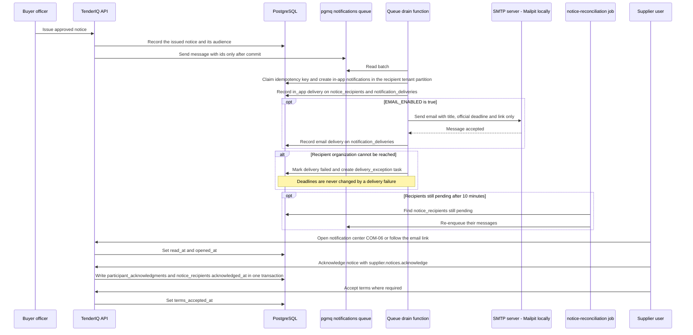

# ADR-0007: Formal notices delivered in-app and by email, with full delivery and acknowledgment tracking

Status: As-designed (pre-build). Updated to as-built at the end of Stage A and Stage B.

Sources:
- `docs/plan/architecture-plan.md`: §3.8 notifications (`DeliveryChannel` with `in_app` and `email`), §3.9 background jobs (`deadline-reminders`, `notification-digests`, `notice-reconciliation`, `notifications` queue for fan-out and delivery), §4 shared owners (`tasks` → approvals), §5 (B1 `platform-http` extends `lib/config`), §11.2 (no new runtime dependencies beyond the brief; item 3 adds one), §11.3 DECIDED email delivery (local now, hosted provider later).
- `docs/plan/design-decisions.md`: DD-02 nullable columns in unique keys, DD-11 partition tenant of cross-tenant rows, DD-16 unowned tables (`tasks`), DD-19 added jobs, DD-23 permission catalog additions, DD-42 acknowledgment authority, DD-43 real authentication from Stage A (Supabase Auth password-reset emails in Mailpit from Stage A; invitation and registration emails from Stage B), DD-44 email channel, §E.4 email delivery (hosted provider deferred).
- `docs/plan/email-delivery-options.md`: status (local development decided, hosted provider deferred), §1 why email matters, §2 how it runs locally, §3 provider options, §4 options considered.
- `docs/plan/tenderiq-backend.workflow.js` (draft): `scaffold-b` (Mailpit variables in `.env.local`, `[inbucket] smtp_port = 54325` kept), `platform-http` (DD-44 variables in `lib/config`), `svc-notifications` (the `email` channel, integration tests against Mailpit's API, hosted webhook deferred). `docs/plan/tenderiq-prototype.workflow.js`: `scaffold` (`nodemailer` and `@types/nodemailer` declared; `[inbucket]` with `smtp_port = 54325`).
- `docs/plan/schema-blueprint.md`: Migration 03 (`notification_rules`), Migration 04 (`tasks`, `notifications`, `notification_deliveries`, `user_notification_preferences`, `notices`, `notice_recipients`), Migration 08 (`participant_acknowledgments`, `addenda.notice_id`), Migration 01 (queues, `job_idempotency_key`), §P (`supplier.notices.acknowledge`).
- `docs/architecture-brief.md`: §1 platform summary (no email or messaging provider listed), §4.3 runtime dependencies, §5.6 transactions (no network calls inside), §5.7 Supabase Auth, §7.3 Mailpit, §9.5 queues (pgmq, reconciliation sweep as the safety net), §14 (new dependencies and services need approval).
- `docs/PRD.md`: §14.2 communication categories, §14.3 notification events, §16 email and organizational messaging, COM-06, ADM-12, BR-41, BR-42, BR-43, AC-10.

Contents:
1. [Status](#status)
2. [Context](#context)
3. [Decision](#decision)
4. [Consequences](#consequences)
5. [Alternatives considered](#alternatives-considered)
6. [References](#references)

---

## Status

- Status: Accepted (owner approval of the architecture plan, 2026-09-29)
- Date: 2026-09-29
- Deciders: product owner. Plan §11.3 first recorded "no email provider approved" as an assumption that needed owner confirmation. At the owner review of 2026-09-29 the owner decided it (DD-44): an SMTP `email` channel with `nodemailer` next to `in_app`, Mailpit locally, and the hosted provider deferred (decision log §E.4). The plan and the design decision log await the owner's final approval (decision log §E.1).
- Affects: Stage A (notification center, notice acknowledgment screens and fixtures, which only display delivery status; Supabase Auth password-reset emails land in Mailpit) and Stage B (`domains/notifications` with the `in_app` and `email` channels, the `notifications` queue handler, the `deadline-reminders`, `notification-digests` and `notice-reconciliation` jobs, and the email variables in `lib/config`)
- The filename keeps its original slug (`in-app-formal-notices`) so that existing links stay valid. The title reflects the decision as amended by DD-44.

## Context

The PRD treats formal communication as evidence:
- PRD §14.2: a "formal addendum or decision notice" is "an approved, versioned communication with a defined audience, issue time, and required acknowledgment where applicable".
- BR-41: email delivery, opening a notice, acknowledging it and accepting its terms are distinct events.
- BR-42: a notification failure "does not silently alter a deadline; it creates a delivery exception for review".
- PRD §14.3: the adopted policy must define whether publication, transmission, receipt or acknowledgment starts a notice period, and mandatory formal notices cannot be disabled by ordinary preferences. It also lists the formal notices recipients must receive (invitations, addenda, deadline changes, outcome and award notices, complaint updates).
- PRD §16 lists email and organizational messaging as a *potential* integration. Even there, "essential content must remain available in the product".

The brief approves no email or messaging provider. It limits the platform to the listed services and requires owner approval for any new dependency or service (brief §1, §4.3, §14). Node has no built-in SMTP client, so an email channel needs either one new dependency (`nodemailer`) or a provider's HTTPS API (email-delivery-options §2).

Supabase Auth already sends email: invitations, password resets and supplier registration verification. Locally that mail goes to Mailpit, the mail catcher in the Supabase Docker stack (brief §7.3). Hosted Supabase needs a custom SMTP provider for real use, because the built-in sender is only for testing and is heavily rate-limited. One provider that offers SMTP can serve both Supabase Auth and TenderIQ's own notices (email-delivery-options §1).

## Decision

1. **Formal notices are in-app records with a full event trail.**
   - `notices` [T] is the versioned formal communication: `notice_type`, `version`, `status` (`draft`, `approved`, `issued`, `withdrawn`), `issued_at`, `requires_acknowledgment`, `approval_request_id`, and `period_start_basis` (`publication`, `transmission`, `receipt`, `acknowledgment`).
   - `notice_recipients` [T][S] records each recipient organization and user with separate timestamps: `delivered_at`, `opened_at`, `acknowledged_at` and `terms_accepted_at`. It also holds `delivery_status` (`pending`, `delivered`, `failed`), `failure_reason` and `exception_task_id` (BR-41). Its unique key `(notice_id, supplier_tenant_id, recipient_user_id)` is `UNIQUE NULLS NOT DISTINCT`, because it includes a nullable column (DD-02).
2. **Personal notifications are separate from notices.**
   - `notifications` [P] holds each user's items, with `category` (`formal_notice`, `task`, `reminder`, `system`, `promotional`), `read_at`, `acknowledged_at`, `mandatory`, `requires_acknowledgment` and a link to `notice_recipient_id`. The notification center (COM-06) shows them, and reading stays distinct from acknowledgment. Each row is written to the partition of the recipient's tenant for that notice, which is the supplier tenant for supplier recipients (DD-11).
   - `notification_deliveries` records each channel attempt with `channel` (`in_app`, `email`) and `status` (`queued`, `delivered`, `failed`, `not_configured`).
3. **A `DeliveryChannel` port with two implementations, `in_app` and `email`** (plan §3.8, DD-44).
   - `in_app` creates the personal notification in the notification center.
   - `email` sends over **SMTP with `nodemailer`**. `nodemailer` (MIT licence) is the one approved added runtime dependency, with `@types/nodemailer` as a dev dependency (plan §11.2, §11.3; [ADR-0010](0010-no-icon-or-pdf-dependencies.md)).
   - Configuration: `EMAIL_ENABLED`, `SMTP_HOST`, `SMTP_PORT`, `SMTP_USER`, `SMTP_PASSWORD` and `EMAIL_FROM`, read through `lib/config`, which B1 `platform-http` extends with these variables. Where email is not enabled, notices are in-app only and no `email` rows are written to `notification_deliveries` (DD-44, plan §3.8).
   - Formal notices go to both channels. Non-mandatory events follow user preferences (DD-44).
   - Email content is limited to the title, the official deadline and a link into the app. It never carries bid, evaluation or other confidential content (BR-43, ADM-12). The authoritative content stays in the product (PRD §16).
4. **Mailpit locally; the hosted provider is deferred.**
   - Locally, every email goes to **Mailpit** in the Supabase Docker stack: the app's notices and the Supabase Auth invite, reset and registration emails (DD-43, DD-44). `supabase/config.toml` sets `[inbucket] smtp_port = 54325`, and the Mailpit web UI is at `http://127.0.0.1:54324`. The local `.env.local` sets `EMAIL_ENABLED=true`, `SMTP_HOST=127.0.0.1`, `SMTP_PORT=54325` and `EMAIL_FROM=notices@tenderiq.local` (Stage B `scaffold-b`).
   - A message that Mailpit accepts is recorded as `delivered` (DD-44).
   - The hosted provider and its delivery-event webhooks are **deferred** until the first hosted environment (decision log §E.4). The options are compared in `docs/plan/email-delivery-options.md` §3. The same SMTP credentials will serve Supabase Auth in hosted environments (DD-44).
5. **Delivery failure creates work and never changes dates.** An undeliverable recipient organization creates a `delivery_exception` task (`tasks.task_type`, owned by the approvals service, DD-16) for the responsible owner. It never alters a deadline (BR-42). The conditions under which an in-app delivery counts as failed are finalized in Stage B. For hosted email, bounce and complaint handling feeds the same delivery-exception tasks once the deferred provider's webhooks exist (email-delivery-options §3).
6. **Fan-out and delivery are asynchronous, with a reconciliation safety net.** They run on the `notifications` pgmq queue (plan §3.9: fan-out and delivery). Messages are published after the business transaction commits, carry ids only, and are processed idempotently (brief §9.5). Because a publish failure never fails the user's request, the `notice-reconciliation` job (every 10 minutes, notifications domain) re-enqueues `notice_recipients` that are still `pending` after 10 minutes (DD-19, brief §9.5). Reminders for closing, evaluation due dates and approvals come from the hourly `deadline-reminders` job (plan §3.9).
7. **Rules and preferences.** `notification_rules` [T] configures recipients, templates, reminder offsets and escalation per event type, and `mandatory` marks notices that cannot be muted (ADM-12). `user_notification_preferences` [G] applies only to non-mandatory items. The `notification-digests` job (daily 05:00 UTC) sends daily or weekly digests according to `user_notification_preferences.digest`. Mandatory notices are never digested (plan §3.9, DD-19).
8. **Acknowledgment has one authority per purpose** (DD-42). For submission readiness, `participant_acknowledgments` is authoritative. `notice_recipients.acknowledged_at` records the delivery-level event. When an acknowledgment comes from a notice, both are written in the same transaction. A supplier user acknowledges a notice with permission `supplier.notices.acknowledge` (DD-23). Acknowledgment always happens in the product. The email only links to it.

## Consequences

Positive:
- Every formal notice has one authoritative record in the product, with separate delivered, opened, acknowledged and terms-accepted evidence per recipient (BR-41). This is what auditors and complaint reviewers need (PRD §18.2).
- Delivery exceptions are visible work items rather than silent failures (BR-42), and deadline integrity does not depend on an external mail service.
- A lost queue message does not lose a notice. The `notice-reconciliation` sweep re-enqueues recipients left `pending`, and idempotent handling makes the retry safe (DD-19, brief §9.5).
- Readiness checks read one table. `participant_acknowledgments` decides whether a supplier has acknowledged what a submission requires, while `notice_recipients` keeps the delivery evidence (DD-42).
- Recipients get an outbound alert for formal notices without confidential content leaving the product: the email carries only the title, the official deadline and a link (DD-44, BR-43).
- Locally, no external account is needed. Every email, from the app and from Supabase Auth, is visible in Mailpit (email-delivery-options §2). Stage B integration tests read Mailpit's API (`http://127.0.0.1:54324/api/v1/messages`) to assert delivery (Stage B `svc-notifications` task).
- Choosing or switching the hosted provider is configuration (host, port, credentials, from-address) plus, for delivery events, a small provider-specific webhook parser (email-delivery-options §2). One SMTP provider can serve both Supabase Auth and TenderIQ's notices.
- Resolved — DD-44: "Adding an email channel later is a new `DeliveryChannel` implementation. The schema already has the channel value." The `email` channel is built in Stage B as the second `DeliveryChannel` implementation, on the existing `notification_deliveries.channel` value.

Negative:
- Resolved — DD-44: "Suppliers learn about a formal notice only when they sign in. There is no outbound alert for business events. Supabase Auth email is used only for invitations and password resets. With `in_app` as the only channel, digests are in-app too (plan §3.8, §3.9)." Formal notices now also go out by email, and non-mandatory events follow user preferences. Whether digests are also sent by email is not stated in the sources and is finalized in Stage B.
- Partly resolved — DD-44: "Customers whose policy counts transmission or receipt by email as the start of a notice period (`period_start_basis`) cannot rely on email evidence until an email channel is approved and built." The channel is approved and built in Stage B, and a message accepted by the SMTP server (Mailpit locally) is recorded as `delivered`. Still open: hosted delivery, bounce and open events depend on the deferred provider's webhooks (decision log §E.4).
- One runtime dependency is added (`nodemailer`, plus `@types/nodemailer` for development). It is the single approved exception to the no-new-dependencies rule ([ADR-0010](0010-no-icon-or-pdf-dependencies.md), DD-44). This replaces the earlier position that no provider, dependency or secret is introduced.
- Before the first hosted environment, a provider must be chosen and configured, together with a sending domain (SPF, DKIM, DMARC), a separate transactional stream or sub-domain for formal notices, bounce and complaint handling that feeds BR-42 delivery-exception tasks, and the same SMTP credentials configured as Supabase Auth's custom SMTP (email-delivery-options §3). SMTP credentials then become hosted secrets. This is deferred (decision log §E.4).
- In-app delivery failure has to be defined in terms of the product itself, not a mail bounce. The rule is finalized in Stage B.
- `notification_deliveries.status` keeps `not_configured` in its CHECK list, but where email is not enabled no `email` rows are written (DD-44). When, if ever, `not_configured` is written is finalized in Stage B.
- The sources do not say how the SMTP send is placed relative to the per-message transaction of the queue drain, given that brief §5.6 keeps network calls out of database transactions. This is finalized in Stage B.
- An acknowledgment that comes from a notice writes two tables, which must stay in the same transaction (DD-42).
- The sources do not say whether `notice_recipients` rows are created in the issuing transaction or by the fan-out handler. This is finalized in Stage B. The `notice-reconciliation` sweep (DD-19) acts on rows that are still `pending`.
- The notifications queue and the reminder, digest and reconciliation jobs are required infrastructure. Locally they run through `npm run queue:worker` and `npm run cron:run`, because pg_cron schedules are no-ops locally (brief §7.5).

## Alternatives considered

| Alternative | Why it was not chosen |
|---|---|
| In-app notices only, with email added later (the plan §11.3 position before the owner review; option 3 in email-delivery-options §4) | The owner chose to approve an email channel now (option 1, DD-44). Recipients get an outbound alert, and email transmission is recorded as delivery evidence. |
| Email through a provider's HTTPS API with `fetch`, with no new dependency (option 2 in email-delivery-options §4) | Locally it would rely on Mailpit's HTTP send API, which would first have to be verified for the Mailpit version bundled with the Supabase CLI, so the path is less certain. SMTP with `nodemailer` works the same against Mailpit and any provider (email-delivery-options §2). |
| Choose the hosted provider now (Postmark, Amazon SES, Resend, SendGrid or Mailgun) | Not needed until the first hosted environment, so the owner deferred it (decision log §E.4). The options and their trade-offs are compared in email-delivery-options §3. |
| Email-only formal notices | PRD §16 requires essential content to remain in the product. Email alone cannot record opening, acknowledgment or terms acceptance as distinct events. |
| Treat "read" as "acknowledged" | Violates BR-41, which makes opening, acknowledging and accepting terms distinct events. |
| Synchronous fan-out inside the issuing request | Large audiences would stretch the transaction and the function's time budget. The brief requires publish-after-commit and idempotent queue handlers (brief §9.5). |

## References

- Architecture plan §3.8, §3.9, §4, §5, §11.2, §11.3.
- Design decision log DD-02, DD-11, DD-16, DD-19, DD-23, DD-42, DD-43, DD-44, §E.4.
- `docs/plan/email-delivery-options.md` §1 to §4.
- Stage B workflow (draft) tasks `scaffold-b`, `platform-http` and `svc-notifications`; Stage A workflow task `scaffold`.
- Architecture brief §1, §4.3, §5.6, §5.7, §7.3, §7.5, §9.5, §14.
- PRD §14.2, §14.3, §16, §18.2, COM-06, ADM-12, BR-41, BR-42, BR-43, AC-10.
- Related documents: [Shared services data model](../03-data-model/03-shared-services.md), [Participation and clarifications data model](../03-data-model/07-participation-clarifications.md), [Background jobs](../08-background-jobs.md), [Key flows](../06-key-flows.md), [System context](../01-system-context.md), [Deployment and environments](../10-deployment-environments.md).
- Related decisions: [ADR-0008](0008-partition-only-high-volume-tables.md) (`notifications` is partitioned), [ADR-0010](0010-no-icon-or-pdf-dependencies.md) (`nodemailer` as the single approved dependency exception), [ADR-0012](0012-supplier-registration-via-provisioned-accounts.md) (Supabase Auth email through the same SMTP path).

## Amendments

- Amended 2026-10-30 by DD-50: Stage A uses no Supabase and sends no email, so no Supabase Auth password-reset email reaches Mailpit in Stage A. Mailpit, Supabase Auth email and the `email` channel are introduced in Stage B. The decision of this record is unchanged.
