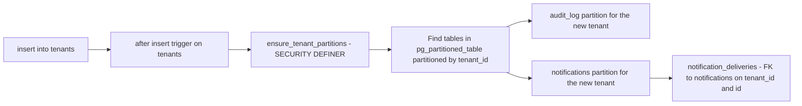

# ADR-0008: Partition only the two high-volume tables

Status: As-designed (pre-build). Updated to as-built at the end of Stage A and Stage B.

Sources:
- `docs/plan/schema-blueprint.md`: §0 conventions ([P] tag: "Only two tables are partitioned: `audit_log` and `notifications`. Nothing may FK a [P] table except `notification_deliveries → notifications(tenant_id, id)`"), Migration 01 (`audit_log`, `ensure_tenant_partitions`), Migration 04 (`notifications`, `notification_deliveries`).
- `docs/plan/design-decisions.md`: DD-01 forward foreign keys (no FKs from `audit_log`), DD-11 partition tenant of cross-tenant rows.
- `docs/architecture-brief.md`: §6.1 (indexes for every access pattern), §6.2 multi-tenant data pattern ("Large tenant-scoped tables are `PARTITION BY LIST (tenant_id)`"), §11 (integration `globalSetup` cleans orphaned tenant partitions).
- `docs/plan/architecture-plan.md`: §3.1 tenancy, §3.5 audit, §3.8 notifications.
- `docs/PRD.md`: §14.3 notification events, §18.2 decision evidence and oversight, BR-40.

Contents:
1. [Status](#status)
2. [Context](#context)
3. [Decision](#decision)
4. [Consequences](#consequences)
5. [Alternatives considered](#alternatives-considered)
6. [References](#references)

---

## Status

- Status: Accepted (owner approval of the architecture plan, 2026-09-29)
- Date: 2026-09-29
- Deciders: product owner (approval of `docs/plan/schema-blueprint.md`, `docs/plan/architecture-plan.md` and `docs/plan/design-decisions.md` is pending)
- Affects: Stage B schema (Migrations 01 and 04) and the integration test setup

## Context

Brief §6.2 prescribes `PARTITION BY LIST (tenant_id)` for large tenant-scoped tables. A SQL function discovers every table partitioned by `tenant_id` from `pg_partitioned_table` and creates the tenant's partitions with `CREATE TABLE IF NOT EXISTS`. Tenant creation calls it in the same transaction, so a rolled-back tenant leaves no orphan partitions, and calling it again is how backfill works.

Under [ADR-0001](0001-tenancy-equals-organization.md), every organization is a tenant: buyers, every supplier (including provisional suppliers) and the operator. Each partitioned table therefore gets one partition per organization. The partition count is tables × organizations.

Partitioning has structural costs in PostgreSQL:
- A primary key or unique constraint on a partitioned table must include the partition key, so the key becomes `(tenant_id, id)`.
- A foreign key that references a partitioned table must reference a unique key that includes `tenant_id`.

TenderIQ's procurement tables are densely cross-referenced (tenders, lots, bids, revisions, receipts, evaluations, contracts), so composite keys everywhere would complicate every join and every foreign key.

Two tables have the volume profile partitioning is designed for:
- `audit_log` receives a row for every audited action: actor, capacity, delegation, entity, action, reason, before/after state and correlation id (plan §3.5, PRD §18.2).
- `notifications` receives a row per recipient per event, plus reminders and escalations (PRD §14.3).

Both are append-heavy, always read within one tenant, and referenced by almost nothing.

## Decision

1. **Exactly two tables are partitioned** with `PARTITION BY LIST (tenant_id)`: `audit_log` and `notifications`. Their primary key is `(tenant_id, id)` (blueprint §0).
2. **All other tenant-scoped tables are ordinary [T] tables.** Each has a single-column identity primary key, a non-null `tenant_id`, and indexes that lead with `tenant_id` for each list access pattern (blueprint §0).
3. **Nothing may reference a [P] table, with one exception:** `notification_deliveries` → `notifications(tenant_id, id)` (blueprint §0). In the other direction, no foreign keys are created *from* `audit_log`. Its reference columns, such as `delegation_id` and `support_grant_id`, hold ids only (DD-01).
4. **Partitions are created automatically.** `ensure_tenant_partitions(p_tenant_id bigint)` is `SECURITY DEFINER` with a pinned `search_path`. It discovers every table in `pg_partitioned_table` partitioned by `tenant_id` and creates `<table>_t<id>` with `CREATE TABLE IF NOT EXISTS`. An `after insert on tenants` trigger calls it in the tenant's creating transaction (blueprint Migration 01).
5. **A cross-tenant row goes to the partition of one named tenant** (DD-11):
   - `audit_log`: the tenant that owns the affected record. A supplier submitting a bid on a buyer-owned row is audited in the buyer's partition, with `actor_capacity` naming the supplier organization. Actions on [G] records go to the operator tenant. Support-access events are written to the customer tenant, so the customer can review them.
   - `notifications`: the recipient's tenant for that notice, which is the supplier tenant for supplier recipients.
6. **Indexes match the read paths:**
   - `audit_log`: `(tenant_id, entity_type, entity_id)`, `(tenant_id, occurred_at desc)`, `(tenant_id, actor_user_id)`;
   - `notifications`: `(tenant_id, recipient_user_id, read_at)`.

## Consequences

Positive:
- Each new organization gets two partitions, not dozens. This keeps catalog growth proportional to organization count even when suppliers are numerous.
- Audit and notification queries, which always name a tenant, touch only that tenant's partition. Because every cross-tenant row has one named partition tenant (DD-11), a buyer's audit review of its own records, a customer's review of support access and a supplier's notification center each read one partition.
- Because the function discovers partitioned tables dynamically, a future migration can partition another table and backfill existing tenants by calling `ensure_tenant_partitions` again (brief §6.2).
- Relational integrity for the rest of the schema uses plain single-column foreign keys.

Negative:
- `audit_log` and `notifications` cannot be targets of ordinary single-column foreign keys. The only enforced reference is `notification_deliveries`, which has to carry `tenant_id` so it can use the composite key. Any other table that needs to point at an audit or notification row can hold the id only as an unenforced value.
- `audit_log`'s own references (`delegation_id`, `support_grant_id` and the other ids it records) are unenforced as well, because no foreign keys are created from the partitioned table (DD-01).
- Code that writes audit or notification rows must choose the partition tenant by the DD-11 rule rather than by the active tenant of the request. For example, a supplier request that submits a bid writes its audit row to the buyer's partition, and an operator request under a support grant writes to the customer's partition.
- Every tenant insert does DDL inside the transaction. Tenant creation (onboarding, supplier registration, buyer-created provisional suppliers, imports) is therefore heavier than an ordinary insert.
- Tenants are soft-deleted (brief §6.2), so their partitions remain. Integration tests must clean orphaned partitions in `globalSetup` (brief §11).
- Converting another existing table to partitioned later means rebuilding that table in a forward-only migration. The decision is cheap to extend but not free.
- Retention and disposal work through retention classes, holds and `disposal_requests` (BR-40), not by dropping partitions. Partitioning by tenant does not align with time-based retention.

## Alternatives considered

| Alternative | Why it was not chosen |
|---|---|
| Partition every [T] table by `tenant_id` | Forces `(tenant_id, id)` keys and composite foreign keys across the whole procurement model, and multiplies partition count by roughly the number of tables for every organization. |
| Partition nothing | Brief §6.2 prescribes list partitioning for large tenant-scoped tables. `audit_log` and `notifications` are the clearest candidates. |
| Time-range partitioning of `audit_log` | Not the brief's pattern. Tenant-first access is the dominant read path. Disposal is governed by retention classes and legal holds (BR-40), not by age alone. |
| Hash partitioning by `tenant_id` | Loses the one-partition-per-tenant property that `ensure_tenant_partitions` and the brief's backfill model rely on. |

## References

- Schema blueprint §0, Migrations 01 and 04.
- Design decision log DD-01, DD-11.
- Architecture brief §6.1, §6.2, §11.
- Architecture plan §3.1, §3.5, §3.8.
- PRD §14.3, §18.2, BR-40.
- Related documents: [Platform, identity and access data model](../03-data-model/01-platform-identity-access.md), [Shared services data model](../03-data-model/03-shared-services.md), [Records, reporting and operations data model](../03-data-model/12-records-reporting-operations.md).
- Related decisions: [ADR-0001](0001-tenancy-equals-organization.md), [ADR-0002](0002-buyer-owned-procurement-records.md), [ADR-0007](0007-in-app-formal-notices.md), [ADR-0013](0013-operator-support-access-grants.md).
