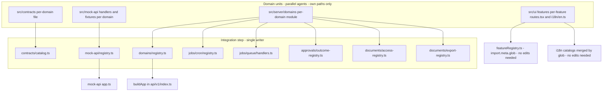

# ADR-0009: Registries are wired only by the Integration step

Status: As-designed (pre-build). Updated to as-built at the end of Stage A and Stage B.

Sources:
- `docs/plan/architecture-plan.md`: §3.9 background jobs and queues (job list as amended; exports handler in the documents service), §4 repository layout (registries list, feature auto-registration, cross-domain writes), §5 build waves and file ownership (Stage A phases A1 to A5, Stage B phases B1 to B6), §12 resilience and resume (progress markers read by Integration).
- `docs/architecture-brief.md`: §3.2 function entrypoint (`api/v1/index.ts` wires every domain's `defaultXxxDeps()` into `buildApp`), §5.2 domain module shape (plain-function dependency injection, no DI container), §9.4 cron registry, §9.5 queue handler registry.
- `docs/plan/schema-blueprint.md`: Migration 14 (`cron.schedule` rows for every job in plan §3.9 as amended by DD-18 and DD-19, plus `queue-drain`; job names must match `jobs/cron/registry.ts`).
- `docs/plan/design-decisions.md`: DD-06 (`job_run.status`, unimplemented jobs), DD-16 unowned tables (`documents/export-registry.ts`), DD-18 grant expiry (split expiry jobs), DD-19 added jobs, DD-37 language (per-feature catalogs merged by glob).

Contents:
1. [Status](#status)
2. [Context](#context)
3. [Decision](#decision)
4. [Consequences](#consequences)
5. [Alternatives considered](#alternatives-considered)
6. [References](#references)

---

## Status

- Status: Accepted (owner approval of the architecture plan, 2026-09-29)
- Date: 2026-09-29
- Deciders: product owner (approval of `docs/plan/architecture-plan.md` and `docs/plan/design-decisions.md` is pending)
- Affects: the Stage A and Stage B build workflows, and the composition code in both stages

## Context

TenderIQ is built by many agents running at the same time in one working tree. Ownership is by path: an agent writes only the paths it owns and may read anything (plan §5). Some shared files are edited by no parallel agent: package.json files, `src/contracts/{common,enums,endpoint}.ts`, `lib/**`, `components/**`, `theme/**`, `app/**` and `seed.sql`. Needs outside an agent's paths are reported as `followUps`.

Composition, however, needs a list of all the parts:
- the backend composes every domain router into one Hono app (brief §3.2, §5.1);
- the cron endpoint maps a job name to its handler (brief §9.4);
- the queue drain maps a message type to its handler (brief §9.5);
- the mock API mounts every domain's handlers;
- the contract catalog aggregates every domain's endpoint map;
- approvals dispatch a final decision to the owning domain;
- document downloads check access per related record type;
- the documents service's export handler dispatches each export type to the generator the owning domain provides (DD-16).

If each domain agent appended its own entry to these shared files, concurrent edits would collide.

## Decision

1. **Registries are single files, written only by the Integration step of each stage** (A3 `integrate` in Stage A, B4 `integrate` in Stage B):

| Registry | Stage | Maps |
|---|---|---|
| `src/contracts/catalog.ts` | A | every domain's endpoint map |
| `src/mock-api/registry.ts` | A | every domain's mock handlers |
| `src/server/domains/registry.ts` | B | every domain router, composed into `buildApp` |
| `src/server/jobs/cron/registry.ts` | B | cron job name → sweep handler. Names match the `cron.schedule` rows (blueprint Migration 14), including the jobs the decision log added or split: `expire-access`, `expire-approvals`, `expire-support-access` (DD-18), `contract-dates`, `report-schedules`, `notification-digests` and `notice-reconciliation` (DD-19). |
| `src/server/jobs/queue/handlers.ts` | B | queue message type → handler |
| `src/server/domains/approvals/outcome-registry.ts` | B | approval subject type → final-state handler |
| `src/server/domains/documents/access-registry.ts` | B | document related type → access check. Anything unregistered is denied. |
| `src/server/domains/documents/export-registry.ts` | B | export type → generator. Domains provide the per-type generators, and the documents service's `requestExport()` and `exports` queue handler use them (DD-16). |

2. **Domain units export, and never register.** Each domain unit writes its contract map, mock handlers and fixtures (Stage A), or its router, service, jobs and outcome and access handlers (Stage B), within its own paths. It reports anything it needs wired as a follow-up.
3. **The SPA registers features without a shared file.** `app/featureRegistry.ts` collects `import.meta.glob('../features/*/routes.tsx', { eager: true })`. Each feature exports `features: FeatureModule[]` with routes and nav items (`section`, `order`, `icon`, `permission`). UI strings follow the same pattern: each feature has its own catalog `features/<f>/i18n/en.ts`, and the catalogs are merged by glob (DD-37). Parallel feature agents never edit a shared SPA file (plan §4).
4. **Composition stays explicit.** Following brief §5.2, dependencies are plain function arguments. Each domain exposes `defaultXxxDeps()`, and `api/v1/index.ts` wires them into `buildApp`. There is no DI container and no runtime directory scanning on the server.
5. **Integration also resumes interrupted work.** When units were skipped on resume, it reads their reports from `.build/progress/<stage>/<unit>.json` (plan §12).

## Consequences

Positive:
- Parallel agents never edit the same file, so there are no merge conflicts or lost writes in the shared working tree.
- Each registry is a readable, reviewable table of the system's composition, which makes gaps easy to spot.
- The document access registry denies by default, so a new document related type is inaccessible until someone deliberately registers its access rule.
- Domain units are independent. An interrupted build can re-run one unit without touching the others (plan §12).

Negative:
- A domain is not reachable through the composed app until Integration runs. Domain agents must test through their own router factory and handler functions, not through the full app.
- Integration is a serialization point. Its work grows with the number of domains, and it must apply every reported follow-up correctly.
- A registry can drift from what it registers, for example cron job names versus `cron.schedule` rows, or catalog entries versus implemented routes. Tests catch this:
  - "every endpoint has a screen reference" (plan §8, Stage A);
  - contract conformance, "every contract endpoint is implemented" (plan §8, Stage B);
  - the rule that job names match `jobs/cron/registry.ts` (blueprint Migration 14). The test that enforces it is finalized in Stage B.
  - a job that is scheduled but not yet implemented writes a `failed` `job_run` row and returns 501, never a fake success, so a missing handler shows up as a failure (brief §9.3, DD-06).
- Two composition styles coexist: explicit registries on the server and in the mock, and glob auto-registration in the SPA (feature routes and i18n catalogs).
- The cron registry grows with the job list. The decision log split one expiry job into three owned by the tables' owners and added four jobs (DD-18, DD-19), and each needs a registry entry and a matching `cron.schedule` row.

## Alternatives considered

| Alternative | Why it was not chosen |
|---|---|
| Each domain agent appends to the shared registry | Concurrent edits to one file collide in a shared working tree, and ownership by path is broken. |
| Runtime auto-discovery on the server (directory scanning) | The brief composes explicitly through `buildApp(deps)` and `defaultXxxDeps()` so that tests can build the app with fakes (brief §5.1, §5.2). Implicit discovery hides the composition. |
| A dependency-injection container | Brief §5.2: "There is no DI container." |
| Explicit registry file for SPA routes | Would reintroduce a shared file that every feature agent edits. The glob pattern avoids it without adding a dependency. |

## References

- Architecture plan §3.9, §4, §5, §8, §12.
- Design decision log DD-06, DD-16, DD-18, DD-19, DD-37.
- Architecture brief §3.2, §5.1, §5.2, §9.4, §9.5.
- Schema blueprint Migration 14.
- Related documents: [Architecture](../02-architecture.md), [Background jobs](../08-background-jobs.md), [Frontend](../09-frontend.md), [Delivery and resilience](../13-delivery-and-resilience.md).
- Related decisions: [ADR-0006](0006-contracts-first-ui-prototype-stage.md), [ADR-0010](0010-no-icon-or-pdf-dependencies.md).
