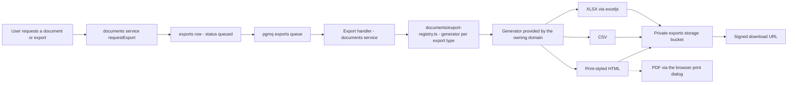

# ADR-0010: No icon library and no PDF generation dependency

Status: As-designed (pre-build). Updated to as-built at the end of Stage A and Stage B.

Sources:
- `docs/plan/architecture-plan.md`: §3.9 (`exports` queue; the exports handler belongs to the documents service), §3.10 (OpenAPI via zod v4 `z.toJSONSchema()`), §4 (shared owners: exports → documents), §7 UI design system ("Icons are a hand-rolled inline-SVG set. There is no icon dependency."), §11.2 ACCEPTED ("No new runtime dependencies beyond the brief ... PDFs are print-styled HTML plus XLSX/CSV ... Item 3 may add one dependency if the owner chooses the SMTP option"), §11.3 DECIDED (`nodemailer`, "the one added runtime dependency, plus `@types/nodemailer`"), §11.9 (fonts self-hosted, CSP meta tag).
- `docs/plan/design-decisions.md`: DD-16 unowned tables (`exports` → documents service `requestExport()`, `documents/export-registry.ts`), DD-30 SPA document headers (CSP meta tag), DD-35 fonts, DD-44 email channel (`nodemailer` is the one approved added runtime dependency).
- `docs/plan/email-delivery-options.md`: §2 dependency note (Node has no built-in SMTP client; `nodemailer`, MIT licence, no runtime dependencies).
- `docs/plan/tenderiq-prototype.workflow.js`: `scaffold` task (root runtime dependencies include `nodemailer`, dev dependencies include `@types/nodemailer`; declared once for both stages).
- `docs/architecture-brief.md`: §1 platform summary (frontend stack), §3.3 serverless constraints, §4.3 runtime and dev dependencies ("plus a library for any required file format (for example `exceljs`)"), §8.4 bundle scan, §14 ("Use only permissive-license dependencies. Adding any new dependency requires approval.").
- `docs/plan/schema-blueprint.md`: Migration 01 (`exports` storage bucket, `exports` queue), Migration 13 (`exports.format` CHECK (`xlsx`, `csv`, `html`), `exports.export_type`, `exports.manifest`).
- `docs/css/theme/components.css` and `docs/screenshots/*.png`: inline `svg` children styled in buttons, icon buttons, nav items, search boxes and empty states. Line icons in the sidebar.
- `docs/PRD.md`: §14.1 (packages, receipts, evaluation reports, award reports and handovers downloadable "in business-readable forms"; exports identify contents, versions, omissions, redactions, creator and date), §19 accessibility.

Contents:
1. [Status](#status)
2. [Context](#context)
3. [Decision](#decision)
4. [Consequences](#consequences)
5. [Alternatives considered](#alternatives-considered)
6. [References](#references)

---

## Status

- Status: Accepted (owner approval of the architecture plan, 2026-09-29)
- Date: 2026-09-29
- Deciders: product owner. Plan §11.2 records the dependency position, and plan §11.9 the self-hosted fonts. The owner accepted both at the review of 2026-09-29, and approved one exception to the dependency position: `nodemailer` for the SMTP email channel (plan §11.3, DD-44). The plan and the design decision log await the owner's final approval (decision log §E.1).
- Affects: Stage A (SPA icon set, self-hosted fonts, print styles) and Stage B (documents service `requestExport()`, `exports` queue handler, export generators and formats)

## Context

The brief keeps runtime dependencies deliberately few:
- backend: `hono`, `kysely`, `pg`, `zod` and `@supabase/supabase-js`, plus "a library for any required file format (for example `exceljs`)";
- SPA: React, Redux Toolkit, React Router and Recharts;
- adding any dependency requires approval (brief §4.3, §14).

The owner has approved exactly one addition to that list: `nodemailer`, for the SMTP `email` delivery channel. Node has no built-in SMTP client, and `nodemailer` has an MIT licence and no runtime dependencies of its own (DD-44, plan §11.3, email-delivery-options §2). The rule that no other runtime dependency is added stays in force.

Three needs would normally pull in extra packages or external services:
1. **Icons.** The target visual style (QuoteIQ screenshots and `docs/css`) uses line icons in the sidebar, buttons, search boxes, KPI tiles and empty states. The stylesheet styles them as inline `svg` children, for example `.qiq-nav-item svg`, `.qiq-btn svg` and `.qiq-icon-btn svg`.
2. **Documents.** PRD §14.1 requires tender packages, submission receipts, evaluation reports, award reports and contract handovers to be downloadable in business-readable forms, and evidence exports to identify their contents, versions, omissions, redactions, creator and creation date.
3. **Fonts.** The UI uses Inter and JetBrains Mono (DD-35). Loading them from a font service or a font package would add an external request or a dependency.

## Decision

1. **Icons are a hand-rolled inline-SVG set in the SPA.** There is no icon package (plan §7). Nav items declare an `icon` in their feature registration (plan §4). The exact module that holds the icon set is finalized in Stage A.
2. **No PDF library and no headless browser.** Downloadable documents come in three formats, which match `exports.format` CHECK (`xlsx`, `csv`, `html`):
   - XLSX, produced with `exceljs` (the brief's example file-format library);
   - CSV;
   - print-styled HTML. A PDF, when a user needs one, is the browser's print output of that HTML (plan §11.2).
3. **Exports run as queued jobs owned by the documents service.** An `exports` row records `export_type` (`report`, `evidence_pack`, `tender_package`, `receipt`, `evaluation_report`, `award_report`, `handover`, `customer_exit`), `status` and a JSON `manifest` of contents, versions, omissions and redactions. The documents service owns the `exports` table and the `exports` queue handler and exposes `requestExport()`. Domains register the generator for each export type in `documents/export-registry.ts`, which the Integration step wires (DD-16). The work runs on the `exports` pgmq queue (plan §3.9), and output goes to the private `exports` storage bucket (blueprint Migration 01). The sources do not say which printable views, if any, the SPA renders directly for printing instead of producing them through the queue. This is finalized in Stage B.
4. **The same rule applies to other tooling.** OpenAPI is generated with zod v4's built-in `z.toJSONSchema()` rather than a generator package (plan §3.10).
5. **Fonts are self-hosted files.** Inter and JetBrains Mono (both under the SIL Open Font License, OFL) are served as self-hosted woff2 files from `src/ui/public/fonts`. There is no Google Fonts request and no npm font dependency (DD-35, plan §11.9). The SPA document carries a Content Security Policy `<meta http-equiv>` tag in `index.html` that allows self plus the Supabase URL for auth, with fonts self-hosted (DD-30).
6. **One approved exception: `nodemailer`.** The SMTP `email` delivery channel uses `nodemailer` (runtime) and `@types/nodemailer` (development). It is the single runtime dependency added beyond the brief's list, approved by the owner on 2026-09-29 (plan §11.3, DD-44; [ADR-0007](0007-in-app-formal-notices.md)). The Stage A `scaffold` task declares it with every other dependency for both stages, so Stage B never edits dependencies. No icon, PDF, font or other package is added.

## Consequences

Positive:
- The supply chain stays small, and every added package would need license review and a bundle-leak scan (brief §8.4, §14). The only runtime package added beyond the brief is `nodemailer` (MIT, no runtime dependencies of its own), and it is server-side only (DD-44).
- Icons use the same design tokens as the rest of the UI, including stroke color and size under the light and dark themes. Components never contain raw hex values (plan §7).
- Export handlers have no native binaries to ship or cold-start, which suits the serverless limits (`maxDuration` 60 s for queue functions, brief §3.1, §3.3).
- HTML exports honor the same access rules as the screens, and each export states what it contains in the manifest.
- One service owns the export lifecycle (request, queue, status, storage, manifest), while each domain supplies only the generator for its export types (DD-16).
- Self-hosted fonts mean the SPA makes no third-party request to render text, which keeps the CSP to self plus the Supabase URL (DD-30, DD-35).

Negative:
- The product does not produce server-generated PDF files. Page layout of a printed document depends on the user's browser. Archival formats such as PDF/A are not available. Any customer requirement for them needs a new, approved dependency.
- Documents that must be PDFs, such as signed agreements from an external signature service (PRD §16), are uploaded files, not generated ones.
- The icon set is maintained by hand. Each icon component must handle accessibility itself: decorative icons are hidden from assistive technology, and icon-only buttons carry an accessible label (PRD §19).
- Print styles must be written and tested for each printable document. The source CSS in `docs/css` contains no print rules to start from.
- The font files live in the repository (`src/ui/public/fonts`) and are updated by hand, like the icon set.

## Alternatives considered

| Alternative | Why it was not chosen |
|---|---|
| An icon package | New dependency outside the brief's list. The design only needs a bounded set of line icons, which inline SVG covers. |
| A PDF generation library | New dependency. Its output would still need its own layout code separate from the HTML views. |
| A headless browser to render HTML to PDF inside a function | Adds a large binary and a runtime process to a serverless function with a 60 s budget (brief §3.1). It is also a new dependency. |
| An external document-rendering service | A new cloud service. The brief forbids adding services without approval (brief §1, §14). |
| Fonts from Google Fonts or an npm font package | An external request at runtime or a new dependency. The fonts are self-hosted instead (DD-35). |

## References

- Architecture plan §3.9, §3.10, §4, §7, §11.2, §11.3, §11.9.
- Design decision log DD-16, DD-30, DD-35, DD-44.
- `docs/plan/email-delivery-options.md` §2 (dependency note).
- Architecture brief §1, §3.1, §3.3, §4.3, §8.4, §14.
- Schema blueprint Migrations 01 and 13.
- `docs/css/theme/components.css`, `docs/css/theme/tokens.css`, `docs/screenshots/overview.png`.
- PRD §14.1, §16, §19.
- Related documents: [Frontend](../09-frontend.md), [Background jobs](../08-background-jobs.md), [Records, reporting and operations data model](../03-data-model/12-records-reporting-operations.md).
- Related decisions: [ADR-0005](0005-decimal-strings-for-money-and-scores.md), [ADR-0006](0006-contracts-first-ui-prototype-stage.md), [ADR-0007](0007-in-app-formal-notices.md) (the `nodemailer` exception), [ADR-0009](0009-registries-wired-by-integration.md).
