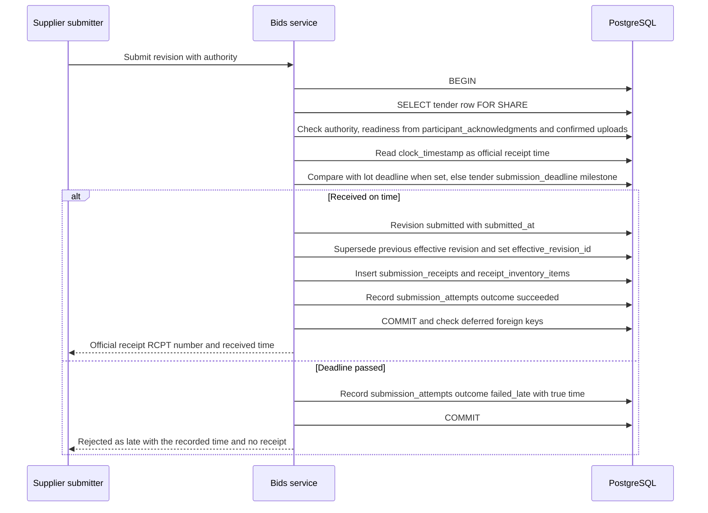

# ADR-0011: Official receipt time comes from the database clock inside the submission transaction

Status: As-designed (pre-build). Updated to as-built at the end of Stage A and Stage B.

Sources:
- `docs/plan/architecture-plan.md`: §3.4 official time, §3.9 (`close-tenders` job, every minute), §4 (bids owns every bid, revision and receipt row; clarifications update deadlines through the lifecycle snapshot API).
- `docs/plan/schema-blueprint.md`: §0 (reference formats `RCPT-2026-000001`, `next_reference`), Migration 01 (`audit_log.occurred_at` default `clock_timestamp()`, `reference_counters`), Migration 07 (`tenders.official_time_zone`, `tenders.current_version_no`, `tender_versions.addendum_id`, `tender_milestones`, `lots.submission_deadline`), Migration 09 (`bid_revisions`, `submission_attempts`, `submission_receipts`, `receipt_inventory_items`, `withdrawals`, `late_submission_exceptions`, partial unique index on submitted revisions).
- `docs/plan/design-decisions.md`: DD-01 forward foreign keys (deferrable receipt cycle), DD-02 nullable columns in unique keys (`bids`), DD-05 sealed envelope mapping (`receipt_inventory_items.envelope`), DD-09 reference numbers, DD-15 deadline authority, DD-33 zone display, DD-39 idempotency, DD-42 acknowledgment authority.
- `docs/architecture-brief.md`: §3.3 serverless constraints, §5.6 transactions and pooler rules (`SELECT … FOR UPDATE` and similar only inside a transaction, no network calls inside `withTransaction`), §5.9 two-step upload envelope.
- `docs/PRD.md`: §7.9 FR-12, §17.2 defaults, §19, BR-11, BR-12, BR-18, BR-19, BR-20, BR-21, AC-11, AC-12, AC-13, AC-14.
- `docs/plan/demo-storyline.md`: T-2026-0002 (failed replacement, late attempt).
- `docs/plan/tenderiq-backend.workflow.js`: Stage B workflow notes for clarifications (addendum issue bumps `tenders.current_version_no` with a new `tender_versions` snapshot).

Contents:
1. [Status](#status)
2. [Context](#context)
3. [Decision](#decision)
4. [Consequences](#consequences)
5. [Alternatives considered](#alternatives-considered)
6. [References](#references)

---

## Status

- Status: Accepted (owner approval of the architecture plan, 2026-09-29)
- Date: 2026-09-29
- Deciders: product owner (approval of `docs/plan/architecture-plan.md` and `docs/plan/design-decisions.md` is pending)
- Affects: Stage B (`domains/bids` submission service, `domains/time`, `close-tenders` job). Stage A shows the same receipt and deadline rendering with fixture values.

## Context

Submission timing decides eligibility, so the PRD is strict about it:
- FR-12: "only material received and finalized within the applicable submission window counts as submitted. Beginning a transfer or pressing a button before the deadline is insufficient if final receipt occurs afterward."
- BR-18: a successful official receipt is required to establish submission.
- BR-20: "late acceptance cannot be achieved by changing a recorded time."
- AC-13: a response that completes after the deadline is rejected as late, "preserving the true receipt time".
- AC-12: a failed replacement leaves the earlier submission effective and issues no false receipt.
- BR-11: the official deadline carries date, time, named time zone and offset.

Candidate time sources:

| Source | Problem |
|---|---|
| Browser clock | Controlled by the user. The brief treats the SPA as hostile (brief §14). |
| Function instance clock (`Date.now()`) | Vercel runs many short-lived instances (brief §3.3). The instant is taken outside the transaction that records the submission, so it does not describe when the record was finalized. |
| `now()` / `transaction_timestamp()` in PostgreSQL | Returns the *start* time of the transaction. A transaction that starts before the deadline and commits after it would stamp a pre-deadline time. |
| `clock_timestamp()` in PostgreSQL | Returns the actual time when the statement runs, inside the transaction that finalizes the record. |

## Decision

1. **Instants are stored as `timestamptz` (UTC).** Each tender stores an IANA `official_time_zone`. The UI renders a deadline with the IANA name and the numeric offset from Intl, for example `14 Oct 2026, 12:00 (UTC+02:00) Africa/Gaborone`. A short abbreviation such as CAT is shown only when Intl provides one (DD-33). Local-time help is optional, and a deadline is never shown as a countdown alone (plan §3.4, BR-11, PRD §19).
2. **Official receipt time is `clock_timestamp()`,** read inside the submission transaction after the tender row has been locked `FOR SHARE` (plan §3.4). The deadline compared against it is `lots.submission_deadline` when set, which is then authoritative for that lot. Otherwise the tender's `tender_milestones` row (`milestone = 'submission_deadline'`, `lot_id` null) applies (blueprint Migration 07, DD-15).
3. **Every attempt is recorded with its true time,** including late and failed attempts (plan §3.4, AC-13). `submission_attempts` stores:
   - `started_at`;
   - `completed_at`, taken from `clock_timestamp()`;
   - `outcome` (`succeeded`, `failed_validation`, `failed_late`, `failed_authority`, `failed_error`);
   - `failure_reason`;
   - `deadline_at_attempt`, the deadline in force at that moment.
4. **A successful attempt, in the same transaction:**
   - marks the revision `submitted` and sets `bid_revisions.submitted_at` to the official receipt time;
   - marks the previously effective revision `superseded`;
   - points `bids.effective_revision_id` at the new revision;
   - creates a `submission_receipts` row with a `RCPT-` number from `next_reference` and a `receipt_inventory_items` row per confirmed document (file name, SHA-256, size, envelope). The year segment of the receipt number is the year in the tenant's official time zone (DD-09), and `receipt_inventory_items.envelope` records the envelope of each file (DD-05).

   Revisions and receipts belong to one `bids` container per supplier, tender and bidding combination. Its unique key `(tender_id, supplier_tenant_id, is_alternative, round_type, final_offer_round_id)` is `UNIQUE NULLS NOT DISTINCT`, which replaces the earlier `coalesce` expression (DD-02). A partial unique index allows at most one `submitted` revision per bid. Receipts are immutable except for `status` (blueprint Migration 09). The foreign keys that close the cycle inside this transaction, `bids.effective_revision_id → bid_revisions` and `bid_revisions.receipt_id → submission_receipts`, are `DEFERRABLE INITIALLY DEFERRED`, so they are checked at commit (DD-01).
5. **A failed or late attempt changes nothing else.** It issues no receipt, does not touch the effective revision, and leaves the earlier submission effective (BR-19, AC-12).
6. **No path edits a recorded time.** Exceptional late treatment is a separate `late_submission_exceptions` record with a policy basis, evidence, an equal-treatment review and an approval (FR-12, BR-20).
7. **Working-day arithmetic uses the tender's approved calendar.** The `time` service is pure and unit-tested (plan §3.4, BR-12).
8. **Deadline changes serialize against submissions.** Issuing an addendum that changes a deadline also updates `tenders.updated_at` in the same transaction, so the submission path's `FOR SHARE` lock on the tender row serializes against the deadline change (DD-15).
9. **A retried submission is a new attempt.** Commands that create records accept an optional `Idempotency-Key` header, but a retried submission still records a new `submission_attempts` row, because every attempt is intended evidence (DD-39).
10. **Readiness uses one acknowledgment authority.** The submission readiness check reads `participant_acknowledgments`, which is authoritative for acknowledgments of addenda, participation conditions, tender versions and notices (DD-42).

## Consequences

Positive:
- There is one authoritative clock, the database server's, and it is read at the moment the record is finalized. This is the same source `audit_log.occurred_at` uses (`clock_timestamp()`).
- A transaction that started before the deadline cannot stamp a pre-deadline time if it finalizes afterward.
- Late and failed attempts leave truthful evidence (AC-13). The earlier effective submission survives a failed replacement (AC-12), and no one can make a late response timely by editing a time (BR-20).
- `FOR SHARE` lets many suppliers submit concurrently while holding back writers that update the tender row, such as the lifecycle status change made by the `close-tenders` sweep, until in-flight submissions commit. The sweep is state-guarded and runs every minute, so a blocked tick is simply followed by the next one (brief §9.4).
- Issuing an addendum applies deadline changes to `tender_milestones` and `lots.submission_deadline` through the lifecycle snapshot API (plan §4) and bumps `tenders.current_version_no` with a new `tender_versions` snapshot (blueprint Migration 07; Stage B workflow notes). The same transaction updates `tenders.updated_at` (DD-15), so the tender-row update waits for in-flight `FOR SHARE` submissions, and deadline changes never interleave with a receipt.
- There is one deadline authority per lot: its own `submission_deadline` when set, otherwise the tender milestone (DD-15).

Negative:
- The database host's clock becomes the legal time source. Its synchronization is controlled by the hosting provider, not by the application. This is an operational dependency to state in customer service commitments (PRD §19).
- The submission transaction must stay short, and the brief forbids network calls inside `withTransaction` (brief §5.6). File transfer to storage therefore happens before submission through the two-step upload envelope (brief §5.9), and the transaction checks only that the relevant `document_versions` are `confirmed`.
- Recording a failed attempt means the transaction commits the attempt row instead of rolling back. For `failed_error`, an unexpected exception that aborts the transaction, the attempt must be recorded in a separate transaction. The exact boundary is finalized in Stage B.
- The mock API cannot demonstrate timing. Stage A shows static fixture receipts and attempts, such as the T-2026-0002 late and failed attempts.
- The zone display depends on what the browser's Intl data provides. The IANA name and numeric offset are always shown, but the abbreviation (for example CAT) appears only where Intl supplies one, so the same deadline can render with or without it (DD-33).

## Alternatives considered

| Alternative | Why it was not chosen |
|---|---|
| Browser-reported time | The client is untrusted (brief §14). |
| API instance time (`Date.now()`) | Many instances with independent clocks. The time is not taken inside the transaction that finalizes the record. |
| `now()` or `transaction_timestamp()` | Returns transaction start time, so a slow submission that started before the deadline could be stamped as on time. |
| Time the file upload completed in storage | Uploading is preparation, not submission. FR-12 counts only material that is received *and finalized*, which happens in the submission transaction. |
| `FOR UPDATE` on the tender row | Would serialize all submissions for one tender at the closing rush. `FOR SHARE` gives the needed protection against concurrent tender-row writers without blocking other submitters. |

## References

- Architecture plan §3.4, §3.9, §4.
- Schema blueprint §0, Migrations 01, 07, 09.
- Design decision log DD-01, DD-02, DD-05, DD-09, DD-15, DD-33, DD-39, DD-42.
- Architecture brief §3.3, §5.6, §5.9, §9.4, §14.
- PRD §7.9 FR-12, §17.2, §19, BR-11, BR-12, BR-18, BR-19, BR-20, BR-21, AC-11 to AC-14.
- Demo storyline: T-2026-0002.
- Stage B workflow notes (`docs/plan/tenderiq-backend.workflow.js`): clarifications, addendum issue.
- Related documents: [Bids and submission data model](../03-data-model/08-bids-submission.md), [Key flows](../06-key-flows.md), [Lifecycles](../05-lifecycles.md), [Background jobs](../08-background-jobs.md).
- Related decisions: [ADR-0002](0002-buyer-owned-procurement-records.md), [ADR-0006](0006-contracts-first-ui-prototype-stage.md).
