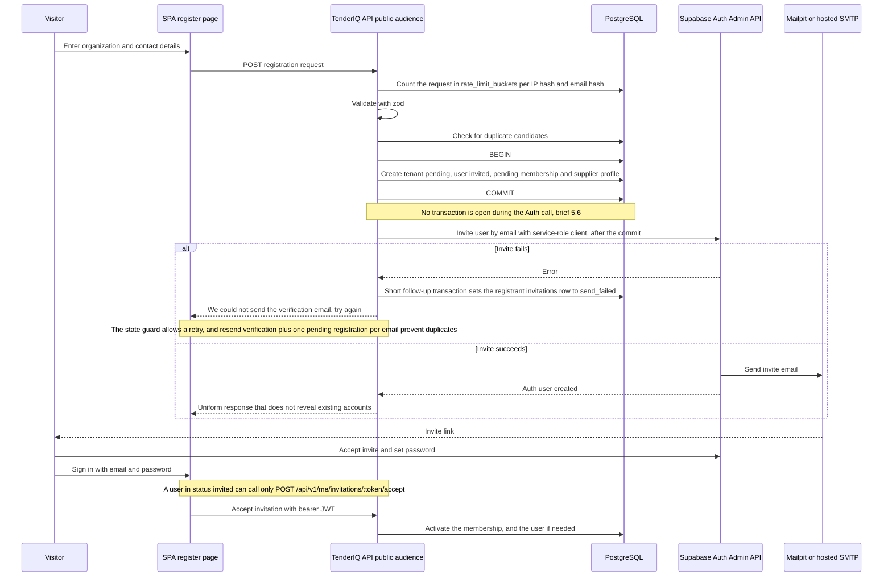

# ADR-0012: Supplier self-registration through app-provisioned accounts

Status: As-designed (pre-build). Updated to as-built at the end of Stage A and Stage B.

Sources:
- `docs/plan/architecture-plan.md`: §0 (Stage A signs in with real Supabase Auth), §3.1 API audiences (`/api/v1/public/*`), §3.11 prototype mode (local Supabase stack, supabase-js sign-in, forgot and reset password, invitation set-password), §4 URL map (`/register`, `/invite/:token`, `/signin`), §11.3 DECIDED (every email, including Supabase Auth invites and resets, goes to Mailpit locally; hosted provider deferred), §11.4 DECIDED ("Supplier self-registration via the API + Auth Admin invite (clarification; not a deviation)": the API validates, checks duplicates, rate-limits, creates the supplier org, user and membership in one transaction, and then asks Supabase Auth to send the verification or set-password email), §11.8 DECIDED (real Supabase Auth in local Docker from Stage A), §11.10 (MFA and step-up not in this release).
- `docs/plan/design-decisions.md`: DD-27 invitation acceptance and registration order, DD-28 public write endpoints (abuse), DD-29 sign-in assurance, DD-43 real authentication from Stage A (password-reset emails in Mailpit from Stage A; invite and registration emails from Stage B), DD-44 email channel (the same SMTP credentials serve Supabase Auth hosted), §E.4 email delivery (hosted provider deferred), §E.7 supplier self-registration (decided: proposed approach).
- `docs/plan/email-delivery-options.md`: §1 (Supabase Auth sends invitations, password resets and supplier registration verification; hosted Supabase needs a custom SMTP provider).
- `docs/architecture-brief.md`: §5.6 transactions (no network calls inside), §5.7 authentication (self-signup disabled, users provisioned through the Auth Admin API, generic sign-in errors, admin client with the service-role key), §7.3 `config.toml` (`enable_signup = false`, Mailpit, MFA disabled), §13 environments (keep self-signup disabled), §14 security checklist.
- `docs/plan/schema-blueprint.md`: Migration 01 (`tenants.status`, `is_provisional`, `created_by_tenant_id`, `verification_status`; `users.status`; `memberships.status`; `invitations`), Migration 05 (`supplier_profiles`, `supplier_membership_requests`, `duplicate_candidates`, `supplier_identity_changes`), Migration 13 (`rate_limit_buckets`).
- `docs/PRD.md`: §5.2 FR-02, §5.3 FR-03, COM-01, SUP-02, PUB-01, §17.2 defaults, BR-03, BR-44.

Contents:
1. [Status](#status)
2. [Context](#context)
3. [Decision](#decision)
4. [Consequences](#consequences)
5. [Alternatives considered](#alternatives-considered)
6. [References](#references)

---

## Status

- Status: Accepted (owner approval of the architecture plan, 2026-09-29)
- Date: 2026-09-29
- Deciders: product owner. Plan §11.4 first recorded this as an assumption that needed owner confirmation. At the owner review of 2026-09-29 the owner decided it: the proposed approach, which is brief-compliant, a clarification and not a deviation (plan §11.4, decision log §E.7). Plan §11.10 (MFA and step-up not in this release) was accepted at the same review. The plan and the design decision log await the owner's final approval (decision log §E.1).
- Affects: Stage A (`/register` screen and its contract, static mock response; supabase-js sign-in, password reset and invitation set-password against the local Supabase Auth) and Stage B (public registration endpoint, rate-limit middleware, `lib/supabase` admin client usage, identity domain, invitation acceptance route)

## Context

FR-02 requires three routes by which a supplier organization can come into existence:
- open registration;
- invitation-led registration;
- buyer-created provisional records.

The supplier journey starts on the public portal with "navigate to registration" (PUB-01), and SUP-02 covers "register, request membership, claim an invited organization". FR-02 also keeps contact verification, organization membership approval, identity verification and procurement qualification as separate decisions, and says a shared email domain or a similar name is not enough evidence to merge organizations (BR-03, BR-44).

The brief disables Supabase self-signup: `enable_signup = false` in `config.toml`, and it stays disabled in every hosted project. "Users are provisioned by administrators through the Auth Admin API." Sign-in errors return one generic message so the form cannot be used to discover accounts (brief §5.7, §7.3, §13). The Auth Admin API requires the service-role key, which is server-only (brief §8.1, §14).

So open registration must exist, but the browser cannot create an Auth account.

## Decision

1. **Registration is an application operation, not an Auth sign-up.** The SPA's `/register` page calls an API endpoint in the public audience (`/api/v1/public/*`, no auth and no tenant; [ADR-0001](0001-tenancy-equals-organization.md)). The request is validated with zod like any other input.
2. **The server provisions the account, application records first** (DD-27). In one transaction, the server creates the supplier `tenants` row (status `pending`), the `users` row (status `invited`), a pending membership and the supplier profile, and **commits**. **After the commit**, it calls the Auth Admin API invite with the server-side admin client (service-role key, `persistSession: false`). This is the brief-compliant order: brief §5.6 forbids network calls inside a transaction, so no transaction is open during the invite. If the invite fails, a short follow-up transaction sets the registrant’s `invitations` row to `send_failed`, a compensating state rather than a rollback. The state guard allows a retry, and the person sees "we could not send the verification email — try again". A "resend verification" action and the unique `users.email` constraint prevent duplicates. Abandoned pending registrations stay visible to operators in the supplier registration and duplicate review, where they can be closed. The person completes access through the Auth invite email and then signs in with email and password like any other user (plan §11.4, brief §5.7).
3. **Invited users can do one thing: accept.** `POST /api/v1/me/invitations/:token/accept` is the one route the auth middleware allows for a user in status `invited`. Accepting activates the membership, and the user if needed (DD-27).
4. **Public writes are rate-limited in the application.** An app middleware limits public POSTs (registration, register interest, access requests) per IP hash and per email hash. Counts are kept in `rate_limit_buckets` [G] (`key_hash`, `window_start`, `count`; primary key `(key_hash, window_start)`). There is no external service (DD-28).
5. **Auth email goes through SMTP, like the app's own email.** Supabase Auth invite, reset and registration emails go to Mailpit locally and to hosted SMTP in deployed environments (plan §11.3). In Stage A only password-reset emails reach Mailpit, because the demo accounts are created already confirmed and the mock API never calls the Auth Admin invite; invite and registration emails arrive from Stage B, when the real API calls it (DD-43). The same SMTP credentials will serve Supabase Auth and the app's `email` channel in hosted environments (DD-44). Business notices use the `in_app` and `email` channels ([ADR-0007](0007-in-app-formal-notices.md)). The earlier statement that "Auth email is the only email" and that business notices stay in-app is superseded by DD-44.
6. **Separate states stay separate** (FR-02, BR-03):
   - `users.status` starts at `invited`, and `tenants.status` starts at `pending` (DD-27);
   - `tenants.verification_status` (`unverified`, `contact_verified`, `identity_verified`) records verification independently of qualification;
   - possible duplicates become `duplicate_candidates` rows for review and are never merged automatically;
   - joining an existing supplier organization goes through `supplier_membership_requests` with an approval decision.
7. **The other two routes use the same provisioning path:**
   - invitation-led registration uses `invitations` [T] (hashed token, expiry, reissue history, and `role_ids` holding the tenant role ids to assign on acceptance; FR-03, DD-06) and the `/invite/:token` page;
   - a buyer-created provisional supplier is a `tenants` row with `kind = 'supplier'`, `is_provisional = true` and `created_by_tenant_id` set to the buyer. The suppliers domain writes it as a listed cross-domain write (DD-17).
8. **Sign-in is email and password, without MFA in this release.** MFA and step-up (PRD FR-03: "may be required as business policy") are not in the initial release, and the brief's configuration disables MFA. They are recorded as a later extension using Supabase MFA (DD-29, plan §11.10).
9. **Stage A uses real Supabase Auth with static data.** The `/register` screen calls its contract endpoint on the mock API and receives a contract-valid static response, and nothing is persisted (plan §0). Sign-in, forgot and reset password and invitation set-password use supabase-js against the local Supabase Auth in Docker from Stage A. The demo persona accounts are created already confirmed by `npm run auth:personas`, and only password-reset emails appear in Mailpit; the mock API persists nothing and never calls the Auth Admin invite, so invite and registration emails appear from Stage B (plan §3.11, DD-43). There is no mock auth adapter. In Stage B, `ui-live-api` completes the invitation set-password flow (`/invite/:token` from the Supabase invite link) against the real `/me/invitations` accept endpoint.

The following details were not fixed by the original sources and were left to Stage B:
- Resolved — DD-27: registration creates the tenant, the user, a pending membership and the supplier profile in one transaction; the membership is activated, and the user if needed, when the invitation is accepted.
- Resolved — DD-27: the initial `tenants.status` is `pending`.
- Resolved — DD-27: `users.status` becomes `active` on acceptance through `POST /api/v1/me/invitations/:token/accept`, which activates the user if needed.
- how the application `invitations` token and the Supabase Auth invite link relate.

## Consequences

Positive:
- Every account passes through application validation, duplicate-candidate review and audit. Auth users are created only by the server, after their application records are committed.
- No network call runs while a database transaction is open (brief §5.6). The registration commits before the Auth invite, and an invite failure leaves a recorded `send_failed` registration that the person can retry, instead of a lost registration (DD-27).
- The brief's authentication posture is unchanged: self-signup stays disabled, the service-role key stays on the server, sign-in errors stay generic, and MFA stays disabled (DD-29).
- One provisioning path serves open registration, invitations and administrator-created users, and the verification, membership and qualification states stay distinct (BR-03).
- A user whose invitation is not yet accepted can reach no business route, because the auth middleware admits an `invited` user only to the accept route (DD-27).
- Abuse of the public endpoints is limited without a new service or dependency (DD-28).

Negative:
- A public, unauthenticated endpoint triggers a privileged Auth Admin API call and sends email. It needs abuse controls.
  - Resolved — DD-28: `rate_limit_buckets` [G] and an app middleware limit public POSTs (registration, register interest, access requests) per IP hash and per email hash, with no external service.
- The Auth invite is a network call, and brief §5.6 keeps network calls out of database transactions. If one side succeeds and the other fails, the Auth user and the application records can disagree.
  - Resolved — DD-27: the brief-compliant after-commit order is used. The application rows are created in one transaction that commits, and the Auth Admin invite is called after the commit. If the invite fails, a short follow-up transaction sets the registrant’s `invitations` row to `send_failed`, the compensating state; there is no rollback. The state guard allows a retry, the person sees "we could not send the verification email — try again", and a "resend verification" action and the unique `users.email` constraint prevent duplicates.
- Application records can exist without a working Auth invite: a registration whose invite failed stays `send_failed`, and one that the person never completes stays pending. Abandoned pending registrations stay visible to operators in the supplier registration and duplicate review, where they can be closed (DD-27).
- Hosted environments depend on SMTP being configured for Supabase Auth. Without it, registration and password reset cannot complete. The hosted SMTP provider is an owner decision (decision log §E.4).
  - Partly resolved — DD-44: the SMTP path is decided, and the same SMTP credentials will serve Supabase Auth and the app's `email` channel. Still open (deferred): the hosted provider, needed before the first hosted environment (decision log §E.4; options in `docs/plan/email-delivery-options.md` §3).
- Responses must not reveal whether an email address or organization already exists. Brief §14 requires uniform error responses so that accounts cannot be discovered, and brief §5.7 applies the same rule to sign-in. The exact response shape is fixed in the Stage A contract for the registration endpoint.
- Customers whose policy requires MFA or step-up for certain actions cannot enforce it in this release (DD-29).

## Alternatives considered

| Alternative | Why it was not chosen |
|---|---|
| Enable Supabase self-signup | The brief requires it disabled in every environment (brief §5.7, §7.3, §13). Auth users would be created without application records, validation or duplicate review, and the sign-up endpoint would expose account existence. |
| Administrator-only provisioning (no open registration) | FR-02 requires open registration, and PUB-01 routes visitors to it. |
| Passwordless (magic-link or OTP) sign-in | The brief specifies email and password authentication (brief §1, §5.7). |
| External identity providers | All external providers are off in `config.toml` (brief §7.3). |
| An external rate-limiting service for the public endpoints | No external service is added. Rate limits are kept in `rate_limit_buckets` by an app middleware (DD-28). |

## References

- Architecture plan §0, §3.1, §3.11, §4, §11.3, §11.4, §11.8, §11.10.
- Design decision log DD-06, DD-17, DD-27, DD-28, DD-29, DD-43, DD-44, §E.4, §E.7.
- `docs/plan/email-delivery-options.md` §1.
- Stage B workflow (draft) task `ui-live-api`.
- Architecture brief §1, §5.6, §5.7, §7.3, §8.1, §13, §14.
- Schema blueprint Migrations 01, 05 and 13.
- PRD §5.2 FR-02, §5.3 FR-03, COM-01, SUP-02, PUB-01, BR-03, BR-44.
- Related documents: [Security model](../04-security-model.md), [Platform, identity and access data model](../03-data-model/01-platform-identity-access.md), [Suppliers and qualification data model](../03-data-model/04-suppliers-qualification.md), [Records, reporting and operations data model](../03-data-model/12-records-reporting-operations.md), [Key flows](../06-key-flows.md), [Deployment and environments](../10-deployment-environments.md).
- Related decisions: [ADR-0001](0001-tenancy-equals-organization.md), [ADR-0006](0006-contracts-first-ui-prototype-stage.md), [ADR-0007](0007-in-app-formal-notices.md).

## Amendments

- Amended 2026-10-30 by DD-50: for Stage A, decision item 9 and the Stage A part of item 5 no longer apply. Stage A uses no Supabase: sign-in is a persona picker with no passwords, the password-reset pages are removed, and no Auth email is sent. The `/register` and `/invite/:token` screens still call their contract endpoints on the in-browser mock API and receive static responses. Supabase Auth sign-in, password reset, invitation set-password and Auth email through SMTP (Mailpit locally) arrive in Stage B. The registration design of this record is unchanged.
