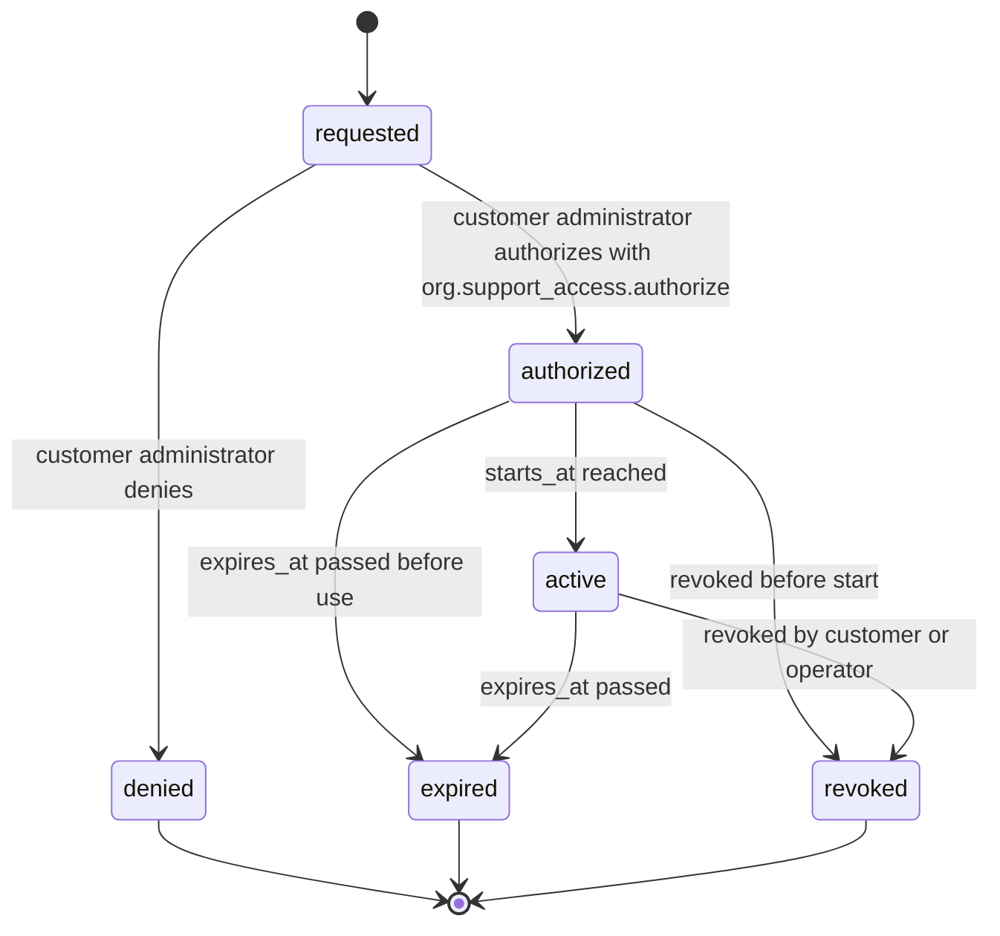
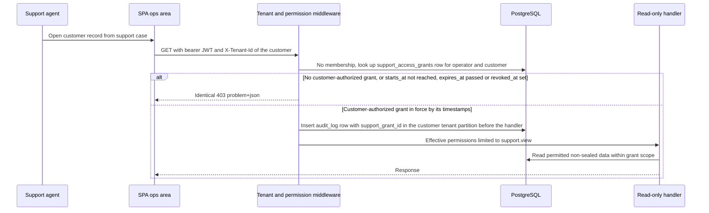

# ADR-0013: Operator access to customer tenants only through customer-authorized support access grants

Status: As-designed (pre-build). Updated to as-built at the end of Stage A and Stage B.

Sources:
- `docs/plan/architecture-plan.md`: §3.1 operator support access (OPS-04), §3.2 authorization model, §3.3 sealing, §3.9 (`expire-support-access` job, hourly at :10, operations domain), §6 domain map (16 operations: OPS-01 to OPS-07).
- `docs/plan/schema-blueprint.md`: Migration 01 (`audit_log.support_grant_id`, `audit_log.sensitivity`), Migration 13 (`support_cases`, `support_case_messages`, `support_access_grants`), §P (operator permissions; "`support.view` (granted only via support_access_grants)"; buyer permission `org.support_access.authorize`; role templates `platform_operator`, `support_agent`).
- `docs/plan/design-decisions.md`: DD-04 `customer_tenant_id` on [G] tables, DD-11 partition tenant of cross-tenant rows (support-access events), DD-18 grant expiry, DD-23 permission catalog additions (`org.support_access.authorize`).
- `docs/architecture-brief.md`: §5.1 step 7 ("Cross-tenant access by privileged internal users is audited *before* the handler runs"), §5.8, §8.3, §14 ("Audit privileged and admin actions and cross-tenant access").
- `docs/PRD.md`: §4.1 (platform operator or support agent: "no routine entitlement to confidential procurement content or sealed bids"), §4.2 support access principle, §4.3, §21.2, COM-09, OPS-04, OPS-06, AC-15.
- `docs/plan/demo-storyline.md`: operator personas `ops.admin`, `support.agent`; two support cases, one with an authorized time-limited grant.

Contents:
1. [Status](#status)
2. [Context](#context)
3. [Decision](#decision)
4. [Consequences](#consequences)
5. [Alternatives considered](#alternatives-considered)
6. [References](#references)

---

## Status

- Status: Accepted (owner approval of the architecture plan, 2026-09-29)
- Date: 2026-09-29
- Deciders: product owner (approval of `docs/plan/architecture-plan.md` and `docs/plan/design-decisions.md` is pending)
- Affects: Stage A (OPS-04 screens, fixtures with one authorized grant, mock tenant middleware) and Stage B (tenant middleware, permission resolution, `domains/operations`, `expire-support-access` job, audit)

## Context

The platform operator runs customer onboarding, support cases, incidents and help content (PRD §21.2). Support staff sometimes need to see what a customer sees in order to help. The PRD limits this tightly:
- PRD §4.2: "Support access to unsealed customer content requires a documented business need, permitted customer authorization, limited duration, and an audit record. Support cannot submit, score, approve, or sign on behalf of a customer."
- PRD §4.1: operators have "no routine entitlement to confidential procurement content or sealed bids".
- OPS-04: "assist within the grant, end access, and preserve support activity history; no business impersonation".
- AC-15: a support agent attempting to inspect a sealed bid gets no early access.

Under [ADR-0001](0001-tenancy-equals-organization.md), the operator is its own tenant. Normally the tenant middleware admits a user into a tenant only through an active membership (brief §5.1).

## Decision

1. **Entry requires an active, customer-authorized grant.** An operator user may act inside a customer tenant only while an active `support_access_grants` [G] row exists for that operator, that customer tenant and a support case (plan §3.1). The row records:
   - `case_id` (`support_cases`), `customer_tenant_id` and `operator_user_id`;
   - `authorized_by_user_id`, the customer administrator who authorized it. A buyer administrator authorizes a grant with permission `org.support_access.authorize` (DD-23);
   - `business_need`, `scope` (`metadata_only`, `specific_records`) and `record_refs`;
   - `starts_at`, `expires_at` and `revoked_at`;
   - `status` (`requested`, `authorized`, `active`, `expired`, `revoked`, `denied`).

   Like every [G] table that names a customer, the table uses `customer_tenant_id`, so the tenant-scoped table generator never picks it up (DD-04).
2. **Access is read-only and narrow.** While a grant is active, the operator's effective permission set in the customer tenant is `support.view`. That permission is granted only through support access grants (blueprint §P). Support access never includes sealed content, drafts or scores, and never allows submit, score, approve or sign (plan §3.1, PRD §4.2). Sealing is enforced independently by the sealing module ([ADR-0003](0003-application-layer-sealing.md)).
3. **Audit comes first, in the customer's tenant.** The access is recorded in `audit_log`, with `support_grant_id` set, before the handler runs (brief §5.1, plan §3.1). Support-access events are written to the customer tenant's partition, so the customer can review them (DD-11).
4. **The request-time check decides access; the expiry job only tidies up** (DD-18). Every request compares `starts_at`, `expires_at` and `revoked_at` directly. The `expire-support-access` job (`10 * * * *`, operations domain) updates the display status of expired grants, sends notices and audits (plan §3.9). It replaces the single `expire-grants` job of the earlier plan, which DD-18 split into jobs owned by each table's owner.
5. **Stage A demonstrates it with fixtures.** The demo includes two support cases, one of them with an authorized, time-limited grant.

The following details were not fixed by the original sources and were left to Stage B:
- the grant legality matrix (the status list is fixed; the transition diagram below is a reading of it);
- how each read endpoint declares that `support.view` is sufficient, and which route prefix an operator uses while inside a customer tenant (the tenant middleware matches tenant kind to route prefix);
- Resolved — DD-11: the support-access record goes to the `audit_log` partition of the customer tenant, so the customer can review it;
- how the `specific_records` scope is enforced against `record_refs`;
- Resolved — DD-23: a customer grant is authorized with the buyer permission `org.support_access.authorize`.

Resolved — DD-18: the request-time check always compares `starts_at`, `expires_at` and `revoked_at` directly, and the expiry job only updates display statuses and sends notices. (The earlier text required the request-time check not to rely on the hourly sweep, which could lag by up to an hour, and left the exact predicate to Stage B.)

Expiry at request time follows the timestamps, not the `status` column. The `expire-support-access` job moves the displayed status to `expired` afterward (DD-18).

## Consequences

Positive:
- Support can see what the customer sees, with the customer's explicit, time-limited consent and a documented business need (PRD §4.2).
- Every support access is audited with its grant reference before any data is returned, so what was accessed, and under which grant, can be reconstructed. The customer can review those records in its own tenant (DD-11).
- Operators have no standing access to customer content. Administrative status, including operator status, never opens sealed bids (AC-15).
- There is no impersonation. The operator acts as themself, under `support.view`, so audit records show the true actor.
- A lagging or failed expiry job cannot extend access, because access follows the timestamps at request time (DD-18).

Negative:
- There is a second path into a tenant besides membership. The tenant middleware and permission resolution must handle it, and the per-endpoint tenant-isolation tests (plan §8) must cover it.
- Deciding which endpoints `support.view` may use, and enforcing `metadata_only` versus `specific_records`, is per-endpoint work across many domains.
- Expiry has two mechanisms. The request-time check decides access, and the `expire-support-access` sweep keeps the displayed status and notices up to date. Between an expiry and the next sweep, the displayed status can still say `active` although access has already ended (DD-18).
- The design governs in-application access only. People who hold production database credentials are controlled operationally (Doppler as the secret source, required reviewers on the Production GitHub environment; brief §8.3).

## Alternatives considered

| Alternative | Why it was not chosen |
|---|---|
| Impersonating a customer user ("sign in as") | OPS-04 forbids business impersonation. Audit would show the customer user instead of the operator, and impersonation would carry the user's submit, approve and sign rights. |
| A standing operator role in every customer tenant | Contradicts PRD §4.1 (no routine entitlement) and §4.2 (customer authorization and limited duration). |
| Operator access through database tools instead of the application | Bypasses the permission model, the sealing module and `audit_log`. |
| Grants without expiry, revoked manually | PRD §4.2 requires limited duration. Forgotten grants would become standing access. |
| Relying on the expiry job to end access | The job runs hourly, so access could outlive `expires_at` by up to an hour. Request-time checks compare the timestamps directly instead (DD-18). |

## References

- Architecture plan §3.1, §3.2, §3.3, §3.9, §6.
- Schema blueprint Migrations 01 and 13, §P.
- Design decision log DD-04, DD-11, DD-18, DD-23.
- Architecture brief §5.1, §5.8, §8.3, §14.
- PRD §4.1, §4.2, §4.3, §21.2, COM-09, OPS-04, OPS-06, AC-15.
- Demo storyline: records and operations.
- Related documents: [Security model](../04-security-model.md), [Records, reporting and operations data model](../03-data-model/12-records-reporting-operations.md), [Background jobs](../08-background-jobs.md), [Lifecycles](../05-lifecycles.md).
- Related decisions: [ADR-0001](0001-tenancy-equals-organization.md), [ADR-0003](0003-application-layer-sealing.md), [ADR-0008](0008-partition-only-high-volume-tables.md).
