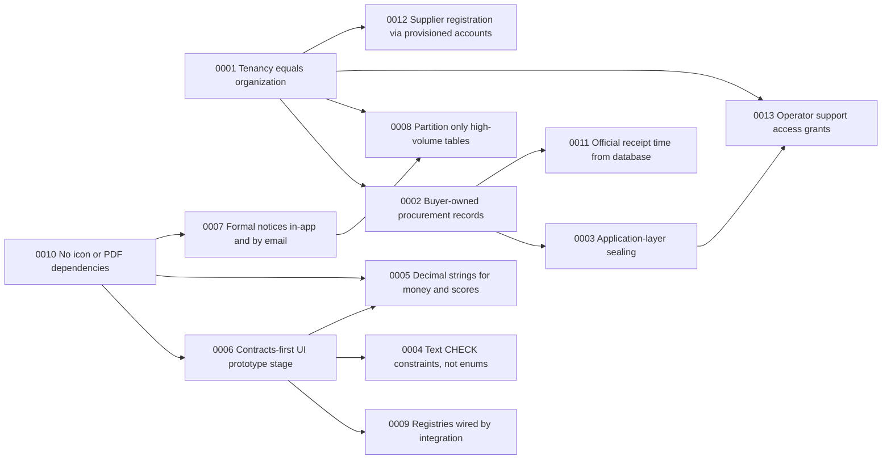

# Architecture Decision Records

Status: As-designed (pre-build). Updated to as-built at the end of Stage A and Stage B.

Sources:
- `docs/plan/architecture-plan.md` (revision 3): §0 delivery stages (real Supabase Auth in Stage A), §3 key architectural decisions (§3.8 `in_app` and `email` channels, §3.11 prototype mode), §4 repository layout and registries, §11 deviations from the brief and assumptions (owner review of 2026-09-29: every item ACCEPTED or DECIDED; final approval pending), "Other owner answers", §12 resilience.
- `docs/plan/schema-blueprint.md`: §0 conventions, Migrations 01, 04, 09, 10, 13, 14, §P.
- `docs/plan/design-decisions.md`: DD-01 to DD-46 (the decision log that amends the plan and the blueprint and wins on conflict; DD-38 is WITHDRAWN and superseded by DD-43), §D2 owner decisions recorded as design decisions (DD-43 real authentication from Stage A, DD-44 email channel, DD-45 Node 24), §E owner decisions (status after the owner review of 2026-09-29).
- `docs/plan/email-delivery-options.md`: status (local development decided, hosted provider deferred), §4 options considered.
- `docs/architecture-brief.md`: §1, §4.3, §5, §6, §9, §14.
- `docs/PRD.md`: §2.1, §4, §7.9, §7.10, §9, §14, §16, BR-02, BR-17, BR-41, BR-42, BR-43.

Contents:
1. [Purpose and format](#purpose-and-format)
2. [Decision index](#decision-index)
3. [How the decisions relate](#how-the-decisions-relate)
4. [How the design decision log refines the records](#how-the-design-decision-log-refines-the-records)
5. [Decisions that need explicit owner confirmation](#decisions-that-need-explicit-owner-confirmation)
6. [Lifecycle of a record](#lifecycle-of-a-record)
7. [Related documents](#related-documents)

---

## Purpose and format

Each record captures one architectural decision behind the approved TenderIQ design. It covers the forces that made the decision necessary, what was decided, what it costs, and what was rejected. The records follow the MADR layout:

| Section | Content |
|---|---|
| Status | Decision status (`Proposed`, `Accepted`, `Superseded by ADR-NNNN`, `Deprecated`), date, deciders, and the stages it affects |
| Context | The requirements and constraints, cited to the PRD, the brief, the plan, the blueprint and the design decision log |
| Decision | What is built, with table, column, module and job names exactly as the sources give them |
| Consequences | Positive and negative effects, including details the sources leave open ("finalized in Stage A" or "finalized in Stage B"). A detail the design decision log or the owner review of 2026-09-29 has since settled stays in place, marked "Resolved — DD-xx: …" or "Resolved — owner decision 2026-09-29: …", so the history of the open point remains traceable. |
| Alternatives considered | Options that were rejected, and why |
| References | Source sections, related technical documents, related decisions |

Every record is **Accepted**: the owner approved the architecture plan, its §11 deviations and the design decision log on 2026-09-29. From now on, a changed decision gets a new record that supersedes the old one, and accepted records are not rewritten in place.

## Decision index

| ADR | Title | Status | Date | Stages affected | Primary sources |
|---|---|---|---|---|---|
| [0001](0001-tenancy-equals-organization.md) | Tenancy equals organization | Accepted | 2026-09-29 | A, B | Plan §3.1; blueprint Migration 01; brief §5.1, §5.6, §6.2; PRD §2.1, BR-02, AC-02; DD-04, DD-10, DD-21, DD-22, DD-26, DD-27, DD-36 |
| [0002](0002-buyer-owned-procurement-records.md) | Buyer-owned procurement records | Accepted | 2026-09-29 | A, B | Plan §3.1, §4; blueprint §0 [S] and [R] tags; brief §5.6; PRD §2.1, §4.3; DD-03, DD-11, DD-12, DD-16, DD-17, DD-41 |
| [0003](0003-application-layer-sealing.md) | Application-layer sealing instead of row-level security | Accepted | 2026-09-29 | A, B | Plan §3.3, §8; blueprint Migrations 09, 10, 14; brief §1, §6.3; PRD BR-17, AC-15, AC-16; DD-05, DD-13, DD-16, DD-23, DD-25, DD-31 |
| [0004](0004-text-check-constraints-not-enums.md) | Text columns with CHECK constraints instead of PostgreSQL enum types | Accepted | 2026-09-29 | A, B | Blueprint §0; plan §3.6, §8; brief §6.1; DD-06, DD-14, DD-40 |
| [0005](0005-decimal-strings-for-money-and-scores.md) | Decimal strings for money, quantities, rates and scores | Accepted | 2026-09-29 | A, B | Plan §3.7; blueprint §0; brief §5.6; PRD §3, §9, AC-18, AC-19; DD-08, DD-24, DD-32 |
| [0006](0006-contracts-first-ui-prototype-stage.md) | Contracts-first UI prototype stage before the backend | Accepted | 2026-09-29 | A, B | Plan §0, §3.10, §3.11, §11.1, §11.8; DD-21, DD-22, DD-32, DD-37, DD-39, DD-40, DD-43 (DD-38 withdrawn) |
| [0007](0007-in-app-formal-notices.md) | Formal notices delivered in-app and by email, with full delivery and acknowledgment tracking | Accepted | 2026-09-29 | A, B | Plan §3.8, §3.9, §11.2, §11.3; blueprint Migration 04; email-delivery-options; PRD §14, §16, BR-41, BR-42, BR-43; DD-02, DD-11, DD-19, DD-23, DD-42, DD-43, DD-44 |
| [0008](0008-partition-only-high-volume-tables.md) | Partition only the two high-volume tables | Accepted | 2026-09-29 | B | Blueprint §0, Migration 01; brief §6.2; DD-01, DD-11 |
| [0009](0009-registries-wired-by-integration.md) | Registries are wired only by the Integration step | Accepted | 2026-09-29 | A, B | Plan §3.9, §4, §5, §12; brief §5.2, §9.4, §9.5; DD-06, DD-16, DD-18, DD-19, DD-37 |
| [0010](0010-no-icon-or-pdf-dependencies.md) | No icon library and no PDF generation dependency | Accepted | 2026-09-29 | A, B | Plan §7, §11.2, §11.3, §11.9; brief §4.3, §14; blueprint Migration 13; DD-16, DD-30, DD-35, DD-44 |
| [0011](0011-official-receipt-time-from-database.md) | Official receipt time comes from the database clock inside the submission transaction | Accepted | 2026-09-29 | B (rendering in A) | Plan §3.4; blueprint Migration 09; PRD FR-12, BR-18 to BR-20, AC-12, AC-13; DD-01, DD-02, DD-09, DD-15, DD-33, DD-39, DD-42 |
| [0012](0012-supplier-registration-via-provisioned-accounts.md) | Supplier self-registration through app-provisioned accounts | Accepted | 2026-09-29 | A, B | Plan §3.11, §11.3, §11.4, §11.8, §11.10; brief §5.7, §7.3; PRD FR-02; DD-27, DD-28, DD-29, DD-43, DD-44 |
| [0013](0013-operator-support-access-grants.md) | Operator access to customer tenants only through customer-authorized support access grants | Accepted | 2026-09-29 | A, B | Plan §3.1, §3.9; blueprint Migration 13, §P; brief §5.1; PRD §4.2, OPS-04, AC-15; DD-04, DD-11, DD-18, DD-23 |

## How the decisions relate

An arrow means "builds on or constrains".

ADR-0010 constrains ADR-0005 and ADR-0006 through the shared rule that no runtime dependencies are added beyond the brief's list. That rule is why decimal arithmetic is written in-house, why OpenAPI is generated with zod's built-in `z.toJSONSchema()`, and why the fonts are self-hosted files rather than a package or an external font request (DD-35). ADR-0010 also constrains ADR-0007: the owner approved exactly one exception, `nodemailer` for the SMTP `email` channel (plan §11.3, DD-44). The link from ADR-0006 to ADR-0005 is now also physical: the decimal helper lives in the pure contracts module, `src/contracts/decimal.ts`, so the SPA and the server share it (DD-32).

## How the design decision log refines the records

`docs/plan/design-decisions.md` (DD-01 to DD-46) resolves the structural open points raised while this documentation was written. It is binding for both stages, and where it differs from the plan or the blueprint, the log wins (both were amended to match). DD-01 to DD-42 settle details the records left open, or tighten a mechanism a record describes. DD-43 to DD-45 record the owner decisions of 2026-09-29 (log §D2), and two of them change a recorded decision:
- DD-43 replaces the mock-auth adapter of ADR-0006 with real Supabase Auth in local Docker from Stage A, and withdraws DD-38 (`VITE_AUTH_MODE`).
- DD-44 extends ADR-0007 from in-app delivery only to an `in_app` and an `email` channel (SMTP with `nodemailer`, Mailpit locally, hosted provider deferred), and makes `nodemailer` the single exception to the dependency rule of ADR-0010.

Before acceptance on 2026-09-29, the records were amended in place ([Lifecycle of a record](#lifecycle-of-a-record)), so no record is superseded. ADR-0007 keeps its filename so that links stay valid, and its title now reads "Formal notices delivered in-app and by email".

| ADR | Log entries that refine it | What changes in the record |
|---|---|---|
| [0001](0001-tenancy-equals-organization.md) | DD-04, DD-10, DD-21, DD-22, DD-26, DD-27, DD-36 | [G] tables that name a customer use `customer_tenant_id`; `tenants` is authoritative for time zone, languages and default currency; `/me/*` lists the caller's own rows across all active memberships; public URLs carry the buyer slug; role scope matching; invited users reach only the invitation accept route; the active tenant is remembered per user and re-validated |
| [0002](0002-buyer-owned-procurement-records.md) | DD-03, DD-11, DD-12, DD-16, DD-17, DD-41 | [S] means supplier-accessible and [R] means reference only; `forSupplier` reaches only [S] tables; audit partition and storage key of cross-tenant records; shared table owners; additional cross-domain writes; buyer-visible bid intent changes only on an explicit action |
| [0003](0003-application-layer-sealing.md) | DD-05, DD-13, DD-16, DD-23, DD-25, DD-31 | Envelope of every sealed table; single-stage opening writes one unseal row per envelope; exact `v_bid_receipt_metadata` shape; price gate owned by evaluation and released with `evaluation.chair`; conflict dispositions that permit access; no sealed content in audit rows |
| [0004](0004-text-check-constraints-not-enums.md) | DD-06, DD-14, DD-40 | Missing CHECK lists added; approval subject types widened; `framework_calloff` stays in CHECK lists but not in write enums |
| [0005](0005-decimal-strings-for-money-and-scores.md) | DD-08, DD-24, DD-32 | Every money column has a currency; cross-currency authority uses `exchange_rates`; the decimal helper moves to `src/contracts/decimal.ts` |
| [0006](0006-contracts-first-ui-prototype-stage.md) | DD-21, DD-22, DD-32, DD-37, DD-39, DD-40, DD-43 (DD-38 withdrawn) | Contract-level rules fixed before Stage A: `/me` aggregation, buyer slug, shared decimal helper, `t()` catalogs, `Idempotency-Key`, deferred procedure value. Authentication is real Supabase Auth in local Docker from Stage A: the mock API verifies real JWTs with `src/server/lib/auth/verify.ts`, `npm run auth:personas` creates the demo accounts, and a dev-only demo-accounts quick-pick replaces the persona switcher. The earlier `VITE_AUTH_MODE` with a dynamic-import mock adapter (DD-38) is withdrawn. |
| [0007](0007-in-app-formal-notices.md) | DD-02, DD-11, DD-19, DD-23, DD-42, DD-43, DD-44 | `notice-reconciliation` and `notification-digests` jobs; notification partition is the recipient's tenant; acknowledgment authority and permission; an `email` channel next to `in_app` (SMTP with `nodemailer`, Mailpit locally, title, official deadline and link only, `EMAIL_ENABLED` and `SMTP_*` configuration, hosted provider deferred) |
| [0008](0008-partition-only-high-volume-tables.md) | DD-01, DD-11 | No foreign keys from `audit_log`; which tenant partition receives a cross-tenant row |
| [0009](0009-registries-wired-by-integration.md) | DD-06, DD-16, DD-18, DD-19, DD-37 | `documents/export-registry.ts`; the amended cron job list; per-feature i18n catalogs merged by glob |
| [0010](0010-no-icon-or-pdf-dependencies.md) | DD-16, DD-30, DD-35, DD-44 | Exports owned by the documents service; self-hosted fonts; CSP meta tag; `nodemailer` as the single approved runtime dependency exception |
| [0011](0011-official-receipt-time-from-database.md) | DD-01, DD-02, DD-09, DD-15, DD-33, DD-39, DD-42 | Deadline authority and addendum serialization; zone display; receipt year; deferrable receipt cycle; retried submissions still record attempts |
| [0012](0012-supplier-registration-via-provisioned-accounts.md) | DD-27, DD-28, DD-29, DD-43, DD-44 | Registration order (invite after commit, send_failed retry); invitation acceptance route; rate limiting of public POSTs; MFA deferred; Supabase Auth password-reset emails in Mailpit from Stage A, invite and registration emails from Stage B; the same SMTP credentials will serve Supabase Auth and the `email` channel hosted |
| [0013](0013-operator-support-access-grants.md) | DD-04, DD-11, DD-18, DD-23 | `expire-support-access` job; request-time checks decide access; audit rows in the customer tenant; `org.support_access.authorize` |

The other entries, DD-07 (additional unique keys), DD-20 (expiry semantics) and DD-34 (CSS port), refine the data model, background jobs and frontend documents but no recorded decision. DD-45 (Node 24 everywhere, a deviation from the brief's Node 22 pin) is a delivery setting, covered in [Deployment and environments](../10-deployment-environments.md).

## Decisions that need explicit owner confirmation

Architecture plan §11 lists deviations from the brief and assumptions that the owner must confirm. Decision log §E.1 adds the log itself: the owner approves the plan, its §11 deviations and the log together, and the ADRs then move to Accepted. At the owner review of 2026-09-29 every §11 item was accepted or decided (plan §11, decision log §E). What remains is the owner's final approval after the consistency re-verification (§E.1). The §11 items that are recorded in ADRs:

| Plan §11 item | Status after the owner review of 2026-09-29 | ADR |
|---|---|---|
| 1. `src/contracts/` and `src/mock-api/` as new top-level source folders | Accepted | [ADR-0006](0006-contracts-first-ui-prototype-stage.md) |
| 2. No new runtime dependencies. Icons are hand-rolled SVG. PDFs are print-styled HTML plus XLSX/CSV. | Accepted, with the single exception `nodemailer` from item 3 (DD-44) | [ADR-0010](0010-no-icon-or-pdf-dependencies.md) |
| 3. Email delivery: formal notices are in-app with full tracking | Resolved — DD-44: an SMTP `email` channel with `nodemailer` next to `in_app`, Mailpit locally for all mail; the hosted provider is deferred (decision log §E.4) | [ADR-0007](0007-in-app-formal-notices.md) |
| 4. Supplier self-registration through app-provisioned accounts | Resolved — owner decision 2026-09-29: the proposed approach (the API plus the Auth Admin invite; a clarification, not a deviation; decision log §E.7) | [ADR-0012](0012-supplier-registration-via-provisioned-accounts.md) |
| 8. `VITE_AUTH_MODE` (`mock` or `supabase`) as an additional browser-safe build variable (DD-38) | Resolved — DD-43: real Supabase Auth in local Docker from Stage A (option b). DD-38 is withdrawn, and there is no `VITE_AUTH_MODE`, mock auth adapter or persona switcher (decision log §E.6). | [ADR-0006](0006-contracts-first-ui-prototype-stage.md) |
| 9. Fonts self-hosted, with no external font request (DD-35); CSP meta tag on the SPA document (DD-30) | Accepted | [ADR-0010](0010-no-icon-or-pdf-dependencies.md) |
| 10. Not in this release: MFA and step-up sign-in (DD-29) | Accepted | [ADR-0012](0012-supplier-registration-via-provisioned-accounts.md) |

The remaining §11 items are not architecture decisions:
- Items 5 to 7 are delivery settings, covered in [Deployment and environments](../10-deployment-environments.md) and [Delivery and resilience](../13-delivery-and-resilience.md):
  - item 5, Doppler, GitHub and Vercel as files and runbooks only: accepted;
  - item 6, the Node engines range: Resolved — DD-45: Node 24 everywhere (`engines` `24.x`, `.nvmrc` 24, CI Node 24, Vercel Node.js 24.x), a deviation from the brief's Node 22 pin (decision log §E.5);
  - item 7, the git branch and checkpoint policy: accepted, with checkpoints local only and no remote.
- The second half of item 10 (English only, with UI strings catalogued per feature so languages can be added later, DD-37) is a scope statement covered in [Frontend](../09-frontend.md). The CSP meta tag is covered in [Security model](../04-security-model.md).

The other owner decisions in decision log §E are not architecture decisions either. They are indexed in the [technical documentation index](../README.md#63-owner-decisions):
- Resolved — owner decision 2026-09-29: the Stage A prototype is hosted locally only (§E.2); the build branch has no off-machine backup, and checkpoints stay local only (§E.3); prototype actions do not persist, and walkthrough screenshots are committed (§E.8).
- Still open: the hosted email provider, deferred until the first hosted environment (§E.4); the owner's final approval of the plan and the log (§E.1); and the "Stage A approved" gate, due after the prototype is delivered (§E.9).

## Lifecycle of a record

- A record is **Proposed** until the owner approves the architecture plan, its §11 deviations and the design decision log (decision log §E.1), then **Accepted**.
- While a record is Proposed, it is amended in place when the plan, the blueprint or the decision log changes. Settled open details are kept and marked "Resolved — DD-xx: …" (or "Resolved — owner decision 2026-09-29: …"). DD-43 and DD-44 changed ADR-0006 and ADR-0007 this way.
- An accepted record is not rewritten to change the decision. A later decision that changes it is a new record, and the old one is marked **Superseded by ADR-NNNN**.
- At the end of Stage A and Stage B, the `docs-sync` step (plan §5) updates the document status line from as-designed to as-built. It also resolves the remaining "finalized in Stage A/B" notes against the code as built.
- A Stage B contract change needs a recorded reason and a matching UI update (plan §0). When the change alters a decision recorded here, the reason is recorded as a new ADR.

## Related documents

- [Technical documentation index](../README.md)
- [System context](../01-system-context.md), [Architecture](../02-architecture.md), [Security model](../04-security-model.md)
- [Data model overview](../03-data-model/README.md)
- [API](../07-api.md), [Background jobs](../08-background-jobs.md), [Frontend](../09-frontend.md)
- [Testing strategy](../11-testing-strategy.md), [Traceability](../12-traceability.md), [Delivery and resilience](../13-delivery-and-resilience.md)
- [Glossary](../glossary.md)
